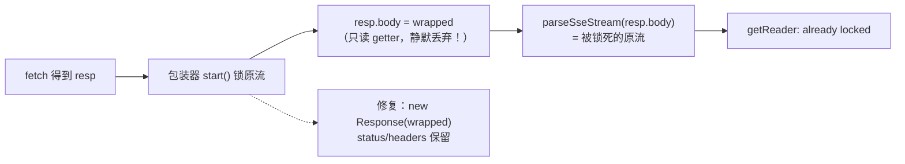

# HANDOVER-R66 — 总交接报告（真机反馈四轮闭环 + 全库优化调研）

> 日期：2026-11-10。接续 `HANDOVER-R61.md`。本文**自包含**，接手者无需阅读历史对话。
> 项目：Harbor / GLM-Chat v1.9.0。生产链 = **Electron 主进程 + server/ Node 服务 + 单文件 `harbor.html`**。
> 汇总轮次：**R61（已提交）→ R62 → R63 → R64 → R65（未提交）**。

---

## 0. 一眼总览

| 维度 | 当前状态 |
|---|---|
| 仓库 | 分支工作区干净程度见 §1.1；最近提交 `67b25a9`（R64）；**R65 改动未提交** |
| 全量回归 | **2060 passed / 0 failed / 3 skipped**（`pytest tests/ -q`，实测 415s） |
| 契约基线 | 最新 `contract-baseline-r65.json`（117 模块 / 1318 符号），零漂移 |
| UI 契约 | PASS（40 DOM id / 13 onclick / 43 callApi / 39 类 / 21 变量） |
| 依赖棘轮 | **157 条**冻结前向边（R62 修正基线），`--check` 通过 |
| server 冷启动 | **516ms**（R64 实施懒化前为 1245ms，-59%） |
| 安装包 | `dist-electron/Harbor-Setup-1.9.0.exe`（R63 产物，sha256 `130c3024…`）；R65 改动需重打 |
| 版本 | `VERSION=1.9.0`；`API_VERSION='v1.0.0'`（契约，不可动） |
| 真机 | R61-R63 修复**待用户真机复验**；R64/R65 为无 UI 变更的工程轮 |

**一句话现状**：四轮真机反馈（群聊协作五问题、本地模型、群文件、专家生效链）已全部修复并验证；
全库模块优化调研完成并落地了最大的一项（server 冷启动）；死面清理批次因触及测试域而**整体回退**，
教训已入档。当前代码库处于**全绿可交付**状态。

---

## 1. 工作区状态（接手第一步）

### 1.1 未提交清单（`git status --short`）

```
M  deliverables/dev-plan/module-optimization-r64.md   # §五 重写为回退记录+教训
M  frontend/src/shell/onboarding.js                   # obTestKey const key 遮蔽修复
M  harbor.html                                         # 构建产物（随源码）
M  tools/lib/js-lexer.mjs                              # +stripCodeMap（骨架↔raw 映射）
?? deliverables/dev-plan/HANDOVER-R65.md               # R65 轮交接
?? deliverables/dev-plan/HANDOVER-R66.md               # 本报告
?? deliverables/dev-plan/contract-baseline-r65.json    # 契约锚点
```

> 关键：`harbor.html` 是被 git 跟踪的**构建产物**，必须与 `frontend/src` 一起提交，否则接手者
> checkout 后源码与产物不一致，`check_contract.py` / `contract_diff` 立刻漂移。

### 1.2 相关文档索引

| 文档 | 内容 |
|---|---|
| `HANDOVER-R61.md` | 中文路径编码 / 项目空间重做 / 本地 CORS 代理落地 / 默认中文 / 缺陷排查 7 项 |
| `HANDOVER-R62.md` | 群聊五问题（接力顺序/群文件写链/工作目录+熔断/弹窗重设计/专家生效链） |
| `HANDOVER-R63.md` | 本地模型流双锁 / 群文件配置族 / 中止优雅化 / 实时气泡 |
| `HANDOVER-R64.md` | 全库模块优化调研 + server 冷启动懒化 |
| `HANDOVER-R65.md` | 全量优化批次执行轮（1 落地 / 1 回退 / 教训） |
| **`module-optimization-r64.md`** | **全库架构数据 + 六图 + 分级立项（继续优化的唯一依据）** |
| **`architecture-r63.md`** | 系统架构六图 + Agent 重设计三原则（待拍板立项） |
| `HANDOVER-R66.md` | 本报告 |

---

## 2. 四轮修复总表（R61→R65）

### 2.1 用户真机反馈 → 根因 → 修复

| # | 轮 | 用户反馈 | 根因（已实证） | 修复 |
|---|---|---|---|---|
| 1 | R61 | Failed to fetch（云端全挂） | Node 迁移只留 `get_local_proxy` 响应形状，**监听器从未实现** → 回落直连被 Clash 拦 | 新增 `local-proxy.js` 受控回环转发器（白名单/CORS/PNA/单飞） |
| 2 | R61 | 中文路径乱码 | PS 5.1 stdout 走 GBK，Node 按 UTF-8 解 | `ps()` UTF-8 前导 + base64 通道 |
| 3 | R62 | 群聊接力顺序错乱 | `groupNextMember` 自由路由（正文最后一个 @ 定下棒） | **名册顺序确定性接力**，链尾交还群主 |
| 4 | R62 | 群文件永远空 | `group_files_write/read` 从未注册 Node 桥（R57 只移植读侧 4 方法） | pybridge 补移植 + 目录哈希对齐 Python |
| 5 | R62 | 成员工具反复失败刷屏 | 群会话无工作区 → 一切路径越界 → 模型不知情重试 | 工作目录绑定 + 上下文预告知 + 同错误熔断 |
| 6 | R62 | 协作弹窗简陋 | 行距挤 + `.gw-mate-row{flex}` 压过 `[hidden]` + 首开无 `.show` | gw-* CSS 重写 + 三个缺陷顺修 |
| 7 | R62 | 专家启用不生效 | 空会话 pick 挂 `''` 键，ensureSession 后查空 | 键迁移 + 会话先建 + 显式报错 |
| 8 | R63 | 本地模型报错云端正常 | `resp.body = 包装流` 对**只读 getter** 赋值静默失败 → 原流已被包装器锁死 | `new Response(包装流)` 重建 |
| 9 | R63 | 群文件「保存目录」→ `[object Object]` | `group_files_config_get/set` 又缺注册 | 补移植 + 系统目录校验 + 错误人话化（4 处） |
| 10 | R63 | `signal is aborted without reason` | 暂停 `abort()` 无原因，原文直出 | abort 带原因 + 中止分类 + 保留部分正文 |
| 11 | R63 | 交接文档不全 | 归档只存【交接文档】小节，正文全丢 | 归档**完整发言** |
| 12 | R63 | 看不到成员在输出什么 | 工作态气泡只有字数 | 气泡可点 → **实时详情页**（流式正文+工具动态） |

### 2.2 工程轮

| 轮 | 内容 |
|---|---|
| R62 | 依赖棘轮扫描器重写（内含引号的正则吞代码区，88→157 修正基线） |
| R64 | 全库盘点器 + 调研报告；**server 冷启动懒化 1245→516ms**（better-auth 占 60%） |
| R65 | onboarding `const key` 遮蔽修复；js-lexer 增 `stripCodeMap`；死面批次回退并记录教训 |

---

## 3. 各轮核心设计与权衡

### 3.1 群聊接力 = 名册顺序（R62）
- 主持人 → 名册第一位非主持成员 → 依次传递 → 末位「接力完成」+ `turn` 复位主持人。
- `@群主` / `交接给: 群主` 是成员侧**唯一**暂停出口（要人类拍板）。
- 群主显式 @ 的 `mentionQueue` 优先级更高（点名顺序=发言顺序），队列耗尽后落回名册接力。
- 取舍：成员互相 @ 讨论能力让位于确定性（用户明确要求顺序）。

### 3.2 本地模型流（R63，最隐蔽的一个）

仅 `local=true` 走包装器 → 云端无恙；R22 起长期存在，vm + 桩 fetch 可确定性复现
（`tests/test_r63_frontend_fixes.py`）。

### 3.3 群文件三族补移植（R62/R63）
R57 只移植了读侧 4 方法，写/读/配置族全缺。现覆盖 8 方法（list/search/delete/open_dir/
write/read/config_get/config_set），目录哈希对齐 Python（`g<digest*131%10^10>`），
`server/test/group-files.mjs` 16 项回归。

### 3.4 工作目录 + 熔断（R62）
- 向导/管理弹窗可绑 `group.wsRoot` → `set_session_ws`；工具栏 chip 显示绑定态。
- 上下文：绑定时告知「唯一可读写位置」；未绑定时明确「工具不可用，勿重试」。
- 熔断：同错误连续 2 轮注入止损指令，≥4 轮硬停保正文。

### 3.5 server 冷启动懒化（R64）
`auth.js` → `ensureAuth()` 单飞工厂（better-auth/kysely/libsql 动态 import）；routes 处理器内
`await ensureAuth()`；fail-fast 密钥校验留在加载期（只读 config 零成本）。
**实测 1245→516ms**，auth-flow 全链路绿；首次 `/api/auth/*` 多付一次性 ~750ms。

### 3.6 死面清理为何回退（R65，方法论教训）
**测试即模块内部一等消费者**：collaboration 测试直接调用 router/schemas/config 的「生产零调用」
函数、hub 测试钉 hubAll 模态 DOM、round6/7 harness vm 单模块加载 esc（无 markdown.js 环境）。
→ **「生产零调用」≠可删**；死面判定必须把 `tests/` 纳入引用面；更新测试域=松动行为钉=产品决策。
正确姿势见 `module-optimization-r64.md` §5.4。

---

## 4. 工程铁律（违反 = 契约事故）

1. **js_api 契约零变更**：新增方法必须登记 `backend/api.py` 的 `_V12_EXTRA`（隐身）；门禁 `pytest tests/test_api_contract.py`。
2. **前端构建纪律**：只改 `frontend/index.template.html` + `frontend/src/*.js` + `frontend/styles/*.css` + `frontend/react/src/*`；按序重建，**勿手改 `harbor.html`**：
   ```
   cd frontend/react && node build.mjs
   cd ../.. && node frontend/build.js
   ```
   `build.js` 校验 manifest `provides` 与**顶层符号严格一致**（任何增删函数必须同步）。
3. **契约基线棘轮**：改前端源码后必须生成新基线（`python tools/contract_diff.py --snapshot deliverables/dev-plan/contract-baseline-r<N>.json`），否则 `test_contract_diff.py` 失败。
4. **依赖棘轮**：157 条冻结前向边**只减不增**（`node tools/gen_allowlist.mjs --check`）。
   新增函数放「其依赖已加载」的模块；**勿在早期模块直接调用晚期模块的新函数**。
5. **UI 契约**：`python deliverables/design/check_contract.py` 只增不改（新增动态类名不在集合内）。
6. **测试口径**：必须 `pytest tests/ -q`。不带路径会误收 `deliverables/wave-backups/` 产生 377 个 collection error。
7. **删除前端符号前的硬性检查**（R65 教训）：`grep -rn SYMBOL tests/` 必须为零，且 harness 单模块 vm 加载的模块**不能**依赖其他模块的符号（委托/下沉会破坏 harness）。
8. **UISeam**：事件环走 `registerUISeam`/`uiSeamCall` 星型缝，勿重新引入跨模块直接环。

---

## 5. 可复现验证命令

```bash
PY="C:/Users/陈/.workbuddy/binaries/python/envs/default/Scripts/python.exe"
NODE="C:/Users/陈/.workbuddy/binaries/node/versions/22.22.2-6/node.exe"
cd "C:/Users/陈/Desktop/GLM-Chat-v1.0.0-完整开发包"

# 1) 构建（改前端源码后必跑）
(cd frontend/react && "$NODE" build.mjs) && "$NODE" frontend/build.js

# 2) UI 契约
"$PY" deliverables/design/check_contract.py
# 3) 契约差分（零漂移）
"$PY" tools/contract_diff.py --compare deliverables/dev-plan/contract-baseline-r65.json
# 4) 依赖棘轮
"$NODE" tools/gen_allowlist.mjs --check
# 5) server 门禁
cd server && for t in contract-coverage contract-signatures local-proxy group-files smoke auth-flow; do "$NODE" test/$t.mjs; done && cd ..
# 6) 全量回归（约 7 分钟）
"$PY" -m pytest tests/ -q
# 期望：2060 passed / 3 skipped / 0 failed

# 7) 全库盘点（模块优化基线）
"$NODE" tools/module-inventory.mjs --out deliverables/dev-plan/module-inventory-r64.json
```

---

## 6. 打包

```
mv dist-electron/Harbor-Setup-1.9.0.exe dist-electron/Harbor-Setup-1.9.0-<旧轮>-backup.exe
PATH="/c/Users/陈/.workbuddy/binaries/node/versions/22.22.2-6:$PATH" \
  npx --no-install electron-builder --win nsis --config "$TEMP/harbor-builder-offline.yml"
```
- 离线配置 `%TEMP%/harbor-builder-offline.yml`（工程配置 + `electronDist` 指向本地 node_modules）。
- 打包后核验 asar：
  `npx --no-install asar list dist-electron/win-unpacked/resources/app.asar | grep -F "server\src\services\local-proxy.js"`
- 当前目录内 exe：`Harbor-Setup-1.9.0.exe`（R63，sha256 `130c3024…`）+ `Harbor-Setup-1.9.0-R61-backup.exe`。

---

## 7. 真机复验清单（重装 + 重启后）

| # | 复验项 | 期望 |
|---|---|---|
| 1 | 单聊/群聊发消息（云端） | 正常返回，有 token 统计，无 `Failed to fetch` |
| 2 | **本地模型**（Ollama 等）单聊+群聊 | 正常流式（R63 双锁修复） |
| 3 | 群聊按名册顺序接力 | 主持人→UI设计→前端→后端→测试，链尾「接力完成」 |
| 4 | 群成员工具调用 | 落点在绑定工作目录；无连续重复意图刷屏 |
| 5 | 群聊中点「暂停接力」 | 气泡保留部分正文+「（已暂停）」，无英文报错 |
| 6 | 群文件面板 | 每轮归档一份；改目录成功（非 `[object Object]`）；点开含完整正文 |
| 7 | 群聊工作气泡点击 | 实时输出滚动 + 工具调用状态 |
| 8 | 专家：市场启用 → +菜单点选 → 新对话发消息 | 角色口令生效 |
| 9 | 首启向导填 Key → 测试连接 | 成功（R65 key 遮蔽修复） |
| 10 | 协作弹窗观感 | 卡片化、首点即开、普通成员不显示端点 Key 行 |

---

## 8. 遗留项与下一步

### 8.1 待用户决策
- **Agent 整体重设计**（`architecture-r63.md` 三原则：过程可见 / 失败即接管 / 配置即生效）——涉及新表面，待立项。
- **功能市场「启用」是否一步生效**（当前启用→+菜单点选两步）。
- **collaboration 子域去留**（~1100 行默认空转，8 个纯逻辑文件仅测试在养）——产品决策，决定后连带其测试域。
- **legacy → React 全并**：不建议一次重写；建议新表面继续长在 React 岛，legacy 随优化逐步瘦身（详见对话中的架构分析）。

### 8.2 已批准待实施的优化项（`module-optimization-r64.md` §三/§五.3）
| 级别 | 项目 | 前置 |
|---|---|---|
| P1 | run-controller 拆步（1365 行 / 出度 43→≤15） | 独立轮次；先读全文件 + 60-agent 回归护航 |
| P1 | state.js 分域（memory 试点） | 需缝化 accessor 设计（直接搬回会复活 memory↔fixtures 环） |
| P2 | 重复样板收编（18 处转义等） | 若动则须同步 tests 域（R65 教训） |
| P2 | auth 探测已完成；hub-catalog 已证伪（6ms） | — |

### 8.3 R60 历史遗留（未动）
- 推送中止：远端 main 为等效重放链（32/48 笔已上），本地 16 笔待续推；**禁止** `fetch + reset --soft`（会挤掉 R46-R59）。续推流程见 `HANDOVER-R60.md` §1。**本轮所有提交均为本地，未推送**。
- OTel 远程 / A-P10 / hub-catalog 外链：P2 需产品决策。
- macOS / 性能基准 / 代码签名：未做。

### 8.4 风险提示
- 本地代理是新增网络监听面（仅 127.0.0.1 随机端口）；放宽白名单须同步评估 SSRF。
- 熔断阈值（2 提示 / 4 硬停）为经验值，真机刷屏可收紧。
- 群聊名册接力取消了成员自由讨论路由——若用户要回讨论态，需恢复 `groupNextMember` 的 @ 分支并同步测试。
- R65 死面回退意味着「体积/耦合」优化需与测试域一起设计，不能纯删。

---

## 9. 诊断速查

| 现象 | 排查 |
|---|---|
| 本地模型 `already locked` | 检查 `request.js` 是否仍为 `resp.body = wrapped`（应为 `new Response(...)`） |
| `[object Object]` 弹窗 | 某 jsapi 返回 NOT_MIGRATED（`grep register(` 查 registry.js 是否缺注册） |
| 群文件面板空 | `group_files_write` 是否注册；`~/.glm-chat/group_files` 是否存在 |
| 群聊顺序错乱 | `groupNextMember` / `groupNextInRoster`；成员上下文规则 1/2 |
| 群成员工具越界 | 检查群 `wsRoot` 与后端 `harbor-node-runtime.json` 的 `sessionWs` |
| 契约测试失败「符号丢失」 | 改前端源码未生成新基线 → `contract_diff --snapshot r66` |
| 构建失败「幽灵符号」 | 模板字符串嵌反引号，或新增函数未登记 `manifest.json provides` |
| `pytest -q` 377 collection error | 误收 `deliverables/wave-backups/`；改用 `pytest tests/ -q` |
| 前端 harness `X is not defined` | 单模块 vm 加载依赖了其他模块符号（见铁律 7） |

---

## 10. 环境与工具路径

| 项 | 路径 / 值 |
|---|---|
| Python (pytest) | `C:/Users/陈/.workbuddy/binaries/python/envs/default/Scripts/python.exe` |
| Node | `C:/Users/陈/.workbuddy/binaries/node/versions/22.22.2-6/node.exe`（v22.22.2） |
| 工作区 | `C:/Users/陈/Desktop/GLM-Chat-v1.0.0-完整开发包` |
| 配置目录 | `%USERPROFILE%/.glm-chat`（`config.json` / `harbor.db` / `group_files/` / `harbor-node-runtime.json`） |
| 离线打包配置 | `%TEMP%/harbor-builder-offline.yml` |
| 用户机器 | FreeToken Desktop（127.0.0.1:1919）；GLM 端点 `open.bigmodel.cn`；系统代理 Clash |
| 网络 | 无外网 |

---

## 11. 接手建议（按优先级）

1. **提交 R65 工作区**（onboarding 修复 + js-lexer stripCodeMap + r65 基线 + 三份交接文档 + harbor.html），
   提交信息建议 `fix(R65): onboarding key 遮蔽修复 + 死面批次回退（测试即消费者教训）+ r65 锚点`。
2. **组织真机复验**（§7 十项），拿到截图判定残留；不要主动启动 exe。
3. 复验通过后按 §8.2 的 P1 顺序立项（run-controller 拆步优先）。
4. 任何前端源码改动后：重建产物 → 新契约基线 → 棘轮 → 全量 pytest（§5 全流程）。

> 事实与判断的区分：§2 根因、§0/§5 数字为已复现实测；§8 遗留与 §11 建议为工程判断。
