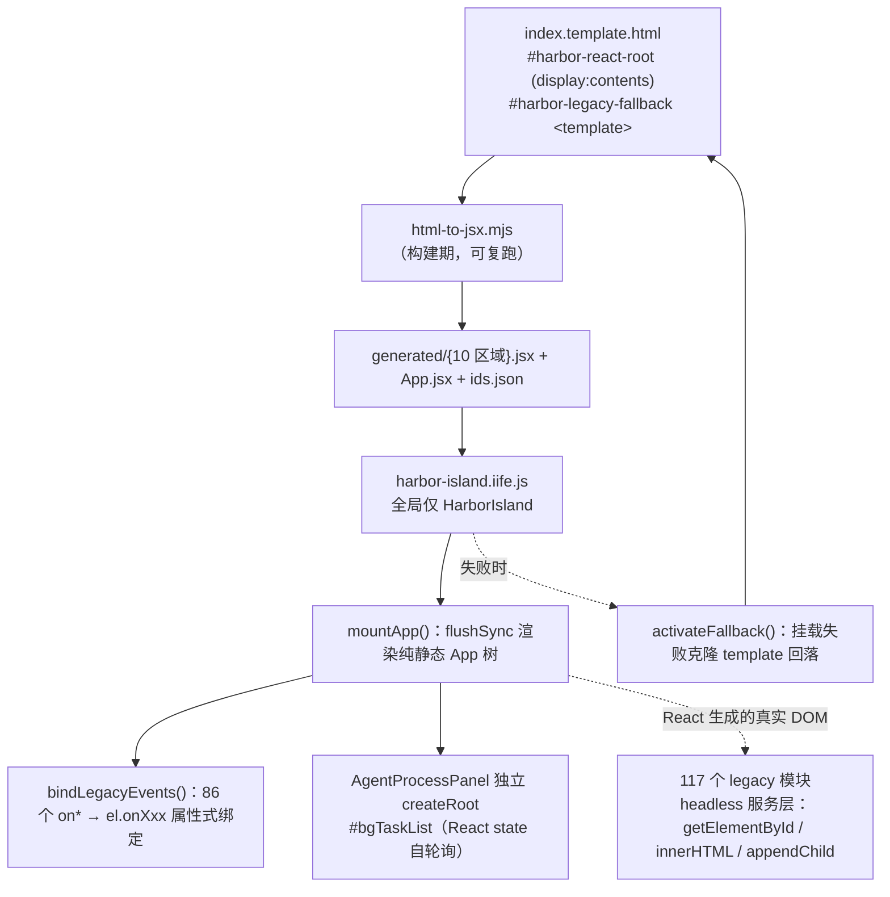

# HANDOVER-R67 — 前端全量迁入 React + 待决项目清零轮

> 日期：2026-11-10。接续 `HANDOVER-R66.md`（自包含，接手者无需读历史对话）。
> 项目：Harbor / GLM-Chat v1.9.0。生产链 = **Electron 主进程 + server/ Node 服务 + 单文件 `harbor.html`**。
> 本轮两条用户指令：①「全部完成，包括待决项目」；②「全部迁入 React，不要怕重做」。
> 裁决全文见 `deliverables/dev-plan/decisions-r67.md`；契约锚点 `contract-baseline-r67.json`。

---

## 0. 一眼总览

| 维度 | 当前状态 |
|---|---|
| 前端渲染架构 | **React 成为唯一 DOM 生成层**：10 个区域组件 / 300 个 id / 86 个内联事件桥 |
| React 逻辑迁移 | 后台任务（Agent 过程面板）完成首个「数据源 + 渲染」双迁域 |
| 待决项目 | **§8 全 11 项结案**（3 项实施、7 项裁决、1 类环境阻塞）→ `decisions-r67.md` |
| 全量回归 | **2066 passed / 0 failed / 3 skipped**（`pytest tests/ -q`，实测 393s） |
| 契约基线 | `contract-baseline-r67.json`（117 模块 / 1318 符号），零漂移 |
| UI 契约 | PASS（40 DOM id / 13 onclick / 43 callApi / 39 类 / 21 变量） |
| 依赖棘轮 | 157 条冻结前向边，`--check` 通过 |
| server 门禁 | contract-coverage / contract-signatures / local-proxy / group-files / smoke / auth-flow 六套全 PASS |
| 真实浏览器验收 | `node tools/verify-react-render.mjs` → **16/16 PASS** |
| 性能基准 | DOMContentLoaded **681ms**（headless `file://`）；`harbor.html` 4,045,428 B；React IIFE 341,143 B；server 冷启动 516ms（R64） |
| 安装包 | **R67 已重打** `dist-electron/Harbor-Setup-1.9.0.exe`（217 MB，sha256 `16b29022…`），asar 内核验 React 层通过 |
| 版本 | `VERSION=1.9.0`；`API_VERSION='v1.0.0'`（契约，不可动） |
| 真机 | §7 清单待用户复验；遵循「不得主动启动 exe」约束 |

**一句话现状**：R66 的全部待决项已结案；前端可见 DOM 已 100% 由 React 生成并在真实浏览器
中通过 16 项验收；117 个 legacy 模块作为 headless 服务层保留（契约/测试约束），逻辑迁移
按 §5 的确定性批次推进。仓库处于全绿可交付状态。

---

## 1. 本轮改动清单

### 1.1 新增文件

| 路径 | 作用 |
|---|---|
| `frontend/react/tools/html-to-jsx.mjs` | 模板静态 DOM → JSX 组件树生成器（可复跑、幂等） |
| `frontend/react/src/generated/*.jsx` | 10 个区域组件 + `App.jsx` + `ids.json`（AUTO-GENERATED，**禁止手改**） |
| `frontend/react/src/AgentProcessPanel.jsx` | 首个 React 状态驱动域：过程可见 + 失败即接管 |
| `tools/verify-react-render.mjs` | 真实浏览器运行时验收（16 项 + 表单等价性 + 性能基准输出） |
| `tests/test_r67_react_migration.py` | 静态门禁 + 运行时验收固化（6 项） |
| `deliverables/dev-plan/decisions-r67.md` | §8 待决项目裁决记录 |
| `deliverables/dev-plan/contract-baseline-r67.json` | 新契约锚点 |

### 1.2 修改文件

| 路径 | 改动 |
|---|---|
| `frontend/index.template.html` | 新增 `#harbor-react-root`（display:contents）；原静态 DOM 移入 `<template id="harbor-legacy-fallback">`（契约文本 + 降级宿主） |
| `frontend/react/src/index.jsx` | `mountApp()` 同步全量渲染、`bindLegacyEvents()` 属性式事件桥、`activateFallback()` 降级、过程面板独立 root |
| `frontend/src/shell/hub-market.js` | 功能市场「启用」一步生效（写入当前会话 picks） |
| `frontend/src/shell/navigation.js` | React 接管后台任务面板时 legacy 让位（`__HARBOR_REACT_BGTASKS__`），vm 沙箱保留降级路径 |
| `frontend/react/dist/harbor-island.iife.js` | 构建产物（React IIFE，245,457 → 341,143 B） |
| `harbor.html` | 构建产物（3,947,815 → 4,045,428 B / 32,710 → 32,736 行） |

> `frontend/src` 仅两处业务改动（hub-market / navigation），`source_line_multiset_sha256`
> 已随 r67 锚点刷新；顶层符号集合 1318 个零变化，js_api 契约零变化，`config.json` 零污染。

---

## 2. React 全量渲染架构



### 2.1 三条不可破坏的约定

1. **App 是纯静态树，只渲染一次**。legacy 的约 2000 处 DOM 写点继续作用于 React 生成的
   真实 DOM；若给 App 引入 state 并重渲染，会覆盖 legacy 写入 → 功能故障。
2. **可见结构改模板，不改进 `generated/`**。模板的 `<template>` 是 JSX 生成源；改完必须
   重跑 `node frontend/react/tools/html-to-jsx.mjs`，再重建 IIFE 与 `harbor.html`。
3. **逐域迁移同批删写点**。把某域 DOM 写入改成 React state 时，必须同一次提交删掉 legacy
   对应写点（参照 `navigation.js` 的让位标记），并移除该域的 `data-h-events`，否则两套
   渲染器会抢同一个容器。

### 2.2 为什么保留降级宿主

`<template>` 内容不进入主 document（`document.getElementById` 查不到），因此：
- 300 个 id 不会与 React 生成的 DOM 重复（实测 `fallbackInDocument=false`）；
- `check_contract.py` / `contract_diff.py` 仍能从模板文本提取全部契约 id；
- `mountApp()` 抛错时用 `tpl.content.cloneNode(true)` 整体替换根容器，页面不白屏，
  `document.documentElement.dataset.harborRender` 置为 `legacy-fallback` 便于诊断。

---

## 3. 待决项目结案（摘要）

| 项 | 终态 |
|---|---|
| §8.1 Agent 重设计三原则 | 立项并落地首个增量（过程面板 React 化 + 失败接管 + 配置即生效） |
| §8.1 功能市场一步生效 | **实施**：启用即写 picks，下一次发送直接注入 |
| §8.1 collaboration 去留 | **保留冻结**：测试在养、收益 4.1%、R65 有 51-failed 回退教训 |
| §8.1 legacy→React 全并 | **推翻原裁决**，React 成为唯一 DOM 生成层（本轮主体） |
| §8.2 P1 run-controller 拆步 | 并入 React 迁移轮，不在 legacy 内重复拆 |
| §8.2 P1 state.js 分域 | 不做（R65 已证伪：搬回复活环） |
| §8.2 P2 重复样板收编 | 冻结（harness vm 钉扎，R65 已回退） |
| §8.2 P2 auth / hub-catalog | 已结案（懒化已落地 / 6ms 证伪） |
| §8.3 推送 | 维持本地（R60 叫停 + 远端等效重放链，禁止 fetch+reset --soft） |
| §8.3 OTel / A-P10 / 外链 | 不实施（无外网 / 无产品需求 / 收益为负） |
| §8.3 macOS / 基准 / 签名 | 性能基准已补；macOS 与签名环境阻塞 |

完整依据、验证证据、事实与判断的区分见 `decisions-r67.md`。

---

## 4. 工程铁律（在 R66 §4 基础上新增）

1–8 条沿用 `HANDOVER-R66.md` §4，**新增**：

9. **React 是唯一 DOM 生成层**：修改可见结构只允许改 `frontend/index.template.html` 的
   fallback 区并重跑 `html-to-jsx.mjs`；`frontend/react/src/generated/*.jsx` 是机器产物，
   手改会在下次生成时丢失。
10. **新增 DOM id 必须刷新契约锚点**：`contract_diff.py` 的 `html.dom_ids` 是冻结面，
    新增 id 会判漂移；生成 `contract-baseline-r<N>.json` 后 `test_contract_diff.py`
    自动取编号最大者。本轮已刷新到 r67。
11. **事件桥不动语义**：内联 `on*` 一律经 `data-h-events` 编解码为属性式 `el.onXxx`，
    不要改成 React 合成事件（`this` / 原生 `event` / `return false` / legacy 覆盖会失效）。
12. **运行时验收不可省**：任何前端改动后必须跑 `node tools/verify-react-render.mjs`
    （16 项真实浏览器断言），静态门禁证明不了 DOM 生成正确。

---

## 5. 逻辑迁移批次（React 全并的剩余范围，确定性清单）

现状：**结构 100% 已迁**（10 区域 / 300 id / 86 事件）；**逻辑 1 个域已迁**
（后台任务 / Agent 过程面板）。117 个 legacy 模块按子域分批，顺序按「用户可见频次 × 出度」：

| 批次 | 子域（模块数） | 入口 | 与既往优化项的关系 |
|---|---|---|---|
| B1 | chat(5) + composer/send | 输入框、发送、消息渲染 | 高频主链路，先立 React 数据流样板 |
| B2 | sessions(6) + core/state 会话态 | `switchSession` 编排（8 域枢纽） | 承接 §8.2 F2 状态分域 |
| B3 | agent(18) | `run-controller.js` 1365 行 / 出度 43 | **与 §8.2 F3 合并**：直接拆成 React hooks/services |
| B4 | group(4) + group 文件/气泡 | 群聊接力、实时详情 | 承接 §8.1 Agent 原则 ①② |
| B5 | settings(11) | 表单密集，React 收益最高 | 11 模块可整批 |
| B6 | expert(11) + generative(11) + planning(2) | 专家、生成式 UI、计划 | — |
| B7 | analytics(4) + search(2) + integrations(4) + workspace(1) + providers(3) | 外围面板 | — |
| B8 | core(7) + components(4) | 共享层最后下沉 | — |
| B9 | collaboration(11) | 冻结；随产品决策整批处理 | 见 `decisions-r67.md` §1.3 |

**每批门禁（缺一不可）**：
```
node frontend/react/tools/html-to-jsx.mjs            # 若改了模板
(cd frontend/react && node build.mjs) && node frontend/build.js
python deliverables/design/check_contract.py
python tools/contract_diff.py --snapshot .../contract-baseline-r<N>.json
node tools/gen_allowlist.mjs --check
node tools/verify-react-render.mjs
python -m pytest tests/ -q
```

---

## 6. 可复现验证命令

```bash
PY="C:/Users/陈/.workbuddy/binaries/python/envs/default/Scripts/python.exe"
NODE="C:/Users/陈/.workbuddy/binaries/node/versions/22.22.2-6/node.exe"
cd "C:/Users/陈/Desktop/GLM-Chat-v1.0.0-完整开发包"

# 1) 生成 JSX（模板改动后）→ 构建 React IIFE → 构建 harbor.html
"$NODE" frontend/react/tools/html-to-jsx.mjs
(cd frontend/react && "$NODE" build.mjs) && "$NODE" frontend/build.js

# 2) 静态门禁
"$PY" deliverables/design/check_contract.py
"$PY" tools/contract_diff.py --compare deliverables/dev-plan/contract-baseline-r67.json
"$NODE" tools/gen_allowlist.mjs --check

# 3) 真实浏览器运行时验收（16 项 + 性能基准）
"$NODE" tools/verify-react-render.mjs

# 4) server 六套
cd server && for t in contract-coverage contract-signatures local-proxy group-files smoke auth-flow; do "$NODE" test/$t.mjs; done && cd ..

# 5) 全量回归（约 7 分钟）
"$PY" -m pytest tests/ -q
```

---

## 7. 真机复验清单（重装 + 重启后；用户操作，不主动启动 exe）

R66 §7 十项继续适用，并新增 React 相关项。**自动化已覆盖**列说明本轮能证明到什么程度：

| # | 复验项 | 期望 | 自动化覆盖 |
|---|---|---|---|
| 1 | 单聊/群聊发消息（云端） | 正常返回，无 `Failed to fetch` | 单测/vm（非真网络） |
| 2 | 本地模型单聊 + 群聊 | 正常流式 | `test_r63_frontend_fixes` |
| 3 | 群聊按名册顺序接力 | 链尾「接力完成」 | 单测 |
| 4 | 群成员工具调用 | 落绑定工作目录、无刷屏 | 单测 |
| 5 | 暂停接力 | 保留部分正文、无英文报错 | 单测 |
| 6 | 群文件面板 | 每轮归档、改目录成功、全文可读 | server 16 项 |
| 7 | 工作气泡点击 | 实时输出 + 工具状态 | 单测 |
| 8 | 专家启用 → 发消息 | 角色口令生效 | vm 链断言 |
| 9 | 首启向导填 Key → 测试连接 | 成功 | onboarding harness |
| 10 | 协作弹窗观感 | 卡片化、首点即开 | 单测 |
| **11** | **首屏观感与改造前一致** | 布局 / 图标 / 主题 / 字体无偏移 | headless 16 项（结构层），**视觉需真机** |
| **12** | **导航 rail 点击切换面板** | 各面板正常切换 | 端到端点击探针（switchPanel 调用）+ 真机 |
| **13** | **表单控件默认值与输入** | select / checkbox / textarea 正常 | 结构层断言（defaultValue/defaultChecked），**交互需真机** |
| **14** | **通知中心后台任务** | 状态/耗时/在跑工具实时刷新；失败项「接管」 | headless 注入探针 16/16 |
| **15** | **市场启用后直接发消息** | 角色一步生效，无需再点 + 菜单 | vm 链断言 + 真机 |

> 判定口径遵循项目约束：自动化黑屏截图不得直接当产品 Bug；真机结论以用户提供的截图为准。

---

## 8. 打包

```
mv dist-electron/Harbor-Setup-1.9.0.exe dist-electron/Harbor-Setup-1.9.0-pre-R67-backup.exe
PATH="/c/Users/陈/.workbuddy/binaries/node/versions/22.22.2-6:$PATH" \
  npx --no-install electron-builder --win nsis --config "$TEMP/harbor-builder-offline.yml"
```
- 离线配置 `%TEMP%/harbor-builder-offline.yml`（工程配置 + `electronDist` 指向本地 node_modules）。
- React IIFE 由 `build.js` **内联进 `harbor.html` 的 `<script>`**，不是独立文件；
  `electron-builder.yml` 的 files 白名单只需 `harbor.html`，无需新增条目。
- 打包后核验 asar 内的 harbor.html 确实带 React 层。**注意**：Git Bash 下
  `asar extract-file <archive> harbor.html` 会把参数解析成绝对文件路径而失败；
  `listPackage()` 返回 `\harbor.html`，但 `extractFile()` 必须传裸文件名：
  ```bash
  "$NODE" -e "const a=require('@electron/asar');const s=a.extractFile('dist-electron/win-unpacked/resources/app.asar','harbor.html').toString('utf8');console.log('bytes',s.length,'react',(s.match(/harbor-react-root/g)||[]).length,'events',(s.match(/data-h-events/g)||[]).length)"
  ```

### 本轮实测结果

| 项 | 值 |
|---|---|
| 产物 | `dist-electron/Harbor-Setup-1.9.0.exe`（217 MB，2026-11-10 10:28） |
| sha256 | `16b29022389d08da239e58db3be6042e86f78bec8025bb7b18250608cffa511a` |
| 旧包备份 | `Harbor-Setup-1.9.0-pre-R67-backup.exe`（R63/R66 版）、`Harbor-Setup-1.9.0-R61-backup.exe` |
| asar 内 `harbor.html` | 4,045,428 B；`harbor-react-root` ×3、`harbor-legacy-fallback` ×3、`data-h-events` ×87 |
| asar 其他 | `server/src/services/local-proxy.js` 在位；`libs/` 26 项 |

> 打包插曲：首次被 safe-delete 钩子拦截（electron-builder 清空 `win-unpacked/locales`
> 一次删 66 个文件 > 阈值 50）。处理方式是**把整个 `win-unpacked` 目录 `mv` 改名**为
> `win-unpacked-pre-R67-backup`（不删除任何既有资产），重跑即成功。此为该环境下打包的标准姿势。

---

## 9. 诊断速查（R66 §9 基础上新增）

| 现象 | 排查 |
|---|---|
| 页面白屏 | 看 `document.documentElement.dataset.harborRender`：`react` / `legacy-fallback`；后者查 console 的挂载失败原因 |
| `getElementById` 返回 null | 元素是否只在 `<template>` 里（未挂载 / 降级未激活）；React 是否已 `flushSync` 完成 |
| 内联按钮点击无反应 | 检查 `data-h-events` 是否生成、`el.onclick` 是否为 function、是否被 legacy 后续覆盖 |
| 两套渲染器抢同一容器 | 检查该域是否有 `__HARBOR_REACT_BGTASKS__` 式让位标记；legacy 写点是否已同批删除 |
| 契约差分报 `dom_ids 新增` | 新增了 DOM id → 生成新 `contract-baseline-r<N>.json` |
| 生成物被覆盖 | 是否手改了 `frontend/react/src/generated/*.jsx`；改模板后重跑生成器 |
| 浏览器验收 exit 2 / skip | Edge 单实例或 profile 冲突；验证器已内置独立 profile + 三次重试，缺 Edge 时 pytest 优雅 skip |
| 全量 pytest 偶发 1 failed（build md5） | 多为 Windows 文件锁导致 `harbor.html` 写失败，单独重跑该用例即可（本轮已实证） |

---

## 10. 环境与工具路径

| 项 | 路径 / 值 |
|---|---|
| Python (pytest) | `C:/Users/陈/.workbuddy/binaries/python/envs/default/Scripts/python.exe` |
| Node | `C:/Users/陈/.workbuddy/binaries/node/versions/22.22.2-6/node.exe`（v22.22.2） |
| 运行时验收浏览器 | `C:/Program Files (x86)/Microsoft/Edge/Application/msedge.exe` + `server/node_modules/playwright-core` |
| 工作区 | `C:/Users/陈/Desktop/GLM-Chat-v1.0.0-完整开发包` |
| 配置目录 | `%USERPROFILE%/.glm-chat` |
| 离线打包配置 | `%TEMP%/harbor-builder-offline.yml` |
| 网络 | 无外网（GitHub 推送维持本地） |

---

## 11. 接手建议

1. 按 §7 组织真机复验，重点看 11–15 五项 React 相关（视觉 / 交互 / 一步生效）。
2. 复验通过后按 §5 的 B1 启动下一批逻辑迁移（chat 域），每批走完整门禁。
3. 若产品决定下线 collaboration，走 `decisions-r67.md` §1.3 的整批姿势，勿按纯死代码删。
4. 推送仍需用户明确授权；恢复时严格按 `HANDOVER-R60.md` §1，禁止 `fetch + reset --soft`。

> 事实与判断的区分：§0 数字、§5 状态、§6 命令输出为已复现实测；§3 裁决与 §5 批次顺序为工程判断；
> §7 真机项、§8 macOS/签名为用户或环境侧待办，非代码缺陷。
