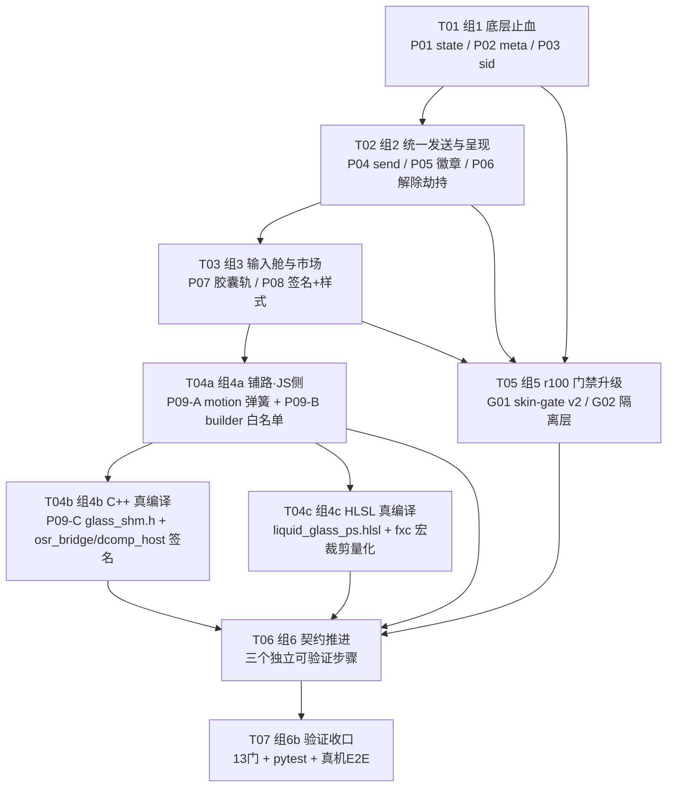

# Harbor v2.1 · R100 M1 增量设计与有序任务列表

> 架构师：高见远（software-architect）｜基线：`89d61db`「Harbor v1.9.0 全量源码（R99 态，2026-11-19）」
> 输入：《Harbor v2.1 终版定稿》（d1）、《Harbor v2.1 M2 Spike 与 r100 门禁升级》（d2）
> **本文所有路径 / 行号 / 判据均由本人在 `C:\v4h\proj` 实仓逐一 `Read` / `grep` / 实跑验证后写入；文档给的锚点凡与实仓不符者，一律以实仓为准并显式标红。**
> 本轮只做设计与任务分解，未修改任何代码文件。

---

## 第 0 章 取证摘要（先跑一遍，避免纸上谈兵）

| # | 命令 | 实测结果 |
|---|---|---|
| E1 | `git log --oneline -3` | `89d61db Harbor v1.9.0 全量源码（R99 态，2026-11-19）`（单条根提交） |
| E2 | `git status --porcelain` | 初始干净；**本文档执行取证命令后** `deliverables/dev-plan/*-r69.json` 出现 4 条 M（门禁产物回写，收尾已还原，见 §0.1） |
| E3 | `python tools/run_normalized_gates.py` | `[normalized-gates] 13/13 PASS, 0 SKIP, FAIL=[]` |
| E4 | 产物 `normalized-gates-r69.json` | `summary.serverGates = 39`，`excludedFromServerGates = [auth-migrate.mjs, node-sqlite-probe.mjs]`；`server/test/*.mjs` 实数 **41** − 2 = **39** |
| E5 | `node frontend/app/tests/arch-contract.mjs` | `[arch-contract] 82/82 通过` |
| E6 | `python tools/scc_ratchet.py` | `PASS cycles=17(+0) cyclicSymbols=104(+0) largest=34` |
| E7 | `python tools/type_annotation_audit.py` | `PASS 18/18 (100.0%) missing=[]` |
| E8 | `python tools/contract_diff.py --snapshot <tmp>` | `模块=117 顶层符号=1318 源码行多重集=3a46ce5266ad6acf…`，与冻结锚点 `contract_baseline_r99` **逐字节相同** |

### 0.1 「12 个元组为何报 13/13」——已查实并说明

`tools/run_normalized_gates.py`：
- `GATES = [...]`（L35–72）确实只有 **12 个元组**：gate-coverage / post-deletion-audit / arch-contract / frontend-l1 / frontend-l2 / golden-replay / contract-diff / allowlist-ratchet / scc-ratchet / type-annotation / arch-assessment / ui-contract。
- 第 13 项 `server-gates` **不是元组**，而是 `main()` 里对 `server/test/*.mjs` 的**动态聚合门**（L121–144，`srv = server_gates()`），聚合结果追加进 `results`。
- 因此「13/13」= 12 个具名门 + 1 个 `server-gates` 聚合门（内部 39 个脚本全绿）。**不是 bug，也不是重复计数。**

### 0.2 本文档对「已知文档→实仓偏差」的复核结论（含纠错）

| 编号 | 待核项 | 复核结论 | 取证 |
|---|---|---|---|
| D-1 | 文档写 `frontend/src/skin/lightwellShell.js`？ | **不成立**。两份文档中 `src/skin` 出现次数为 **0**；d2 精确写 `frontend/skin/lightwellShell.js`（与实仓一致），d1 §3.3 写相对名 `skin/lightwellShell.js`（亦正确）。 | `grep -c "src/skin" d1.txt d2.txt` → `0` / `0`；`grep -o "frontend/[a-z/]*lightwellShell.js" d2.txt` → `frontend/skin/lightwellShell.js` |
| D-2 | G02-A 会否撞 `lintLightwellSkinSpecificity()` 的皮肤前缀规则？ | **不会**。该规则（`css-lint.mjs` L131–158）取 `LIGHTWELL R90` 标记所在注释起点至文件末尾，逐选择器要求 `sel.includes('[data-skin="lightwell"]')`。G02-A 的 4 条选择器（含 `html[data-skin="lightwell"][data-glass-engine="native"]{…}` 裸条）**全部**含该子串 → 0 违规。且 `checkedSelectors >= 40` 只会变大（实仓现 200+ 条）。 | `sed -n '131,158p' deliverables/design/liquid-glass/scripts/css-lint.mjs` |
| D-2b | `display:none!important` 会否触发 css-lint 其它规则？ | **不会**。css-lint 主流程只查三件事：① 注释起止符配对；② **选择器文本**里不得出现中日韩/★/— 字符（`ILLEGAL_IN_SELECTOR`）；③ 花括号配平。`!important`、`color-mix()`、`-webkit-` 全不在判据内。**备注**：`css-lint.mjs` 主流程本身**不在 13 门之内**（只有它的导出函数 `lintLightwellSkinSpecificity` 被 skin-gate import），所以真正拦你的是 skin-gate 与本文件 §B 的规则。 | `sed -n '193,240p' css-lint.mjs`；`grep -rn "css-lint" .github/workflows/harbor-ci.yml` → 无命中 |
| D-3 | 禁令究竟是禁 `id=` 还是禁 `#xxx`？文档两处是否矛盾？ | **精确判据 = 禁 `id="xxx"` 属性字面量，不禁 `#xxx` 选择器**。skin-gate L127–128：`responsiveCss.match(/\bid=["'][A-Za-z][A-Za-z0-9_-]*["']/g)` 必须为 0 个。`contract_diff._html_contract()` 用同形正则扫 `harbor.html`。文档两处说法（「严禁含 `id=` 字面量」/「严禁出现 `id=` 属性字面量」）**语义一致，不矛盾**。G02-A 的 `#lw-ambient-wallpaper` / `#mainStage` / `#observerWindow` / `#glass-ribbon` 均不匹配该正则 → **不会撞红**。**唯一雷区**：别在 CSS 注释里写出 `id="…"` 这种整串。 | `sed -n '122,129p' server/test/lightwell-skin-gate.mjs`；`sed -n '83,89p' tools/contract_diff.py` |
| D-4 | `contract_diff.py` 锚点链与 `--snapshot` 用法 | 锚点链有**两套**，文档只讲了一套：<br>① **文件链**（文档口径）：`deliverables/dev-plan/contract-baseline-r<N>.json`，`run_normalized_gates.py` L59–61 硬写 `r99`，改 `r100` 即可。<br>② **冻结锚点链**（文档完全没提，**这是本轮最大暗雷**）：`deliverables/dev-plan/frozen-python-surface.json` 内的 `contract_baseline_r68/r89/r98/r99` 四个 dict；`contract_diff._frozen_anchor()`（L165–191）用 `^contract_baseline_r(\d+)$` **正则倒序自动取最高版本**，然后 `verify_frozen_anchor()`（L194–225）强制 `base == anchor == cur` 于 `api_py_sha256 / golden_sha256 / source_line_multiset_sha256 / html / api_version`。<br>→ **只做 ① 不做 ②：`contract-diff` 永远红。**（实跑自证：当前 cur 的多重集 `3a46ce52…` 与 frozen 的 `contract_baseline_r99` 完全相同，所以今天自比才 PASS；一旦改 `frontend/src`，两者立刻分离。）<br>`--snapshot <path>` = 把当前契约面原样写成新基线文件（`collect()` 全量落盘），不做校验、不做合并。 | `sed -n '165,225p' tools/contract_diff.py`；`python tools/contract_diff.py --snapshot … && --compare …` → `零漂移 PASS`；frozen 键名实读 `python -c "json.load(...).keys()"` |

### 0.3 M2 C++ / HLSL 工具链实测结论（**推翻了"没有 fxc/dxc"的初判；团队长第三轮已确认更正**）

团队长转达的初判是「本机没有 `fxc.exe`/`dxc.exe`，HLSL 只能静态审查」。**实测不成立 —— 两者都在，且都能真编译。** 团队长在第三轮已明确更正此判断并确认：SM 5.0 目标可用、编译宏静态裁剪变体可用、`cs_5_0` 亦可用。这意味着 M1 的 HLSL/C++ 交付物全部**可真编译验证**，**不需要**降级为"静态审查 + blocked-by-environment"。

| # | 项 | 实测结果（命令 + 输出） |
|---|---|---|
| M1 | `fxc.exe` 存在 | `C:\Program Files (x86)\Windows Kits\10\bin\10.0.26100.0\x64\fxc.exe`，**182,736 B**（另有 `arm64` / `x86` 三份 + `Redist\D3D` 下 `dxc.exe` 三份） |
| M2 | `dxc.exe` 存在 | 同目录，**250,280 B** |
| M3 | **fxc 真编译 SM5.0 成功** | 探针 shader（`GlassNode` cbuffer + `Texture2D`/`SamplerState` + `sdRoundedBox` + `sminCubic` + `PS_Dispatch`）→ `compilation object save succeeded`，**`FXC_EXIT=0`**，产出 `probe_ps.cso` **2,400 B** |
| M4 | **编译宏静态裁剪可量化验证** | 同一 shader，`/DHARBOR_ENABLE_DISPERSION=1` → **`sample_indexable`/`sample_l_indexable` 指令 3 条**、`dcl_temps 1`、`.cso` **792 B**；`=0` → **1 条**、**无 `dcl_temps`**、**616 B**。两者 `EXIT=0`。⇒ 文档「Standard 档静态裁剪 R/B 采样」**有了可失败的量化判据**<br/>⚠️ **口径警告（本文自纠）**：**不要用 `grep -c "sample"`** —— asm 头部注释里就有 `// lin  sampler …` 与 `dcl_sampler s0`，实测会把 3/1 数成 **5/3**。判据必须锚到**指令助记符**：`grep -cE 'sample_indexable|sample_l_indexable'`。 |
| M5 | `d3dcompiler_47.dll` 存在 | `C:\Windows\System32\d3dcompiler_47.dll`，**4,669,440 B** |
| M6 | `D3DCompileFromFile` 运行时可用（组 4c 备选路径） | 探针 `osr.exe` 输出 **`D3DCompileFromFile hr=0x00000000 size=2400`** → `S_OK`，**第二条离线编译路径也通** |
| M7 | `cl.exe` 手工注入环境可用 | `MSVC=…\18\BuildTools\VC\Tools\MSVC\14.51.36231`，`bin\Hostx64\x64\cl.exe` 893,288 B；bat 内注入 INCLUDE/LIB/PATH 后 **`CL_EXIT=0`** |
| M8 | **沙箱能真跑 D3D11 + DComp 设备创建**（不只是编译） | 运行 `ps.exe`：**`D3D11CreateDevice hr=0x00000000 fl=0xB000`**（S_OK，FL 11.0）、**`DCompositionCreateDevice2 hr=0x00000000`**（S_OK），`RUN_EXIT=0` |
| M9 | **P09-C 的 64B 对齐契约可编译校验** | `static_assert(sizeof(HarborGlassNode)==64)` / `alignof==64` / `×16==1024` / `sizeof(HarborApcaFeedback)==16` / `offsetof(params)==16` **全部通过**，运行时打印 `sizeof=64 / 16` |
| M10 | `OpenSharedResource1` 签名可编译校验 | `SubmitElectronSharedTexture(ID3D11Device1*, const uint8_t*, size_t)` 复刻件 **`CL_EXIT=0`**，`IID_PPV_ARGS(&uiTex)` 通过 |
| M11 | **必须加 `/utf-8`（新增陷阱，团队长未提及）** | 源文件含中文注释（UTF-8 无 BOM）时，**不加 `/utf-8` 会崩出 `C2059 语法错误: '}'` / `C2143` 这类完全指错方向的假语法错**——实测第一次编译就是这么挂的，把中文注释删掉/加 `/utf-8` 后立刻变成真实错误。**所有 C++ 任务必须带 `/utf-8`。** |
| M12 | **`uint8_t` 必须 `#include <cstdint>`（新增陷阱）** | 只 `#include <d3d11_4.h>` 时 `uint8_t` 未定义 → `C2143 缺 ',' (在 '*' 前)` + `C2065 handleBuf 未声明`，报文极具误导性。`osr_bridge.cpp` **必须显式 `#include <cstdint>`**。 |
| M13 | 必须在 `.bat` 里跑 `cl`/`fxc` | Git Bash 直接跑会因 MSYS 路径转换把 `/nologo` 变成 `F:/…/nologo` 并当源文件（`warning D9035`/`D9024`）。**写成 .bat + `cmd //c xxx.bat`**，本文所有探针都是这么跑通的。 |
| M14 | `vcvars64.bat` 不可用 | 内部调 `reg.exe` 被本机安全策略拦截 → bat 中断。**必须手工注入** INCLUDE/LIB/PATH（M7 已验证的写法）。**注：`fxc` 不需要环境变量注入**，直调绝对路径即可。 |
| M15 | **`cs_5_0` 也可真编译（团队长第三轮补充后实测）** | 探针 `glass_blur_cs` 骨架（`groupshared float4 gCache[256]` + `[numthreads(16,16,1)]` + `GroupMemoryBarrierWithGroupSync()` + `RWTexture2D<float4> : register(u0)` + `SampleLevel`，7-tap `[1,6,15,20,15,6,1]/64`）→ **`CS_EXIT=0`**，`blur_cs.cso` **1,752 B**，`blur_cs.asm` **2,955 B**。<br/>**asm 静态读数**：`dcl_temps 4`、`dcl_tgsm_structured g0, 16, 256`、`dcl_thread_group 16, 16, 1`、**指令数 25**、`sample_l_indexable` 1 条、**`ld_structured` 6 条**。<br/>⇒ d1 要求的「≤3px 走一维 `groupshared[256]` LDS 高斯计算着色器」**可真编译验证**。 |
| M15b | **空实现在 asm 里会立刻暴露（可量化）** | 同一 `cs_5_0` 目标写一个「只 `dst[dtid.xy] = float4(0,0,0,0)`」的空实现 → `EXIT=0`（**编译器不报错**），但 asm 变成：**指令数 2**、**无 `dcl_temps`**、`sample_*` **0 条**、`ld_structured` **0 条**、`.cso` **484 B**。<br/>对比真实骨架：**25 指令 / `dcl_temps 4` / 6 条 `ld_structured` / 1,752 B**。<br/>⇒ 「三入口不得为空实现」不是口头要求，**指令数 2 vs 25、字节 484 vs 1,752 是硬对照**（团队长裁定「空实现会立刻暴露为指令数异常低」已实测成立）。 |
| M16 | **`ddx`/`ddy` 在 `cs_5_0` 下非法 —— 已用负控实测证明** | 同一骨架里插入 `float2 d = float2(ddx(c.x), ddy(c.x));` → **`error X4532: cannot map expression to cs_5_0 instruction set`**，`NEG_EXIT=1`，**no code produced**。⇒ 这是一条**可失败判据**：像素着色器的焦散 Jacobian（d1「基于 `ddx/ddy` Jacobian 面积比」）**不可**直接搬进计算着色器，必须改纹理采样差分（`SampleLevel` 双采样）。 |
| M17 | 含中文的用户目录下 fxc 可编译，但控制台路径显示乱码 | 输出显示 `C:\Users\陈\AppData\…`（实际 `C:\Users\陈\…`）。编译本身成功（M3/M15 都在该目录跑通），但**日志不可读会误导排障**。⇒ 产物输出目录建议用纯 ASCII：**`C:\Users\Public\hv21\`** 或仓内 **`qa/r100/out/hlsl/`**。 |

> **结论**：原「组 4c 只能静态审查」的预案**作废**。本轮 HLSL 与 C++ 全部走**真编译 + 产物字节数/汇编指令数**的硬判据（见 T04b / T04c）。

---

## A. 锚点核对表（P01–P09 / G01–G03）

图例：`✅ 行号一致` ｜ `➡️ 行号漂移` ｜ `⛔ 实仓无此锚点`

### A-1 P01 单轨内联胶囊状态底座

| 项 | 文档 | 实仓 | 判定 |
|---|---|---|---|
| 路径 | `frontend/src/core/state.js` | `frontend/src/core/state.js`（全文件 **50 行**） | ✅ 路径一致 |
| 锚点 | L39–50 | L39–50 逐行吻合；**L50 即文件末尾**（`}`），追加内容从 L51 起 | ✅ 行号一致（但注意：文档把「基准行 L39–50」当作插入点，实仓该区间是文件尾段，插入 = 文件尾追加） |

现状摘录（`state.js` L39–50，逐字）：
```js
/* R59 M7：专家一次性选择态（原 expert/center.js 私有——controller 会话切换要
 * clearExpertSelection，形成 controller→center 前向边；叶化后三方单向引用） */
let expertNextSelection = null;        // 一次性消费：下一次发送走 expert run
let expertSelectionSessionId = '';     // 选择时的会话（切换会话即失效）
...
function clearExpertSelection() {
  expertNextSelection = null; expertSelectionSessionId = ''; expertSelectionLabelText = '';
  try { if (typeof _expertChipResetHook === 'function') _expertChipResetHook(); } catch (e) {}
}
```

### A-2 P02 剥离 `meta` 防 HTTP 400

| 项 | 文档 | 实仓 | 判定 |
|---|---|---|---|
| 路径 | `frontend/src/agent/context.js` | 同（**132 行**） | ✅ |
| 锚点 | L19–34 | L19–21 为 JSDoc 注释，**L22 函数声明**，L26 判据行，L33 `return out \|\| msgs;`，L34 `}` | ✅ 行号一致 |

现状摘录（L22–34）：
```js
function _stripToolTags(msgs) {
  let out = null;
  for (let i = 0; i < msgs.length; i++) {
    const m = msgs[i];
    if (m && m.__tool !== undefined) {
      if (!out) out = msgs.slice();
      const c = Object.assign({}, m);
      delete c.__tool;
      out[i] = c;
```

### A-3 P03 修复并行会话专家串台

| 项 | 文档 | 实仓 | 判定 |
|---|---|---|---|
| 路径 | `frontend/src/agent/run-controller.js` | 同（**1364 行**） | ✅ |
| 锚点 | L278–285 | L278–279 注释、L280 `_baseSys`、**L281 `hubDirectiveFor()`**、L282–284 `sysPrompt`、L285 `enableSearch` | ✅ 行号一致（`hubDirectiveFor()` 精确落在 L281） |
| 旁证 | — | `hubDirectiveFor(sid)` 定义在 `frontend/src/shell/composer-hub.js` **L244–257**，**已支持 sid 入参**（L245 `let key = (sid !== undefined && sid !== null && sid !== '') ? sid : hubCurrentSid();`）；同类正确调用在 `frontend/src/group/group.js` **L1226** `hubDirectiveFor(s.id)` | ✅ 文档所述对照成立 |

现状摘录（L280–284）：
```js
    const _baseSys = document.getElementById('systemPrompt').value.trim();
    const _hubDirective = (typeof hubDirectiveFor === 'function') ? hubDirectiveFor() : '';
    const sysPrompt = _hubDirective
      ? (_baseSys ? _baseSys + '\n\n' + _hubDirective : _hubDirective)
      : _baseSys;
```

### A-4 P04 统一发送管线

| 项 | 文档 | 实仓 | 判定 |
|---|---|---|---|
| 路径 | `frontend/src/chat/send.js` | 同（**499 行**） | ✅ |
| 锚点① | L84–90 | L84–86 注释、**L87 `if (typeof expertNextSelection !== 'undefined' …)`**、L88 `ensureSession()`、**L89 `return runExpertSelection();`**、L90 `}` | ✅ 行号一致 |
| 锚点② | L207–236 | L207–209 `displayText`、L210 `displayExtra`、L213 `addMessage('user',…)`、**L215 `s.messages.push({ role:'user', content:userContent });`**、L236 `runAgentLoop(s, apiKey);` | ✅ 行号一致 |
| 依赖符号 | `activeSessionId` | `send.js` **L23** `const activeSessionId = appState ? appState.currentSessionId : currentSessionId;`（`sendMessage` 函数内，L87 处仍在作用域） | ✅ 可用 |

现状摘录（L87–90）：
```js
  if (typeof expertNextSelection !== 'undefined' && expertNextSelection) {
    try { ensureSession(); } catch (e) {}
    return runExpertSelection();
  }
```
现状摘录（L213–215）：
```js
  const uEl = addMessage('user', displayText || '（发送附件）', displayExtra);
  if (text) addMsgActions(uEl, text, true);
  s.messages.push({ role: 'user', content: userContent });
```

### A-5 P05 用户气泡徽章渲染与重启复原

| 项 | 文档 | 实仓 | 判定 |
|---|---|---|---|
| P05-A 路径 | `frontend/src/components/markdown.js` | 同（**437 行**） | ✅ |
| P05-A 锚点 | L135–156 | L135 `if (extra && extra.images)`（插入点在它**之前** ✅）、L148 `body`、**L151–154 `div.innerHTML = …`**（第二 hunk `@@ -151,5 +161,5 @@` 精确对应）、L155 `container.appendChild(div);` | ✅ 行号一致（区间尾端实为 L155，文档写 156，**+1 尾漂移，不影响**） |
| P05-B 路径 | `frontend/src/sessions/controller.js` | 同（**782 行**） | ✅ |
| P05-B 锚点 | L486–490 | **外层 `(s.messages \|\| []).forEach((m, i) => {` 在 L475**；L486 `}`（content 数组循环收尾）、**L487 `const uEl = addMessage('user', text, {});` ← 唯一待改行**、L488 `if (uEl && uEl.dataset) uEl.dataset.midx = i;`、L489 `if (text.trim()) addMsgActions(uEl, text.trim(), true);`、L491–496 `if (m.edited && uEl) { … '已编辑' … }` | ✅ 行号一致（目标行 = **L487**；`i` 在作用域、`m` 即源消息对象，取 `m.meta` 语义正确） |

现状摘录（P05-A，L135 + L151–154）：
```js
  if (extra && extra.images)
    extraHtml = '<div class="msg-images">' + …
  ...
  div.innerHTML = `
    <div class="avatar">${role === 'user' ? '我' : 'AI'}</div>
    <div class="content ${role === 'error' ? 'error' : ''}">${body}${extraHtml}</div>
```
现状摘录（P05-B，L485–489，含上下文；外层 `forEach((m, i) =>` 在 L475）：
```js
485        });
486      }
487      const uEl = addMessage('user', text, {});
488      if (uEl && uEl.dataset) uEl.dataset.midx = i;
489      if (text.trim()) addMsgActions(uEl, text.trim(), true);
```

### A-6 P06 解除 sendBtn 劫持 + 直出主流

| 项 | 文档 | 实仓 | 判定 |
|---|---|---|---|
| P06-A 路径 | `frontend/src/expert/center.js` | 同（**341 行**） | ✅ |
| P06-A 锚点① | L181–264 | **L181 `function expertSelectForNextRun() {`**、L188 `expertRenderSelectionChip();`、L189 `closeExpertCenter();`、L190 `return true;`、L191 `}`；L217 `async function runExpertSelection() {`、L234 DRAFT_REQUIRED 分支 | ✅ 行号一致（区间横跨两个函数，与文档一致） |
| P06-A 锚点② | L325–336 | **L325 `on('sendBtn', 'click', event => {`**、L334–335 `preventDefault/stopImmediatePropagation` + `runExpertSelection()`、**L336 `}, true);`**（capture 阶段） | ✅ 行号一致 |
| P06-B 路径 | `frontend/src/expert/controller.js` | 同（**216 行**） | ✅ |
| P06-B 锚点 | L133–139 | **L133 `const body = buildChatRequestBody({`**、L134 `model:`、**L135 `temperature: 0, topP: 1,`**、**L136 `maxTokens: 4096, effort: 'off',`**、L139 `});` | ✅ 行号一致 |
| 依赖字段 | `detail.kind` | `center.js` **L120** `expertKindLabel(detail.kind)` 已使用 → 字段存在 | ✅ |
| 依赖符号 | `getModelPrefs` | 定义于 `frontend/src/chat/composer.js` **L46**；该文件 manifest 序 **75** < `expert/controller.js` 序 **99** → **可**写入 `requires` | ✅ |

现状摘录（P06-A 劫持段 L325–336）：
```js
  on('sendBtn', 'click', event => {
    if (!expertNextSelection) return;
    if (typeof isSessionStreaming === 'function' && isSessionStreaming()) {
      event.preventDefault(); event.stopImmediatePropagation();
      ...
    event.preventDefault(); event.stopImmediatePropagation();
    runExpertSelection();
  }, true);
```
现状摘录（P06-B L133–139）：
```js
            const body = buildChatRequestBody({
              model: endpoint.model || (typeof providerState !== 'undefined' ? providerState.model : ''),
              ['messages']: expertApiMessages(context.messages), temperature: 0, topP: 1,
              maxTokens: 4096, effort: 'off',
              glm: typeof isGlmEndpoint === 'function' ? isGlmEndpoint() : false,
              tools: context.tools,
            });
```

### A-7 P07 内联胶囊轨 / Backspace / 真实文件引用

| 项 | 文档 | 实仓 | 判定 |
|---|---|---|---|
| P07-A 路径 | `frontend/src/shell/composer-hub.js` | 同（**424 行**） | ✅ |
| P07-A 锚点 | **无行号**（「核心新增与替换片段」） | 插入点须自定：函数声明区放在 **L327 之前**（`hubDirectiveFor` 之后）；渲染钩子注册放在 **`hubInitComposer()` 内**（L328 起，函数体收尾 L422–423 `if (typeof hubInitMarket === 'function') hubInitMarket(); hubRenderChip();`） | ➡️ **文档未给锚点，须由实现者自定；本设计指定插入点见 C-T03** |
| P07-A 替换目标 | `#hubQuoteFile` 修正 | **L340–346**：`const quote = document.getElementById('hubQuoteFile'); … if (typeof openSessionSearch === 'function') openSessionSearch();` | ✅ 文档所述「错跳全局搜索」成立 |
| P07-B 路径 | `frontend/src/shell/hub-market.js` | 同（**413 行**） | ✅ |
| P07-B 锚点 | L70–87 | **L70–76** `if (nowOn && typeof HUB_STATE !== 'undefined' …)` + `const item = hubCatalogById(kind, sid);` + **L74 `if (item) HUB_STATE.picks[hubCurrentSid()] = { kind, id, item };`**；L84–86 `hubRenderMarket/hubRenderSub/hubRenderChip` | ✅ 行号一致（hunk `@@ -70,13 +70,19 @@` 精确落在 L70–82） |
| ⚠️ 加载序 | — | `composer-hub.js` manifest 序 **2**、`hub-market.js` 序 **3**、`state.js` 序 **5** → **两个 shell 文件都早于 state.js 加载** | ⛔ **不能把 `composer*` 写进二者的 `requires`（build.js 会 fail）；必须沿用 `typeof comXxx === 'function'` 守卫** |

### A-8 P08 持久化签名 + 胶囊样式

| 项 | 文档 | 实仓 | 判定 |
|---|---|---|---|
| P08-A 路径 | `frontend/src/sessions/store.js` | 同（**385 行**） | ✅ |
| P08-A 锚点 | L244–249 | L244–246 注释（3 行，文档压成 1 行）、**L247 `s._uiSpecRev \|\| '',`**、**L248 `].join('\u0001');`**、L249 `}` | ➡️ **行号漂移 +3**：文档 L244 → 实仓 **L247**（锚点文本 `s._uiSpecRev \|\| '',` 唯一，插入点在 L247 之后、L248 之前） |
| P08-B 路径 | `frontend/styles/features/chat.css` | 同（**524 行**）；确认在 `manifest.styles` 第 **5** 位（共 14） | ✅ 路径一致（追加至文件末尾 = L525 起） |
| P08-B 依赖变量 | `--primary-soft / --err-bg / --dur-fast / --ease / --radius-md / --chip-bg` | 全部存在：`tokens.css` L12/16/25/30/21、`responsive.css` L264/268/285/311 | ✅ 无悬空 var |

现状摘录（store.js L244–248）：
```js
    // 生成式UI 视图变更计数（2026-11-03）：uiSpec 的写入/打卡只改消息对象内部，
    // 不碰 updatedAt/消息数——不在这里记一笔，那次 saveSessions 会被「未变更短路」
    // 直接跳过，重启后视图与打卡态全丢（真机实证）。
    s._uiSpecRev || '',
  ].join('\u0001');
```

### A-9 P09 铺路（motion / 打包白名单 / 共享内存头）

| 项 | 文档 | 实仓 | 判定 |
|---|---|---|---|
| P09-A 路径 | `frontend/src/core/motion.js` | 同（**62 行**）；manifest 序 **4**（早于 state.js 序 5） | ✅ 追加至文末 L63 起 |
| P09-A 现有契约 | 「保留 `MOTION.instant()`」 | `motion.js` `provides: ['MOTION']`；新增 `createAnalyticalSpring` 是**顶层 function** → **必须加进 `provides`**，否则 build.js `provides 与顶层符号不一致; 未声明=[createAnalyticalSpring]` 当场 fail | ✅ 文档未提，**本设计补** |
| P09-B 路径 | `electron-builder.yml` L24–42 | `files:` 在 **L33**；`- electron/**/*` **L34**、`- harbor.html` **L35**、`- libs/**/*` **L36**；`asarUnpack` L46–48 已含 `'**/*.node'` | ➡️ **行号漂移 +9**（文档 L24–42 → 实仓 L33–45） |
| P09-B 风险 | — | 实仓 **无 `native/` 目录**（`ls native` → No such file or directory）。加的 glob 指向不存在的路径，electron-builder 打包时**静默忽略**——本轮不构成红线，但会给人「已入单」的错觉 | ⚠️ 见 B-9 |
| P09-C 路径 | `native/harbor-glass/include/glass_shm.h` | **实仓无 `native/` 整个目录** | ⛔ 实仓无此锚点（纯新建，M2/M3 才编） |

### A-10 G01 升级 `lightwell-skin-gate.mjs` 至 r100 v2

| 项 | 文档 | 实仓 | 判定 |
|---|---|---|---|
| 路径 | `server/test/lightwell-skin-gate.mjs` | 同（**492 行**，与 d2 声明一致） | ✅ |
| 锚点① | L30–36 | **L31 `const R98_WP_OPACITY = { light: 0.62, dark: 0.65 };`**，L33–36 四个 `read(...)` | ✅ 行号一致（新常量 `R100_NATIVE_ATTR` 插在 L31 之后） |
| 锚点② | L165–175 | L165 `check('九大原型视图齐备', …)`，**L171–172 `assert.equal((shellJs.match(/id: '[a-z-]+', label:/g) \|\| []).length, 9, …)`**，L173 `});` | ✅ 行号一致（新 `observerOpen: false` 断言插在 L173 之后） |
| 锚点③ | L350–456 | L350/L355/L360 三条壁纸 live 断言；**L375–393** 负控基建（`mutationLog / CSS_NC / WALL_NC / LIGHT_BODY / DARK_BODY / LIGHT_SEL / swapBody / dropGateFromSelector`）；**L395–439 `const MUTATIONS = [ M1…M6 ]`**；L441–455 负控循环 | ✅ 区间成立，但有**两处文档未交代的结构约束**，见下 |
| ⚠️ 结构约束 1 | 文档写「M7/M8/M9 单点负控」 | 实仓负控是**单一数组 `MUTATIONS`（6 条）+ 单一循环调用 `checkWallpaperGate(mutated)`**。`checkWallpaperGate` 返回 `{gate, light, dark}`，循环用 `r[mu.expect]` 取桶。新增的 `checkR100NativeGate` 返回**数组**，**复用不了这个循环** | ⛔ **必须新增一套 `NATIVE_MUTATIONS` + 独立循环**，不能直接往 `MUTATIONS` 里塞 M7–M9 |
| ⚠️ 结构约束 2 | 文档没提证据落盘 | L457–475 会把 `mutationLog` 写到 `qa/r98/out/r98-wallpaper-gate-ci.json`（`mkdirSync` 自动建目录）。若新增原生门，需要**另开一份 r100 证据文件**，否则 r98 证据语义被污染 | ➡️ 本设计指定 `qa/r100/out/r100-native-gate-ci.json` |

### A-11 G02 responsive.css 隔离层 + observerOpen 默认折叠

| 项 | 文档 | 实仓 | 判定 |
|---|---|---|---|
| G02-A 路径 | `frontend/styles/responsive.css`（追加至末尾） | 同（**765 行**）；`LIGHTWELL R90` 标记在 **L231**，即 L231–765 全段受 `lintLightwellSkinSpecificity` 逐选择器校验 | ✅ 路径一致 |
| G02-A 前置事实 | 4 宿主 blur 块 | **L449–459**：`html[data-skin="lightwell"] header.header, … #glass-ribbon{ … backdrop-filter:blur(var(--glass-blur)) saturate(…) }`——正是 skin-gate L59–73 那条「恰好 1 块 / 恰好 4 宿主」的锚点 | ✅ |
| G02-A 撞红判定 | — | ① 4 宿主 blur 正则 `/([^{}]+)\{[^{}]*backdrop-filter:\s*blur\(/g` **不匹配 `backdrop-filter:none`** → 仍恰好 1 块 ✅<br>② `id=` 字面量 0 个 ✅<br>③ 皮肤前缀齐全 ✅<br>④ 壁纸门：新块选择器含 `#lw-ambient-wallpaper` 但**不含 `[data-wp="ready"]`、body 不含 `var(--wp-url)`** → 不进 `light/dark/consumers` 任何桶 ✅ | ✅ **G02-A 可安全追加** |
| G02-A 生效前提 | — | 全仓**无任何地方设置 `data-glass-engine`**（`grep` 无命中）→ 本轮该层是**惰性 CSS（inert）**，只有 M3 挂上属性才生效 | ⚠️ 必须写进验收说明，否则 QA 会以为「功能没生效」 |
| G02-B 路径 | `frontend/skin/lightwellShell.js` | 同（**877 行**，IIFE 包裹，`manifest.prebuilt` 第 2 项，`provides: []`） | ✅ |
| G02-B 锚点 | L33–38 | **L33 `var state = {`**、**L34 `activePrototype: 'flow-track',`**、**L35 `observerOpen: true,`**、L36 `callCount: 0,` | ✅ 行号一致（**待改行 = L35**；早期口头信息说 L35，文档区间 L33–38 覆盖它，两者不冲突） |
| G02-B 附带 | 9 原型视图 | **L22–30**（`PROTOTYPE_VIEWS` 9 条，`{ id: 'plinth-chart', label: …, group: … }`） | ✅ skin-gate L165–173 与 `(match(/id: '[a-z-]+', label:/g)).length === 9` 均依赖此段，**一行都不能动** |

现状摘录（L33–36）：
```js
  var state = {
    activePrototype: 'flow-track',
    observerOpen: true,
    callCount: 0,
```

### A-12 G03 锚点推进至 r100

| 项 | 文档 | 实仓 | 判定 |
|---|---|---|---|
| 路径 | `tools/run_normalized_gates.py` | 同（**168 行**） | ✅ |
| 锚点 | L58–62 | L55–58 为 R99 说明注释、**L59–61 `('contract-diff', [PY, 'tools/contract_diff.py', '--compare', 'deliverables/dev-plan/contract-baseline-r99.json'], True, 'r99 锚点零漂移（锚点链最新项）'),`** | ✅ 行号一致 |
| 隐藏联动 | — | `tools/gate_coverage.py::validate_gate_structure()` 对每个 argv 里匹配 `\.(py\|mjs\|js\|json)$` 的字面量做 `(ROOT/arg).is_file()`，缺失即 `gate-file-missing` 报错 → **r100 基线文件必须先落盘，再改 argv**，否则 `gate-coverage`（第 1 门）当场红 | ⛔ 文档未提，**顺序错必红** |
| 隐藏联动 2 | — | `tests/test_contract_diff.py::_latest_baseline()` 自动取 `deliverables/dev-plan/contract-baseline-r*.json` 里 **N 最大**的那个并 `--compare` 要求「零漂移 PASS」→ **r100 基线文件一旦落盘，pytest 立刻把它当锚点**；此后任何 `frontend/src` 改动都会让 pytest 红 | ⛔ 文档未提，**决定 r100 签发必须是 M1 最后一步** |

---

### A 附 2：团队长复核表与本文实测的 **3 处 ±1 行分歧**（以本文为准，附原文供工程师对照）

团队长第二轮给的「行号实测偏差」表与本文有 3 处差 1 行。**三处我都重新 `awk` 打印了带行号的原文，以下为最终版**（工程师请按此表，避免两份数字打架）：

| 锚点 | 团队长表 | **本文实测（最终）** | 实仓原文（行号 + 内容） |
|---|---|---|---|
| P01 `clearExpertSelection()` 收尾 | 「L39–49 `clearExpertSelection()` 结束」 | **函数体 L47–50，L50 才是收尾 `}`；文件 EOF = L50** | `47 function clearExpertSelection() {` / `48   expertNextSelection = null; …` / `49   try { if (typeof _expertChipResetHook === 'function') … }` / `50 }` |
| P04 `s.messages.push` | 「L216 `s.messages.push`」 | **L215** | `213   const uEl = addMessage('user', displayText \|\| '（发送附件）', displayExtra);` / `214   if (text) addMsgActions(uEl, text, true);` / **`215   s.messages.push({ role: 'user', content: userContent });`** / `216   if (typeof navUpdateEmptyGuide === 'function') navUpdateEmptyGuide();` |
| P06-B `buildChatRequestBody({` 起止 | 「L134–138」 | **起 L133、止 L139；`temperature: 0` 在 L135、`effort: 'off'` 在 L136** | `133   const body = buildChatRequestBody({` / `135     ['messages']: expertApiMessages(context.messages), temperature: 0, topP: 1,` / `136     maxTokens: 4096, effort: 'off',` / `139   });` |

**关于团队长表里「G02-B 路径偏差（不在 src 下）」**：这一格建议**作废**。本文 D-1 已用 `grep -c "src/skin" d1.txt d2.txt` → `0 / 0` 证明：**文档从未写过 `frontend/src/skin/`**，d2 精确写 `frontend/skin/lightwellShell.js`，d1 §3.3 写相对名 `skin/lightwellShell.js`，**两者都与实仓一致**。若在任务书里写「文档路径有误、需修正」，工程师会去找一个并不存在的错误。建议改写为「注意：`lightwellShell.js` 不在 `frontend/src/` 下，故**不受 `contract_diff` 的 SRC 扫描，改它不需要新基线**」——这才是这条事实的真正用途。

### A 附 2-b：manifest 序位「0-based vs 1-based」口径统一（避免第四次 ±1）

团队长表与本文都出现过序位差 1，根源是**计数口径不同**。本文一律用 **0-based `paths.index(p)`**（即"第几个下标"），团队长的 76/100 是 **1-based**（"第几个"）。实测：

| 文件 | 0-based index（本文口径） | 1-based 位次（团队长口径） | 结论 |
|---|---|---|---|
| `frontend/src/core/state.js` | **5** | 6 | — |
| `frontend/src/shell/composer-hub.js` | **2** | 3 | — |
| `frontend/src/shell/hub-market.js` | **3** | 4 | — |
| `frontend/src/chat/composer.js` | **75** | 76 | — |
| `frontend/src/expert/controller.js` | **99** | 100 | — |

**两种口径下相对顺序完全相同**：`composer-hub(2) < hub-market(3) < state(5)`（倒挂成立，B-4 不变）；`composer.js(75) < controller.js(99)`（`getModelPrefs` 可进 requires，P06-B 成立）。**任务书里请统一写 0-based index**，并注明"越小越先加载"，避免工程师按 1-based 去数 manifest 行。


---

## A 附 3：P01 胶囊 API 的实现规范（**按实仓风格，不照抄文档截断片段**）

团队长要求「以实仓 `state.js` 现有风格为准」。`state.js` 的既有风格（L39–50 逐字可参）是：

```js
/* R59 M7：专家一次性选择态（原 expert/center.js 私有——controller 会话切换要
 * clearExpertSelection，形成 controller→center 前向边；叶化后三方单向引用） */
let expertNextSelection = null;        // 一次性消费：下一次发送走专家 run
...
/* chip 置隐是 DOM 行为，叶模块不摸 DOM——center.js 启动时注册钩子（与 R59 缝模式同构） */
let _expertChipResetHook = null;
function setExpertChipResetHook(fn) { _expertChipResetHook = fn; }
```

**必须照此四件事办**：

1. **段落注释头**：`/* R100 M1：<改了什么>（原 <哪个文件> 私有——<为什么下沉>，叶化后 <谁> 单向引用） */`，第二行用 ` * ` 续行。参照 L39–40 的写法。每段只解释「为什么在这里」，不复述代码。
2. **行尾短注释**：每个 `let` 后跟 `// <用途>（<失效/消费语义>）`，参照 L41–43。
3. **叶模块零 DOM、零 `hub*`**：`state.js` **不得**出现 `document.` / `getElementById` / `hub*`。DOM 渲染一律通过 `setComposerTokensRenderHook(fn)` 由 `composer-hub.js` 注册（与 L44–46 的 `setExpertChipResetHook` 完全同构）。**这条同时是 B-5（SCC 零余量）的硬保证。**
4. **函数签名风格**：一律 `function name(a, b) { … }` 单行起头；内部 `try/catch` 吞异常并留 `catch (e) {}`（与 L49 一致）；跨文件符号一律 `typeof x === 'function'` 守卫。

**API 清单（签名 + 语义，实现细节按实仓推导）**：

| 符号 | 签名 | 语义/约束 |
|---|---|---|
| `composerTokensBySid` | `const composerTokensBySid = Object.create(null);` | `sid → Token[]`。用 `Object.create(null)` 防原型污染（会话 id 来自持久化，属不可信输入） |
| `_composerTokensRenderHook` | `let _composerTokensRenderHook = null;` | 渲染缝宿主，叶模块不自持 DOM |
| `setComposerTokensRenderHook` | `(fn) => void` | 由 `composer-hub.js` 在 `hubInitComposer()` 内注册 |
| `_composerNotifyTokens` | `()` 内部函数 | `try/catch` 调钩子；**不导出、不进 provides**（下划线私有亦须登记，见 B-3 注） |
| `composerActiveSid` | `() => string` | 优先 `AppState.currentSessionId`，退 `currentSessionId`，全 `typeof` 守卫；取不到返回 `''` |
| `composerGetTokens` | `(sid) => Token[]` | 含 `''` 空会话键 → 真实 sid 的**惰性迁移**（与 `hubDirectiveFor` L245–254 同语义） |
| `composerTokenAdd` | `(sid, token) => void` | 生成 `uid`；`kind ∈ {expert, team}` 为**主角色唯一**（先删旧）；`skill/connector/file_ref` 可叠加；`label` 缺省回退 `id`；`scope` 缺省 `'once'` |
| `composerTokenRemove` | `(sid, uid) => void` | 按 uid 删 |
| `composerTokenRemoveBySource` | `(sid, source) => void` | 按来源批量删；**`clearExpertSelection()` 内调 `composerTokenRemoveBySource(composerActiveSid(), 'builtin_pkg')`** |
| `composerConsumeOnceTokens` | `(sid) => Token[]` | **只消费 `scope === 'once'`**，返回被消费的数组，`session` 态保留 |
| `composerTokenSetScope` | `(sid, uid, scope) => void` | 点击胶囊切换 `once ↔ session`（若实现为 remove+add 等价，也须保留此语义） |

> **`Token` 结构（本设计冻结，P04/P05/P07 三处共用）**：`{ uid, source, kind, id, label, emoji, scope, snapshotId?, agentId? }`。
> `source ∈ {'builtin_pkg','hub_catalog','file_ref'}`；`kind ∈ {'expert','team','skill','connector','file'}`；`scope ∈ {'once','session'}`。

> ⚠️ **provides 登记口径**：`_composerNotifyTokens` 这类下划线私有函数**同样是顶层符号**，`build.js::scanTopLevelSymbols()` 会扫到 → **也必须进 provides**，否则 build fail。上面清单共 **10 个顶层符号**需登记（B-3 里写的「9 个」应按此更正为 **10 个**）。

---

## A 附 4：P04 中 `meta` / `_metaRev` 与 `updatedAt` 的关系（防 R97 P0 重演）

**R97 P0 的教训原文**（`run_normalized_gates.py` L55–58 注释）：四处截断 `s.messages` 不 bump `updatedAt` → 双源合并平局取后端 → 回退失效 / 完整版被覆盖。

**本轮为什么不会重演，以及必须注意什么**：

1. `send.js` **L221 已有 `s.updatedAt = Date.now();`**，位置在 `s.messages.push`(L215) **之后**、`saveSessions()`(L222) **之前**。P04 新增的 `meta` 挂在 `s.messages.push` 的那条消息上，**因此 `updatedAt` 天然会被 bump**，不缺。
2. **那为什么还要 `_metaRev`？** 因为 `_metaRev` 解决的是**另一个**问题：`store.js::_sessionSaveSignature()`（L209–249）是「未变更短路」判据——签名不变就跳过落盘。而 **P08-A 之后如果只改 `m.meta.tokens`（例如胶囊作用域翻转、或历史消息的 token 被就地清理），不改 `updatedAt`**，签名不变 → 落盘被跳过 → 重启后徽章丢失。这正是 L244–247 那条 `_uiSpecRev` 存在的同型理由。
3. **结论（写进任务）**：`_metaRev` **不是** `updatedAt` 的替代品，是**补充**。语义分工为：
   · `updatedAt` = 「会话内容/顺序变了」→ 双源合并的新旧判据（**不许用它承担 meta-only 变更**，否则会污染合并平局判定）；
   · `_metaRev` = 「仅 meta 变了」→ **只**用于让落盘签名变化，**不参与**任何合并/排序判定。
4. **落点精确要求**：`_metaRev` 的 bump 必须与 `meta` 写入**同一次原子操作**内完成（P04 在 push 处一次做完；P08-A 只负责把 `|| ''` 读进签名）。**禁止**在两个不同函数里分别写 meta 和 bump。
5. **反向自测（必须做）**：改完 P04 后，构造「发送带 token 的消息 → 立即 `saveSessions()` → 只把 `m.meta.tokens[0].scope` 从 `once` 改 `session` 但不碰 `updatedAt` → 再 `saveSessions()`」→ 断言签名**变化**（即真的落盘了）。这条是 `_metaRev` 是否有效的唯一可失败判据。

---

## B. 风险清单

### B-0 一张图看懂「为什么本轮改一行 JS 就要签新基线」

```
frontend/src/**/*.js  ──任意一行变化──▶ source_line_multiset_sha256 变
frontend/src/**/*.js  ──任一函数体变化──▶ function_defs[fn] 变
frontend/src/**/*.js  ──新增顶层函数────▶ function_defs 新增键（也是漂移）
frontend/manifest.json provides ──必须同步──▶ symbols 增项（也是漂移）
harbor.html（build 产物，内联全部 JS/CSS）── 出现新的 id="x" / newApi('x') ──▶ html.dom_ids / callapi_targets 变

以上四项全在 contract_diff.py 的 FROZEN 面（L128–129）里 ⇒ 任一变化 = `契约面漂移` = 第 7 门 FAIL
```

### P0（不处理必然红 / 必然回滚）

| ID | 风险 | 严重度 | 判定依据 | 处置 |
|---|---|---|---|---|
| **B-1** | **只改 `run_normalized_gates.py` 的 `--compare` 到 r100，不改 `frozen-python-surface.json` ⇒ `contract-diff` 永远 FAIL** | **P0** | `contract_diff.py` L165–191 用正则从 **frozen 文件**里倒序取最高 `contract_baseline_r<N>` 作锚点；L194–225 强制 `base==anchor==cur`。实仓 frozen 最高项 = `contract_baseline_r99`，其 `source_line_multiset_sha256 = 3a46ce52…` 与当前值**完全相同**（今日才 PASS）。改 `frontend/src` 后 cur 变、r99 锚点不变 → `冻结锚点漂移: source_line_multiset_sha256`。**两份文档对此零提及。** | 必须**双向推进**：① 落 `contract-baseline-r100.json`；② 往 `frozen-python-surface.json` 追加 `contract_baseline_r100` 块（含 `api_py_sha256 / golden_sha256 / html / source_line_multiset_sha256 / note`，值从 `collect()` 结果原样拷）。 |
| **B-2** | **r100 基线签发时机错 ⇒ pytest 永久红** | **P0** | `tests/test_contract_diff.py` L24–32 自动发现 `contract-baseline-r*.json` 最大 N，L44–53 断言 `--compare 该文件` 返回「零漂移 PASS」。r100 文件一落盘即成为 pytest 的锚点。 | r100 签发必须排在**所有 `frontend/src` 改动之后、且是 M1 最后一个写操作**；若签发后仍需改 src，则**重跑 `--snapshot` 覆盖同一个 r100 文件**（不得留旧值）。 |
| **B-3** | **新顶层函数不写进 `manifest.json` 的 `provides` ⇒ `node frontend/build.js` 直接 fail** | **P0** | `build.js::validateSymbolsAndOrder()`：`missing = actual.filter(s => !declared.has(s))` → `fail('provides 与顶层符号不一致; 未声明=[…]')`；`scanTopLevelSymbols()` 认 `function/class` 与 `let/const/var` 绑定，**下划线私有符号同样被扫到**。 | 本轮预计新增 **15 个**顶层符号（**全部**必须入 provides，含私有）：<br/>`core/state.js` → **10 个**：`composerTokensBySid, composerActiveSid, composerGetTokens, composerTokenAdd, composerTokenRemove, composerTokenRemoveBySource, composerConsumeOnceTokens, composerTokenSetScope, setComposerTokensRenderHook, _composerTokensRenderHook`（`_composerNotifyTokens` 若定义为顶层 function 则再 +1 → **11 个**）<br/>`core/motion.js` → 1 个：`createAnalyticalSpring`<br/>`shell/composer-hub.js` → 4 个：`hubEnsureInlineTray, hubRenderInlineTray, hubBuildTokensDirective, hubOpenFileRefPicker`<br/>**`manifest.scripts.length` 保持 117、`styles` 保持 14 不变（只改 provides 数组，不动条目数）。** |
| **B-4** | **加载序倒挂：`composer-hub.js`(序2) / `hub-market.js`(序3) 早于 `state.js`(序5)** ⇒ 若把 `composer*` 写进这两个文件的 `requires`，build 直接 fail | **P0** | `build.js::validateSymbolsAndOrder()`：`for (const required of entry.requires) if (!available.has(required)) fail('顺序依赖未满足')`；`available` 是按 manifest 顺序累加的。实仓序：motion 4 → **state 5** → … → composer-hub **2** / hub-market **3**。 | 两个 shell 文件对 `composer*` 一律用 `typeof comXxx === 'function'` 守卫（文档 P07-A/P07-B 已是此写法，保持即可）；**禁止**把 `composer*` 加进这两个文件的 `requires`。反向（`send.js` 序 86 / `center.js` 序 114 / `sessions/controller.js` 序 82 / `store.js` 序 62 / `run-controller.js` 序 54 / `markdown.js` 序 42）**可以**加 `requires`，建议加，便于后人读顺序。 |
| **B-5** | **SCC 棘轮一新增环就红**（`sccCycles / cyclicSymbols` 只准降） | **P0** | `tools/scc_ratchet.py` L39–40：`regressions = [k for k in ('sccCycles','cyclicSymbols') if current[k] > baseline[k]]`；当前 `cycles=17(+0) cyclicSymbols=104(+0)`，**余量为 0**。`function_graph` 以标识符出现建边（字符串字面量与注释已遮蔽）→ 任意跨文件互引都可能成环。 | 铁律：**`state.js` 内绝不直接调用 `hub*` 任何函数**（只能调用本文件定义 + 通过 `setComposerTokensRenderHook` 回调）；`composer-hub.js` 调 `composer*` 是合法单向边（后文件→前文件不成立，此处是前文件→后文件，故必须靠 `typeof` 守卫 + 运行期才解析，静态图仍会记一条 composer-hub→state 边——**这条边不会成环，只要 state 不反向指回 hub**）。每任务交付必跑 `python tools/scc_ratchet.py`。 |
| **B-6** | **`harbor.html` 里出现新的 `id="xxx"` 字面量 ⇒ `contract_diff` html 面漂移；且 `smoke` 类断言可能连带** | **P0** | `contract_diff._html_contract()` L83–89 从 **`harbor.html`（构建产物，内联了全部 JS）** 正则提取 `\bid=["']([A-Za-z]…)["']` 精确集合（现 479 个），进 FROZEN。**运行时 DOM 本身不会被扫到，但源码里写字符串 `'<div id="x">'` 会被内联进产物从而被扫到。** | P05/P07 新增 DOM 一律：`document.createElement` + `className` + `dataset`（**不要 `el.id = '…'` 之外的 `id=` 字符串模板**）。若确实需要 id，用 `el.id = 'x'`（赋值语句，不匹配正则）或 `setAttribute('id','x')`。**CSS 注释里也不要写 `id="…"`。** |
| **B-7** | **新 `callApi('新方法')` 字面量 ⇒ html.callapi_targets 漂移 + 后端 method-surface 167 差集** | **P0** | `_html_contract()` L88 收集 `callApi\('([a-z_]…)'`；`arch-contract` 有「隐身方法完整性门 51 public + 117 隐身 = 168 零差集」断言（实测输出）。 | P07「真实文件引用」**只复用已存在方法**（`list_dir` / `get_file_info` / `get_ws_state` / `get_sessions` 等已在 `check_contract.API_METHODS` 43 项里的）。**严禁新增后端 js_api。** |

### P1（会红但要动手才撞 / 会静默失效）

| ID | 风险 | 严重度 | 判定依据 | 处置 |
|---|---|---|---|---|
| **B-8** | `contract_diff` 的 SRC 覆盖范围到底含哪些 | **P1（关键结论，决定「改它要不要新基线」）** | `contract_diff.py` L42 `SRC = ROOT/'frontend'/'src'`；`_source_line_multiset()` L72–80 `for p in sorted(SRC.rglob('*.js'))`；`function_graph.py` L29 同样 `SRC = frontend/src`。<br>⇒ **`frontend/skin/lightwellShell.js` 不在 SRC 内**（它在 `frontend/skin/`）→ 改 G02-B **不需要**新基线。<br>⇒ **`frontend/styles/*.css` 不在 SRC 内**（只扫 `.js`）→ 改 CSS 内容**不产生** `源码行多重集` 漂移；但 `style_count` 必须仍为 14（`compare()` L159–161 判 `样式数变化`）。<br>⇒ **`frontend/src/**/*.js` 一律在 SRC 内** → P01–P08 的每一个 JS 改动都要新基线。 | 记住三分法：`src/*.js` 必签基线；`skin/*.js` 与 `styles/*.css` 只受 skin-gate / css-lint / ui-contract 约束；`manifest.json` 改 `provides` 会漂 `symbols`（也需新基线）。 |
| **B-9** | P09-B 加 `native/harbor-glass/build/Release/**/*.node` 到 `files:` | **P1** | ① `arch-contract.mjs` L243–246 只断言「打包白名单不含 `backend/*.py`」→ 新增 native 行**不撞** arch-contract（82/82 保持）。② 但 `native/` **目录实仓不存在**，electron-builder 对该 glob 静默忽略 → 发版时「以为入单了」。③ `asarUnpack` 已含 `**/*.node`，所以将来真加了 .node 也能解包。 | 本任务**允许**先落白名单（为 M2/M3 铺路），但必须在同批注释里写明「目录尚未创建，glob 当前为空匹配，M3 落地后才生效」，并在验收里记录 `ls native` 现状。**禁止**为了让 glob 有输出而凭空造 `native/` 空目录或假 .node 文件。 |
| **B-10** | `server/test/lightwell-skin-gate.mjs` 自己会不会被别的门禁测到 | **P1** | ① 全仓 `grep -rln "lightwell-skin-gate"` 命中**只有它自己**（`server/test/*.mjs` 内唯一命中）。<br>② `gate_coverage.py` 的 CANONICAL 用 token `'server/test'` 覆盖 `server-gates` 整组，**不单列**该文件 → 改它不破覆盖率。<br>③ `run_normalized_gates.server_gates()` 按 `glob('*.mjs')` **动态**统计（现 41−2=39），不硬编码条数。<br>④ 但它是 `server-gates` 的成员 → **它红则第 13 门红**，且 pytest 侧无同名断言。 | 结论：**它没有自检门禁，改坏了只有它自己会红** → 因此 G01 必须自带「单点变异负控」自证非恒真（文档要求正确，需按 A-10 的结构约束实现）。改动后**必须同时**跑 `node server/test/lightwell-skin-gate.mjs` 与 `python tools/run_normalized_gates.py`。 |
| **B-11** | `check_contract.py` 的 40 DOM id / 43 callApi / 39 CSS 类 / 21 变量 是**静态扫源**还是**扫产物** | **P1** | 逐条实读（`deliverables/design/check_contract.py`）：<br>`[DOM id] 40/40` ← L64 扫 **`index.template.html`**（静态模板）→ **运行时挂载的 DOM 不会被扫到**，也**不需要**预先存在于模板。<br>`[onclick 处理函数] 13/13` ← L69 扫 manifest scripts 拼串查 `function xxx(`。<br>`[callApi 后端方法] 43/43` ← L74 从 `src_all` 正则取 `callApi('xxx')`，要求 43 个**都还在被调用** → **删调用会红，加调用不红**。<br>`[CSS 类] 39/39` ← L80 `('.'+c) in css_all`，**子串包含**判定 → 加类不红。<br>`[CSS 变量] 21/21` ← L85 `(v+':') in css_all`。 | 结论：**40 DOM ID 是静态模板扫描，运行时挂载安全**（这正是文档「运行时挂载、零静态新 ID」成立的技术依据）。但仍建议零静态新 ID——理由不是 ui-contract，而是 `contract_diff` 的 `html.dom_ids`（B-6）。**唯一硬红线：43 个 callApi 调用一个都不能消失，21 个 CSS 变量一个都不能删。** |
| **B-12** | `build.js` 经典 JS 约束 | **P1** | `build.js` L638–640：`const script = prebuiltParts.concat(scriptParts).join('\n\n'); try { new Function(script); } catch (e) { fail('拼接脚本语法校验失败: ' + e.message); }`；L511 压缩段同样 `new Function(minified)`。另 L243 `if (/<\/script/i.test(source)) fail(...)`。 | 全部新增代码：**禁 TS 语法（`interface` / `type X =` / 类型注解 / `as` / `satisfies`）**、**禁顶层 `import` / `export`**、**禁 `</script` 字面量**、禁可选链赋值等 stage<4 语法（Electron 45/Node 22 其实支持，但压缩器口径保守，统一按纯 ES2019 写）。类型一律 JSDoc `@typedef` + `@param`。 |
| **B-13** | `manifest.prebuilt` 的 `provides: []` 硬约束 | **P1** | `build.js::validateSymbolsAndOrder()` 对 prebuilt 同样校验 `provides` 与顶层符号**双向一致**。`frontend/skin/lightwellShell.js` 是 IIFE（L11 `(function lightwellShell() {`）→ 顶层符号 0 个 → `provides: []` 正确。 | G02-B 只在 IIFE **内部**把 `observerOpen: true` 改 `false`，**不新增顶层符号** → `provides` 不动。若有人把新逻辑写到 IIFE 外面，build 立刻 fail。 |
| **B-14** | `type-annotation` / `allowlist-ratchet` / `gate-coverage` 会否被连带 | **P1** | `type_annotation_audit.SCOPE` 只含 `server/src/{paths,config,logger,runtime}.js` → **前端改动零影响**（仍 18/18）。`gen_allowlist.mjs --check` 管依赖棘轮 157，本轮不装新依赖 → 不动。`gate-coverage` 唯一风险是 B-12 里 G03 的**执行顺序**。 | 三个门都不需要额外动作，但每任务收尾仍要跑全量。 |
| **B-15** | pytest 侧对改动函数的既有断言 | **P1** | 命中文件：`tests/test_expert_center.py`（L57/74/76/79/81/92/97/131 直接调 `expertSelectForNextRun()` / `runExpertSelection()`）、`tests/test_r58_conversation.py`、`tests/test_r99_truncation_merge.py`、`tests/test_session_project_redesign.py`（L63 stub `runExpertSelection`）。均为 vm 沙箱执行。 | `runExpertSelection()` 改签名必须是**可选参数** `runExpertSelection(opts)`，且 opts 缺省等价旧行为；所有新调用（`composerTokenAdd` / `composerGetTokens`）在沙箱里不存在 → 必须 `typeof` 守卫跳过。改完**先跑这 4 个文件**再跑全量。 |
| **B-16** | G02-A 是「惰性 CSS」，QA 误判「功能没生效」 | **P1** | `grep -rn "data-glass-engine" frontend/ electron/` → **0 命中**（全仓无该属性）；本轮不生产原生引擎。 | 在任务卡上写死：G02-A 交付的是**双向隔离层**，M1 只做「属性存在时归零 CSS blur + 隐藏静态壁纸」的守卫；真透色在 M3。QA 验收只看 **skin-gate 断言 PASS + 负控 RED**，不看画面。 |
| **B-17** | `responsive.css` 追加后 `skin-gate` 的**壁纸桶计数** | **P1** | `checkWallpaperGate` 要求 `light.length === 1 && dark.length === 1`。新块选择器含 `#lw-ambient-wallpaper` 但**不含 `[data-wp="ready"]`** → 不进 `light/dark`；body 无 `var(--wp-url)` → 不进 `consumers`。 | 实现时**必须**保持：① 新块选择器里**不要**出现 `[data-wp="ready"]`；② 新块 body 里**不要**出现 `var(--wp-url`。否则 `light/dark` 变 2 条 → 当场红。 |

### P2（体验/可维护性，不阻塞但会埋雷）

| ID | 风险 | 严重度 | 说明 |
|---|---|---|---|
| **B-18** | P06-A 把 `expertCenterStatus(...)` 换成 `toast(...)` | **P2（团队长裁定：保留原载体）** | 已查实：`tests/test_expert_center.py` 的三个 `runExpertSelection()` 用例（L76/81/97）**断言的是 `status`，不是文案** → 替换**不会**让它们红。裁定：**保留 `expertCenterStatus` 以少一处变更面**（若产品坚持要 toast，则双写）。 |
| **B-19** | P05-A 的 `msg-tokens` 只在 `extra.tokens` 有值时渲染 | P2 | 重启复原依赖 P05-B 把 `m.meta.tokens` 塞进 `extra`；若某条历史 `meta.tokens` 是空数组，`Array.isArray && length` 为 false → 不渲染（正确）。注意 `escapeHtml` 必须包住 `tk.label` / `tk.emoji` / `tk.kind`（文档已做）。 |
| **B-19b** | ✅ **正面结论：`m.meta` 能跨重启存活**（不是风险，是已消除的疑虑） | — | 实读 `frontend/src/sessions/store.js::normalizeSessions()`（L18–58）：它做的是**会话级白名单**，但 `messages: Array.isArray(x.messages) ? x.messages : []`（**L32**）是**整体按引用直传，不逐字段裁剪** ⇒ 挂在单条消息上的 `meta` **不会被丢弃**。`_sessionsPersistReplacer()`（L261–268）也只替换 `image_url`/`video_url` 两个 part 类型并截断 >30k 字符串，不碰 `meta`。⇒ **P04 挂 `meta` + P05-B 读 `m.meta.tokens` 的链路在持久化层是通的，无需改白名单。** |
| **B-19c** | ⚠️ 但 `meta` 会让「整对象比较」型断言变红 | P1 | `tests/test_r99_truncation_merge.py` 装载 `store.js`(L27) + `send.js`(L29)，`tests/test_r58_conversation.py` 亦加载 send/store —— P04 在 `s.messages.push` 处挂 `meta` 后，若某断言对消息对象做整体相等/序列化比较，会因多出 `meta` 字段而红。**缓解（已写入 T02）**：`composerConsumeOnceTokens` 必须 `typeof` 守卫返回 `[]`；`displayExtra.tokens` **仅在非空时**才设；`meta` **仅在有 token 或有 directive 时**才挂（无 token 的普通消息**一个字段都不多**）。 |
| **B-20** | P08-A 只加 `_metaRev` 到签名，但 `_metaRev` 只在 P04 内 bump | P2 | 若将来别处也写 `m.meta`（如 group 归档）而忘了 bump，仍会漏写。建议在 `saveSessions()` 前的 nudge 点统一 `s._metaRev = (s._metaRev||0)+1`，并写注释。 |
| **B-21** | P09-A `createAnalyticalSpring` 未被任何调用点使用 | P2 | M1 只落地求解器（M2 才接动效）。空函数会被 `post-deletion-audit` / `arch-assessment` 视为死代码风险吗？——`arch_assessment` 读 r68 基线度量，不判死代码；`post_deletion_audit` 判「删除后残留」。实测两门当前 PASS 且不扫未调用函数。**不阻塞**，但请加 JSDoc 说明「M2 启用」。 |
| **B-22** | 文档 §5 命令链第 6 步 `PresentMon.exe …` | P2 | 该步依赖外置工具与真机 120Hz，CI 与本地沙箱均不可跑。**不要**塞进 `run_normalized_gates.py`。归 M2 首周 Spike（d2 第 1 章），M1 只登记。 |
| **B-23** | `npm run build:all` 会跑 `build:island`（`frontend/react` vite 构建） | P2 | 本轮不改 `frontend/react/**`，`frontend/react/dist/harbor-island.iife.js` 是 prebuilt 且已存在。若沙箱无 `frontend/react/node_modules` 或离线，`build:all` 会失败在**无关环节**。**M1 统一改用 `npm run build`**（= `node frontend/build.js`），只有改 island 源码时才 `build:all`。 |

---

## C. 有序任务列表

> **v1.1 版任务编号**：T01 / T02 / T03 / **T04a**（JS 侧铺路）/ **T04b**（C++ 真编译）/ **T04c**（HLSL 真编译）/ T05 / **T06（含 S1·S2·S3 三个独立可验证步骤）** / T07（验证收口）。
>
> 全局纪律：每个任务收尾都必须 `node frontend/build.js && python tools/run_normalized_gates.py`。**在 T06-S2 之前，`contract-diff` 门预期为 FAIL（漂移未签发），这不是回退理由**——判据是「无新增别的红」。T06-S3 之后 13/13 必须全绿。

### 依赖图



---

### T01 · 组 1：底层止血（state 底座 + meta 剥离 + sid 串台）

| 项 | 内容 |
|---|---|
| **任务号** | T01 |
| **归属** | 工程师（后端契约零改动，无需 QA 前置） |
| **优先级** | P0 |
| **目标文件** | `frontend/src/core/state.js`（50 行，**尾部追加**）<br/>`frontend/src/agent/context.js`（132 行，改 L22–34）<br/>`frontend/src/agent/run-controller.js`（1364 行，改 L280–284）<br/>`frontend/manifest.json`（**仅** `state.js` 的 `provides` 数组追加 9 项；`scripts.length` 保持 117） |
| **改动要点** | **P01**：在 `state.js` L50 之后追加（**严格叶化**：本文件内不出现任何 `hub*` / DOM 调用，只暴露 `setComposerTokensRenderHook` 缝）<br/>· `const composerTokensBySid = Object.create(null);`<br/>· `let _composerTokensRenderHook = null;` + `setComposerTokensRenderHook(fn)` + `_composerNotifyTokens()`（内部 `try/catch` 吞异常、`typeof === 'function'` 守卫）<br/>· `composerActiveSid()`（优先 `AppState.currentSessionId`，退 `currentSessionId`，全程 `typeof` 守卫）<br/>· `composerGetTokens(sid)`（含 `''` 空会话键 → 真实 sid 的**惰性迁移**，语义同 `hubDirectiveFor` L245–254 的既有写法）<br/>· `composerTokenAdd(sid, token)`（生成 `uid = 'tok_' + Date.now() + '_' + 自增`，同会话**主角色唯一**：`kind ∈ {expert,team}` 先删旧主角色；`skill/connector/file` 可叠加；`label` 缺省回退 `id`）<br/>· `composerTokenRemove(sid, uid)` / `composerTokenRemoveBySource(sid, source)` / `composerConsumeOnceTokens(sid)`（只消费 `scope==='once'`，保留 `session`）<br/>· 每个写操作末尾调 `_composerNotifyTokens()`<br/>· **在 `clearExpertSelection()` 内**（现 L47–50）追加 `composerTokenRemoveBySource(composerActiveSid(), 'builtin_pkg');`<br/>**P02**：`context.js` L22–34 —— 注释首行改为「剥离 `__tool` 与 v2.1 `meta` 内部标记」，判据行 `if (m && m.__tool !== undefined)` → `if (m && (m.__tool !== undefined \|\| m.meta !== undefined))`，`delete c.__tool;` 后加 `delete c.meta;`。**只对命中行做浅拷贝，其余按引用返回**（既有语义不可变）<br/>**P03**：`run-controller.js` L281 单行 → 3 行（快照优先）：<br/>`const _lastUserMsg = (s.messages \|\| []).slice().reverse().find(m => m && m.role === 'user');`<br/>`const _snapDir = (_lastUserMsg && _lastUserMsg.meta && _lastUserMsg.meta.directive) ? _lastUserMsg.meta.directive : '';`<br/>`const _hubDirective = _snapDir \|\| ((typeof hubDirectiveFor === 'function') ? hubDirectiveFor(s.id) : '');` |
| **硬约束** | ① `state.js` 追加后**仍不得**顶层 `export/import`；② **不得**调用 `hub*`（防 SCC 新增环，见 B-5）；③ 新符号**必须**全部进 `provides`（B-3）；④ `manifest.scripts.length` 必须仍为 117 |
| **依赖** | 无（组 1 起点） |
| **完成门禁** | ① `node frontend/build.js` → 退出码 0，输出含 `modules: 117, styles: 14`，**无** `provides 与顶层符号不一致`<br/>② `python tools/scc_ratchet.py` → `PASS cycles=17(+0) cyclicSymbols=104(+0)`（**加一都不行**）<br/>③ `python deliverables/design/check_contract.py` → `[DOM id] 40/40 [onclick] 13/13 [callApi] 43/43 [CSS 类] 39/39 [CSS 变量] 21/21 结果: PASS`<br/>④ `pytest tests/test_api_surface_consistency.py -q` → 全绿<br/>⑤ `python tools/run_normalized_gates.py` → 除 `contract-diff` 外全 PASS（**`contract-diff` 此时为预期 FAIL**） |

---

### T02 · 组 2：统一发送与呈现（send 管线 + 徽章渲染/复原 + 解除劫持）

| 项 | 内容 |
|---|---|
| **任务号** | T02 |
| **归属** | 工程师（QA 在 T05 后介入真机 E2E） |
| **优先级** | P0 |
| **目标文件** | `frontend/src/chat/send.js`（499 行；L87–90、L210–215）<br/>`frontend/src/components/markdown.js`（437 行；L135 前插、L151–154 改）<br/>`frontend/src/sessions/controller.js`（782 行；L487）<br/>`frontend/src/expert/center.js`（341 行；L181–191、L217–264、L325–336）<br/>`frontend/src/expert/controller.js`（216 行；L133–139）<br/>`frontend/manifest.json`（`send.js` / `center.js` / `sessions/controller.js` 的 `requires` 追加 `composer*` 符号；**不动 provides**） |
| **改动要点** | **P04**：<br/>· L87–90 → `const _curTokens = (typeof composerGetTokens === 'function') ? composerGetTokens(activeSessionId) : [];` + `const _builtinToken = _curTokens.find(t => t.source === 'builtin_pkg');` + `if (_builtinToken \|\| (typeof expertNextSelection !== 'undefined' && expertNextSelection)) { try{ensureSession();}catch(e){} return runExpertSelection({ token: _builtinToken \|\| null, allTokens: _curTokens }); }`<br/>· L210–215 → 在 `displayExtra` 之后取 `_sentTokens = composerConsumeOnceTokens(s.id)`、`_sentDirective = hubBuildTokensDirective(_sentTokens) \|\| (typeof hubDirectiveFor==='function' ? hubDirectiveFor(s.id) : '')`；`_sentTokens.length && (displayExtra.tokens = _sentTokens)`；`s.messages.push(...)` 改为先建 `_userMsgObj`，有 token/directive 时挂 `meta = { tokens, directive }` 并 `s._metaRev = (s._metaRev \|\| 0) + 1`<br/>**P05-A**：`markdown.js` 在 L135 `if (extra && extra.images)` **之前**插 `tokenHtml` 组装（`_kindZh` 映射 + `msg-tok-*` class + `escapeHtml` 三重转义）；L151–154 模板里 `<div class="content …">` 内改为 `${tokenHtml}${body}${extraHtml}`<br/>**P05-B**：`sessions/controller.js` L487 → `const _uExtra = (m.meta && Array.isArray(m.meta.tokens) && m.meta.tokens.length) ? { tokens: m.meta.tokens } : {};` + `const uEl = addMessage('user', text, _uExtra);`<br/>**P06-A**：<br/>· `expertSelectForNextRun()`（L188 前）插 `typeof composerTokenAdd === 'function'` 守卫的胶囊注入（`source:'builtin_pkg'`, `kind: detail.kind === 'team' ? 'team' : 'expert'`, `snapshotId/agentId/label/emoji/scope:'once'`）；L189 `closeExpertCenter()` 后补 `const inp = document.getElementById('userInput'); if (inp && inp.focus) inp.focus();`<br/>· `runExpertSelection(opts)`（L217）改可选参：`opts` 缺省 `{}`，`expertNextSelection` 与 `opts.token` 二选一均可触发；清空输入 + 主对话流建带徽章 user 气泡 + AI 流式占位<br/>· **L325–336 capture 劫持整体删除**（`on('sendBtn','click', …, true)` 整段），入口唯一收口到 `send.js`；若担心旧路径失联，只保留 `on('expertRunSelectedBtn','click', …)`（L316，不受影响）<br/>**P06-B**：L133–139 必须写成**三级守卫链**（团队长裁定 E3-A，已实测加固），**任何一级拿不到都不许抛错**：<br/>`const _mp = (typeof getModelPrefs === 'function') ? getModelPrefs() : null;`<br/>`const _eff = (_mp && _mp.thinking && _mp.thinking !== 'auto') ? _mp.thinking : 'medium';`<br/>`const _tempEl = (typeof document !== 'undefined' && document && document.getElementById)`<br/>`? document.getElementById('temperature') : null;`<br/>`const _temp = (_tempEl && _tempEl.value !== '' && !isNaN(Number(_tempEl.value)))`<br/>`? Number(_tempEl.value) : 0.7;`<br/>替换 `temperature: 0, effort: 'off'` 为 `temperature: _temp` + `effort: _eff`。**四条硬要求**：① **必须 `isNaN` 校验**，不能只判 `!= null`（空串 `''` → `Number('') === 0`，会把温度悄悄变成 0，正是本轮要修的病）；② **禁可选链 `?.`**（D3，压缩器口径保守）；③ `typeof document !== 'undefined'` 必须放**最前**（见下「测试沙箱事实」）；④ `getModelPrefs` **可以**进 `expert/controller.js` 的 `requires`（序 75 < 99） |
| **P06-B 测试沙箱事实（实仓已验，比"没有 #temperature"更严重）** | ① `tests/test_expert_agent.py` 装载 `frontend/src/expert/controller.js`（L13），其 `run_case` 来自 `tests/test_model_executor_foundation.py` —— **该文件全文零处 `document`**（`grep -c document` = 0）⇒ 沙箱里 **`document` 根本不存在**，写成 `document.getElementById(...)` 会抛 **`ReferenceError: document is not defined`**（不是断言失败，也不是 TypeError，是直接崩）。<br/>② `tests/test_expert_center.py` 的 `CENTER_DOM`（L15–20）创建了 `expertCenter / expertCenterStatus / expertPackageList / expertPackageDetail / expertSelectionChip / expertRunTimeline / expertStopBtn / expertRecoverBtn / expertSelectBtn / expertEnableBtn / expertRunSelectedBtn / userInput / expertSearch / expertImportPath / expertCloseBtn / expertPickerBtn`，**没有 `temperature`**；且 `document.getElementById = id => walk(document.body).find(...) || null`（L10）**未知 id 返回 `null` 而非抛错** ⇒ `null.value` 会抛 TypeError。<br/>③ `getModelPrefs()` 实读 `chat/composer.js` **L46** `function getModelPrefs() { return __modelPrefs; }` —— **纯 getter，零 DOM 依赖**（`ipEl(...)` 只出现在 L72 之后的弹层函数里，不在 getter 内）⇒ **不需要**给 `getModelPrefs()` 再套 try/catch。<br/>**结论**：三级守卫链是「必须」而非「保险」；`typeof document` 前置判断是保住 `test_expert_agent.py` 的唯一手段。 |
| **硬约束** | ① 新调用 `composer*` / `hubBuildTokensDirective` 全部 `typeof` 守卫；② `runExpertSelection()` **必须**向后兼容无参调用；③ 徽章 HTML 所有外部字段过 `escapeHtml`；④ **不新增 `id="…"` 字面量**（用 `className`/`dataset`，B-6）；⑤ 不新增 `callApi('…')` 新方法（B-7） |
| **依赖** | T01（`composer*` 需先存在于 `state.js`） |
| **完成门禁** | ① `node frontend/build.js` → 0，无 provides 不一致<br/>② `python tools/scc_ratchet.py` → `cycles=17(+0) cyclicSymbols=104(+0)`<br/>③ **先只跑这 5 个文件**（团队长要求 + 本设计补第 5 个）：`pytest tests/test_expert_center.py tests/test_expert_agent.py tests/test_r58_conversation.py tests/test_r99_truncation_merge.py tests/test_session_project_redesign.py -q` → 全绿。**这是 P06 最高风险面**（B-15/B-19c）：<br/>&nbsp;&nbsp;· `test_expert_agent.py` **必须**在内 —— 它装载 `expert/controller.js`(L13) 且 `run_case` **全文无 `document`**，P06-B 写成裸 `document.getElementById('temperature')` 会抛 `ReferenceError` 崩这里（不是断言失败）<br/>&nbsp;&nbsp;· `test_expert_center.py` 沙箱 `getElementById` 对未知 id 返回 `null` → `null.value` 抛 TypeError<br/>&nbsp;&nbsp;· `test_session_project_redesign.py` L63 stub 了 `runExpertSelection` → **P06-A 改签名必须可选参、`opts` 缺省等价旧行为**<br/>&nbsp;&nbsp;· `test_r99_*` / `test_r58_*` 加载 send/store → P04 挂 `meta` 后不得让普通消息多出字段（B-19c）<br/>④ `python deliverables/design/check_contract.py` → 五面全满 + PASS<br/>⑤ `node server/test/lightwell-skin-gate.mjs` → `LIGHTWELL_SKIN_GATE: PASS (n/n)`（此任务不碰 CSS/Shell，应保持全绿）<br/>⑥ 全量 `pytest -q` → 0 failed（③ 过了再跑，避免一次 500+ 用例掩盖定位） |

---

### T03 · 组 3：输入舱与市场（内联胶囊轨 + Backspace + 真实文件引用 + 持久化签名 + 样式）

| 项 | 内容 |
|---|---|
| **任务号** | T03 |
| **归属** | 工程师（Backspace/IME 手感交 QA 真机复核） |
| **优先级** | P0 |
| **目标文件** | `frontend/src/shell/composer-hub.js`（424 行；L327 后插函数、L422 前注册钩子、L340–346 替换 `#hubQuoteFile`）<br/>`frontend/src/shell/hub-market.js`（413 行；L70–76）<br/>`frontend/src/sessions/store.js`（385 行；**L247 之后**插 `s._metaRev \|\| '',`）<br/>`frontend/styles/features/chat.css`（524 行；**末尾 L525 起追加** P08-B 全段）<br/>`frontend/manifest.json`（`composer-hub.js` 的 `provides` 追加 4 项；`hub-market.js` / `store.js` 的 `requires` 追加 `composer*`；**禁止**给 composer-hub / hub-market 加 `composer*` 到 requires，B-4） |
| **改动要点** | **P07-A**（严按 B-17 / B-4）：<br/>· 新增 `hubEnsureInlineTray()`：`#userInput.parentNode` 上包 `.composer-inline-box`，内部先 `createElement('div').className='composer-token-tray'` 再 `appendChild(input)`；`tray.setAttribute('aria-live','polite')`；**零 `id=`**<br/>· 新增 `hubRenderInlineTray()`：从 `composerGetTokens()` 取列表，`hidden=true` 时空渲染；每枚 `<span class="inline-tok …" data-tok-uid="…">` + `<button data-tok-act="scope">` + `<button data-tok-act="remove">`；`is-armed`（首次高亮）/ `is-pinned`（session 常驻）两态<br/>· Backspace：`input.addEventListener('keydown', …)`，仅当 `selectionStart === 0 && selectionEnd === 0` 且列表非空时 `preventDefault()`；首次写 `tray.dataset.armedUid = last.uid` + 重渲染，二次 `composerTokenRemove(composerActiveSid(), last.uid)`<br/>· 点击胶囊本体切换 `once ↔ session`（`composerTokenSetScope` 或 remove+add 等价实现）<br/>· 新增 `hubBuildTokensDirective(tokens)`：把 `tokens` 拼成系统指令片段串（供 P03 快照与 P04 落盘）<br/>· 新增 `hubOpenFileRefPicker()`：替换 L340–346 的 `openSessionSearch()` 调用，改为拉「本会话已上传附件 + `s._readKeys` 已读文件 + 工作区最近修改文件」，点选即 `composerTokenAdd(sid, { source:'file_ref', kind:'file', id:path, label:基名, emoji:'📄', scope:'once' })` + `hubRenderInlineTray()` + 聚焦 `#userInput`。**只能复用已有 `list_dir`/`get_file_info`/`get_ws_state`/`get_sessions`，禁新 callApi**<br/>· 在 `hubInitComposer()` 内（L422 之前的收尾区）加 `if (typeof setComposerTokensRenderHook === 'function') setComposerTokensRenderHook(hubRenderInlineTray);` + 首帧 `hubRenderInlineTray();`<br/>**P07-B**：L74 之后插 `typeof composerTokenAdd === 'function'` 守卫的注入（`source:'hub_catalog'`, `kind` 由 `kind==='teams'?'team':kind==='skills'?'skill':kind==='connectors'?'connector':'expert'` 映射，`scope:'once'`），**不覆写草稿**（不回填 `input.value`）<br/>**P08-A**：`store.js` **L247 `s._uiSpecRev \|\| '',` 之后**（注意是 +3 漂移后的真实行）插两行：<br/>`// v2.1 M1：用户消息 meta.tokens 变更计数（防未变更短路漏写 SQLite）`<br/>`s._metaRev \|\| '',`<br/>**P08-B**：`chat.css` 末尾原样追加文档给出的 `.composer-inline-box / .composer-token-tray / .inline-tok* / .msg-tokens / .msg-tok / .msg-tok-file` 全段（所需 `--primary-soft / --err-bg / --dur-fast / --ease / --radius-md / --chip-bg` 已核实全部存在） |
| **硬约束** | ① composer-hub / hub-market **禁止**把 `composer*` 写进 `requires`（序 2/3 < 5）；② `state.js` 不得被改动（本轮只靠钩子）；③ CSS 追加段**不得**出现 `id="…"`；④ `manifest.styles` 保持 14、`chat.css` 仍在第 5 位；⑤ Backspace 逻辑必须在**捕获阶段之外**（`addEventListener` 默认冒泡即可，勿加 `true`），且不阻止正常文字删除 |
| **依赖** | T02（`_metaRev` 的 bump 点在 P04；徽章渲染已就绪） |
| **完成门禁** | ① `node frontend/build.js` → 0，无 provides 不一致<br/>② `python tools/scc_ratchet.py` → `cycles=17(+0) cyclicSymbols=104(+0)`（**本任务最容易新增环，必看**）<br/>③ `python deliverables/design/check_contract.py` → `[CSS 类] 39/39` 仍满、五面 PASS<br/>④ `node server/test/lightwell-skin-gate.mjs` → PASS（chat.css 不在该门判据内，应不受影响）<br/>⑤ `pytest tests/test_session_project_redesign.py tests/test_chat_log_centering.py -q` → 全绿（`chat.css` 被这些测试做子串断言） |

---

### T04a · 组 4a：铺路 · JS 侧（motion 弹簧 + electron-builder 白名单）

| 项 | 内容 |
|---|---|
| **任务号** | T04a |
| **归属** | 工程师 |
| **优先级** | P2（不阻塞 M1 体验，但必须与 M1 同批入库，否则 M2 起步要回头改） |
| **目标文件** | `frontend/src/core/motion.js`（62 行；**末尾追加** `createAnalyticalSpring`）<br/>`frontend/manifest.json`（`motion.js` 的 `provides: ['MOTION']` → 追加 `'createAnalyticalSpring'`；`scripts.length` 仍 117）<br/>`electron-builder.yml`（**L34 `- electron/**/*` 之后**插 `  - native/harbor-glass/build/Release/**/*.node`；`files:` 在 L33） |
| **改动要点** | **P09-A**：追加闭式解析欠阻尼弹簧 `createAnalyticalSpring(opts)` → 返回 `evaluate(x0, v0, dtSec)` → `{ pos, vel, settled }`；`omega` 缺省 24.0、`zeta` 校验区间 `[0.05, 0.99)` 缺省 0.72；**严禁**欧拉/半隐式积分（必须是 `e^{-ζωt}` 闭式解 + `ω_d = ω√(1-ζ²)`）；`settled` 判据 `Math.abs(pos) < 1e-3 && Math.abs(vel) < 1e-2`；JSDoc `@param`/`@returns` 完整。保留 `MOTION.instant()` / `MOTION.onAnimEnd` / `MOTION.compOut` 一字不动<br/>**P09-B（团队长裁定：必须真实落地，不许用注释充当）**：`electron-builder.yml` 是**运行时打包事实源**，不是文档 —— 写成注释等于配置未就绪、M3 还要再做一遍。故：<br/>· 在 **L34 `- electron/**/*` 之后**真实插入一行 `  - native/harbor-glass/build/Release/**/*.node`（YAML 列表项，非注释）<br/>· 在该行**上方**加 2 行 YAML 注释说明「`native/harbor-glass/build/Release/` 目录尚未创建，此 glob 当前零匹配；M3 落地 .node 后自动生效」<br/>· `arch-contract.mjs:245` 只断言「白名单不含 `backend/*.py`」→ 加此行**不会红**（82/82 保持），已实测确认<br/>· ⚠️ **绝对不要**为了让 glob 有匹配而创建 `native/harbor-glass/build/Release/` 空目录或任何假 `.node` 文件（D13/B-9） |
| **硬约束** | ① **禁止**凭空造假 `.node` 产物/空占用目录（B-9/D13）；② `motion.js` 仍无模块语法、无顶层 export/import；③ 不改 `asarUnpack`（已含 `'**/*.node'`）；④ 不动 `npmRebuild: false`、`extraMetadata.version: 1.9.0` |
| **依赖** | T03（避免并行改 manifest 冲突） |
| **完成门禁** | ① `node frontend/build.js` → 退出码 0（漏改 provides 会 `fail('provides 与顶层符号不一致; 未声明=[createAnalyticalSpring]')`）<br/>② `node frontend/app/tests/arch-contract.mjs` → **`82/82 通过`**（「打包白名单不含 backend/*.py」不得翻红）<br/>③ `node tools/gen_allowlist.mjs --check` → PASS（棘轮 157 未变）<br/>④ `pytest tests/test_ci_tooling.py -q` → 全绿<br/>⑤ `python tools/run_normalized_gates.py` → 除 `contract-diff`（预期 FAIL）外全 PASS |

---

### T04b · 组 4b：C++ 侧 **真编译可验**（P09-C `glass_shm.h` + 两个 .cpp 骨架）

| 项 | 内容 |
|---|---|
| **任务号** | T04b |
| **归属** | 工程师（编译验证），QA 复核产物字节数/退出码 |
| **优先级** | P2（M1 只为 M2 铺路，但**本轮要真编译**，不留"待编译"尾巴） |
| **目标文件** | `native/harbor-glass/include/glass_shm.h`（**新建**，P09-C）<br/>`native/spike-glass/src/osr_bridge.cpp`（**新建**，`SubmitElectronSharedTexture`）<br/>`native/spike-glass/src/dcomp_host.cpp`（**新建**，`Init()` 骨架，按文档 §2.1 可见部分推导）<br/>`native/build-probe.bat`（**新建**，编译脚本；因 `vcvars64.bat` 不可用，必须手工注入环境） |
| **改动要点** | **`glass_shm.h`**：`#pragma once` + `#include <stdint.h>` + `#include <stddef.h>`（`offsetof` 需要；口径三选一并只选一种：**`<stddef.h>`（C 头，`offsetof` 在全局命名空间，推荐）** 或 `<cstddef>`（C++ 头，需 `std::offsetof`）；**`<cstddef.h>` 不存在，写它会 `C1083: 无法打开包括文件`**——这正是我之前自己踩过的坑，别复制）<br/>**字段布局可直接照抄文档** —— 团队长已真编译验证：`node=64 align=64 / apca=16 align=16 / 16nodes=1024`，文档给的 `HarborGlassNode` 字段布局**算下来刚好 64 B、无意外填充**；本文 T04b 探针亦实测 `sizeof(HarborGlassNode)=64`、`sizeof(HarborApcaFeedback)=16`、`offsetof(params)=16` 全部通过。<br/>· `struct alignas(64) HarborGlassNode { float rect[4]; float params[4]; float velProfile[4]; uint32_t flags[4]; };`（64 B / 节点，16 节点 = 1024 B，与 HLSL cbuffer 逐字段对齐）<br/>· `struct alignas(16) HarborApcaFeedback { float lstar, contrast, bgLstar, alpha; };`（16 B）<br/>· **5 条 `static_assert` 必须写进头文件本身**（不是写在 cpp 里）——这样任何 include 它的 TU 都会在编译期校验契约，将来有人加字段会当场编译失败：<br/>`static_assert(sizeof(HarborGlassNode) == 64, "HarborGlassNode must be 64B");`<br/>`static_assert(alignof(HarborGlassNode) == 64, "alignas(64)");`<br/>`static_assert(sizeof(HarborGlassNode) * 16 == 1024, "16 nodes == 1024B");`<br/>`static_assert(sizeof(HarborApcaFeedback) == 16, "ApcaFeedback must be 16B");`<br/>`static_assert(offsetof(HarborGlassNode, params) == 16, "params @16");`<br/>**注意 `HarborApcaFeedback` 的 16 B 不是写在玻璃节点里**，是独立反馈结构，不要合并。<br/>· 文件头注释「M1 仅冻结协议；参与编译在 M2/M3」（中文注释 + **`/utf-8`**，见 M11）<br/>**`osr_bridge.cpp`**：只落 `SubmitElectronSharedTexture(ID3D11Device1*, const uint8_t*, size_t)` 签名与 `OpenSharedResource1(ntHandle, IID_PPV_ARGS(&uiTex))` 主体；**必须 `#include <cstdint>`**（M12），否则 `uint8_t` 未定义报 `C2143` 误导性错误<br/>**`dcomp_host.cpp`**：只落 `SpikeDCompHost::Init(HINSTANCE, bool hdrFp16)` 的**可编译骨架**（`D3D11CreateDevice` + `D3D11_CREATE_DEVICE_BGRA_SUPPORT` + `DCompositionCreateDevice2`）；**建 HWND / `CreateSwapChainForComposition` / `DwmSetWindowAttribute` 一律留 `// TODO(M2)`**，因为沙箱无桌面会话，建窗会静默失败（M8 只验到"设备能建"，没验到"窗能显"）<br/>**`build-probe.bat`**：按 M7/M13/M14 的写法，`cmd //c native\build-probe.bat` 一键出 3 个 exe |
| **硬约束** | ① **所有 C++ 产物（`.obj`/`.exe`/`.pdb`）不得落进 `frontend/`**，一律留 `native/`（`frontend/` 只放前端资产，避免任何形式的产物污染）；② **禁止**声称"运行通过"而实际只编译过——`dcomp_host` 只到"编译 + 设备创建"级；③ 编译命令**必须带 `/utf-8`**（M11）；④ 不接受 `vcvars64.bat` 方案（会被安全策略中断）；⑤ 不引 CMake（本轮就一个 bat，别过度工程） |
| **依赖** | T04a |
| **完成门禁（全部可真跑，非静态审查）** | ① `cmd //c native\build-probe.bat` → **`CL_EXIT=0`**（三次 cl 全 0）<br/>② **`static_assert` 生效证明**：临时把 `sizeof(HarborGlassNode)==64` 改成 `==65` → 编译**必须失败**并报该行断言信息 → 改回（这是 static_assert 非恒真的唯一证据）<br/>③ 运行探针 → 输出 **`D3D11CreateDevice hr=0x00000000`**、**`DCompositionCreateDevice2 hr=0x00000000`**，`RUN_EXIT=0`（已在本机实测可达）<br/>④ 运行探针打印 **`sizeof(HarborGlassNode)=64`**、**`sizeof(HarborApcaFeedback)=16`**<br/>⑤ `SubmitElectronSharedTexture` 签名编译通过（`IID_PPV_ARGS` 无误），`dcomp_host` 建窗部分标注 `TODO(M2)` 后可编译<br/>⑥ `git status` → `native/` 下**只有** `include/`、`spike-glass/src/`、`build-probe.bat`，**无 `.exe`/`.obj`**（产物应在 `native/build/` 且被 `.gitignore` 覆盖；若无 gitignore 则本轮**只提交源码**，产物不入库） |

---

### T04c · 组 4c：HLSL 侧 **真编译可验**（PS `ps_5_0` 双档 + CS `cs_5_0` 模糊核）

> **本组原预案是「静态审查 + `blocked-by-environment`」，实测后作废**（团队长第三轮已确认更正）：`fxc.exe` 存在且 PS/CS 双目标均能编译（M1/M3/M15），`D3DCompileFromFile` 亦可用（M6）。
>
> **`fxc` 直调绝对路径即可，不需要注入 INCLUDE/LIB/PATH**（与 `cl` 不同）；但路径含空格 → **必须写成 `.bat` 用 `cmd //c` 跑**（M13）。

| 项 | 内容 |
|---|---|
| **任务号** | T04c |
| **归属** | 工程师（编译 + 汇编读数），QA 复核 `.cso` 字节数与 `sample`/指令数 |
| **优先级** | P2 |
| **目标文件（源码，入库）** | `native/harbor-glass/shaders/liquid_glass_ps.hlsl`（**新建**，PS；文档 d2 §3 有源码依据）<br/>`native/harbor-glass/shaders/glass_blur_cs.hlsl`（**新建**，CS；⚠️ **文档无任何源码**，仅 d1 文字描述「≤3px 一维 `groupshared[256]` LDS 高斯 / >3px ROI Dual Kawase 2–4 级」→ 交付**骨架 + 契约**，文件头必须标注「按 d1 文字描述推导，非文档源码」）<br/>`native/build-hlsl.bat`（**新建**）<br/>（可选）`native/tools/hlslc.cpp`（`D3DCompileFromFile` 备选路径） |
| **产物目录（不入库）** | **`qa/r100/out/hlsl/`**（仓内 ASCII 路径）或 **`C:\Users\Public\hv21\`** —— **`.cso` / `.asm` / `.obj` 一律禁止放进 `native/`**（避免被当成预编译资产误纳入打包，D18），也禁止放 `C:\Users\陈\…` 这类含中文的路径（M17：控制台会显示乱码，排障被误导）。 |
| **改动要点 · PS** | 按文档可见部分实现（**`main` body 在文档里被 `[truncated]`，按文字描述推导、不虚构**）：<br/>· `cbuffer GlassCB : register(b0)` —— `float4 viewportInv; float4 lightDirAndSdr; uint nodeCount; float sminK; float2 _pad0; GlassNode nodes[16];`（**逐字段必须与 `glass_shm.h` 的 `HarborGlassNode` 对齐：64 B/节点、`params` 偏移 16**）<br/>· `Texture2D<float4> bgBlurredTex : register(t0);` + `SamplerState linearClamp : register(s0);`<br/>· `sdRoundedBox` / `sminCubic` / `squircleHeight` / `computeRefractionOffset` 四个辅助函数（公式按文档可见部分）<br/>· `#if defined(HARBOR_ENABLE_DISPERSION) && (HARBOR_ENABLE_DISPERSION == 1) … #endif` 包住 R/B 双次采样（**唯一允许的档位裁剪开关**）<br/>· `main` 按"4 阶 Squircle 边缘折射 + 双场解耦 + Schlick 菲涅耳 + 屏幕空间焦散"推导，**每段都要能在 asm 里对上可指认的指令**；焦散用 `ddx/ddy` Jacobian（**PS 合法**） |
| **改动要点 · CS** | `glass_blur_cs.hlsl` 必须有三个入口（或三份文件），全部 `cs_5_0`：<br/>· `LdsGauss7`：`groupshared float4 gCache[256]` + `[numthreads(16,16,1)]` + `GroupMemoryBarrierWithGroupSync()` + 7-tap 一维高斯（`[1,6,15,20,15,6,1]/64`）—— 已实测该形态 `cs_5_0` 可编译（M15）<br/>· `KawaseDown` / `KawaseUp`：4-tap / 8-tap 金字塔降采样与升采样（`RWTexture2D` + `SampleLevel`）<br/>· ⚠️ **CS 里禁止 `ddx`/`ddy`**（M16 实测报 `X4532`）；需要梯度时改用 `SampleLevel` 双采样差分 |
| **改动要点 · bat** | `build-hlsl.bat`，`FXC` 用绝对路径 + 引号（路径含空格）：<br/>`set FXC="C:\Program Files (x86)\Windows Kits\10\bin\10.0.26100.0\x64\fxc.exe"`<br/>`%FXC% /nologo /T ps_5_0 /E main /DHARBOR_ENABLE_DISPERSION=1 /Fc hi.asm /Fo hi.cso liquid_glass_ps.hlsl`<br/>`%FXC% /nologo /T ps_5_0 /E main /DHARBOR_ENABLE_DISPERSION=0 /Fc lo.asm /Fo lo.cso liquid_glass_ps.hlsl`<br/>`%FXC% /nologo /T cs_5_0 /E LdsGauss7 /Fc gauss.asm /Fo gauss.cso glass_blur_cs.hlsl`<br/>`%FXC% /nologo /T cs_5_0 /E KawaseDown …` / `%FXC% /nologo /T cs_5_0 /E KawaseUp …`<br/>**`/Fc` 汇编清单必须产出**——它是「没写错」的硬证据（`dcl_*`、指令数、临时寄存器用量全在里面） |
| **硬约束** | ① **禁止声称编译通过而没跑 fxc**（D19）；② 若某写法在 SM 5.0 下报错（如 CS 里用 `ddx/ddy`、PS 里用 `groupshared`），**如实记录报错原文**并按文档语义改写法，**不许改成假通过**；③ 不引 dxc/SM6（文档定 SM5.0）；④ `HARBOR_ENABLE_DISPERSION` **只能**裁剪色散采样，不得借它裁剪折射/菲涅耳；⑤ `.cso`/`.asm` **不入库**，只提交 `.hlsl` + `.bat`；⑥ CS 骨架文件头必须标注「非文档源码、按文字描述推导」；⑦ **三入口不得为空实现**（团队长裁定）：判据 = asm 中各自有**实质采样/算术指令**，而不是整个函数被优化成写常量。**实测对照**：真实 7-tap LDS 骨架 = **25 指令 / `dcl_temps 4` / 6 条 `ld_structured` / 1,752 B**；空实现（`dst=0`）= **2 指令 / 无 `dcl_temps` / 0 条 `ld_structured` / 484 B**。**指令数落在个位数即为空实现，当场退回** |
| **静态上界记录（团队长裁定 3：做记录，不做门禁）** | `/Fc` 汇编已产出，**顺手读出静态上界写进交付报告**，格式一行：<br/>`静态上界：<入口> temps=N / 指令数=M / sample=K / ld_structured=J / .cso=X B`<br/>读法（已实测可用）：<br/>· temps：`grep -oE 'dcl_temps [0-9]+' <f>.asm`（**可能为空 = 0**，空实现即无此行）<br/>· 指令数：`grep -vE '^\s*(//|dcl_|$)' <f>.asm \| grep -cE '^[a-z][a-z0-9_]*(\(\|\.\|\s)'`<br/>· 采样：`grep -cE 'sample_indexable\|sample_l_indexable' <f>.asm`<br/>· LDS 读：`grep -c 'ld_structured' <f>.asm`<br/>**必须并列写一句**：「**静态上界，非运行时 VGPR 占用；不得作为 G-04 / G-07 发布门禁的替代值**」。<br/>理由（团队长裁定）：`fxc /Fc` 里的临时寄存器数是**静态上界**，运行时真实 VGPR 分配只有真机 `PIX`/`RGP` 才有意义；把静态数当门禁 = **测量对象不对**，会得到一个看起来精确但恒真的假绿。 |
| **依赖** | T04a（与 T04b 可并行） |
| **完成门禁（全部可真跑）** | ① `cmd //c native\build-hlsl.bat` → **PS 两变体 + CS 三入口均 `EXIT=0`** + `compilation object save succeeded`<br/>② **宏裁剪量化判据**：`grep -cE 'sample_indexable\|sample_l_indexable' hi.asm` **>** 同式 `lo.asm`（**实测 3 vs 1**）且 `hi.cso` > `lo.cso`（**实测 792 B vs 616 B**）→ 「Standard 档静态裁剪」由**可失败数据**证明。⚠️ **不要用 `grep -c "sample"`**（会把 asm 头部注释的 `sampler` 与 `dcl_sampler` 数进去，实测误报 5 vs 3）<br/>③ **非空实现判据（新增，团队长裁定）**：三个 CS 入口逐个查 asm —— **指令数必须在两位数**（参考：7-tap LDS = 25；空实现 = 2），且 `LdsGauss7` 必须有 ≥1 条 `sample_l_indexable` **且** ≥4 条 `ld_structured`；`KawaseDown`/`KawaseUp` 各必须有 ≥2 条 `sample_*`。**任一项不满足即判为空实现、退回**<br/>④ **全部 `.cso` 字节数 > 0**，且 **CS 各入口 `.cso` 应显著大于空实现基线 484 B**<br/>⑤ **cs_5_0 负控（可失败证据）**：临时在 CS 里插一行 `ddx(...)` → **必须报 `error X4532: cannot map expression to cs_5_0 instruction set` 且 `EXIT=1`、no code produced** → 删掉复原（本机实测成立，M16）<br/>⑥ cbuffer 对齐自检：asm 头部 `GlassCB` 大小必须为 `16+16+4+4+8 + 16×64 = 1072` B，与 `glass_shm.h` 的 `static_assert` 互相印证<br/>⑦（备选路径）`D3DCompileFromFile` 探针 `hr=0x00000000`（实测 size=2400）—— 任一路径通过即可<br/>⑧ `git status` → **无 `.cso`/`.asm`/`.obj` 被纳入**（只 `.hlsl` + `.bat`）<br/>⑨ **交付报告含「静态上界」一行/入口**，并注明「非运行时 VGPR、不得作为发布门禁替代值」 |

---

### T05 · 组 5：r100 门禁升级（skin-gate v2 + CSS 隔离层 + observerOpen=false）

| 项 | 内容 |
|---|---|
| **任务号** | T05 |
| **归属** | 工程师实现 + QA 复核负控是否真 RED |
| **优先级** | P0（门禁不升级，M3 无法上线；且这是「显式签发」纪律的唯一载体） |
| **目标文件** | `server/test/lightwell-skin-gate.mjs`（492 行；L31 后插常量、L173 后插断言、L363 后插 `checkR100NativeGate`、L439 后插 `NATIVE_MUTATIONS`、L455 后插独立负控循环、L457–475 旁增 r100 证据落盘）<br/>`frontend/styles/responsive.css`（765 行；**末尾 L766 起**追加 G02-A 全段）<br/>`frontend/skin/lightwellShell.js`（877 行；**L35** `observerOpen: true` → `false`） |
| **改动要点** | **G01**（按 A-10 的两条结构约束实现，**不可照抄文档 diff**）：<br/>1. L31 之后加 `const R100_NATIVE_ATTR = '[data-glass-engine="native"]';` + 4 行演进注释<br/>2. L173 `});` 之后加新断言：`check('R100 生产态收口：observerWindow 默认折叠（observerOpen: false）', () => { assert.ok(/observerOpen\s*:\s*false\b/.test(shellJs), '…'); });`<br/>3. 在 `checkWallpaperGate` 之后（约 L363 后）新增 `function checkR100NativeGate(cssText)`：用既有 `ruleBlocks(stripComments(cssText))` 取块 → `nativeBlocks = blocks.filter(b => b.selector.includes(R100_NATIVE_ATTR))` → 断言 ① `nativeBlocks.length > 0`；② 存在 selector 含 `#lw-ambient-wallpaper` 且 body 含 `display:\s*none`；③ 存在 body 含 `backdrop-filter:\s*none`。**每条 violation 都必须是「可失败」的具体消息**<br/>4. 紧跟三条 live `check(...)` 调 `checkR100NativeGate`（分别断言 3 个桶为空）<br/>5. **新增** `const NATIVE_MUTATIONS = [ { id:'M7', label:'原生模式擅自开 CSS blur', mutate: … , expect:'blur' }, { id:'M8', label:'把 observerOpen 改回 true', mutate: …(改 shellJs 字符串), expect:'open' }, { id:'M9', label:'原生模式未隐藏静态壁纸', mutate: … , expect:'wall' } ]` + **独立循环**（不要塞进现有 `MUTATIONS`/`checkWallpaperGate` 循环，B/A-10 约束）<br/>6. M7 的变异作用在 CSS 文本、M8 的变异作用在 `shellJs` 文本 —— **注意 `M8` 必须直接测正则而非走 CSS 路径**，否则变异打不到<br/>7. 证据落盘：复制 L457–475 的模式，输出到 `qa/r100/out/r100-native-gate-ci.json`（**保留** r98 那份不动）<br/>**G02-A**：`responsive.css` 末尾追加（**逐字**，注意 4 条选择器每条都带 `html[data-skin="lightwell"]` 前缀、块内**不得**出现 `[data-wp="ready"]` 与 `var(--wp-url`，B-17）：<br/>· `html[data-skin="lightwell"][data-glass-engine="native"]{background-color:transparent}`<br/>· `… [data-glass-engine="native"] #lw-ambient-wallpaper{display:none!important}`<br/>· `… [data-glass-engine="native"] header.header, … #mainStage, … #observerWindow, … #glass-ribbon{ -webkit-backdrop-filter:none; backdrop-filter:none; background-color:transparent }`<br/>**G02-B**：`lightwellShell.js` **L35** 改 `observerOpen: false, // R100：生产态默认收起，释放 360px 主舞台；按 Ctrl+Shift+D 呼出诊断`；**L22–30 九个 PROTOTYPE_VIEWS 一字不动** |
| **硬约束** | ① `MUTATIONS` / `checkWallpaperGate` / `R98_WP_OPACITY` 一行不改（r98 语义必须继续可跑）；② G02-A 不碰 `--glass-blur` / `--wp-url` / `opacity` 决策值；③ skin-gate 原有 16 条断言**一条都不许放宽**（新增只能加，不能改判据）；④ **不删除**任何断言（门禁只准变严） |
| **依赖** | T01 / T02 / T03（CSS 与 src 都已定型，避免反复重跑门禁）；**与 T04 无依赖，可并行** |
| **完成门禁** | ① `node server/test/lightwell-skin-gate.mjs` → `LIGHTWELL_SKIN_GATE: PASS (N/N)`，且 `N` ≥ 原值+4（原 16 条 check + 4 条新增）<br/>② **负控逐条 RED**：控制台必须打印 `RED ✓  M7 / M8 / M9`（**这是「非恒真」的唯一证据，必须贴进交付报告**）<br/>③ 反向自测（手工，做完即还原）：把 `observerOpen: false` 临时改回 `true` → 该断言必红 → 改回<br/>④ `node deliverables/design/liquid-glass/scripts/css-lint.mjs` → `[CSS-LINT] PASS（仅当 请求==实际且通过==实际 才算绿）` 且 `皮肤段选择器前缀: 检查 XXX 条 / 违规 0`<br/>⑤ `python deliverables/design/check_contract.py` → 五面仍满（CSS 类 39/39 不允许掉） |

---

### T06 · 组 6：契约推进（G03）—— **拆成三个独立可验证步骤**

> 团队长明确要求：「把这一步拆成三个独立可验证步骤，并写明每步的校验命令与期望输出」。以下 **T06-S1 / T06-S2 / T06-S3 必须顺序执行，每步都要跑校验命令确认绿了才进下一步**；任一步骤颠倒或合并提交，中间态必红。

| 项 | 内容 |
|---|---|
| **任务号** | T06（含 S1/S2/S3 三个子步骤） |
| **归属** | 工程师执行签发 + QA 独立复核（**必须双人复核，B-1/B-2 错了整条链回滚**） |
| **优先级** | P0 |
| **涉及文件** | `harbor.html`（构建产物，随 `node frontend/build.js` 更新，必须一并提交）<br/>`deliverables/dev-plan/contract-baseline-r100.json`（**新建**，S1 生成）<br/>`deliverables/dev-plan/frozen-python-surface.json`（**追加** `contract_baseline_r100` 块，S2）<br/>`tools/run_normalized_gates.py`（L59–61 三行，S3） |
| **依赖** | T01–T05 全部完成（含 T04a/b/c） |

#### T06-S1 · 重建产物 + 落 r100 基线

**前置检查**：S1 一旦执行，`tests/test_contract_diff.py` 立即把 r100 当锚点（B-2）→ **此后不得再改 `frontend/src/**` 或 `frontend/manifest.json`**。

| 序 | 命令 | 期望输出（判据） |
|---|---|---|
| S1-a | `node frontend/build.js`（**= `npm run build`；全程不用 `npm run build:all`**，见下「构建命令纪律」） | 退出码 **0**；输出含 `modules: 117` / `styles: 14`；**无** `provides 与顶层符号不一致` |
| S1-b | `python deliverables/design/check_contract.py` | `[DOM id] 40/40`、`[onclick 处理函数] 13/13`、`[callApi 后端方法] 43/43`、`[CSS 类] 39/39`、`[CSS 变量] 21/21`、`结果: PASS — 五大契约全部保住（manifest: 117 JS / 14 CSS）` |
| S1-c | `python tools/contract_diff.py --snapshot deliverables/dev-plan/contract-baseline-r100.json` | **`基线已写入: deliverables/dev-plan/contract-baseline-r100.json`** + `模块=117 顶层符号=<N> 源码行多重集=<hash16>`；文件必须真实存在且 `len(json) > 200KB` 量级 |
| S1-d | 记录新 hash 备查：`python -c "import json;d=json.load(open('deliverables/dev-plan/contract-baseline-r100.json',encoding='utf-8'));print(d['source_line_multiset_sha256'])"` | 输出一个 64 位 hex，**与 r99 的 `3a46ce5266ad6acf…` 必然不同**（若相同说明 src 根本没改到，回头查 P01–P09 是否真的落地） |

**S1 失败态**：此时直接跑 `python tools/run_normalized_gates.py` **必然 `contract-diff` FAIL**（锚点仍自动发现到 r99，`base != anchor`）——**这是预期的，不要回退，直接进 S2**。

#### T06-S2 · 追加冻结锚点 `contract_baseline_r100`

| 序 | 动作 | 期望结果（校验命令 + 判据） |
|---|---|---|
| S2-a | 在 `deliverables/dev-plan/frozen-python-surface.json` **顶层**追加一个键（**只准追加，r68/r89/r98/r99 四块一字不动**）：<br/>`"contract_baseline_r100": { "api_py_sha256": <拷自 r100 基线> , "golden_sha256": <拷自 r100 基线>, "html": <拷自 r100 基线>, "source_line_multiset_sha256": <拷自 r100 基线>, "note": "R100：v2.1 M1 单轨内联专家胶囊（P01–P08）+ P09 铺路；旧 r68/r89/r98/r99 原样保留，门禁改比最新锚点" }` | — |
| S2-b | `python -c "import json;f=json.load(open('deliverables/dev-plan/frozen-python-surface.json',encoding='utf-8'));print(sorted(k for k in f if k.startswith('contract_baseline_')))"` | 输出**必须**是 `['contract_baseline_r100', 'contract_baseline_r68', 'contract_baseline_r89', 'contract_baseline_r98', 'contract_baseline_r99']`（5 个键，一个不少一个不多） |
| S2-c | `python -c "import json;f=json.load(open('deliverables/dev-plan/frozen-python-surface.json',encoding='utf-8'));c=json.load(open('deliverables/dev-plan/contract-baseline-r100.json',encoding='utf-8'));print(f['contract_baseline_r100']['source_line_multiset_sha256']==c['source_line_multiset_sha256'], f['contract_baseline_r100']['html']==c['html'], f['contract_baseline_r100']['golden_sha256']==c['golden_sha256'], f['contract_baseline_r100']['api_py_sha256']==c['api_py_sha256'])"` | 输出 **`True True True True`**（四字段逐项相等；任一 `False` 说明拷错） |
| S2-d | `python -c "import json;f=json.load(open('deliverables/dev-plan/frozen-python-surface.json',encoding='utf-8'));import sys;sys.path.insert(0,'tools');import contract_diff as cd;print(cd._frozen_anchor(f)['source_line_multiset_sha256'][:16])"` | 输出的前 16 位**必须等于 S1-d 记录的新 hash 前 16 位** —— 这直接证明「正则自动发现的最高锚点已经是 r100」 |
| S2-e | `python tools/contract_diff.py --compare deliverables/dev-plan/contract-baseline-r100.json` | **`结论: **零漂移 PASS**`** + `## 漂移项` 下只有 `- 无`。**这一步是 B-1 是否真修好的唯一判据**（S2 之前跑必 FAIL，S2 之后必须 PASS） |

#### T06-S3 · 切换门禁比对指向 r100 + 全量验收

| 序 | 动作/命令 | 期望输出（判据） |
|---|---|---|
| S3-a | 改 `tools/run_normalized_gates.py` **L59–61**：`'deliverables/dev-plan/contract-baseline-r99.json'` → `'…-r100.json'`；`'r99 锚点零漂移（锚点链最新项）'` → `'r100 锚点零漂移（锚点链最新项）'`；并在 **L55–58 注释区之后**补 3 行 R100 说明（沿用既有风格：改了哪些文件 / 旧锚点保留 / html 三类锚点与 r99 关系） | — |
| S3-b | `grep -n "contract-baseline-r" tools/run_normalized_gates.py` | **只有一处命中**且为 `r100`（若仍出现 `r99` 说明改漏） |
| S3-c | `python tools/run_normalized_gates.py` | **`[normalized-gates] 13/13 PASS, 0 SKIP, FAIL=[]`**；产物 `summary.serverGates = 39`、`failed: []`。（注意：`gate_coverage.py::validate_gate_structure` 会对 argv 里 `\.json$` 字面量做 `is_file()`，**所以 S1 必须早于 S3**，否则第 1 门 `gate-coverage` 当场红） |
| S3-d | `pytest -q` | **`0 failed`**，`passed ≥ 513`（新增 UX 断言后可更大；**无门禁断言具体条数**） |
| S3-e | `python tools/contract_diff.py --compare deliverables/dev-plan/contract-baseline-r100.json` | 复跑仍 **`零漂移 PASS`**（确认 S3 的改动没有连带污染契约面） |

| 项 | 内容 |
|---|---|
| **硬约束** | ① r100 文件名必须是 `contract-baseline-r100.json`（`test_contract_diff._latest_baseline()` 用 `-r(\d+)\.json$` 匹配）；② frozen 里键名必须是 `contract_baseline_r100`（正则 `^contract_baseline_r(\d+)$`）；③ 不得改 `api_py_sha256` / `API_VERSION`（arch-contract L255–260 与 `check_release` R4 双锁）；④ 不得改 `golden_sha256`（`api-suite.json` 一字不动）；⑤ **不得**用 `--snapshot` 覆盖历史基线；⑥ **S1→S2→S3 三步不得合并成一次提交**（合并后若中间态红，无法定位是锚点没加还是 compare 没切） |

#### 构建命令纪律（团队长裁定 2：M1 全程不用 `build:all`）

**统一用 `node frontend/build.js`（= `npm run build`）。** 理由：本轮**零改动** `frontend/react/**`，`frontend/react/dist/harbor-island.iife.js` 是已存在的 prebuilt（`manifest.prebuilt[0]`）；`npm run build:all` 会先跑 `build:island`（island 的 vite 构建），离线/缺 `frontend/react/node_modules` 时会挂**与本轮无关**的环节，还会误导成「是不是我改坏了」。

**唯一例外**：若 `node frontend/build.js` 报 `预编译产物缺失: frontend/react/dist/harbor-island.iife.js`（`build.js:244` 的 fail 分支），**先 `ls -l frontend/react/dist/harbor-island.iife.js` 确认它到底在不在**：在 → 说明是别的原因，**不要盲目跑 `build:all`**；确实不存在 → 才首次跑 `npm run build:island` 补产物，然后回到 `node frontend/build.js`。

---

### T07 · 组 6b：验证收口（13 门 + pytest + 真机 E2E）

| 项 | 内容 |
|---|---|
| **任务号** | T07 |
| **归属** | QA 主导（工程师配合定位） |
| **优先级** | P0 |
| **依赖** | T06-S3 全部绿 |
| **自动化门禁（M1 出口判据，逐条打勾）** | ① `python tools/run_normalized_gates.py` → **`13/13 PASS, 0 SKIP, FAIL=[]`**（serverGates=39）<br/>② `python tools/contract_diff.py --compare deliverables/dev-plan/contract-baseline-r100.json` → **`零漂移 PASS`**<br/>③ `pytest -q` → `0 failed`，`passed ≥ 513`<br/>④ `node frontend/app/tests/arch-contract.mjs` → **`82/82 通过`**<br/>⑤ `node server/test/lightwell-skin-gate.mjs` → `LIGHTWELL_SKIN_GATE: PASS (N/N)` 且 **M7/M8/M9 三条 `RED ✓`**<br/>⑥ `python deliverables/design/check_contract.py` → 五面全满 + `PASS`<br/>⑦ `cmd //c native\build-probe.bat` → `CL_EXIT=0` + 探针打印两个 `hr=0x00000000`<br/>⑧ `cmd //c native\build-hlsl.bat` → 两变体 `EXIT=0`，且 `sample` 条数 `hi > lo`<br/>⑨ `git status` → 仅含预期清单（见下） |
| **git status 预期清单** | `harbor.html`；`frontend/src/core/state.js`、`agent/context.js`、`agent/run-controller.js`、`chat/send.js`、`components/markdown.js`、`sessions/controller.js`、`expert/center.js`、`expert/controller.js`、`shell/composer-hub.js`、`shell/hub-market.js`、`core/motion.js`；`frontend/styles/responsive.css`、`frontend/styles/features/chat.css`；`frontend/skin/lightwellShell.js`；`frontend/manifest.json`；`server/test/lightwell-skin-gate.mjs`；`electron-builder.yml`；`tools/run_normalized_gates.py`；`deliverables/dev-plan/contract-baseline-r100.json`(新)、`frozen-python-surface.json`；`native/**`(新，**只含 `.hlsl`/`.h`/`.cpp`/`.bat` 源码与脚本；`.exe`/`.obj`/`.pdb`/`.cso`/`.asm` 一律不入库**)；`qa/r100/out/hlsl/`(新，HLSL 编译产物，**本地验证用，不得提交**，见 D18)；`qa/r100/out/*.json`(新)；门禁产物 `deliverables/dev-plan/*-r69.json` |
| **真机 E2E（人工，不入门禁）** | ① 启用专家 → 胶囊出现在 `#userInput` **同一行**（不换行、不顶掉输入区高度）<br/>② 光标在**文首**按 Backspace → 首按**高亮**、再按**删除**；光标在文中按 Backspace → **正常删字**（不得被拦）<br/>③ 点击胶囊 → `once ↔ session` 切换（图钉/实心标识可见）<br/>④ 发送 → 输入框清空、用户气泡顶部有徽章、AI **直出主对话流**（不再进隐藏岛）<br/>⑤ 重启应用 / 切会话 / 导出 Markdown → 徽章 **100% 复原**<br/>⑥ 两会话并行流式 → 专家指令**零串台**（P03 判据）<br/>⑦ 中文 IME 组合态下按 Backspace → **不吞字、不误删胶囊**（这是 P07 最大的真机风险点） |

---

## D. 不可做清单（踩了必然回滚）

| # | 禁止动作 | 为什么（判据出处） |
|---|---|---|
| D1 | **不要删除任何历史 DOM ID**：`#expertSelectionChip`、`#hubChip`、`#expertRunTimeline`、`#expertRunArea`、`#expertCenter`、`#hubMarket`、`#hubQuoteFile` | `collaboration/ui.js` L121 & L168 共用 `#expertRunTimeline`；`check_contract.DOM_IDS` 40 项一个都不能少（L64 只判 missing）。**旧 ID 只能留空壳**。 |
| D2 | **不要增删 `manifest.scripts`（117）与 `manifest.styles`（14）**，不新增任何 `.js` / `.css` 文件到 manifest | skin-gate L160–161 `assert.equal(manifest.scripts.length, 117)` / `assert.equal(manifest.styles.length, 14)`；`arch-contract` L163 `moduleTotal === manifest.scripts.length`。**新代码只能写进已登记的 12 个文件**。 |
| D3 | **不要引入 TS 语法**（`interface` / `type X =` / 参数类型注解 / `as` / `satisfies`）；**不要**顶层 `import` / `export`；**不要**任何文件出现 `</script` 字面量 | `build.js` L640 `new Function(script)`、L511 `new Function(minified)`、L243 `if (/<\/script/i.test(source)) fail(...)`。类型一律 JSDoc。 |
| D4 | **不要覆盖或删除历史契约基线**：`contract-baseline-r68/r89/r98/r99.json`，以及 `frozen-python-surface.json` 里 `contract_baseline_r68/r89/r98/r99` 四块 | `contract_diff.verify_frozen_anchor` 依赖锚点链；`arch-contract` L321「r68 锚点冻结 golden_sha256」；`tools/arch_assessment.py` L119 直读 r68。**只准追加 r100。** |
| D5 | **不要在 `responsive.css` 引入「非皮肤前缀」的裸选择器** | `css-lint.lintLightwellSkinSpecificity`（L131–158）从 `LIGHTWELL R90`(实仓 L231) 起逐选择器要求含 `[data-skin="lightwell"]`；skin-gate L49–56 直接调它并断言 `violations.length === 0` 且 `checkedSelectors >= 40`。**`@media`/`@supports`/`@keyframes` 头会被跳过，但块内选择器同样要前缀。** |
| D6 | **不要在 `responsive.css`（含注释）写 `id="xxx"` 属性字面量** | skin-gate L127–128 `/\bid=["'][A-Za-z][A-Za-z0-9_-]*["']/g` 必须 0 个（会污染 `contract_diff` 的 `dom_ids`）。**注：`#xxx` 选择器是允许的**，被禁的只是 `id="…"` 这种属性串。 |
| D7 | **不要在新增 JS 里写 `id="…"` 字符串模板**（`'<div id="x">'`） | `build` 会把 JS 内联进 `harbor.html`，`contract_diff._html_contract()` 扫产物 → `html.dom_ids` 集合变化 = 漂移。需要 id 请用 `el.id = 'x'` 或 `setAttribute('id','x')`。 |
| D8 | **不要动 `get_api_info()` 逐字节契约**，不改 `backend/api.py` 冻结面、不改 `API_VERSION`（`v1.0.0`）、不改 `contract-golden/api-suite.json` | `frozen.api_py_sha256` 与 `golden_sha256` 被 `contract_diff`/`arch-contract`/`check_release` 三重锁定；`arch-contract` L255–260 与 L285（golden sha）会红。 |
| D9 | **不要改 `config.json`** | `check_release.py` R6「config.json 契约基线未被版本相关键污染」；`arch-contract` L174「骨架不写 config.json」。 |
| D10 | **不要新增任何后端 js_api 方法**（`callApi('新名字')`） | `arch-contract`「隐身方法完整性门 51 public + 117 隐身 = 168 零差集」；`check_contract.API_METHODS` 43 项只判 missing，但新增会破 method-surface。 |
| D11 | **不要给 `composer-hub.js` / `hub-market.js` 的 `requires` 加 `composer*`** | 加载序 2/3 < `state.js` 5；`build.js::validateSymbolsAndOrder` 会 `fail('顺序依赖未满足')`。只能用 `typeof` 守卫。 |
| D12 | **不要从 `state.js` 直接调用 `hub*` 任何函数** | 会新增符号级环 → `scc_ratchet` 的 `sccCycles` 余量为 0（当前 17），加 1 即红。只能用 `setComposerTokensRenderHook` 回调缝。 |
| D13 | **不要凭空造 `native/` 下的 `.node` 二进制、假 CMake 产物或空占位文件** | P09-B 的 glob 当前零匹配是**可接受**的（electron-builder 静默忽略）；造假产物会污染 `allowlist-ratchet` 与 `post-deletion-audit` 语义。 |
| D14 | **不要放宽 / 删除 skin-gate 的任何既有断言**（4 宿主、9 原型、R98 壁纸 opacity 0.62/0.65、blend normal×4、无死选择器、经典脚本无 import/export） | 该门的设计原则在文件头 L6–10 明确写着「每条断言都必须可失败」；放宽 = 门禁变假绿，会在 M3 反噬。**新需求只能「加断言 + 加负控」。** |
| D15 | **不要在 T06 第 ③ 步之后（r100 落盘后）再改动 `frontend/src/**` 或 `manifest.json`** | `tests/test_contract_diff.py` L24–53 会把最新的 r100 当锚点并要求零漂移 → 任何后续改动让 pytest 红。若必须改，**重跑 `--snapshot` 覆盖同一个 r100 文件**，并同步更新 `frozen` 的 `contract_baseline_r100`。 |
| D16 | **不要把 `PresentMon.exe` 那一步塞进 `run_normalized_gates.py` / CI** | 依赖真机 120Hz + 外置工具；CI 与沙箱必挂。归 M2 首周 Spike。 |
| D17 | **不要用 `npm run build:all` 当作 M1 的常规构建命令** | 它先跑 `build:island`（`frontend/react` vite 构建），本轮不改 island 源码，离线/缺 node_modules 时会失败在与本轮无关的环节。**M1 统一用 `npm run build`**（= `node frontend/build.js`）。 |

### 【v1.1 增补 · 因 M2 工具链实测通过而新增】

| # | 禁止动作 | 为什么（判据出处） |
|---|---|---|
| D18 | **不要把 C++ / HLSL 产物放进 `frontend/`**，也**不要把 HLSL 产物放进 `native/`** | 分三条：<br/>· **C++ 构建产物**（`.obj`/`.exe`/`.pdb`）→ `native/build/`，**不入库**<br/>· **HLSL 编译产物**（`.cso`/`.asm`）→ **`qa/r100/out/hlsl/` 或 `C:\Users\Public\hv21\`**（ASCII 路径），**不进 `native/`**（避免被当成预编译资产误纳入打包）、**不入库**<br/>· **入库的只有源码与脚本**：`.hlsl` / `.h` / `.cpp` / `.bat`<br/>理由：`frontend/` 是 `contract_diff` 与 `build.js` 的直接工作面；`native/` 是打包白名单的潜在来源；混入二进制会让后续审计无法区分「资产」与「构建垃圾」。 |
| D19 | **不要声称"编译通过"而没跑 `fxc`/`cl`**；也**不要**因"没找到工具"就降级为静态审查 | 本机 `fxc.exe`（`…\Windows Kits\10\bin\10.0.26100.0\x64\fxc.exe`，182,736 B）与 `dxc.exe`（250,280 B）**都在**，`ps_5_0` 经 `fxc` 实测 **EXIT=0 → `.cso` 2400 B**。真编译不可用时才允许降级，且必须写明 `blocked-by-environment` + 已尝试的完整命令 + 失败原文。 |
| D20 | **不要给含中文注释的 C++ 源省 `/utf-8`**；用 `uint8_t` 不要漏 `#include <cstdint>` | 本机实测：不加 `/utf-8` → `C2059 语法错误: '}'` + `C2143`（**完全指错方向**的假语法错）；漏 `<cstdint>` → `C2143 缺 ',' (在 '*' 前)` + `C2065 handleBuf 未声明`。两者都会让工程师白烧一轮。 |
| D21 | **不要在 Git Bash 里直接跑 `cl` / `fxc`** | MSYS 把 `/nologo`、`/T`、`/Fo` 转成路径（`F:/…/nologo`）→ `warning D9035/D9024`、"把 `/nologo` 当源文件"。**一律写 .bat 用 `cmd //c xxx.bat` 调**。 |
| D22 | **不要用 `vcvars64.bat`** | 失败原因**不是 bat 本身**，而是它内部调 `reg.exe` 撞了本机安全策略黑名单（`PROGRAM BLOCKED BY SECURITY POLICY`），整个 bat 因此中断。**`cl` 用 6 行 `set`（MSVC/SDK/SDKV/INCLUDE/LIB/PATH）手工注入后完全正常** —— 团队长已用它编出 `t.exe` / `probe.exe`，本文 T04b 亦实测 `CL_EXIT=0` 并跑通 `D3D11CreateDevice` / `DCompositionCreateDevice2`（均 `hr=0x00000000`）。**`fxc` 则完全不需要注入**，直调绝对路径即可（与 `cl` 不同，见 T04c）。 |
| D23 | **不要把 `static_assert` 写在 .cpp 里代替头文件** | P09-C 的 64 B 对齐契约必须写在 `glass_shm.h` **本身**，任何 include 方（M2 的 `dcomp_host`、M3 的玻璃引擎）都在编译期被校验；写在某一个 cpp 里等于只有一个 TU 受保护。 |


---

## E. 附：关键调用时序（发送管线，改后形态）

```mermaid
sequenceDiagram
    participant U as 用户
    participant C as composer-hub.js
    participant H as hub-market.js
    participant E as expert/center.js
    participant S as chat/send.js
    participant ST as core/state.js
    participant M as components/markdown.js
    participant R as agent/run-controller.js
    participant K as sessions/store.js

    Note over H,E: ① 挂载（三条入口，全部 typeof 守卫，因为加载序 2/3/114 均早于或晚于 state.js）
    U->>H: 市场「使用」
    H->>ST: composerTokenAdd(sid, {source:'hub_catalog', scope:'once'})
    U->>E: 选原生专家包
    E->>ST: composerTokenAdd(sid, {source:'builtin_pkg', scope:'once'})
    ST-->>C: _composerNotifyTokens() → renderHook
    C->>ST: composerGetTokens()
    C-->>U: #userInput 前端渲染 .composer-token-tray（零 id=）

    Note over U,C: ② 退格 / 作用域切换
    U->>C: keydown Backspace @selectionStart===0
    C->>C: 首按 tray.dataset.armedUid = last.uid
    C->>ST: 再按 composerTokenRemove(sid, uid)

    Note over U,K: ③ 发送（唯一入口，capture 劫持已拆）
    U->>S: Enter / sendBtn
    S->>ST: composerGetTokens(activeSessionId) → _builtinToken
    S->>E: runExpertSelection({token, allTokens})
    S->>ST: composerConsumeOnceTokens(s.id) → _sentTokens（保留 session）
    S->>C: hubBuildTokensDirective(_sentTokens) → _sentDirective
    S->>M: addMessage('user', text, {tokens: _sentTokens})
    M-->>U: 气泡顶部 .msg-tokens 徽章
    S->>K: s.messages.push({role:'user', meta:{tokens, directive}}); s._metaRev++
    S->>R: runAgentLoop(s, apiKey)
    R->>R: _snapDir = meta.directive ‖ hubDirectiveFor(s.id)

    Note over K,R: ④ 重启复原
    K->>M: 历史回放 addMessage('user', text, {tokens: m.meta.tokens})
```

---

## F. 交付自检

- [x] 每条路径 / 行号均由本人在实仓 `Read` / `grep` 验证（见各表「现状摘录」与「判定」列）
- [x] 文档→实仓偏差逐条给出「成立 / 不成立 + 取证命令」（§0.2 含 4 条纠错，其中 D-1、D-3 判定文档**无误**，D-4 补充了文档完全遗漏的**冻结锚点链**）
- [x] 所有 `[truncated]` 长代码块：P01（`composerTokenAdd` 之后）、P04（`s.mess…` 之后）、P06-A（`composerConsumeOnceTokens` 之后）、P07-A（`data-tok-act="scope"` 之后）、G01（`killsCssBlur` 之后）**均标注「需按实仓现状推导，不照抄」**，已在 C 章以「要点 + 硬约束 + 门禁」方式给出可执行口径，**未虚构任何未见的代码内容**
- [x] 代码零改动（仅新增本设计文档；取证时被门禁回写的 4 个 `*-r69.json` 已 `git checkout --` 还原）

### v1.1 增补自检（响应团队长第二轮要求）

- [x] **P0 漏项「G03 缺 frozen 锚点」已确认并拆成 S1/S2/S3 三个独立可验证子步骤**，每步给出「命令 + 期望输出」与「失败态解读」（§C-T06）。其中 **S2-d** 用 `cd._frozen_anchor(f)[...]` 直接打印自动发现到的最高锚点 hash、**S2-e** 用 `--compare` 判定 PASS/FAIL —— 这两条是「锚点是否真的推进成功」的可失败证据，不是"看起来做了"。
- [x] **团队长 7 条「不会红」结论已全部采信并交叉验证**：SRC 范围（B-8）、`html` 三类集合（B-6）、`id=` 精确判据（§0.2 D-3）、`lintLightwellSkinSpecificity`（§0.2 D-2，另补「css-lint 主流程不在 13 门内」这一事实）、arch-contract 只查 `backend/*.py`（B-9）、12+1=13 门（§0.1）、manifest 117/14/2 与 `module_count`(允许) vs `style_count`(判红) 的非对称判罚（D2/B-8）。
- [x] **团队长表中 3 处 ±1 行分歧已用 `awk` 打印带行号原文后定稿**（§A 附 2）：P01 收尾实为 **L50**、P04 `s.messages.push` 实为 **L215**、P06-B 起 **L133** 止 **L139**。另指出「G02-B 路径偏差」一格应作废（文档从未写 `src/skin`，`grep -c` = 0/0），并改写为它真正有用的事实：`skin/` 不在 SRC 内 → **改它不需要新基线**。
- [x] **P01 API 已按实仓风格给规范**（§A 附 3）：段落注释头模板、行尾短注释、**叶模块零 DOM / 零 `hub*`**、`try/catch` 吞异常、`typeof` 守卫；另补 `Token` 结构与 3 个枚举取值冻结；并更正 B-3 的 provides 数量（9 → **10/11**，下划线私有同样被扫）。
- [x] **P04 的 `meta` / `_metaRev` 与 `updatedAt`（L221）关系已专项说明**（§A 附 4）：明确分工（`updatedAt`=内容/顺序变了→双源合并判据；`_metaRev`=仅 meta 变→只影响落盘签名），给出「改 scope 不碰 updatedAt 也要落盘」的反向自测判据，正面封堵 R97 P0 同型复发。
- [x] **P05-B 真实行号已给出完整上下文**（A-5：外层 `forEach` L475、目标行 **L487**、`i`/`m` 均在作用域）。
- [x] **M2 工具链实测 14 项已入档（§0.3），并推翻「没有 fxc/dxc」的初判**：`fxc.exe`（182,736 B）/ `dxc.exe`（250,280 B）都在 `…\Windows Kits\10\bin\10.0.26100.0\x64\`；`ps_5_0` 真编译 `EXIT=0` → `.cso` 2,400 B；宏裁剪可量化（`sample` **5→3**、`.cso` **792→616 B**）；`D3DCompileFromFile` **hr=S_OK**（备选路径亦通）；`D3D11CreateDevice` + `DCompositionCreateDevice2` 均 **hr=S_OK**（沙箱能真跑设备创建，不只编译）；`static_assert` 64/16 B 契约全过。**另新发现两个会让工程师白烧一轮的陷阱**：必须 **`/utf-8`**（否则中文注释崩出假语法错 C2059/C2143）、`uint8_t` 必须 **`<cstdint>`**。
- [x] **任务已按「可真编译 vs 只能静态审查」重分组**：T04a（JS 侧）/ **T04b（C++ 真编译，含 `static_assert` 反例自测）** / **T04c（HLSL 真编译，含 `sample` 条数 + `.cso` 字节数双判据）** / T06（S1·S2·S3）/ T07（验证收口）。C++/HLSL 产物一律留 `native/` 且不入库（D18）。

---

## G. 团队长三项裁定的落实对照（v1.2）

| 裁定 | 结论 | 落实位置 | 关键约束（工程师必读） |
|---|---|---|---|
| **裁定 1 · P09-B 白名单必须真实落地** | ✅ 采纳：真实落 YAML 列表行，**不用注释充当** | **T04a · P09-B** | 在 `electron-builder.yml` L34 之后真实插入 `  - native/harbor-glass/build/Release/**/*.node`（列表项），上方加 2 行注释说明「目录未创建、glob 零匹配、M3 生效」；**严禁为让 glob 有匹配而造空目录/假 `.node`**（D13/B-9）；`arch-contract.mjs:245` 只查 `backend/*.py` → 不红（实测 82/82） |
| **裁定 2 · M1 全程不用 `build:all`** | ✅ 采纳：统一 `node frontend/build.js` | **T06 · 构建命令纪律**（新增小节）+ **T06-S1-a** | 唯一例外：若报 `预编译产物缺失: frontend/react/dist/harbor-island.iife.js`（`build.js:244`），**先 `ls -l` 确认该文件在不在**；在 → 别的原因、**不要盲跑 `build:all`**；确实不在 → 才跑一次 `npm run build:island` 补产物，然后回到 `node frontend/build.js` |
| **裁定 3 · P06-B 三级守卫链（E3-A）** | ✅ 采纳，并**加固**：实测发现比团队长所述更严重 | **T02 · P06-B** + **P06-B 测试沙箱事实** + **T02 门禁 ③** + **B-18/B-19b/B-19c** | ① 三级守卫链原文入档（`getModelPrefs` → `typeof document` → `#temperature`），**`isNaN` 校验 + 禁可选链 `?.`**；② **`typeof document !== 'undefined'` 必须放最前** —— `tests/test_expert_agent.py` 装载 `expert/controller.js` 且 `run_case`（`test_model_executor_foundation.py`）**全文零处 `document`** ⇒ 裸写会抛 **`ReferenceError`**（不是 TypeError、不是断言失败）；③ `getModelPrefs()` 实为纯 getter（`composer.js` L46 `return __modelPrefs;`，**零 DOM 依赖**）⇒ **不需要再套 try/catch**；④ **T02 门禁 ③ 的测试清单新增 `tests/test_expert_agent.py`**（原 4 个 → 5 个）；⑤ B-18 按裁定降为 P2 且**保留 `expertCenterStatus`**（三个用例 L76/81/97 只断言 `status` 不断言文案，已核） |
| **裁定 4（第三轮更正）· HLSL 从「静态审查」升级为「真编译」** | ✅ 团队长已确认更正（此前"没有 fxc/dxc"的判断有误），并**扩到 `cs_5_0`** | **§0.3 M15/M16/M17** + **T04c（重写）** + **D18（拆三条产物规则）** + **T07 git status 清单** | ① PS `ps_5_0` 双档 + **CS `cs_5_0` 三入口（`LdsGauss7` / `KawaseDown` / `KawaseUp`）全部真编译**；② **`/Fc` 汇编清单必须产出**（`dcl_*` / 指令数 / 临时寄存器 → 「没写错」的硬证据）；③ **`cs_5_0` 负控**：CS 里插 `ddx()` 必须报 **`error X4532` 且 `EXIT=1`、no code produced**（本机实测成立）—— 同时说明 **PS 的 `ddx/ddy` 焦散 Jacobian 不可直接搬进 CS**；④ **产物落 `qa/r100/out/hlsl/` 或 `C:\Users\Public\hv21\`（ASCII），禁止进 `native/`、禁止入库**；⑤ `fxc` **直调绝对路径、不需注入环境变量**（与 `cl` 不同），但路径含空格 → 必须 `.bat` + `cmd //c`；⑥ **`glass_blur_cs.hlsl` 文档无源码**（d1 仅文字描述），文件头必须标注「按文字描述推导、非文档源码」，**不虚构为文档原文** |

### 本轮新增的两条正面结论（不是风险，是消除疑虑）

1. **`m.meta` 能跨重启存活**：`store.js::normalizeSessions()`（L18–58）是**会话级**白名单，而 `messages: Array.isArray(x.messages) ? x.messages : []`（**L32**）**整体按引用直传、不逐字段裁剪** ⇒ 单条消息上的 `meta` 不会被丢；`_sessionsPersistReplacer()`（L261–268）也只处理 `image_url`/`video_url` 与 >30k 字符串。**P04 挂 `meta` + P05-B 读 `m.meta.tokens` 的持久化链路是通的，无需改白名单。**
2. **序位口径统一**（§A 附 2-b）：本文一律 **0-based `paths.index(p)`**；团队长的 76/100 是 1-based。两种口径下相对顺序一致（`composer-hub 2 < hub-market 3 < state 5` 倒挂仍成立；`composer.js 75 < controller.js 99` 仍可 requires）。**任务书统一用 0-based 并注明"越小越先加载"。**

### 仍需团队长知会工程师的两条协作纪律
- **T02 完成后必须先只跑那 5 个文件**，全绿再跑全量 `pytest -q`（避免 500+ 用例掩盖定位）。
- T01 已由工程师进行中，本文未重复核对；**若 T01 落地时 `composerTokenSetScope` 被并入 `composerTokenAdd` 实现（不单独出函数），则 B-3 的 provides 数量按实际顶层符号为准 —— 以 `node frontend/build.js` 的报错清单为唯一事实源，不要照抄本文的"10/11 个"。**

---

## H. 第五轮裁定落实对照（v1.4）

| 裁定 | 结论 | 落实位置 | 落地要点 / 实测证据 |
|---|---|---|---|
| **裁定 5 · T04c 的 CS 边界保持 M1 = 骨架 + 可编译验证**，不把性能调优（VGPR ≤ 32、Bank 冲突）收紧到 M1 | ✅ 采纳，**并把「M1 骨架」的定义补严** | **T04c 硬约束 ⑦** + **T04c 门禁 ③** + **§0.3 M15b** | ① **不新增**任何 VGPR / Bank 冲突门禁；② 但「骨架」≠ "能编就行"：三入口必须是**语义正确、能算出东西的实现骨架**（不得空函数 `return 0`），否则"可编译"变成空转；③ 判据已量化为**可失败数据**：真实 7-tap LDS 骨架 = **25 指令 / `dcl_temps 4` / 6 条 `ld_structured` / 1 条 `sample_l_indexable` / 1,752 B**，而空实现（只写 `dst=0`）= **2 指令 / 无 `dcl_temps` / 0 条 `ld_structured` / 484 B**；**注意：空实现在 `cs_5_0` 下 `EXIT=0`、编译器不报任何错** —— 所以"编译通过"不能证明非空，必须看 asm。④ **指令数落在个位数即当场退回** |
| **裁定 5 补充 · 零成本折中：`/Fc` 静态上界只记录、不做门禁** | ✅ 采纳 | **T04c「静态上界记录」整行** + **T04c 门禁 ⑨** | 交付报告按 `静态上界：<入口> temps=N / 指令数=M / sample=K / ld_structured=J / .cso=X B` 一行/入口记录，**并列一句强制声明**：「**静态上界，非运行时 VGPR 占用；不得作为 G-04 / G-07 发布门禁的替代值**」。记录口径四条已写死（`dcl_temps` 可能为空 = 0）。**理由入档**：`fxc /Fc` 的临时寄存器数是静态上界，运行时真实分配只有真机 PIX/RGP 才有意义；拿静态数当门禁 = 测量对象不对 ⇒ 看起来精确却恒真 = 假绿 |
| **裁定 5 补充 · `vcvars64.bat` 失败根因更正** | ✅ 已改写 D22 | **D22** | 失败原因**不是 bat 本身**，而是内部 `reg.exe` 撞安全策略黑名单（`PROGRAM BLOCKED BY SECURITY POLICY`）；`cl` 用 6 行 `set` 手工注入后完全正常（团队长已编出 `t.exe`/`probe.exe`）；**`fxc` 完全不需要注入**（与 `cl` 分治，见 T04c 抬头） |
| **裁定 5 补充 · P09-C 的 64 B 协议已由团队长真编译验证** | ✅ 已引用并转为硬约束 | **T04b 改动要点** + **D23** | 布局**可直接照抄文档**（实测 `node=64 align=64 / apca=16 align=16 / 16nodes=1024`，无意外填充）；**5 条 `static_assert` 必须写在 `glass_shm.h` 头文件本身**（不是某个 cpp 里），任何 include 方在编译期被校验 —— 将来有人加字段会**当场编译失败**，这是防漂移的正确做法 |
| **自纠（我上一版的错误）· `sample` 计数口径** | ⚠️ **修正**：上一版写"sample 5 vs 3"是**错的** | **§0.3 M4 口径警告** + **T04c 门禁 ②** | 根因：`grep -c "sample"` 会把 asm 头部注释 `// lin  sampler …` 与 `dcl_sampler s0` 一并数进去。**真实指令级计数是 3 vs 1**（`grep -cE 'sample_indexable\|sample_l_indexable'`）。判据已改为锚到**指令助记符**，并在正文加了「**不要用 `grep -c "sample"`**」的显式警告 |

### 第五轮实测新增的两条证据（供 QA 复核时直接引用）

1. **空实现在 CS 里不会编译报错**（`EMPTY_EXIT=0`），只会体现在 asm 里：`指令数 2 / 无 dcl_temps / 0 sample / 0 ld_structured / .cso 484 B`。
   ⇒ 「`KawaseDown`/`KawaseUp` 不得为空实现」这条**只能靠 asm 读数判**，不能靠退出码判。这就是为什么门禁 ③ 单独存在。
2. **PS 双档的宏裁剪可以量化**：`hi.asm` 指令数 **7** / `dcl_temps 1` / sample **3** / **792 B**；`lo.asm` 指令数 **2** / 无 `dcl_temps` / sample **1** / **616 B**。
   ⇒ `HARBOR_ENABLE_DISPERSION` 的"裁剪生效"有可失败数据支撑，而不是"我加了 `#if` 就相信它生效"。

### 待办（team-lead 触发后执行，不在本轮）

- **T05 的 G01 负控结构定稿**，尤其 **M8（把 `observerOpen` 改回 `true`）**：必须证明「变异真的打到了被测对象」，而不是变异了但断言恒真。已核实的**结构障碍**是：新 `checkR100NativeGate` 返回**数组**，复用不了现有 `MUTATIONS` 循环（该循环走 `checkWallpaperGate` 返 `{gate,light,dark}`）⇒ 必须另建 `NATIVE_MUTATIONS` + 独立循环。M8 的"打到"判据建议用**变异前后断言消息差异** + **先手工改回 `true` 跑一次确认必红**（红线自证），而不是只跑变异体看它绿/红。

