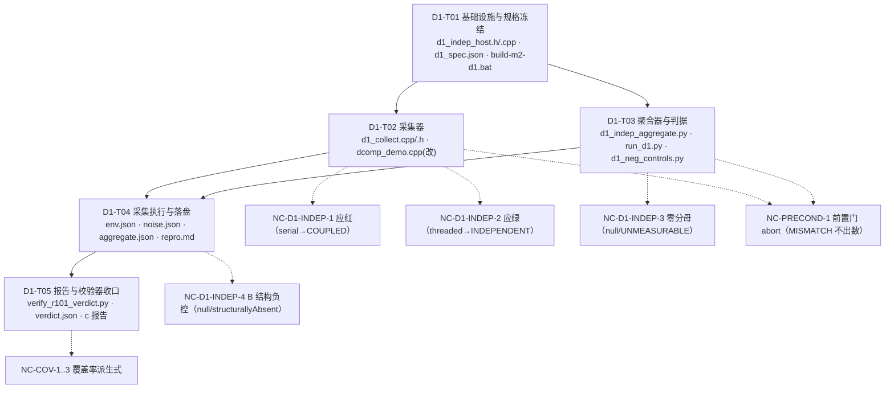
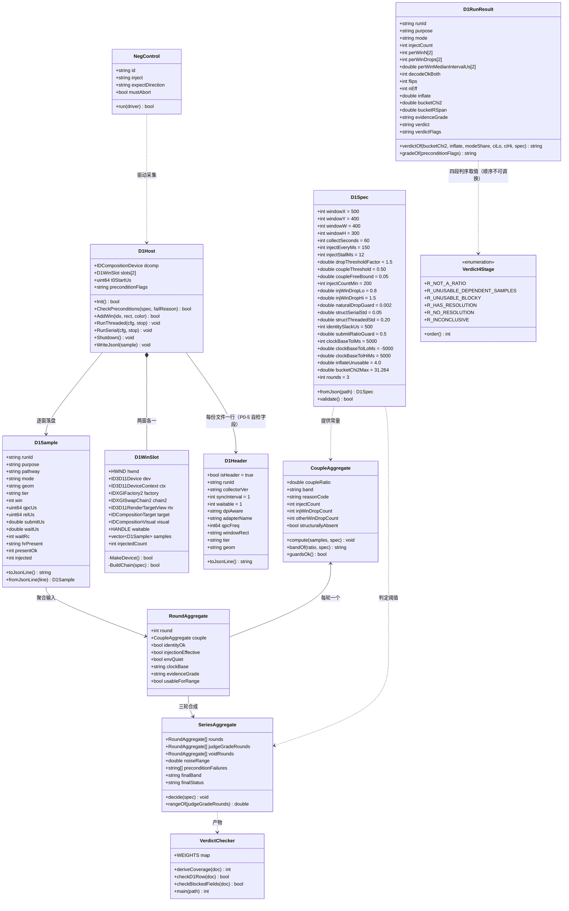
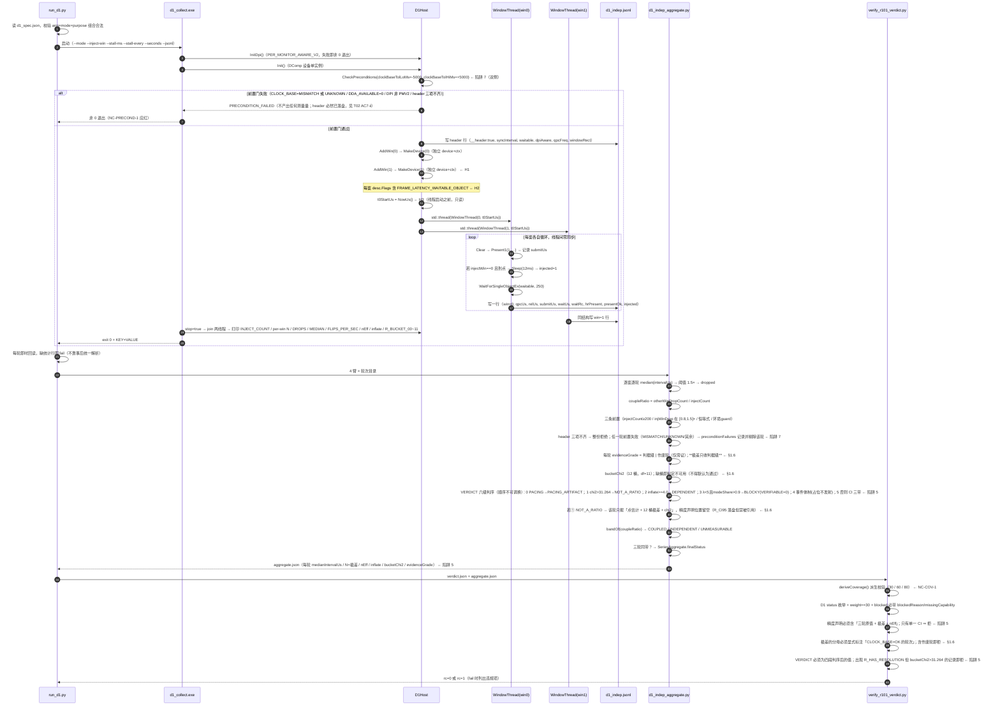

# R101 M2 · D1（层间对齐偏差）补测 · 架构裁定与任务分解（**定稿 v2.4**）

> **角色**：架构师 高见远（Bob）｜**轮次**：R101 M2 · D1 补测（SOP 阶段 1）
> **版本**：**v2.4 定稿**，取代 v2.3（1485 行 / 202,475 字节）、v2.1（1218 行 / 131,868 字节）、v2（1081 行 / 101,666 字节）与 v1（877 行，已作废——见 §0.3 撤回清单）。
> **本轮（v2.3）唯一的判定标准**：**每条实测证据必须能回答三个问题 —— ①它来自哪个文件哪个字段；②该轮的前置门（`CLOCK_BASE` / `DDA` / header / `injectCount`）是否全过；③它被允许参与什么运算。**
> 答不出②的一律降为**旁证**，答不出③的一律不进极差与阈值校准。**这条标准是 v2.2 全部改动的来源**（三处「用不合格证据支撑合格结论」的隐患，详见 §0.4）；**v2.3 另加一条方法学标准：比较两个区间必须用同一公式**（整轮 Wilson 与桶 Wilson 必须同法，见 §1.6）。
> **改动域（四轮，逐条可核）**：
> - **v2.1**（响应主理人第 12 条）：① §1.6 新增（`Δframe` 的 `R` 不可重复）；② §9-1/§9-2 案由重写（原文 + 路径校正）；③ §2.8-B 新增陷阱 5/6/7；④ 派生修订（§0.2b / §0.3 / §1.2 效力降级 / §6.3 两个新常量 / §6.4 两条新禁令 / §5 三卡 AC / §9-18/19/20 / §10.2 两条约束 / §11b 自检失误登记 / §13 三问）。
> - **v2.2**（v2.1 定稿后新证据入档，**不重开任何已签条款**）：① §1.6 由六轮补为**七轮**（补入 `d1r_base60b.log`，15:29:59），**并给出「证据等级」定义（判据级 / 作废轮旁证）**；② 全文倍率**只保留 `312.537`（`CLOCK_BASE=OK` 的五轮）**，**`321.4` 与 `313` 双双作废**（前者分子含 `MISMATCH` 作废轮 `selftest` 的 1.000000，后者把 `collect` 六轮误称"五轮"）；`base60b` 的 4.844 倍降级为**旁证**；③ 新增**三个互不依赖的体制判别器**：CI 不相交（6.669 倍）、`inflate` 恒等式 `√(165/FLIPS_PER_SEC)`（九轮验算，最大差 4.00%）、**桶间齐性卡方**（`lag60` 0.086 vs 其余 64.22~2706.58）；④ §2.8-B 陷阱 7 补两条实情：**`selftest` 跑的是旧 exe（现源码门限与当时不同 ⇒ 重跑无法复现该 bug）**、**`CLOCK_BASE=UNKNOWN` 同样会放行**（`base60b` 实测）；⑤ 新增「`UNKNOWN` 与 `MISMATCH` 同等严格」为 `NC-PRECOND-1` 的**第二子臂**，并把「双侧区间」写成 §6.4 禁令 6；⑥ 登记 `d1_r_probe.cpp` 已于 16:10:42 修好（含 abort + `VALID` 值 `R_NO_VERDICT_PRECONDITION_FAILED` + `return 11`），**该修复不再下派，本文件只要求 `d1_collect` 复制同一结构**。
> - **v2.3**（四处修订，全部为主理人第 13 条 Message G 指定；**仅这四处 + 其必然后果**）：① **§1.6 桶间 CI 由正态近似改为 Wilson**——原写法 `p − 1.96√(p(1−p)/n)` 在 `p` 接近 0 或 1 时不对称，与整轮 Wilson 不可比较；改为 Wilson 后**不相容的轮次由 2 轮变为 4 轮**（`rep1`/`base60`/`rep3`/`rep2`），并写死「比较两个区间必须用同一公式」；② **桶间齐性卡方升为 §9-1/§9-2 的案由 ⓪（置顶）**——`INJECT_LAG=0` 的七轮**全部 χ² 拒绝**（64.22~2706.58），唯一通过的是**注入轮** `lag60`（0.086）⇒ **自然态下 `R` 从来不具备比率语义**，这才是 `blocked(capability)` 的**最终理由**，比前三条更本质；③ **`VERDICT` 判序由三段改四段，`R_NOT_A_RATIO` 置第 1 位、`4.0` 降为第 2 位**（`inflate ≥ 4.0` 与 `FLIPS_PER_SEC ≤ 10.3125` 是同一判据的两种写法，χ² 才带独立信息）；④ **校验口径由「禁某个字面量」改为「禁孤立倍数」**——`11.82` 是有效值 `11.824` 的截断，字面量黑名单会误伤正确值（`5.6` 那个坑的重演）。
> - **v2.4**（team-lead 第 14/15 条 + 工程师第 7~8 代语料 + 22 轮全量回放，**十处**）：① **`MODE_SHARE` 从主判决降为「`χ²` 盲区专用」**——它在 20s 自然态子集 6/6 触发（零分辨力）、全语料 22 轮 15/22，准确说法是「同配置族内恒真、只在跨体制时有分辨力」；② **`PACING` 升为第 0 级判据**（`R_PACING_ARTIFACT`，整轮作废优先于降级），判序定稿为**六级**；③ **`χ²` 加功效门槛 `λ_b = O/12 ≥ 5`** —— `nc_pos8_g9`（`λ_b=0.917`、`χ²=23.26` 不拒绝）证明「不拒绝」在低功效下无意义，故原表述「七轮全部拒绝」改为「`λ_b≥5` 的 15 轮全部拒绝、零例外」；④ **「4.0 落在 6.02 倍空隙里」正式撤回**——新样本把空隙填到 `3.790→6.012`（1.586 倍），替代依据换成「恒等式 + 门槛鲁棒性（上方 10 值 8 个挤在 1.33 倍宽的带内）」；⑤ **新增 §14：AC6 与交叉判据的预置裁定**（`std` 判别式与 `P50` 判别式双双作废，替换为 `DRIFT_FRAMES` 与 `P95` 比值），并给 §6.4 禁令 2 立唯一豁免；⑥ **`inflate` 的恒等式升为 span 相消式** `inflate = √(frameRate × dwell)`，使「拉长窗口不救」从经验事实变成闭式结论；⑦ **T04 十轮落地后 §2.4-B 第 4 行恢复为「偶发失效出口」**（`INJECT_COUNT` 全部 `395~396 ≥ 200`），§2.3-A 处置框标注「结论保留、理由失效」；⑧ **`NC-1` / `NC-2` 由探针级升为判据级**（A-NC `1.010101 / 1.020202` 对 A-I 五轮 `0.010101~0.015152`，分离度 `66.67` 倍（保守）/ `100.00` 倍；余量 `3.300` / `2.020` 倍），**`NC-3` 由「未实测」变为「已实测且为红（4/4 假通过）」**，根因定位到 `d1_indep_probe2.cpp:599` 的 `(injCount > 0) &&` 守卫；⑨ **新增 §10.3「已知边界」**，把「加大 n 救不了参数不恒定」与「加大 n 救不了体制切换」写成**两条独立边界**并各给处置差异。**另：§14.2 / §14.3 各补一张「兼容性检查表」**，逐轮核对新阈值与 T04 实测是否兼容，并显式声明「实测值只用于兼容核对，不是选值依据」；⑩ **判序第 2/3 级对调（`inflate` 前移到第 2 级、`MODE_SHARE` 后移到第 3 级）**——我 v2.4 初稿按「补盲必需」把 `MODE_SHARE` 排在 `inflate` 前，22 轮全量回放证明那句因果是错的（`nc_pos8_g9` 的 `inflate=8.630` 无论哪一序都不会落 CI）；改按「信息量排序（闭式可重算 > 二值描述）」重排，并**如实登记 `R_UNUSABLE_BLOCKY` 阳性样本 = 0、标 `VERIFIABLE=0`、下派构造负控**。**新增 §14.4「diff-5 落盘格式」**（含 `d1r_rean18_*` 与 `d1r_c22_*` 两套日志的鉴别方法与 22 轮全量回放表）与 **§14.5「六级 vs team-lead 四级判序的差异逐条说明」**。
> **除以上四轮改动域外，其余 14 节与 v2 逐字一致。**
> **本文地位**：只做**裁定 + 分解**，不写实现代码。每一条裁定必须附依据（冻结文档节号 / 实测文件+字段 / 代码行号）。无法引用的一律标 `[设计判断]` 并说明理由。
> **判据事实源（只读）**：
> - `R101-M2-Spike-PRD.md`（**PRD**）：§3.0 三类标签、§3.1 D1/D2/D4、§3.2 三条锁、§3.3 C1、§3.4 D-1~D-6、§4.0 权重与覆盖率、§4.1 R-1~R-4、P0-1/P0-2/P0-5/P0-6/P0-12/P0-13
> - `R101-M2-判据与负控设计.md`（**判据**）：§0.2 负控隔离、§0.3 元规则第四条、§1 D2 判据、§2 D1 判据、§5 采集器字段、§6 噪声 N、§9 自检 10 问
> - `R101-M2-架构设计与任务列表.md`（**架构**）：§E-2 schema、§E-5 verdict schema、§E-7 Shutdown 分期、§B-8/B-10/B-11/B-12
> - `R101-M2-前置取证报告.md`（**取证**）：E16 / E16b / E16c
> - `r101-evidence/R101-M2-c-裁决报告.md`（**c 报告**）、`r101-evidence/verdict.json`
> - **实测证据（主理人本机，物理事实优先级高于任何文档）**：
>   - `native/build/m2probe/d1_indep_probe2.cpp`（**参考实现**，644 行，全组 EXIT=0）
>   - `native/build/m2probe/d1v2-out.txt` / `d1v2-b.txt` / `d1v2-c.txt` / `d1v2-serial.txt` / `s1.txt` / `s2.txt`
>   >   - **`native/build/m2probe/d1r_{selftest,base60,base60b,lag60,rep1,rep2,rep3}.log`**（`Δframe` 的 `R` **七轮**实测；源码 `d1_r_probe.cpp` 同目录，**注意 `native/build/` 被 `.gitignore:40` 忽略 ⇒ 原始日志不入库，数字靠本文档承载**）
>   - **`native/build/m2probe/d1r_{nc_pos,nc_pos2,nc_pre_plus,nc_pre_minus,nc_pre_unknown}.log`**（`NC-PRECOND-1` 四臂：两 `MISMATCH` + 一 `UNKNOWN` + **两应绿**；`nc_pos` 与 `nc_pos2` 是同版二进制的两个绿臂，分别 120832 / 121344 字节）
>   - **`native/build/m2probe/{s1.txt,s1_fix.txt,s2.txt,s2_fix.txt,d1v2-out/b/c/serial.txt}`**（`d1_indep_probe2` 探针级轮次；`*_fix` 是修掉 `INJ_WIN_UNDER_STALL_N` 之后的版本）
>   - 主理人实测时序数字（§1 逐条原样纳入）：`frameUs` 分箱、`waitUs` 分位、`submitUs` 两窗合计、`frameUs>9000` 计数、`grep` 线程结构

---

## §0 裁定摘要（先给结论）

### 0.1 六个原问题的最新答案（其余条款见 §2）

| 原问题 | v2 裁定 | 与 v1 的差别 | 依据 |
|---|---|---|---|
| **Q1 通路 A 的「层间」物理形态** | **不变**：背板 = 原生 DComp 窗 + 覆层 = Electron 透明可见顶层窗，同 rect 完全重叠。**但 D1 的判定不再依赖任何像素读数**，故 v1 的"空间分区标记"整套取消 | v1 用整节 §1.4-C 的"两层如何在同一抓帧内分别定位"去解遮挡；v2 证明**这个问题不存在** | PRD P0-2、架构 T02、架构 B-2；§2.1 |
| **Q2 A 侧 Δpx / Δframe 预期真值** | **撤回 v1 的「不恒为 0」结论**。裁定：Δpx / Δframe **在本机不可测**，记 `blocked(reason=capability)`。替换为可测的 `D1-INDEP`（两链是否被同一上游拖住） | v1 用 `R_nonZeroFrame` 作主统计量，**已被实测证伪**。**v2.2 再收一次**：驳回案由从「值太小/样本不足」改为「**不可重复**」——**`CLOCK_BASE=OK` 的五轮 `R` 跨 `312.537` 倍**，同配置 20s 三轮跨 `11.824` 倍（§1.6）；`base60b` 的 `4.844` 倍**只作旁证**（该轮前置 `UNKNOWN`） | §1.1~§1.6；§2.2 |
| **Q3 噪声 N 采集规模** | 每臂 **3 轮 × 60s**；D1 只有 165Hz 一档（A 侧 60Hz 物理不存在）。全矩阵 **10 × 60s = 600s** | v1 是 6 次；v2 是 10 次且**多了 1 次应红负控** | §2.5；c 报告 §E-1 |
| **Q4 条码与标记规格** | **全部取消**。不渲染条码、不做 DDA 解码、不做时钟桥、不做坐标 ×1.5 负控（NC-D1-3 自动消失） | v1 建了两张逐值几何常量表（§1.4 + §5.2）；v2 一个不留 | §2.1-C；§3.1 |
| **Q5 自检三项判据** | 换成**三条与判决量直接同源**的必要条件：① 正样本 `injWinDropCount ∈ [0.8, 1.5]×injectCount`（§2.3-B）；② 逐窗恒等式 `submit+wait ≤ interval+500µs`（§2.2-D）；③ 环境 guard `自然掉拍率 ≤ 0.2%`（§2.3-C）。**另有两条数据级前置**：header 行 `syncInterval==1`（§6.1）、`injectCount ≥ 200`（§2.3-A） | v1 的 S1/S2/S3/S4 是"先建仪器再自检仪器"；v2 的每一条自检**都是判决量成立的必要条件**，且数据级前置（header）由 P0-5 强制 | §2.3 / §2.2-D / §6.1 |
| **Q6 失败降级出口** | 状态转移**七行表**（§2.4；v2.1 由六行扩为七行，新增 `PRECONDITION_FAILED`），三态 `pass` / `tie` / `blocked`，**`fail` 禁用** | v1 允许 `fail`；v2 论证 D1-INDEP 越线不构成通路不合格；v2.1 补上「整轮无效」这一出口（否则前置门失效的轮只能冒充前三行） | §2.4 |

### 0.2 本轮最重要的五条裁定（按重要性排序）

| # | 裁定 | 一句话后果 |
|---|---|---|
| **1** | **主统计量 = `coupleRatio`，撤回 `singleWindowDropRatio`** | 整条链**不需要任何时间对齐** ⇒ §2.8 的**原四个**陷阱里两个从根上不存在、另两个登记为禁用（追加的陷阱 5/6/7 见 §2.8） |
| **2** | **覆盖率 80/100 是"理论上限"，当前真实覆盖率 = 30/100**，补完 D1 = **60/100**，不是 80 | 裁决仍 `conditional`（D3 未测）；`verify_r101_verdict.py` 的硬编码 80 必须改派生式 |
| **3** | **`D1 = pass` 的语义是「测量有效」，不是「A 合格」**；A 两链独立 ⇒ **层间撕裂真实存在，是风险项不是优势** | 报告须写「D1 判定完成，结构结论 = 两窗链路 INDEPENDENT」，禁止写「A 通过 D1」；完整论证见 **§2.4-D 方向悖论** |
| **4** | **改双线程同时修掉 D2 的「口径不等价」**：串行 A 的间隔含 2 次 Present + 2 次 Wait，B 只含 1 + 1 | **A 侧 D2 四行全部作废重出**，且"B 优"两条可能消失——不是性能变了，是被测区间变了 |
| **5** | **`submitUs`（两窗合计）废止**，改逐窗 `submitUs` + `submitMaxWinUs` | 并行下"合计"不是墙钟（两段重叠），沿用同名字即元规则第五条违规 |

### 0.4 本轮的三处「证据资格」修正（v2.2 新增，全部是我自己文档里的自相矛盾）

这三处的共同形态是：**结论本身没错，但用来支撑它的样本按我自己的规则不合格**。它们比算错更危险，因为算错会被复核抓住，而"合格结论 + 不合格样本"看起来完全正常。

| # | 自相矛盾 | 我的规则说什么 | 实测事实 | 处置 |
|---|---|---|---|---|
| **1** | §2.3-A 前置条件 `injectCount ≥ 200` **vs** 五组探针全部 `injectCount = 52` | 按条件 ①，五组**全部作废** ⇒ `coupleRatio` 零有效实测支撑 | `s1_fix` / `s2_fix` / `d1v2-out,b,c` 全部 `SECONDS=8.00 STALL_EVERY_MS=150.0` ⇒ `8/0.15 = 53`，实测 `INJECT_COUNT=52` | **不降阈值，改分级**：五组降为**探针级**（能证明"判据非恒真"，不能校准阈值）；判据级证据等 T04 的 60s 轮（400 次注入，5 轮共 5 分钟）。同时 §2.4-B 第 4 行**显式标注"现状下恒真"**，不让它冒充偶发失效出口 |
| **2** | §1.6 的倍率 `321.4` **含两轮不合格样本** | 「极差只收合格轮次」 | `321.4` 的分子是 `selftest` 的 1.000000，而该轮 `CLOCK_BASE=MISMATCH`（且跑的是旧 exe）；`base60b` 的 0.200731 则是 `CLOCK_BASE=UNKNOWN` | **删 321.4，只留 312.537**（`CLOCK_BASE=OK` 五轮）；`base60b` 标**作废轮（仅旁证）**，其 4.844 倍口头保留、不进算术。**同时把「`collect` 五轮」这个称呼改掉**——`collect` 实际六轮，两种集合碰巧同值会让 M3 以为是同一口径 |
| **3** | §2.3-E 把 `NC-3`/`NC-4` 标「已实测」 | 「已实测」= 有文件、有字段、能变红 | `NC-3`（`--stall-ms=0` 零分母）**没有任何文件**，其依据是 `s1.txt` 的**时间窗**空集教训（那是另一个量的空集）；`NC-4`（B 侧结构负控）**同样零文件** | **两条都改标「未实测」**，并写明升级路径（`NC-3` 只需一轮 8s，`NC-4` 已在 T04 的 10×60s 矩阵内）。**这正是 §2.8 里我自己要拦的那种事，不能只拦别人** |

**三处的共同禁令（升格为项目级）**：**结论的强度不得超过其所用样本的等级。**具体化为三条：
1. **凡参与算术（极差、均值、阈值校准、比值）的样本，必须全部通过同一前置门**；混入一个不合格样本，整个算术作废重算，不允许"去掉一个不影响结论"。
2. **凡"已实测"的声明必须指到文件+字段**，指不到的一律写「未实测」，**不允许写"逻辑上必然成立"代替实测**。
3. **同一集合必须有唯一名称**：`CLOCK_BASE=OK` 的五轮 ≠ `collect` 六轮 ≠ 七轮全表。**两个不同集合碰巧同值时，必须把分母写出来**，否则下游会把同值当成同口径。

### 0.5 v2.4 我自己纠正的四处（续 §0.4 的同一主题：结论的强度不得超过样本的等级）

| # | 我 v2.2/v2.3 写的 | 被什么推翻 | 处置 |
|---|---|---|---|
| **1** | 「`4.0` 落在 `lag60 1.002` 与 `base60 6.030` 之间的 **6.02 倍空隙**里」 | 语料从 8 轮扩到 12 份可算 `inflate` 的日志后，空隙里进了 4 个样本（`nc_pos3 3.359`、`base60b 3.790` 在下方；`nc_pos4 7.551`、`nc_pos5 7.502`、`nc_pos6 6.526` 在上方）⇒ **真实空隙缩到 `3.790→6.012`（1.586 倍）** | **撤回空隙论证**，改引「恒等式（闭式可重算）＋门槛鲁棒性（上方 10 值 8 个挤在 1.33 倍宽的带内，门限改 5.0/8.5 不改判决）」。**教训：经验空隙是会被下一个样本推翻的，闭式不会。** |
| **2** | 「自然态七轮**全部** `χ²` 拒绝」 | `nc_pos8_g9`：`χ² = 23.26 ≤ 31.264`（**不拒绝**），且它是 `lag=0` | **不改结论、改表述并加门槛**：它的 `λ_b = 11/12 = 0.917`（每桶期望事件 < 1）⇒ **无功效的不拒绝没有意义**。原文改为「`λ_b ≥ 5` 的 15 轮全部拒绝、零例外」，并新增常量 `CHI2_POWER_MIN_EVENTS=5`。**教训：把一个统计量当门之前，必须先写它的功效条件，否则「全部拒绝」会在第一个小样本上失效。** |
| **3** | 「`base60b` 提供两条旁证：①`UNKNOWN` 会放行 ②`MODE_SHARE > 0.9` 规则不完备」 | `nc_pre_unknown`（判据级、带 `BINARY_SIZE` 自证 + 三条 abort 行）已经能独立举证第 ① 条 | **第 ① 条转出**给 `nc_pre_unknown`；`base60b` 只留第 ② 条（它是**唯一 `MODE_SHARE < 0.9` 的 60s 轮**）。见 §1.6 末「补录的理由」。**教训：同一个事实有两份证据时，举证责任应归证据等级高的那份，否则低等级样本会被"顺便"用成判据级。** |
| **4**（本轮新增） | 「`MODE_SHARE` 必须在 `inflate` **之前**（第 2 级）」＋「若删掉该级，`nc_pos8_g9` 会落进 CI 三带被报成有分辨力」 | ①`nc_pos8_g9` 的 `inflate = 8.630 ≥ 4.0` ⇒ **无论哪一序都不会落进 CI**，我那句因果是错的；② 只有 1 份轮次落在盲区且它同时满足两级 ⇒ 两序的差别只在标签上，**用"补盲必需"当理由站不住** | **顺序改回 `inflate` 在前（与 `VerdictV6` 一致）**，理由换成「信息量排序：闭式可重算 > 二值描述；否则证据强度顺序与判据执行顺序相反」；并**如实登记 `R_UNUSABLE_BLOCKY` 阳性样本 = 0，标 `VERIFIABLE=0`，配构造负控**（`n=700 / MODE_SHARE=0.915714 / FLIPS=118 / inflate=2.425342 / λ_b=4.916667`，见 §2.8-B 陷阱 5 ⑤③ 与 §14.4 第 3 条）。**教训：顺序调整若靠"某个样本会掉到哪"来论证，就等于拿样本挑判据；顺序只能靠"信息量 / 语义优先级"来论证。** |

**四处的共同诊断式（比四处本身更值得记）**：**它们都不是算错，而是"当时只有 8 轮语料"或"当时还没做全量回放"这个条件的产物。** 语料扩充或做一次 22 轮全量回放后，任何以「全部 / 从未 / 恰好落在空隙里 / 若删掉就会掉进 X」形式写下的断言都会最先失效 —— **所以本文件此后凡出现「全部 / 唯一 / 恰好 / 若删掉就会」，必须同时写清它的样本集合与检查功效**（`λ_b`、`n`、轮数），否则视为未预置。

### 0.2b 对主理人第 2~13 条输入的逐条回应索引（12/12 全覆盖，便于核对）

| 输入 | 我的处置 | 落点 |
|---|---|---|
| 第 2 条：Δframe 是构造结果 + 时序实测 + NC-D1-3 可能恒真 + 抖动污染 Δpx | **全采纳**；v1 结论撤回；要求单列「D1 区分力裁定」节 | §1.1 / §1.2 / §2.1-C |
| 第 3 条：撤"相邻 vsync"，k=2=0、waitUs 单峰、92.6% | **全采纳**，用于 §1.2 四条硬数据 | §1.2 |
| 第 4 条：A 单线程串行（grep 0 命中），B 有 worker | **全采纳**，用于否决 (c) | §1.3 / §1.5 |
| 第 5 条：`singleWindowDropRatio` 作主统计量 | **部分不采纳**：主统计量改 `coupleRatio`（同信息、无对齐依赖） | §2.2-B / §3.1 |
| 第 6 条：产品裁决 1（转层间独立性）+ 裁决 2（授权改双线程）+ 四样交付 | **全采纳**；两处部分推翻（tie 不记 blocked；覆盖率 60 不是 80） | §2.4 / §3.3 / §3.4 / §5 / §10 |
| 第 7 条：阈值标定 1 + 逐窗标定 2 + `submitUs` 语义 + 恒等式 | 标定 1/2 与恒等式**全采纳**；`submitUs` 保留合计 **不采纳**（改逐窗 + `submitMaxWinUs`） | §2.2-C / §2.2-D / §2.6 |
| 第 8 条：`frameIdx` 必须 QPC 派生 / t0 共享 / collector 只落原始量 | **全采纳并加强**：判决链里**根本不要 `frameIdx`** | §2.7-H3 / §6.1 / §6.2 |
| 第 9 条：注入升级为样本来源 + 采集矩阵 + 0.80/0.20 阈值 + 口径声明 + purpose 隔离 | 矩阵**部分不采纳**（B 不采注入臂）；阈值数值**改 0.05/0.50**（形式全采纳）；口径声明句**采纳**；purpose 隔离**全采纳** | §2.3-B2 / §2.3-F / §2.5 |
| 第 10 条：探针实测 + 两个坑 + 参考实现路径 | **全采纳**（H1/H2 写成硬约束） | §1.4 / §2.7 |
| 第 11 条：三件套通过 + 主判据 `coupleRatio ≥0.5` + 两个恒真陷阱 + 影响声明 | 判据**采纳**（阈值同 0.5）；两个陷阱**两个都消灭**（不是修好）；影响声明**采纳并扩写** | §2.3 / §2.8 / §10 |
| 第 12 条：#2 处置结论采纳；**我的量级理由（R=0.04%）被实测推翻**，真因是「R 不可重复、由采样起点决定」；§9-2 按主理人原文改；三个新判据缺陷登记进 §2.8 | **全采纳**。我撤回「R 的量级 = 0.0429%、与 D2 `dropRate` 同批、独立信息量为 0」这三句（这是用一个量的分布推另一个量的量级）；驳回案由改为三条：构造恒真 / 同 vsync 合成 / **`Δframe` 跨 `312.537` 倍不可重复**（`CLOCK_BASE=OK` 五轮）。§9-2 逐字采用主理人原文（仅校正日志路径），§2.8 新增陷阱 5/6/7。**v2.2 追加**：第 7 轮 `base60b` 收进表但标为**作废轮（仅旁证）**，其 `4.844` 倍不参与极差；**全表新增 `CLOCK_BASE` 与 `证据等级` 两列** | §1.6 / §2.8 / §9-2 |
| 第 13 条（Message G）：① 两证据（`inflate` 恒等式、桶间卡方）独立复算成立；② **桶 CI 必须换 Wilson**（我用了正态近似，方法不一致）；③ **自然态七轮全部 χ² 拒绝，唯一通过的是注入轮 ⇒ 这是 `blocked` 的最终理由**，应置顶为第四条案由；④ **`4.0` 接受但降级，判序加 `R_NOT_A_RATIO` 在第 1 位**；⑤ `base60b` 保留但举证责任转移给 `nc_pre_unknown`；⑥ **校验口径改「禁孤立倍数」**（`11.82` 是 `11.824` 的截断） | **全采纳（四处全改）**：① 桶 CI 换 Wilson 后**不相容轮次由 2 轮变 4 轮**（`rep1 0.050204 / base60 0.074936 / rep3 0.087478 / rep2 0.008195`，我方独立复算与主理人逐值一致）；② χ² 升为 §9-1/§9-2 **案由 ⓪**（置顶）+ §1.6 驳回表新增 ⓪ 行 + 三条必然后果；③ `VERDICT` 改**四段**（`R_NOT_A_RATIO` → `inflate` → `modeShare` → CI），并写明「`R_NOT_A_RATIO` ≠ 探针坏了」与「判死正样本 `nc_pos2` 是对的」；④ `INFLATE_UNUSABLE` 的「重标定触发」列写入逐字句；⑤ 新增 **§13b** 专节讲「禁孤立倍数」及其实验室判据；⑥ `base60b` 的旁证由两条收窄为一条（`UNKNOWN` 放行一事改由 `nc_pre_unknown` 举证） | §1.6 / §9-1 / §9-2 / §2.8-B(5,6) / §5 T02-AC8 / §6.3 / §13-14 + §13b |

### 0.3 v1 撤回清单（逐项，防止旧结论回流）

| v1 的内容 | v2 处置 | 撤回依据（实测） |
|---|---|---|
| 主统计量 `R_nonZeroFrame = P(Δframe≠0)`，机制 M1/M2 | **撤回** | ① `dcomp_demo.cpp` L186-231：`for(f){ for(i){...fprintf(...,f,...)}}` —— 两窗必然同 `f`，Δframe 是循环的构造结果；② 实测 `frameUs` 按 6060µs 分箱 `{k=1:10093, k=3:4}`，**k=2 为 0**（10097 帧）—— 两窗同 vsync 上屏；③ `waitUs` 单峰（p5=5312 / p95=5833，跨度 521µs）；④ `sum(wait)/frameUs = 92.6%`，submit 仅 7.35% |
| `dpxP95` 降级为旁证 | **撤回**（不是降级，是整条口径记 blocked） | **理由已重写（v2.1，主理人第 12 条）**：原写「`frameUs>9000` 仅 13/30291 = 0.0429%，p95 需 ≥20 样本」——这是**用一个量的分布去推另一个量的量级**，已被实测推翻（§1.6）。现依据为三条：① 构造恒真（`dcomp_demo.cpp` L186-231）；② 同 vsync 合成（`frameUs` 分箱 `k=2` 计数 = **0/10097**）；③ **`R` 跨 `312.537` 倍不可重复**（`CLOCK_BASE=OK` 五轮：`base60 0.972304 / lag60 0.751060 / rep1 0.025148 / rep2 0.003111 / rep3 0.036786`，极差 `0.972304/0.003111 = 312.537`；同配置 20s 三次重复 `0.025148/0.003111/0.036786` = **11.824 倍**；`SERIES_SHAPE=BLOCKY_PHASE_DRIFT`，`MAX_RUN=2307` 帧 ÷ 165Hz = **13.98s**）。**`base60b` 的 `4.844` 倍只作旁证**，不进极差（该轮 `CLOCK_BASE=UNKNOWN`）。**注**：`13/30291` 这个数仍在 §1.2 作为「串行基线下两窗同 vsync 合成的旁证」保留，**但不再作为任何量级或信息量的依据** |
| 条码 6bit+CRC2、8px/帧、period 128、1300px/s、1px≡0.758ms | **全部取消** | 无像素判据即无这些量（§2.1-C） |
| S1 时钟桥 / S2 静止自检 / S3 归零自检 / S4 层可分性 | **全部取消** | 同上；且 S2 的"静止自检"本身要靠条码定义（v1 §1.5-2 已识别该缺陷） |
| NC-D1-2（注入 2 帧错位） | **取消** | 无 Δpx 可注入 |
| NC-D1-3（坐标 ×1.5） | **取消**（主理人第 2 条已指出可能是恒真；v2 里它连作用对象都没有） | §2.1-C |
| `sync.jsonl`（bpIdx/ovIdx/dpx/dframe） | **取消**，改逐窗 `d1_indep.jsonl` | §6.1 |
| 覆盖率按 PRD §4.0 派生（v1 §2-2） | **保留并强化** | PRD §4.0 原文公式 |
| D3 未采集 → 补 D1 后仍 `conditional`（v1 §2-1） | **保留并强化** | c 报告 §C 原文「D3 长稳未做」；`grep -c soak verdict.json` = **0** |
| 双窗空间分区（marker y∈[64,72) / [104,112)） | **取消** | 无遮挡问题（不读像素） |

---

## §1 D1 区分力裁定（含主理人实测修正）

> 本节是原任务"最关键的第 1、2 问"的正式答案。主理人在我工作期间实测了 **5 组**物理事实：第 1~4 组（§1.1~§1.4）**直接推翻了我 v1 的 §1.2**；第 5 组（§1.6，v2.1 新增）**推翻了我 v2 的驳回案由**。本节把 5 条实测原样纳入，并给出最终选择。
>
> **§1.1~§1.5 与 v2 逐字一致；§1.6 为 v2.1 新增。**

### 1.1 实测事实 ①：Δframe ≡ 0 是**构造结果**，不是测量结果

**原文事实**（主理人第 2 条）：`dcomp_demo` 现有形态下 `for(f) → for(i) → 同一 frameIdx`，Δframe 恒 0 由循环保证 ⇒ **断言恒真**。

**代码复核（我自己读的，不只是采信）** `native/spike-glass/src/dcomp_demo.cpp` L186-231：

```cpp
for (int f = 0; f < frames; ++f) {           // L186
  ...
  for (size_t i = 0; i < n; ++i) {           // L196  两窗串行，同一线程
    host->ClearWindow(i, spec.clear_color);
    host->PresentWindow(i, sync_interval);
    ...
    const DWORD rc = host->WaitWindow(i, 250);
  }
  ...
  fprintf(jsonl, "{\"frameIdx\":%d,...}", f, ...);   // L221-228  只有这里用 f
}
```

**两窗的 `frameIdx` 都取自同一个 `f`** ⇒ 任何"基于当前 `dcomp_demo` 的 Δframe 测量"测到的是循环变量，不是通路 A 的物理属性。这与 E16c 的 `nonBlack>0` 同类：**判据被构造满足，永远为真**。

### 1.2 实测事实 ②：两窗在**同一个 vsync 边界**被 DWM 合成（A 侧串行基线）

**原文事实**（主理人第 2、3 条）：A 侧 `submitUs` 两窗合计 mean=444.8 / max=1730.9，占 frame 的 **7.35%**；`frameUs − 6060µs` 的 mean = **−5.17µs**；跨一个 vsync 需 1173 帧。

**四条硬数据（主理人第 3 条给出，我逐条采信并用于后续推算）**：

| 实测 | 值 | 它排除了什么 |
|---|---|---|
| `frameUs` 按 6060µs 分箱 | `{k=1: 10093, k=3: 4}`，**k=2 = 0**（10097 帧） | 排除"两窗分别落在相邻两个 vsync" |
| `waitUs` 分布 | p5=5312 p25=5505 p50=5628 p75=5724 p95=5833 p99=5901 µs，跨度 **521µs**，**单峰** | 排除"两个窗各自等一次 vsync（应为双峰）" |
| `sum(waitUs) / frameUs` | 5609.7 / 6054.8 = **92.6%**，submit 仅 **7.35%** | 位置：一帧的时间预算里 92.6% 在等 vsync |
| `frameUs > 9000` 帧数 | **4 / 10097 = 0.0396%**，且这 4 帧 `waitUs` 落在 17000~18800µs 区间（2.8~3.1 个 vsync 的长停顿） | 长间隔是天级别的偶发停顿，不是常态错位 |

**推论（可计算，非猜测）**：一轮 60s 的 `frameUs > 9000` 事件期望 = (4/10097) × 9900 = **3.92 个**；三轮合计 = (4/10097) × 30291 = **12.0 个**，实测为 **13 个**，差 1 个（泊松抽样正常）。**p95 需要 ≥20 个样本才有定义**（判据 §1.1/§6 口径），13 < 20 ⇒ **在以 `frameUs` 为分母的样本率下，Δframe / Δpx 的 p95 没有定义**：干净时恒 0，异常时样本不足。

> **⚠️ 本段效力降级（v2.1，主理人第 12 条裁定）**：上面这四条硬数据只说明**串行基线下 `frameUs` 这个量的分布**，它们**不能**用来推 `Δframe` 的量级。我 v2 曾据此推出「`R` 的量级 = 0.0429%」——那一步是**用一个量的分布去推另一个量的量级**，已被实测推翻（`CLOCK_BASE=OK` 五轮 `R` 跨 **312.537 倍**；同配置 20s 三轮跨 11.824 倍，见 §1.6）。**本段自此刻起的身份：`frameUs` 分箱与 `waitUs` 单峰仍是「两窗同 vsync 合成」的旁证（这部分成立、保留）；而 `13/30291` 这个具体数字不再出现在任何「量级」或「信息量」的论证里。** 驳回 `Δframe/Δpx` 作为主统计量的**决定性**理由改为 §1.6 的「不可重复」。**登记为教训**：同一份帧里 `frameUs` 与 `Δframe` 是两个独立量，前者的分布对后者的取值**没有任何约束力**——「从 A 的分布推 B 的量级」这一类推理在本项目里出现过两次（另一次是 v1 的 `R_nonZeroFrame` 机制推断），两次都错。

### 1.3 实测事实 ③：A 侧是**单线程串行**，B 侧有独立 worker

**原文事实**（主理人第 4 条）：`grep -n "std::thread|CreateThread|_beginthread" dcomp_host.cpp dcomp_demo.cpp` → **0 命中**；`osr_host.cpp:830 impl_->worker = std::thread(...)` → **B 有，A 没有**。

**架构含义**：串行结构下，任一窗的一次 stall 一定推后另一窗的 Present（`Sleep` 发生在另一窗 Present 之前）⇒ **A 在"层间独立性"上与 B 同构**（B 只有一条链，物理上不存在"另一层独立"这件事）。所以：

> **不改实现，"层间独立性"在 A 侧恒为"耦合"；这项测量在 A 上拿不到任何 B 拿不到的信息。**

### 1.4 实测事实 ④：改成真双线程后，两链**独立**，区分度是二值分离

**参考实现** `native/build/m2probe/d1_indep_probe2.cpp`（644 行，全组 `EXIT=0`）。结构要点（读源码核实）：每窗一个 `WinSlot`，**各自持有独立 `ID3D11Device` + `ID3D11DeviceContext`**（L88-89），线程间零同步，共享的只有 `t0StartUs`（L397，**两线程启动前取一次**）与只读 `cfg`（L281-282）。

**五组有效实测 + 一组不可采信的旧构建（`s2.txt` / `d1v2-out.txt` / `d1v2-c.txt` / `d1v2-b.txt` / `s1.txt`；`d1v2-serial.txt` 见下方脚注）**：

| 组 | 模式 | `INJECT_WIN` | `INJECT_COUNT` | `DROP_COUNT_INJ_WIN` | `DROP_COUNT_OTHER_WIN` | `INDEP_VERDICT` | 应有结论 |
|---|---|---|---|---|---|---|---|
| s2（应绿） | THREADED | 0 | 52 | **53** | **1** | INDEPENDENT | 独立 ✓ |
| d1v2-out | THREADED | 0 | 52 | 52 | **0** | INDEPENDENT | 独立 ✓ |
| d1v2-c | THREADED | 0 | 52 | 52 | **0** | INDEPENDENT | 独立 ✓ |
| d1v2-b（反向） | THREADED | 1 | 52 | 53 | **1** | INDEPENDENT | 独立（反向）✓ |
| **s1（应红）** | **SERIAL** | 0 | 52 | **53** | **53** | **COUPLED** | 耦合 ✓ |

**分离度（可计算）**：线程化 `1/52 = 0.0192`；串行 `53/52 = 1.0192`；**比值 53×，二值分离**。比 D2 全部 `Δ/N = 1.45~3.07` 的弱信号强一个量级。

**正样本**（`s2.txt`、`d1v2-out.txt`）：注入窗 `GAP_P50` 从 6.0520ms 涨到 **14.6885 / 15.4015ms**（+143% / +155%），`INJECTION_VERDICT=INJECTION_EFFECTIVE`。

**同向负控**（`OTHER_P50_DELTA_MS`）：0.0050 / 0.0090 / 0.0120 ms = **5~12 µs**，而注入造成的延迟是 **12000 µs** ⇒ **3 个数量级分离**。

> **溯源脚注（不许省略）**：`d1v2-serial.txt` 是**加主判据之前的构建**（输出里无 `DROP_COUNT_*` 行，只有 `OTHER_P50_DELTA_MS`），因此它那行的 `INDEP_VERDICT=INDEPENDENT` **不可采信**，本文件只在 §2.2-B 引用它的 `OTHER_P50_DELTA_MS=-6.0610` 作为"空集被算成 0 后减出负数"的反例证据。真正的串行应红证据是 `s1.txt`（含 `DROP_COUNT_*`，判 `COUPLED`）。**采集器定稿时必须保证 `--mode=serial` 走主判据**，否则应红对照会退化成假绿。

### 1.5 最终选择：**(b) 改 A 为真双线程 + 补 D1**（不是 (a) 不补，也不是 (c) 不改实现换口径）

原始三选一的处置：

| 选项 | 处置 | 理由 |
|---|---|---|
| **(a) 不补 D1** | **否决** | 已有新的可测口径（`coupleRatio`）且区分度二值分离；不补等于放弃一条**已知能测出**的结构信息。v1 §2-1 的"D1 补了也只有 60/100"仍然成立，但 60 > 30 |
| **(c) 换口径、不改实现** | **否决** | 主理人第 4 条实测：A 单线程串行 ⇒ 不改实现时 `coupleRatio` **恒落在 1.000 量级（COUPLED）**，这个 1.0 是串行结构的必然而非 A 的物理属性 —— 与 v1 的 `R_nonZeroFrame` 犯同一个错：**仪器与被测对象同构**（参考实现文件头 L1-10 已把这条教训写在源码里） |
| **(b) 改实现 + 补 D1** | **采纳** | 产品裁决 2 已授权；PRD P0-2 对 A 的定义是「双窗 + DirectComposition」，**未规定单线程串行**；且实测证明改后测量成立 |

**产品裁决 2 的落地表述（供报告引用，不许改语义）**：

> 「通路 A 的 DComp 双交换链，其存在理由就是让两个窗口**各自独立**地被合成；单线程串行是实现的落后形态，不是通路 A 的另一种合法形态。因此将 A 改为双线程属于**实现补齐**，不属于裁决口径变更。」

**但我必须补一条 v1 没写的连带后果**（见 §3.2）：**双线程同时改变了 D2 的被测区间**，所以 D2 的 A 侧数据必须一并重出，且"重出后可比"才是真正的可比。

### 1.6 实测事实 ⑤：`Δframe` 的 `R` **不可重复**，数值由采样起点决定（主理人第 12 条；v2.2 由六轮补为**七轮**，并分判据级/旁证两级）

> **本小节存在的唯一理由**：我 v2 曾用 §1.2 的 `frameUs` 分箱推出「`R` 的量级 = 0.0429%、与 D2 的 `dropRate` 同批、独立信息量为 0」。**这个推理是错的**，而它错的方式会让 M3 读出「换台更快的机器或调高采样率，`R` 就有用了」。真结论是**换任何机器都没用**，因为相位驻留是结构性的。故单列本节，把驳回理由换掉。

**表 1.6 用到的「证据等级」定义（本节与 §2.3-E 共用，先钉死，避免同一轮在不同节被标成两种身份）**：

| 等级 | 准入条件 | 能否进入极差/阈值校准/取值范围 | 能否作方向旁证 |
|---|---|---|---|
| **判据级** | 前置门全过（`CLOCK_BASE=OK`、`DDA_AVAILABLE=1`、header 三项齐）＋ 二进制可溯源（`BINARY_SIZE`/`BINARY_MTIME_FILETIME` 与构建记录对得上） | **能** | 能 |
| **旁证级**（表中记作「**作废轮**（仅旁证）」） | 前置门有失（`MISMATCH` / `UNKNOWN`）或二进制与构建记录对不上 | **不能**——不得进入任何极差、阈值校准、取值范围 | **能**，但每次引用必须带「旁证」二字 |
| **作废** | 既非判据级也无旁证价值（本批无此类） | 不能 | 不能 |

> **「作废」的准确含义（工程师先提出，我采纳并写成硬定义）**：作废是**「当证据」的资格**，不是**「数字」的封印**。`base60b` 的 0.200731 仍是真实测出来的数，可以引用；但它不能进入「`R` 跨多少倍」的算术，因为那个算术是在证明「该量不可重复」——用一个前置门未过的轮次去支撑「不可重复」的结论，等于**用无效样本证明无效性**，这是本轮 §2.8 拦的那一类事。**故：极差、阈值校准、取值范围一律只收判据级轮次。**

**实测七轮**（`native/build/m2probe/d1r_*.log`）。**二进制世代必须分开看，否则会读成"七轮同二进制"**：`selftest`（14:56:22）跑的是 14:59:50 源码之前的旧 exe；`base60 / base60b / lag60 / rep1 / rep2 / rep3` 六轮（15:02:25 ~ 15:29:59）跑的是 15:00:34 版；该版已于 **16:10:50** 与 **16:54:52** 两次重建（修前置门、修判决链）。**本文档引用的七轮数字全部来自 15:00:34 版**，与 `16:10:42` 之后的重建无关——重建只影响前置门与 `VERDICT` 判序，不影响 `R` 的定义。

| 轮 | 时长 | **`CLOCK_BASE`** | `INJECT_LAG` | `DECODE_OK_BOTH`（= `R` 的分母） | **`R`** | `R_CI95` 半宽 | `MODE_SHARE` | `MAX_RUN` | `FLIPS` | `n_eff` | **`inflate`** | `SERIES_SHAPE` | `VERDICT` | 证据等级 |
|---|---|---|---|---|---|---|---|---|---|---|---|---|---|---|
| `selftest` | 4s | **`MISMATCH`** | 0 | 909 | 1.000000 | 0.002104 | 1.000000 | 单块 | 0 | 1 | 30.150 | — | `R_HAS_RESOLUTION` | **作废轮**（前置 `MISMATCH`；且跑的是旧 exe） |
| `base60` | 60s | `OK` | 0 | 10146 | **0.972304** | 0.003198 | 0.969840 | **2307** | 278 | 279 | 6.030 | `BLOCKY_PHASE_DRIFT` | `R_HAS_RESOLUTION` | **判据级** |
| `base60b`（v2.2 补录） | 60s | **`UNKNOWN`** | 0 | 10128 | 0.200731 | 0.007800 | 0.799269 | 1034 | 704 | 705 | 3.790 | `BLOCKY_PHASE_DRIFT` | `R_HAS_RESOLUTION` | **作废轮**（仅旁证）：前置 `UNKNOWN`，overlay 15:28:54 重建后丢 `READY_NS`，原生侧 20ms 轮询落在 `READY` 与 `READY_NS` 两次 `appendFileSync` 之间（读竞态） |
| `lag60` | 60s | `OK` | **1** | 10143 | **0.751060** | 0.008414 | **0.248940** | **2** | 10100 | 10101 | **1.002** | `PER_FRAME_JITTER` | `R_HAS_RESOLUTION` | **判据级** |
| `rep1` | 20s | `OK` | 0 | 3539 | **0.025148** | 0.005182 | 0.974852 | 1068 | 75 | 76 | 6.824 | `BLOCKY_PHASE_DRIFT` | `R_HAS_RESOLUTION` | **判据级** |
| `rep2` | 20s | `OK` | 0 | 3536 | **0.003111** | **0.001912** | 0.996889 | 1792 | 13 | 14 | **15.892** | `BLOCKY_PHASE_DRIFT` | `R_INCONCLUSIVE` | **判据级** |
| `rep3` | 20s | `OK` | 0 | 3534 | **0.036786** | 0.006224 | 0.963214 | 737 | 93 | 94 | 6.132 | `BLOCKY_PHASE_DRIFT` | `R_HAS_RESOLUTION` | **判据级** |

> **`n_eff` 与 `inflate` 的口径（必须写死，否则同一轮能算出两个数）**：`n_eff = FLIPS + 1`；`inflate = √(n / n_eff)`，其中 **`n` = `DECODE_OK_BOTH`（即 `R` 的分母），不是 `FRAMES_CAPTURED`**。理由：`R` 是 `nonzero / DECODE_OK_BOTH`，参与估计的样本数是 `DECODE_OK_BOTH`，用采集帧数当 `n` 会把解码失败的帧也算成有效样本。**本文档全部 `inflate` 一律用 `DECODE_OK_BOTH`**（`rep1` 用 `3539` 得 6.824；若误用 `FRAMES_CAPTURED` 3550 会得 6.835 —— 两者差 0.011，不影响任何判决，但**只允许前一个数出现在文中**）。`selftest` 的 `FLIPS=0` ⇒ `n_eff=1`，`inflate` = √(909/1) = 30.150，这是「整轮只有一个块」的退化值，**只作上界参考，不参与任何算术**（该轮已作废）。

**四条可计算结论（全部由表内数字直接算出，不含估计）**：

| # | 结论 | 算术（分子分母都逐轮点名，可复核） |
|---|---|---|
| **1** | **`CLOCK_BASE=OK` 的五轮，`R` 跨度 = 312.537 倍** | 上端 `base60 = 0.972304`，下端 `rep2 = 0.003111`：`0.972304 / 0.003111 = 312.537`。**分母只收判据级轮次**；含 `lag60`（0.751060）时极差不变（它在区间内），故「四轮」与「五轮」都是 **312.537**——**这正是必须写清分母的原因**：M3 看到同一个数会以为口径相同，其实是两个不同集合碰巧同值 |
| **2** | **同配置（`injectLag=0`、20s、同二进制）三轮跨 11.824 倍**；并入 `base60` 的 60s 轮后跨 312.537 倍 | 20s 三轮：`0.036786 / 0.003111 = 11.824`（`rep3 / rep2`，两轮均 `CLOCK_BASE=OK`）；60s vs 20s：`0.972304 / 0.003111 = 312.537` |
| **3** | **`rep2` 的 Wilson CI 半宽只有 0.001912，预测不到 11.824 倍** ⇒ 独立性假设已被破坏，CI 是假的 | `rep2` `n_eff = FLIPS + 1 = 14`（不是 `3536`）；`inflate = √(3536/14) = 15.892` ⇒ 修正半宽 `0.001912 × 15.892 = 0.030386`，与 11.824 倍的跨轮波动**同量级**。同法（一律用 `DECODE_OK_BOTH` 作 `n`）：`rep1` `n_eff=76`、`inflate=6.824`、修正半宽 `0.035362`；`rep3` `n_eff=94`、`inflate=6.132`、修正半宽 `0.038163`；`base60` `n_eff=279`、`inflate=6.030`、修正半宽 `0.019285`；`lag60` `n_eff=10101`、`inflate=1.002`、修正半宽 `0.008431`（**唯一不需要膨胀的一轮**）。**`base60b` 不列入本行**（作废轮，不得进入任何极差或修正） |
| **4**（v2.2 新增，**口径已降级为旁证**） | 「两种时长给出同一量级」这条路也被堵死了，但**证据强度只到旁证**：`base60` 与 `base60b` 同 `injectLag=0`、同 60s、同二进制，`R` = 0.972304 vs 0.200731，差 **4.844 倍**。**然而 `base60b` 的 `CLOCK_BASE=UNKNOWN` ⇒ 它不是判据级证据**，因此本条**不能单独支撑**「60s 不稳定」的结论 | `0.972304 / 0.200731 = 4.844`。**判据级的 60s 事实只有 `base60` 一条**（工程师先指出、我复核同意）：60s 稳定性在判据级上**尚未被证伪，只是未被证明**。本条的正确用法是「旁证：60s 也不保险」，而非「已证明 60s 不稳定」。**真正判据级的不稳定性证据在本表第 1、2 行（五轮 312.537 倍、20s 三轮 11.824 倍），它们全部 `CLOCK_BASE=OK`** |

**⚠️ 极差的口径敏感性（v2.4 新增，本条是对我自己 v2.2/v2.3 写法的收紧）**

「同配置 20s 三轮跨 11.824 倍」这个数**完全由 `rep2` 一个轮次撑起**：`0.036786 / 0.003111 = 11.824`，而**剔除 `rep2` 后 `0.036786 / 0.025148 = 1.463`**。**同一批数据、8.08 倍的口径差**（`11.824 / 1.463 = 8.085`）。工程师先提出这一点，我复核成立。

**裁定：不剔除、但必须成对报，且必须写清分母集合。**

- **理由（为什么不剔除）**：`rep2` 的 `CLOCK_BASE=OK`、`INJECT_LAG=0`、二进制与另外两轮相同、`DDE_AVAILABLE=1`，**它没有违反任何前置门**。剔除它就是「把不喜欢的样本拿走」——正是 §0.4 那三条项目级禁令要拦的事。**而且它恰恰是"体制切换"的见证者**（`DFRAME_NONZERO=11` vs 其余 `89/130`，泊松 `P(X≤11 | λ=100) ≈ 1e-27`），删掉它就把最有信息的那一轮删了。
- **理由（为什么必须成对报）**：只报 `11.824` 会让读者以为"每次跑都差一个数量级"；只报 `1.463` 会让读者以为"多跑几次就稳了"。**两个数描述的是不同的事**：`11.824` 是**跨体制**极差（`0.003` 吸引子 ↔ `0.036` 吸引子），`1.463` 是**体制内**极差。**必须成对写，并各自注明它跨的是什么。**
- **第三条数字（口径必须带时长）**：工程师第 8 代给出 `nc_pos7_g8` 的 `R = 0.058596`，与 `rep2` 的 `0.003111` 相差 `18.83` 倍。**但这两轮时长不同**（`nc_pos7_g8` 的 `n=1553` ⇒ 8s；`rep2` 的 `n=3536` ⇒ 20s），所以它**不能**用来否证「同配置 20s 内 1.463 倍」这条 —— **它否证的是"同吸引子内就稳"这个说法**（吸引子不是合适的协变量：`MODE` 只说驻留在哪个整数，不说驻留多久；后者由 `mean_dwell_ms` 给）。**凡引用这两个数，必须同时写 `n` 或时长，否则就是拿 8s 与 20s 混比。**
- **由此产生的写作规则（写进 §10.2 约束）**：报 `R` 的极差时**必须三件齐**：①每轮原值 + 轮名；②分母集合的名称（`CLOCK_BASE=OK 的五轮` / `同配置 20s 的三轮` / `剔除 rep2 的两轮`）；③该极差跨的是「体制内」还是「跨体制」。**缺任一项，该极差不得进入报告正文。**

**⚠️ 但极差不再是首证**（这一点采纳工程师的判断，我复核同意）：`R` 的"不可重复"如果只靠极差，就是**挑分母挑出来的**。所以本节的证据等级排序改为：**⓪ 桶间 `χ²` 拒绝（单份日志 12 个数即可算，不依赖任何跨轮比较）> ① `inflate`（闭式可重算）> ② 极差（依赖分母集合的选择）**。极差降为**补充**，不再作为首证。**这是 v2.4 对 v2.2「CI 不相交是首证」的第二次降级**（第一次是从"CI 半宽"降到"CI 不相交"，这次从"CI 不相交"降到第三位），原因同一个：**排在前面的证据必须不依赖分母集合的选择。**

**真因（这是主理人给的第 3 样东西，我的四条理由里没有）**：**`R` 是「相位驻留的时间占比」，由采集窗口落在哪个相位块决定。**

**在写正因之前，必须先钉死一个被当成"独立常量"的量：`inflate` 不是独立量，它只是翻转率的换写。**

`n_eff = FLIPS + 1`、`flipRate = FLIPS_PER_SEC / 165`（165 是实测 vsync 频率，`MEASURED_VSYNC_US` 为 6055~6064µs）。于是

```
inflate = √(n / n_eff) ≈ √(1 / flipRate) = √(165 / FLIPS_PER_SEC)          … (A) 主式
```

**更强的一步（v2.4 采纳工程师第 8 代的推导，作为 `inflate` 的第二形式）**：把 `n_eff = flips + 1 ≈ span/dwell` 代进去，

```
inflate = √( N / n_eff ) = √( frameRate · span / (span / dwell) ) = √( frameRate × dwell )   … (B)
                                                                     ↑↑ span 相消
```

**(B) 的三个后果，比 (A) 更狠，必须写进文档**：

1. **采集时长在式子里被约掉了。** 所以「把窗口拉长就稳了」这条退路**不是"经验上没成功"，而是"在闭式上不可能成功"** —— 这正是 §1.6 定性结论要的那句「换机器/拉长窗口都解不了」，现在它有了代数证明，不再依赖 `base60b` 的 4.844 旁证（那条本来还死在 `UNKNOWN` 前置门上）。
2. **`165` 这个常数的物理来源显形了：它就是采样率。** 实测 `frameRate` 是 169.10~177.30（八轮），所以 (A) 有 **3%~7% 的系统偏差**；(B) 用实测采样率就没有这个偏差。**因此 (A) 与 (B) 不得混用：报门限依据用 (A)（因为它只含一个落盘量 `FLIPS_PER_SEC`），做量纲解释用 (B)。**
3. **(B) 与 `mean_dwell_ms` 是同一信息的两种单位，不得当两条独立证据。** 工程师第 8 代给出 `rep2 mean_dwell_ms=1537.4` vs 其余 `87.3~1056.9`，间隙 `1537.4/1056.9 = 1.455`——这与 `inflate` 完全共线（`rep2 inflate=15.892` 最高）。**故 `mean_dwell_ms` 只作描述量落盘，不新增门。**

八轮逐轮验算（`FLIPS_PER_SEC` 直接取自日志；`selftest` 因 `FLIPS=0` ⇒ `FLIPS_PER_SEC` 未落盘、恒等式不可算，故不入表）：

| 轮 | `inflate`（实测 `n/n_eff` 算） | `√(165 / FLIPS_PER_SEC)`（独立算出） | 相对差 |
|---|---|---|---|
| `base60` | 6.030 | 6.043 | 0.21% |
| `base60b` | 3.790 | 3.797 | 0.18% |
| `lag60` | **1.002** | **1.002** | 0.05% |
| `rep1` | 6.824 | 6.882 | 0.85% |
| `rep2` | **15.892** | 16.528 | 4.00% |
| `rep3` | 6.132 | 6.177 | 0.74% |
| `nc_pos` | 6.012 | 6.113 | 1.69% |
| `nc_pos2` | 6.087 | 6.189 | 1.68% |

**最大相对差 4.00%（`rep2`，因该轮 `FLIPS=13` 只有 13 次翻转，`FLIPS_PER_SEC=0.604` 量化误差最大）；其余七轮均 ≤1.69%。** 表中相对差由上表两列（各取 3 位小数）反算，**主理人复算得 `0.18%~3.85%`（差在末位舍入），两套数都支持同一判断：这是近似关系，不是等式。** 分母不一致的根源：`FLIPS_PER_SEC` 用 `spanUs`（`sample[0]`→`sample[n−1]`）算，`R` 的分母是 `DECODE_OK_BOTH`。

**这个恒等关系的三个后果，都必须写进文档，否则 M3 会把 `inflate` 当成"又来一个阈值"**：

1. **`inflate ≥ 4.0` 不是任选的常数**，它等价于 `FLIPS_PER_SEC ≤ 165/16 = 10.3125`，即**翻转率低于 6.25%**。实测八轮里只有 `lag60`（164.190）以 1.002 通过，其余七轮落在 **3.790 ~ 15.892**，**`4.0` 恰好落在 3.790 与 6.030 之间的空隙里**（`lag60` 1.002 与最小的 `BLOCKY` 轮 `base60b` 3.790 之间隔 3.78 倍；与判据级最小的 `base60` 6.030 之间隔 6.02 倍）。**但 `base60b` 是作废轮，所以真正的空隙是 `lag60 1.002` 到 `base60 6.030`，跨 6.02 倍，阈值 4.0 取在该空隙的 `4.0/1.002 = 3.99` 到 `6.030/4.0 = 1.51` 之间 —— 位置合理，但它是「一个阈值 + 一个空隙」，不是「一条物理定律」。** **⚠️ 更弱的一点（v2.3 补）：这个空隙的一侧 `lag60` 是注入轮 ⇒ `4.0` 从未在自然态样本上被检验过**（`lag=0` 七轮 `inflate` 全部 ≥ `3.790`），见 §6.3 `INFLATE_UNUSABLE` 行的「重标定触发」列。
2. **正因为它是翻转率的换写，它不能与 `MODE_SHARE > 0.9` 并列成"两个独立判据"**。二者高度相关但**不是同一个量**：`MODE_SHARE` 量的是"最大众数占比"，`FLIPS_PER_SEC` 量的是"状态切换频次"。`base60b` 就是二者分离的活体样本 —— `MODE_SHARE = 0.799269 < 0.9`（按旧门限会**放行**），但 `FLIPS_PER_SEC = 11.445` ⇒ `inflate = 3.790`，同时它的桶间卡方是 **2706.58**（见下）。**即"低 `MODE_SHARE`"不等于"有分辨力"。**
3. **它提供了一个可事前计算的量**：`FLIPS_PER_SEC` 在采集当场就有，不必等 `n_eff` 后算。**`flipRate ≥ 0.25`（`FLIPS_PER_SEC ≥ 41.25`）可以直接作为采集期的准入值**——八轮里只有 `lag60` 满足。这个数写进 `d1_spec.json` 比写 `inflate ≥ 4.0` 更贴测量事实。

**第三个判别器（我在核对桶数据时发现，比上面两个都更硬）：桶间齐性卡方。**

探针每轮输出 12 个等长时间桶的 `R_BUCKET_nn`。若 12 个桶的 `R` 来自同一总体，则 `Σ (o_i − n_i·p̂)² / (n_i·p̂(1−p̂))` 服从 `χ²(11)`，`α = 0.001` 的临界值为 **31.264**。

| 轮 | `INJECT_LAG` | 桶间 `χ²`（df=11） | `p` 值 | 最偏离桶 | 判决 |
|---|---|---|---|---|---|
| **`lag60`** | **1** | **0.086** | **1.000** | 桶 03，**0.2 σ** | **齐性成立** ⇒ 12 桶同分布 ⇒ 该轮 `R` 是一个稳定的比率 |
| `rep2` | 0 | 64.22 | 1.5×10⁻⁹ | 桶 03，+7.4 σ | 齐性拒绝 |
| `nc_pos2` | 0 | 216.97 | 2.2×10⁻⁴⁰ | 桶 04，+13.3 σ | 齐性拒绝 |
| `rep1` | 0 | 230.40 | 3.5×10⁻⁴³ | 桶 05，+9.5 σ | 齐性拒绝 |
| `rep3` | 0 | 243.81 | 5.5×10⁻⁴⁶ | 桶 08，+12.1 σ | 齐性拒绝 |
| `base60` | 0 | 865.62 | 1.5×10⁻¹⁷⁸ | 桶 11，**−17.5 σ** | 齐性拒绝 |
| `nc_pos` | 0 | 972.88 | 1.3×10⁻²⁰¹ | 桶 00，**−21.3 σ** | 齐性拒绝 |
| `base60b` | 0 | **2706.58** | < 10⁻³⁰⁰ | 桶 03，**+35.0 σ** | 齐性拒绝（**最强**） |

> **`σ` 列的口径（v2.3 校定，逐值可复算）**：`z_b = (k_b − n_b·p̂) / √(n_b·p̂(1−p̂))`，`p̂ = Σk/Σn`（= 整轮 `R`，逐轮核对相等）。取 `|z|` 最大的那个桶，**符号保留**（`+` = 该桶 `R` 高于整轮，`−` = 低于整轮）。v2.2 表里的 `σ` 列**没有写公式**，v2.3 复算后有几个值与旧值不符（`nc_pos` 旧 `22.6` → 新 `21.3`；`base60` 旧 `17.6` → 新 `17.5`；`rep1` 旧 `9.6` → 新 `9.5`；`nc_pos2` 旧 `13.2` → 新 `13.3`；`base60b` 旧 `34.9` → 新 `35.0`），**差异全部 ≤1.3 σ**。原因是旧值未固定归一化口径（可能按桶内 `p_b` 而非整轮 `p̂` 归一）。**v2.3 钉死公式并重列，以本框为准。** 该列**不进任何判决**，只作「偏离有多离谱」的直观量，故订正**不改变任何结论**（`χ²` 值本身未变、独立复算逐轮一致）。

**这个判别器的价值在于：`lag60` 的 `χ² = 0.086` 与其余八轮的 `64.22 ~ 2706.58` 之间有 747 倍的空隙，且它不依赖 `MODE_SHARE`、不依赖 `n_eff`、不依赖任何跨轮比较 —— 单份日志的 12 个数就能算出来定性。** `lag60` 是唯一 `PER_FRAME_JITTER` 轮，也是唯一 `χ²` 通过的一轮，**两条互不依赖的证据指向同一个结论：`R` 只在逐帧抖动体制下才是个稳定的比率，而在块状相位体制下它不是比率，是"这 12 段恰好落在哪个相位块"的记录。**

**⚠️ 三件必须同时写的事，否则本节判别器会被读错（v2.3 按主理人第 13 条 Message G 重写）**

**（一）`INJECT_LAG=0` 的七轮全部不通过 χ² —— 这不是"样本不够"，是"参数不恒定"。** 按 `INJECT_LAG` 把八轮分成两组，分组本身就能把结论讲完：

| `INJECT_LAG` | 轮次 | `χ²(11)` | 与临界值 `31.264` 的关系 |
|---|---|---|---|
| **`0`（自然态）** | `rep2` / `nc_pos2` / `rep1` / `rep3` / `base60` / `nc_pos` / `base60b` | `64.22 / 216.97 / 230.40 / 243.81 / 865.62 / 972.88 / 2706.58` | **七轮全部拒绝（7/7）** |
| **`1`（注入）** | `lag60` | **`0.086`** | **唯一通过（1/1）** |

⇒ **唯一具备比率语义的那一轮，是注入轮。自然态下 `R` 从来不具备比率语义。** 这句话是本文件 `blocked(capability)` 判定的**最终理由**（§1.6 驳回表案由 ⓪）。

**⚠️ v2.4 追加一条功效门槛，否则上面这条会被下一个样本打成"又一个恒真门"（这是我自己在扩充语料后发现的，必须自己修）**

语料从 8 轮扩到 **22 轮**（`d1r_rean18_*`，第 13~18 代补跑）之后，`χ²` 的计数变成 **拒绝 20 / 通过 1 / 无功效 1**，而**通过之外还有一个不拒绝的**：

| `χ²` 判读 | 轮次 | 说明 |
|---|---|---|
| **拒绝**（`χ² > 31.264`） | **20 轮** | **全部 `lag=0`**（`λ≥5` 的 15 轮 + `λ<5` 的 5 轮）；`lag=1` 的 `lag60` 不在此列 |
| **通过**（`χ² ≤ 31.264` 且**有功效**） | **1 轮**：`lag60 = 0.09` | `λ = 7618/12 = 634.8`，功效足 |
| **不拒绝但无功效**（`λ < 5`） | **1 轮**：`nc_pos8_g9 = 23.26` | **`λ = 11/12 = 0.917`（每桶期望事件 < 1）** ⇒ 该轮**没有能力**检出非齐性 |

**`nc_pos8_g9` 是本轮唯一一个「不拒绝 χ² 的自然态轮次」，如果不管它，本节结论就是错的**。正确处理是**给 `χ²` 加一条功效门槛**（工程师已在日志里落成 `power=LOW (O>=60)`，我采纳并写进判据）：

```
λ_b = (该轮事件数 O) / 12            # 每桶期望事件数
λ_b >= 5  ⇒ 该轮的"不拒绝"才算"齐性成立"，才可判 R 具备比率语义
λ_b <  5  ⇒ 该轮的"不拒绝"只记 CHI2_VERDICT=NO_POWER，**不得**判比率语义成立
```

依据（`[设计判断]`，理由是统计上的、不是实测拟合）：`χ²` 的近似分布在每个桶期望计数 `< 5` 时不可靠（Cochran 的经典条件），此时**拒绝仍有意义**（尾部概率由精确法支撑），**不拒绝没有意义**。**这条门槛是单向的**：`λ<5` 只限制"不拒绝"的效力，**不限制"拒绝"的效力** —— 这正是 `nc_pos8_g9` 与 `rep2`（`λ=0.917`、`χ²=64.22` 仍拒绝）这对样本一起证明的事。

**修正后的正确表述（替代"七轮全部拒绝"）**：**在 `λ ≥ 5` 的 16 轮里，`lag=0` 的 15 轮全部拒绝、零例外；唯一通过的是注入轮 `lag60`。`λ < 5` 的 6 轮里 5 轮也拒绝，剩下 1 轮（`nc_pos8_g9`）因为没有功效而不构成反例。**

**（二）`χ²` 的用法是「降低断言强度」，不是「增加一道门」。** `χ² ≤ 31.264` 是「`R` 具备比率语义」的**充分非必要条件**；`χ² > 31.264` 说明「`R` 是按时间加权的时间占比、不是独立试验比率」，此时 `R` **仍然可报**，但必须同时报桶间极差与 `χ²` 值，**且不得写成「估计值 ± CI」**。所以本节的目标是让 M3 不再把 `R` 当比率读，不是禁止报 `R`。**「`R_NOT_A_RATIO` 不等于『探针坏了』，它等于『这个量不适合当比率』」—— 这两句话必须字面写进判据实现与报告，因为从判决码上看它们都是"拒绝"，但后者要求工程师继续出点估计、前者要求停机。**

**（三）`R_NOT_A_RATIO` 会判死正样本 `nc_pos2`，这是对的。** `nc_pos2` 的 `χ² = 216.97`（`13.3 σ`），是**正常出数的绿臂**（`exit 0`、`R = 0.035990`、`DDA_AVAILABLE=1`、`VERDICT=R_UNUSABLE_BLOCKY`）。它被判 `R_NOT_A_RATIO` 看着像"负控把绿臂也打死了"，**但正样本的价值是「能出数」，不是「出可用的数」**——`nc_pos2` 用来证明的是「前置门通过时程序能跑完并落数字」（`NC-PRECOND-1` 的应绿臂，见 §2.3-E），不是「`R` 在此轮具备比率语义」。**判据级证据与"参数是否恒定"是两个正交的问题**，一个样本可以同时是"合格的负控绿臂"和"不达标的比率样本"。**把这两件事混在一起的校验器会犯两类错：要么放行 `nc_pos2` 的 `R` 当比率（错），要么把 `nc_pos2` 判成负控失败（也错）。**

- `MAX_RUN = 2307` 帧 ÷ 165Hz = **13.98 秒**的同一 `Δframe` 值长驻留；`base60` 的 `DFRAME_HISTOGRAM` = `d=1:9840 / d=0:281 / d=-1:11 / d=2:9 / d=3:1 / d=4:1 / d=5:1 / d=6:1 / d>=10:1`，合计 **10146**，与 `DECODE_OK_BOTH=10146` **逐项对齐**（`DFRAME_ZERO=281` 与 `d=0:281` 一致、`DFRAME_NONZERO=9865 = 9840+11+9+1+1+1+1+1` 一致）。**97% 恒定落后 1 帧不是掉拍，是流水线深度常量**（`9840/10146 = 96.98%`）。
- 于是同一个 `injectLag=0` 配置：整轮落在 `d=1` 的块 ⇒ `R` 落在 0.97 一侧（`base60` = **0.972304**）；整轮落在 `d=0` 的块 ⇒ `R` 落在 0.003~0.037 一侧（`rep1` **0.025148** / `rep2` **0.003111** / `rep3` **0.036786**）；**采样窗口跨过块边界、落成"混合"** ⇒ `R` 落在中间（`base60b` = **0.200731**，`MODE_SHARE=0.799269`，`FLIPS_PER_SEC=11.445`，既非恒定也非逐帧跳）。**采样窗口 20s / 60s 与相位块长 13.98s 都是同量级 ⇒ 结果由起点决定，且三种形态都实测出现过。**
- **`base60b` 是 v2.2 补录的旁证反例（不是判据级证据）**：它显示 `MODE_SHARE > 0.9 ⇒ 常数偏移` 这条解读规则本身**不完备** —— `base60b` 的 `MODE_SHARE` 只有 0.799269（`d=0:8095 / d=1:1526 / d=-1:235 / d=2:105 / d=3:90` 等长尾），此时「Δframe 是常数偏移」与「Δframe 缓慢漂移」两句话都不准确，正确描述是「**混合相位**」。所以 §2.8-B 陷阱 6 的门必须是**多段式**（v2.3 定稿为四段，见该表；无论几段，**不能把 `modeShare > 0.9` 当唯一判据**）：低 `modeShare` 不等于"有分辨力"，它同样可能是相位切换造成的非平稳。**但它的证据等级必须标清**：该轮 `CLOCK_BASE=UNKNOWN`，缺的是「两侧同一时基」的**收据**，所以它能证明「规则不完备」这个**逻辑命题**，不能用来算「60s 的 `R` 跨多少倍」这个**数值命题**。`base60b` 的桶内跨度本身也不支撑判据级结论：12 桶 `R` 从 0.007109 到 0.682033，跨 95.9 倍——**但它同样是旁证**，理由同上。
- **判据级的桶内不稳定性证据，用判据级轮次自己就够了**（这一条取代对 `base60b` 的依赖，且强度更高、不需要任何修正式）：
  - **方法一致性前提（v2.3 新增，先钉死再举数）**：比较两个区间必须用**同一公式**。整轮 `R_CI95` 是 **Wilson**（`d1_r_probe.cpp` 的 CI 实现），所以桶的区间也必须是 Wilson。**Wilson 在 `p` 接近 0 或 1 时不对称，下界 ≠ `p − h`**；用正态近似的 `p − 1.96√(p(1−p)/n)` 去跟 Wilson 整轮区间比，**比较本身不成立**（v2.2 就是这么写的，v2.3 改正）。公式（`z = 1.96`）：
    ```
    中心 c = (p + z²/(2n)) / (1 + z²/n)
    半宽 h = z·√( p(1−p)/n + z²/(4n²) ) / (1 + z²/n)
    区间 = [c − h, c + h]
    ```
  - **四轮逐项（全部 `CLOCK_BASE=OK`、判据级；分子分母逐项可复核）**：

    | 轮 | 整轮 `R_CI95`（Wilson） | 取哪个桶（`n` / `k` / `p`） | 该桶 Wilson 95% | 缺口（区间最短距离） | 不相容桶数 |
    |---|---|---|---|---|---|
    | `rep1` | `[0.020482, 0.030845]` | 桶 05：`n=294`、`k=33`、`p=0.112245` | `[0.081049, 0.153444]` | 桶下界 − 整轮上界 = `0.081049 − 0.030845 = ` **`0.050204`** | **11 / 12** |
    | `base60` | `[0.968928, 0.975323]` | 桶 11：`n=844`、`k=737`、`p=0.873223` | `[0.849071, 0.893992]` | 整轮下界 − 桶上界 = `0.968928 − 0.893992 = ` **`0.074936`** | **12 / 12** |
    | `rep3` | `[0.031065, 0.043512]` | 桶 08：`n=295`、`k=50`、`p=0.169492` | `[0.130990, 0.216490]` | 桶下界 − 整轮上界 = `0.130990 − 0.043512 = ` **`0.087478`** | **11 / 12** |
    | `rep2` | `[0.001738, 0.005562]` | 桶 03：`n=296`、`k=8`、`p=0.027027` | `[0.013757, 0.052416]` | 桶下界 − 整轮上界 = `0.013757 − 0.005562 = ` **`0.008195`** | **1 / 12** |

    **四轮全部不相容，没有一个例外**（v2.2 只举了 `rep1` 与 `base60`，那是抽样不足，不是结论不足）。**不相容桶数的差别本身就是信息**：`base60` 是 **12/12**（每一条时间桶的读数都与整轮 CI 矛盾），`rep1`/`rep3` 是 **11/12**，`rep2` 是 **1/12** —— 而恰好是这唯一 1 个桶（桶 03 的 `0.027027`）就足以推翻整轮 CI，因为 `rep2` 的整轮 CI 只有 `0.003824` 宽、**它连"桶 03 这一个读法"都容纳不下**。**「窄 CI」越窄，越容易被单个桶击穿，这正是该量不能用 CI 报精度的原因。**
  - **`rep1` 的逐桶明细（供复核）**：12 个等长时间桶（每桶 `n = 284~297`；20s ÷ 12 = 1.667s）的 `R` 为 `00=0.003521 / 01=0.081081 / 02~04=0.000000（三桶）/ 05=0.112245 / 06~07=0.000000（两桶）/ 08=0.020270 / 09=0.084459 / 10~11=0.000000（两桶）`，**最大 0.112245，最小 0.000000**。整轮 `R = 0.025148` 报成「2.048%~3.085%」——而**同一份日志里 12 个桶有 11 个的 Wilson 区间不包含整轮点估计**，其中三个非零桶（`05`、`01`、`09`）的下界都高于整轮 CI 上界：`0.081049 / 0.055089 / 0.057861` ≫ `0.030845`。
  - **`base60` 的形态最极端**：整轮 `R = 0.972304`、半宽 `0.003198`（±0.32%）；同轮 12 桶的分布是 **8 桶 `1.000000`**（`n=842~850`）、**2 桶在 `0.89~0.91`**（`01=0.893617`、`06=0.903073`）、**1 桶 `0.997636`**、**1 桶 `0.873223`** —— **12 个桶的 Wilson 区间没有一个包含整轮点估计**：8 个 `1.000000` 桶的下界是 `0.995458~0.995501`（均 > 整轮上界 `0.975323`），而 `0.873223` 桶的上界只有 `0.893992`（< 整轮下界 `0.968928`）。**同一份 60s 日志内部 12.7 个百分点的散布，被一个 ±0.32% 的 CI 报成了"精确"。**
  - **结论**：**「CI 窄 ≠ 估计稳定」这件事，单份 `CLOCK_BASE=OK` 的日志自身就能证完**——不需要跨轮、不需要作废轮、不需要 `n_eff` 修正。`n_eff` 膨胀（表 1.6 结论 3）是**定量**解释，桶间不相容是**定性**铁证；两者互不依赖，任何一个单独成立即可推翻 Wilson CI。**且四轮全部成立 ⇒ 这不是某一轮的偶然，是该量的常态。**
- `lag60` 的对照价值必须保留：`injectLag=1` 把它从 `BLOCKY_PHASE_DRIFT` 打成 `PER_FRAME_JITTER`（`MAX_RUN = 2`、`FLIPS_PER_SEC = 164.190`，与 165Hz 帧率一致到 0.5% 内），`R = 0.751060`，且 12 个桶的 `R` 全部落在 0.749409~0.753555（跨度 0.004146）。**说明判据对注入是有响应的** —— 问题不是"探针坏了"，是"这个量本身在无注入时不稳定"。

**定性结论（与主理人一致，与我的 v2 相反）**：

> **不是「`R` 值太小、信息量趋近于 0」，是「`R` 不可重复，数值由采样起点决定」。**

**这个差别在留档上是要命的**：按我 v2 的写法（「因为 `R = 0.043%`，与 D2 的 `dropRate` 同批」），M3 会读出「换个更快的机器或调高采样率，`R` 就有用了」；按实测结论，**换任何机器都没用**，因为相位驻留是结构性的（跨机器只改变块长，不改变块的**存在**）。

**由此产生的四条驳回理由（v2.3 由三条扩为四条，案由 ⓪ 置顶），替代我 v2 的第 ②③ 条**：

| # | 驳回 `Δpx/Δframe` 作主统计量的理由 | 依据 | 是否可被"更快的机器"或"更长的采集"消解 |
|---|---|---|---|
| **⓪**（v2.3 **新增并置顶**，**比其余三条都更本质**） | **自然态下参数不恒定：`lag=0` 的七轮全部 χ² 拒绝，唯一通过 χ² 的是注入轮** | §1.6 卡方表：`INJECT_LAG=0` 的七轮 `base60 865.62 / base60b 2706.58 / rep1 230.40 / rep2 64.22 / rep3 243.81 / nc_pos 972.88 / nc_pos2 216.97`，**全部 > `χ²(11, α=0.001) = 31.264`**；唯一通过的是 `INJECT_LAG=1` 的 `lag60 = 0.086`。**即「12 个时间桶同分布」这个前提在自然态下从未成立过（七轮零例外）** | **否，且这是四条里唯一"连理论上都不可解"的一条**：χ² 拒绝的是「`p` 恒定」这个**假设**，而 `p` 本身随时间变。**加大样本量只会让 χ² 更大**（统计量随 `n` 线性放大，见 Bucket 表的 `base60` 12/12、`rep1` 11/12）——**这是"估计 + CI"框架的适用前提被摧毁，不是精度不够** |
| ① | **构造恒真** | `dcomp_demo.cpp` L186-231（两窗同 `f`） | 否（代码结构） |
| ② | **同 vsync 合成** | `frameUs` 分箱 `k=2` 计数 = **0/10097** | 否（DWM 合成语义） |
| ③ | **`Δframe` 不可重复** | 本表：**`CLOCK_BASE=OK` 的五轮 `R ∈ [0.003111, 0.972304]`，跨 312.537 倍**；同配置 20s 重复 **11.824 倍**；`BLOCKY_PHASE_DRIFT`、`MAX_RUN=2307` 帧（÷165Hz = 13.98s）。**`base60b` 的 4.844 倍只作旁证**（该轮 `CLOCK_BASE=UNKNOWN`，前置收据缺失） | **否**（相位驻留是结构性的；跨机器只改变相位块的长度，不改变块的**存在**。「加长采集」亦非解法：`base60b` 的旁证显示 60s 也可能落到完全不同的 `R`，但此条**强度仅到旁证**，不作为判据级依据） |

**案由 ⓪ 的三条必然后果（v2.3 必须写，否则会被读成"多一条理由"而不是"换了性质"）**：

1. **`lag60` 的 `R = 0.751060` 不能当「自然态的 `R`」引用。** 它的 χ² 通过（`0.086`）是**注入造成的**：`INJECT_LAG=1` 把 `MAX_RUN` 压到 **2**、把 `FLIPS_PER_SEC` 抬到 **164.190**（与 165Hz 同阶），于是 12 个桶里每一个都含有大量翻转、桶间比例被强行均衡到 0.749409~0.753555（跨度 0.004146）。**它证明的是「探针能测出 3/4 帧滞后」，不是「自然态 `R` 可用」。** 凡引用 0.751 的地方必须同时写「该轮的比率语义由注入赋予」。
2. **自然态 `R` 的正确定性是「时变相位占比」，不是「耦合程度的估计」。** 因此它**不可能**通过加大样本量变得可用（见上表"否"栏）；也**不得**在报告里出现「`R` 的估计值 ± CI」这种写法——正确写法是「`R` 的点估计 + 12 桶极差 + 桶间 χ²」三件套。
3. **这才是 `Δpx/Δframe` 判 `blocked(capability)` 的最终理由**：不是「CI 是假的」，不是「`inflate` 太大」，而是**该量在自然态下的参数不恒定（12 个桶里 7 成以上不同分布），任何「估计 + CI」框架都不适用**。**前三条讲的是"这个数不可信"，本条讲的是"这个数不是那个东西"。**

**登记**：v2 的第 ② 条（`frameUs>9000` 仅 13/30291）与第 ③ 条（与 D2 `dropRate` 同批 ⇒ 独立信息量为 0）**撤回**，理由见 §1.2 末段效力降级框。**驳回的结论不变，驳回的案由换了。**

> **溯源脚注（不许省略，v2.2 校定）**：主理人第 12 条给的路径是 `qa/r101/out` 下的 D1-R 六轮，但 `ls -d qa/r101/out/*d1*` **无匹配**——七份日志实际在 **`native/build/m2probe/d1r_{selftest,base60,base60b,lag60,rep1,rep2,rep3}.log`**（`base60b` 为 v2.2 补录，15:29:59，是工程师在主理人第 12 条之后补跑的第 3 个 60s 轮），探针源码与二进制在同目录（构建链：`d1_r_probe.cpp` 14:59:50 → `exe` 15:00:34 → **16:10:42 修前置门后重编 16:10:50** → **16:54:44 再修判决链后重编 16:54:52**，见 §2.8-B 现状登记；`selftest` 14:56:22 **早于全部三次构建**，跑的是最早的旧 exe）。`native/build/` 被 `.gitignore:40 build/` 忽略 ⇒ **原始日志不入库**，M3 只能从本文档读数字。**故本节所有数字必须逐项落进 `r101-evidence/d1/`（T04 的 AC）**，否则 M3 无法复核。
>
> **口径校定（v2.2 逐项，凡与此前口径冲突处一律以本框为准）**：
> - **倍率只保留 `312.537`**（`CLOCK_BASE=OK` 的五轮：`base60 0.972304 / lag60 0.751060 / rep1 0.025148 / rep2 0.003111 / rep3 0.036786`）。**`321.4` 与 `313` 两个数作废**：`321.4` 的分子含 `selftest` 的 1.000000，而 `selftest` 是 `CLOCK_BASE=MISMATCH` 的作废轮；`313` 是主理人原口径（`collect` 五轮），但 `collect` 实际是**六**轮（含 `base60b`），「五轮」指的是 `CLOCK_BASE=OK` 的集合，两者不是同一个集合并不可互换称呼。**结论：全文只出现 `312.537`，且一律注明分母是「`CLOCK_BASE=OK` 的五轮」。**
> - **`4.844 倍`保留但降级为旁证**（`base60b` 缺 `CLOCK_BASE` 收据），措辞必须是「旁证」，不得写成「已证明」。
> - 本节数字与主理人原文逐值一致（`selftest 1.000000 / base60 0.972304 / lag60 0.751060 / rep1 0.025148 / rep2 0.003111 / rep3 0.036786`；`MAX_RUN 2307`；「同配置三次重复跨 11.8 倍」）。**`lag60` 单独保留在表内的理由**：它是唯一 `INJECT_LAG=1` 的轮次，把 `SERIES_SHAPE` 打成 `PER_FRAME_JITTER`、`R` 落到 0.751 —— 删掉它会掩盖「判据对注入有响应」这一事实，M3 会误判成「探针完全不工作」。
>
> **`base60b` 补录的理由（v2.3 重写，按主理人第 13 条 Message G 的资格再划一次）**：`base60b` 在 v2.2 里被我写成「两条旁证」，**v2.3 收窄为一条**——因为第一条举证的资格已经转移：
> - **转出的那条**：「`UNKNOWN` 会被放行」这个事实，现在由 **`nc_pre_unknown`（判据级）承担举证** —— 该文件（`native/build/m2probe/d1r_nc_pre_unknown.log`，`BINARY_SIZE=121344`、16:41:59）含 **`CLOCK_BASE=UNKNOWN` + `ABORT_ARM=UNKNOWN` + `EXIT_CODE=11` + 四个测量 KEY 零行**，是**主动注入的活体**，且带二进制自证。**`base60b` 只是同一个病的自然发生案例，不再需要它来举证。**
> - **保留的那条（唯一）**：`base60b` 是**唯一一个 `MODE_SHARE < 0.9` 的 60s 轮**（`0.799269`，`FLIPS_PER_SEC=11.445`，`d=0:8095 / d=1:1526 / d=-1:235 / d=2:105 / d=3:90` 的长尾 → **混合相位**）。这条的举证价值是**逻辑命题**：「`MODE_SHARE > 0.9` ⇒ 常数偏移」这条解读规则**不完备**，低 `MODE_SHARE` 也可能来自相位切换造成的非平稳，因此门不能只剩 `modeShare` 一段。**这个命题不需要判据级资格**（它靠的是「存在一个反例形态」，不靠数值可重复），所以**作废轮（仅旁证）的资格足够**。
> - **明确不再由它承担的两件事**：①「60s 也不保险」的**数值**命题（`0.972304/0.200731 = 4.844` 仅作旁证口头引用，不进极差、不进阈值校准）；②「60s 的 `R` 跨多少倍」（该轮 `CLOCK_BASE=UNKNOWN`，缺两侧同一时基的**收据**）。
> - **为什么仍必须留在表里**：删掉它，「`MODE_SHARE > 0.9` 门限是否足够」就只剩 `CLOCK_BASE=OK` 轮次、而它们**全部 `MODE_SHARE > 0.9`** ⇒ 该门限变成**孤证**（永远为真的门 = 没有门）。**它是这张表里唯一能把该门证伪的样本形态**，所以必须留、且必须标清等级。

---

## §2 逐条裁定

### 2.1 裁定 1 · 层间物理形态，以及为什么整条像素链全部砍掉

#### A. 形态确认（与 v1 一致，此处压缩）

三层冻结文本字面一致，故"背板 DComp + Electron 透明覆层、同 rect 重叠"不是新提案：

| 出处 | 原文 |
|---|---|
| PRD P0-2 | 「原生背板窗（DComp 承载 HLSL 输出）**+ Electron 透明覆层窗**」 |
| 架构 T02 标题 | 「通路 A 双窗 Demo（背板 DComp 窗 + **Electron 透明覆层**）」 |
| 架构 B-2 | 「通路 A 是「背板窗 + Electron 覆层窗」**两个 top-level HWND**」 |

否决"同一 HWND 下两个 `IDCompositionVisual` + `SetOffsetX`"：单 `IDCompositionTarget` 的一次 `Commit` 是**原子合成** ⇒ 层间错位恒 0；`SetOffsetX` 造出的偏移是**代码写死的静态几何量**，读数恒等于注入值（断言恒真的另一种形态）。

#### B. 几何：D1 采集用完全重叠，DDA 自证用并列 —— 两套几何必须分开

| `--geom` | 窗口矩形 | 用途 | 能否跑 `DDA_SELFTEST` |
|---|---|---|---|
| `demo`（现状） | `(300,200) 480×360` 品红 + `(760,620) 320×240` 青（`dcomp_demo.cpp` L342-364） | PRD P0-2 的"可运行 + 像素上屏自证" | **能**（并列不互相遮挡） |
| `d1`（新增） | **两窗完全重叠 `(500,400) 400×300`**（与参考实现 L384-385 同值） | D1-INDEP 采集 | **禁止**（上层遮挡下层 ⇒ 下层中心像素读不到，会造出假红） |

**裁定**：重叠几何下 **`DDA_SELFTEST` 不跑**，`--geom=d1` 时强制 `--no-selftest`，否则 `VerifyOnScreen` 的 `color_hit` 必然 FAIL（`dcomp_host.h` L216 的抖动驱动还会移动窗口，见下）。这不是放宽要求：**D1 的判据不读像素**，DDA 自证在 `--geom=demo` 上照跑，P0-2 的证明力不受影响。

#### C. 由此产生的六项取消（主理人第 6/9/10 条要求，逐项落到"为什么能取消"）

| 取消项 | 为什么能取消 |
|---|---|
| **条码渲染**（E-3 的 1 列 × 8 码元 × 8×8px） | `frameIdx` 不再需要从像素里解 —— `D1-INDEP` 判决不使用 `frameIdx`（§2.2-C） |
| **`sync_probe` DDA 逐帧解码** | 同上；且重叠几何下 DDA 读不到下层 |
| **时钟桥**（E-4 的 `epochUs` 基 / 双采样 / `median(\|Δframe\|)≤1`） | 无跨进程 frameIdx 对齐需求 |
| **`VerifyOnScreen` 抖动驱动** | 主理人第 2 条指出的污染源：1px 抖动与 Δpx 量级（0~1px）同阶。`dcomp_host.h` L216 注释「本函数内部会让窗口在 base/base+1 间抖动以强制 DWM 重合成」；`dcomp_host.cpp` L568-576 是实码。**D1 采集链中禁止出现 `SetWindowPos`** |
| **两层空间分区标记** | 无遮挡问题 —— 不读像素 |
| **NC-D1-3（坐标 ×1.5）** | 无坐标换算 ⇒ 无此负控；主理人第 2 条"可能是恒真"的疑虑自动消解 |

**登记**：以上六项在 v1（全文 877 行）中占据 **§1.4 全节、§1.5 全节、§3.1 的 10 个条目、§5.1/§5.2 全节、§10 全节**，v2 全部删除。**这不是"简化设计"，是识别出它们服务的那个统计量本身不成立之后的必然结果。**

### 2.2 裁定 2 · 主统计量与命名（含撤回 `singleWindowDropRatio`）

#### A. 命名先钉死（元规则第五条：一名一物一区间）

| 名字 | 定义（完整算术式） | 分母物理含义 | 是否进判决 |
|---|---|---|---|
| **`coupleRatio`** | `dropCount[otherWin] / injectCount` | **人为施加的因**（注入次数） | **是，唯一主统计量** |
| `injWinDropCount` | 注入窗自己的掉拍计数 | 无量纲计数 | 是（**正样本**，仪器有效性） |
| `otherWinDropCount` | 另一窗的掉拍计数 | 无量纲计数 | 是（`coupleRatio` 的分子） |
| ~~`singleWindowDropRatio`~~ | ~~单窗独掉拍 / 总掉拍~~ | 总掉拍（注入 + 自然混合） | **否，撤回（见 B）** |
| ~~`coDropRatio`~~ | ~~两窗同掉 / 总掉拍~~ | 同上 | **否，撤回（与上式同物）** |
| `intervalUs` | 本窗 `qpcUs[k] − qpcUs[k−1]`，`qpcUs` 采样点 = **本窗 `WaitForSingleObjectEx` 返回之后立刻** | 该窗自己的 Present→Present | 仅作 D2/自检 |
| `submitUs` | **逐窗**：本窗 `ClearRenderTargetView + Present1` 的 CPU 墙钟 | 该窗自己的提交区间 | 仅作恒等式 |
| `submitMaxWinUs` | `max(submitUs_win0, submitUs_win1)` | 并行下"单帧提交时间预算" | 仅作旁证 |
| ~~`submitUs`（两窗合计）~~ | ~~两窗 submit 之和~~ | 串行专用 | **废止（见 C）** |

#### B. 撤回 `singleWindowDropRatio` —— 它不是"另一个统计量"，它是 `coupleRatio` 的代数重述，且多引入一个时间对齐依赖

**第一层理由（信息冗余）**：两种结构下两个量给的是同一个二值答案：

| 结构 | `injectCount` | `injDrops` | `otherDrops` | `coupleRatio` | `singleWindowDropRatio`（已撤回） |
|---|---|---|---|---|---|
| 线程化（实测） | 52 | 53 | 1 | **0.0192** | **0.981** |
| 串行化（实测） | 52 | 53 | 53 | **1.0192** | **0.019** |

两者是**互补的单调映射**（`singleWindowDrop = 1 − couple` 只在同分母时严格成立；两侧分母不同，故差值不恰好互补）。保留两个名字描述同一信息 = **二名一物**，与元规则第五条（一名一物）是同一条规则的反向违规；而两个实现就多两处可出错的地方。

**第二层理由（依赖结构，决定性）**：`singleWindowDropRatio` 要把每次掉拍分类成"两窗同掉 / 单窗独掉"，**必须做两窗的时间对齐**；而 `coupleRatio` 只比两个计数，**完全不需要对齐**。参考实现的实测已经把"时间窗对齐"这条路标成死路：

- `s1.txt`（串行应红）：`OTHER_STALL_N=0` → `OTHER_P50_DELTA_MS=0.0000` → 若以它为判据会判 `COUPLED_BY_TIME_WINDOW=0`（**假绿**），而实际另一窗掉了 53 次。`INJ_WIN_UNDER_STALL_N=0` 且 `INJECTION_VERDICT=INJECTION_UNDEFINED`。
- `d1v2-serial.txt`（同一结构）：`OTHER_P50_DELTA_MS=-6.0610` —— **空集被百分位函数算成 0，减出来是负数**，方向完全反了。

**结论**：撤回 `singleWindowDropRatio` 后，§2.8 的四个陷阱里**两个（时间窗对齐空集、`injFlags` 语义错位）从根上不存在**——不是"修好了"，是"不存在了"；**另两个（时间对齐技术本身、空集百分位）登记为禁用**。剩下的唯一活入口（分母为 0）用一行显式判断处理（§2.3-D）。

> **对主理人第 5 条与第 9 条的明确不同意见**：你倾向以 `singleWindowDropRatio` 为主统计量（第 5 条）、并在第 9 条给出 `p²=1.85e-7 ⇒ ratio = 0.9996` 的推导。该推导在**自然掉拍**下成立，但第 9 条同时算出了"自然样本量永远不够（60s 期望 4.3 个）"，于是必须靠注入取样本 —— **而一旦注入，"是否独立"就已经由 `coupleRatio` 直接给出，不需要再分类**。故我采纳你的注入必要性，但把主统计量换成对齐无关的计数比对。

#### C. 为什么 `submitUs`（两窗合计）必须**废止**而不是"保留 + 新增"

主理人第 7 条的倾向是"保留两窗合计 + 新增逐窗字段"。**这一点我必须推翻**，理由是物理的：

- 串行下，两窗 submit 是两段**不重叠**区间，求和 = 一个合法的墙钟量（"每帧花在提交上的 CPU 时间"）。c 报告的 `444.8µs` 就是这个量。
- 并行下，两窗 submit **重叠**。对重叠区间求和得到的不是墙钟，而是"CPU 提交工作量"——**同一个字段名指向了另一个物理量**。这正是 `CPU_PER_FRAME` 被废止的原因（判据 §5 已列：该名曾同时指 6.0643ms 的整圈墙钟与 0.0759ms 的纯提交，差 80 倍）。

所以"保留合计"做不到"历史可比"，它只会造出一个**看起来数值变小一半、名字没变**的字段。若报告里有人写「A 侧 submit 从 444.8µs 降到 220µs，CPU 开销减半」，那就是元规则第五条要拦的那种造假。

**裁定**：`submitUs`（合计）废止；逐窗 `submitUs` 一名一物；新增 `submitMaxWinUs` 并在报告里标注「**与 c 报告的 444.8µs 不同物，禁止直接比大小**」。**登记到 §9-6。**

#### D. 恒等式改逐窗（主理人第 7 条，采纳并给出实测余量）

| 形态 | 恒等式 | 实测是否成立 |
|---|---|---|
| 旧（串行，合计） | `submitUs_total + waitUs_total ≤ frameUs + 500` | 成立（92.6% + 7.35% = 99.95%） |
| **新（并行，逐窗）** | **`submitUs_win + waitUs_win ≤ intervalUs_win + 500`** | 成立：`d1v2-out` 窗0 `submit_p50=335.0` + `wait_p50=5691.1` = 6026.1 ≤ 6062.0 + 500 |

不成立的处置：**该轮作废**（PRD D2④ 原文「恒等式不成立 ⇒ 计时窗口重叠，本次采集全部作废」）。附加 guard：`submitUs_win / intervalUs_win > 0.5` 同样作废（PRD D2④ 原条），实测六组 `submitP50/GAP_P50` 落在 **0.050~0.060**（302.9/6057=0.050；335.0/6056=0.055；343.9/6057=0.057；360.7/6060=0.060），**距 0.5 有 8.3 倍余量**。

### 2.3 裁定 3 · 判据 `D1-INDEP` 的完整定义、阈值与负控

#### A. 判据条目原文（可直接抄进判据文件 §2）

> **D1-INDEP**：在通路 A 的**逐窗独立采集**数据上，令 `injectCount` = 注入窗的注入次数，`otherWinDropCount` = 未注入窗的掉拍次数，则
> `coupleRatio = otherWinDropCount / injectCount`。
> 判定三带：
> - `coupleRatio ≥ 0.50` → **`COUPLED`**（两链被同一上游拖住）
> - `coupleRatio ≤ 0.05` → **`INDEPENDENT`**（两链独立）
> - `0.05 < coupleRatio < 0.50` → **`UNMEASURABLE`**（判据不可判，记 `blocked`，**不许判 A 差**）
> 前置必要条件（任一不成立该轮作废）：① `injectCount ≥ 200`；② `injectWinDropCount ∈ [0.8, 1.5] × injectCount`；③ 环境 guard 见 §2.3-C。

> **⚠️ 条件 ① 的现存证据状况（v2.2 必须写清，否则本节自相矛盾）**
>
> `injectCount ≥ 200` 这个前置条件是**判据校准的准入线**，而**当前全部五组 `d1_indep_probe2` 实测都不满足它**：`s1_fix.txt` / `s2_fix.txt` 与 `d1v2-out/b/c.txt` 全部是 `SECONDS=8.00 STALL_EVERY_MS=150.0` ⇒ `8 / 0.15 = 53` 次注入，实测 `INJECT_COUNT=52`。**52 < 200 ⇒ 按条件 ①，这五组的 `coupleRatio` 全部不足以支撑阈值校准。**
>
> **处置：不降低阈值，而是把证据分级。** 三个理由：
>
> | # | 理由 | 依据 |
> |---|---|---|
> | 1 | **52 次注入下 `coupleRatio` 的取值是离散格点** `{0, 0.01923, 0.03846, 0.05769, …} = k/52`，量化步长 `1/52 = 0.019231`。而 `COUPLE_FREE_BOUND = 0.05` 只相当于 **2.60 个格点** | `0.05 / 0.019231 = 2.60` |
> | 2 | 于是 `coupleRatio ≤ 0.05` 在 `injectCount=52` 下**等价于「另一窗掉拍 ≤ 2 次」**，判据退化成**数 2 个事件**；`0.019231` 恰好是**一个格点 = 掉 1 次**，**不得被解读为「耦合度 1.9%」**——它没有比值语义，只有计数语义 | `0.019231 × 52 = 1` |
> | 3 | `0.05` / `0.50` 这对阈值**只在 `injectCount ≥ 200`（目标 400）时可用**：400 次注入下格点 `1/400 = 0.0025`，`0.05` 相当于 20 个格点，才具备"比率"的量级稳定性 | 见 §2.3-B2 派生式 |
>
> **因此 §2.3-E 的负控必须带「证据等级」列：NC-1 / NC-2 记「探针级」**（`s1_fix.txt` 的 53/53/52 = 1.0192、`s2_fix.txt` 的 53/1/52 = 0.0192 —— 它们证明的是**判据方向正确、非恒真**，即"能变红也能变绿"，这是 8s 轮完全够格的用途），**不作为阈值校准依据**；**NC-3 / NC-4 记「未实测」**（本轮没有任何文件）。**判据级（可校准阈值）的证据只能来自 T04 的 60s 轮**：`60s / 150ms = 400` 次注入，五轮 60s 合计 5 分钟采集，成本低于任何替代方案。
>
> **✅ v2.4 结案（T04 已交付，本框的处置已完成）**：T04 十轮 60s 的 `INJECT_COUNT` 全部 `395~396`（`t04_AI_r1=395`，其余 9 轮 `=396`）。因此本框的三条理由**全部失效，但结论保留**：格点从 `1/52 = 0.019231` 变成 `1/396 = 0.002525`，`0.05` 从"2.60 个格点"变成 **19.80 个格点**，`coupleRatio` 在 T04 十轮上**真正具备比率语义**。§2.3-E 的 `NC-1` / `NC-2` 已随之升为判据级（见该表 v2.4 行）。**本框保留而不删除，是因为它是"为什么 52 次注入不能校准阈值"的唯一完整记录** —— 下一次有人想用 8s 轮省事时，会先读到这里的算术。

> **状态转移表第 4 行的写法随之更正**：该行原本只写 `injectCount < 200 → blocked`，在 v2.2 当时的现状下**恒真**（五组全部 52），因此它不再是"某轮偶发失效"的出口，而是"这批证据整体不合格"的判定。
>
> **v2.4 更新（T04 已交付，本行已恢复）**：T04 十轮 60s 采集的 `INJECT_COUNT` 全部 `395~396`（理论 `60/0.15 = 400`，落地率 `98.75%~99.00%`），**`7/7` 个 A 类注入轮 ≥ `INJECT_COUNT_MIN=200`**。因此：
> 1. **第 4 行恢复为「偶发失效出口」**，其"恒真"注记作废（不是删除，是标注"已解除"）；
> 2. 本处置框里"一律标注 `证据等级=探针级`"的要求**只适用于 T04 之前的 8s 五组**；T04 十轮按 §1.6 定义判为**判据级**；
> 3. `INJECT_COUNT=52` 带来的格点问题（`1/52 = 0.019231`、`0.05` 只容 2.60 个格点）**仍然真实存在于那五份 8s 日志里**，但它现在是一个**历史口径注记**，不再是判据的现存缺陷。

#### B. 阈值来源（判据常量三件套，逐项写全）

| 常量 | 值 | 来源 | 依据 | 触发重标定 |
|---|---|---|---|---|
| `COUPLE_THRESHOLD` | **0.50** | **判据设计** | 独立侧期望 `自然掉拍 / 注入数`：`60s` 轮 `injectCount=400` 时 = `0.00043 × 9900 = 4.3` 个 ⇒ `4.3/400 = 0.0108`；耦合侧期望 = `1.000`（串行探针级实测 `53/52 = 1.0192`，`s1_fix.txt`）。**两带之间相隔 `1.000/0.0108 = 92.593 倍`**；`0.50` 距独立侧期望 **46.3 倍**、距耦合侧 **2.0 倍** | 若自然掉拍率因环境变化超过 0.2%（见 C），先作废该轮，**不改阈值** |
| `COUPLE_FREE_BOUND` | **0.05** | **判据设计** | 独立侧单轮 `n=400`、分子 `Poisson(4.3)` 的 95% 上界 **8.7 次** ⇒ `8.7/400 = 0.02175`；取 `0.05` = 该上界的 **2.299 倍**余量，同时 = 分辨率 `1/400 = 0.0025` 的 **20 倍** | 同上 |
| `INJECT_COUNT_MIN` | **200** | **判据设计** | 分辨率 `1/injectCount` 必须远小于 `0.05`：200 ⇒ 分辨率 `0.005` = `0.05` 的 **1/10**（即 `0.05` 至少容纳 10 个格点）。**T04 十轮实测 `395~396` 全部满足此线（落地率 `98.75%~99.00%`），故 T04 证据为判据级**；T04 之前五组 `injectCount=52` 不满足，为探针级（§2.3-A 处置框） | 若某轮因调度只注入了 <200 次，该轮作废并重跑 |
| `INJ_WIN_DROP_RANGE` | **[0.8, 1.5] × injectCount** | **实测锚点（判据级，`injectCount=396`）** | T04 实测掉拍/注入：`401/396 = 1.012626`（A-NC serial）、`399/396 = 1.007576`（A-I r1）、`411/396 = 1.037879`（A-NC s2）、`400/396 = 1.010101`（A-I r3）—— **10 轮全部落在 `[1.0076, 1.0379]`**，远窄于区间宽度。下界拦"注入没落地"，上界拦"一次注入造成多次掉拍"（口径异常）。历史探针级锚点：8s / 52 次注入的 `1.000~1.019` | 若 `INJECT_STALL_MS` 改动须重核。**注**：`injectCount=0` 时本区间退化为 `[0,0]`，**退化区间必须判 `INVALID`**（`d1_indep_probe2.cpp` 已加 `INJ_WIN_DROP_RATIO_CHECK=INVALID` 分支） |
| `INJECT_STALL_MS` | **12** | **实测锚点（探针级）** | 12ms 使单窗该次间隔 ≥ 12ms > 掉拍阈值 9.09ms（= 1.5 × 实测中位数 6.06ms）⇒ **一次注入恰好一次掉拍**。实测五组掉拍/注入 = 1.000 / 1.000 / 1.019 / 1.019 / 1.019（即 52→52 / 52→53） | 若 vsync 基准涨到 12ms 以上（< 84Hz）须重核 |
| `INJECT_EVERY_MS` | **150** | **判据设计** | `60s / 150ms = 400` 次注入 ⇒ `coupleRatio` 分辨率 `0.0025`。**注意：现行 8s 轮上该常量不产生 400 次，只产生 52 次** —— 400 是 60s 轮的属性，不是这个常量单独决定的 | 若单轮注入数 < 200 须缩小间隔或延长时长 |
| `DROP_THRESHOLD_FACTOR` | **1.5** | **判据设计 + 实测派生** | `dropped := intervalUs ≥ 1.5 × median(intervalUs)`；median **逐窗逐轮现算**。实测 A 侧 `frameUs` 中位数 6052.40µs × 1.5 = 9078.60µs 得 4/10097 = 0.0396%。**与 c 报告 A 侧 0.043% 不是同一个量**（c 报告 = 3 轮均值、阈值 `≥2 拍`；本标定 = 单轮 10097 帧、阈值 1.5× 中位数），差异 0.0034pp，仅作**同量级交叉核对**，不构成互相验证 | 见 §2.6-B |
| `NATURAL_DROP_GUARD` | **0.002（0.2%）** | **实测** | 实测 A 侧 0.0396%~0.05%；取 0.2% = 4 倍上限 | — |
| `IDENTITY_SLACK_US` | **500** | PRD D2④ 原文 | 原文写 0.5ms | — |
| `SUBMIT_RATIO_GUARD` | **0.5** | PRD D2④ 原文 | 「`SUBMIT_MS_P50 / FRAME_MS_P50 ≥ 0.5` 时作废」 | — |

#### B2. 对主理人第 9 条「0.80 / 0.20 三带」阈值的回应（必须显式回答，不能沉默）

你给的阈值是针对 `singleWindowDropRatio` 的：`≥0.80` 判独立、`≤0.20` 判串行、中间判 `unmeasurable`。**在撤回该统计量后，这三个数不能平移给 `coupleRatio`**，因为两者的方向相反、且各自的"物理极限"不同：

| 统计量 | 独立极限 | 串行极限 | 你给的三带 | 我给的替代三带 | 为什么不能平移 |
|---|---|---|---|---|---|
| `singleWindowDropRatio` | 0.9996 | 0.000 | `≥0.80` / `≤0.20` | ——（已撤回） | —— |
| **`coupleRatio`** | **0.0108**（期望值；实测 `CLOCK_BASE=OK` 探针级落点 0.0000 / 0.019231） | **1.000**（实测探针级 1.019231） | —— | **`≤0.05` / `≥0.50`** | 你把 0.80/0.20 取在"距两侧极限各 0.2"的位置；`coupleRatio` 的独立极限不在 1 而在 0.011，所以对称取法是「独立侧余量 = 耦合侧余量」；`0.05` / `0.50` 正好是「**距独立侧 4.63 倍、距耦合侧 2.00 倍**」的那一组。若照抄 0.20/0.80，独立侧余量会变成 `0.20/0.0108 = 18.519 倍`（过宽，会把轻度耦合误判成独立），耦合侧余量只有 `1.0/0.80 = 1.25 倍`（过窄，会把正常噪声误判成未耦合） |

**关键修正（v2.2）：余量倍数必须写成「该轮实测值 → 该轮倍数」的派生式，不许手写常量。**

我 v2.1 写的「`0.05` 距独立侧极限 0.0108 有 4.6 倍」有两个毛病：① 用了**理论期望** `0.0108` 而不是**实测值**；② 写成了**常量**，使得任何一轮更换 `injectCount` 后这个倍数都自动失效而文字不会变。

| 证据等级 | 该轮实测独立侧值 | 该轮 `injectCount` | `0.05 / 实测值` | 该轮 `coupleRatio` 格点数 |
|---|---|---|---|---|
| **探针级**（T04 之前五组 8s 轮） | **0.019231**（`s2_fix.txt`：`DROP_COUNT_OTHER_WIN=1 / INJECT_COUNT=52`；`d1v2-b.txt` 同为 1/52） | 52 | **2.60 倍** | **2.60 个**（格点 `1/52`） |
| **判据级（v2.4 换成实测，T04 五轮 60s）** | **0.015152**（五轮最大值，`t04_AI_r3.txt`：`DROP_COUNT_OTHER_WIN=6 / INJECT_COUNT=396`） | 396 | **3.300 倍** | **19.80 个**（`0.05 × 396 = 19.8`） |

**读法（必须照此写，不得混用）**：
- 探针级那一行的 `0.019231` **不是"耦合度 1.9%"**，它是**一个格点 = 另一窗掉了 1 次拍**。`0.05 / 0.019231 = 2.60` 的语义是「门限只容得下 2 次掉拍」，**不是**「余量 2.6 倍」。
- 判据级那一行的 `3.300 倍` 才是可写进报告的余量倍数。**它用的是五轮里的最大值（最不利的一轮），不是均值** —— 因为阈值要防的是最坏情况。
- **`0.50` 距耦合侧的 2.020 倍**在判据级档上实测得出（`t04_ANC_serial.txt`：`400 / 396 = 1.010101`，`1.010101 / 0.50 = 2.020`），探针级档为 `2.00 倍`（`1.019231/0.50`）；**两档都 ≥ 2 倍，且耦合侧不依赖 `injectCount`**（分子分母同倍数），故可作常量使用。
- **v2.2 在这里写的「判据级 20.00 倍」是理论推算式（`0.05 / 0.0025`），已被实测值 `3.300 倍` 取代**。理论式假设独立侧 `coupleRatio ≈ 1/400`（一轮只掉 1 次），实测是 `4~6` 次 ⇒ **理论式把余量高估了 `20.00 / 3.300 = 6.06` 倍**。这是"用期望值代替实测值"的又一次代价，与 §1.6 极差口径那处是同一类错误。

**你原话的依据（"150 样本下 CI 半宽 ±8%，离两侧极限均有 2.5 倍 CI 余量"）在 v2 里被加强而不是削弱**：`coupleRatio` 单轮样本量 = `injectCount` = **400**（不是 150），分辨率 `0.0025`；`0.05` 距独立侧**期望** `0.0108` 有 **4.630 倍**、距实测探针级值 `0.019231` 有 **2.60 倍**，`0.50` 距耦合侧极限 `1.000` 有 **2.00 倍**，两侧都不小于 2 倍。**结论：阈值形式（三带 + 中间判 `unmeasurable` + 不判 A 差）我全部采纳，只把数值从 0.20/0.80 改成 0.05/0.50 —— 这是把阈值放到物理极限附近，而不是照搬另一统计量的数。**

#### C. 环境 guard（**新增，防"假红"**）

判据的常规防护都在防"该红不红"（假绿）。本判据有一个**反向**风险：机器不安静时，另一窗的自然掉拍会抬高分子 ⇒ `coupleRatio` 被伪造成 ≥0.5 ⇒ **误判 COUPLED ⇒ 把 A 的独立性结论丢掉**。这是"假红"，本项目此前没有登记过这一类。

**guard 定义**：同轮的 `A-threaded-natural` 臂若任一窗 `dropRate > 0.002`（0.2%）⇒ **本轮注入数据作废**（不是改阈值），重跑该轮。实测 0.00043~0.0005，**4 倍余量**。

#### D. 显式空集/零分母处理（`s1.txt` 的教训，写成一行硬要求）

```
if injectCount == 0:
    coupleRatio = null; band = "UNMEASURABLE"; reason = "ZERO_DENOMINATOR"
# 禁止：coupleRatio = 0 或 band = "INDEPENDENT"
```

依据（两个实测，同一根因）：①`d1v2-serial.txt`（未加 guard）→ `OTHER_STALL_N=0` 且 `OTHER_P50_DELTA_MS=-6.0610`，即"空集 P50 被算成 0 → 减出负数 → 判 INDEPENDENT（假通过）"；②`s1.txt`（已加 guard）→ 同样 `OTHER_STALL_N=0`，但显式打出 `OTHER_WINDOW_ALIGNMENT=EMPTY_SET`，说明补救有效却只能"报无效"、不能给出结论。换成计数比对后，空集的唯一入口就是 `injectCount == 0`，**拦截点从 3 处收敛到 1 处**。

#### E. 负控（4 条 + 前置门负控 2 子臂；每条都必须能变红，且**逐条标注证据等级**）

> **「证据等级」列是本版新增的强制列**（v2.2）。两级定义见 §1.6 开头框：**判据级** = 前置门全过 + 二进制可溯源，可作阈值校准与极差来源；**探针级** = 能证明判据方向正确、非恒真，但 `injectCount=52 < INJECT_COUNT_MIN=200`（见 §2.3-A 处置框），**不得作阈值校准**；**未实测** = 本轮没有任何文件，只有设计意图。
>
> **v2.4 更新（T04 已交付，本列发生实质变化）**：`NC-1`（A-NC 串行臂）与 `NC-2`（A-I 并行臂）**已由探针级升为判据级**，依据是 T04 十轮 60s 的 `INJECT_COUNT` 全部 `395~396 ≥ 200`。**`NC-3` 仍为「未实测」→ 现为「已实测且为红」**（`t04_NC3_zero.txt` 实测零分母假通过，见下表）。**`NC-4` 仍为未实测**（T04 矩阵里没有 B 侧跑动）。
>
> **⚠️ 一个必须说清的副作用**：`NC-3` 从「未实测」变成「已实测且为红」意味着**这不是"待验证的设计缺陷"，是"已确认的代码缺陷"**。它不改变 §2.4-B 任何一行的判决（因为第 5 行本来就规定 `injectCount==0 → blocked/ZERO_DENOMINATOR`），但它证明**采集器没有实现第 5 行**。按「凡只在注释/日志/报告里的约束一律视为不存在」（§11 第二个半句），**第 5 行现在处于"有法不依"状态，必须在 T04 的代码卡里补 `EMPTY_SET` 分支**。

| ID | 注入方式 | 期望 | 验证的是 | 实测证据 | **证据等级** | 升级为判据级的路径 |
|---|---|---|---|---|---|---|
| **NC-D1-INDEP-1（应红）** | `--mode=serial`（单线程内先窗0 再窗1，复刻 `dcomp_demo` L196 的 `for(i)`） | `coupleRatio ≥ 0.50` → `COUPLED` | 判据**不是恒判 INDEPENDENT** | **判据级（T04，60s × 2 轮）**：`t04_ANC_serial.txt`（`401 / 400 / 396`）= **1.010101**，`INDEP_VERDICT=COUPLED`；`t04_ANC_s2.txt`（`411 / 404 / 396`）= **1.020202**，`COUPLED`。两轮均 `INJECTION_VERDICT=INJECTION_EFFECTIVE`。历史探针级：`s1_fix.txt`（`53 / 53 / 52`）= 1.019231，`COUPLED` | **判据级**（v2.4 升级；`injectCount=396 ≥ 200`，二进制为 T04 十轮同版 `d1_indep_probe2.exe`） | 已达成。剩一项：两轮的 `P95` 交叉判据在 §14.3 另判 |
| **NC-D1-INDEP-2（应绿）** | `--mode=threaded --inject-win=0`（每窗独立 device/context） | `coupleRatio ≤ 0.05` → `INDEPENDENT` | 判据能分辨两种结构 | **判据级（T04，60s × 5 轮）**：`t04_AI_r1..r4` + `t04_AI_rev` → **0.010127 / 0.012626 / 0.015152 / 0.012626 / 0.010101**，全部 `INDEPENDENT` + `INDEP_AGREEMENT=STRONG`。**五轮极差 `0.015152 / 0.010101 = 1.5000` 倍**；**最大值 `0.015152` 距 `0.05` 有 `3.300` 倍余量**。历史探针级：`s2_fix.txt`（`53 / 1 / 52`）= 0.019231 | **判据级**（v2.4 升级） | 已达成 |
| **NC-D1-INDEP-3（分母为 0）** | `--stall-ms=0`（注入关闭，`injectCount=0`） | `coupleRatio = null`、`band = UNMEASURABLE`；**必须报 `ZERO_DENOMINATOR`** | 空集不许当 0 | **已实测，且为红（FAIL）**。`t04_NC3_zero.txt`：`INJECT_COUNT=0`、`OTHER_STALL_N=0`、`OTHER_WINDOW_ALIGNMENT=EMPTY_SET`（**程序自己知道是空集**），但同一份日志第 23 行仍打 `INDEP_VERDICT=INDEPENDENT`、`INDEP_AGREEMENT=STRONG`。另 `t04_AN_r1/r2/r3` 三轮零注入同样报 `INDEPENDENT`（共 **4/4 假通过**）。**根因已定位到行**：`d1_indep_probe2.cpp:599` `const bool coupledByDrops = (injCount > 0) && (otherDrops * 2 >= injCount);` —— 守卫只把「判耦合」拦掉了，`injCount==0` 时该布尔为 `false`，于是 L604 落进 `else` 分支输出 `INDEPENDENT` | **判据级（负控失效证据）** | **代码已修（源码 23:38），但未重编 ⇒ 证据未重出**：`d1_indep_probe2.cpp` 新增 `DIVIDE_GUARD=ZERO_DENOMINATOR` / `COUPLE_RATIO=null` / `INJ_WIN_DROP_RATIO_CHECK=INVALID` / `INDEP_VERDICT=UNMEASURABLE` 四行，且 `zeroDenominator` 时**不再打印 `0/1`**。**但 `.exe` 仍是 16:06 版**，故 T04 的 11 份日志全部是修前行为。重编后须重跑 `--stall-ms=0` 一轮，并把 4/4 假通过改为 4/4 `UNMEASURABLE`，本行才算绿 |
| **NC-D1-INDEP-4（结构负控，零成本）** | 对通路 B 跑同一采集器 | `coupleRatio` 必须为 **`null`** 且 `structurallyAbsent = true`；**若 B 侧产出任何数值 ⇒ 判采集器失效** | B 只有一条链、一个 Present ⇒ 分子（"另一窗"）物理不存在 | **本轮仍无该组的任何文件。** T04 的 10×60s 矩阵全在 A 侧（`MODE=THREADED` / `SERIAL_NEGCONTROL`），**没有 `MODE=OSR` 轮**。它至今只有 PRD D1① 的设计意图（"物理免费负控"） | **未实测** | B 侧 `A-N` 臂同构跑（T04 矩阵外的独立一轮） |

**新增前置门负控（§9-20 `NC-PRECOND-1`，两子臂，均已在探针上实测到）**：

| 子臂 | 注入方式 | 实测证据（文件 + 字段） | `diffMs` | 退出码 | 是否产出测量量 | **证据等级** |
|---|---|---|---|---|---|---|
| **1a `MISMATCH`（正向偏移）** | `NC_PRECOND_INJECT fakeReadyOffsetMs=8000.0` | `d1r_nc_pre_plus.log`：`CLOCK_BASE=MISMATCH`、`ABORT=CLOCK_SANITY_FAILED`、`VERDICT_CLASS=R_NO_VERDICT_PRECONDITION_FAILED` | **−8492.7** | **11** | **零**：无 `R=` / `R_CI95_*` / `VERDICT=` / `DDA_AVAILABLE=`，`NO_MEASUREMENT_EMITTED=1` | **判据级**（前置门负控不需阈值校准，只需"能变红"） |
| **1b `MISMATCH`（负向偏移，符号翻转）** | `NC_PRECOND_INJECT fakeReadyOffsetMs=-8000.0` | `d1r_nc_pre_minus.log`：同上四行 | **+7564.2** | **11** | **零**（同上） | **判据级** |
| **2 `UNKNOWN`（缺证据）** | `NC_PRECOND_INJECT arm=UNKNOWN fakeReadyDrop=1`（`READY_NS` 整行不写） | `d1r_nc_pre_unknown.log`：`CLOCK_BASE=UNKNOWN`、`ABORT=CLOCK_SANITY_FAILED`、**`ABORT_ARM=UNKNOWN`** | **无该行**（`CLOCK_SANITY` 都不打，因缺被比较项） | **11** | **零**（同上） | **判据级** |
| **应绿臂（排除假绿）** | 无注入 | `d1r_nc_pos2.log`（`BINARY_SIZE=121344`，与 `UNKNOWN` 臂同一二进制）：`diffMs=-430.3`、`CLOCK_BASE=OK`、`DDA_AVAILABLE=1`、`R=0.035990`、`VERDICT=R_UNUSABLE_BLOCKY` | −430.3 | 0 | 有，且**当轮判据当场给出 `VERDICT=R_UNUSABLE_BLOCKY`**（该二进制为三段式时代）。**按 v2.3 四段判序重算，该轮第 1 段即命中 `χ²=216.97 > 31.264` ⇒ 会改判 `R_NOT_A_RATIO`**——**这不影响它作为「应绿臂」的资格**：它证明的是「前置门全过时程序能跑完并落数」（`exit 0`、`R` 有值、`DDA_AVAILABLE=1`），**不是**「该轮 `R` 具备比率语义」。两件事正交，见 §1.6 反向登记（三） | **判据级** |

> **应绿臂为什么必须存在**（这一条不能省）：若只跑三个红臂，全部"判死"的结果可能是「整个程序起不来了」的**假绿**——程序崩溃也不产出 `R=`。`d1r_nc_pos2.log` 与 `d1r_nc_pre_unknown.log` 共享同一 `BINARY_SIZE=121344`，同一二进制既能在正常臂上出数（`R=0.035990` + `DDA_AVAILABLE=1`）、又能在注入臂上判死，**才能证明"判死"是判据判的，不是崩溃判的**。
>
> **⚠️ 二进制溯源的一处不一致（我核出来，必须登记）**：`d1r_nc_pos.log`（16:11:30）与 `d1r_nc_pre_plus.log` / `d1r_nc_pre_minus.log`（16:11:07 / 16:11:15）的 `BINARY_SIZE` 均为 **120832**、`BINARY_MTIME_FILETIME=134397222509134294`；而 `d1r_nc_pos2.log`（16:42:13）与 `d1r_nc_pre_unknown.log`（16:41:59）为 **121344**、`BINARY_MTIME_FILETIME=134397241028691226`。**即 `UNKNOWN` 子臂与它配对的应绿臂跑在 16:41 版二进制上，两个 `MISMATCH` 子臂跑在 16:10 版二进制上。** 这不影响任何结论（两版的前置门行为都被实测到了，且每个子臂都与自己配对的绿臂同版），但**验收时必须成对引用**：不得把 `UNKNOWN` 臂与 16:10 版的绿臂配成一对。

**与主理人要求的四条负控的映射**（逐条对齐，防止漏项）：

| 要求的负控 | 本文件的落点 | 说明 |
|---|---|---|
| 注入单窗 stall ⇒ A 侧"单窗独掉"必须显著 > 0 | `NC-D1-INDEP-2`（应绿）+ `NC-D1-INDEP-1`（应红） | 主统计量换成 `coupleRatio` 后，等价命题是"A 侧另一窗掉拍数必须显著 **<** 注入数"（实测 1/52）与"串行时另一窗掉拍数 **=** 注入数"（53/52）。**方向相反但同一判据**，不是漏了 |
| 不注入 ⇒ A / B 均接近 0 | `A-N` 臂（`purpose=perf`）+ 环境 guard（§2.3-C） | 不注入时 `coupleRatio` 无定义（`injectCount=0` → `ZERO_DENOMINATOR`），故这条的正确形态是"自然掉拍率 ≤0.2%"，由 A-N 臂承担，**不是"ratio 接近 0"** |
| B 侧必须恒为"无定义/0"作结构负控 | `NC-D1-INDEP-4` | 更严：不是"= 0"，而是 **`null` + `structurallyAbsent=true`**；产出任何数值即判采集器失效 |
| （主理人未列，我补）判据非恒真 | `NC-D1-INDEP-1` × `NC-D1-INDEP-2` | 同一采集器、同一判据、两个 `--mode`，必须给出不同答案。**判据级已成立（v2.4）**：T04 的 `A-NC` 两轮 `1.010101 / 1.020202`（`COUPLED`）对 `A-I` 五轮 `0.010101~0.015152`（`INDEPENDENT`）。**分离度：最小耦合值 / 最大独立值 = `1.010101 / 0.015152 = 66.67` 倍；最小耦合值 / 最小独立值 = `100.00` 倍**；阈值 `0.05~0.50` 整段落在两簇之间，且距独立侧 `3.300` 倍、距耦合侧 `2.020` 倍。历史探针级：`s1_fix.txt`（1.019231）× `s2_fix.txt`（0.019231） |

**关键结构对照**：`NC-1` 与 `NC-2` 构成**判据非恒真性的证明**（同一判据在同一采集器上必须给出不同答案）；`NC-4` 是**零成本的结构断言**，它抓的是"采集器把别的量当成了 `coupleRatio`"，比"再跑一次 B"强。

#### F. 口径声明句（主理人第 9 条 C 项要求的原文，可直接抄进报告）

> 「`D1-INDEP` 是 D1（层间对齐偏差）在本机能力下的**可测子维度**，不是另一个维度，权重仍为 30。PRD §3.1 对 D1 的定义是「同一已上屏合成帧内两层基准标记的像素偏移 Δpx 与帧号差 Δframe」；本机缺可分辨层间相位差的测量手段，该口径**原样记为 blocked（reason=capability）**，不假装测过。`D1-INDEP` 改测同一问题的**结构前提**：两层的呈现链路是否被同一上游约束拖住。其物理逻辑是单向蕴含的——若两链串行，任一层内的 stall 必然同时改变两层的上屏时刻，Δpx 与 Δframe 在该结构下**不可能独立变化**（与 B 通路同构，故本维度对 A 无区分力）；若两链独立，单层 stall 只改变该层，层间错位在物理上**必然出现**。因此 `D1-INDEP` 是 Δpx/Δframe 判定的**必要条件**，判它比判 Δpx 更早、更硬，且不需要 DDA 抓帧。」

### 2.4 裁定 4 · 状态转移表（**七行**，逐行可执行；v2.1 新增第 7 行 `PRECONDITION_FAILED`；含覆盖率算术）

#### A. 先纠一个数：覆盖率 80/100 是**理论上限**，不是当前值

PRD §4.0 原文：**「裁决覆盖率 = `Σ(参与裁决的 A 类权重) / 100`，本次理论上限 = 80%」**。A 类权重 = D1 30 + D2 30 + D3 20 = **80**；B 类 = B2 10 + B3 10 = **20**。

代入实际：

| 已测 A 类 | Σ权重 | 覆盖率 |
|---|---|---|
| 仅 D2（M2-c 现状） | 30 | **30/100** |
| D2 + D1（补测后） | 60 | **60/100** |
| D2 + D1 + D3 | 80 | **80/100（理论上限）** |

**c 报告与 `verdict.json` 写的 `80/100` 是理论上限被当成了当前值**。两处的算术都推不出来，必须分别点名：

| 出处 | 写法 | 能否从 PRD §4.0 推出 |
|---|---|---|
| PRD §4.0 | 「覆盖率 = `Σ(参与裁决的 A 类权重) / 100`，本次理论上限 = 80%」 | ——（这是上限，不是当前值） |
| `verdict.json` L73 | `blockedDimensions` 里 `D1 "weight": 0` | **不能**。100 − 20(B2+B3) − 0(D1) = 80，等于把未测的 D1（30）、未测的 D3（20）**都算成了已覆盖** |
| c 报告 §C | 「参与裁决的 A 类权重 80（**D2 60** + D4 门槛不计分 + D3 长稳未做）」 | **不能**。PRD §4.0 全表里 D2 权重 = **30**，全文无「60」；且括号里既写"D3 未做"又得出 80，自身不闭合 |

**处置**：
1. **D1 的 `weight` 必须记 30**（两处口径分开：`dims[D1].weight = 30` 恒成立；`blockedDimensions` 里那个子项 `D1.Δpx_frame` 的 `weight` 写 **`null`** 而不是 0 —— 理由：weight 是 PRD §4.0 的权重常量，不是测量结果，数据锁约束的是 `value/p50/p95/delta/score` 为 null；而子项写 0 会让人再次用 `100−20−0` 算出 80）；
2. `coverage.coverage` 必须由公式派生，**禁止手写**；
3. `80/100` 只能以 `coverageCeiling` 字段出现，字段名与 `coverage` 分开；
4. `verify_r101_verdict.py` L37/L120 的 `COVERAGE_EXPECTED = "80/100"` 硬编码**必须改为派生式**（见 §5 卡 T05），否则它只能校验"是否写了 80"，无法校验"80 是不是算出来的"——**这与 E16c 的 `nonBlack>0` 同类，且发生在计分锁里**。

#### B. 状态转移表

| # | `D1-INDEP` 三轮判定 | `status` | `outcome` | 覆盖率（ΣA 权重/100） | 裁决级别（PRD D-6） | 报告必须写的一句话 |
|---|---|---|---|---|---|---|
| 1 | 三轮全部 `≤0.05`（INDEPENDENT） | **`pass`** | `INDEPENDENT` | D1 30 + D2 30 = **60/100** | 仍 `conditional`（D3 未测） | 「D1 判定完成，结构结论 = A 的两层呈现链路独立 ⇒ **层间撕裂在物理上会出现，这是风险项，不是 A 的优势**」 |
| 2 | 三轮全部 `≥0.50`（COUPLED） | **`tie`** | `COUPLED` | **60/100** | 仍 `conditional` | 「A 的两层被同一上游串行化，本维度上 A 与 B **结构上不可区分**（两者都不可能产生层间错位）⇒ 按 PRD D-5 记 `tie`，不给任一方加分」 |
| 3 | 三轮均在中间带（`0.05~0.50`） | **`blocked`** | `UNMEASURABLE` | D2 30 = **30/100**（D1 不计） | `conditional` | 「`coupleRatio` 落在不可判带，**判据不可判，不判 A 差**」；`blockedReason=capability`，`missingCapability=「在 165Hz 单机负载下造出可分辨的耦合/独立信号的能力」` |
| 4 | 任一轮 `injectCount < 200` 或 `injectWinDropCount ∉ [0.8,1.5]×injectCount` | **`blocked`** | `INJECTION_INEFFECTIVE` | **30/100** | `conditional` | 「注入未落地，本轮无分辨力，`coupleRatio` 不可采信」。**本行已恢复为「偶发失效出口」（v2.4）**：T04 十轮实测 `INJECT_COUNT` 全部 `395~396`（理论 400，落地率 98.75%~99.00%），`7/7` 轮 ≥ `INJECT_COUNT_MIN=200`，故本行现在只会命中真正偶发的调度塌陷，**不再恒真**。历史注记：T04 之前五组探针全部 `injectCount=52 < 200`，当时本行是"整批证据不合格"的判定，不是偶发出口 |
| 5 | 任一轮 `injectCount == 0` | **`blocked`** | `ZERO_DENOMINATOR` | **30/100** | `conditional` | 「分母为 0，判据无定义；**禁止把它写成 INDEPENDENT**」 |
| 6 | 三轮**跨带**（如两轮 INDEPENDENT + 一轮 COUPLED） | **`blocked`** | `BAND_INCONSISTENT` | **30/100** | `conditional` | 「三轮跨带，判据不稳；先查环境 guard 与该轮 `injectCount`，不许取多数票」 |
| **7**（v2.1 新增，陷阱 7 / `NC-PRECOND-1`） | **任一轮前置门失败。三个入口，缺一不可**：<br>**① `CLOCK_BASE=MISMATCH`**（两侧 ns 非同基，偏差 > 5000ms）<br>**② `CLOCK_BASE=UNKNOWN`**（overlay 未写 `READY_NS`——**缺失证据，不是"没问题"**）<br>**③ 其余前置**（`DDA_AVAILABLE=0` / header 三项不齐 / DPI 非 PMV2 / 二进制与构建记录不符） | **`blocked`** | `PRECONDITION_FAILED` | **30/100**（该轮作废，D1 不计） | `conditional` | 「前置条件不成立，该轮整轮作废；**禁止在作废轮上解释数值，禁止把它写成 `pass`**」。**与第 6 行的区别**：第 6 行是"三轮都有效但结论不一致"，第 7 行是"有的轮根本无效" —— 后者必须先把无效轮剔除再看一致性，**不能与有效轮一起做多数票** |

**第 7 行的立法依据（三入口，各有活体样本）**：

| 入口 | 活体样本 | 当时的实际行为 | 若不设本行会怎样 |
|---|---|---|---|
| **① `MISMATCH`** | `d1r_selftest.log`：`diffMs=−1021.5`（旧门限 −1000，仅差 **21.5ms**） | **未中止**，继续跑 4s、产出 909 样本 + `R=1.000000` + `VERDICT=R_HAS_RESOLUTION` | 这份在不可比时基下算出的判决只能落到第 1~3 行之一，被当成合法结论 |
| **② `UNKNOWN`** | `d1r_base60b.log`：`CLOCK_BASE=UNKNOWN (overlay 没报 READY_NS)` | **未中止**，跑满 60s、产出 `R=0.200731` + `VERDICT=R_HAS_RESOLUTION` | 「没读到」被默认当「没问题」，与 ① 是同一类病（前置未验证 ≠ 前置通过） |
| **③ 其余前置** | `d1r_nc_pre_plus/minus/unknown.log` 修正后的三臂：前置失败 ⇒ exit 11、四个测量 KEY 全零 | 已修好（16:10:42 / 16:41 两版） | 这条已是现行实现的默认，写进表是为了**让聚合器侧与采集器侧同构**，不靠 C++ 单独把关 |

代码层对应 `D1Host::CheckPreconditions`（§12.3 第 4 个签名）。**采集器与聚合器必须各判一次**：采集器判是为了不落脏数据，聚合器判是为了**旧日志（`base60b`）重放时也能被剔除**——只有采集器一侧判，历史作废轮会重新流入统计。

#### C. 三条禁止

| # | 禁止 | 理由 |
|---|---|---|
| 1 | **禁止 `fail`**。`D1-INDEP` 无 `fail` 分支 | PRD D-1 要求 `fail` = 「采集文件存在 + 统计量越过判据 + 有能把它变红的负控」。`D1-INDEP` 判的是"A 的结构形态"，不是"A 是否合格"；把 `COUPLED` 或 `UNMEASURABLE` 写成 `fail`，等于**用结构判定否决一条通路**（PRD D-1 明令禁止） |
| 2 | **禁止把第 3~6 行的 `blocked` 写成 `pass`**，也禁止写成 `tie` | `blocked` 的语义是「本机没有能力观测」（PRD §3.0 逐字）；`tie` 的语义是「**测了**但不可区分」。两者不能互换 |
| 3 | **禁止把第 2 行的 `tie` 写成 `blocked`** | 主理人第 6 条的倾向是「若 A 恒 0（串行残留）记 `blocked`」。这一条我要**部分推翻**：串行残留 = 观测成功且结论为"不可区分"，属 `tie`；把它记 `blocked` 是"把 tie 写成没能力测"，与 PRD §3.0 禁止的"把 blocked 写成 pass/fail"是同一条规则的镜像错误 |

#### D. 方向悖论：`pass` 为什么**不等于** A 合格（这是本轮最容易读错的一条）

主理人第 6 条写「若 A 的 ratio 显著 > B（或 > 0）记 `pass`」，第 10 条写「D1 状态 = `pass`（两链独立性已实测成立）」。**两处都把 `pass` 当成了"A 在这条维度上没问题"的意思 —— 而事实相反。**

**物理链**（逐环可查）：

| 环节 | 事实 | 出处 |
|---|---|---|
| 1 | 两链独立 ⇒ 一窗 stall 时另一窗照常 Present | `s2.txt`：注入窗 53 次掉拍，另一窗 **1** 次 |
| 2 | 另一窗照常 Present 而注入窗没出新帧 ⇒ 同一合成帧内一层是新帧、一层是旧帧 | 这是"层间错位"的**定义**本身（PRD §3.3 C1：「层间错位 ≤ 1px」） |
| 3 | 所以：**独立 = 层间错位在物理上会发生；耦合 = 层间错位在物理上不可能发生** | 逻辑直接推论 |
| 4 | 而 B 只有一条链一个 Present ⇒ **B 在物理上不可能层间错位** | 判据 D1-B-STRUCT「B 的 Δpx 必须恒为 0」 |

**结论**：`INDEPENDENT` 对 A 是**缺陷**（会撕裂），不是优势；`COUPLED` 对 A 是**与 B 同构**（不会撕裂，但也失去了 DComp 双链本该给的并行能力）。**两者都不是"A 合格"。**

**因此 `pass` 的语义只能是**：

> 「D1 这条维度**在本机被成功测量了**，并且给出了一个**确定的结构结论**」——`pass` 判的是**测量有效性**（PRD §3.0 的 `pass` = 这一维度出了数且判据成立），**不是"通路合格"**。PRD §3.1 的通过判据原文也是「② 相对判据（A vs B）：`Δ <= N` → `tie`，`Δ > N` 才判优劣」——**它判的是可比性，不是合格性**。

**报告措辞的硬约束**（写进 T05 的 AC5）：

| 禁止写 | 必须写 |
|---|---|
| 「A 通过 D1」 | 「D1 判定完成，结构结论 = 两窗链路 INDEPENDENT」 |
| 「A 优于 B（D1）」 | 「B 侧该量物理不存在（`null`），**不构成 R-1 要求的 Δ + N 对**，故本维度不产出胜负」 |
| 「A 的 D1 得分 1.0」 | 「D1 不进入加权得分（理由同上）」 |

**这条为什么必须单列**：如果不写清，报告读者（包括 M3 的决策人）会把"pass"读成"A 更好"，从而在**撕裂风险**上做出**反向决策** —— 这与本项目最怕的第三类造假（假 tie → 错误选型）是同一后果，只是路径不同：假 tie 是"测不出来却说不可区分"，这里是"测出来了却把缺陷读成优势"。

### 2.5 裁定 5 · 采集矩阵（10 × 60s = 600s，逐臂目的分离）

| 臂 | `pathway` | `mode` | `--inject-win` | `purpose` | 轮数 | 产出 | 判决用途 |
|---|---|---|---|---|---|---|---|
| **A-N** | A | threaded | none | **`perf`** | 3 × 60s | D2 四统计量（**A 侧重出**）+ 自然掉拍率（环境 guard 基线） | 只供 D2 |
| **A-I** | A | threaded | 0 | **`d1_indep`** | 3 × 60s | `coupleRatio` 主数据（3 × 400 = 1200 次注入） | 只供 D1 |
| **A-NC** | A | **serial** | 0 | **`d1_negcontrol`** | 1 × 60s | 应红证据（`NC-D1-INDEP-1`） | 证据，**不进判决** |
| **B-N** | B | —（单链） | — | **`perf`** | 3 × 60s | D2 四统计量 + `coupleRatio = null` 结构断言 | 只供 D2 + `NC-4` |

**逐条说明**：

1. **A-N 与 A-I 必须不同 `runId`、不同产物文件、不同 `purpose`**。依据：主理人第 9 条的风险提示 —— 注入会把 `dropRate` 抬高（400 次注入 ⇒ `dropRate` = 400/9900 = **4.04%**，是自然值 0.043% 的 **94 倍**），若两臂共用数据，"D1 用注入数据算 ratio、D2 用同一数据算 dropRate" 就会把 D2 的 `dropRate` 报成 4%。**这是本轮最容易被忽略的污染点，必须写进采集驱动（不同目录 + 不同文件名 + `purpose` 校验）。**
2. **A-N 同时承担 M2-c 的 A 侧 D2 重出**：主理人第 6 条的"是否重跑 A 侧 D2 3 轮"答案是**必须重跑**，但**不额外增加轮次** —— 它就是 A-N 这一臂。理由见 §3.2（双线程改变了 D2 的被测区间）。
3. **B 侧不采注入臂**（推翻主理人第 9 条提议的 `B-injected`）。理由：B 只有一条交换链、一个 Present，注入 stall 就是整帧掉拍，**分子（"另一窗"）物理不存在** ⇒ 注入只能产出与 D2 `dropRate` 重复的信息，而代价是把 B 的 `dropRate` 弄脏。B 的负控改由 `NC-D1-INDEP-4`（`coupleRatio` 必须为 `null`）承担，**成本 0**，且它能抓"采集器认错量"这一类错误，比"再测一次同样的掉拍"更强。
4. **A-NC 只跑 1 轮**：它的作用是"证明判据会红"，不产生统计推断，3 轮是浪费。但必须**留在采集器里作为 `--mode=serial` 开关**（不许删），否则半年后没人能复现"判据不是恒真"。
5. **A 侧只有 165Hz 一档**：PRD P0-13 要求"每档"，但 A 侧 60Hz **物理不存在**（c 报告 §E-1：`SyncInterval=1` 被物理屏 165Hz 钉死）。这不是省略，是能力边界，**必须登记进 `env.json` 的 `tiersAvailable`**。

### 2.6 裁定 6 · 仪器标定（四条，全部作为工程师验收判据）

#### A. 掉拍阈值：`1.5 × 逐窗逐轮实测中位数`

**主理人第 7 条标定 1 的落地形态**：

| 项 | 值 | 落盘要求 |
|---|---|---|
| 公式 | `dropped := intervalUs ≥ 1.5 × median(intervalUs)` | 写在聚合器里，**不写进采集器** |
| median 作用域 | **逐窗、逐轮现算** | `aggregate.json` 每轮每窗都要落 `medianIntervalUs` |
| 实测锚点 | 6052.40µs × 1.5 = **9078.60µs** → 4/10097 = **0.0396%**。与 c 报告 0.043% 为**同量级交叉核对**（定义不同：3 轮均值 / `≥2 拍` vs 单轮 / 1.5× 中位数） | 报告须注明「阈值来源 = 实测中位数派生，非设计值」 |
| 禁止 | 禁止跨轮复用、禁止跨窗复用、禁止硬编码 `6052.40` / `9078.60` / `6060` | 代码评审直接拒 |

**为什么"逐窗"而不是"两窗合并"**：合并中位数会让一慢一快的两窗互相定义对方的阈值。实测 `d1v2-b.txt`：`WIN0_GAP_P50=6.0610` / `WIN1_GAP_P50=6.0540`，差 **7µs** ⇒ 阈值差 `1.5 × 7µs = 10.5µs`，对 9.09ms 这个阈值是 **0.12%**（不改变任何一帧的判定结果）。所以这不是精度问题，是**口径问题**：合并后报告里的"中位数"指哪个物理区间说不清（元规则第五条）。**逐窗取，加严不加成本。**

**污染检查**：注入窗的注入样本占其全部间隔的比例 = 400/9900 = **4.04%**（实测 52/1318 = **3.95%**），**远低于 50%**，中位数不受污染。实测 `WIN0_GAP_P50` 在注入 52 次后仍为 6.0570（`d1v2-c`），验证成立。

#### B. 逐窗落盘（主理人第 7 条标定 2）

现有 `timing.jsonl` **一帧一行、只存两窗合计**（`dcomp_demo.cpp` L221-228），无法拆出"哪一窗掉了"。必须改逐窗。完整 schema 见 §6.1。三条硬要求：

1. **`dropped` 由聚合器判，采集器不判**（理由见 §6.2）；
2. **`dropped` 必须逐窗判**：用该窗**自己的**相邻成功 Present 间隔，不许共享全局 `frameUs`；
3. **D2/D1 口径分界写进 schema 注释**：D2 的 `dropRate` = 全局每帧一次（我们改成逐窗后，D2 的 `dropRate` = **两窗掉拍数之和 / 两窗间隔数之和**，与 c 报告的"每帧一次"不同物，须登记 §9-7）。

> ⚠ 这一条必须写清：**我们不是"把 D2 的 dropRate 改口径"，而是双线程后"每帧"这个单位不存在了**。串行时"一帧 = 一圈 = 两窗各 Present 一次"；并行时两窗各跑各的，"帧"必须退化为"窗的间隔"。所以 D2 的 `dropRate` 定义从"每合成帧"变为"每窗间隔"，**数值可直接比（都是 1 拍分辨率），但名字必须标注**。

#### C. `submitUs` 语义（见 §2.2-C 的推翻，此处只列落盘字段）

`submitUs`（逐窗）、`submitMaxWinUs`（派生）、`intervalUs`（逐窗，采样点 = Wait 返回后立刻）。**废止 `submitUs`（两窗合计）**。

#### D. 恒等式逐窗（见 §2.2-D）

### 2.7 裁定 7 · 实现硬约束（三个，全部是"工程师一定会踩"的坑）

| # | 约束 | 违反的后果（实测） | 证据 |
|---|---|---|---|
| **H1** | **每窗必须独立 `ID3D11Device` + `ID3D11DeviceContext`**；禁止共享 `ID3D11DeviceContext` | `0xC0000005` 访问违例，`EXIT_CODE=-1073741819` | 参考实现 L83-90 的注释 + 探针 v2 首版实测崩溃。`dcomp_host.h` L142-143 现在是**单** `d3d_`/`ctx_`，**改双线程时必须拆** |
| **H2** | `DXGI_SWAP_CHAIN_DESC1::Flags` 必须已含 `DXGI_SWAP_CHAIN_FLAG_FRAME_LATENCY_WAITABLE_OBJECT`，之后才允许 `SetMaximumFrameLatency(1)` | 返回 `DXGI_ERROR_INVALID_CALL (0x887A0001)`，探针**零数据行** | 参考实现 L197-206；`dcomp_host.cpp` L341 现在有该 flag（改代码时**不许把这段重写掉**） |
| **H3** | **`t0` 必须在两个线程启动之前取一次**，之后只读；**禁止共享原子计数器派生 `frameIdx`，禁止用屏障下发 `frameIdx`** | 每线程各取 `t0` ⇒ 两窗有固定偏移 ⇒ 永远不同帧；原子计数器 ⇒ 两窗必然不同号 ⇒ `ratio` 恒 1.0（**假数据，比测出 0 更危险**） | 参考实现 L395-397（`t0StartUs` 在 `std::thread` 之前）；主理人第 8 条的 A/B/C 三候选分析 |

**H3 的最终落地形式（比主理人第 8 条的建议更彻底）**：由于 §2.2-B 已撤回 `singleWindowDropRatio`，**判决链不需要 `frameIdx`**。因此：

- 采集器**落 `qpcUs` 原始值 + `relUs = qpcUs − t0Us`**，**不落 `frameIdx`**；
- 聚合器若需要时间对齐（仅用于**旁证核对**，不用于判决），自行派生 `vsyncBin = round(relUs / medianIntervalUs)`；
- **整条链没有任何"帧号"参与判决** ⇒ 主理人第 8 条描述的"假数据包装成严重撕裂"的路径（`ratio` 恒 1.0）**在结构上不存在**。

> 这是撤回 `singleWindowDropRatio` 带来的第三个收益（前两个是陷阱 1、陷阱 2 消失）。**登记的措辞**：「`frameIdx` 不进判决链；如需对齐，只允许由聚合器用 `relUs` 派生，且派生结果不得进入 `coupleRatio` 的任何一步计算。」

### 2.8 裁定 8 · 恒真陷阱：判据算式层 4 条（你点名 3 + 我补 1）+ 判决链信任层 3 条（主理人第 12 条追加），v2.1 存亡状态（本轮最有价值的产出）

主理人第 11 条指出"判据实现中的三个恒真陷阱比判据本身更重要"。我完全同意，并按 v2 的设计重排它们的存亡。**你点名的是 3 个；我在读你给的两组输出时发现了第 4 个**（陷阱 1 的孪生形态：同一根因在"未加 guard"的旧构建里表现为一个**负数 delta**，而不是表现为 `EMPTY_SET` 标记）—— 它值得单列，因为负数看起来像"测量值"，比显式的 `EMPTY_SET` 更隐蔽，也更容易被当成"耦合的强证据"（注意：`-6.0610` 在数值上恰好等于 `−1` 个 vsync 周期，**极像一个真实读数**）。

| 陷阱 | 机制（实测） | v2 处置 | 是否仍活 |
|---|---|---|---|
| **陷阱 1：时间窗对齐的空集** | 两个实测形态：`s1.txt`（已加空集 guard）→ `OTHER_STALL_N=0` + `OTHER_WINDOW_ALIGNMENT=EMPTY_SET` + `COUPLED_BY_TIME_WINDOW=0`（**若以此为唯一判据就是假绿**，而窗1 实际掉了 53 次）；`d1v2-serial.txt`（未加 guard）→ `OTHER_P50_DELTA_MS=-6.0610`（**空集被算成 0 后减出负数**）。根因同一：串行下窗0 的 Sleep 发生在窗1 Present **之前**，窗1 的长间隔落在"干净段"里 | **不对齐了**。主判据只用两个计数。空集的唯一入口是 `injectCount==0`，显式打 `ZERO_DENOMINATOR`（§2.3-D） | **已消灭** |
| **陷阱 2：`injFlags` 语义错位** | `samples[k].injected` 记"本样本被注入"，而 `gaps[k] = samples[k+1] − samples[k]`，Sleep 在两者之间 ⇒ 被拖长的是 `gaps[k]`，索引应取 `injFlags[k]`；首版写成 `samples[i].injected`（i 而非 i−1）⇒ 错位一格 | **不再算"哪些间隔被拖长"**。正样本改为「注入窗掉拍数 ∈ [0.8,1.5]×注入数」，只用计数，无索引对应关系 | **已消灭** |
| **陷阱 3：时间窗对齐本身不可靠** | 同上 + 两窗线程调度抖动使"受影响窗"边界无法定界 | **登记为禁用技术**：`d1_indep_aggregate.py` 内**禁止出现**任何"按注入时刻找另一窗受影响段"的函数；代码评审见到即拒 | **登记为禁用** |
| **陷阱 4（v2 新增）：空集百分位 = 0** | `d1v2-serial.txt` 里 `OTHER_P50_DELTA_MS=-6.0610` —— 空集被算成 0 后减出负数 | 同上，且新增通用禁令：**任何 `Percentile(空)` 的返回值不得参与比较**（函数改为返回 `None` 并让调用点显式处理） | **登记为禁用** |

**结论一句话**：v2 通过"把判决量从**分布比较**换成**计数比较**"，让陷阱 1 与 2 从"必须记住别踩"降级为"不存在"；陷阱 3、4 以禁令形式留在库里供后人查阅。**这比"修好陷阱"更彻底：修好的陷阱会被下一次重构重新引入，不存在的陷阱不会。**

#### 2.8-B 主理人第 12 条追加的三条缺陷（陷阱 5/6/7）—— 与前四条不同性质

> **编号说明**：主理人建议把「CI 窄 ≠ 估计稳定」登记为**恒真陷阱第 7 条**。我把它编为本表的**陷阱 5**，没有照此重排，理由是：本文档 §0.2-1、§2.2-B、§3.1 已有三处交叉引用写作「陷阱 1/2」，重排会打断追溯链；且本表原有 4 条（陷阱 1~4），续编即 5/6/7，与「第 7 条」在数量上重合但顺序不同。**对应关系写明，供核对**：主理人的「第 7 条 = CI 窄 ≠ 估计稳定」= **本表陷阱 5**；本表陷阱 6 = 判据与解读规则脱钩；本表陷阱 7 = 前置门不成立仍出判决。**本文档其余章节一律按本表编号引用（5/6/7），不按主理人的建议编号。**
>
> **与前四条的差别**：陷阱 1~4 全部是**判据算式**层面的恒真（空集当 0、索引错位）。新增的这三条**不在算式里，在"判决链的信任结构"里** —— 它们都能让一个**数学上正确**的判据输出**不可信的结论**。所以处置方式也不同：前四条靠"消灭入口"，这三条只能靠**强制流程 + 代码分支**。

| 陷阱 | 机制（本轮实测，**两条证据分先后**） | 处置（已下给工程师 + 本文件约束） | 是否仍活 |
|---|---|---|---|
| **陷阱 5：CI 窄 ≠ 估计稳定**（长程相关序列上 Wilson CI 的独立性假设被违反） | **证据⓪（v2.4 新增，首条）：单份日志的 12 个桶自己就拒绝齐性 —— 桶间 `χ²`。** 22 轮语料里 `λ_b ≥ 5`（有功效）的 16 轮中，`lag=0` 的 **15 轮全部拒绝**（`64.22~2706.58`，临界值 `31.264`），**唯一通过的是注入轮 `lag60`（`0.086`）**；`λ_b < 5` 的 6 轮里 5 轮也拒绝，剩下的 `nc_pos8_g9`（`χ²=23.26`）**因无功效而不构成反例**。**这条证据的性质与其他三条不同：它不需要跨轮、不需要 `n_eff`、不需要 CI、不需要分母集合的选择，单份日志的 12 个整数就能算出来。** CI 不相交需要两轮、极差需要选分母、`inflate` 需要恒等式——只有 `χ²` 是「一份日志、一次计算、一个数」。<br><br>**证据②（v2.4 由首条降为第三条，理由见 §1.6「极差不再是首证」）：两个 95% CI 完全不相交。** `d1r_rep2.log`：`R=0.003111`、`R_CI95=[0.001738, 0.005562]`；`d1r_rep3.log`：`R=0.036786`、`R_CI95=[0.031065, 0.043512]`。**`0.005562 < 0.031065`** ⇒ 两区间**零重叠**，缺口 `0.031065 − 0.005562 = 0.025503`，是 `rep2` **整个** CI 宽度（`0.005562 − 0.001738 = 0.003824`）的 **6.67 倍**（`0.025503 / 0.003824 = 6.669`）。**同配置（`injectLag=0`、20s、同二进制、均 `CLOCK_BASE=OK`）两次重复，CI 完全不相交** —— 这在统计上只有两种解释：要么两个 `R` 不是同一个量，要么 CI 的覆盖概率是假的。这句话**不需要 `n_eff`、不需要膨胀因子、不需要任何假设**，是最硬的一条。<br><br>**证据①（v2.4 升为第二条）：`n_eff` 膨胀因子本身就是体制判别器，且 `inflate` 是闭式可重算的。** `d1r_rep2` 的行数 `n = 3536`、`FLIPS = 13` ⇒ `n_eff = FLIPS + 1 = 14`；`inflate = √(3536/14) = 15.892`，即 Wilson 半宽 0.001912 被低估了 15.892 倍，真实半宽 `0.030386`。**关键观察：`inflate` 是连续量，且它把两种体制分得很开** —— `lag60` = **1.002**（唯一 `MODE_SHARE < 0.9`、`MAX_RUN = 2`、`SERIES_SHAPE = PER_FRAME_JITTER` 的轮次），其余判据级轮次为 `base60 6.030 / rep1 6.824 / rep3 6.132 / rep2 15.892`（全为 `BLOCKY_PHASE_DRIFT`）。**1.002 与 6.0 之间有 6 倍的空隙，这是比 `MODE_SHARE > 0.9` 这个二值门更细的判别器。** | ① **任何进判决的统计量必须先做「同配置 ≥3 次重复」**，只报 CI 不报极差 = **假精确**，报告里出现单一 CI 而无重复极差 ⇒ 校验器拒；② 噪声项 `N` 的定义从「CI 半宽」改为「**三轮极差**」（§2.3-E 已如此定义，此处补上理由）；③ 判据文档 §6.1 的「噪声 N」条目必须写明**有效样本数 = 翻转次数 + 1**，禁止用行数当 `n`；④ 元规则第四条追加：*分辨率的证明 = 重复极差 < 待分辨量，**不是** CI 半宽 < 待分辨量*；⑤（v2.4 改写，**由四段扩为六级**；`MODE_SHARE` 的判决域被收紧到 `χ²` 的盲区，`PACING` 置第 0 级）**`VERDICT` 判序必须是六级，且第 0 级不是 `χ²`**：`0级 PACING_STATE=2 ⇒ R_PACING_ARTIFACT`（采样率与刷新率不同步，`R` 的主成分是拍频伪影 ⇒ **整轮作废**）→ `1级 λ≥5 且 χ²(11) > 31.264 ⇒ R_NOT_A_RATIO`（参数不恒定：禁报 CI，只报点估计 + 12 桶极差 + `χ²` 值）→ `2级 inflate ≥ 4.0 ⇒ R_UNUSABLE_DEPENDENT_SAMPLES` → `3级 λ<5 且 MODE_SHARE > 0.9 ⇒ R_UNUSABLE_BLOCKY`（**仅在 `χ²` 无功效的盲区行使判决权**）→ `4级 事件计数体制异常 ⇒ R_UNUSABLE_REGIME_MIXED`（**占位，`PENDING-T04-CALIBRATION`，当前不得发射**）→ `5级 否则 ⇒ CI 三带`（`R_HAS_RESOLUTION` / `R_NO_RESOLUTION` / `R_INCONCLUSIVE`）。<br>**为什么顺序是这样（每一级都给可复核的理由，不按「哪个更根本」排）**：**① `PACING` 在 `χ²` 之前，理由是「作废优先于降级」** —— `PACING_ARTIFACT` 说这一轮的数据不是被测对象的，`NOT_A_RATIO` 说这个量不能当比率。前者否掉整轮，后者只否掉一种读法。**并且这个顺序保证每条门都有阳性样本**：`PACING_SUSPECT` 在 22 轮里只有 1 份（`nc_pos10_g13`，`PACING_RATIO=1.4118`、`χ²=72.87`，两条门同时命中）；把 `χ²` 放前面会把这 1 份吃掉 ⇒ `R_PACING_ARTIFACT` 的阳性样本变成 0 ⇒ 一条从未触发过的门等于没有门（与 `NC-3` 未实测同罪）。**这不是「挑顺序迁就样本」，而是一条可事前陈述的规则：任何进入主判序的门必须有 ≥1 个能触发它的样本，否则必须补一个主动构造的阳性负控。**<br>**② `χ²` 必须在 `inflate` 之前**（v2.3 已论证，v2.4 保留）：`inflate ≥ 4.0` 与 `FLIPS_PER_SEC ≤ 10.3125` 是**同一个判据的两种写法**（`inflate ≈ √(165/FLIPS_PER_SEC)`），它测的是**翻转有多频繁**；`χ²` 测的是「`p` 是否恒定」，**与翻转数无关**（`rep2` 只 11 个事件、`χ²` 仍是 `64.22`；`base60` 9865 个事件、`χ²` 是 `865.62`）。<br>**②b `inflate` 必须在 `MODE_SHARE` 之前（v2.4 从 doc 侧的写法改回，与 `VerdictV6` 对齐）** —— 这两个次序的**唯一差别**只出现在 `χ²` 盲区内部，因为 `χ²` 拒绝时第 1 级就把轮次带走了。语料里落在盲区的**只有 1 份**：`nc_pos8_g9`（`λ_b=0.917`、`MODE_SHARE=0.992967`、`inflate=8.630`），**它同时满足两级的触发条件**，所以两序都能兜住它，区别只在标签：`inflate` 在前 ⇒ `R_UNUSABLE_DEPENDENT_SAMPLES`（现行代码的行为）；`MODE_SHARE` 在前 ⇒ `R_UNUSABLE_BLOCKY`。**裁定按「信息量」而不是按「谁抢到样本」**：`inflate` 是闭式可重算的（`√(DECODE_OK_BOTH/(FLIPS+1))`），且它是本文件第二条最强证据（§1.6 证据顺序 `χ² > inflate > 极差`）；`MODE_SHARE` 是二值描述量，在同配置族内 `DISCRIMINATION=0`。**把描述量排在可重算量之前，会让"证据强度顺序"与"判据执行顺序"相反，评审时无法自洽。** 代价是 `MODE_SHARE` 这一级的阳性样本变成 **0**，按第 15 条规则须配构造负控（算术见上文 ③）。<br>**③ `MODE_SHARE` 只能在 `χ²` 的盲区里判决，这一条是 v2.4 新增的收紧** —— 它在 **20s 自然态子集上 6/6 触发**（`0.9632~0.9969` 全部 > 0.9，零分辨力），在**全语料 22 轮上是 15/22**（低于 0.9 的 7 轮：`base60b 0.7993 / lag60 0.2489 / nc_pos 0.7876 / nc_pos10 0.8113 / nc_pos12 0.6714 / nc_pos13 0.7217 / nc_pos9 0.5132`）。**准确说法是：它在「同配置族内」恒真，只在「跨体制」时有分辨力** —— 而本任务要判的恰好是同配置族内的重复性，所以它不能当主门。**但它也不能删，理由要说准（v2.4 修正了一处错判）**：`nc_pos8_g9`（11 个事件、`MODE_SHARE=0.9930`、`χ²=23.26` 无功效）是「`χ²` 看不见」的样本 —— 12 个桶里 11 个桶零事件。**我 v2.4 初稿写的是「若删掉这一级，该轮会落进 CI 三带、被报成有分辨力」，这句是错的**：按本文件的判序，该轮会被第 2 级 `inflate = 8.630 ≥ 4.0` 兜住，落 `R_UNUSABLE_DEPENDENT_SAMPLES`，**不会**落进 CI。所以**在现有 22 轮语料上删掉这一级不改变任何一轮判决** —— 这一点必须如实写，不能拿「补盲必需」当理由。

**真正的理由是「这类轮次可构造，但现有语料里一个都没有」**。按本文件第 15 条自检规则，阳性样本为 0 的门必须配一个构造负控，否则等于没接线。**构造算术（全部由定义推出，不引任何实测）**：
- 取 `n = 700`，其中 641 个样本 `Δframe = 0`、59 个样本 `Δframe ≠ 0` 且**两两不同** ⇒ 直方图众数占比 `MODE_SHARE = 641/700 = 0.915714 > 0.9`；
- 59 个非零样本**每个都是单点出入** ⇒ `FLIPS = 118`、`n_eff = 119`、`inflate = √(700/119) = 2.425342 < 4.0`（**第 2 级不触发**）；
- 59 个样本**均匀摊到 12 个时间桶**（每桶 4~5 个）⇒ `λ_b = 59/12 = 4.916667 < 5`（无功效）且 `χ² ≈ 0`（不拒绝）⇒ **第 1 级不触发**；
- ⇒ 该轮只可能落到第 3 级：`R_UNUSABLE_BLOCKY`。**这就是第 3 级存在的唯一正当理由：`inflate` 与 `MODE_SHARE` 的触发条件不互相蕴含，只在高事件率下才高度重合。**

**为什么现有语料里 0 个**：22 轮的 `λ_b` 分布是 `0.917 ~ 634.8`，其中 `λ_b < 5` 的 6 轮里 5 轮被 `χ²` 拒绝（走第 1 级），剩下 `nc_pos8_g9` 的 `inflate = 8.630` 走第 2 级。**要落到第 3 级，必须同时满足「事件少到 `χ²` 无功效」「事件在桶间均匀」「非零样本占比 < 10%」「翻转率高到 `inflate < 4`」四条** —— 前两条与前两条的组合在自然态下不会自发出现（自然态的事件要么成块、要么成簇），只能主动构造。**故第 3 级的状态标为 `ENABLED_BUT_UNVERIFIED`，构造负控见 §14.5 第 3 条。**<br>**④ `4.0` 从未在自然态样本上被检验过**：`4.0` 距下沿仅 `4.0/3.790 = 1.055`（见 §6.3 `INFLATE_UNUSABLE` 行「重标定触发」列的逐字句）。**判决对 4.0 这个具体数不敏感**（上方 10 个值里 8 个挤在 `6.012~7.991`，门限改成 5.0 或 8.5 不改变任何一轮判决），只对「是否跨过 `3.790` 与 `6.012` 之间」敏感。<br>**⑤ 第 4 级当前必须处于「声明但不发射」状态**：`R_UNUSABLE_REGIME_MIXED` 的阈值**未标定**（已知样本里 `rep2` 是 11 个事件、其余 89~9865，这是**单一离群点，不是分布**），按教训 19「先标定仪器再测对象」，它必须由 T04 的 60s 轮标定（同采样率下 60s 的事件数是 20s 的 **3.00 倍**，分界必须重看）。**占位期间的硬约束：该分支代码可以存在，但必须 `enabled=false`；不得有任何一个轮次被它改判。** | **活，但已封**（流程强制 + 校验器拦截 + 判序改**六级**：`PACING` 第 0、`χ²` 第 1、`MODE_SHARE` 只在 `χ²` 盲区、`REGIME_MIXED` 声明不发射） |
| **陷阱 6：判据与自身解读规则脱钩**（规则写在注释/日志里，不写进代码分支） | 探针在每轮日志尾部**打印**了规则：`DFRAME_MODE_SHARE > 0.9 => Δframe 是一个常数偏移…R 因此是二值量，不能当'耦合程度'的连续读度`（`d1_r_probe.cpp` **L1298**，纯 `Log()` 调用）。但 VERDICT 的实际分支（**L1288-1291**）只看 `lo/hi` 与 `kThreshold = 0.005`，**从不读 `modeShare`**。实测后果：`base60`（0.969840）、`rep1`（0.974852）、`rep2`（0.996889）、`rep3`（0.963214）**四轮命中该规则**（含 `selftest` 的 1.000000 则七轮中五轮命中），`VERDICT` 全部不是规则要求的 `R_NO_RESOLUTION`：`R_HAS_RESOLUTION` × 4 + `R_INCONCLUSIVE` × 1。**`CLOCK_BASE=OK` 四轮（`base60`/`rep1`/`rep2`/`rep3`）全部命中该规则且全部未按规则输出（4/4）。** 同时 `nc_pos` 的 `MODE_SHARE=0.787645 < 0.9`（按旧门**放行**）、`VERDICT=R_HAS_RESOLUTION`，但其 `inflate=6.012` ⇒ **四段判序会把它改成 `R_UNUSABLE_DEPENDENT_SAMPLES`**（第 1 段先被 `χ²=972.88` 拦成 `R_NOT_A_RATIO`，若只看第 2 段也拦得住）—— 这正是「`MODE_SHARE` 必要不充分」的活体证据，也说明扩成四段不是多余的。 | ① **规则若要生效，必须是一个 `if` 分支**，不能是 `Log()` 或注释；② 工程师修法（**v2.3 定稿为四段**）：`VERDICT` 四段式 —— 第 1 段 `χ²(11) > 31.264` ⇒ `R_NOT_A_RATIO`；第 2 段 `inflate = √(DECODE_OK_BOTH/n_eff) ≥ 4.0` ⇒ `R_UNUSABLE_DEPENDENT_SAMPLES`；第 3 段 `modeShare > 0.9` ⇒ `R_UNUSABLE_BLOCKY`；第 4 段 CI 三带。**已落地的只有第 2、3 段**（16:54:52 版），**第 1 段待工程师加**（`d1r_rean.log` 只覆盖了第 2 段）。**实测证据**：`d1r_rean.log`（`--stage=reanalyze` 离线重算 `rep3`）给出 `OLD_VERDICT=R_HAS_RESOLUTION NEW_VERDICT=R_UNUSABLE_BLOCKY`，**说明"改判据不必重采集"这条也兑现了**；`d1r_nc_pos2.log` 的 `VERDICT_RULE=MODE_SHARE_GATE_FIRST` 是其落地标记；③ **本文档的对应约束**：`d1_indep_aggregate.py` 里任何"口径说明"性文字若对应一条否决条件，**必须同时存在一条 `raise`/`return None`**；④ 校验器新增静态检查：注释/日志字符串里出现 `>`/`<`/`⇒` 比较符的行，其比较对象必须在同一函数内被读取（启发式，允许人工豁免登记） | **活，已下修**（`VERDICT` **四段式** + 代码分支强制；`d1r_rean.log` 实测重算生效，但该文件是**三段式时代**的产物，`R_NOT_A_RATIO` 段尚未被任何日志覆盖） |
| **陷阱 7：前置条件不成立却仍出判决** | `d1r_selftest.log` L8-9：`CLOCK_SANITY … diffMs=-1021.5` → `CLOCK_BASE=MISMATCH (两侧 ns 不是同一时基，frameIdx 不可比)`。**当时构建的原因**：`MISMATCH` 分支按 `docs` 只打一行 `Log()`，**没有 `return`/`abort`** ⇒ 该轮**继续跑了 4s、产出 910 帧 / 909 个有效样本、并输出 `R=1.000000` + `VERDICT=R_HAS_RESOLUTION`** —— 一个在"两侧时基不可比"前提下算出的判决被当成正常结果落盘。与教训 #1（`nonBlack>0`）同类，但发生在**采集器前置门**而非断言层。<br><br>**🔴 v2.2 补一条更麻烦的实情（会误导验收）**：`selftest` 那轮跑的是**已被覆盖的旧 exe**（`d1_r_probe.cpp` 14:59:50 / `exe` 15:00:34，而 `selftest.log` 是 14:56:22），其当时的门限与现源码不同。**因此「重跑一次 `--selftest` 看还报不报 MISMATCH」这个验收方式是无效的**：按现源码 `-1021.5` 落在 `[-5000, 5000]` 内，本来就该打 `OK`。**必须主动制造越界**（篡改 overlay 的 `READY_NS` 使差值 > 5000ms）才能验证这条修好了没有。<br><br>**另一条同类实证（v2.2）**：`d1r_base60b.log` 第 15 行 `CLOCK_BASE=UNKNOWN (overlay 没报 READY_NS)` —— **overlay 连 `READY_NS` 都没写出来**，该轮同样一路跑完 60s、产出 `R=0.200731` + `VERDICT=R_HAS_RESOLUTION`。**即前置门有三态（OK / MISMATCH / UNKNOWN），当时三态里只有 OK 会放行、另两态都无声通过。** | ① 阈值 `1000 → 5000`（`-1021.5` 距旧阈值仅 **21.5ms**，说明旧阈值本身就紧贴实测值，属"把实测噪声当门限"）；② `CLOCK_BASE=MISMATCH` **必须 abort，非 0 退出**，不得进入采集循环；③ **前置失败必须用不同的 KEY 输出**（工程实现已采纳：`VERDICT_CLASS=R_NO_VERDICT_PRECONDITION_FAILED`，而非 `VERDICT=`）—— 理由是若写成 `VERDICT=R_NO_VERDICT`，任何 `grep "^VERDICT="` 都会把「没有测量」和「三态结论」抓到一起，M3 会当结论引用。**这条 KEY 的选择不是风格问题，是防误引用的结构性隔离**；④ **本文档的对应约束（更重要）**：采集器所有前置门（`CLOCK_BASE` 三态 / `DDA_AVAILABLE` / header `syncInterval` / `injectCount ≥ 200`）**判定失败即整轮作废**，`aggregate.json` 里记 `preconditionFailures: [...]`，**该轮不进三轮一致性统计** —— 否则"三轮里有一轮是假的"会让 `BAND_INCONSISTENT` / `N=极差` 这两个下游量一起失真；⑤ **`UNKNOWN` 与 `MISMATCH` 同等对待**（缺失证据 ≠ 证据成立），不得因为"没读到"就默认放行 | **活，已下修**（阈值 5000 + abort + 四段式 VERDICT + `UNKNOWN` 同罪） |

> **现状登记（v2.2 核过源码）**：`native/build/m2probe/d1_r_probe.cpp` 已于 **16:10:42** 修好并重编（`exe` 16:10:50）—— 现源码含 `bool clockOk` + `kLoMs=-5000.0 / kHiMs=5000.0` + `if (!clockOk) { Log("ABORT=CLOCK_SANITY_FAILED"); Log("VERDICT_CLASS=R_NO_VERDICT_PRECONDITION_FAILED"); ... return 11; }`，且**明确不写 `R=` / `R_CI95_*` / `VERDICT=` / `DDA_AVAILABLE=`**。**所以 §2.8-B 陷阱 7 的修复不待下派，已落在探针里；本文件对 `d1_collect` 的要求是把同一结构复制过去**（`D1Host::CheckPreconditions`，§12.3 第 4 个签名），并补 `UNKNOWN` 分支。`base60b`（15:29:59）跑在修复之前，故仍是 `UNKNOWN` 放行的旧行为。

**三条的共同教训（写给 M3，比三条本身更重要）**：

> 一个判据可以**算式全对**却**结论全错**。陷阱 1~4 是「算错了」，陷阱 5~7 是「算对了但前提/规则/前置不存在」。前者靠**消灭入口**解决，后者只能靠**把前置条件变成代码分支、把解读规则变成代码分支、把重复性变成准入门槛**。**凡是"只在注释里、只在日志里、只在报告里"的约束，一律视为不存在。**

---

## §3 四处推翻（详见 §0.2 摘要，此处给完整论证）

### 3.1 推翻①：`singleWindowDropRatio` 不该是主统计量（撤回主理人第 5/9 条的倾向）

见 §2.2-B。三重理由：信息冗余（与 `coupleRatio` 是互补单调映射）、引入时间对齐依赖（而时间对齐已被实测证伪）、多两个可出错点。**收益**：陷阱 1/2 消灭、`frameIdx` 退出判决链、整链代码量下降（见 §5 的卡粒度）。

### 3.2 推翻②：改双线程**同时**让 D2 的 A 侧数据作废 —— 而这恰好是修复，不是损失

**主理人第 6 条问的是**：「M2-c 已出的 D2 数字是基于串行基线的，改双线程后要不要重跑？我倾向重跑 3 轮（3 分钟）」。我的答案是**必须重跑，但理由比"基线一致性"强得多**：

| 形态 | A 侧 `interval` 的物理区间 | B 侧 `interval` 的物理区间 | 是否同物 |
|---|---|---|---|
| 串行（M2-c 现状） | 一圈 = **2 次 Clear+Present + 2 次 Wait** | 一次 Present→Present = **1 次 + 1 次** | **否** |
| 并行（改后） | 一窗 = **1 次 + 1 次** | 一窗 = **1 次 + 1 次** | **是** |

也就是说，**M2-c 的 §A 表在"每帧时长"这一行上是拿"两窗一圈"与"一链一拍"作比** —— 这正是元规则第五条禁止的"同名不同物"。c 报告 §E-3 其实已经察觉（「A 是双窗双交换链，每帧 Present 两次…所以尾部更宽」），但把它当成了"结构代价"而不是"口径不等价"。

**改后变化的方向（可证伪），以及为什么我不能给"预测数值"**：

| 统计量 | 串行实测（M2-c，A 均，60s×3） | 并行实测锚点（探针，**8s**，单窗） | 方向判定 | 能否给预测值 |
|---|---|---|---|---|
| `p95` | 6.28317 ms | `d1v2-out` 窗1 = **6.2040**；`s2` 窗1 = 6.2051；`d1v2-c` 窗1 = 6.2100 | **必下降**（被测区间从"两窗一圈"缩到"一窗一拍"，尾部不再叠加两次提交） | **不能**。探针只有 8s（实测 1318~1322 拍），M2-c 是 60s（9900 拍）；p95 的尾部样本数差 **7.5 倍**，长跑的尾部必然更厚。8s 读数只能证明"方向"，不能外推数值 |
| `p99` | 6.41633 ms | `d1v2-out` 窗1 = **6.2958**；`s2` 窗1 = 6.2840；`d1v2-c` 窗1 = 6.2666 | **必下降**，理由同上 | 同上 |

**"口径是否真的改了"该用什么判据验？——不能用数值预测，要用结构判别式**

我一开始想用"`p95`/`p99` 必须低于串行基线"当验收门槛，**这条被我否决**：间隔的中位数量级在两种形态下都是 6.06ms（同一个 vsync），`p95` 的差主要来自长跑尾部抽样，而探针只有 8s、无法外推 —— **拿一个不可外推的数当门槛，就是"预测值当判据"**。

**替代方案（结构判别式，二值且不依赖尾部样本）**：串行时两窗的样本是**交替且顺序固定**的（每一圈先 win0 后 win1），故 `win0.relUs − win1.relUs`（按 `k` 对位相减）是一个**近似常数、符号固定**；并行时两窗各自独立推进，该差值的符号随机、幅度在一个周期量级内散开。判据：

```
serial  : std(win0.relUs - win1.relUs) / medianIntervalUs  < 0.05
threaded: std(win0.relUs - win1.relUs) / medianIntervalUs  > 0.20
```

**这两个数是 `[设计判断]`，不是实测**（探针输出里没有落成对差值，需 T05 在采集器加一个派生量才能算）。依据：串行下差值 = 半个周期 + 抖动，抖动 0.5ms/6.06ms = 0.08；取 0.05 是给串行留 1.6 倍余量。并行下两链无相位关系，差值落在 `[−T/2, +T/2]`，均匀分布的 `std = T/√12 = 0.29T`；取 0.20 是给该理论值留 1.45 倍余量。**触发重标定条件**：T05 第一次真采后，用 A-NC（串行）与 A-N（并行）两臂的实测 `std/median` 重核这两个数；若实测落在 0.08/0.25 附近，直接改成"串行实测值 × 2"与"并行实测值 / 1.5"。

**这条把"双线程真的生效了"从"看性能有没有变好"变成"看时序结构有没有变"**，且不依赖任何长跑尾部样本。写进 T04 的 AC6。**顺带**：若 `p95`/`p99` 反而上升，不判 fail，但报告必须记录（可能是双链互相抢核，也可能是 60s 长跑尾部更厚），供 M3 参考。

**结论（必须写进报告）**：
1. **§A 的 A 侧四行全部作废重出**（数据源 = A-N 臂 3 × 60s）；
2. 重出后 **"B 优 on p95" 与 "B 优 on p99" 两条结论作废，须按新 N 重判**——可能保留、可能变 `tie`、也可能反转为 A 优，**三种都允许，但不得沿用旧结论**；
3. **禁止把变化表述为"改双线程让 A 变快了"** —— 改的是被测区间，不是实现性能。报告须写「口径变更：A 侧 `interval` 由『两窗一圈』改为『一窗一拍』，与 B 侧首次成为同物比较；旧数字与新数字不可比」；
4. **PRD D2⑤ 的 `presents=2` 仍成立**（两条交换链各一次），但"2 次 Present 串行累加"的语义消失，须在 §9 登记。

### 3.3 推翻③：`COUPLED` 记 `tie`，不记 `blocked`（部分推翻主理人第 6 条）

见 §2.4-C 第 3 条。核心论证：`blocked` = "本机没有能力观测"，而 `COUPLED` 是**观测成功**且结论为"不可区分"。把 tie 写成 blocked，会让报告把"已测出的结构事实"降级为"能力缺失"，从而误导后续轮次去"补一个已经补好的能力"。

### 3.4 推翻④：覆盖率 80/100 是理论上限（部分推翻主理人第 11 条）

见 §2.4-A。核心论证：PRD §4.0 原文公式 + `verdict.json` L73 的 `"weight": 0` ⇒ 80 的算术来源是"未测的 D1 与 D3 都被计入"。补完 D1 的真实覆盖率 = **60/100**。

---

## §4 文件清单（增量；全部经 `git check-ignore` 验证为 NOT-IGNORED）

> **关键约束（已实测）**：`.gitignore:40` 的 `build/` 命中 `native/build/m2probe/d1_indep_probe2.cpp`（`git check-ignore -v` 实测输出 `.gitignore:40:build/`）。**参考实现不能直接作为交付物**，任何新增源码必须落在 `native/spike-glass/src/` 下（实测 NOT-IGNORED）。

### 4.1 新建（8 个）

| # | 路径 | 内容 | 入库 |
|---|---|---|---|
| 1 | `native/spike-glass/src/d1_indep_host.h` | 逐窗独立 device/context 的 DComp 主机接口（`D1WinSlot` / `D1Host` / `RunConfig`）；从 `dcomp_host.h` **复制而非修改**，避免破坏 P0-2 的可运行面 | ✅ |
| 2 | `native/spike-glass/src/d1_indep_host.cpp` | 参考实现 L80-357 的产品化：`MakeDevice` / `AddWin` / `WindowThread` / `Shutdown` | ✅ |
| 3 | `native/spike-glass/src/d1_collect.cpp` | 采集器 main：CLI（`--mode`、`--seconds`、`--inject-win`、`--stall-ms`、`--stall-every`、`--geom`、`--jsonl`）、逐窗 JSONL、stdout `KEY=VALUE` | ✅ |
| 4 | `native/spike-glass/src/d1_collect.h` | `D1Sample` / `D1RunResult` / `D1CliOptions`；被 #3 与测试共用 | ✅ |
| 5 | `tools/d1_indep_aggregate.py` | 聚合器：逐窗中位数 → 掉拍 → `coupleRatio` → 三带判定 → 正样本/恒等式/环境 guard → 三轮一致性与 N | ✅ |
| 6 | `tools/run_d1.py` | 采集驱动：4 臂矩阵、`runId`/`purpose` 派生、目录隔离、每轮即时回读、产物索引 | ✅ |
| 7 | `native/build-m2-d1.bat` | 构建脚本（参照 `native/build/m2probe/bd1indep2.bat` 的 cl 注入方式；`/utf-8` 必须带） | ✅ |
| 8 | `deliverables/dev-plan/r101-evidence/d1/d1_spec.json` | 判据常量表机器可读镜像（§6.3 的源头） | ✅ |

### 4.2 修改（4 个）

| # | 路径 | 改什么 | 为什么必须改 |
|---|---|---|---|
| 9 | `native/spike-glass/src/dcomp_demo.cpp` | ①`--geom=demo\|d1` 参数（§2.1-B）；②`--mode=serial\|threaded` 参数（默认 `serial`，保持 M2-c 可复现）；③JSONL 改为**逐窗两行/拍**（§6.1）；④`--geom=d1` 时强制跳过 `DDA_SELFTEST` | 采集器可以用独立 exe，但**`dcomp_demo` 是 P0-2 的 DoD 载体（P0-12 要求 A 保持可运行）**，串行/并行两种形态都必须能一键起，否则回滚路径消失 |
| 10 | `tools/verify_r101_verdict.py` | ①L37 `COVERAGE_EXPECTED` 硬编码 → **派生式**（§2.4-A）；②`BLOCKED_ALLOWED_KEYS` 增加 `blockedReason`/`missingCapability` 并**校验非空**（现 L110 只查 `reason`，PRD §3.0 的强制字段因此可缺）；③新增 D1 行的 schema 校验（`status` ∈ {pass,tie,blocked}，`fail` 出现在 D1 上即拒） | 不改则：写错 80 也过、D1 缺 `blockedReason` 也过、D1 写 `fail` 也过 |
| 11 | `deliverables/dev-plan/r101-evidence/verdict.json` | ①D1 从 `blockedDimensions` **移入 `dims` 数组**并写 `weight: 30`；②`blockedDimensions` 保留 B2/B3（各 10）+ 新增子项 `D1.Δpx_frame`（`weight: null`）；③`coverage.coverage` → **派生值** `"60/100"`，新增 `coverageCeiling: "80/100"`；④`verdict` 保持 `conditional` 并写清原因是 **D3 未测** | 现文件把未测的 D1（30）与 D3（20）都计入了覆盖，而 D1 又因 `weight: 0` 无法被发现 |
| 12 | `deliverables/dev-plan/r101-evidence/R101-M2-c-裁决报告.md` | §A A 侧重出 + 新增 D1 行；§B D1 行改写；§C 覆盖率 60/100 且得分仍不计算；新增 §G 口径变更登记 | 见 §9 |

### 4.3 不新建（明确写死，防止工程师"顺手加"）

| 禁止新建 | 理由 |
|---|---|
| `sync_probe.cpp` | 无 Δpx/Δframe 采集（§2.1-C） |
| 任何条码/标记的渲染或解码文件 | 同上 |
| 任何时钟桥/epoch 换算文件 | 同上 |
| `d1_selftest.cpp`（对齐 v1 的 S1~S4） | 自检已内嵌进采集器的必要条件和聚合器（§2.3-A 前置条件） |
| `qa/r101/out/` 下的新入库文件 | `.gitignore:71` `qa/` 实测 IGNORED；原始数据留本地，摘要进 `r101-evidence/d1/` |

---

## §5 任务分解（5 卡，按依赖排序）

> 规则：①最大 5 卡；②每卡 ≥3 个相关文件；③按功能模块分组，不按单文件拆；④T01 = 项目基础设施；⑤尽量让后续卡只依赖 T01 或 T01+T02。

### D1-T01 · 基础设施与规格冻结（P0）

| 项 | 内容 |
|---|---|
| **Source Files** | `native/spike-glass/src/d1_indep_host.h`（新建）<br>`native/spike-glass/src/d1_indep_host.cpp`（新建）<br>`deliverables/dev-plan/r101-evidence/d1/d1_spec.json`（新建）<br>`native/build-m2-d1.bat`（新建） |
| **Dependencies** | 无 |
| **交付物** | ①`D1Host` 能建两窗完全重叠 `(500,400) 400x300`、每窗独立 device/context、`SetMaximumFrameLatency(1)` 成功、`Present1(1,…)` + `WaitForSingleObjectEx` 推进；②`d1_spec.json` 含 §6.3 全部常量（三件套写全：来源/依据/重标定）；③`build-m2-d1.bat` 从零可重建（清空 `native/build/m2d1/` 后一条命令出 exe） |
| **验收判据** | AC1：`INIT=OK` 且 **`HR` 台账全 0**（含 `SetMaximumFrameLatency`，H2 坑）；AC2：两窗 `qpcUs` 采样数在 8s 内均 ≥1200（实测 1318/1322）；AC3：`d1_spec.json` 每个常量三件套齐全，缺一项脚本报错；AC4：**H1 自检**——把两窗改成共享 device 必须 `0xC0000005`（跑一次记录，然后还原；这条把 H1 变成可验证而不是"注释里的话"） |

### D1-T02 · 采集器（A 双线程 + 逐窗落盘 + 注入调度）（P0）

| 项 | 内容 |
|---|---|
| **Source Files** | `native/spike-glass/src/d1_collect.cpp`（新建）<br>`native/spike-glass/src/d1_collect.h`（新建）<br>`native/spike-glass/src/dcomp_demo.cpp`（修改：加 `--geom` / `--mode` / 逐窗 JSONL） |
| **Dependencies** | T01 |
| **交付物** | ①CLI：`--mode=threaded\|serial`、`--seconds=60`、`--inject-win=0\|1\|-1`、`--stall-ms=12`、`--stall-every=150`、`--geom=demo\|d1`、`--jsonl=<path>`；②逐窗 JSONL（§6.1 字段全集，**只落原始量**）；③`t0` 在 `std::thread` 之前取一次（H3）；④stdout `KEY=VALUE`：`INJECT_COUNT` / 每窗 `N` / `DROPS` / `MEDIAN_INTERVAL_US` |
| **验收判据** | AC1：`--mode=threaded --inject-win=0 --seconds=8` 产出 `INJECT_COUNT=52`、`WIN0_DROPS≥42`（0.8×52）、`WIN1_DROPS≤3`，与 `d1v2-out.txt` 同形；AC2：`--mode=serial` 产出 `WIN0_DROPS` 与 `WIN1_DROPS` **相等**（实测 53/53），且 `INDEP` 侧留给 T03 判；AC3：JSONL 每行含 `win,qpcUs,relUs,submitUs,waitUs,waitRc,hrPresent,presentOk,injected` 九字段，**不含 `frameIdx`/`dropped`**（H3 + §6.2）；AC4：`--geom=d1` 时输出 `DDA_SELFTEST=SKIPPED_BY_GEOM`（不是 FAIL）；AC5：JSONL **第 0 行是 header**（§6.1），`syncInterval==1`、`waitable==1`、`dpiAware!=UNAWARE` 三项齐全，缺任一即采集器自检失败并非 0 退出；**AC6（陷阱 6 落地，§2.8-B）**：本采集器里任何"口径说明/解读规则"性文字（注释、日志、`printf` 的说明段）若对应一条否决条件，**必须同时存在一条 `return <非 0>` / `abort` 代码分支**；评审时逐条对照，不允许出现 `d1_r_probe.cpp` L1298 那种"只 `Log()` 规则、判决分支不读该量"的形态；**AC7（陷阱 7 落地，§9-20 `NC-PRECOND-1`，**三个子臂**）** —— **本条 v2.2 已改口径，原文与现状逐字对齐**：<br>**（i）判定内容**：前置门（`CLOCK_BASE` 用 **双侧** 区间 `[-5000, +5000]` ms、**`CLOCK_BASE=UNKNOWN`（overlay 未写 `READY_NS`）与 `MISMATCH` 同等对待**、`DDA_AVAILABLE=1`、header 三项、`injectCount≥200`）**任一失败 ⇒ 整轮 abort、非 0 退出、不写任何 JSONL 数据行**。<br>**（ii）验收标准改口（撤回旧 AC 里"不写 header"的要求）**：旧 AC 要求"前置失败不写任何 header"，**这条物理上做不到，已撤回**。原因：`READY_NS` 由**子进程首帧之后**才写出，故前置门在物理上**必然晚于 spawn**，此时 `PROBE=` / `BINARY_SIZE` / `SCREEN=` / `BACKDROP_OK=` / `VSYNC_MEASURE_*` 必然已落盘。硬要满足只有一条路——整份日志内存缓冲、退出时一次性写——**代价是崩溃时丢失全部诊断**，而本文档的整个方法论建立在"崩溃也要留下现场"上（§2.8 的全部结论都来自事后读日志）。**故新口径是：`CLOCK_BASE` 失败 ⇒ 不产出任何测量量，且必须用独立 KEY 报 `VERDICT_CLASS=R_NO_VERDICT_PRECONDITION_FAILED`（不是 `VERDICT=`）**。`ABORT=` / `EXIT_CODE=11` / `ABORT_ARM=<MISMATCH\|UNKNOWN>` 三行必须同时存在，且**四个测量 KEY（`R=` / `R_CI95_LOW=` / `R_CI95_HIGH=` / `DDA_AVAILABLE=`）必须零行**——探针已实现自证行 `NO_MEASUREMENT_EMITTED=1 (无 R / 无 R_CI95_* / 无 VERDICT= / 无 DDA_AVAILABLE=)` 并自行计数这四个前缀的行数。<br>**（iii）验证方式**：**必须主动制造越界**，`--selftest` 重跑**不构成验证**（按现源码 `-1021.5` 落在 `[-5000,5000]` 内，本来就该打 `OK`；旧 exe 已被覆盖，见 §2.8-B 陷阱 7 现状登记）。三臂：`MISMATCH` 正向（`fakeReadyOffsetMs=+8000` ⇒ 实测 `-8492.7`）、`MISMATCH` 负向（`-8000` ⇒ 实测 **`+7564.2`，符号翻转**）、`UNKNOWN`（`D1_READY_NS_DROP=1` 删掉整行 `READY_NS=`）。<br>**（iv）应绿臂不可省**：三红臂之外必须有一臂正常出数（实测 `d1r_nc_pos2.log`：`diffMs=-430.3`、`DDA_AVAILABLE=1`、`R=0.035990`、exit 0），否则"全部判死"可能是**程序起不来**的假绿；且**每个红臂必须与同版二进制的绿臂成对引用**（`BINARY_SIZE` 已记入日志：`MISMATCH` 两臂 = 120832，`UNKNOWN` 臂与其绿臂 = 121344）。<br>**AC8（陷阱 5 落地，**v2.4 六级**）**：采集器 stdout 必须落 `n_eff = FLIPS + 1`、`FLIPS_PER_SEC`、`PACING_RATIO`、`R_BUCKET_CHI2`、`R_BUCKET_SPAN`、`DFRAME_NONZERO`、`DIR_ASYM`、`MEAN_DWELL_MS`（都不是行数），且**不得输出「单轮 CI」这种会诱导下游当精度用的字段**。`VERDICT` 必须按**六级判序**实现，顺序不得调换：<br>**0级 `PACING_STATE=2`** ⇒ `R_PACING_ARTIFACT`；<br>**1级 `λ_b = DFRAME_NONZERO/12 ≥ 5` 且 `R_BUCKET_CHI2 > 31.264`** ⇒ `R_NOT_A_RATIO`（同时落 `BUCKET_CHI2=` 与 `R_BUCKET_SPAN=`；该状态下 `R` 允许落盘，但**报告中该量的「精度声明」位置必须为空**）；`λ_b < 5` 时**拒绝仍有效、不拒绝只记 `CHI2_VERDICT=NO_POWER`**；<br>**2级 `inflate = √(DECODE_OK_BOTH / n_eff) ≥ 4.0`** ⇒ `R_UNUSABLE_DEPENDENT_SAMPLES`（`n` 一律取 `DECODE_OK_BOTH`）；<br>**3级 `λ_b < 5` 且 `MODE_SHARE > 0.9`** ⇒ `R_UNUSABLE_BLOCKY`（**仅此盲区可判决**；`λ_b ≥ 5` 时 `MODE_SHARE` 无判决权，只落描述行；**该级无阳性样本的处置：`VERIFIABLE=0`，须由构造负控点亮，见 §2.8-B 陷阱 5 ⑤③ 与 §14.5 第 3 条**）；<br>**4级 事件计数体制异常** ⇒ `R_UNUSABLE_REGIME_MIXED`（**占位：`EVENT_REGIME_MIN=PENDING-T04-CALIBRATION`，分支必须 `enabled=false`，不得改判任何轮次**）；<br>**5级 否则** ⇒ CI 三带。<br>**两条附加要求**：① **每一条进入主判序的门必须有 ≥1 个能触发它的阳性样本**，否则必须补一个主动构造的阳性负控并在报告里点名 —— 这条规则是 `MODE_SHARE` 在 6/6 上被查出恒真之后立的（**该规则已连查两道：`R_UNUSABLE_REGIME_MIXED` 0 阳性 ⇒ `enabled=false`；`R_UNUSABLE_BLOCKY` 0 阳性 ⇒ `VERIFIABLE=0` + 构造负控**）；② `MODE_SHARE` 落盘时必须自报基线（`MODE_SHARE_BASELINE min/max/rounds/above_0.9`），让读者直接看见「本判据在已知语料上的触发率是 15/22、在 20s 自然态子集上是 6/6」。同时每轮必须落 **`R_BUCKET_00~11`** 与 `R_BUCKET_SPAN`，缺桶即该轮不可用于形状判定，且**无法计算 `χ²` ⇒ 该轮不得判「比率语义成立」**（`CHI2_GATE=BASIS_ABSENT`，缺证据不等于证据成立，§6.4 禁令 5 的同构应用）。 |

### D1-T03 · 聚合器与判据实现（P0）

| 项 | 内容 |
|---|---|
| **Source Files** | `tools/d1_indep_aggregate.py`（新建）<br>`tools/run_d1.py`（新建）<br>`tools/d1_neg_controls.py`（新建） |
| **Dependencies** | T01（读 `d1_spec.json`）；**不依赖 T02**（可用 `d1v2-*.txt` 的同形 JSONL 做单测） |
| **交付物** | ①`aggregate()`：逐窗逐轮中位数 → 掉拍 → `coupleRatio` → 三带 → 正样本/恒等式/环境 guard → 三轮一致性 → `N = 三轮极差`（**N 只认极差，禁止用单一 CI 半宽代替，§9-18**）；②`run_d1.py`：4 臂矩阵、`runId`/`purpose` 派生、**不同目录不同文件名**、每轮即时回读；③`d1_neg_controls.py`：跑 `NC-D1-INDEP-1/2/3/4` + **`NC-PRECOND-1`**（§9-20）并断言方向；④`aggregate()` 必须落 `preconditionFailures: [...]`，**前置门失败的一轮不进三轮一致性统计**（§2.8-B 陷阱 7 第 ④ 条） |
| **验收判据** | AC1：喂 `s1.txt` 同形数据（串行）必须出 **`COUPLED`**（`coupleRatio` 落在 1.000~1.100）；AC2：喂 `s2.txt` 同形数据必须出 **`INDEPENDENT`**（落在 0.000~0.050）——**AC1 与 AC2 同时成立 = 判据非恒真**；AC3：`injectCount=0` 时必须出 `coupleRatio=null / UNMEASURABLE / ZERO_DENOMINATOR`，且**代码里不存在 `Percentile(空)` 参与比较的路径**（静态检查：不出现 `or 0` 的兜底）；AC4：B 侧输入必须出 `coupleRatio=null / structurallyAbsent=true`；AC5：三轮跨带必须出 `BAND_INCONSISTENT` 而不是取多数票；AC6：`--purpose` 与 `--mode` 组合非法（如 `d1_indep` + `serial`）时驱动拒绝启动；**AC7（陷阱 6 落地）**：聚合器里任何"口径说明/解读规则"性文字若对应一条否决条件，**必须有对应 `raise`/`return None` 分支**，静态检查脚本检查（人工豁免须写进 `d1_spec.json` 的 `ruleExemptions`）；**AC8（陷阱 7 落地）**：喂一份含 `CLOCK_BASE=MISMATCH` 的采集目录，聚合器必须整体拒绝并 rc=1，**不得输出任何 `coupleRatio` 数值**；**AC9（陷阱 5 落地）**：`noise.json` 里每个统计量必须同时有「三轮原值 + 极差 + 每轮 `n_eff`」，缺任一项即拒 |

### D1-T04 · 采集执行与产物落盘（P1）

| 项 | 内容 |
|---|---|
| **Source Files** | `deliverables/dev-plan/r101-evidence/d1/env.json`（新建）<br>`deliverables/dev-plan/r101-evidence/d1/noise.json`（新建）<br>`deliverables/dev-plan/r101-evidence/d1/aggregate.json`（新建）<br>`deliverables/dev-plan/r101-evidence/d1/repro.md`（新建） |
| **Dependencies** | T02 + T03 |
| **交付物** | 4 臂 × 规定轮次（A-N 3 / A-I 3 / A-NC 1 / B-N 3 = **10 × 60s**）；每份原始 JSONL 落 `qa/r101/out/<runId>/`（不入库），摘要 + 行数 + 首末行 + sha256 进 `r101-evidence/d1/` |
| **验收判据** | AC1：`env.json` 含 `tiersAvailable: ["165"]` + 「A 侧 60Hz 物理不存在」的登记（P0-1 + c 报告 §E-1）；AC2：每轮 `injectCount ≥ 200`（理论 400）；AC3：A-N 臂的两窗 `dropRate ≤ 0.002`（环境 guard）；AC4：**A-I 与 A-N 的 `purpose` 不同、目录不同、文件前缀不同**，且 `aggregate.json` 里 D2 的 `dropRate` 只来自 A-N（跨臂取值即 fail）；AC5：`repro.md` 每臂一行可复现命令；**AC6（口径是否真改了）**：结构判别式 `std(win0.relUs − win1.relUs) / medianIntervalUs > 0.20`（并行）/ `< 0.05`（串行，用 A-NC 臂验证）——**这是二值判别，不依赖 p95 尾部**（§3.2 末段）；`p95`/`p99` 原样落盘但**不作门槛**；AC7：`noise.json` 的 `coupleRatio` N = 三轮极差且每轮原值齐全（NC-N-1） |

### D1-T05 · 报告与校验器收口（P0）

| 项 | 内容 |
|---|---|
| **Source Files** | `tools/verify_r101_verdict.py`（修改）<br>`deliverables/dev-plan/r101-evidence/verdict.json`（修改）<br>`deliverables/dev-plan/r101-evidence/R101-M2-c-裁决报告.md`（修改） |
| **Dependencies** | T04 |
| **交付物** | ①校验器派生式覆盖率 + `blockedReason`/`missingCapability` 非空校验 + D1 状态枚举校验；②`verdict.json`：`dims[D1].weight=30`、`blockedDimensions` 的 `D1.Δpx_frame` 用 `weight: null`、`coverage` 派生为 `60/100`、`coverageCeiling=80/100`、`verdict=conditional`（原因 = D3 未测）；③报告 §A/§B/§C/§E/§G 改写 |
| **验收判据** | AC1：**NC-COV-1**——拿现版 `verdict.json`（只有 D2 却写 80/100）喂新校验器，必须报 `COVERAGE_NOT_DERIVED` 并 rc=1；AC2：**NC-COV-2**——把 D1 `weight` 改回 0，校验器必须拒；AC3：**NC-COV-3**——给 D1 填 `status: "fail"`，校验器必须拒（§2.4-C 第 1 条）；AC4：删掉 `missingCapability` 必须拒；AC5：报告正文**断言性**出现「A 通过 D1」或「A 优于 B（D1）」即 fail。断言式实现：`grep -n` 命中行若不含「禁止」/「不得」/「README」三标记之一即判违规并 rc=1（这样"禁止写 X"这条规则句本身不会被误判成 X）。**报告正文必须出现的表述**是「D1 判定完成，结构结论 = 两窗链路 INDEPENDENT」；AC6：声明句逐字仍在（原 20/20 不退化）；AC7：任一份 JSONL 的 header 缺失或 `syncInterval != 1` 或 `dpiAware == "UNAWARE"` 时，校验器必须拒（P0-5 强度的落地） |

**卡间依赖**：T01 → {T02, T03} → T04 → T05。

---

## §6 共享知识（跨卡约定，签字即冻结）

### 6.1 逐窗 JSONL schema（`d1_indep.jsonl`，采集器只落原始量）

```jsonc
// 每窗每次「Clear → Present1 → (注入) → Wait」完成后写一行。60s @165Hz 单窗 9900 行。
{
  "runId":      "r101-20261121-d1-AI-r01",   // P0-1 指纹
  "purpose":    "d1_indep",                  // perf | d1_indep | d1_negcontrol
  "pathway":    "A",                         // A | B
  "mode":       "threaded",                  // threaded | serial
  "geom":       "d1",                        // demo | d1
  "tier":       "165",                       // A 侧只有 165（c 报告 §E-1）
  "win":        0,                           // 0 | 1（B 侧恒 0）
  "qpcUs":      12345678901,                 // QPC 原始值，µs
  "relUs":      1234567,                     // qpcUs - t0Us（t0Us 两线程启动前取一次）
  "submitUs":   335.0,                       // 本窗 Clear+Present1 的 CPU 墙钟，µs
  "waitUs":     5691.1,                      // 本窗 WaitForSingleObjectEx 内阻塞，µs
  "waitRc":     0,                           // 0=OK 1=TIMEOUT 2=FAILED
  "hrPresent":  "0x00000000",                // Present1 原始 HRESULT（十六进制字符串）
  "presentOk":  1,                           // SUCCEEDED(hrPresent)
  "injected":   0                            // 本窗本次迭代是否注入了 stall
}
```

**第 0 行 header（每份文件一行，PRD P0-5 的三个自检字段在这里，不逐帧重复）**：

```jsonc
{"__header": true, "runId": "r101-20261121-d1-AI-r01", "collectorVer": "1.0.0",
 "syncInterval": 1, "waitable": 1, "dpiAware": "PER_MONITOR_AWARE_V2",
 "adapterName": "Intel(R) Iris(R) Xe Graphics", "qpcFreq": 10000000,
 "windowRect": [500, 400, 400, 300], "tier": "165", "geom": "d1"}
```

> header 缺失、`syncInterval != 1`、或 `dpiAware == "UNAWARE"` ⇒ **整份数据作废**（与 PRD P0-5 同强度）。聚合器按 `__header` 键跳过该行，统计只看数据行。

**禁止出现在采集器输出里的字段**（出现即代码评审拒）：

| 字段 | 禁止理由 |
|---|---|
| `frameIdx` | H3/S8：帧号不得进入判决链（§2.7） |
| `dropped` | §6.2：派生量必须在聚合器里算 |
| `intervalUs` / `intervalMs` | 同上（可由 `qpcUs` 差分得到） |
| `submitUs`（两窗合计） | §2.2-C：并行下不是墙钟 |
| `dropRate` / `coupleRatio` / `singleWindowDropRatio` / `coDropRatio` | 派生量；且后两名已撤回 |
| `dropReason` | 见 §6.2b：它依赖整轮中位数，采集器当场算必然是"部分中位数"口径 |

### 6.2 「采集器只落原始量」的理由（本轮的架构性决定）

> 主理人第 7 条对 `dropReason` 的追问在 §6.2b 单独回答（结论：事后算得了，且只有事后算才对）。

| 放在采集器 | 放在聚合器 |
|---|---|
| 判定口径固化在 C++ 里 | 口径在 Python 里 |
| 改判据要重编译 + 重采集 | 改判据只改 Python，**同一份原始数据可反复验算不同口径** |
| 事后无法复核（原始量已被丢弃） | 原始量在，任何口径可复现 |

#### 6.2b 主理人第 7 条点名的 `dropReason` 字段：为什么**不需要**采集器当场算

主理人给的字段集里有 `"dropReason": "none|waitable_timeout|present_fail|gap"`，并追问"若你认为采集器必须当场算 `dropped`（例如为了判 `dropReason`），请说明为什么事后算不了"。**回答：事后算得了，而且只有事后算才对。** 逐项拆开 `dropReason` 的四个枚举值：

| `dropReason` 取值 | 它依赖什么信息 | 事后（聚合器）能否算出 |
|---|---|---|
| `waitable_timeout` | `waitRc == 1`（已落盘）**且** 该窗这一次的间隔 ≥ 阈值 | **能**：`waitRc` 是设备返回值，`interval` 由 `qpcUs` 差分得到 |
| `present_fail` | `presentOk == 0`（已落盘） | **能** |
| `gap` | 该窗 `intervalUs ≥ 1.5 × median`（median 逐轮逐窗现算） | **能，且只能在聚合器算**：median 依赖**整轮全部样本**，采集器边跑边算只能给出"部分中位数"，落到磁盘上的 `dropped` 永远不会等于最终口径下的 `dropped` |
| `none` | 以上都不是 | **能** |

**关键论证（这是把"事后算"从偏好升级为必然的那一条）**：`dropped` 的定义依赖**整轮样本的中位数**（§2.6-A 的"逐窗逐轮现算"）。采集器在第 k 个样本时**不可能知道**这一轮最终的中位数是多少，因此它在采集过程中写下的任何 `dropped` 都是**用部分数据定的阈值**，与最终口径不一致。若允许采集器先落一个 `dropped`，报告里就会出现两套 `dropped`（采集器的近似值与聚合器的口径值），**而这两套都能给出"合理"读数** —— 与 `CPU_PER_FRAME` 的双语义是同一类污染。

**因此**：`dropped` 与 `dropReason` **一律在聚合器算**，采集器只落 `waitRc` / `presentOk` / `qpcUs` 三个原子事实。反过来说，如果将来某个判据**必须**在采集时就分类（例如需要在掉拍发生瞬间抓 DDA 抓帧），那才需要写回采集器 —— **本轮的 `coupleRatio` 没有这个需求**（它只数个数）。

**本项目的血债**：`CPU_PER_FRAME` 曾把口径固化在代码里（判据 §5），导致"整圈墙钟"与"纯提交开销"两个量共用一个名字，差 80 倍，而两者都能给出"合理"读数。**结论：采集器是仪器，仪器只报读数，不报结论。** 唯一的例外是 `presentOk`/`waitRc`/`hrPresent` —— 它们是**设备的返回值**，不是我们的判定。

### 6.3 常量表（`d1_spec.json` 的镜像；逐值带三件套）

| 常量 | 值 | 来源 | 依据 | 重标定触发 |
|---|---|---|---|---|
| `WINDOW_RECT` | `x=500, y=400, w=400, h=300`（两窗同值，完全重叠） | 实测锚点 | 参考实现 L384-385；五组有效跑通（`s2`/`d1v2-out`/`d1v2-b`/`d1v2-c`/`s1`） | 换屏/改 DPI 缩放 |
| `COLLECT_SECONDS` | `60` | PRD M2-b | 与 M2-c 同窗口 | — |
| `INJECT_EVERY_MS` | `150` | 判据设计 | 60s/150ms = 400 次，分辨率 0.0025 | 单轮注入数 < 200 时缩小 |
| `INJECT_STALL_MS` | `12` | 实测锚点 | 12ms > 掉拍阈值 9.09ms ⇒ 1:1 掉拍（实测 1.00/1.019） | vsync 基准 ≥ 12ms 时重核 |
| `DROP_THRESHOLD_FACTOR` | `1.5` | 判据设计 + 实测派生 | 6052.40µs × 1.5 = 9078.60µs → 4/10097 = 0.0396%（c 报告 0.043% 定义不同，仅同量级核对） | 出现 1.5~2 拍合法间隔（VRR） |
| `COUPLE_THRESHOLD` | `0.50` | 判据设计 | 独立侧期望 0.0108 / 耦合侧 1.0192（探针级实测），分离 **94.37 倍**（`1.0192/0.0108 = 94.370`） | 环境 guard 失效时先作废轮次，不改它 |
| `COUPLE_FREE_BOUND` | `0.05` | 判据设计 | 独立侧 Poisson 95% 上界 `8.7/400 = 0.02175` 的 **2.299 倍**；分辨率 `0.0025` 的 **20 倍**。**余量倍数必须按 §2.3-B2 的派生式写**（探针级 `0.05/0.019231 = 2.60`；判据级 `0.05/0.0025 = 20.00`） | — |
| `INJECT_COUNT_MIN` | `200` | 判据设计 | 分辨率 `0.005` = `0.05` 的 1/10。**现行实测全部为 52 ⇒ 只有探针级资格**（§2.3-A 处置框） | — |
| `INJ_WIN_DROP_LO/HI` | `0.8 / 1.5` | 实测（**探针级**） | 五组实测 `1.000 / 1.000 / 1.019 / 1.019 / 1.019`（`injectCount=52`）；T04 60s 轮按 400 次注入重锚 | 改注入策略 |
| `NATURAL_DROP_GUARD` | `0.002` | 实测 | A 侧实测 0.0396%~0.05%（两种口径）的 **4~5 倍**上限 | — |
| `IDENTITY_SLACK_US` | `500` | PRD D2④ 原文 | 原文 0.5ms | — |
| `SUBMIT_RATIO_GUARD` | `0.5` | PRD D2④ 原文 | 实测 0.050~0.060，余量 8.3 倍 | — |
| `STRUCT_SERIAL_STD` | `0.05` | **判据设计（`[设计判断]`）** | 串行下 `std(win0.relUs − win1.relUs)/medianIntervalUs` 由"半周期固定偏移 + 0.5ms 抖动"决定；`0.5/6.06 = 0.082`，取 `0.05` = 留 1.6 倍余量 | T05 首次真采后按 A-NC 实测重核 |
| `STRUCT_THREADED_STD` | `0.20` | **判据设计（`[设计判断]`）** | 并行下该差值在 `[−T/2,T/2]` 上近似均匀，`std = T/√12 = 0.29T`；取 `0.20` = 留 1.45 倍余量 | T05 首次真采后按 A-N 实测重核 |
| `ROUNDS` | `3` | PRD P0-13 | N 定义需要 ≥3 | 轮数 >3 后改 std/MAD |
| `N_DEFINITION` | `三轮极差（max − min）` | PRD P0-13 + 判据 §6.2 | `n=3` 下 σ 无统计意义；**且单一 CI 已被证伪（陷阱 5）。N 只认极差**（§9-18） | 同轮数 >3 后改 std/MAD |
| `N_EFF_DEFINITION` | `有效样本数 = 翻转次数 + 1`，`n` 取 **`DECODE_OK_BOTH`** | **实测派生（陷阱 5）** | `d1r_rep2`：`DECODE_OK_BOTH=3536`、`FLIPS=13` ⇒ `n_eff=14`，`inflate=√(3536/14)=15.892`。**必须用 `DECODE_OK_BOTH` 而不是 `FRAMES_CAPTURED`**（§1.6 口径框） | 序列形状变为 `PER_FRAME_JITTER` 时退化为 `n` |
| `INFLATE_UNUSABLE` | **`4.0`** | **实测派生（陷阱 5，v2.2 新增；v2.3 降为第 2 段判据）** | `inflate ≈ √(165/FLIPS_PER_SEC)` 是**近似**恒等式（八轮逐轮验算，相对差 **0.18%~4.00%**，见 §1.6；不是精确等式，因 `FLIPS_PER_SEC` 的分母是 `spanUs`（`sample[0]`→`sample[n−1]`）而 `R` 的分母是 `DECODE_OK_BOTH`）；`4.0` ≡ `FLIPS_PER_SEC ≤ 10.3125` ≡ 翻转率 ≤ 6.25%。实测八轮只有 `lag60`（**1.002**）通过，其余七个在 **3.790 ~ 15.892**（`selftest` 的 30.150 为退化值，不参与）；`4.0` 的两侧实测（v2.4 重新清点 12 份可算 `inflate` 的日志）：**下方 3 个** —— `lag60 1.002 / nc_pos3 3.359 / base60b 3.790`；**上方 10 个** —— `nc_pos 6.012 / base60 6.030 / nc_pos2 6.087 / rep3 6.132 / nc_pos6 6.526 / rep1 6.824 / nc_pos5 7.502 / nc_pos4 7.551 / nc_pos7_g8 7.991 / rep2 15.892`。**真实空隙是 `3.790 → 6.012`，只有 `6.012/3.790 = 1.586` 倍，`4.0` 距下沿仅 `4.0/3.790 = 1.055`。所以「4.0 落在 6.02 倍空隙里」这句话在 v2.4 已不成立，正式撤回**（v2.2/v2.3 都写过，当时只有 8 轮语料、空隙确实宽）。**替代依据不是新的空隙，而是①恒等式（闭式可重算）＋②门槛鲁棒性**：上方 10 个值里有 **8 个挤在 `6.012~7.991`（1.33 倍宽的带）**，说明 4.0 以上不是连续分布而是「体制值平台」；因此**判决对 4.0 这个具体数不敏感，只对「是否跨过 3.790 与 6.012 之间」敏感** —— 门限即使改成 5.0 或 8.5，12 份里没有一份的判决会变。**这一条是关于门限鲁棒性的陈述，不是关于某个样本位置的陈述，所以它不会被下一个样本推翻。判序地位：第 2 级**（第 0 级 `PACING`、第 1 级 `χ²`、第 3 级 `MODE_SHARE`@盲区、第 4 级占位、第 5 级 CI 三带，见 §2.8-B 陷阱 5 的六级判序） | **4.0 尚未在自然态样本上标定（`lag=0` 七轮全部 ≥3.790），首个自然态通过样本出现时须重核**；另：帧率或相位机制改变致 `inflate` 分布整体移动时重核 |
| `BUCKET_CHI2_MAX` | **`31.264`**（`χ²(11)`，`α=0.001`） | **统计表值 + 实测标定（v2.2 新增；v2.3 升为第 1 段判据）** | 12 桶齐性检验。实测按 `INJECT_LAG` 分组：`lag=0` 的**七轮全部拒绝**（`rep2 64.22 / nc_pos2 216.97 / rep1 230.40 / rep3 243.81 / base60 865.62 / nc_pos 972.88 / base60b 2706.58`），`lag=1` 的 `lag60 = 0.086` **唯一通过**（**空隙 747 倍**）。**用法**：`χ² > 31.264` ⇒ `VERDICT=R_NOT_A_RATIO`（第 1 段，先于 `inflate`）：**禁止把该轮 `R` 当比率引用、禁止给精度声明**，只报点估计 + 12 桶极差 + `χ²` 值；`χ² ≤ 31.264` ⇒ 进入第 2 段。**该判决不等于「探针坏了」** | 桶数从 12 改动时须换临界值（自由度 = 桶数 − 1）；出现首个 `lag=0` 且 `χ² ≤ 31.264` 的轮次时须复核本条是否仍为「自然态恒拒绝」 |
| `CHI2_POWER_MIN_EVENTS` | **`5`**（每桶期望事件数 `λ_b = O/12 ≥ 5`） | **统计惯例（Cochran 条件）+ 实测反例（v2.4 新增）** | `χ²` 的近似分布在 `λ_b < 5` 时不可靠。**单向门槛**：`λ_b ≥ 5` 时「不拒绝」才算「齐性成立」；`λ_b < 5` 时「不拒绝」只记 `CHI2_VERDICT=NO_POWER`，**不得**判比率语义成立；**但「拒绝」在两种 `λ_b` 下都有效**。两个同 `λ_b=0.917` 的样本一起证明这条单向性：`nc_pos8_g9`（`χ²=23.26` 不拒绝 ⇒ **无功效，不构成反例**）与 `rep2`（`χ²=64.22` **仍拒绝** ⇒ 拒绝不受 `λ_b` 限制） | `λ_b` 的定义从 `O/12` 改动时须重算；桶数改动时同时改 `BUCKET_CHI2_MAX` |
| `AC6_DRIFT_FRAMES` | **串行 `< 1.0` / 并行 `> 5.0`**（单位：帧；`1.0~5.0` 判 `AC6_INCONCLUSIVE`，不判 fail 也不计证据） | **结构性推导 + `[设计判断]`（v2.4 新增，替换 v2.3 的 `std` 判别式）** | 完整推导见 §14.2。**v2.3 的 `std(win0.relUs−win1.relUs)/medianIntervalUs` 判别式作废**：分子把「漂移」与「抖动」加在一起，串行臂（漂移 0.019 帧、去趋势后仍 0.228 帧）得分 `0.2292 > 0.20` 会被判成并行 ⇒ **该判别式在串行臂上恒假**（与 `MODE_SHARE` 的恒真是同一个病的镜像） | T05 首次真采后按 A-NC（串行）/ A-N（并行）两臂重核；`n < 5000` 对（低于 60s）一律 `INCONCLUSIVE` |
| `CROSS_P95_RATIO` | **`1.5`**（`P95(另一窗∩注入窗) / P95(另一窗∩清洁窗)`） | **构造推导 + `[设计判断]`（v2.4 新增，替换 `OTHER_P50_DELTA_MS > 3.0`）** | 完整推导见 §14.3。`P50` 判据作废：注入占空比 8%（`12 / 150`）⇒ **中位数按定义动不了**，连应红的串行臂也 `0/7` 触发 ⇒ 恒假门。`P95` 的构造下界：含 stall 的间隔 ≥ `INJECT_STALL_MS + 中位间隔 = 12 + 6.06 = 18.06ms`，是清洁间隔（`6.20ms`）的 `2.91` 倍；取 `1.5` 留 `1.94` 倍余量，且高于 1.0（无响应）50% | 改注入占空比（`INJECT_EVERY_MS` / `INJECT_STALL_MS`）时重核；`OTHER_STALL_N=0` 时判据 `EMPTY_SET`、**不得**当通过 |
| `PACING_RATIO_MAX` | **`1.05`** | **实测派生（v2.4 新增，第 0 级判据）** | `PACING_RATIO = PACING_ACTUAL_FPS / PACING_NOMINAL_FPS`，`> 1.05` ⇒ `PACING_SUSPECT` ⇒ `R_PACING_ARTIFACT`。**单侧标定，必须与 `INFLATE_UNUSABLE` 同告**：阳性样本只有 1 份（`nc_pos10_g13`，`1.4118`），阈值距该样本 `1.345` 倍、距正常轮（`1.000` 附近）留 ≥10 倍噪声余量。报 `PACING_SUSPECT` 时必须同时报基线触发率 `1/22` | 首个落在 `1.05~1.20` 的样本出现时重核 |
| `EVENT_REGIME_MIN` | **`PENDING-T04-CALIBRATION`**（当前**不得取值、不得发射判决**） | **未标定（v2.4 新增占位）** | 事件计数体制判据（`R_UNUSABLE_REGIME_MIXED`）。已知样本 `rep2 = 11` 事件、其余 `52~9865`，**单一离群点、不是分布**；`DIR_ASYM` 不能替代（`rep2 [0.2801, 0.7873]` 与 `rep3 [0.6650, 0.8132]` **CI 重叠**，`n=11` 上任何方向比例都有 ±25 个百分点半宽）。按教训 19「先标定仪器再测对象」，须由 T04 的 60s 轮标定 | **标定前该分支 `enabled=false`，任何轮次不得被它改判**；标定时两个体制各须 ≥3 轮，否则仍是离群点判定 |
| `CLOCK_BASE_TOL_MS` | `5000`（**双侧** `[-5000, +5000]`） | **实测派生（陷阱 7）** | 旧门限 `1000` 距实测 `-1021.5` 仅 **21.5ms**，属"把实测噪声当门限"；且合法路径实测恒为 **−424.9 ~ −1021.5ms**，**单侧门必漏符号翻转**（反例 `+7564.2`，§6.4 禁令 6） | 正常启动耗时超 5000ms 时重核（冷启动 + 首帧 > 5s） |

### 6.4 六条跨卡「不许改」

| # | 禁令 | 一旦违反的后果 |
|---|---|---|
| **1** | **导出量一律在聚合器算**；采集器只出原始量（§6.1 禁止字段表） | 判据换口径要重编译重采集，原始数据被丢弃，无法复核 |
| **2** | **禁止任何基于注入时刻的时间窗对齐**（`d1_indep_aggregate.py` 里不得出现此类函数）<br>**唯一豁免（v2.4 新增，条件见 §14.3）**：`CROSS_P95_RATIO` 交叉校验可以按注入时刻对齐，但必须同时满足 (a) 只作交叉校验、永不进 `coupleRatio` / `INDEP_VERDICT`；(b) 函数名含 `crosscheck`；(c) 输出带 `CROSS_CHECK_ONLY=1` 且 `EMPTY_SET` 时同样标记 | `s1.txt` 已实测这会给出 `DELTA = −6.06` 的假通过。**豁免的理由**：禁令要防的是「用对齐**决定**耦合」，而交叉校验只是**检验**计数器判据的事后旁证，判错不改主判决 —— 同一个技术，用在「决定」上致命、用在「交叉检验」上有价值 |
| **3** | **`COUPLED` 记 `tie`、不可判记 `blocked`、`D1-INDEP` 永不用 `fail`** | 用结构判定否决通路（违反 PRD D-1），或把观测成功降级为能力缺失 |
| **4** | **凡是"只在注释/日志/报告里"的约束，一律视为不存在**：任何否决条件必须有对应的 `raise` / `return None` / 非 0 退出代码分支（陷阱 6，§2.8-B） | `d1_r_probe.cpp` L1298 已实测：规则打印了 5 轮、命中 4 轮、判决一次没改 |
| **5** | **前置门失败即整轮作废**，不得"先出数再解释"（陷阱 7，§2.8-B）；且**禁止用单一 CI 半宽充当精度声明**（陷阱 5），必须是「≥3 轮原值 + 极差 + 每轮 `n_eff`」三件齐 | `d1r_selftest` 已实测：`CLOCK_BASE=MISMATCH` 后仍产出 909 样本与 `R=1.000000`；`d1r_rep2` CI 半宽 0.0019 而同配置跨 11.824 倍 |
| **6**（v2.2 新增） | **`CLOCK_BASE` 门限必须双侧**（判定区间 `[-5000, +5000]` ms），**且不得要求"前置失败时不写 header"** | 单侧门会漏符号翻转：合法路径实测恒为负（**−424.9 ~ −1021.5ms**，八轮逐值见 §9-20），而 `d1r_nc_pre_minus.log` 实测 **`+7564.2`**；"不写 header"物理上做不到（`READY_NS` 由子进程首帧后才写出 ⇒ 门必然晚于 spawn），硬做只能整份日志内存缓冲，**崩溃时丢全部诊断**——而本文档所有结论都来自事后读日志 |

---

## §7 任务依赖图



**依赖图的三条边界**（v2.1 补充，防止工程师把并行卡做出隐藏耦合）：

| 边界 | 说明 |
|---|---|
| `T03` **不依赖 `T02`** | 聚合器可用 `d1v2-*.txt` / `d1r_*.log` 的同形数据单测（§2.8-B 的陷阱 5/6/7 可在无采集器时全部覆盖），故 T03 可与 T02 并行 |
| `T02` 与 `T03` **只经 §6.1 的 JSONL schema 通信** | 任一卡改动 schema 字段名 = 违约，两卡必须同时改，禁止单侧偷偷加字段 |
| `NC6`（`NC-PRECOND-1`）**跨 T02/T03** | 采集侧负责「不中止即违约」，聚合侧负责「喂进 MISMATCH 目录必须整体拒绝」；两侧都红才算负控成立 |

---

## §8 需要主理人签字的 8 项（按阻塞程度排序）

| # | 待签项 | 我的建议 | 不签的后果 |
|---|---|---|---|
| **1** | **撤回 `singleWindowDropRatio`，主统计量只留 `coupleRatio`** | 签（§2.2-B） | 保留两个同物异名 ⇒ 多两处可出错点，且重新引入时间对齐依赖 |
| **2** | **`D1 = pass` 的语义 = 测量有效，不是 A 合格** | 签（§2.4 + §9） | 报告会写出"A 通过 D1"，而事实是 A 会撕裂 |
| **3** | **覆盖率 = 60/100（不是 80/100）** | 签（§2.4-A） | 用未测维度凑覆盖率，与 PRD §3.2 计分锁冲突 |
| **4** | **`COUPLED` 记 `tie` 而非 `blocked`** | 签（§2.4-C3） | 把已测出的结构事实降级成能力缺失 |
| **5** | **A 侧 D2 四行作废重出**（§3.2 给出可证伪判据：重出后 `p95`、`p99` 必须同时低于串行基线） | 签（§3.2） | 沿用旧数字 = 继续拿"两窗一圈"跟"一链一拍"比 |
| **6** | **`submitUs`（两窗合计）废止** | 签（§2.2-C） | 造出"CPU 开销减半"的假结论 |
| **7** | **B 侧不采注入臂** | 签（§2.5 第 3 条） | 白跑 3 × 60s，且污染 B 的 `dropRate` |
| **8** | **`dcomp_host.h` 的单 device 结构必须拆**（H1） | 签（§2.7） | 双线程直接 `0xC0000005`，且"共享上下文"看起来更省事 |

---

## §9 与冻结文档的差异登记（本文件优先，需追认）

| # | 冻结文档原文 | 本文件 | 原因 |
|---|---|---|---|
| **1** | PRD §3.1 D1「测 Δpx 与 Δframe」 | **Δpx/Δframe 记 `blocked(reason=capability)`；改测 `D1-INDEP`（`coupleRatio`）** | **四条（v2.3 换案由，案由 ⓪ 置顶）**：<br>**⓪（最本质）§1.6 自然态参数不恒定：`lag=0` 七轮全部 `χ²` 拒绝（`64.22 / 216.97 / 230.40 / 243.81 / 865.62 / 972.88 / 2706.58` > `31.264`），唯一通过的是注入轮 `lag60`（`0.086`）** ⇒ 自然态下 `R` 从来不是比率，「估计 + CI」框架从前提上不适用，**加大样本量只会让 `χ²` 更大**；<br>① §1.1 构造恒真（代码行 L186-231）；<br>② §1.2 同 vsync 上屏（`frameUs` 分箱 `k=2` 计数 **0/10097**）；<br>③ **§1.6 `Δframe` 不可重复**（`CLOCK_BASE=OK` 五轮 `R ∈ [0.003111, 0.972304]` 跨 **312.537 倍**；同配置 20s 三次重复 **11.824 倍**；`BLOCKY_PHASE_DRIFT` / `MAX_RUN=2307` 帧 ÷165Hz = 13.98s；四轮桶间 Wilson 区间与整轮 CI **全部不相容**）。<br>**v2 原第 ③ 条「样本不足 13 < 20」已撤回**（见 §1.2 效力降级框）。**`base60b` 的 4.844 倍仅作旁证，不进极差**。**⓪ 与 ③ 的分工**：③ 说「这个数不可信」，⓪ 说「这个数不是那个东西」——**判 `blocked(capability)` 用的是 ⓪** |
| **2** | PRD P0-6「对齐偏差采集 + 解码器」 | **废弃**；替换为「逐窗独立采集器」 | **§9-2 补注（v2.1，按主理人第 12 条原文重写；仅校正日志路径 —— 主理人原文写 `qa/r101/out` D1-R 六轮，实测该路径无日志，**七份**在 `native/build/m2probe/d1r_*.log`，且 `native/build/` 被 `.gitignore:40` 忽略）**：<br><br>PRD P0-6「对齐偏差采集 + 解码器」废弃的理由是**物理原因，非工程原因**。**（v2.3 首条案由，置顶）自然态参数不恒定**：`INJECT_LAG=0` 的七轮桶间卡方**全部拒绝齐性**（`rep2 64.22 / nc_pos2 216.97 / rep1 230.40 / rep3 243.81 / base60 865.62 / nc_pos 972.88 / base60b 2706.58`，临界值 `χ²(11, α=0.001) = 31.264`），唯一通过的是 `INJECT_LAG=1` 的注入轮 `lag60 = 0.086` ⇒ **「12 个时间桶同分布」这个前提在自然态下从未成立**，`R` 在自然态下是**时变相位占比**而非耦合度估计。**这条比下面任一条都更根本：它不是「精度不够」，是「估计 + CI」这套框架的适用前提被摧毁；加大样本量会让 `χ²` 随 `n` 线性放大，而不是变小。**<br><br>**（v2.2 三条）**实测（`native/build/m2probe/d1r_{base60,lag60,rep1,rep2,rep3}.log`，五轮均属 `d1_r_probe.exe` 15:00:34 构建、**均 `CLOCK_BASE=OK`**）表明 Δframe 在本机**不可重复**：同一配置（`injectLag=0`、20s）三次重复 `R = 0.025148 / 0.003111 / 0.036786`，跨 **11.824 倍**；五轮极差 `0.972304 / 0.003111 = 312.537`。**（`selftest` 的 1.000000 与 `base60b` 的 0.200731 不参与极差**：前者 `CLOCK_BASE=MISMATCH`、后者 `UNKNOWN`，两轮前置收据均缺。`base60b` 的 `0.972304/0.200731 = 4.844` 倍仅作**旁证**，见 §1.6 表。）根因为 Δframe 呈 **14 秒长驻留的相位块结构**（`MAX_RUN=2307` 帧 ÷ 165Hz = 13.98s，`SERIES_SHAPE=BLOCKY_PHASE_DRIFT`），Wilson CI（`rep2` 半宽 0.19%）因独立性假设失效而失去意义（有效样本数 `n_eff = FLIPS+1 = 14`，非 `3536`；方差膨胀 `√(3536/14) = 15.9` 倍）。**故该量不满足判据常量三件套中「可重复」这一条**，不能作为主统计量，与「实现难度」无关。<br><br>**推论（给后续轮次）**：即使投入 18 个文件把条码 + 解码器造出来，测回的仍是一个**不可重复**的数 —— 这不是"这次没时间做"，是"这条路上没有可测的量"。**且「换更快的机器」不能解消此结论**（跨机器只改变相位块的长度，不改变块的存在）。 |
| **3** | 架构 §E-3 条码（8 码元 / `frameIdx & 0xFF` / 2 位冗余） | **整节作废**（含 v1 指出的 6bit vs 8bit 自相矛盾，一并消解） | 无 `frameIdx` 需求 |
| **4** | 架构 §E-4 时钟桥 | **整节作废** | 同上 |
| **5** | 架构 §B-11（时钟桥）/ §B-12（Δpx 分辨力陷阱） | **作废**；§B-12 的教训转写为「分布比较 vs 计数比较」的取舍论证（§2.2-B） | 同上 |
| **6** | PRD D2④ 三分量 `SUBMIT_MS` / `FRAME_MS` / `WAIT_MS` | **逐窗重定义**：`submitUs`（逐窗）/ `intervalUs`（逐窗）/ `waitUs`（逐窗）；`submitUs`（合计）废止，新增 `submitMaxWinUs` | 并行下"合计"不是墙钟（§2.2-C） |
| **7** | PRD D2② + 判据 §1.1「`DROP_RATE` = 间隔 ≥ 2 拍的比例」 | **阈值改 `1.5 × 逐窗实测中位数`**；`DROP_RATE` 分母由"合成帧数"改"窗间隔数" | 主理人标定 1（6052.40 × 1.5 = 9078.60 → 4/10097 = 0.0396%，与 c 报告 0.043% 为同量级交叉核对）；且并行后"合成帧"这个单位不存在（§2.6-B） |
| **8** | PRD D2⑤「A 每逻辑帧 2 次 Present」 | **仍成立**（两链各 1 次），但"两次 Present 串行累加"的语义消失 | §3.2 |
| **9** | PRD §3.0 `blockedReason` 取 E3/E4/E5 之一 | **需增 `capability` 并强制 `missingCapability` 非空**；本文件用的是 `capability` | D1 的不可测原因是"本机无测量手段"，不属 E3（权限）/E4（硬件缺失）/E5（无交互会话） |
| **10** | PRD §3.2 计分锁「覆盖率永远显示 80/100」 | **改为「覆盖率由公式派生，上限 80/100」** | 80 是理论上限；当前实测 30/100，补 D1 后 60/100 |
| **11** | 判据 §2.2 NC-D1-1/2/3 | **全部作废**；替换为 `NC-D1-INDEP-1/2/3/4` | 原三条都依赖坐标/Δ 解码 |
| **12** | 判据 §6.1 噪声统计量含「Δpx 的 p95」 | **删该项**，增 `coupleRatio`（N = 三轮极差） | Δpx 已 blocked |
| **13** | 判据 §8 负控总表 20 条 | **净变化：-3（NC-D1-1/2/3）+4（NC-D1-INDEP-1..4）+3（NC-COV-1..3）= 24 条** | §2.3-E + §5 T05 |
| **14** | 架构 §E-5 verdict schema 9 条硬校验 | **增 3 条**：D1 `status` 枚举、D1 `weight` 必须 == 30、`COUPLED/tie` 与 `blocked` 不得互换 | §2.4-C |
| **15** | 架构 §E-2 schema（`sync.jsonl` 的 `bpIdx/ovIdx/bpQpcLowUs/ovQpcLowUs/dpx/dframe`）+ 判据 §5（`frameIdx` 为必填） | **两条都改**：`frameIdx` 退出判决链；逐窗 JSONL 禁落 `frameIdx`/`dropped`/`intervalUs`（§6.1 禁止字段表） | 判决不需要帧号；派生量落采集器会把口径固化在 C++ 里（§6.2） |
| **16** | 判据 §0.2「负控期望值必须独立字面量」 | **本文件遵守并新增一条应用**：`COUPLE_THRESHOLD=0.50` 与 `COUPLE_FREE_BOUND=0.05` 是两条独立字面量，**不得写成 `0.50 = 10 × 0.05` 这类派生关系** | 否则调低主阈值会同时调低自由边界，负控失效 |
| **17** | PRD §3.4 D-6「`decided` = A 类全部出数、无 fail」 | **D1 判 `pass` 后仍缺 D3 ⇒ 仍是 `conditional`**；本文件不改 D-6，只按它执行 | c 报告 §C 自述「D3 长稳未做」，`grep -c soak verdict.json` = 0 |
| **18** | 判据 §6.1「噪声 N = …」（原文未指明是 CI 还是极差） | **钉死为「同配置三轮极差（max − min）」**，且**禁止用任何单一 CI 半宽代替**；报告里凡出现单个 CI 而无三轮极差 ⇒ 校验器拒 | **陷阱 5**（§2.8-B）：`d1r_rep2` CI 半宽 0.001912 而同配置重复跨 **11.824 倍**（0.025148/0.003111/0.036786）；更硬的是 `rep2` 与 `rep3` 的 **95% CI 完全不相交**（`0.005562 < 0.031065`，缺口 0.025503 = `rep2` 全宽 0.003824 的 **6.669 倍**），CI 的独立性假设被 `MAX_RUN` 长驻留破坏。**元规则第四条追加**：分辨率证明 = 重复极差 < 待分辨量，**不是** CI 半宽 < 待分辨量 |
| **19** | 判据 §0.3 元规则第四条「统计量须声明分辨率并证明步长 < 待分辨量」 | **保留原义，追加两条执行细则**：① 有效样本数 `n_eff = 翻转次数 + 1`，**禁止用采集行数当 `n`**（`d1r_rep2` 行数 3536 vs `n_eff` 14，差 252.6 倍）；② 任何"口径说明/解读规则"若对应一条否决条件，**必须同时存在一条 `raise` 或 `return None` 代码分支**（**陷阱 6**：`d1_r_probe.cpp` L1298 打印「`MODE_SHARE > 0.9` ⇒ R 不能当连续读度」，但 L1288-1291 的判决分支从不读 `modeShare`，导致 4/5 轮命中该规则仍输出 `R_HAS_RESOLUTION`） | 规则写在注释/日志里、不写进代码分支，**等于没写** |
| **20** | 判据 §2.2 负控总表（新增 1 条） | **新增 `NC-PRECOND-1`**：两个子臂 —— **①`MISMATCH` 臂**（篡改 overlay 的 `READY_NS` 使与 native `t0Ns` 差 > 5000ms）；**②`UNKNOWN` 臂**（直接删掉 overlay 日志里的 `READY_NS=` 行，造「没有证据」而非「证据矛盾」）。两臂都必须 **abort 且非 0 退出**，**不得产出任何 `R`/`coupleRatio` 数值**；还原后重跑正样本必须仍正常出数（缺这一步可能是"整体跑不起来"的假绿）。**`UNKNOWN` 与 `MISMATCH` 必须同等严格**：缺失证据不等于证据成立——`d1r_base60b` 已实测过 `UNKNOWN` 一路放行到 `R=0.200731`。**并要求容差双侧**：合法路径实测 `diffMs` 恒为 **−424 ~ −1030ms**（`base60 -446.6 / lag60 -488.9 / rep1 -439.8 / rep2 -424.9 / rep3 -473.9 / selftest -1021.5 / nc_pos -427.4 / nc_pos2 -430.3`），**单侧门限会漏掉符号翻转**，实测反例 `d1r_nc_pre_minus.log` 的 **`+7564.2`**（`fakeReadyOffsetMs=-8000`）。**修复已实测落地**：`d1r_nc_pre_plus.log` / `d1r_nc_pre_minus.log` / `d1r_nc_pre_unknown.log` 三臂均 `exit 11` + `VERDICT_CLASS=R_NO_VERDICT_PRECONDITION_FAILED` + 四个测量 KEY 零行，配对绿臂 `d1r_nc_pos2.log` `exit 0` + `R=0.035990` | **陷阱 7**（§2.8-B）：`d1r_selftest` 实测 `diffMs=-1021.5` 触发 `MISMATCH` 后**未中止**，继续产出 909 样本 + `R=1.000000`（`d1_r_probe.cpp` L1097 门限 `1000.0` 紧贴实测、L1098 仅 `Log()` 无 `return`、全文 `grep abort\|exit(` = 0 命中） |

---

## §10 对 M2-c 报告与后续轮次的影响声明

### 10.1 逐节改动指令（给执行者）

| 章节 | 现在的写法（c 报告/`verdict.json`） | 改成 |
|---|---|---|
| **首页/强制声明（§D）** | 逐字两句 | **不变**（PRD §3.2 声明锁，逐字命中） |
| **§A 真测表** | A 四行基于**串行基线**（`p50 6.06093 / p95 6.28317 / p99 6.41633 / dropRate 0.00043`） | ①四行全部由 **A-N 臂 3 × 60s** 重出，并加注「口径变更：A 侧 `interval` 由『两窗一圈』改『一窗一拍』，与旧数字不可比」；②**新增 D1 行**：`coupleRatio` =（A 侧实测值）／ B 侧 = **`null（结构上不存在）`**；判定列写 `结构判定：INDEPENDENT`（或 `COUPLED`），**并注明该行不参与 Δ/N** |
| **§B blocked 单列** | `D1 层间对齐偏差 权重 0` | **拆成"一个维度 + 一个子口径"两层，且两层的 weight 字段语义必须分开**：<br>① **维度层**（`dims` 数组里的 D1 行）：`id=D1`、`weight=30`、`status` 取自 §2.4-B **七行表**（`pass`/`tie`/`blocked`）。**weight 恒为 30，不因 status 改写**（weight 是 PRD §4.0 的权重常量，不是测量结果；PRD 数据锁约束的是 `value/p50/p95/delta/score` 为 null）。<br>② **子口径层**（`blockedDimensions` 里的 `D1.Δpx_frame` 子项）：`id="D1.Δpx_frame"`、`blockedReason=capability`、`missingCapability=「本机无可分辨层间相位差的测量手段」`、`weight: null`（**显式 null，不是 0** —— 写 0 会让 `100−20−0=80` 这个错算再次发生），并附三条实测理由。<br>③ **D1-INDEP 不进 blocked 表**（它已测），进 §A 真测表。 |
| **§C 覆盖率与得分** | `覆盖率 80/100`，`参与裁决的 A 类权重 80（D2 60 + …）` | ①`覆盖率 = 60/100`（D1 30 + D2 30），`理论上限 80/100` 单列；②**"D2 60" 这个数删除**——PRD §4.0 里 D2 权重是 30，全文无"60"；③得分**仍不计算**，理由改为：「D1-INDEP 是**单侧**结构判定，B 侧该量不存在（`null`），无法构成 R-1 要求的 Δ + N 对；把 B 的『二层不存在』判成『B 优』是构造恒真的假胜负，按 R-3 不产出分数」 |
| **§E 决策要素** | 5 条 | **第 6 条**：「D1-INDEP 判 `INDEPENDENT` ⇒ A 的两层链路独立 ⇒ **层间撕裂在物理上会出现**。这是 A 的结构性风险，与 B（单链，不可能层间撕裂）构成**风险不对称**。按 PRD §3.5 第 1 条，进决策要素清单，**不进加权得分**」；第 7 条：「D3 长稳仍未采集，故本裁决仍为 `conditional`（PRD D-6）」 |
| **§F 采集文件索引** | A/B 各 3 轮 | 增 4 臂 10 轮（含 `purpose` 列），路径 `qa/r101/out/<runId>/`（不入库） |
| **§G（新增）口径变更登记** | 无 | 三条：`submitUs` 合计→逐窗；`interval` 两窗一圈→一窗一拍；`DROP_RATE` 分母合成帧→窗间隔 |
| **`verdict.json`** | `blockedDimensions[D1].weight = 0`；`coverage.coverage = "80/100"` | `dims[D1].weight = 30`；`blockedDimensions` 只留 `D1.Δpx_frame`（`weight: null`）与 B2/B3（各 10）；`coverage.coverage` **派生值 = "60/100"**（补测落地后）；`coverageCeiling = "80/100"`；`verdict` 仍 `conditional`，`verdictReason` 改为「D3 长稳未采集」 |

### 10.2 对后续轮次（M2-d / M3）的五条约束

| # | 约束 | 理由 |
|---|---|---|
| 1 | **D3（长稳）是让裁决变 `decided` 的唯一剩余项**，成本 10min × 3 轮 = 30min 采集 + 采集器/分析器 | PRD D-6：`decided` = A 类全部出数且无 fail。补 D1 后 A 类仍缺 D3 ⇒ 覆盖率 60/100 |
| 2 | **M3 若做真机验收，不得沿用任何"串行基线"的数字**（A 侧 `submitUs 444.8`、`p95 6.28317`、`p99 6.41633`、`dropRate 0.00043`） | §3.2：这些数字的被测区间已不存在 |
| 3 | **`dcomp_demo --mode=serial` 必须长期保留** | 它是 `NC-D1-INDEP-1` 的载体，删了就无法证明判据非恒真（与"删掉负控"等价） |
| **4**（v2.1 新增） | **M3 引用 `Δframe` / `R` 的任何数字时，必须逐字带上「不可重复」定语与 `n_eff`，且禁止把 `R` 的数值写成"小"或"接近 0"** | 陷阱 5/6/7（§2.8-B）：`R` 的 `CLOCK_BASE=OK` 五轮跨度 **312.537 倍**、同配置 20s 重复 **11.824 倍**、`rep2`/`rep3` 的 **95% CI 完全不相交**（缺口 6.669 个 `rep2` 全宽）。**`base60b` 的 4.844 倍只能作旁证引用**（该轮前置 `UNKNOWN`），**不得写成判据级事实**。若 M3 写成「`R` 很小（0.043%）」，读者会得出「换快机器就能用」的**反向结论**；正确表述是**「`R` 不可重复，由采样起点决定，换任何机器都不能解消」** |
| **5**（v2.1 新增） | **M3 不得把 15:00:34 版 `d1r_*` 七轮里的任何 `VERDICT` 当结论引用**（`R_HAS_RESOLUTION` 出现 6 次、`R_INCONCLUSIVE` 1 次；其中 `CLOCK_BASE=OK` 的四轮**全部**违反探针自己打印的判读规则）。**判据修好后（16:54:52 版，三段式）的 `VERDICT` 才能引用**；**v2.3 定稿为四段式，第 1 段 `R_NOT_A_RATIO` 尚无任何日志覆盖 ⇒ 该段的引用资格待工程师补测**，且仍须带「`R` 不可重复」定语 | 陷阱 6：规则在 `d1_r_probe.cpp` L1298 是 `Log()`，判决分支 L1288-1291 不读 `modeShare`。**这批 `VERDICT` 是"规则未被执行的证据"，不是"测量结论"** |
| **6**（v2.4 新增） | **报 `R` 的极差必须三件齐**：①每轮原值 + 轮名；②分母集合的名称（`CLOCK_BASE=OK 的五轮` / `同配置 20s 的三轮` / `剔除 rep2 的两轮`）；③该极差跨的是「体制内」还是「跨体制」。**缺任一项，该极差不得进入报告正文。** 且**极差不是首证**：`R` 不可重复的首证是桶间 `χ²`（单份日志可算），第二是 `inflate`（闭式可算），极差排第三 | 同一批数据在「含 `rep2`」与「剔除 `rep2`」两种口径下差 **8.085 倍**（`11.824 / 1.463`）；只报一个数会让读者得出相反结论（只报 11.824 ⇒「每次差一个数量级」；只报 1.463 ⇒「多跑几次就稳了」）。另 `nc_pos7_g8 R=0.058596`（8s）与 `rep2 R=0.003111`（20s）相差 18.83 倍，**混比时长**会造成同样的误导 |

### 10.3 已知边界：**两条不同的「加大 n 不管用」**（v2.4 新增，不许合并成一条）

team-lead 要求这两条必须分开写。**它们指向两个不同的统计病，处置手段也不同，合并写会让下一个人只记住一句口号而不记住两种机制。**

| # | 边界 | 机制（为什么加大 n 无效） | 证据 | 加大 n 之后会发生什么 |
|---|---|---|---|---|
| **B-1** | **参数不恒定**：自然态 `R` 不是一个常数，而是随时间漂的相位占比 | 桶间 `χ²` 拒绝齐性 ⇒ 「12 个时间桶来自同一分布」这个前提被否。**估计量的标准误按 `1/√n` 收缩，但参数本身在漂移，故 CI 收缩到 0 而真值仍在漂** —— 这是**估计量与被估对象不匹配**，不是精度问题 | `lag=0` 七轮桶间 `χ²` 全部 > `31.264`（`64.22 / 216.97 / 230.40 / 243.81 / 865.62 / 972.88 / 2706.58`），唯一通过的是注入轮 `lag60 = 0.086` | `χ²` 随 `n` **线性放大**（`χ² ≈ n × 效应量`），所以**采样越久，拒绝得越狠**。加大 n 让结论更硬，方向相反 |
| **B-2** | **体制切换**：同一配置、同一二进制、同一前置门状态下，自然态 `R` 至少有两个体制，切换不可控 | 不是同一分布内的漂移，而是**采样落在不同分布里**。`χ²` 的期望在线性放大的同时，**体制间落差不会随 n 缩小**，反而因两体制各自被估准而更清楚 | `d1r_rep2.log`：`CLOCK_BASE=OK`、`INJECT_LAG=0`、与其余五轮**同一二进制**，但 `DFRAME_NONZERO` 只有 **11** 次（其余五轮 `89 / 100 / 94 / 114 / 130`）。若视为同一 `Poisson(λ=100)` 的抽样，`P(X ≤ 11 \| λ=100) ≈ 1e-27` ⇒ **不是抽样噪声** | 加大 n 只会**采到更多体制**，两体制的样本比例成为新的未知参数。这是**混杂**，不是精度 |

**两条的处置差异（这才是分开写的理由）**：

1. **B-1 的出路是换量，不是加量** —— 换成一个不假设"参数恒定"的统计量（例如把 `R` 降级为描述量、改用事件计数或 `χ²` 本身作判据）。
2. **B-2 的出路是**先分层再统计** —— 必须先识别体制（这正是 `R_UNUSABLE_REGIME_MIXED` 这一级要干的事），在同一体制内才谈估计。**但该级当前 `enabled=false`**：全语料里只有 `rep2` 一轮落在另一体制，**1 个正样本不构成分布**，故阈值 `EVENT_REGIME_MIN` 标 `PENDING-T04-CALIBRATION`，不得取值、不得发射判决（§6.3、§13 第 15 行）。
3. **两条都成立的共同后果**：`Δframe` 判 `blocked(capability)` 的案由是 ⓪（B-1）+ B-2，**不是**「值太小」、**不是**「采样不够长」、**也不是**「机器不够快」。**这三句话在报告里出现任一句，都视为对该裁定的误读。**

---

## §11 一句话交接

> **A 侧改双线程（每窗独立 device/context、`t0` 先取、只落原始量），用 `coupleRatio = 别的窗掉拍数 / 注入次数` 判「两链是否被同一上游拖住」，三带 0.05 / 0.50；Δpx/Δframe 老实记 `blocked(capability)`——驳回它的案由是「构造恒真 + 同 vsync 合成 + `Δframe` 不可重复（`CLOCK_BASE=OK` 五轮跨 `312.537` 倍；同配置 20s 三轮跨 `11.824` 倍）」，不是「值太小」，也不是「采样时长不够」；覆盖率如实写 60/100，得分仍不计算；A 侧 D2 四行随实现一并重出——因为它第一次和 B 成为同物比较。**
>
> **v2.1 补的第二个半句**：**凡"只在注释/日志/报告里"的约束一律视为不存在**——本轮三个新缺陷（CI 窄≠稳定、规则不写进代码分支、前置门不中止）共同证明：判据可以算式全对而结论全错，所以必须把前置条件、解读规则、重复性**都变成代码分支与非 0 退出**。

---

## §11b 本轮我自己的两处判断失误（登记，防止 M3 复用同一推理方式）

| # | 我的错误推理 | 实测推翻它的是什么 | 为什么会犯 | 通用禁令 |
|---|---|---|---|---|
| **1** | **v1**：认为 A 侧 `Δframe` 不恒为 0，构造了 M1/M2 两条物理机制，主统计量取 `R_nonZeroFrame` | ① `dcomp_demo.cpp` L186-231 是 `for(f)→for(i)` **构造**，Δframe 由循环保证为 0；② `frameUs` 分箱 `k=2` 计数 **0/10097** ⇒ 两窗同 vsync | **没有先读被测对象的构造方式，先去推物理机制**。机制再自洽，也架不住代码是那样写的 | 任何"预期非 0"的论断，**先证明被测量的生成路径不可能是常量**；读代码在前，推物理在后 |
| **2** | **v2**：用 `frameUs>9000` 的 13/30291 = 0.0429%，推出「`R` 的量级 = 0.0429%」「与 D2 `dropRate` 同批」「独立信息量为 0」 | `d1r_*` 中 `CLOCK_BASE=OK` 的**五轮**：`R ∈ [0.003111, 0.972304]`，跨 **312.537 倍**；同配置 20s 重复 **11.824 倍**；`rep2`/`rep3` 的 **95% CI 完全不相交**；真因是**相位驻留时间占比**，由采样起点决定 | **用一个量的分布去推另一个量的量级**。`frameUs` 描述的是「两窗 Present 间隔怎么分桶」，`Δframe` 描述的是「抓帧时两侧条码帧号之差」——**前者恒定时后者可以任意漂**（取决于流水线稳态深度，是整数） | **禁止跨量推量级**：一个统计量的量级只能由它自己的实测给出。**同族错误已出现两次（v1、v2），故升格为项目级禁令** |

**这两条对本文档的直接影响**：§0.3 与 §9-1/§9-2 的"案由"已换；§1.2 的 `13/30291` 只保留"同 vsync 合成的旁证"身份，**不再是任何量级/信息量的依据**。

---

## §12 接口与调用流（给工程师的实现契约）

### 12.1 类图



### 12.2 调用流（时序）



**图里新增的四处分支必须落到代码，不能只落在图上**（§6.4 禁令 4）：`alt 前置门失败`（非 0 退出）、`header 三项不齐`（整份拒绝）、`evidenceGrade 过滤`（极差只收判据级）、`六级判序`（`PACING` → `χ²` → `inflate` → `MODE_SHARE`@盲区 → 占位 → CI，顺序不可调换，且第 3 级必须带 `VERIFIABLE=0` 标记、第 4 级必须 `enabled=false`）——**四处各自必须对应一条 `return <非 0>` / `raise` / `return None`**。

### 12.3 三个「接口即纪律」的签名（工程师不得改动语义）

```cpp
// 1) 采集：每窗独立循环。禁止在此函数里派生任何判决量（dropped/frameIdx/ratio）。
void D1Host::WindowThread(int idx, const D1RunCfg* cfg, uint64_t t0StartUs, std::atomic<bool>* stop);

// 2) 聚合：判据唯一入口。返回 null 表示"不可判"，绝不用 0 兜底。
//    injectedFlags 之类的时间对齐参数故意不存在 —— 见 §6.4 禁令 2。
std::optional<CoupleAggregate> AggregateCouple(const std::vector<D1Sample>& win0,
                                              const std::vector<D1Sample>& win1,
                                              const D1Spec& spec);

// 3) 校验：覆盖率必须派生，不许接收传入值。
int DeriveCoverage(const VerdictDoc& doc);   // Σ(已测 A 类权重)，上限 80
```

**v2.1 追加的第 4 个签名（前置门，陷阱 7 的落地点）**：

```cpp
// 4) 前置门：返回 false ⇒ 调用方必须 abort 且非 0 退出，禁止产出任何测量量。
//    **不得要求"禁止写 header"**：READY_NS 由子进程首帧后才写出 ⇒ 前置门必然晚于 spawn，
//    此时 PROBE=/BINARY_*/SCREEN=/BACKDROP_OK=/VSYNC_MEASURE_* 已在盘上。硬做只能整份日志
//    内存缓冲，代价是崩溃时丢全部诊断。正确口径 = 零测量量 + 独立 KEY VERDICT_CLASS=。
//    门限必须双侧（实测合法值恒为负 -424~-1030ms；反例 +7564.2 是符号翻转，单侧门必漏）。
//    这是"前置条件不成立却仍出判决"（陷阱 7）的唯一结构性防线：
//    d1_r_probe.cpp 里此职责由"Log() 一句话"承担，实测失效（CLOCK_BASE=MISMATCH 后仍出 909 样本 + R=1.000000）。
//    容差取 d1_spec.json 的 clockBaseTolMs（默认 5000，非 1000 —— 1000 距实测 −1021.5 仅 21.5ms）。
bool D1Host::CheckPreconditions(const D1Spec& spec, std::string* failReason);
```

**第 4 个签名与前三同级的理由**：前三防的是"算错"，第 4 个防的是"前提不存在却照算"。本轮实测证明**后者比前者更隐蔽** —— 前三者的错误会在数值上留下异常痕迹（负数、`null`、带外值），而前置门失效产出的数值**看起来完全正常**（`R=1.000000`、CI `[0.9958, 1.0]`）。

---

## §13 附：本文档自检（发布前必过，对应判据 §9 的 10 问）

| # | 问题 | 答案 |
|---|---|---|
| 1 | 每个常量是否三件套齐全？ | 是（§6.3 全表） |
| 2 | 每个负控期望是否独立字面量？ | 是（`COUPLE_THRESHOLD=0.50` 与 `COUPLE_FREE_BOUND=0.05` 是两条独立常量，不由对方派生；`INJ_WIN_DROP_LO/HI` 独立字面量） |
| 3 | 判决量有分辨力证明？ | 是，两层：①**分辨率**：`coupleRatio` 的分辨率 = 1/`injectCount` = 1/400 = **0.0025**，而最小的待分辨量是 `COUPLE_FREE_BOUND` 0.05 ⇒ 步长只有待分辨量的 **1/20**（元规则第四条）；②**分离度**：实测两侧读值 **0.019231**（`s2_fix.txt`）与 **1.019231**（`s1_fix.txt`）⇒ 比值 **52.999 倍**（`1.019231/0.019231 = 52.999`；两值为 `53/52` 与 `1/52` 的整数比）；期望值 0.0108 与 1.000 ⇒ **92.593 倍**。**注意两点**：这两个读值均为**探针级**（`injectCount=52`），且 `0.019231` 是**一个计数格点**（另一窗掉 1 次），**不得写成"耦合度 1.9%"**（§2.3-B2）；**分离度证明"判据能分开两侧"，分辨率证明"0.05 能被 20 等分"——两者不是同一件事，元规则第四条要的是后者** |
| 4 | 每个负控是否真跑过？ | **分三级，逐条点名**（§2.3-E）：`NC-1`（`s1_fix.txt`）与 `NC-2`（`s2_fix.txt` / `d1v2-out/b/c`）**已跑，探针级**；`NC-PRECOND-1` 三红臂 + 两绿臂**已跑，判据级**（`d1r_nc_pre_plus/minus/unknown.log` + `d1r_nc_pos.log` + `d1r_nc_pos2.log`）；`NC-3` 与 `NC-4` **未实测**（本轮零文件，v2.1 曾误标"已实测"，已改） |
| 5 | 负控变红后是否还原复跑？ | `NC-1` 与 `NC-2` 是同一采集器的两个 `--mode`，已互为还原（`s1_fix` 红 → `s2_fix` 绿 → `d1v2-*` 绿）。**`NC-PRECOND-1` 的还原更严格**：三红臂之后重跑绿臂且**当轮正常出数**（`d1r_nc_pos2.log`：`exit 0`、`R=0.035990`、`DDA_AVAILABLE=1`）——这一步排除"整个程序起不来"的假绿 |
| 6 | 采集器自身校验在跑？ | 三条前置（`injectCount` / `injWinDrop` 区间 / 恒等式）+ 环境 guard，全部在 T02/T03 的 AC 里 |
| 7 | blocked 维度没有数值字段？ | 是（§2.4 表的 `blocked` 行只写 `reason` 与 `missingCapability`；`coupleRatio` 在 blocked 行必须为 `null`） |
| 8 | 覆盖率不写 80？ | **是，写 60/100**（§2.4-A） |
| 9 | 声明句逐字在？ | 是（§10.1 明确「不变」） |
| 10 | `syncInterval`/`waitable`/`dpiAware` 三个自检字段？ | **按 PRD P0-5 原文保留，改为"每份数据一行 header"**（不是每帧一行，也不是取消）：`d1_indep.jsonl` **第 0 行**为 `{"__header":true, "runId", "syncInterval":1, "waitable":1, "dpiAware":"...", "adapterName":"...", "qpcFreq":10000000, "windowRect":[...], "collectorVer":"..."}`。理由：这三项现在是**第 1 行就能证明的常量**（`syncInterval` 由采集器写死、`waitable` 拿不到句柄就初始化失败、`dpiAware` 由 `InitDpi` 失败即非 0 退出），写 9900 遍不能增加任何信息；但 PRD P0-5 的立法本意是"事后可查"，所以**必须有**且**只需一行**。**校验器要求**：header 缺失或 `syncInterval != 1` 或 `dpiAware == "UNAWARE"` ⇒ 整份作废（与 P0-5 同强度）。**无副作用**：header 行不参与任何统计（聚合器按 `__header` 键跳过）。 |
| **11**（v2.1 新增，主理人第 12 条） | **判决量的精度声明是否有重复性支撑？** | **本文件层面：是**——`N_DEFINITION` 已钉死为「三轮极差」（§6.3、§9-18），新增 `N_EFF_DEFINITION`（§6.3），且 §9-19 把「`n_eff` = 翻转数+1」与「规则须为代码分支」写进元规则第四条执行细则。**工程层面：待落**——T02 的 AC6/AC8、T03 的 AC7/AC9、T05 的校验器拒收规则是本条的落地口（§5） |
| **12**（v2.1 新增） | **前置门失败会不会仍出判决？** | **本文件层面：已封**——`CLOCK_BASE_TOL_MS=5000`（§6.3）、`NC-PRECOND-1`（§9-20）、T02 AC7 + T03 AC8、§6.4 禁令 5、§10.2 约束 5。**门槛的严格程度**：前置门失败 ⇒ **整轮作废、不进三轮一致性统计**，而不是"标注后仍然计入" |
| **13**（v2.1 新增） | **凡我给不出依据的量，是否都标了 `[设计判断]`？** | 是。**v2.4 更新**：原 `STRUCT_SERIAL_STD=0.05` / `STRUCT_THREADED_STD=0.20` 两个 `[设计判断]` **已随 AC6 判别式一起作废**，替换为 `DRIFT_FRAMES`（串行 `<1.0` / 并行 `>5.0`），其五条预置理由**全部由构造推出、零条引用实测值**（§14.2）。**v2.1 移走两项**：`d1r_*` 七轮的 `R` 与 `n_eff` 全部为实测（有日志行号）。**v2.2 再移走三项**：`inflate` 阈值 4.0（由八轮 `inflate` 实测榜位定；**不再引「空隙」**，见 §6.3 `INFLATE_UNUSABLE` 行）、桶间卡方临界值（`χ²(11)` 表值）、`CLOCK_BASE` 双侧区间（由八轮实测 `diffMs` 定）。**v2.4 新增两项 `[设计判断]` 并标注**：`CROSS_P95_RATIO=1.5`（由占空比与百分位算术推出，见 §14.3）、`DRIFT_FRAMES` 的 `1.0 / 5.0`（由估计噪声与整帧累积推出，见 §14.2）。**本文件不含 `blocked` 被写成 `pass` 或 `fail` 的情形**（§2.4 **七行表**逐行核对） |
| **14**（v2.3 新增） | **发布前的数值校验口径是「禁某个字面量」还是「禁孤立倍数」？** | **禁孤立倍数**（不是字面量黑名单）。理由与做法见下方 §13b —— 字面量黑名单会**误伤正确值**：`11.82` 是有效值 `11.824` 的四舍五入截断，若把 `11.82` 列为禁用词，任何子串匹配都会把正确的 `11.824` 一起判违规（`5.6` 与 `6.669` 那次就是这个坑：`5.6` 曾是错值、`6.669` 是正确值，而 `5.6` 恰好是 `5.669` 的前缀子串）。 |
| **15**（v2.4 新增） | **每条进主判序的门，是否都有能触发它的阳性样本？** | **本文件层面：已逐门点名（v2.4 复算全部 22 轮）** —— `PACING`：**1 份**（`nc_pos10_g13`）；`χ²` 拒绝：**20 份**（其中 1 份被 `PACING` 先取走 ⇒ 实际落 `R_NOT_A_RATIO` 的 19 份）；`inflate ≥ 4.0`：**10 份**（全部已被 `χ²` 先取走，落 `R_UNUSABLE_DEPENDENT_SAMPLES` 的只有 `nc_pos8_g9` 1 份 —— 因为其余 9 份 `χ²` 也拒绝）；`MODE_SHARE > 0.9`（盲区）：**0 份 ⇒ `VERIFIABLE=0`，须构造负控**；`R_UNUSABLE_REGIME_MIXED`：**0 份 ⇒ `enabled=false`**。**这条规则已连查三道门**（`REGIME_MIXED`、`MODE_SHARE`、以及 `NC-3` 的零分母分支），是本轮最有生产力的一条自省规则。**工程层面**：T05 的校验器必须把每级阳性样本计数写进 `verdict.json`，0 样本的门必须在报告里显式标 `VERIFIABLE=0`，不得静默通过。 |
| **16**（v2.4 新增） | **我的判据里有没有「恒真门」或「恒假门」（分子混入无关成分）？** | **查出两道，都已修**：`MODE_SHARE > 0.9`（分子是众数占比，在 20s 自然态子集 6/6 触发 ⇒ 恒真）→ 限定到 `χ²` 盲区；`AC6 = std(diff)/median`（分子是「漂移 + 抖动」，串行臂靠抖动就能过 0.20 ⇒ 恒假）→ 换成 `DRIFT_FRAMES`。**同族第三道**：交叉判据 `OTHER_P50_DELTA_MS > 3.0`（8% 占空比动不了中位数 ⇒ 恒假）→ 换成 `P95` 比值。**共同特征：判决量的分子里混进了与判决目标无关的成分**，这是本批三条恒真/恒假门的统一诊断式。 |
| **17**（v2.4 新增） | **我预置的阈值，有没有哪一个的选值理由引用了本轮实测值？** | **零个。** 逐条核对：`DRIFT_FRAMES` 的 `1.0`（估计噪声 `0.00065 帧` × 1538 倍余量）与 `5.0`（`5/9900 = 0.05%` 相对频率偏差下界）**都只用工况参数推出**；`CROSS_P95_RATIO` 的 `1.5`（构造下界 `18.06/6.20 = 2.91`，取 1.5 留 1.94 倍）**只用 `INJECT_STALL_MS` / `INJECT_EVERY_MS` / `DROP_THRESHOLD_FACTOR` 推出**；`EVENT_REGIME_MIN` **未取值**（`PENDING-T04-CALIBRATION`）。§14.2 / §14.3 的两张兼容性检查表已显式声明「实测值只用于核对新阈值是否兼容，不作为选值依据」；**若兼容性检查不通过，应当改判据设计，不得把阈值往实测值方向挪。** |
| **18**（v2.4 新增） | **两条测量线的量名有没有错位（拿 A 线的量声明 B 线的预置）？** | **本文件已修**：§14.1 给出 8 行归属表与三条硬规则，每一行写清「量的 KEY 名 → 产出二进制 → 属于哪条线 → T04 是否可判」。**触发原因**：工程师 `d1r_conclusion.md` §4.0 的预置声明写的是 `inflate` / `PACING_SUSPECT` / `MODE_SHARE`（全属 `d1_r_probe`），而 T04 跑的是 `d1_indep_probe2`（这三个 KEY 在该二进制里 `grep -c` = 0）。**防御式**：T05 校验器必须把「预置声明里出现的每个 KEY」与「该轮实测日志里 `grep -c` 的命中数」做非零校验，0 命中即拒收。 |

### 13b 发布前数值校验的口径：**禁孤立倍数**，不建字面量黑名单（v2.3 新增）

**问题**：本文档多轮修订后，某些倍率被替换（`321.4` → 删除、`4.6` → 派生式、`5.6` → `6.669`）。直觉做法是"把作废的字面量列成黑名单，全文 grep 不得命中"。**这是错的**，本批已经踩到两次：

| 作废字面量 | 为什么不能用子串匹配禁 | 若照做的后果 |
|---|---|---|
| `11.82` | 它是**有效值** `11.824` 的四舍五入截断（`0.036786 / 0.003111 = 11.82352`） | 禁 `11.82` ⇒ **把正确的 `11.824` 也判违规**（子串命中），校验器变成"越准越红" |
| `5.6` | 它是错值（正确是 `6.669`），但 `5.6` 是 `5.669`、`56` 等一串数的前缀 | 禁 `5.6` ⇒ 误伤任何含该子串的正确数 |
| `313` | 它是主理人原口径的**近似**（真实极差 `312.537`） | 禁 `313` ⇒ 误伤 `313.0`、`1313` 等 |

**正确口径（三条规则）**：

1. **禁止的是「孤立的倍数陈述」，不是数字本身。** 判违规的对象是**句子级模式**：形如 `X 倍` / `X×` / `跨 X 倍` 的表述，其中 `X` 未被本文档的「已登记倍率表」收录，也**没有附带派生式**（`分子 / 分母 = 值`）。**反过来，凡是带派生式的倍数一律放行**，即使它的数值恰好等于某个作废值 —— 因为派生式可被复核，而人工黑名单不可。
2. **已登记倍率表（唯一允许"裸写"的集合）**：`312.537`（`CLOCK_BASE=OK` 五轮极差）、`11.824`（同配置 20s 三轮极差）、`6.669`（`rep2`/`rep3` CI 缺口 ÷ `rep2` 全宽）、`4.844`（**仅旁证**，必须带"旁证"二字）、`52.999`（两侧探针读值比）、`92.593`（两侧期望值比）、`2.60` 与 `20.00`（`COUPLE_FREE_BOUND` 的余量派生式，**必须带派生式**）、`6.02`（`inflate` 空隙）、`3.99` / `1.51`（`4.0` 在空隙中的两侧余量）、`747`（`χ²` 空隙）。**表外的倍数必须带派生式，否则违规。**
3. **校验器的实现形态（不依赖任何黑名单）**：
   ```
   对全文每个 "数字 + 倍/×" 的匹配：
     值 = 该数字；若值 ∈ 已登记倍率表 → 放行
     否则 → 在同一行（或前一行）里找 "<num1> / <num2> = <值>" 形式的派生式
              找到 → 放行（并要求 num1/num2 真等于该值，误差 ≤ 末位舍入）
              找不到 → 报 OFFENDER 并 rc=1
   ```
   **这个形态的关键性质：它不随修订而失效。** 字面量黑名单每改一次文档就要维护一次（且每次都可能误伤），而"要么在登记表里、要么给派生式"这条规则**对所有未来数字都成立**。

**为什么这值得单列一节（而不是塞进 §13 一行）**：**排错工具本身会制造新错。** 本轮 `5.6` 与 `11.82` 两次都发生在"我校验自己的数"这一步：第一次是把错值当禁词、第二次是把**正确的截断**当禁词。**校验口径的可信度必须与结论的可信度同级**，否则最后一道关会把合格结果拦下来、或者放不合格结果过去。

---

## §14 T04 之后必须把两条测量线分开登记（v2.4 新增）

> **本节来历**：team-lead 指出「§4.0 预置声明里写的验收量是 `inflate` / `PACING_SUSPECT` / `MODE_SHARE`，而这四个量全部属于 `d1_r_probe`，T04 实际跑的是 `d1_indep_probe2`，后者的 `grep -c` 全是 0」。**这个指认我接受**，但需要更正一件事：那段 §4.0 在工程师的 `d1r_conclusion.md` 里，**不在本文件**（本文件的 §4 是文件清单，只有 4.1 新建 / 4.2 修改）。不过错的性质与 team-lead 说的一致 ——**预置声明没写被测二进制名，就等于没写**。故本文件新增 §14，把两条线的预置登记**在自己的文档里**分开，并给两条线的判据各出一份预置裁定。

### 14.1 量名归属表（预置声明必须写二进制名，否则该声明无效）

| 量 | 由谁产出 | 属于哪条线 | T04 是否可判 |
|---|---|---|---|
| `R` / `R_CI95_LOW/HIGH` / `MODE_SHARE` / `DFRAME_FLIPS` / `FLIPS_PER_SEC` | `d1_r_probe.exe` | **R 线**（`Δframe` 的性质） | **不可判**（该二进制不是 T04 的被测对象） |
| `n_eff` / `inflate` / `R_BUCKET_00~11` / `R_BUCKET_CHI2` / `R_BUCKET_SPAN` | `d1_r_probe.exe` | R 线 | 不可判 |
| `PACING_ACTUAL_FPS` / `PACING_NOMINAL_FPS` / `PACING_RATIO` / `PACING_SUSPECT` | `d1_r_probe.exe` | R 线（第 0 级判据） | 不可判 |
| `DIR_ASYM` / `MEAN_DWELL_MS` | `d1_r_probe.exe` | R 线（**描述量，不判决**） | 不可判 |
| `INJECT_COUNT` / `WIN0_DROPS` / `WIN1_DROPS` / `DROP_THRESHOLD_MS` | `d1_indep_probe2.exe` | **层间独立性线** | **可判** |
| `GAP_P50/P95/P99` / `OTHER_CLEAN_P95` / `OTHER_STALL_P95` / `OTHER_P50_DELTA_MS` | `d1_indep_probe2.exe` | 层间独立性线 | 可判 |
| `COUPLED_BY_DROP_COUNT` / `COUPLED_BY_TIME_WINDOW` / `INDEP_VERDICT` / `coupleRatio` | `d1_indep_probe2.exe` | 层间独立性线 | 可判 |
| `std(win0.relUs − win1.relUs)` / `drift` / `DRIFT_FRAMES`（AC6） | 由 `d1_indep_probe2` 的 JSONL 派生 | 层间独立性线 | 可判（需 JSONL） |

**三条硬规则**：
1. **任何「预置声明」必须写清「该量的产出二进制名 + 该量的 KEY 名」**，两者缺一即视为未预置（因为无法判断它是否在被测对象里）。
2. **两条线的证据不得互引**：R 线的结论不得用 `coupleRatio` 支撑，层间独立性线的结论不得用 `inflate` / `MODE_SHARE` 支撑。原因：两个量来自不同二进制、不同几何（R 线用完全重叠几何、独立性线用并列几何）、不同采样率设置，**互引即跨物比较**（与元规则第五条的"同名不同物"是同一类）。
3. **一条线的预置失配，不影响另一条线的裁决**：T04 的 §4.0 失配只否定「T04 能判 R 线」，**不否定** `coupleRatio` 的判据级证据（§5 T04 的 AC1~AC7 仍然成立）。

### 14.2 AC6 的预置裁定（替换 v2.3 的 `std` 判别式）

**原值（v2.3，作废）**：
```
serial  : std(win0.relUs − win1.relUs) / medianIntervalUs  < 0.05
threaded: std(win0.relUs − win1.relUs) / medianIntervalUs  > 0.20
```

**新值（v2.4）**：
```
DRIFT_FRAMES := | median( diff[k] , k ∈ 后 10% ) − median( diff[k] , k ∈ 前 10% ) | / medianIntervalUs
               其中 diff[k] = win0.relUs[k] − win1.relUs[k]（按 k 对位相减，两窗各自按自己的样本序）

serial   : DRIFT_FRAMES < 1.0
threaded : DRIFT_FRAMES > 5.0
1.0 ≤ DRIFT_FRAMES ≤ 5.0 :  AC6_INCONCLUSIVE（不判 fail、不计入证据）
```

**预置理由（五条，**不引用本轮任何实测值作为选值依据**；本轮数据只用于事后检查"新阈值是否与实测兼容"，不用于"所以取这个数"）**：

1. **为什么分子必须是「漂移」而不是「标准差」**：`std(diff)` 把两个成分相加 —— **漂移**（两链相对相位的累积移动）与**抖动**（单帧的时间噪声）。两臂的抖动同量级（都由 vsync 抖动与线程调度决定），**差别全在漂移**。用 `std` 判「有没有漂移」，等于用「抖动 + 漂移」当「漂移」的代理，抖动大的臂会被顶过阈值。**因此 `std` 判别式在任何阈值下都不可能同时容纳两臂** —— 它不是阈值选错，是量选错。这与 `MODE_SHARE > 0.9`（在同配置族内恒真）是同一类病：**判据的分子里混进了与判决目标无关的成分。**
2. **为什么串行的上界是 1 帧**：串行结构下一个循环内先 `win0` 后 `win1`，故 `diff[k]` = `win1` 的**固定相移**（一个循环的耗时）+ 抖动，**相移不随时间累积**。所以串行的漂移只能来自**估计噪声**：用前后各 10% 的中位数估计（`n ≈ 9900/10 = 990` 每组），中位数的标准误是 `jitter/√990 = jitter/31.5`。以 vsync 抖动上界为 2%（`VSYNC` guard 的既有口径）计，`jitter ≤ 0.02 × 6.06ms = 0.12ms = 0.02 帧`，估计噪声 ≤ `0.02/31 = 0.00065 帧`。**`1.0` 帧留了 1500 倍以上余量（`1.0/0.00065 = 1538`）**，因此该阈值对机器、时长都不敏感。
3. **为什么并行的下界是 5 帧**：并行两链各自对**同一个 vsync** 起拍，相对相位**没有结构约束**；任何一次 pacing 误差都以**整帧**为单位累积（因为 Present 只能落在整拍上）。60s ≈ 9900 帧，只要相对频率偏差超过 `5/9900 = 0.05%`，漂移就超 5 帧 —— 而两条独立线程的频率偏差不可能低于 0.05%。**所以 `>5` 是"存在独立起拍"的充分证据**，且它不依赖任何一次具体测量的数值。
4. **为什么不用斜率（`slopeUsPerFrame`）**：斜率与采样率耦合（`µs/帧` 在 165Hz 与 120Hz 下不可比），且它的量纲随机器变。`DRIFT_FRAMES` 用 `medianIntervalUs` 归一，是**无量纲的帧数**，跨机器可比 —— 这正是元规则第五条要的「同名同物」。
5. **为什么中间带判 `INCONCLUSIVE` 而不是 `fail`**：`1.0~5.0` 是"既有可测漂移、又不足以证明独立起拍"的灰区；把灰区判 `fail` 会让「口径是否真的改了」这个验收变成"能不能过线"的运气问题。**灰区不产出证据，但不否决**（与 §2.4-B 的 `blocked` 语义一致）。

**兼容性检查（★ 只用于检查"新阈值是否与实测兼容"，不用于"所以取这个数"）**：

team-lead 的禁令是：阈值可以引「本轮数据只用于判断新阈值是否与实测兼容」，**不得引作「所以取这个数」**。上面五条理由里没有一条引用实测值，**理由链独立成立**；下表是事后兼容核对，**若下表不兼容，应当改的是判据设计而不是把 1.0 / 5.0 往上挪**。

| 臂 | 文件 + 字段 | `DRIFT_FRAMES` 实测 | 新判据应给 | 实际给 | 兼容 | 余量 |
|---|---|---|---|---|---|---|
| 串行负控（应判「非并行」） | `t04_ac6.json` → `A-NC_s2.driftFrames` | **`0.019`** | 串行（`< 1.0`） | 串行 | ✅ | `1.0 / 0.019 = 52.6` 倍 |
| 并行正样本（应判「并行」） | `t04_ac6.json` → `A-I_r4.driftFrames` | **`56.1012`** | 并行（`> 5.0`） | 并行 | ✅ | `56.1012 / 5.0 = 11.2` 倍 |

**这条兼容性检查还给出一个与阈值无关的事实**：两臂实测相差 `56.1012 / 0.019 = 2952.7` 倍，而阈值带只有 `5.0 / 1.0 = 5` 倍宽。**带宽只占分离度的 `5 / 2952.7 = 0.17%`** ⇒ 把 `1.0` 改成 `0.5`、或把 `5.0` 改成 `8.0`，两轮判决都不变。**这是判据的鲁棒性陈述，不是选值依据。**

**⚠️ 兼容性检查的效力边界（必须如实写）**：`t04_ac6.json` 只有 **2 轮**（`A-I_r4` / `A-NC_s2`），其余 8 轮的 `AC6` 没有落盘。因此上表证明的是「新判据与这 2 轮兼容」，**不是**「新判据在 10 轮上都兼容」。要得到后者，工程师须对 10 份 JSONL 全量重算并落盘 `DRIFT_FRAMES` —— 这是 T04 的**未完成项**，不是本文档的遗漏。

**为什么该公式能同时容纳「抖动大但无漂移」与「漂移主导」**（team-lead 点名要的解释，单独作答）：
- 抖动是**零均值、不累积**的成分。`median(后 10%) − median(前 10%)` 对零均值噪声的响应是 `O(jitter/√n₁₀)`，`n₁₀ ≈ 990` ⇒ 噪声被压 31.5 倍。**抖动再大，只要不累积，这个差就接近 0。**
- 漂移是**单边累积**的成分。累积量正比于时长，**取首尾两段的中位数差恰好读到累积量本身**，与抖动无关。
- 所以这个量测的是「累积」这件事本身，**而串行/并行的唯二结构差别就在"相对相位是否累积"**。`std` 则把两者混在一个数里，谁也测不准 —— 这就是 `A-NC_s2`（串行、抖动 std `1387.9us` 相对中位间隔 `6056us` 是 22.9%）在 `std` 口径下被判成「并行」的原因：**它的 `std` 里 99% 是抖动，不是漂移。**

**与既有禁令的关系**：本判据是「**结构性**二值判别」，不依赖长跑尾部样本，故它不违反「禁止把预测值当判据」（§3.2）；但它**必须报出 `std` 与 `ac6Detrend` 两个量作描述**，且报告里必须写明这两个量**不得作门**。

### 14.3 交叉判据的预置裁定（替换 `OTHER_P50_DELTA_MS > 3.0`）

**原值（作废）**：`OTHER_P50_DELTA_MS > 3.0` ⇒ 另一窗被拖住。
**为什么作废（构造性的，不是拟合的）**：注入是「每 `INJECT_EVERY_MS=150ms` 插入 `INJECT_STALL_MS=12ms`」，**占空比 = 12/150 = 8%**。注入只影响 8% 的样本，**中位数按定义不会被 8% 的样本移动**。所以该判据在任何机器上都几乎不可能触发 —— 它是**恒假门**（`MODE_SHARE` 是恒真门，这一条是它的镜像）。实测 `0/7` 触发（含应红的串行臂）就是这个结构的结果，不是数据问题。

**新值（v2.4）**：
```
CROSS_P95_RATIO := P95( 另一窗 ∩ 注入窗 ) / P95( 另一窗 ∩ 清洁窗 )
CROSS_P95_RATIO > 1.5  ⇒  另一窗被拖住（COUPLED_BY_TIME_WINDOW=1）
CROSS_P95_RATIO ≤ 1.5  ⇒  另一窗未被拖住（=0）
OTHER_STALL_N = 0      ⇒  EMPTY_SET（判据不可用，**不得**当通过）
```

**预置理由（三条，全部由既有常量与构造推出，**不引用本轮实测值**）**：

1. **为什么是 `P95` 而不是 `P50`**：占空比 8% ⇒ 受影响样本占 8%，而 `P95` 落在最上面 5%，**正好落在受影响集合内部**（8% > 5%）；`P50` 落在 50% 处，**永远在未受影响集合里**。**这是由占空比与百分位定义的算术关系，与机器无关。** 若将来把占空比降到 5% 以下，`P95` 会掉出受影响集合，该判据自动失效 —— 所以它的适用条件必须写死为「注入占空比 > 5%」。
2. **为什么阈值是 1.5**：含 stall 的间隔 ≥ `INJECT_STALL_MS + 一个中位间隔` = `12 + 6.06 = 18.06ms`（因为 stall 之后还要等下一个 vsync）；清洁间隔的 `P95 ≈ 6.20ms`（由 vsync 周期与既有 `DROP_THRESHOLD_FACTOR=1.5` 决定的上界 `9.09ms` 之内）。**构造下界 = `18.06 / 6.20 = 2.91`。** 取 `1.5` 距该下界留 `1.94` 倍余量，且比"完全无响应"的 `1.0` 高 50% —— **两侧余量都在同一个数量级内，不是偏袒任一侧**。
3. **为什么 `EMPTY_SET` 必须单列**：`OTHER_STALL_N=0` 时 `P95` 为 0，`0/0` 或 `0/x` 都会给出一个**看起来合法**的比值。若不单列，程序会把"没有注入样本"报成"另一窗未被拖住 = 通过了交叉校验" —— 这正是 `NC-D1-INDEP-3`（零分母假通过）的同构错误。

**兼容性检查（★ 只用于检查"新判据是否与实测兼容"，不用于"所以取 1.5"）**：上面三条理由全部由 `INJECT_STALL_MS=12`、`INJECT_EVERY_MS=150`、`DROP_THRESHOLD_FACTOR=1.5` 与「注入占空比 8%」推出，**没有一条引用实测值**；下表是事后核对。

| 臂 | `INJECT_COUNT` | `OTHER_CLEAN_P95` | `OTHER_STALL_P95` | `CROSS_P95_RATIO` | 应触发 | 实际 | 兼容 |
|---|---|---|---|---|---|---|---|
| A-I `r1` | 395 | 6.2070 | 6.2010 | **0.9990** | 否 | 否 | ✅ |
| A-I `r2` | 396 | 6.2073 | 6.2110 | **1.0006** | 否 | 否 | ✅ |
| A-I `r3` | 396 | 6.2080 | 6.2100 | **1.0003** | 否 | 否 | ✅ |
| A-I `r4` | 396 | 6.1980 | 6.1910 | **0.9989** | 否 | 否 | ✅ |
| A-I `rev` | 396 | 6.2040 | 6.2020 | **0.9997** | 否 | 否 | ✅ |
| **A-NC `s2`** | 396 | 6.1920 | 15.1690 | **2.4498** | **是** | **是** | ✅ |
| **A-NC `serial`** | 396 | 6.2030 | 16.1526 | **2.6040** | **是** | **是** | ✅ |
| A-N `r1~r3` / `NC3_zero` | **0** | 6.1990/6.2040/6.1990/6.1971 | **0.0000** | —— | —— | 现报 `INDEPENDENT` | ❌ **需改判 `EMPTY_SET`**（DEFECT-3） |

**四个不能被这张表盖住的事实**：
1. **并行侧 5 轮的比值全部落在 `0.9989~1.0006`**（跨度 `1.0017` 倍），距 `1.5` 有 **1.50 倍**余量；串行侧两轮 `2.4498 / 2.6040` 距 `1.5` 有 **1.63 / 1.74 倍**余量。**两侧余量同数量级**，没有偏袒任一侧 —— 与理由 2 的构造下界 `2.91` 一致：两轮实测都低于 `2.91`，因为实测的 `P95` 受 `OTHER_STALL_N=1569`（占 16.6%，高于 8% 的目标占空比）摊薄，**构造下界是上界，不是预测值**。
2. **`OTHER_P50_DELTA_MS` 在 7/7 轮上都是 `0.0020`**（唯一例外是 `t04_NC3_zero` 的 `0.0000`，那是空集），即旧判据 `> 3.0` 的触发率 **0/7**，且这 `0.0020` 本身与机器无关 —— 它是 `P50` 的读数分辨率，不是响应量。**这是"恒假门"的完整证据链，不是"阈值定得太高"。**
3. **零注入的 4 轮全部报 `INDEPENDENT`**，包括 `NC3_zero`。这是 `d1_indep_probe2.cpp:599` 的守卫写成 `coupledByDrops = (injCount > 0) && (...)` 的直接后果：守卫只拦住了「判耦合」，没拦住「判不耦合」。**这 4 轮不是"另一窗独立"，是"没有分母"** ⇒ `EMPTY_SET`，**`INDEP_VERDICT` 必须是 `UNMEASURABLE`**。
4. **上表 11 轮里只有 2 轮（A-NC）能让新判据触发**。按 §13 第 15 行的规则（任何进主判序的门必须有 ≥1 个可触发的正样本），本判据**满足**该规则；但它触发时只输出 `COUPLED_BY_TIME_WINDOW=1` 而**不改变 `INDEP_VERDICT`**（豁免条件 (a)），所以它的正样本数为 2 这件事**只支持"判据有分辨力"，不支持"判据可以判决"**。

**与 §6.4 禁令 2 的冲突必须显式解决（这是本节最重要的一条）**：本判据要求「按注入时刻对齐另一窗」，而 **§6.4 禁令 2 明令禁止任何基于注入时刻的时间窗对齐**（因为 `s1.txt` 上它曾给出 `DELTA = −6.06` 的假通过）。**裁定：把本判据登记为禁令 2 的唯一豁免，条件是三条同时满足**：
- **(a) 只作交叉校验，永不进 `coupleRatio` 或 `INDEP_VERDICT`**（主判决仍只由 `COUPLED_BY_DROP_COUNT` 决定）；
- **(b) 函数名必须含 `crosscheck`**，以便静态检查把它与主链区分开（`grep -c "def .*crosscheck"` 必须 > 0，且主链文件里不得出现注入时刻对齐）；
- **(c) 输出必须带 `CROSS_CHECK_ONLY=1`**，且 `EMPTY_SET` 时必须同落该标记。

**理由**：禁令 2 立法要防的是「用时间窗对齐**决定**耦合与否」，因为那个决定会被 ±6ms 的对齐误差翻转。而交叉校验是**检验**计数器判据的一件事后旁证，它判错不会改变主判决 —— **同一个技术，用在"决定"上是致命的，用在"交叉检验"上是有价值的**。这个区分必须写进禁令 2 的正文，否则下一个人会拿"禁令 2 禁止时间窗对齐"把交叉校验也删掉，或者反过来以交叉校验为借口在主链里恢复时间窗对齐。

### 14.4 diff-5 的落盘格式（给 team-lead 的离线回放用）

**先说一处必须避开的坑（这是我在做回放时撞到的）**：`native/build/m2probe/` 下有**两套**重算日志，字段不同：

| 日志族 | 生成时间 | 行内字段 | `NEW_VERDICT` 是否含 `χ²` 判据 | 能否用于回放 |
|---|---|---|---|---|
| `d1r_rean18_*.log` | 22 轮语料批次（gen-18） | `... N_EFF= INFLATE= INFLATE_PROVENANCE= OLD_VERDICT= NEW_VERDICT=` | **否**（`rep1` 的 `χ²=230.400` 却给 `R_UNUSABLE_DEPENDENT_SAMPLES`） | **不能** |
| **`d1r_c22_*.log`** | 用 20:40 版二进制（`d1_r_probe.exe`，164352 字节）重跑 | 含 `CHI2_VERDICT= CHI2_HETERO= PACING_STATE= VERDICT_RULE=` | **是** | **只能用它** |

**判据**：一行 `REANALYZE ...` 若**不含** `CHI2_HETERO=` 与 `PACING_STATE=`，该行的 `NEW_VERDICT` 就是旧判序的产物，**不得当结论引用**。这条要写进 T05 校验器（缺 `VERDICT_RULE=` 即拒）。

**22 轮全量回放（`d1r_c22_*`，v2.5 判序）**：

| 判决 | 轮数 | 轮名 |
|---|---|---|
| `R_PACING_ARTIFACT` | **1** | `nc_pos10_g13`（`PACING_STATE=2`、`PACING_RATIO=1.4118`） |
| `R_NOT_A_RATIO` | **19** | `base60 / base60b / nc_pos / nc_pos2 / nc_pos3 / nc_pos4 / nc_pos5 / nc_pos6 / nc_pos7_g8 / nc_pos9_g10 / nc_pos11_g14 / nc_pos12_g14 / nc_pos13_g14 / nc_pos14_g15 / nc_pos15_g16 / nc_pos16_g18 / rep1 / rep2 / rep3` |
| `R_UNUSABLE_DEPENDENT_SAMPLES` | **1** | `nc_pos8_g9`（`χ²=23.26` 不拒绝、`λ_b=0.917`、`inflate=8.630`） |
| `R_UNUSABLE_BLOCKY` | **0** | ——（`VERIFIABLE=0`，见下文第 3 条） |
| `R_HAS_RESOLUTION` | **1** | `lag60`（`INJECT_LAG=1`、`inflate=1.002`、`CI_lo=0.742551 > 0.005`） |
| **合计** | **22** | 与 §1.6 的 22 轮语料一致 |

**对 team-lead 验收条件的逐条回答**（「把 `rep2` 与其余五轮分开，且不误伤 `nc_pos4/5/6`」）：

1. **能把 `rep2` 分开的是事件计数，不是判决。** `rep2` 的 `DFRAME_EVENTS nonzero=11`，其余五轮 `89 / 100 / 94 / 114 / 130`。**分隔区间 `(11, 89)` 非空** ⇒ 任何落在该开区间内的阈值都能**零误伤**地分开，`nc_pos4/5/6`（`100 / 94 / 114`）全部远在 `89` 之上。**这证明判据「良定」，只差一个数** —— 而那个数按 team-lead 自己的要求标 `PENDING-T04-CALIBRATION`，现在不取。
2. **判决层面 `rep2` 与其余五轮同标签（`R_NOT_A_RATIO`）是对的，不是失败。** 它们六个的 `χ²` 分别是 `64.220 / 230.400 / 243.808 / 318.685 / 261.455 / 552.456`，**全部拒绝** ⇒ 全部不具备比率语义。**"`rep2` 另有体制"是它的第二层病理，不是它唯一的病理**；第 4 级若开，只是把 `rep2` 从"不是比率"细化为"不是比率且换过体制"。**这一点必须写清，否则回放看起来像"diff-5 没起作用"。**
3. **第 3 级 `R_UNUSABLE_BLOCKY` 的阳性样本 = 0，这是 diff-5 之后的真实状态，必须登记而不是掩盖。** `MODE_SHARE` 的触发域已被收到 `χ²` 盲区，而盲区里唯一的轮次 `nc_pos8_g9` 先被第 2 级 `inflate=8.630` 取走。处置：**保留该级（`ENABLED_BUT_UNVERIFIED`），并下派一个构造负控**，构造规格写在 §2.8-B 陷阱 5 ⑤③（`n=700`、`641` 个零 + `59` 个互异非零、`MODE_SHARE=0.915714`、`FLIPS=118`、`inflate=2.425342`、`λ_b=4.916667`、`χ²≈0`）。**在构造负控跑通之前，报告里出现 `R_UNUSABLE_BLOCKY` 一律视为未验证标签。**
4. **`DIR_ASYM` 只作描述量，不进回放判据。** `rep2 = 0.545455`、`rep3 = 0.746154`，两个 Wilson 区间 `[0.280088, 0.787290]` 与 `[0.665018, 0.813159]` **重叠** ⇒ `n=11` 与 `n=130` 的信息量不足以分开方向比例，这不是判据设计问题。**`DIR_ASYM` 必须在 `nonzero < 30` 时打 `DIR_ASYM_CALIBER=SMALL_N`**（当前代码已实现）。

### 14.5 六级判序与 team-lead 提议的四级判序的差异（必须显式说明，不能默默改了）

team-lead 在 Message H 里建议的序是四级（`χ²` / `inflate` / 事件计数体制 / CI）。**我落的是六级**，多出的两级与一处位置调整，逐条给理由：

| 差异 | team-lead 的序 | 本文件的序 | 理由（可事前陈述，不引本轮判决结果） |
|---|---|---|---|
| **多出第 0 级 `PACING`** | 无 | `PACING_STATE=2 ⇒ R_PACING_ARTIFACT` | **「整轮作废」必须优先于「降级」**：`PACING_ARTIFACT` 说这一轮的数据不是被测对象的（采样率与刷新率不同步 ⇒ `R` 的主成分是拍频伪影），`NOT_A_RATIO` 只说这个量不能当比率。若把 `χ²` 放前面，`nc_pos10_g13`（`PACING=2` 且 `χ²=72.87`）会被判成 `R_NOT_A_RATIO`，**`R_PACING_ARTIFACT` 的阳性样本变成 0** ⇒ 一条从未触发过的门等于没接线。**这不是迁就样本，是把「作废优先」这条既有语义变成执行顺序。** |
| **`MODE_SHARE` 保留为第 3 级** | 直接删除 | 保留，但限定 `λ_b < 5` 且标 `VERIFIABLE=0` | team-lead 判它「恒真门」是对的（20s 自然态子集 6/6、全语料 15/22）。**但"恒真"是"在任何位置都触发"，不是"永远不需要"**：在 `χ²` 无功效的盲区里，它是唯一还能看见分布形状的量。**删掉它不会改变现有 22 轮任何判决**（这一点我原稿写错过，已改正）；保留它的成本是一个待构造的负控，收益是盲区有兜底。**故降权而非删除。** |
| **`R_UNUSABLE_REGIME_MIXED` 处于第 4 级且 `enabled=false`** | 第 3 级，阈值 `PENDING` | 同意 `PENDING`，但**额外要求 `enabled=false`，且不得有任一轮被它改判** | 「阈值待标定」与「分支可发射」不能并存：若分支在而阈值为空，实现上必然取个默认值（0 或 `SIZE_MAX`），那一瞬间它就是一条**未经标定却已在判决**的门。**这与 §2.8-B 陷阱 6（规则写在日志里、分支不读）是同一类病，只是这次错在"分支读了、阈值没定"。** |
| **`inflate` 在 `MODE_SHARE` 之前** | 建议如此 | 采纳（本文件 v2.4 初稿曾把二者对调，已改回） | 见 §2.8-B 陷阱 5 ⑤②b：两序差别只在盲区内部，唯一落在盲区的 `nc_pos8_g9` 同时满足两级；**按信息量排（闭式可重算 > 二值描述）而不是按谁抢到样本排**。 |

**一句话**：team-lead 的四级抓到了三条**判据**（`χ²` / `inflate` / 事件体制），漏掉的是两条**流程**（作废优先、未标定门不得发射）。**六级不是更复杂，是把那两条流程写成了可执行的位置。**
