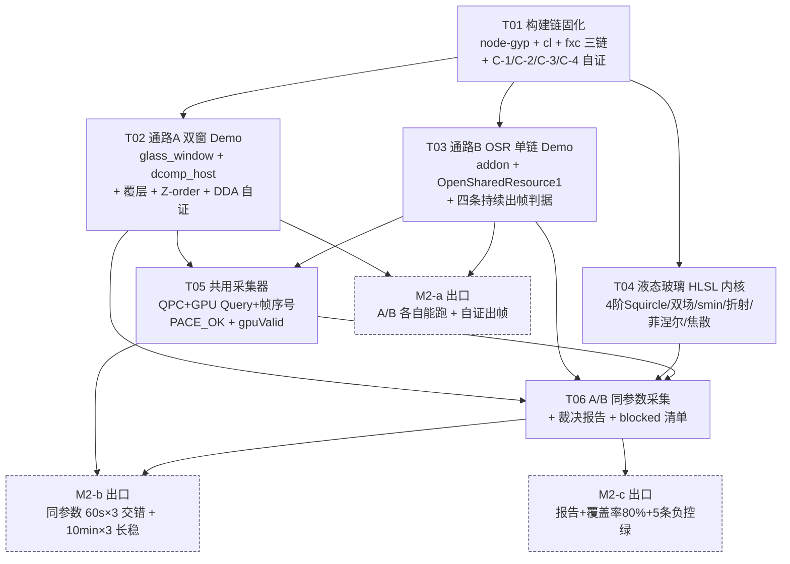

# Harbor v2.1 · R101 M2 架构设计与有序任务列表

> 架构师：高见远（software-architect）｜阶段：v2.1 **M2**｜任务 #2
> 基线：`4b5f993`「v2.1 M1 T06 收口补记」（**注意：不是 R100 文档写的 `89d61db`，仓库已前进一格**）
> 输入：`R101-M2-Spike-PRD.md`（**337 行，含 §4 `#### P0-3 的双档三态判定` 与 `P0-13` 噪声基线**）、`R101-M2-前置取证报告.md`（主理人实测）、`R100-M1-落地设计与任务列表.md`（格式范本）、实仓 `native/**`
> **本文每一条路径 / 行号 / 字节数 / 读数，均由本人在 `C:\v4h\proj` 实仓 `Read` / `wc` / 实际编译 / 实际运行后写入。** 凡与上游文档不符者，附命令与输出，并按主理人要求**标注而非推翻**。
> 本轮**未修改任何产品代码**：`native/spike-glass/**`、`native/harbor-glass/**`、`frontend/**`、`electron/**` 一字未动（`git status` 干净，仅两份上游 md 为未跟踪）。唯一副作用是本文件。

---

## §0 取证摘要（9 条硬事实复核 + 本轮 7 条新发现）

### 0.1 主理人 9 条硬事实的复核结论

**复核口径**：能只读复核的一律实跑；不能自动化的一律写「未复核，接受为准」，**不伪造复核**。

| # | 硬事实（摘要） | 我的复核动作 | 结论 |
|---|---|---|---|
| **E1** | 通路 A 原生全链路 `HRESULT` 全 0 | `./native/build/m2probe/winprobe.exe`（已编产物，实跑） | ✅ **一致**：`RegisterClassExW atom=49793 err=0` / `CreateWindowExW(NOREDIRECTIONBITMAP) hwnd=…1107EC err=0` / `IsWindowVisible=1` / `DwmSetWindowAttribute hr=0x0` / `CreateSwapChainForComposition hr=0x0` / `SetMaximumFrameLatency hr=0x0` / `waitable=0x408` / `DCompositionCreateDevice..Commit hr=0x0` / `Present1 hr=0x0` / `WaitForSingleObjectEx → 0` / `EXIT=0`<br>⚠️ **但见 0.3-①：这批 0 只证明"链路受理"，不证明"像素上屏"** |
| **E2** | Electron 45.2.1 含 `offscreen.useSharedTexture` 等 | `grep -n` 于 `node_modules/electron/electron.d.ts` + 实跑 | ✅ **一致**：`useSharedTexture?: boolean`(23888)、`startPainting()`(19647)、`setFrameRate(fps)`(19546)、`interface SharedTexture`(14579)、`ntHandle?: Buffer`(14648)、`interface OffscreenSharedTexture{release;textureInfo}`(11447–11463)；实跑 `ELECTRON=45.2.1 NODE=24.22.1 CHROME=156.0.8078.75` |
| **E3** | PresentMon 装得上但采不到（`ADMIN=no`） | `net session` | ✅ **一致**：`ADMIN=no`。`where PresentMon.exe` 无命中（不在 PATH）。采集会话**未复测**（按指令不重验） |
| **E4** | 单屏 165Hz；Intel Iris Xe + RTX 4070；4 个虚拟适配器 | `./native/build/m2probe/gputimer.exe` + WMI | ✅ **主结论一致，细节需补正**：`ADAPTER[0] Intel Iris Xe`（默认）/`OUTPUT[0] "\\.\DISPLAY1" rect=1707x960 refresh=165Hz`/`ADAPTER[1] RTX 4070 Laptop`/`ADAPTER[2][3] Intel Iris Xe`（重复枚举）。WMI 另列 `MuMu Virtual Display Adapter` / `OrayIddDriver Device` / `GameViewer Virtual Display Adapter` → 「4 个虚拟适配器」成立，但**DXGI 层看不到它们**（`EnumOutputs` 只对 adapter0 返回 1 个 output）。<br>🔴 **补正（新事实）**：`Win32_VideoController` 报 Intel 当前 `2560×1440`，`AppliedDPI=144` → **本机 DPI 缩放 = 150%**，桌面坐标 = 1707×960 |
| **E5** | 无法自动化驱动真实中文 IME | — | ⏸ **未复核（接受）**。本条是"无工具"型断言，复核手段本身不存在 |
| **E6** | `fxc`/`dxc` 可用，SM5.0/`cs_5_0` 可真编译 | `cmd //c native\build-shaders.bat` | ✅ **一致**：4 个目标全 `EXITCODE_*=0`、`FXC_EXIT=0`；产物 `squircle_ps_exact.cso 1,520 B` / `_poly 1,512 B` / `kawase_cs_down 1,844 B` / `_up 2,160 B` |
| **E7** | 共享句柄在 `textureInfo.handle.ntHandle`（8 字节），**不存在** `sharedTextureHandle` | `env -u ELECTRON_RUN_AS_NODE -u NODE_OPTIONS ./node_modules/electron/dist/electron.exe native/build/m2probe/osr-probe2.js` | ✅ **完全一致**：`HANDLE_SAMPLE={"bytes":8,…,"codedSize":{"width":640,"height":482},"pixelFormat":"bgra",…}`；`electron.d.ts` 里 `SharedTextureHandle` **只有** `ioSurface`/`nativePixmap`/`ntHandle` 三个键 |
| **E9** | 原生 `OpenSharedResource1` 打开成功、SRV 可建、能读回像素 | 同上（`nativeOpen` 段） | ✅ **完全一致**：`openSharedHr=0 openOk=1` / `width=640 height=482 format=87 mipLevels=1 sampleCount=1` / `srvHr=0 srvOk=1` / `stagingHr=0 mapHr=0` / `centerPixelBGRA="255,255,255,255"` |
| **E8/E11** | 静态页几乎不出帧；动画页实测 **201/168（83.6%）** | 同上（`--- RESULT ---`） | ✅ **一致（量级复现）**：`FRAMES=205 / FRAMES_WITH_TEXTURE=174 (84.9%) / WITHOUT=31 / WITH_NT_HANDLE=174 / RELEASED=174 / ERRORS=[]`<br>**并且 `RELEASED == WITH_NT_HANDLE`（174==174）——R3 的"计数相等"判据天然可测** |
| **E10** | 手工 `cl` 的 addon 在 Electron 里静默崩溃；必须 node-gyp；`binding.gyp` 必须 `/utf-8` | ① 删 `native/build/m2probe/gyp/build` 后按 E10 原命令 clean rebuild；② 用临时 cpp 实测 `/utf-8` 负控 | ✅ **一致且可复现**：① `gyp info ok`，编译日志中可见 `probe_addon.cpp` **与 `win_delay_load_hook.cc`** 两个 TU 被编；产物 `harbor_probe.node = 141,312 B`，而手工 `cl` 版 `native/build/m2probe/Release/harbor_probe.node = 14,848 B`（**体积比 9.5×，可作为 C-1 的可失败旁证**）<br>② `/utf-8` 负控实测（见 0.2-N1） |
| **E12** | D3D11 Timestamp Query 可用、`freq=19,200,000` | `./native/build/m2probe/gputimer.exe` | ✅ **一致**：`CreateQuery(DISJOINT) hr=0x0` / `CreateQuery(TIMESTAMP x2) hr=0x0` / `DISJOINT disposed=0 freq=19200000` / `VERDICT_GPU_TIMER=USABLE` |
| **E13** | 一帧 = 6.06 ms | 计算 | ✅ `1000/165 = 6.0606 ms` |
| **E14** | A/B 共用采集器 99/99 | 读源码复核（`collector.cpp`） | ⚠️ **"采集器可用"成立，但读数口径必须修正 —— 见 0.3-②，这是本轮最重要的一条修正** |

### 0.2 本轮 7 条新发现（全部带命令与输出，均有任务落点）

| # | 发现 | 证据（可复制） | 性质 | 落点 |
|---|---|---|---|---|
| **N1** | **本机 shell 环境带 `ELECTRON_RUN_AS_NODE=1`**，`electron.exe` 会**静默退化成 node**：报 `TypeError: Cannot read properties of undefined (reading 'whenReady')` + `Node.js v24.22.1`。这是"看起来像代码 bug、实际是环境"的假红 | `env \| grep ELECTRON` → `ELECTRON_RUN_AS_NODE=1`、`NODE_OPTIONS=--require=…node-language-shim.cjs`；加 `env -u ELECTRON_RUN_AS_NODE -u NODE_OPTIONS` 后同一脚本立刻正常出 174/205 | 🔴 **静默失败（R 类）** | T01（harness 清环境 + 自证 `process.versions.electron`）、§D D11 |
| **N2** | **`qa/` 与 `native/build/` 都在 `.gitignore` 里** → PRD §5.2 的 **#10/#10a/#10b（代码）与 #11/#12/#13（数据）全部落在不可入库路径**。照 PRD 字面执行 = 交付物**进不了版本库**，第三方无 `repro.md` 可看 | `grep -n "native/build\|^qa/" .gitignore` → `5:native/build/`、`71:qa/`；`git check-ignore -v native/build/m2probe/winprobe.cpp qa/r101/out/x.json` → 两条均命中 `.gitignore:40:build/` / `.gitignore:71:qa/`；`git ls-files native/` 只有 9 个源码/脚本（无任何产物） | 🔴 **交付面阻塞** | §A-3 路径重定 + §G Q2（需签字） |
| **N3** | **`tests/test_generative_registry.py` 用字典全等硬断言 devDependencies**，把 `node-gyp` 写进 `package.json` 会**直接让 pytest 红** | `sed -n '228,240p' tests/test_generative_registry.py` → `assert package['devDependencies'] == {'esbuild':'0.28.2','electron':'^45.2.1','electron-builder':'^26.18.0'}` | 🟠 **构建链 vs 门禁冲突** | T01 硬约束 + §G Q1（需裁决） |
| **N4** | **生产路径 0 命中，采集探针 2 处合法调用**（原写"全仓 0 命中"，**该表述是假阴性，已更正**）：`SetWindowDisplayAffinity` 只出现在 `native/build/m2probe/winprobe.cpp` **L26–L27**；`electron/main.js` 与 `native/spike-glass/**` 一处都没有 | **更正后的实测**：`Grep path=…\m2probe\winprobe.cpp` → L26 `BOOL aff = SetWindowDisplayAffinity(h, WDA_EXCLUDEFROMCAPTURE);`、L27 打印行。<br>🔴 **我原来那份"全仓 0 命中"是怎么错的**：`Grep`（ripgrep）**默认跳过 `.gitignore` 覆盖的路径**，而 `native/build/` 正是被忽略的 → 递归搜索时那两行根本没被看到。**教训**：凡"必须 0 命中"的验收，必须用 `Grep path=<具体文件/非忽略目录>` 或明确 `--no-ignore`，否则会得到一个漂亮的假阴性（与 R1–R5 是同一类错误：**工具沉默 ≠ 事实成立**） | 🟡 **前提更正** | §D **D9** 改写为「**生产路径不得新增该标志；探针内允许用于验证**」（N8 纪律不变，只是把"不许删"改成"不许加"，因为生产路径根本没有可删的东西） |
| **N5** | **`cmd //c xxx.bat` 下子进程 exe 的 stdout 会丢**：`build-probe.bat` 里 `layout_probe` / `d3d_probe` 两段输出为空，但直接执行 exe 有完整输出 | `cmd //c "native\build-probe.bat nover"` → `---- layout_probe output ----` 后**无任何行**；`./native/build/layout_probe.exe` → 8 行 `sizeof/offsetof` 全出；`./native/build/d3d_probe.exe` → `hr=0x00000000 OK` | 🟠 **验收假红陷阱** | 全部任务卡的验收命令（**一律直调 exe 或 `> file` 落盘**） |
| **N6** | **现有 `squircle_ps.hlsl` 的"双档"当前不可证伪**：exact 与 poly 两档只差 **8 字节 / 1 条指令** | 实测 `squircle_ps_exact.cso=1,520 B`、`_poly=1,512 B`；指令数 `24` vs `23`（判据命令见 §A-2） | 🟡 **伪双档** | T04 必须把差异做成可量化（`/DHARBOR_SQUIRCLE_POLY` + 断言指令差 ≥ 8） |
| **N7** | **DPI 缩放 150%**（`AppliedDPI=144`，物理 2560×1440，桌面坐标 1707×960）→ 任何"物理像素/客户区/DIP"换算必须显式带 `dpiScale`，否则 D1 的 Δpx 会混进 1.5 倍的换算误差 | `Get-ItemProperty 'HKCU:\Control Panel\Desktop\WindowMetrics' -Name AppliedDPI` → `144`；`gputimer.exe` → `rect=1707x960` | 🟠 **坐标口径** | T02（`SetProcessDpiAwarenessContext(PER_MONITOR_AWARE_V2)` + 录 `dpiScale`）、T06（sync 解码用物理像素） |

### 0.3 两处我**必须指出**的口径问题（不推翻事实，只收窄它能支撑的结论）

#### ① E1 的"HRESULT 全 0"不能当作"像素上屏"的证据

`winprobe.exe` 只做到 `Commit()` + `Present1()` + 等一次 waitable，**没有做任何像素回读**。而 `Present1` 在合成树上"受理了"和"屏幕上有这个颜色"是两件事（合成树被裁掉、视觉被后续 `SetContent(nullptr)` 清掉、窗口在屏幕外、DComp 设备与 target 的 hwnd 不匹配——全部表现为 `hr=0`）。

**因此**：通路 A 必须有正向断言，判据不是 HRESULT，而是**"DDA（Desktop Duplication）抓到背板窗区域像素 == 期望色 ± 容差"**。这条已写进 T02 的 DoD，并配负控 **NC-A1b：去掉 `Commit()` → 所有 HRESULT 仍为 0，但 DDA 读到的不是期望色 → 必须红**。这是把 E1 从"链路受理"升级为"真的上屏"的唯一手段，成本约 40 行。

> ⚠️ **本条已在 §0.5 被收窄（不是我改口，是主理人 CAL 标定实测）**：去掉 `Commit()` 对**节拍**无可测影响（CAL-5 6.0596 vs CAL-6 6.0644，差 0.08%），所以这条负控**只能用于"像素上屏"判定，绝不能当节拍判据**。节拍的负控是 `SyncInterval=0`（§0.5 的 NC-A1）。

#### ② E14 的读数口径：0.33 ms 不是帧时长 —— **但我的归因错了，真因是 `SyncInterval=0`**

> 🔴 **本节保留原始观察，结论已被 §0.5 取代。** 观察（那条链从未 `SetContent/SetRoot/Commit`）**成立且主理人复核确认**；但我把它归因为"没上屏所以没节拍"是**错的**——主理人六组 CAL 标定证明**接不接合成树与节拍无关**，真因是 `Present1` 第一个参数 `SyncInterval=0`。请直接读 §0.5，本节仅作追溯。

`collector.cpp` 里交换链创建后**从未 `SetContent` / `SetRoot` / `Commit` 到任何 target**（L52–60 只创建 swapchain；L88–91 只拿 backbuffer 做 RTV）。实测 `CPU_FRAME_MS p50=0.3292`，而 165Hz 的理论值是 6.0606 ms。

**结论（收窄，不是推翻）**：
- ✅ E14 **证明**：`DISJOINT + TIMESTAMP` 三组轮转 + 读两帧前查询组 + 有界等待 —— **这套查询模式可用**（99%，`stampFail=0`）。
- ❌ E14 **不能证明**："按 Waitable 推进就等于按显示节拍推进"。
- 🔴 由此新增 R6（**归因已于 §0.5 更正为 `SyncInterval=0`**）。落点仍是 T05 的 `PACE_OK` + NC7。

> ⚠️ **R6 与 R5 的关系已被 §0.5 重写**：它们**不是"邻居"而是两个正交条件**（节拍 vs 上屏），我原来写成一条链上的两种表现，是错的。

### 0.5 E14b 自我更正：R5/R6 重写 + NC-A1 更换（主理人 CAL 六组标定，**推翻我的归因、保留我的观察**）

> **这是本文件唯一一处我承认"归因错误"的地方，写清否则后来者会按我的错话实现。**
> 我原写："那条链从未接合成树 → 所以没节拍"。**观察成立**（`grep -n "SetContent\|SetRoot\|CreateTargetForHwnd\|Commit" native/build/m2probe/collector.cpp` 确实 0 命中，主理人复核确认）；**归因错了** —— 主理人写 `calib.cpp`（N=180）做了六组对照，证明**接不接 DComp 对节拍无因果关系**。

**六组标定结果（主理人实测，`native/build/m2probe/calib.cpp`）**：

| 组 | 交换链 | 接 DComp | SyncInterval | p50 | fps |
|---|---|---|---|---|---|
| CAL-1 | `ForHwnd` | — | 0 | 0.1536 ms | ~1538 |
| CAL-2 | `ForHwnd` | — | **1** | **6.0594 ms** | 162.0 |
| CAL-3 | `ForComposition` | 否 | 0 | 0.1537 ms | ~2125 |
| CAL-4 | `ForComposition` | **是**（`SetContent`+`SetRoot`+`Commit` 全 hr=0） | 0 | **0.1786 ms** | ~3352 |
| CAL-5 | `ForComposition` | **是** | **1** | **6.0596 ms** | 165.9 |
| CAL-6 | `ForComposition` | 否 | **1** | **6.0644 ms** | 165.9 |

**决定性对照 = CAL-5 vs CAL-6**：同为 `SyncInterval=1`，接/不接 DComp 的 p50 差 **0.08%**（在噪声内）→ 「接合成树」对节拍**无因果**。
**决定性对照 2 = CAL-4 vs CAL-5**：代码完全相同、只改 `SyncInterval` 0→1，p50 从 **0.1786 → 6.0596 ms**（33×）→ **真因就是 `Present1` 的第一个参数**。

补充排除（主理人另做的三组）：
- `Present1(0,…)` 语义 = 立即返回不等 vsync；`waitsem.cpp` 逐帧打印 `OBJECT_0=10 / TIMEOUT=0 / OTHER=0`、`WAIT_MEAN_MS=0.001` → **是真放行，不是超时、不是失败被吞**。
- `DwmGetCompositionTimingInfo`：`rateRefresh=10000000/60604`（165.0Hz）、`IsCompEnabled=1`，但 `cRefresh` 每 Present 只 +1、`cFrameDisplayed` 恒 0 —— 这是 `SyncInterval=0` 的**结果**，不是原因。
- 不是沙箱：`ctxprobe` → `WindowStation=WinSta0 / Desktop=Default / OpenInputDesktop=OK / IsWindowVisible=1 / SM_CXSCREEN=1707 SM_CYSCREEN=960`。
- 不是空句柄：`waitsem` → `GetFrameLatencyWaitableObject = 0x44C`。

**修正后的 collector 读数**（只改 `Present1(0,…)` → `Present1(1,…)`，其余一字未动）：
```
FRAMES=100  GPU_VALID=99  (99%)
CPU_FRAME_MS  p50=6.0643  p95=6.1391  max=6.2358
GPU_WORK_MS   p50=6.0301  p95=6.1909  max=7.3943
VERDICT_COLLECTOR=SHARED_COLLECTOR_USABLE
```
p50 对 165Hz 理论值 6.0606 ms 偏差 **0.06%**；且 `GPU_WORK_MS` 与 `CPU_FRAME_MS` 同量级（都 6 ms 级）→ **此时测的才是"每帧占满一个显示周期"，不是 CPU 空转。**

#### 改写后的 R5 / R6（**这是唯一生效文本，§0.3-② 的旧表述作废**）

| 编号 | 原表述（作废） | **生效表述** | 为什么必须改 |
|---|---|---|---|
| **R5** | "采集循环必须按 Waitable 帧节拍推进" | **`Present1` 的 `SyncInterval` 必须为 1 **且** 必须用 Waitable 推进；两者缺一，节拍即不成立** | 原文本按字面实现**照样会踩坑**：`SyncInterval=0` 时 waitable **依然返回 `OBJECT_0`**（`waitsem` 实测 10/10），"按 Waitable 推进"这句话被满足了，节拍却是 0.15 ms |
| **R6** | "采集链没上屏 → 节拍不成立" | **已确认成因 = `SyncInterval=0`（唯一）；已排除成因 = 未接 DComp target（CAL-6 不接仍 6.0644 ms、判定 ✓）→ "不许再据此修代码"**。判据 `PACE_OK = abs(p50 − 1000/hz) / (1000/hz) ≤ 0.20` | 归因必须是**单一已确认成因 + 显式排除项**。我原写"`SyncInterval=0` **或**未接 target 任一存在"是**错的**：CAL-6 正是"`SyncInterval=1` + 未接 target + 节拍成立"，按那个写法会把一个 ✓ 判成红（§0.5-③） |

**R6 的危险性（原判断成立，且从假想变成实证）**：六项指标全绿 —— HRESULT 全 0 / `GPU_VALID=99%` / `cRefresh` 在涨 / 退出码 0 / Wait 全 `OBJECT_0` / 进程健康 —— 而节拍完全不成立（0.15–0.33 ms）。**这就是"所有指标都绿、测的却不是产品"的活样本。**

#### 负控更换（**NC-A1 必须换，原提议在本机测不出差异**）

| 原负控（作废） | 问题 | **新负控（生效）** |
|---|---|---|
| ~~NC-A1：去掉 `Commit()` → HRESULT 仍全 0 但 DDA 读到非期望色~~ | CAL-5 vs CAL-6 证明**去掉 `Commit` 在本机测不出节拍差异**（6.0596 vs 6.0644，0.08%）。用它当**节拍**负控是无效的（当"像素上屏"负控仍有效，见下） | **NC-A1（新）：把 `Present1` 的 `SyncInterval` 从 1 改回 0** → p50 必须从 6.06 ms 级掉到 **0.15–0.35 ms 级**、`PACE_OK` 必须变 `0`，而其余六项指标**仍然全绿**。这条同时是 R6 的活体证明 |

**保留但降级用途**：`NC-A1b`（去掉 `Commit()` → `DDA_SELFTEST=FAILED` 而 HRESULT 全 0）**仍然保留**，但**只用于"像素上屏"判定**（§0.3-① 那条），**禁止用于节拍判定**。

**落点（已改到任务卡）**：
- T02：DoD 加 `SYNC_INTERVAL=1` 打印；NC-A1 换成新负控；NC-A1b 保留但注明"仅像素上屏用"
- T03：同（通路 B 的共用主机走同一份 `glass_window`）
- T05：`timing_probe.h` 的 `Attach()` 增加 `requireSyncIntervalOne` 断言；`PACE_OK` 的计算不变
- §E-7 S1–S6：不变（与节拍无关）

### 0.4 主理人追加裁定 + 对 M1 骨架的两处更正（本轮并入，已改到任务卡里）

> 收到时刻：本文件初稿之后。**PRD 已更新为 337 行**（新增 `#### P0-3 的双档三态判定`，L220–242；`P0-13` 接在原 P0 表尾）。以下 5 条**全部已并入 §C**，不是附录。

| # | 追加项 | 我对它的落地 | 复核/说明 |
|---|---|---|---|
| **C-1** | **P0-3 从二态改三态**（PRD L220–242）：60Hz = **基线档**（不过 → `FAIL`，唯一真失败）；165Hz = **能力档**（不过 → 不判失败）；三态 `PASS` / `PASS_BASELINE_ONLY` / `FAIL` | T03 的 DoD 改成**双档分别判定**；**M2-a 出口 = 60Hz 基线档全过**（§H 已改），不再写"双档全过"；`PASS_BASELINE_ONLY` 视为 D4 通过、不进 `incomplete`；165Hz 档**原样落盘** `rafFps`/`targetFps`/`rafFpsDivTargetFps` 三项 | ✅ 已核对 PRD 原文：L32（M2-a 出口）、D4 行（"该态视为 D4 通过，只在报告里留一条'高频余量不足'结论"）、P0-10（§B2 独立统计行）三处口径一致，无冲突 |
| **C-2** | **噪声基线从 P1 升 P0** | T06 新增**独立采集作业**：每通路 × **每档** × **3 轮 × 60s** → `noise.json`（N 的定义 + 计算式 + 每轮原始值）；`verdict.js` 对"N 缺失或被估算"**必须拒绝出终稿** | 🔴 **编号更正**：你的消息写"升为 **P0-12**"，但 PRD 里 **P0-12 是「两条通路都保持可运行、可切换」**，噪声基线是 **`P0-13`**（PRD L219 + L253 的编号说明明确"P1-2 已升格为 P0-13，原编号不复用"）。我按 **P0-13** 写。若两份文档要统一，请以 PRD 为准改你手上的清单 |
| **C-3** | **`dcomp_host.cpp` L3 注释被实测推翻**（"沙箱/无桌面会话下建窗必然静默失败"） | T02 把"删除/改写该注释"列为**显式产出**（不是顺手清理），并注明依据 | ✅ **我自己也复现了**：`./native/build/m2probe/winprobe.exe` → `CreateWindowExW(NOREDIRECTIONBITMAP) hwnd=00000000001107EC err=0` / `IsWindowVisible=1` / 全链路 `hr=0x0`。你的 hwnd 是 `0x820846`、我的是 `0x1107EC`，**结论一致**：本机可建窗 |
| **C-4** | **`osr_bridge.cpp` 签名是错的**（`const uint8_t* pixels, size_t bytes` 对应 `toBitmap()` 的 CPU 回读慢路，源方案明令禁止） | T03 **不是"扩展"而是"重写签名"**：`SubmitElectronSharedTexture(ID3D11Device1*, HANDLE ntHandle, uint32_t width, uint32_t height)`，删掉 `pixels/bytes`；若保留旧签名必须 `[[deprecated("CPU 回读路径，M2 禁用")]]` | ✅ 与 E7/E9 一致：实跑 `HANDLE_SAMPLE.bytes = 8`、`openSharedHr=0`、`centerPixelBGRA="255,255,255,255"` —— 8 字节句柄直通，**全程没有一次 CPU 像素回读** |
| **C-5** | 要求我裁决 RAII（裸指针 vs `ComPtr`），且必须覆盖"`frameLatencyWaitable` 是 `HANDLE` 不是 COM 接口"的顺序风险 | **裁决：COM 接口全改 `ComPtr`；`HANDLE` 用 `UniqueHandle`（RAII 但只关句柄）；两者都不靠析构顺序，靠一张显式 `Shutdown()` 阶段表**（S1 停线程 → S2 join → S3 清视觉树 → S4 `CloseHandle` → S5 Reset COM → S6 `DestroyWindow`）。理由与负控见 §E-7 | 裸指针方案的风险随资源数线性上升，且 **double-release 在 `IDCompositionVisual::SetContent` 共享所有权时最隐蔽**（target/visual/swapchain 三者互指）。`ComPtr` 只解决"忘记 Release"，解决不了"释放顺序"，所以**两者都要** |

---

## §A 现有资产盘点（逐文件实测，不凭 PRD 推断）

### A-1 `native/spike-glass/` + `native/harbor-glass/` 四（六）个文件现状

编译验证方式：`cmd //c native\build-probe.bat nover`（**实跑**）→ `EXITCODE_OSR_BRIDGE=0 / EXITCODE_DCOMP_HOST=0 / EXITCODE_LAYOUT_PROBE=0 / EXITCODE_D3D_PROBE=0 / CL_EXIT=0`；`cmd //c native\build-shaders.bat`（**实跑**）→ 4 目标 `EXIT=0`。

| 文件 | 字节 / 行 | 能编过？ | 现状（逐行核对后的实话） | M2 缺什么 |
|---|---|---|---|---|
| `native/spike-glass/src/dcomp_host.cpp` | **1,511 B / 41 行** | ✅ `EXITCODE_DCOMP_HOST=0` | 只有 `class SpikeDCompHost{ bool Init(HINSTANCE,bool); 4 个空指针成员 }`（L14–22）+ `Init()` 里 `D3D11CreateDevice`（L31–34）与 `DCompositionCreateDevice2`（L36–37）。**L39 是 `// TODO(M2): CreateWindowEx / CreateSwapChainForComposition / DwmSetWindowAttribute`——建窗一行都没有**。`hdrFp16` 参数被 `(void)` 丢弃（L26）。<br>🔴 **L3 注释是错的，必须删改**：`// 沙箱/无桌面会话下建窗必然静默失败…` —— 已被 `winprobe.exe` 实测推翻（§0.4 C-3）。<br>🔴 **成员全是裸指针且无析构函数**（文件里不存在 `~SpikeDCompHost`）→ 扩成多资源必然泄漏 | ① **删/改 L3 注释**；② 建窗（`RegisterClassExW`/`CreateWindowExW(WS_EX_NOREDIRECTIONBITMAP\|WS_EX_NOACTIVATE)`）；③ DWM 圆角 + `SetWindowDisplayAffinity`；④ 交换链 + `SetMaximumFrameLatency(1)` + waitable；⑤ 视觉树 `SetContent/SetRoot/Commit`；⑥ **渲染循环与 Present 节拍**；⑦ 双窗（背板 + 覆层）的 Z-order 同步；⑧ 演示模式切换（双窗/单窗、静/动）；⑨ **RAII 化 + 显式 `Shutdown()` 阶段表**（§E-7） |
| `native/spike-glass/src/osr_bridge.cpp` | **1,274 B / 27 行** | ✅ `EXITCODE_OSR_BRIDGE=0` | 只有签名 `HRESULT SubmitElectronSharedTexture(ID3D11Device1*, const uint8_t*, size_t)`（L12–14）+ 参数校验（L16）+ **`HANDLE ntHandle = nullptr;`（L20，硬编码空句柄）** + `OpenSharedResource1` 调用（L23–24，**必然 `E_INVALIDARG`**）+ `if (iuTex) iuTex->Release()`（L25）。**没有任何 SRV 缓存、没有尺寸键、没有 DComp 合成**。<br>🔴 **签名本身是错的抽象**：`pixels/bytes` 对应 `toBitmap()` 的 **CPU 回读慢路**（源方案明令禁止，§0.4 C-4）。**M2 不是"扩展"它，是"重写签名"** | ① **重写签名为 `SubmitElectronSharedTexture(ID3D11Device1*, HANDLE ntHandle, uint32_t w, uint32_t h)`**，删掉 `pixels/bytes`；② 从 8 字节 `Buffer` 里**取出真句柄**（`*(HANDLE*)data`，E9 已验证的写法）；③ `ID3D11Texture2D` 生命周期缓存（同句柄复用、尺寸变化重建）；④ `CreateShaderResourceView` + 采样；⑤ 把纹理喂给**同一条** DComp 交换链；⑥ **release 计数校验**（R3） |
| `native/spike-glass/shaders/squircle_ps.hlsl` | **2,073 B / 69 行** | ✅ `EXIT=0`（2 个 entry） | `cbuffer GlassParams{float4 gRect; float4 gParams}`（L8–12）+ `ToCornerSpace`(L24) + `SdSuperellipseExact`(L31) + `SdSuperellipsePoly`(L39) + `Shade`(L48，唯一 1 条 `SampleLevel`)+ `main`(L57) + `poly`(L64)。**是"圆角覆盖率"着色器，不是液态玻璃光学内核**：无折射、无菲涅耳、无焦散、无双场解耦、无 `smin` | ① 4 阶 Squircle 双场 SDF；② C² 连续 `smin`（`sminCubic`）；③ 斯涅尔折射偏移；④ Schlick 菲涅耳；⑤ 屏幕空间焦散（PS 里 `ddx/ddy` 合法，CS 里非法）；⑥ **宏级双档且差异可量化**（当前 8 B/1 指令 = 不可证伪，见 §0 N6） |
| `native/spike-glass/shaders/kawase_cs.hlsl` | **2,616 B / 72 行** | ✅ `EXIT=0`（2 个 entry） | `cbuffer KawaseParams{float2 gTexel; float2 gPad}`(L9–13) + `groupshared float4 gTile[18][18]`(L22) + `main_down`（L25，18×18 平铺 + 5-tap 对角降采样，`gSrc.Load` 走 LDS）+ `main_up`（L54，9-tap 显式 `SampleLevel`）。**实测 `ld_structured=5`、`sample=9`、`instr=33/36`** —— 是**真实现**，不是空壳 | ① 4 级金字塔的**调度**（现在只有单级 shade 函数）；② 与 PS 的 cbuffer 契约对齐（`KawaseParams` 是独立 bf，M2 可保留）；③ **无需重写**，只需被 `blur_chain` 调用 |
| `native/harbor-glass/include/glass_shm.h` | **2,009 B / 33 行** | ✅（`layout_probe` 运行打印 `sizeof=64`） | `struct alignas(64) HarborGlassNode{float rect[4]; float params[4]; float velProfile[4]; uint32_t flags[4];}`(L17–22) + `alignas(16) HarborApcaFeedback`(L25–27) + **5 条 `static_assert`(L29–33)**。运行期实测：`rect@0 / params@16 / velProfile@32 / flags@48 / alignof=64 / 16×64=1024` | **不需要改**（M2 不改协议）。但**缺 HLSL 侧的 cbuffer 镜像与总长断言**（`GlassCB` = 48 + 1024 = **1072 B**，见 §E-1） |
| `native/spike-glass/src/d3d_probe.cpp` / `layout_probe.cpp` | 1,972 B/54 行、1,084 B/21 行 | ✅ 均 `EXIT=0`，实跑有输出 | 设备可建性 + 布局读数探针。**M2 保留不改**（T01 继续编它们，作为"构建链没坏"的哨兵） | 无 |
| `native/build-probe.bat` / `native/build-shaders.bat` | 2,387 B/67 行、1,629 B/41 行 | ✅ | 手工注入 INCLUDE/LIB/PATH（`vcvars64.bat` 不可用）+ fxc 绝对路径。**两条链的写法是 M2 的模板** | T01 要在它们基础上做 `build-m2-native.bat` / `build-m2-shaders.bat`（**保留原文件不动**，作为回归基线） |

> **结论（一句话）**：M1 铺的路是**可编译的骨架 + 两个真 HLSL 内核（Kawase 可用，Squircle 需重做）+ 一个冻结协议头**。`dcomp_host.cpp` 与 `osr_bridge.cpp` **合计 68 行、0 行业务逻辑**，M2 是**在骨架上长出肌肉**，不是推倒。

### A-2 现有着色器产物的实测读数（M2 的对照基线）

判据命令（**已实测可用**，注意别用 `grep -c "sample"`，会把 asm 头部注释的 `sampler`/`dcl_sampler` 数进去）：

```bash
cd native/build/shaders
for f in *.asm; do
  n=$(grep -vE '^\s*(//|dcl_|$)' "$f" | grep -cE '^[a-z][a-z0-9_]*(\(|\.|\s)')
  t=$(grep -oE 'dcl_temps [0-9]+' "$f" | head -1)
  s=$(grep -cE 'sample_indexable|sample_l_indexable' "$f")
  l=$(grep -c 'ld_structured' "$f")
  printf "%-24s instr=%-4s %-12s sample=%-3s ld=%s\n" "$f" "$n" "${t:-none}" "$s" "$l"
done
```

实测结果（**这就是 T04 的"不得退化"基线**）：

| 产物 | `.cso` | 指令数 | `dcl_temps` | `sample_*` | `ld_structured` |
|---|---|---|---|---|---|
| `squircle_ps_exact.cso` | 1,520 B | 24 | 2 | 1 | 0 |
| `squircle_ps_poly.cso` | 1,512 B | 23 | 2 | 1 | 0 |
| `kawase_cs_down.cso` | 1,844 B | 33 | 6 | 0 | **5** |
| `kawase_cs_up.cso` | 2,160 B | 36 | 7 | **9** | 0 |

**两条直接结论**：
1. `squircle` 的 exact/poly **只差 8 B / 1 指令** → **N6：当前"双档"不可证伪**，T04 必须重做档位（宏裁剪 + 断言差 ≥ 8 指令），否则"Standard 档省 GPU"这句话在 M2 拿不出证据。
2. `kawase` 的 `ld_structured=5` + `instr=33` 落在 R100 记录的"真实 7-tap LDS = 25 指令 / 6 条 ld_structured"量级 → **非空实现，可直接复用**。

### A-3 从 `native/build/m2probe/` 迁移什么（逐段映射，T01–T06 照此落地）

> ⚠️ 前提：`native/build/**` 被 `.gitignore`（§0 N2），**所以探针不能当交付物、也不能原地长成正式代码**。下表是"哪段逻辑 → 搬到哪个正式路径的哪个位置"。

| 探针文件（不入库） | 可迁移的逻辑（精确到行为） | 迁移到（入库路径） | 迁移时**必须改**的地方 |
|---|---|---|---|
| `winprobe.cpp`（3,013 B） | L11 `SetProcessDpiAwarenessContext(PER_MONITOR_AWARE_V2)`；L12–19 `WNDCLASSEXW`+`CreateWindowExW(WS_EX_NOREDIRECTIONBITMAP)`；L23–25 DWM 圆角；L26–27 `SetWindowDisplayAffinity`；L37–53 交换链 desc（`FLIP_DISCARD`/`STRETCH`/`PREMULTIPLIED`/`FRAME_LATENCY_WAITABLE_OBJECT`）+ `SetMaximumFrameLatency(1)` + `GetFrameLatencyWaitableObject` + `SetSourceSize`；L55–63 DComp 视觉树 | `native/spike-glass/src/glass_window.cpp`（新建）+ `dcomp_host.cpp`（扩展） | ① 加 `WS_EX_NOACTIVATE`（背板窗**不许抢焦点**，§B-3）；② `ShowWindow(SW_SHOWNOACTIVATE)` 而非 `SW_SHOW`；③ 每个 HRESULT 进结构化日志（不是 `printf`）；④ **加 `SetContent/SetRoot/Commit` 后的像素回读自证**（§0.3-①）；⑤ `printf` → `fprintf(stderr)`+`fflush`（N5） |
| `winprobe.cpp` L66–77（backbuffer→RTV→`Present1`→等 waitable） | **Present 节拍骨架** | `glass_window.cpp` 的 `PresentLoop()` 线程 | ① 从"一次"改成"按 waitable 推进的循环"；② **等 waitable 放在 Present 之前**（不是之后）；③ 循环里插入 `TimingCollector::BeginFrame/EndFrame`（T05）；④ 超时上限 50 ms 防挂死 |
| `osr-probe2.js` L15–19（`new BrowserWindow({show:false, webPreferences:{offscreen:{useSharedTexture:true}}})` + `setFrameRate(60)`） | **通路 B 的 BrowserWindow 配置** | `native/spike-glass/host/spikeB-osr.js` | ① `show:false` **必须**保留（否则双链）；② `setFrameRate` 从参数读（165/60 双档）；③ 加 `webContents.startPainting()`（L63 的写法，**缺它等于静态页**） |
| `osr-probe2.js` L21–53（`paint` 事件 → `tex.textureInfo.handle.ntHandle` → 每帧 `release()`） | **B 通路的取帧循环 + R3 计数** | `spikeB-osr.js` | ① 句柄取出后**交给 addon**（`addon.presentFromHandle(nt, w, h, idx)`），不是只打印；② 计数三元组 `painted/released/withNt` 必须 `painted==released`；③ **不得**在 `finally` 之外早退（L52 的 `finally` 是关键） |
| `osr-probe2.js` L56–63（带动画的 data-URL 页面 + `startPainting`） | **P0-4 的负载页**（动画驱动） | `native/spike-glass/host/spike-load.js`（**A/B 共用**） | ① 抽成 `module.exports = buildLoadHtml(params)`，参数来自 `load-params.json`；② 加**帧号条码**（§E-3）与 QPC/epoch 桥（§E-4）；③ A/B 同一份 HTML，**只允许 `window.__SPIKE_PATH__` 不同** |
| `gyp/probe_addon.cpp` L32–120（`Probe()`：`napi_get_buffer_info` → `*(HANDLE*)` → `OpenSharedResource1` → `GetDesc` → `CreateShaderResourceView` → `CopyResource`+`Map` 读中心像素） | **通路 B 的原生闸门 + 正向断言三件套**（句柄 8 B / `openSharedHr=0` / `srvHr=0`） | `native/spike-glass/addon/spike_addon.cpp`（T03）+ `src/osr_bridge.cpp`（T03） | ① **保留** `CopyResource`+`Map` 读中心像素这一段——它是"不是空纹理"的唯一硬证；② 设备与纹理**缓存到模块级**（探针是一次性）；③ 加 `ID3D11Device1` 的 `AdapterLuid` 与 Electron 侧 LUID 比对（§B-1）；④ 所有 `napi_*` 返回值检查，**不许抛异常**（§B-2） |
| `gyp/binding.gyp`（`target_name: harbor_probe`，`AdditionalOptions:["/std:c++20","/utf-8"]`，6 个 `.lib`） | **C-1/C-2 的正确形态** | `native/spike-glass/addon/binding.gyp` | ① `sources` 扩成 `spike_addon.cpp + ../src/glass_window.cpp + ../src/timing_probe.cpp + ../src/osr_bridge.cpp`；② `include_dirs` 加 `../src`、`../../harbor-glass/include`；③ `libraries` 补 `dwmapi.lib dxgi.lib psapi.lib`；④ **`/utf-8` 一个字都不能少**；⑤ 文件名**故意不叫 `probe_addon.cpp`**（与不入库的探针同名会造成 §D D10 的混淆陷阱，见 §G Q5） |
| `osr_bridge.cpp` 的**旧签名**（L12–14） | **反面教材**：`const uint8_t* pixels, size_t bytes` = `toBitmap()` CPU 回读慢路 | `native/spike-glass/src/osr_bridge.cpp`（**重写签名**） | ① 新签名 `SubmitElectronSharedTexture(ID3D11Device1*, HANDLE ntHandle, uint32_t w, uint32_t h)`；② `pixels/bytes` **删掉**；③ 若因故要留旧签名做重载，必须 `[[deprecated("CPU 回读路径，M2 禁用")]]` + 注释写明"源方案明令禁止"；④ 全仓 `grep -n "const uint8_t\* pixels"` 必须只命中 `native/build/`（不入库） |
| `collector.cpp` L63–156（3 组轮转查询 + 读两帧前 + 有界等待 + 逐帧 `gpuValid`） | **共用采集器的核心算法（E14 唯一真正验证过的部分）** | `native/spike-glass/src/timing_probe.cpp` | ① **必须挂到"上了屏的"交换链**（§0.3-②，否则 R6）；② 加 **`PACE_OK` 自证**；③ 样本从 `std::vector` 改成**逐行 `fprintf`+`fflush` 落 JSONL**（崩溃不丢数据，§B-6）；④ `19200000.0` 硬编码 → 用 `dj.Frequency` |
| `collector.cpp` L116（`WaitForSingleObjectEx(waitable,100,TRUE)`） | **节拍推进写法** | `glass_window.cpp::PresentLoop` | 同上，且**改成 Present 前等** |
| `gputimer.cpp` L14–37（DXGI 适配器/输出枚举 + `EnumDisplaySettingsW` 读 `dmDisplayFrequency`） | **`env.json` 的环境指纹采集** | `native/spike-glass/src/spike_common.h`（`CollectEnvFingerprint()`） | ① 加 `AppliedDPI`/`dpiScale` 读取（当前打印 `dpi=0` 是 `GetDpiForWindow(nullptr)` 的 bug）；② 加 `IDXGIAdapter3::QueryVideoMemoryInfo`（长稳用）；③ 输出改成 JSON |
| `gputimer.cpp` L48–90（`DISJOINT`+2×`TIMESTAMP` 创建与一次读数） | **GPU 计时器的可用性自检** | `timing_probe.cpp::SelfTest()` | 同 E12 形态，输出 `VERDICT_GPU_TIMER` |
| `build.bat` / `build-addon.bat` / `b2.bat` / `bc.bat` / `bg.bat` | **手工 `cl` 注入 6 行 `set` 的写法**（`vcvars64.bat` 不可用） | `native/build-m2-native.bat` | ① **ASCII-only**（codepage 936 会 desync）；② 路径从 `%~dp0` 推导，不写死 `C:/v4h/proj`；③ 加 `/utf-8`；④ 产物落 `native/build/`（N2：不入库） |
| `build-addon.bat`（手工 `cl` 编 addon） | **只作为 NC-BUILD-3 的反例保留**（证明"能加载"必须自证） | 不迁移（只复制到 `qa/r101/negative/` 作为负控材料） | — |
| `min_addon.cpp` / `load-test.js` / `t2.js` / `t3.js` / `osr-probe.js` | 一次性取证脚本，**无迁移价值** | 不迁移 | — |

### A-4 资产盘点结论

| 类别 | 复用 | 重写 | 新建 |
|---|---|---|---|
| C++ 骨架 | `glass_shm.h`（0 改动）、`d3d_probe.cpp`/`layout_probe.cpp`（哨兵） | `dcomp_host.cpp`（41 → ~380 行）、`osr_bridge.cpp`（27 → ~120 行） | `glass_window.{h,cpp}`、`spike_common.h`、`timing_probe.{h,cpp}`、`sync_probe.cpp`、`soak_probe.cpp`、`spikeA_main.cpp` |
| HLSL | `kawase_cs.hlsl`（0 改动，实测非空实现） | `squircle_ps.hlsl`（重做双档） | `liquid_glass_ps.hlsl`、`spike_backplate_ps.hlsl`、`spike_b_composite_ps.hlsl`、`glass_cb.h` |
| JS | — | — | `spike-load.js`、`spikeA-overlay.js`、`spikeB-osr.js`、`run-harness.js`、`run-suite.js`、`aggregate.js`、`verdict.js`、`selfcheck.js` |
| 构建 | `build-probe.bat`/`build-shaders.bat` 保留为回归基线 | — | `build-m2-native.bat`、`build-m2-shaders.bat`、`build-m2-addon.bat`、`addon/binding.gyp` |

---

## §B 风险清单

> 每条必须有 **可证伪判据**（能变成红的具体命令/读数）。写不出判据的条目不许进本表。

### B 组 1：两通路共存与设备层（主理人点名要求覆盖）

| ID | 风险 | 触发条件 | 后果 | 缓解 | 可证伪判据 |
|---|---|---|---|---|---|
| **B-1** | **A/B 抢 D3D 设备 / 跨适配器共享纹理打不开** | 本机是**双 GPU**（Intel 主输出 + RTX 4070，§0 E4）。若一处 `D3D11CreateDevice(nullptr)` 落到 Intel、另一处（Chromium 侧）落到 NVIDIA，`OpenSharedResource1` 必然 `E_INVALIDARG` | 通路 B 直接在**最关键的闸门**失败，且报错是 `0x80070057`（"参数错误"），极易误判为"句柄传错" | ① 全部 `D3D11CreateDevice(nullptr, HARDWARE)`（实测都落 Intel adapter0）；② **两端各打印 `AdapterLuid` 并断言相等**；③ env.json 记 `adapterLuid` | 启动日志两行 `ADAPTER_LUID_BACKPLATE=0x0000xxxx:0x00000000` / `ADAPTER_LUID_OSR=…` **不相等** → 判环境异常、本次采集作废（不是通路失败） |
| **B-2** | **A 与 B 抢焦点 / 抢 Z-order** | 通路 A 是"背板窗 + Electron 覆层窗"两个 top-level HWND；通路 B 是"原生宿主窗 + 隐藏的 offscreen 窗"。若背板窗被激活，Electron 覆层失去焦点，键盘/IME 全部失效 | A 的"手感"数据不可用；更糟：背板窗盖住覆层 → DDA 抓到的是背板、覆层被遮 → **Δpx 恒为 0 的假绿** | ① 背板窗 `WS_EX_NOACTIVATE` + `ShowWindow(SW_SHOWNOACTIVATE)`；② 每次覆层 `show()` 后 `SetWindowPos(overlay, backplate, …)` 重排；③ `env.json` 记 `zOrderOk` | `ZORDER_OK=1`（用 `GetWindow(hwnd,'GW_HWNDPREV')` 链验证覆层在背板之上）；反转顺序的负控 **NC-A2** 必须变红 |
| **B-3** | **A/B 同时跑时互相干扰采集** | 若 A/B 并行跑（为省时间），两个 Present 循环 + 两套 DDA 抢同一 output，DDA 每 output **只允许一个 duplication 客户端** | 第二个 `DuplicateOutput` 返回 `DXGI_ERROR_NOT_CURRENTLY_AVAILABLE`；若吞掉错误 → 采到的是"另一个通路"的数据 | **串行，永不并行**；`run-suite.js` 强制顺序；DDA 创建失败必须**硬失败**（不许降级为空采集） | `run-suite.js` 的 `envelope.json` 里 `concurrency=1`；人为并行跑 → 必须出现 `DDA_UNAVAILABLE` 并 `exit≠0` |
| **B-4** | **165Hz 下时间戳精度不足以分辨 0.3 ms 量级差异** | 采样窗口太短 / 用均值比较 / **噪声与 Δ 不同档** | Δ 落在噪声里却判"有差异"（或反之） | **仪器分辨率本身不是瓶颈**（QPC ~0.1 µs、GPU tick = 1/19.2 MHz ≈ 52 ns，均比 6.06 ms 小 5 个数量级）。真正的瓶颈是**轮间噪声 N**：3 轮极差是 σ 的高方差估计量（有效自由度 ≈1.7）。故：① 每轮 60 s ≈ **9,900 帧**（p50 的 SE ≈ σ/√n）；② **A/B 交错序且同档相邻**（`A@60-1 → B@60-1 → A@165-1 → …`）以消除热漂移、并支持配对比较；③ **N 必须与 Δ 同档同采集器版本**（PRD R-4：采集节拍不同，噪声本身就是假的）；④ 每通路 × 每档 × 3 轮 × 60 s = **12 次**（P0-13）；⑤ 同时报 `N_range`（PRD 口径）与 `N_mad`（稳健口径） | ① 同通路 3 轮 `p50` 极差 `/ p50 ≤ 2%` 才算 N 可信；② **漂移自检**：A1→A2→A3 的 p50 单调同向变化幅度 > 轮间极差 → 判"存在系统性漂移"，改用配对比较（同轮次 A_i vs B_i）；③ 判 `tie` 时**必须**同时打印 `Δ` 与 `N` 两个数（缺一即报告非法）；④ 跨档借 N（拿 60Hz 的 N 去判 165Hz 的 Δ）→ `verdict.js` 必须拒（NC-N6） |
| **B-5** | **`native/build/` 与 `qa/` 全在 `.gitignore` → 交付物入不了库、别人无法复现** | 任何人照 PRD §5.2 字面把文件写到 `native/build/m2probe/` 或 `qa/r101/` | 交付物**在 git 里根本不存在**；`repro.md` 缺失 → 第三方无法复现 → 整个 Spike 的"可审计"前提塌掉 | **路径重定（已定，见 §G Q2 备案）**：<br>· 源码/脚本 → `native/spike-glass/{src,host,addon,shaders}/`（**入库**）<br>· 产物 → `native/build/`（**不入库**）<br>· 原始采集数据 → `qa/r101/out/<runId>/`（**不入库**，容量考虑）<br>· **可审计摘要（sha256/行数/首末行/env.json/repro 命令）→ `deliverables/dev-plan/r101-evidence/`（入库）** | `git ls-files native/spike-glass deliverables/dev-plan/r101-evidence` **必须**列出全部源码 + 每份 manifest；`git status --porcelain` 里**不得**出现 `qa/`（被忽略是对的） |

### B 组 2：进程与生命周期

| ID | 风险 | 触发条件 | 后果 | 缓解 | 可证伪判据 |
|---|---|---|---|---|---|
| **B-6** | **addon 崩溃拖死 Electron 主进程** | addon 与 Electron **同进程**（这是 B 通路的硬性前提：`ntHandle` 是"local to current process"，见 `electron.d.ts` L14641–14648 原文「Note that this NT HANDLE is local to current process」）。任何 AV/未捕获的 `SEH`/`std::terminate` 直接带走整个 Electron | 整轮采集丢数据；且**退出码可能仍是 0**（Electron 崩在渲染线程/子进程上时） | ① 所有 `napi_*` 返回值检查，**不抛 C++ 异常**；② 原生侧所有入口 `__try/__except` 包一层（MSVC SEH，只有它能吃 AV）；③ **逐行 `fprintf`+`fflush` 落 JSONL**（崩前数据保留）；④ 外层 `run-harness.js` 捕获 `exit code` + `signal` 写 `envelope.json` 的 `termination` 字段；⑤ `napi_add_env_cleanup_hook` 释放 D3D/HWND | 人为在 addon 里 `*(int*)0=1` → `envelope.termination="crash"` 且 `exitCode≠0`，**且 timing.jsonl 里已有 ≥1 行可解析样本**（证"崩前数据保留"）。若 `termination=clean` 却有 0 行数据 → 判 harness 失效 |
| **B-7** | **主线程阻塞导致 OSR 掉帧**（B 通路特有） | 若在 `paint` 回调里同步等 waitable（6 ms）+ 渲染，Electron 主线程被占满 → Chromium 的 painter 排队 → 出帧率掉到 50% 以下 | P0-3 ①b 判红，且**看起来像"B 通路性能差"**（实为我们自己的实现缺陷） | **paint 回调只做两件事**：取句柄 + 置原子标记（不碰 GPU、不阻塞）。真正的 `draw+Present+等 waitable` 在**独立 Present 线程**里做（`glass_window` 提供，A/B 共用） | `paint` 回调耗时 p99 < 0.5 ms（原生侧自计）；`RAFRATE_RATIO ≥ 0.50`。若 p99 > 2 ms 且 ratio < 0.5 → 判"实现缺陷"，不是通路结论 |
| **B-8** | **DComp 视觉树与 Electron 窗口的 Z-order 穿插** | 两个 top-level 窗口的 z-order 由 DWM 管理；`SetWindowPos` 后若任一窗口被激活/最小化/DPI 变更，顺序可能被重置 | 覆层被背板盖住 → **Δpx 恒 0（假绿）**；或背板被覆层全遮 → 光学层不可见 | ① 每次 present 循环迭代**不**重排（避免闪烁），只在 `WM_ACTIVATE`/`WM_WINDOWPOSCHANGED` 时重排；② **每 5 s 自检一次 z-order**，失败即 `zOrderOk=0` 写入 sync.jsonl；③ 报告只统计 `zOrderOk=1` 的样本并明示占比（同 R5 的 `gpuValid` 纪律） | sync.jsonl 里 `zOrderOk=0` 的样本占比 > 1% → 该轮采集作废（不许静默剔除） |

### B 组 3：测量链有效性（"假绿"防线）

| ID | 风险 | 触发条件 | 后果 | 缓解 | 可证伪判据 |
|---|---|---|---|---|---|
| **B-9** | **R6：采集链没上屏，节拍不成立，但所有指标都绿**（本轮新增，源自 §0.3-②） | 交换链创建了但没 `SetContent/SetRoot/Commit`；或 Commit 了但窗口在屏幕外/被裁 | `presentInterval` 变成 0.3 ms 级，`gpuValid` 仍 99%，"跑完 100 帧所以没问题" | ① **`PACE_OK` 硬断言**：`abs(p50 − 1000/hz) / (1000/hz) ≤ 0.20`；② 每次采集开头跑一次 **DDA 像素自证**（读到背板期望色）；③ 两条都过才允许写 `timing.jsonl` | 负控 **NC7**：注释掉 `dc->Commit()` → `PACE_OK=0` **且** `DDA_SELFTEST=FAILED`，而 `gpuValid` 仍 ≈99%（这个组合就是 R6 的指纹） |
| **B-10** | **DDA 抓不到 DComp 内容（黑帧）** | DDA 与 DComp 的已知兼容边界：正常桌面会话可抓；但若窗口带 `WDA_EXCLUDEFROMCAPTURE`、或走硬件保护路径、或 DDA 客户端被另一进程占用 | P0-6（Δpx 解码）**整条废掉** → D1 只剩备选（相位漂移，无 Δpx） | ① **T06 第一件事就是 DDA 空转自证**（30 分钟内出结论，不许拖到末尾）；② 失败则立刻走 §3.4 D-3 降级（D1 → `blocked`，裁决降为 `conditional`），并**照实写报告** | `dda_selftest.json`：`framesCaptured ≥ 60` 且 `pixelMatch=1`。若 `framesCaptured>0` 但 `pixelMatch=0` → 判"抓到了但内容是黑的"（比"抓不到"更隐蔽，必须区分这两个码） |
| **B-11** | **帧号条码解码不出（时钟桥错）** | 页面侧 `performance.timeOrigin` 与原生 QPC 的 epoch 桥接误差 > 半个帧周期（3 ms） | Δframe 全是 ±n 的随机值 → 会**误判 A 通路"层间不同步"** | ① epoch 桥用 `GetSystemTimePreciseAsFileTime` + QPC 双采样求 offset（误差 < 100 µs）；② **静止自检**：两层都不做视觉变化跑 5 s，解码 Δframe 中位数必须 `abs(Δframe) ≤ 1`；③ 静止自检不符 → 判"测量链失效"（**不判通路不合格**，这是 PRD D1② 的"免费负控"同源） | `clockbridge_selftest.json`：`medianAbsDframe ≤ 1` 且 `decodeOkRatio ≥ 0.95`。负控 **NC2**（人为注入 2 帧延迟）→ `medianAbsDframe` 必须 ≥ 2 |
| **B-12** | **Δpx 的分辨率陷阱**：150% DPI 缩放 + DWM 逐窗缩放 | 两层各自 size 不同、或一层按 DIP 一层按物理像素 → 每层都被 DWM 缩放，Δpx 里混进缩放误差（1.5× 量级） | Δpx 常数偏移 1~2 px，被当成"结构性错位" | ① 两层都 `SetProcessDpiAwarenessContext(PER_MONITOR_AWARE_V2)`；② 两窗尺寸用**物理像素**经 `SetWindowPos` 设定（不用 DIP 的 `setBounds` 作为唯一来源）；③ `env.json` 记 `dpiScale=1.5`；④ 归零自检：**把两层画同一个静态图案**，Δpx 必须中位数 = 0 | `zeroshift_selftest`：`medianAbsDpx == 0`；若 `medianAbsDpx ∈ {1,2}` 且与 `dpiScale` 相关 → 判坐标口径错（先修，不许当结论） |

### B 组 4：工程与交付

| ID | 风险 | 触发条件 | 后果 | 缓解 | 可证伪判据 |
|---|---|---|---|---|---|
| **B-13** | **`node-gyp` 未在 `package.json` 声明**（transitive: `electron-builder→@electron/rebuild→node-gyp@12.4.0`） | `npm i` 后 electron-builder 升级/树变化 → `node_modules/node-gyp/bin/node-gyp.js` 消失 | C-3"从零复现"失败；且报错是 `Cannot find module`，不指向真因 | ① 构建脚本**先探测三个候选路径**并打印实际用到的那个；② 找不到时报**明确指令**（`npm i -D node-gyp@^12` 需先解 §G Q1）；③ `env.json` 记 `nodeGypVersion` | `build-m2-addon.bat` 必须打印 `NODE_GYP_PATH=…` + `NODE_GYP_VER=12.4.0`；人为 `mv node_modules/node-gyp /tmp` → 必须打印明确错误并 `exit 1`（不许静默 fallback） |
| **B-14** | **构建产物污染仓库** | 有人把 `.node`/`.cso`/`.obj`/`.exe` 提交 | `dist` 里混进构建垃圾；`post-deletion-audit`/`allowlist-ratchet` 语义被污染（M1 已吃过一次） | 产物一律落 `native/build/`（已被 ignore）；`.gitignore` **不改**（不给自己开例外） | `git status --porcelain` 里**不得**出现任何 `.node/.cso/.obj/.exe/.pdb/.asm`；`git ls-files native/` 只应有 `.h/.cpp/.hlsl/.gyp/.bat/.js` |
| **B-15** | **M2 改动面外溢到产品路径** | 为图方便改 `electron/main.js` 或 `frontend/**` | `contract-diff` / `arch-contract` / skin-gate 全红；且违反 N1/N3/N7 | 改动面白名单：`native/**`（仅 spike-glass/harbor-glass + `build-m2-*.bat`）、`deliverables/dev-plan/**`。**其它一律不许** | `git diff --name-only 4b5f993..HEAD` 必须**全部**落在白名单内；`python tools/run_normalized_gates.py` 必须 `13/13 PASS`（实测当前基线就是 13/13） |

---

## §C 有序任务列表

### C-0 任务划分与理由（先说清"为什么是 6 个而不是 5 个"）

| 任务 | 覆盖 PRD P0 | 为什么必须独立成卡 |
|---|---|---|
| **T01** 构建链固化 | P0-1（指纹的载体之一）、§2.2 C-1~C-5、N12 | 三条**互不相容**的工具链（node-gyp / 手工 `cl` / `fxc`）在这里一次定型；后续 5 个任务的验收命令**全部**依赖它 |
| **T02** 通路 A 双窗 Demo | P0-2、P0-4（负载）、P0-12 | 唯一的"建窗 + 双链"工作面；`glass_window`（共用主机）在这里诞生，T03/T05 复用 |
| **T03** 通路 B OSR 单链 Demo | P0-3（**双档三态**：60Hz 基线档 = 门槛 / 165Hz 能力档 = 只记结论）、R1/R2/R3 | 与 T02 **失败模式互斥**、工具链不同（addon vs exe），合并会让验收命令无法定位是"哪条链坏了"；且**签名要从 CPU 回读改成 NT 句柄**（§0.4 C-4），是重写不是扩展 |
| **T04** 液态玻璃 HLSL 内核 | §5.2 #6 之外的 d1 光学要求、N6 | 纯编译期产物（`.cso`/`.asm`），与运行时无关，可完全并行；但它**依赖 T01 的 fxc 链** |
| **T05** 共用采集器 | P0-5、R5、R6、B-9 | 是 T06 的**仪器**。"仪器没校准就采数"是本项目最容易出的系统性错误；单独成卡才能挂自己的负控（NC6/NC7） |
| **T06** A/B 同参数采集 + 裁决 | P0-6/7/8/9/10/11、**P0-13（噪声 N，原 P1-2 升格）**、P1-3/P1-4/P1-5、D-1~D-6 | 编排 + 报告生成。"采数"与"判定"必须在同一张卡里，防止"先看数再定标准"（PRD P0-10）；**J1 噪声 / J2 性能 / J3 长稳是三条独立命令**（D23） |

> **与系统模板"≤5 个任务"的偏离说明（明示）**：通用模板按"基础设施/数据层/核心组件/辅助/集成"五段切。本任务的切分维度是**工具链边界 + 两通路互斥失败模式**，任两条合并都会让一张卡里出现两套不可比的验收命令（例如把 T02/T03 合并 → 同一张卡的 DoD 里既有 `gyp info ok` 又有 `CL_EXIT=0`，任一条红都需要先判断"这属于哪条链"）。**这里以"任务卡可被工程师无歧义执行"为最高优先级，取 6 个。**

### C-1 依赖图



**关键路径**：`T01 → T02 → T05 → T06`（= M2 的最短可行链）。`T03` 与 `T02` 并行（同依赖 T01），`T04` 可全程并行但必须在 T06 前完成（T06 要编它的 `.cso` 做旁证）。

---

### T01 · 构建链固化（node-gyp + cl + fxc 三链并存）

| 项 | 内容 |
|---|---|
| **任务名** | 构建链固化 + addon 加载自证（§2.2 全部 5 条约束的落地） |
| **优先级** | **P0**（T02–T06 的验收命令全部依赖它） |
| **依赖** | 无（起点） |
| **产出文件（绝对路径）** | ① `C:\v4h\proj\native\spike-glass\addon\binding.gyp`（**新建**）<br>② `C:\v4h\proj\native\spike-glass\addon\spike_addon.cpp`（**新建**，最小但**非空**：导出 `hostVersion()` 返回非空字符串、`probeSelf()` 返回含 `adapterLuid/dxgiAdapter/electron/node` 的对象）。🔴 **故意不叫 `probe_addon.cpp`**：PRD §5.2 #10a 用的是该名，但不入库的探针 `native/build/m2probe/gyp/probe_addon.cpp` 已占用它——同名会让"哪个才是正式实现"含糊（§G Q5 备案）<br>③ `C:\v4h\proj\native\spike-glass\addon\selfcheck.js`（**新建**，C-4 加载自证）<br>④ `C:\v4h\proj\native\build-m2-addon.bat`（**新建**，ASCII-only）<br>⑤ `C:\v4h\proj\native\build-m2-native.bat`（**新建**，ASCII-only）<br>⑥ `C:\v4h\proj\native\build-m2-shaders.bat`（**新建**，保留原 `build-shaders.bat` 不动）<br>⑦ `C:\v4h\proj\deliverables\dev-plan\r101-evidence\build\T01-addon.log`、`T01-native.log`、`T01-shaders.log`（**入库**） |
| **落点锚点（具体到行 + 改动方式）** | **`binding.gyp`（新建，逐字结构）**：`target_name:"harbor_spike"`；`sources:["spike_addon.cpp"]`（T03 再追加 `../src/*.cpp`）；`include_dirs:["../src","../../harbor-glass/include"]`；`libraries:["d3d11.lib","dxgi.lib","dcomp.lib","dwmapi.lib","user32.lib","gdi32.lib","psapi.lib","ole32.lib","dxguid.lib"]`（`dxguid.lib` 为 §E-7 的 `ReportLiveObjects` 自证所需）；`msvs_settings.VCCLCompilerTool.AdditionalOptions:["/std:c++20","/utf-8","/EHsc"]`<br>**`spike_addon.cpp`（新建）**：`#include <windows.h>`（**必须在 `d3d11_1.h` 之前**，见 `osr_bridge.cpp` L1–3 的警示注释）+ `#include <cstdint>`；`static_assert(sizeof(HANDLE)==8)` 不是必须但建议保留一句<br>**`selfcheck.js`（新建）**：`console.log('ELECTRON='+process.versions.electron)`；`const a=require('./build/Release/harbor_spike.node')`；`console.log('ADDON_EXPORT='+Object.keys(a).join(','))`；**实际调用** `a.hostVersion()` 与 `a.probeSelf()` 并打印非空结果；末行 `VERDICT_ADDON=LOADED_AND_CALLED`；末尾 `app.exit(0)`<br>🔴 **主理人 Q1-A 裁决的 4 条硬前提（必须写死在脚本里，见 §G Q1）**：<br>&nbsp;&nbsp;**A-1** 不得直接调 `node-gyp`，必须**探测** `node_modules\node-gyp\bin\node-gyp.js` 是否存在<br>&nbsp;&nbsp;**A-2** 探测失败 → **立即 `exit /b 1`** 并打印 `NODE_GYP_MISSING=1` + `node-gyp 缺失：请 npm ci 重装 devDependencies`（**不许静默跳过 addon 编译** —— 那会让 T04 与通路 B 变成假绿）<br>&nbsp;&nbsp;**A-3** 探测成功 → 必须打印 `NODE_GYP_PATH=<abs>` 与 `NODE_GYP_VER=<v>`（实测应 `v12.4.0`）<br>&nbsp;&nbsp;**A-4** 不得改 `package.json` / `package-lock.json`（§D D13 仍生效）<br>**`build-m2-addon.bat`（新建）**：① 探测 node-gyp：`node_modules\node-gyp\bin\node-gyp.js` → `npx --no-install node-gyp` → **都找不到则 `echo NODE_GYP_MISSING=1` 且 `exit /b 1`**（不许静默）；② `rmdir /s /q addon\build`（C-3 干净重建）；③ `node "%GYP%" rebuild --runtime=electron --target=45.2.1 --dist-url=https://electronjs.org/headers --arch=x64 --devdir="%LOCALAPPDATA%\electron-gyp" --directory=native\spike-glass\addon`；④ 断言 `addon\build\Release\obj\harbor_spike\win_delay_load_hook.obj` **存在** → `CHECK_HOOK=1`；⑤ 断言 `.node` 体积 `≥ 100000` 字节 → `CHECK_BYTES=1`；⑥ 打印 `GYP_EXIT`、`NODE_GYP_VER`<br>**`build-m2-native.bat`（新建）**：沿用 `build-probe.bat` L12–18 的 6 行 `set`；`for %%f in ("%SRC%\*.cpp")` 逐个 `/c`（**新增 .cpp 无需改 bat**）；链接白名单显式列出（`spikeA_main.cpp`、`spike_timing_selftest.cpp`、`layout_probe.cpp`、`d3d_probe.cpp`），链接库 = `dcomp.lib dwmapi.lib d3d11.lib dxgi.lib user32.lib gdi32.lib psapi.lib`；产物 `/Fo`/`/Fe` 全落 `native\build\`<br>**`build-m2-shaders.bat`（新建）**：`FXC` 绝对路径 + 引号（`build-shaders.bat` L10 的写法）；保留原 4 条 entry（`squircle main/poly`、`kawase main_down/main_up`）作为**回归哨兵**；产物落 `native\build\shaders\` |
| **验收命令（可复制）** | ① `cmd //c native\build-m2-addon.bat`<br>② `rm -rf native/spike-glass/addon/build && cmd //c native\build-m2-addon.bat`（C-3 干净重建）<br>③ `env -u ELECTRON_RUN_AS_NODE -u NODE_OPTIONS ./node_modules/electron/dist/electron.exe native/spike-glass/addon/selfcheck.js`<br>④ `cmd //c native\build-m2-native.bat`<br>⑤ `cmd //c native\build-m2-shaders.bat`<br>⑥ `./native/build/layout_probe.exe`（**直调，不经 bat**，见 §0 N5） |
| **期望输出（逐字判据）** | ① `NODE_GYP_PATH=<path>` / `NODE_GYP_VER=12.4.0` / `CHECK_HOOK=1` / `CHECK_BYTES=1` / `GYP_EXIT=0`<br>② 同 ①，且构建日志里出现 `win_delay_load_hook.cc` 这一行（**C-1 的正面证据**）<br>③ `ELECTRON=45.2.1` / `ADDON_EXPORT=` 至少含 `hostVersion,probeSelf` / `HOST_VERSION=<非空>` / `SELFCHECK={"adapterLuid":"0x…:0x…",…}` / `VERDICT_ADDON=LOADED_AND_CALLED`<br>④ `EXITCODE_OSR_BRIDGE=0` / `EXITCODE_DCOMP_HOST=0` / `EXITCODE_LAYOUT_PROBE=0` / `EXITCODE_D3D_PROBE=0` / `LINK_SENTINELS=0`<br>⑤ `EXITCODE_PS_EXACT=0`…`EXITCODE_CS_UP=0` / `FXC_EXIT=0`，且 4 个 `.cso` 字节数与 §A-2 表**逐字节一致**（1,520/1,512/1,844/2,160）<br>⑥ 8 行，含 `sizeof(HarborGlassNode)=64` / `offsetof(HarborGlassNode, params)=16` / `16*sizeof(HarborGlassNode)=1024`<br>⑦ **clean-clone 重建也必须给出完整同样的输出**（`NODE_GYP_PATH` / `CHECK_HOOK=1` / `CHECK_BYTES=1` / `GYP_EXIT=0`）—— **若只在本机能重建、副本里报 `NODE_GYP_MISSING=1` 或 `C1083` → 判「**源码未入库**」，不是「环境问题」** |
| **负控（必须变红）** | **NC-BUILD-1（增量掩盖）**：手工往 `addon\build` 里塞一个旧 `.obj` 再跑 → 必须仍走到 clean（`rmdir /s /q` 在 rebuild 之前），日志首行 `CLEAN_BUILD=1`<br>**NC-BUILD-2（`/utf-8` 缺失，已实测形态）**：把 `binding.gyp` 的 `"/utf-8"` 删掉，并在 `spike_addon.cpp` 第 1–2 行写成 `// 乗` / `static int _utf8_marker = 0;` → 必须 `error C2065: _utf8_marker: 未声明的标识符`、`GYP_EXIT=1`（本机已用临时 cpp 实测：`NO_UTF8_EXIT=2` 报 `C2065`；带 `/utf-8` 则 `WITH_UTF8_EXIT=0`）<br>**NC-BUILD-3（手工 cl 的 addon 静默崩溃）**：用 `native/build/m2probe/build-addon.bat` 的形态（手工 `cl /LD /MD`）编同一份 `spike_addon.cpp`，在 Electron 里 `require` → **必须无任何输出、进程非 0 退出**（这就是 C-1 的失败指纹：`selfcheck.js` 的 `VERDICT_ADDON` 一行都不会出现）<br>**NC-BUILD-4（环境退化）**：`ELECTRON_RUN_AS_NODE=1 ./node_modules/electron/dist/electron.exe selfcheck.js` → 必须报 `TypeError: Cannot read properties of undefined (reading 'whenReady')`（§0 N1）。**这条负控证明"为什么 harness 必须清环境"** |
| **不可做（本任务明确禁止）** | ① **不许改 `package.json` / `package-lock.json`**（`tests/test_generative_registry.py` L231 字典全等硬断言，见 §0 N3；**已裁决走 A 方案，不写进 devDependencies**，见 §G Q1）<br>② 不许把 `native/build/m2probe/` 当正式构建目录（不入库，N2）<br>③ 不许用 `vcvars64.bat`（调 `reg.exe` 撞安全策略）、不许在 Git Bash 里直调 `cl`/`fxc`（MSYS 会把 `/nologo` 当路径）<br>④ 不许在 `.bat` 里写中文（codepage 936 会 desync，见 `build-probe.bat` L5 的既有告诫）<br>⑤ 不许交付增量 `build/` 目录（N12）<br>⑥ 不许为了让 `CHECK_BYTES=1` 通过而填充无用代码（体积断言只是旁证，真判据是 `win_delay_load_hook.obj` 存在 + `selfcheck` 实调成功）<br>⑦ 🔴 **不许把 build/产物目录建在 `native/build/m2probe/`**（不入库；且会与探针同名文件混淆）<br>⑧ 🔴 **不许在 `NODE_GYP_MISSING` 时以「跳过 addon、先跑通其他」为由继续**（A-2 硬前提）；addon 编不出来 = T03 与 T04 的验收全部无效 |

---

### T02 · 通路 A 双窗 Demo（背板 DComp 窗 + Electron 透明覆层）

| 项 | 内容 |
|---|---|
| **任务名** | 通路 A 可运行 Demo：原生背板窗（DComp 承载 HLSL）+ Electron 透明覆层 + 合成负载 + **像素上屏自证** |
| **优先级** | **P0**（M2-a 出口之一） |
| **依赖** | T01 |
| **产出文件（绝对路径）** | ① `C:\v4h\proj\native\spike-glass\src\glass_window.h`（**新建**，共用主机接口）<br>② `C:\v4h\proj\native\spike-glass\src\glass_window.cpp`（**新建**，~320 行：建窗/交换链/waitable/视觉树/**Present 线程**/Z-order 维护）<br>③ `C:\v4h\proj\native\spike-glass\src\spike_common.h`（**新建**：负载参数结构、帧号编解码、运行指纹、JSONL writer）<br>④ `C:\v4h\proj\native\spike-glass\src\dcomp_host.cpp`（**改**：41 → ~380 行，**保留 L14–22 的类骨架与 L31–37 的两句创建设备**）<br>⑤ `C:\v4h\proj\native\spike-glass\src\spikeA_main.cpp`（**新建**，exe 入口）<br>⑥ `C:\v4h\proj\native\spike-glass\shaders\spike_backplate_ps.hlsl`（**新建**：色块 + 移动基准标记 + 帧号条码；**不是**液态玻璃，玻璃在 T04）<br>⑦ `C:\v4h\proj\native\spike-glass\host\spike-load.js`（**新建**，**A/B 共用**负载页生成器）<br>⑧ `C:\v4h\proj\native\spike-glass\host\spikeA-overlay.js`（**新建**，Electron 覆层）<br>⑨ `C:\v4h\proj\native\spike-glass\host\run-harness.js`（**新建**，清环境 + spawn + envelope）<br>⑩ `C:\v4h\proj\native\spike-glass\host\load-params.json`（**新建**，P0-4 唯一参数源） |
| **落点锚点** | **`dcomp_host.cpp`**：<br>· 🔴 **L1–4 文件头注释 → 必须删改**：现文 `// 沙箱/无桌面会话下建窗必然静默失败，故 Init 只做 D3D11 设备 + DComposition 设备的创建` **与事实相反**（`winprobe.exe` 实测：`CreateWindowExW(NOREDIRECTIONBITMAP) hwnd=…1107EC err=0`、`IsWindowVisible=1`、全链路 `hr=0x0`，§0.4 C-3）。改为：`// M2 通路 A 主机。本机为真实桌面会话（E1 实测建窗成功），原"沙箱下建窗必失败"的结论已作废；像素上屏自证见 VerifyOnScreen()`。**这不是"注释过期顺手清理"**——留着它会让后来者把"建窗"当成环境限制直接跳过，一条错误注释会让一个可实现的功能永远不被实现<br>· L14–22 类声明 → **四个裸指针成员改 `ComPtr`**：`ComPtr<ID3D11Device> d3d_; ComPtr<ID3D11DeviceContext> ctx_; ComPtr<IDCompositionDevice> dcomp_; HWND hwnd_;`，**追加** `GlassWindow host_; ComPtr<IDCompositionTarget> tgt_; ComPtr<IDCompositionVisual> vis_; ComPtr<ID3D11ShaderResourceView> srv_; UniqueHandle waitable_; bool shutdown_=false;`（RAII 裁决与释放顺序见 §E-7）<br>· L24–41 `Init()` → **保留** `D3D11CreateDevice`(L31–34) 与 `DCompositionCreateDevice2`(L36–37) 两段逻辑，仅把裸指针换成 `.GetAddressOf()`；**替换** L39 的 `// TODO(M2)` 为：建窗（`RegisterClassExW` + `CreateWindowExW(WS_EX_NOREDIRECTIONBITMAP\|WS_EX_NOACTIVATE)` + `ShowWindow(SW_SHOWNOACTIVATE)`）→ DWM 圆角 → `SetWindowDisplayAffinity` → `host_.Attach(hwnd_, w, h)`<br>· **新增 `~SpikeDCompHost()` + `Shutdown()`**（文件里目前**没有**析构函数）：严格按 §E-7 的 S1–S6 阶段表；`~` 只调 `Shutdown()`；`Shutdown()` 幂等<br>· **文件尾追加**：`VerifyOnScreen()`（DDA 抓 1 帧、读背板中心 3×3 均值、与期望色比 ±2）、`OverlaySync()`（`SetWindowPos` 重排 + `GetWindow(GW_HWNDPREV)` 校验）、`SelfTestLeaks()`（`IDXGIDebug::ReportLiveObjects` + `GetGuiResources` 前后差）<br>**`glass_window.h`（新建）接口（T03/T05 复用，签字即冻结）**：<br>`bool Attach(HWND,uint32_t w,uint32_t h,bool transparentPremul);`<br>`void SetFrameCallback(std::function<void(uint32_t frameIdx)> draw);`<br>`bool Start();  void Stop();  void Shutdown();`（`Shutdown()` 执行 §E-7 S1–S6，幂等）<br>`void NotifyContentReady(uint32_t frameIdx);`（外部（B 通路 paint 回调）置帧标记）<br>`ID3D11Device* Device(); ID3D11DeviceContext* Ctx(); IDXGISwapChain2* Chain();`<br>`uint64_t Presents() const; double PresentIntervalP50Ms() const;`（T05 用）<br>🔴 **Present 线程必须等 `WaitForMultipleObjects({frameLatencyWaitable, stopEvent}, FALSE, 50)`**——只等 waitable 是停不下来的（只能靠超时退出，§E-7 S1）<br>**`spike_common.h`（新建）**：`struct SpikeLoadParams{int seconds; int hz; int width; int height; float markerSpeed; uint32_t markerSizePx; uint32_t barcodeX,barcodeY; };` + `ParseLoadParams(path)` + `uint8_t EncodeFrameIdx(uint32_t idx)` + `bool DecodeBarcode(const uint8_t* bgra, uint32_t pitch, ...)` + `struct RunFingerprint{...}`（字段见 §E-2）+ `class JsonlWriter{ void Row(const char* json); }`（**每行 `fprintf`+`fflush`**）+ `struct UniqueHandle{HANDLE h=nullptr; ~UniqueHandle();}`（**只关句柄，不参与 COM 顺序**）<br>**`spikeA-overlay.js`（新建）**：`transparent:true, frame:false, resizable:false, hasShadow:false, focusable:true, webPreferences:{offscreen:false}`；`setAlwaysOnTop(false)`；加载 `spike-load.js` 生成的 HTML（**与 B 同一份**）；`did-finish-load` 后打印 `HWND_OVERLAY=<hex>`（`win.getNativeWindowHandle()` 的 `readBigUInt64LE(0)`） |
| **验收命令** | ① `cmd //c native\build-m2-native.bat`（编译 `dcomp_host`/`spikeA_main`）<br>② `cmd //c native\build-m2-shaders.bat`（编 `spike_backplate_ps`）<br>③ `node --check native/spike-glass/host/spike-load.js && node --check native/spike-glass/host/run-harness.js`<br>④ `env -u ELECTRON_RUN_AS_NODE -u NODE_OPTIONS node native/spike-glass/host/run-harness.js --path=A --seconds=10 --hz=165`<br>⑤ `./native/build/spikeA.exe --selftest`（**直调 exe**，不经 bat/Electron，验 `VerifyOnScreen` + 泄漏自证）<br>⑥ `grep -c "沙箱/无桌面会话下建窗必然静默失败" native/spike-glass/src/dcomp_host.cpp`（**必须 0**） |
| **期望输出（逐字判据）** | ① `EXITCODE_DCOMP_HOST=0` / `EXITCODE_SPIKE_A_MAIN=0` / `LINK_SPIKE_A=0`<br>② `EXITCODE_SPIKE_BACKPLATE_PS=0`，`spike_backplate_ps.cso` **> 1,200 B**（空实现形态是 484 B，见 R100 M15b）<br>③ 两行均无输出、退出码 0<br>④ 必须打印（**缺一行即不通过**）：<br>&nbsp;&nbsp;`ELECTRON=45.2.1`<br>&nbsp;&nbsp;`HWND_BACKPLATE=0x…` / `HWND_OVERLAY=0x…`<br>&nbsp;&nbsp;`ADAPTER_LUID_BACKPLATE=0x…:0x0` / `ADAPTER_LUID_OVERLAY_MATCH=1`<br>&nbsp;&nbsp;`ZORDER_OK=1`<br>&nbsp;&nbsp;`DDA_SELFTEST=OK pixels=w,h mean=R,G,B expect=R,G,B`<br>&nbsp;&nbsp;`PRESENTS=<N>` 且 `PRESENTS / (10*165) ≥ 0.80`<br>&nbsp;&nbsp;🔴 **`SYNC_INTERVAL=1`**（R5 的生效判据之一，§0.5；打印 1 不是 0）<br>&nbsp;&nbsp;`INTERVAL_P50_MS=6.06±20%`（`PACE_OK=1`，R6）<br>&nbsp;&nbsp;`LIVE_OBJECTS=0` / `HANDLE_DELTA=0` / `GDI_DELTA=0` / `USER_DELTA=0`（§E-7）<br>&nbsp;&nbsp;`ENVELOPE=C:\v4h\proj\qa\r101\out\<runId>\envelope.json` / `exit=0`<br>⑤ `SELFTEST_ONSCREEN=OK` / `SELFTEST_ZORDER=OK` / `SELFTEST_TEARDOWN=OK` / `exit=0`<br>⑥ `0` |
| **负控（必须变红）** | 🔴 **NC-A1（节拍，**替换原"去掉 Commit"方案**）**：把 `Present1` 的第一个参数 **`SyncInterval` 从 1 改回 0** → `INTERVAL_P50_MS` 必须从 6.06 ms 级掉到 **0.15–0.35 ms 级**、`PACE_OK=0`，而其余六项指标（HRESULT/`GPU_VALID`/`PRESENTS`/退出码/`ZORDER_OK`/`DDA_SELFTEST`）**仍然全绿**。<br>⚠️ **为什么换**：主理人 CAL-5 vs CAL-6 实测证明**去掉 `Commit()` 在本机测不出节拍差异**（6.0596 vs 6.0644，差 0.08%）；而 CAL-4 vs CAL-5 只改 `SyncInterval` 就让 p50 从 0.1786 → 6.0596 ms（33×）。**原方案无效，这条才是有效负控**（§0.5）<br>**NC-A1b（"HRESULT 全 0 但没上屏"，仅像素判定用）**：注释掉 `dc->Commit()` → `DDA_SELFTEST=FAILED` 而 `Present1 hr=0x0` 不变 → 必须红。**这条只能证明"像素没上屏"，禁止当节拍判据**（§0.3-①、§0.5）<br>**NC-A2（Z-order 反转）**：`SetWindowPos(backplate, overlay, …)` 顺序反转 → `ZORDER_OK=0`<br>**NC-A3（Waitable 失效）**：Present 循环去掉 `WaitForSingleObjectEx` 改紧凑 `for` → `INTERVAL_P50_MS < 1.0` 且 `PRESENTS/(10*165) > 5` → 必须红（注意：**这条与 NC-A1 是两个不同失效点**——NC-A1 是"等了但没等到"，NC-A3 是"根本没等"）<br>**NC-A4（DPI 口径）**：把 `SetProcessDpiAwarenessContext` 注释掉 → `DDA_SELFTEST` 的 `mean` 与 `expect` 出现与 1.5 缩放相关的偏差 → 必须红<br>**NC-A5（§E-7 释放顺序）**：把 S4 与 S5 对调（先 `swapChain_.Reset()` 再 `CloseHandle`）→ 三者至少命中一个：`TEARDOWN_ORDER_VIOLATION=1` / `LIVE_OBJECTS≠0` / 进程 `EXIT≠0`。**三个都绿 = 自证装置失效**，此时必须先把自证修好再继续 |
| **不可做** | ① **不许**为了"好看"加任何材质/模糊/颜色档位（N9；负载参数 JSON 里只有几何/速度/帧号编码）<br>② 不许改 `native/build-probe.bat` / `build-shaders.bat`（它们是回归基线）<br>③ 不许在覆层窗上加 `WDA_EXCLUDEFROMCAPTURE`（§0 N4：加了 DDA 就抓不到自己的窗口 → 自证必红）<br>④ 不许让背板窗可激活/可聚焦（`WS_EX_NOACTIVATE` 必须留）<br>⑤ 不许在 `paint` 之外的地方阻塞主线程超过 50 ms<br>⑥ 不许把 `spike-load.js` 的内容复制成两份（A/B 必须同一份，P0-4）<br>⑦ **不许保留 `dcomp_host.cpp` L3 那句错误注释**（哪怕是"先留着后面再改"，§0.4 C-3）<br>⑧ **不许在 `~SpikeDCompHost()` 里另写一套释放逻辑**（唯一释放路径是 `Shutdown()`，§E-7 硬约束 1）<br>⑨ 不许给背板窗加 `WS_EX_TRANSPARENT`（会让命中测试穿透到桌面，覆层收不到鼠标；本卡不需要窗口交互） |

---

### T03 · 通路 B OSR 单链 Demo（addon + `OpenSharedResource1` + 单链合成）

| 项 | 内容 |
|---|---|
| **任务名** | 通路 B 可运行 Demo + **四条持续出帧判据**（P0-3；**双档三态判定**：60Hz 基线档 = 门槛，165Hz 能力档 = 只记结论） |
| **优先级** | **P0**（M2-a 出口之二） |
| **依赖** | T01（T02 的 `glass_window` 必须已存在——**但本卡可以与 T02 并行开工，先写 `osr_bridge.cpp`/`spike_addon.cpp` 的 D3D 部分，合流时再调 `glass_window`**） |
| **产出文件（绝对路径）** | ① `C:\v4h\proj\native\spike-glass\src\osr_bridge.cpp`（**改**：27 → ~150 行，🔴 **签名必须重写，不是"保留 L12–14 扩展"**，见 §0.4 C-4）<br>② `C:\v4h\proj\native\spike-glass\addon\spike_addon.cpp`（**改**：T01 的最小版 → 真实现）<br>③ `C:\v4h\proj\native\spike-glass\addon\binding.gyp`（**改**：`sources` 追加 `../src/osr_bridge.cpp`、`../src/glass_window.cpp`、`../src/timing_probe.cpp`）<br>④ `C:\v4h\proj\native\spike-glass\shaders\spike_b_composite_ps.hlsl`（**新建**：采样 OSR 纹理 + 画基准标记/条码，`ps_5_0`）<br>⑤ `C:\v4h\proj\native\spike-glass\host\spikeB-osr.js`（**新建**，Electron 侧）<br>⑥ `C:\v4h\proj\native\spike-glass\host\spikeB_main.js`（**新建**，Electron 主进程入口：起 addon、建宿主窗、跑双档判据、落 **每档独立** `env.json`） |
| **落点锚点** | **`osr_bridge.cpp`**：<br>· L1–8 注释 → 追加"M2：真句柄零拷贝路径 + SRV 缓存 + 尺寸键；**CPU 像素回读路径已删除**"<br>· 🔴 **L12–14 签名 → 重写（不是扩展）**：<br>&nbsp;&nbsp;`HRESULT SubmitElectronSharedTexture(ID3D11Device1* dev1, HANDLE ntHandle, uint32_t width, uint32_t height);`<br>&nbsp;&nbsp;**`const uint8_t* pixels` 与 `size_t bytes` 两个参数删掉**。理由（已实测）：E9 的 `HANDLE_SAMPLE.bytes=8` + `openSharedHr=0` 证明"8 字节句柄直通"可行，而 `pixels/bytes` 语义对应 `toBitmap()` 的 CPU 回读慢路——**正是源方案明令禁止的那条**。若因兼容必须留旧签名做重载，**必须**标 `[[deprecated("CPU 回读路径，M2 禁用")]]` 并在注释写明"留着会诱使后人走慢路"<br>· L16 参数校验 → 改为 `if (!dev1 \|\| !ntHandle \|\| !width \|\| !height) return E_INVALIDARG;`<br>· L18–20（`// TODO(M2)` + `HANDLE ntHandle = nullptr;`）→ **整段删除**（占位句柄消失）<br>· L22–26 → **替换**为：`OpenSharedResource1(ntHandle, IID_PPV_ARGS(&uiTex))` → `GetDesc` → **尺寸不匹配则重建缓存** → `CreateShaderResourceView` + 三件套断言（`openSharedHr/srvHr/descOk`）<br>· **保留**探针里 `CopyResource`+`Map` 读中心像素那段（`probe_addon.cpp` L92–115 的逻辑）—— 它是"不是空纹理"的唯一硬证，接成 `VerifyPixels()`（**注意：这是自证用途，不是传帧路径**）<br>**`spike_addon.cpp`**：导出 `initHost({parentHwnd,w,h})` / `presentFromHandle(ntBuffer,w,h,frameIdx)` / `stats()` / `hostVersion()` / `probeSelf()`；`presentFromHandle` 内**只**做：从 `napi_get_buffer_info` 取 `*(HANDLE*)data`（要求 `len==8`，否则返回 `{error:"BAD_HANDLE_LEN"}`）→ `SubmitElectronSharedTexture` → `NotifyContentReady(frameIdx)`（**不阻塞**，§B-7）；所有 `napi_*` 返回值检查；**不抛异常**；`NAPI_MODULE` 注册 + `napi_add_env_cleanup_hook` 调 `glass_window.Shutdown()`<br>**`spikeB_main.js`**：`new BrowserWindow({show:false, webPreferences:{offscreen:{useSharedTexture:true}, contextIsolation:true, nodeIntegration:false}})`；`setFrameRate(hz)`；`webContents.startPainting()`；`on('paint', (e)=>{ const nt=e.texture?.textureInfo?.handle?.ntHandle; if(!nt){noTex++;return;} if(nt.length!==8) errs.push('BAD_HANDLE_LEN'); addon.presentFromHandle(nt, codedSize.width, codedSize.height, rAFidx()); try{e.texture.release(); released++;}catch(...){...} })`——**`release()` 在 `finally` 语义里，任何早退都不许跳过**<br>**双档三态（PRD L220–242）落点**：`--hz=60` 与 `--hz=165` **各跑一次、各写一份 `env.json`**（`hzTier` 分别为 `"60"`/`"165"`，**禁止共用**）；各自落盘 `rafFps` / `targetFps` / `rafFpsDivTargetFps` **三项原始值**（不许只写"未达标"）；末尾输出 `P0_3_STATUS=` 三态之一 |
| **验收命令** | ① `cmd //c native\build-m2-addon.bat`<br>② `cmd //c native\build-m2-shaders.bat`<br>③ `env -u ELECTRON_RUN_AS_NODE -u NODE_OPTIONS ./node_modules/electron/dist/electron.exe native/spike-glass/host/spikeB_main.js --seconds=10 --hz=60`（**基线档 = 门槛**）<br>④ `env -u ELECTRON_RUN_AS_NODE -u NODE_OPTIONS ./node_modules/electron/dist/electron.exe native/spike-glass/host/spikeB_main.js --seconds=10 --hz=165`（**能力档 = 只记结论**）<br>⑤ `env -u ELECTRON_RUN_AS_NODE -u NODE_OPTIONS ./node_modules/electron/dist/electron.exe native/spike-glass/host/spikeB_main.js --seconds=10 --hz=165 --static-page`（负控）<br>⑥ `grep -rn "const uint8_t\* pixels" native/spike-glass/`（**必须 0 命中**）<br>⑦ `ls qa/r101/out/*B*/env.json` → 两档**两个文件** |
| **期望输出（逐字判据，缺一即不通过）** | ③ / ④ **各自**必须打印：<br>&nbsp;&nbsp;`ELECTRON=45.2.1`<br>&nbsp;&nbsp;`HZ_TIER=60\|165` / `TARGET_FPS=60\|165`<br>&nbsp;&nbsp;`HANDLE_BYTES=8`（R1①）<br>&nbsp;&nbsp;`OPEN_SHARED_HR=0` / `SRV_HR=0` / `DESC_OK=1`（R1②）<br>&nbsp;&nbsp;`CODED_SIZE=<w>x<h>` 且与覆层客户区一致（R1③）<br>&nbsp;&nbsp;`ADAPTER_LUID_MATCH=1`（B-1）<br>&nbsp;&nbsp;`RAFRAMES=<N>` / `PAINTED=<M>` / `RELEASED=<R>`<br>&nbsp;&nbsp;`TEX_RATIO=<M/N> ≥ 0.70`（P0-3①）<br>&nbsp;&nbsp;**`RAF_FPS=<f>` / `TARGET_FPS=<t>` / `RAF_FPS_DIV_TARGET_FPS=<f/t>`（三项原样，P0-3①b 落盘硬要求 #1/#2）**<br>&nbsp;&nbsp;`RAFRATE_RATIO ≥ 0.50`（P0-3①b 阈值）<br>&nbsp;&nbsp;`MAX_TEX_GAP_FRAMES ≤ 3`（P0-3②）<br>&nbsp;&nbsp;`PAINT_OVER_RAF ∈ (0,1]`（P0-3③）<br>&nbsp;&nbsp;`TEX_EQ_RELEASE=1`（M==R，P0-3④）<br>&nbsp;&nbsp;`PRESENT_PER_PAINT_AVG ∈ [0.9,1.1]`（**单链的结构性旁证**：A 是 2，B 是 1）<br>&nbsp;&nbsp;`DDA_SELFTEST=OK`<br>&nbsp;&nbsp;`P0_3_STATUS=<PASS\|PASS_BASELINE_ONLY\|FAIL>`<br>**三态合成规则（两档合起来看，硬判据）**：<br>&nbsp;&nbsp;· `③ 过 + ④ 过` → `P0_3_STATUS=PASS`<br>&nbsp;&nbsp;· `③ 过 + ④ 不过` → `P0_3_STATUS=PASS_BASELINE_ONLY`（**不算失败**；但必须在裁决报告里作为一条显式的「高频余量不足」结论出现，且**不得用它去否定通路 B 的可行性**）<br>&nbsp;&nbsp;· `③ 不过` → `P0_3_STATUS=FAIL`（**唯一真失败**，进入 D-1 否决流程）<br>⑤ `TEX_RATIO < 0.05` / `P0_3_STATUS=FAIL` / `STATIC_PAGE_NO_FRAMES=1`（**必须红**）<br>⑥ 无输出<br>⑦ 两个 `env.json`，`hzTier` 分别为 `"60"`/`"165"` |
| **负控（必须变红）** | **NC-B1（R2/NC5：静态页，必须在 60Hz 基线档上跑）**：`--static-page --hz=60`（去掉 rAF 动画，仅保留 `invalidate()`）→ `TEX_RATIO < 0.05`、`P0_3_STATUS=FAIL`（主理人实测：100 帧仅 1 帧带纹理）。**必须跑基线档**——在能力档上跑出来的 FAIL 不能证明"实现不成立"，只能证明"高刷下不行"<br>**NC-B2（R1：键名退化）**：把 `info.handle.ntHandle` 改成 `info.sharedTextureHandle` → `HANDLE_BYTES` 一行不出现 → 必须红。**并附 `grep -r "sharedTextureHandle" native/ qa/r101/` 必须 0 命中**<br>**NC-B3（R3：漏 release）**：把 `release()` 移到 `if(!nt) return;` 之后 → `TEX_EQ_RELEASE=0`（M≠R）<br>**NC-B4（R6 的 B 侧）**：不 `Commit()` 宿主窗视觉树 → `DDA_SELFTEST=FAILED` + `PACE_OK=0`，而 `OPEN_SHARED_HR=0`/`SRV_HR=0` 仍全绿（**这个组合就是"吃得下但没上屏"**）<br>**NC-B5（B-7 主线程阻塞）**：把 `presentFromHandle` 改成同步等 waitable → `RAFRATE_RATIO < 0.4`（判"实现缺陷"，不是通路结论）<br>**NC-B6（三态退化成二态）**：把 `PASS_BASELINE_ONLY` 改成 `FAIL` → 报告校验器 `verdict.js` 必须拒（§E-5 规则 6）<br>**NC-B7（两档共用 env）**：让 165Hz 档复用 60Hz 的 `env.json` → `verdict.js` 必须因 `hzTier` 与 run 不符而拒 |
| **不可做** | ① **不许**把 `show` 改成 `true`（变双链，结构性结论作废）<br>② 不许漏 `startPainting()`（E8：缺它 = 静态页 = 1 帧）<br>③ 不许把 `paint` 回调写成阻塞（§B-7）<br>④ 不许用探针结果顶替（E9 只证"吃得下"，本卡要证"持续吃得下"）<br>⑤ 不许把 `codedSize` 换成窗口尺寸（实测 640×482 ≠ 640×480，差 2 px 会让 `SetContent` 拉伸）<br>⑥ 不许为了 `TEX_RATIO` 达标而降低 `--hz`（**判据常量，不是可调参数**，PRD P0-3①b 明文）<br>⑦ 不许改 `frontend/manifest.json` / `electron/main.js`（N3/N8）<br>⑧ 🔴 **不许把"60Hz 过 + 165Hz 不过"写成 `FAIL` 或写成"通过"**（三态只有一种正确写法 `PASS_BASELINE_ONLY`；写成 FAIL = 用性能不达标否定可行通路，写成 PASS = 抹掉高频余量不足，两者都是造假）<br>⑨ 不许两档共用一个 `env.json`（PRD L241 明文）<br>⑩ 不许把 165Hz 的比值只写成"未达标"而不落 `rafFps/targetFps/比值` 三项原值（PRD L239–240：这个比值是 M3 决定"要不要给原生侧加 vsync 节流"的唯一依据）<br>⑪ 不许保留 `const uint8_t* pixels` 参数（哪怕注释成"备用"） |

---

### T04 · 液态玻璃 HLSL 光学内核（真编译 + 可失败量化）

| 项 | 内容 |
|---|---|
| **任务名** | 4 阶 Squircle 双场 SDF + C² `smin` + 斯涅尔折射 + Schlick 菲涅耳 + 屏幕空间焦散；宏双档且**差异可量化** |
| **优先级** | P0（M2-c 报告的旁证；不阻塞裁决，但阻塞"M3 光学代码可开工"） |
| **依赖** | T01（fxc 链）。**与 T02/T03 可并行** |
| **产出文件（绝对路径）** | ① `C:\v4h\proj\native\spike-glass\shaders\liquid_glass_ps.hlsl`（**新建**，`ps_5_0`，单 entry `main`）<br>② `C:\v4h\proj\native\spike-glass\shaders\squircle_ps.hlsl`（**改**：`main`/`poly` 两个 entry 保留，但把"双档"改成**宏级**且差异可量化——见负控说明）<br>③ `C:\v4h\proj\native\spike-glass\include\glass_cb.h`（**新建**：`GlassCB` C++ 镜像 + `static_assert(sizeof(GlassCB)==1072)` + `static_assert(offsetof(GlassCB,nodes)==48)`）<br>④ `C:\v4h\proj\native\build-m2-shaders.bat`（**改**：追加 4 条 entry：`lg_disp1`/`lg_disp0`/`squircle_poly`/`squircle_exact`，**原 4 条一条不删**） |
| **落点锚点** | **`liquid_glass_ps.hlsl`（新建）结构**：<br>· `cbuffer GlassCB : register(b0)` —— **逐字段必须与 `glass_cb.h` 一致**：`float4 viewportInv;`(0) `float4 lightDirAndSdr;`(16) `uint nodeCount; float sminK; float2 _pad0;`(32) → `GlassNode nodes[16];`(48)<br>· **`struct GlassNode { float4 rect; float4 params; float4 velProfile; uint4 flags; };`** —— 🔴 **必须用 `float4`/`uint4`，绝对不许写 `float rect[4]`**：HLSL 里数组每个元素占一个 16 B 寄存器，`float rect[4]` 会变成 64 B（整个 cbuffer 从 1072 膨胀到 4144），asm 的 cbuffer 大小断言会当场抓住<br>· `Texture2D<float4> bgBlurredTex : register(t0); Texture2D<float4> uiTex : register(t1); SamplerState linearClamp : register(s0);`<br>· 辅助函数（顺序：SDF → blend → 折射 → 着色）：`float sdSquircleDual(float2 q, float n)`（4 阶超椭圆，返回 `float2(outer, inner)` 双场）、`float sminCubic(float a,float b,float k)`（**C¹/C² 连续**，不许用 `min` 硬切）、`float2 refractOffset(float2 n, float eta)`（斯涅尔）、`float schlickFresnel(float cosTheta, float f0)`、`float causticsPS(float2 uv, float strength)`（**PS 里允许 `ddx/ddy`**，Jacobian 面积比）<br>· 档位宏：**只允许** `HARBOR_ENABLE_DISPERSION`(0/1) 裁剪 R/B 双次采样；不许借它裁折射/菲涅耳<br>· `main`：`q=ToCorner(q)` → 双场 `d=sdSquircleDual` → `edge=1-saturate(d.x/aa)` → `smin` 软化 → `refr=refractOffset(normal(d), eta)` → 两次 `SampleLevel`（含/不含色散）→ `fres=schlickFresnel` → `caust=causticsPS` → 合成 `float4(..., alpha)`<br>**`squircle_ps.hlsl`（改）**：把 L57 `main`/L64 `poly` 保留为 entry 名（`build-shaders.bat` 与 T01 的 ⑥ 判据都依赖它们），但在两个 entry 里**各加一条 `#if HARBOR_SQUIRCLE_POLY` 分支**走 `SdSuperellipsePoly`，使 `poly` 档的 pow 全部消失 → 两档指令差必须 ≥ 8（当前只有 1，见 §0 N6）<br>**`glass_cb.h`（新建）**：`struct alignas(16) GlassCB { float viewportInv[4]; float lightDirAndSdr[4]; uint32_t nodeCount; float sminK; float _pad0[2]; HarborGlassNode nodes[16]; };` + 两条 `static_assert`（1072 / 48） |
| **验收命令** | ① `cmd //c native\build-m2-shaders.bat`<br>② `cd native/build/shaders && for f in lg_disp1 lg_disp0 squircle_poly squircle_exact; do echo "== $f"; grep -oE 'dcl_temps [0-9]+' $f.asm\|head -1; grep -vE '^\s*(//\|dcl_\|$)' $f.asm\|grep -cE '^[a-z][a-z0-9_]*(\(\|\.\|\s)'; grep -cE 'sample_indexable\|sample_l_indexable' $f.asm; ls -l $f.cso; done`<br>③ `./native/build/layout_probe.exe`（`glass_cb.h` 的 `static_assert` 在 `layout_probe` 里被 include 才生效 → 需在 T01 的 `layout_probe.cpp` 里加一行 `#include "glass_cb.h"`，**这是本卡对 T01 文件的唯一改动，须写在交付说明里**） |
| **期望输出（逐字判据）** | ① `EXITCODE_LG_DISP1=0` / `EXITCODE_LG_DISP0=0` / `EXITCODE_PS_EXACT=0` / `EXITCODE_PS_POLY=0` / `FXC_EXIT=0` + 每目标 `compilation object save succeeded`<br>② 判据表（**全部满足才算过**）：<br>&nbsp;&nbsp;· `lg_disp1.cso > lg_disp0.cso`，且 `sample` 条数 `disp1 ≥ 4`、`disp0 ≥ 2`、**`disp1 > disp0`**（宏裁剪可量化）<br>&nbsp;&nbsp;· `lg_disp1` 指令数 **≥ 60**、`dcl_temps ≥ 6`（真光学内核；**空实现 = 2 指令 / 无 `dcl_temps` / 484 B**，R100 M15b 基线）<br>&nbsp;&nbsp;· `lg_disp1.cso ≥ 2,000 B`（对照：现有 squircle 1,520 B、kawase 1,844 B）<br>&nbsp;&nbsp;· `squircle_exact` 与 `squircle_poly` 的**指令差 ≥ 8** 且 `.cso` 差 ≥ 64 B（N6：当前只有 1 指令 / 8 B，**必须改善**）<br>&nbsp;&nbsp;· `squircle_*` 的原有读数**不得退化**：指令数 ≥ 23、`sample` ≥ 1（§A-2 基线）<br>③ `sizeof(HarborGlassNode)=64` … 8 行不变（`glass_cb.h` 的 1072/48 断言编过即证明）<br>④ **cbuffer 总长自证**：`.asm` 头部 `GlassCB` 大小 = **1072**（用 §E-1 的字段表手算；若写成 `float rect[4]` 会是 4144 → 立刻暴露） |
| **负控（必须变红）** | **NC-S1（空实现）**：把 `main` 改成 `return float4(0,0,0,0);` → 指令数 = 2、`dcl_temps` 行消失、`.cso < 600 B` → 必须判"空实现退回"<br>**NC-S2（`cs_5_0` 里用 `ddx`）**：在 `kawase_cs.hlsl` 临时加一行 `ddx(...)` → 必须 `error X4532: cannot map expression to cs_5_0 instruction set`、`EXIT=1`、no code produced（R100 M16 已实测）<br>**NC-S3（`float rect[4]` 陷阱）**：把 `GlassCB` 的 `nodes` 换成 `float rect[4]` 形态 → cbuffer 总长变 4144 → `static_assert(1072)` 或 asm 读数必须红<br>**NC-S4（宏越权）**：把折射也塞进 `#if HARBOR_ENABLE_DISPERSION` → `disp0` 的 `sample` 条数会掉到 0，`disp0 ≥ 2` 判据必须红 |
| **不可做** | ① 不许用 `grep -c "sample"` 判采样条数（会把 asm 头注释的 `sampler`/`dcl_sampler` 数进去，实测 3 vs 1 会误报成 5 vs 3）<br>② 不许声称"编译通过"而没跑 fxc（D19）<br>③ 不许把 `.cso`/`.asm` 放进 `native/`（产物落 `native/build/shaders/`，不入库）<br>④ 不许在 CS 里用 `ddx/ddy`（NC-S2 已验证会报 `X4532`）<br>⑤ 不许把 `static_assert` 写进某个 `.cpp` 代替 `glass_cb.h`（R100 D23）<br>⑥ 不许改 `native/harbor-glass/include/glass_shm.h`（协议已冻结；要扩字段必须另开轮次） |

---

### T05 · 共用采集器（QPC + GPU Query + 帧序号，**按显示节拍 + 节拍自证**）

| 项 | 内容 |
|---|---|
| **任务名** | A/B 同一份采集代码：CPU QPC + GPU Timestamp Query + 帧序号 + `gpuValid` + **`PACE_OK`（R6 防线）** |
| **优先级** | **P0**（T06 的仪器；仪器没校准，后面的数全部无效） |
| **依赖** | T02、T03（采集器必须挂到**已上屏**的两条真实链上） |
| **产出文件（绝对路径）** | ① `C:\v4h\proj\native\spike-glass\src\timing_probe.h`（**新建**）<br>② `C:\v4h\proj\native\spike-glass\src\timing_probe.cpp`（**新建**，~260 行；算法迁自 `m2probe/collector.cpp` L63–156）<br>③ `C:\v4h\proj\native\spike-glass\src\soak_probe.cpp`（**新建**：5 s 打点 + `GetGuiResources` + `IDXGIAdapter3::QueryVideoMemoryInfo`）<br>④ `C:\v4h\proj\native\spike-glass\src\sync_probe.cpp`（**新建**：DDA 抓帧 + 条码解码 → `sync.jsonl`）<br>⑤ `C:\v4h\proj\native\spike-glass\src\spike_timing_selftest.cpp`（**新建**，exe 入口：在**临时真实窗**上跑 300 帧自检）<br>⑥ `C:\v4h\proj\native\spike-glass\host\aggregate.js`（**新建**：**单次运行内**的 JSONL → `aggregate.json`（p50/p95/p99/max、有效率、掉拍率、`vsyncBase`）。**注意边界**：Δ 与 N 是**跨运行**统计，属 T06 的 `noise.json` / `verdict.js`，不在本卡——本卡只负责"一份数据自己是不是可信"） |
| **落点锚点** | **`timing_probe.h` 接口（签字即冻结，T06 按此调用）**：<br>`void Attach(ID3D11Device*, ID3D11DeviceContext*, IDXGISwapChain2*, int hz);`<br>`void BeginFrame(uint32_t frameIdx);`（`Begin(DISJOINT)`+`End(t0)`+绘制+`End(t1)`+`End(DISJOINT)`）<br>`void EndFrame(uint32_t presentsThisFrame);`（Present1 之后调）<br>`bool CloseFrameOf(uint32_t kBack);`（读 k 帧前的查询组，**有界等待 ≤ 3 ms**）<br>`CollectorStats Summary() const;`（`frames/gpuValidPct/intervalP50Ms/intervalP95Ms/paceOk/dropRate/stampFail/disjoint/freq`）<br>`void OpenJsonl(const char* path);`（`fprintf`+`fflush` 每行）<br>**`timing_probe.cpp` 硬要求**：<br>· 3 组查询轮转 + 读 **两帧前**（`collector.cpp` L122 `prev=(cur+2)%3` 的写法）<br>· `gpuMs = ticks * 1000.0 / dj.Frequency`（**不许硬编码 19200000**，用返回的频率）<br>· **`PaceOk()`**：`fabs(p50 - 1000.0/hz) / (1000.0/hz) <= 0.20`（P0-5 + R6）<br>· 🔴 **`Attach()` 必须断言 `SyncInterval==1`**（R5 生效判据，§0.5）：采集器**不自己建 `Present1`**，它挂在 `glass_window` 的 Present 线程上；`Attach()` 要求调用方传入 `syncIntervalUsed` 并校验 `==1`，否则 `VERDICT_COLLECTOR=SYNC_INTERVAL_NOT_ONE` 直接拒绝采数（**因为 `SyncInterval=0` 时 waitable 仍返回 `OBJECT_0`，光靠 `PACE_OK` 只能事后发现，那一轮已经白跑**）<br>· **`GpuValidPct() < 90 → Verdict="COLLECTOR_INVALID"`**（PRD R5③）<br>· `dj.Disjoint==1` 的样本**丢弃并计数**，不许当 0<br>· **D2 主统计量按主理人 E15 裁决**（§G Q3）：`intervalUs` 的 p50/p95/p99/max + `dropRate` 为主；`gpuUs`/`cpuUs` **仍采集落盘**但只作旁证与诊断，**不进 Δ 判定**<br>**`sync_probe.cpp`**：`DuplicateOutput(adapter0, output0)` → 逐帧 `AcquireNextFrame` → 在**已知窗口矩形**内取条码列（位置来自 `load-params.json`）→ 解 `(frameIdx, qpcLowUs)` → 算 `dpx`（两层标记边缘的列坐标差）与 `dframe` → **每帧一行 `sync.jsonl`**；另提供 `ZeroShiftSelfTest()`（两层画同一静态图案，要求 `medianAbsDpx==0`）与 `ClockBridgeSelfTest()`（静止 5 s，要求 `medianAbsDframe ≤ 1`） |
| **验收命令** | ① `cmd //c native\build-m2-native.bat`（`spike_timing_selftest` 已在 T01 的白名单里预留）<br>② `./native/build/spike_timing_selftest.exe --hz=165 --frames=300 --out=qa/r101/out/selftest-timing`（**直调**）<br>③ `./native/build/spike_timing_selftest.exe --hz=165 --frames=300 --compact-loop --out=…/selftest-compact`（NC6）<br>④ `./native/build/spike_timing_selftest.exe --hz=165 --frames=300 --sync0 --out=…/selftest-sync0`（NC7，E14b 更换后）<br>④b `./native/build/spike_timing_selftest.exe --hz=165 --frames=300 --nocommit --out=…/selftest-nocommit`（NC-A1b，**仅像素判定**）<br>⑤ `node native/spike-glass/host/aggregate.js --in=qa/r101/out/selftest-timing/timing.jsonl` |
| **期望输出（逐字判据）** | ② 必须打印：<br>&nbsp;&nbsp;`FRAMES=300` / `GPU_VALID=<≥270> (≥90%)` / `STAMP_FAIL=0` / `DISJOINT=0` / `FREQ=19200000`<br>&nbsp;&nbsp;`INTERVAL_P50_MS=6.06±20%` / **`PACE_OK=1`**<br>&nbsp;&nbsp;`DROP_RATE=<0.00–0.02>`<br>&nbsp;&nbsp;`VERDICT_COLLECTOR=SHARED_COLLECTOR_USABLE`<br>&nbsp;&nbsp;`JSONL_LINES=301`（含表头/尾行）<br>③ `GPU_VALID < 10%` 且 **`PACE_OK=0`**（紧凑循环既无节拍也读不到 GPU → R5 的指纹）<br>④ `PACE_OK=0`、`INTERVAL_P50_MS ≈ 0.15–0.35`、**`GPU_VALID ≥ 90%`**（**R6 的指纹：所有指标都绿，只有节拍不对**）<br>④b `DDA_SELFTEST=FAILED` 而 `PACE_OK` **仍为 1**（证 `--nocommit` 只影响像素、不影响节拍 —— 这是 §0.5 的关键区分）<br>⑤ `aggregate.json` 含 `{"p50Ms":..,"p95Ms":..,"p99Ms":..,"maxMs":..,"gpuValidPct":..,"dropRate":..,"vsyncBaseMs":<实测中位数>}`，且 `p99Fail = (p99 >= 2*vsyncBase)` 字段存在 |
| **负控（必须变红）** | **NC6（PRD 指定）**：`--compact-loop` → `GPU_VALID` 从 ~99% 跌到 < 10%、`PACE_OK=0`<br>**NC7（R6，已按 E14b 更换命令）**：`--sync0`（把 `Present1` 的 `SyncInterval` 设回 0）→ `PACE_OK=0`、`INTERVAL_P50_MS ≈ 0.15–0.35`，而 `GPU_VALID ≥ 90%`、其余指标全绿 —— **这条是本卡存在的核心理由**。⚠️ **原写的 `--nocommit` 已被 CAL-5/CAL-6 证伪**（接/不接 DComp 的 p50 差 0.08%，测不出节拍差异），`--nocommit` 保留但**只用于验证 `DDA_SELFTEST`**（像素上屏），不作节拍负控<br>**NC-DISJOINT**：人为制造设备丢失/频率调整（`SetMaximumFrameLatency(0)` 反复切换 + 强制 `PIX` 无关；**最简做法**：在 `BeginFrame` 与 `EndFrame` 之间插入一次 `ctx->ClearState()`）→ `DJ Disjoint=1` 样本必须被**丢弃且计数**（`DISJOINT>0`），不许当 0 计入 p50<br>**NC-SYNC**：人为给覆层加 2 帧延迟 → `medianAbsDframe` 从 ≤1 升到 ≥2（PRD NC2） |
| **不可做** | ① 不许用紧凑 `for` 循环采集（N14 / R5 / NC6）<br>② 不许把 `gpuValid=0` 当 0 ms 计入统计（必须剔除并上报有效率）<br>③ 不许把 `19200000` 硬编码（用 `dj.Frequency`）<br>④ 不许让采集器依赖 `PresentMon`/ETW/管理员权限（E3）<br>⑤ 不许在 A 用一套采集、B 用另一套（"同一采集器"是 Δ 有意义的前提）<br>⑥ 不许省略 `PACE_OK` 只报 `GPU_VALID`（那正是 R6 的入口）<br>⑦ 🔴 **不许把 `Present1` 的 `SyncInterval` 写成 0**（`Attach()` 会断言，写 0 直接拒绝采数）<br>⑧ 🔴 **不许用「去掉 `Commit()`」当节拍负控**（CAL-5/CAL-6 实测差 0.08%，无效）；它只能验像素上屏（§0.5） |

---

### T06 · A/B 同参数采集 + 裁决报告生成

| 项 | 内容 |
|---|---|
| **任务名** | **三类采集**（噪声基线 / 性能对比 / 长稳）+ `sync` 对齐 + 裁决 JSON + 报告 |
| **优先级** | **P0**（M2-b / M2-c 的出口） |
| **依赖** | T02、T03、T04、T05 |
| **产出文件（绝对路径）** | ① `C:\v4h\proj\native\spike-glass\host\run-suite.js`（**新建**：编排器，串行、三类作业、交错序、断点续跑）<br>② `C:\v4h\proj\native\spike-glass\host\verdict.js`（**新建**：schema 校验 + 生成裁决 JSON + 强制声明逐字匹配 + **N 缺失即拒稿**）<br>③ `C:\v4h\proj\native\spike-glass\host\load-params.json`（**改**：定稿为唯一参数源，A/B 共用、两档共用几何但**帧率档不同**）<br>④ `C:\v4h\proj\qa\r101\out\<runId>\{timing,sync,soak}.jsonl` + **`noise.json`（P0-13）** + `env.json`（**每档一份**）+ `envelope.json`（**本地，不入库**）<br>⑤ `C:\v4h\proj\deliverables\dev-plan\r101-evidence\<runId>.manifest.json`（**入库**：`sha256/bytes/lines/firstLine/lastLine/command`）<br>⑥ `C:\v4h\proj\deliverables\dev-plan\r101-evidence\env.json`（**入库**：**12 份**（A/B × 60/165 × 3 轮）环境指纹去重后的合集）<br>⑦ `C:\v4h\proj\deliverables\dev-plan\r101-evidence\noise.json`（**入库**：N 的定义 + 计算式 + 每轮原始值，P0-13）<br>⑧ `C:\v4h\proj\deliverables\dev-plan\r101-evidence\repro.md`（**入库**：每份采集一行可复制命令）<br>⑨ `C:\v4h\proj\deliverables\dev-plan\r101-evidence\spike-r100-verdict.json`（**入库**，schema 见 §E-5）<br>⑩ `C:\v4h\proj\deliverables\dev-plan\R101-M2-裁决报告.md`（**新建**：按 P0-10 模板填数，**必含 §B2 高频余量结论**）<br>⑪ `C:\v4h\proj\deliverables\dev-plan\r101-evidence\negative\`（**入库**：NC1–NC7 + NC-A1/A5 + NC-B1..B7 + NC-S1..S4 + NC-SHUTDOWN 的输入/输出摘要，各一行 JSON） |
| **落点锚点** | **`run-suite.js` 编排规则（硬性）**：<br>· **串行**（`concurrency=1`；DDA 每 output 只允许一个 duplication 客户端，B-3）<br>· 🔴 **三类作业互不顶替**（PRD §1.4 + P0-13；**各自独立命令、独立 `runId`、独立产物、独立验收**——这是本卡的硬结构，不许合并成"跑一遍什么都有"）：<br>&nbsp;&nbsp;· **J1 噪声基线（P0-13）** → 产 N（轮间离散度）→ 规模 **每通路 × 每档 × 3 轮 × 60 s = 12 次** → 产物 `noise.json`<br>&nbsp;&nbsp;· **J2 性能对比（P0-5/P0-6）** → 产 Δ → 规模同 J1（**同批采集但 `purpose:"perf"` 独立打标**）→ 产物 `timing.jsonl` + `sync.jsonl`<br>&nbsp;&nbsp;· **J3 长稳（P0-7）** → 泄漏趋势 → 规模 **每通路 × 10 min × 3 轮 = 6 次** → 产物 `soak.jsonl`<br>&nbsp;&nbsp;· **J3 跑不出性能对比样本**（10 min 含热漂移，p50 不可比）；**J1/J2 跑不出泄漏趋势**（60 s 太短）。三者**任何两个互相顶替 → 该份数据作废**<br>&nbsp;&nbsp;· J1 与 J2 共用同一批 12 次采集是**允许且刻意**的（N 必须来自"同参数同采集器"的重复轮次，R-4），但**必须分别打 `purpose` 标并分别聚合**——一份数据两种用途，不等于"一次作业顶两个作业"<br>· **交错序**（消除热漂移，B-4）：`A@60-1 → B@60-1 → A@165-1 → B@165-1 → A@60-2 → …`（**同档同轮次的 A/B 相邻**，才能做配对比较）<br>· **两档不共用 `env.json`**（PRD L241）：`env-<runId>.json` 里 `hzTier` 必须与命令行 `--hz` 一致<br>· 每轮结束**立即**算 sha256 并写 manifest（防事后编辑）<br>· `runId = r101-<YYYYMMDD-HHMM>-<A\|B>-<60\|165>-<seq>`（PRD §5.2 口径 + 档位入名，**防两档串号**）<br>· **DDA 空转自证是第一件事**（B-10：30 分钟内出结论，失败立即走 D-3 降级，不许拖）<br>· **每档独立出 D1/D2/D3 结论**：主结论取 **165Hz**（本机真实节拍 E4），**60Hz 档作为"节拍宽松下的复核"**；两档方向不一致 → 按 R-3 记 `conditional` 并在报告单列（不许只报一档）<br>**`noise.json` 结构（P0-13 硬要求：定义 + 计算式 + 每轮原始值）**：<br>`{"v":1,"path":"A","hzTier":"165","rounds":3,"seconds":60,"statistics":["intervalP50Ms","intervalP95Ms","dpxP95"],"perRound":{"intervalP50Ms":[6.061,6.058,6.064],"intervalP95Ms":[6.42,6.39,6.45],"dpxP95":[0,0,0]},"definition":"N = max(perRound) - min(perRound)（轮间极差）","formula":"N_range = max(r)-min(r); N_mad = 1.4826*median(abs(r-median(r)))","N":{"intervalP50Ms":{"range":0.006,"mad":0.0021},"intervalP95Ms":{"range":0.06,"mad":0.021},"dpxP95":{"range":0,"mad":0}}} `<br>**`verdict.js` 校验规则**：`status ∈ {pass,fail,blocked,untested}`（**没有第四个值**）；`blocked` 必带非空 `blockedReason ∈ {permission,hardware,capability}` + `missingCapability`；`blocked` 行所有数值字段**必须为 `null`**；`coverage` 恒为 **80** 且**不与 score 归一化**；两句声明**字符串逐字相等**（不是包含）；**`p03Status` 必须 ∈ {PASS, PASS_BASELINE_ONLY, FAIL}**；**任何维度缺 `noise` 字段或 `noise===null` 且 `status==="pass"` → 拒稿**（P0-13 的负控） |
| **验收命令** | ① `node native/spike-glass/host/run-suite.js --job=noise+perf --seconds=60 --rounds=3 --tiers=60,165 --paths=A,B`（**J1+J2，12 次**）<br>② `node native/spike-glass/host/run-suite.js --job=soak --minutes=10 --rounds=3 --tiers=165 --paths=A,B`（**J3，6 次，独立命令**）<br>③ `node native/spike-glass/host/verdict.js --check deliverables/dev-plan/r101-evidence/spike-r100-verdict.json`<br>④ `grep -c "在 B 类 blocked 维度（DisplayLatency / 异 DPI 双屏连续拖拽 / 真实中文 IME 候选框定位）上，本机无法区分两条通路，因此本裁决仅基于 A 类维度。" deliverables/dev-plan/R101-M2-裁决报告.md`<br>⑤ `grep -c "IME 维度两通路均 blocked，裁决不依据该维度" deliverables/dev-plan/R101-M2-裁决报告.md`<br>⑥ `grep -c "高频余量不足" deliverables/dev-plan/R101-M2-裁决报告.md`（**P0-10 §B2 要求**）<br>⑦ `grep -rc "sharedTextureHandle" native/ qa/r101/ \| grep -v ":0"`（**必须无输出**）<br>⑧ `python tools/run_normalized_gates.py`（**回归**：必须仍 13/13）<br>⑨ `git status --porcelain` |
| **期望输出（逐字判据）** | ① 每次打印 `RUNID=…` / `PATH=A\|B` / `HZ_TIER=60\|165` / `PURPOSE=noise\|perf` / `SEQ=n` / `PACE_OK=1` / `GPU_VALID_PCT=…` / `TEX_EQ_RELEASE=1` / `EXIT=0`；末尾 `SUITE_DONE=1` / `RUNS=12` / `NOISE_FILES=4`（A/B × 两档）<br>② 每次打印同样字段 + `PURPOSE=soak`；末尾 `SOAK_RUNS=6` / `SOAK_JSONL_LINES>0`<br>③ `SCHEMA_OK=1` / `DIMS=A:3` / `BLOCKED=3` / `COVERAGE=80` / `SCORE=<0..1>` / `VERDICT=<decided\|conditional\|void>` / `P03_STATUS=<PASS\|PASS_BASELINE_ONLY\|FAIL>` / `NOISE_PRESENT=1` / `DECL_1_OK=1` / `DECL_2_OK=1`<br>④ `1`（恰好命中 1 次）<br>⑤ `1`<br>⑥ `≥1`（若 `P03_STATUS=PASS` 则允许 `0`，但此时必须打印 `B2_NOT_APPLICABLE=1` 说明为何不适用）<br>⑦ **无输出**（0 命中）<br>⑧ `[normalized-gates] 13/13 PASS, 0 SKIP, FAIL=[]`<br>⑨ 只出现：`deliverables/dev-plan/R101-M2-*.md`、`r101-evidence/**`（新），**不得**出现 `frontend/**`、`electron/**` 之外的产品文件；**不得**出现任何 `.node/.cso/.obj/.exe/.asm` |
| **负控（必须变红）** | **NC3（拖慢节拍）**：给 Present 循环加 `Sleep(12)` → `p99 ≥ 2×vsyncBase` 且 `dropRate` 显著上升<br>**NC4（伪造 blocked→pass）**：把裁决 JSON 里 IME 行改成 `{"id":"B3","status":"pass","value":0.9}` → `verdict.js --check` 必须 `SCHEMA_VIOLATION=blocked_with_value` 且 `exit≠0`<br>**NC1（B 通路 Δpx 非 0 = 测量链失效）**：人为把覆层偏移 3 px → `medianAbsDpx ≥ 3`，**报告必须写"测量链失效"而不是"B 通路不合格"**（这条由物理结构免费提供）<br>**NC5（假绿）**：A 用 `--nocommit` 采集 1 轮 → `PACE_OK=0` → 该轮必须被判 `COLLECTOR_INVALID` 且**不进统计**<br>**NC-N1（声明句篡改）**：把报告里那句声明的"异 DPI 双屏连续拖拽"改成"跨屏拖拽" → ④ 的 `grep -c` 必须变 `0`<br>**NC-N2（覆盖率归一化）**：把 `coverage` 改成 100 → `verdict.js` 必须拒<br>**NC-N3（P0-13 的活体证明：N 缺失）**：删掉 `noise.json` 后跑 `verdict.js --check` → 必须 `NOISE_MISSING` 且 `exit≠0`（**不许"记一堆 tie 之后照常交付"**，PRD R-4 明文：这不是"记 tie 继续交付"，而是"M2-c 不能出终稿"）<br>**NC-N4（N 被估算）**：把 `noise.json` 的 `perRound` 删掉只留 `N` → 必须 `NOISE_NOT_DERIVED` 且拒稿（"定义+计算式+每轮原始值"三项缺一即非法）<br>**NC-N5（三类作业互相顶替）**：用 J3 的 10 min soak 数据填 `timing.jsonl` → `PACE_OK` 或 `noise` 自洽检查必须红（热漂移会让轮间极差远超 2%）<br>**NC-N6（两档串号）**：把 165Hz 的 runId 改成 `-60-` → `verdict.js` 必须因 `hzTier` 与 runId 不符而拒 |
| **不可做** | ① 不许手填 JSONL / 估算 / 用别的机器的历史数据 / 把上一轮数复制到新 `runId`（N5）<br>② 不许把 `blocked` 写成 `pass` 或 `fail`（N6、D-2）<br>③ 不许为 IME 造任何形式得分（中性分/50%/0.5 保底），不许把 P1-5 键鼠测试表述为"IME 已验证"（N13）<br>④ 不许为了让阈值过关调低目标帧率（P0-3①b）<br>⑤ 不许在 M2 拆掉另一条通路（D-4/P0-12）<br>⑥ 不许把 `qa/` 里的原始数据当成"已交付"（不入库 = 未交付；必须写 manifest 入库，B-5）<br>⑦ 不许并行跑 A/B（B-3）<br>⑧ 不许先看数再定判据（P0-10：模板先定稿）<br>⑨ 🔴 **不许省掉噪声基线（P0-13）**，也不许用 soak 数据、文献值、估算值、历史轮次替代（R-4 明文：不能"记一堆 tie 后照常交付"，只能"M2-c 不出终稿"）<br>⑩ 不许把三类作业（noise/perf/soak）合并成一次"什么都采"的运行（J3 的热漂移会污染 J2 的 p50）<br>⑪ 不许两档共用一个 `env.json`、不许两档共用一套 runId 命名<br>⑫ 不许只报一个档位的 D1/D2/D3 结论（两档都要出，方向不一致要单列）<br>⑬ 不许把 `PASS_BASELINE_ONLY` 计入通过率或失败数（PRD L242：独立统计行） |

---

## §D 不可做清单（踩了即返工）

| # | 禁止 | 为什么（判据出处） | 落地检查 |
|---|---|---|---|
| **D1** | **不许造假 `.node`**：空实现、手改的二进制、别人的 addon 改名 | M1 已有硬对照（空实现 CS 484 B/2 指令 vs 真实 1,752 B/25 指令）；假 `.node` 一旦进产物目录会污染 dist 与审计语义 | T01 `CHECK_HOOK=1` + `selfcheck` **实调** `hostVersion()` 返回非空；T03 的 `TEX_RATIO` 空实现过不了 |
| **D2** | **不许造假 `.cso`/`.asm`**（手写二进制、拿别轮产物改名） | 指令数/`dcl_temps`/cbuffer 大小三者互相制约，手写很难自洽 | T04 的量化表 + NC-S1（空实现形态必须能被识别） |
| **D3** | **不许放空占位文件充数**（`xxx.cpp` 只有一行注释、`binding.gyp` 只有 `{}`） | 空文件能骗过"文件存在"检查，但过不了编译/实调 | 每个 `.cpp` 必须被 `build-m2-*.bat` 实际编到；编译日志里出现文件名 |
| **D4** | **不许用退出码 0 判通路可用**（R1–R5 纪律） | E7/E8/E10 三条硬事实证明这类失败全都表现为"程序很健康"；R6 更是"所有指标都绿" | 正向断言三件套：`handle.ntHandle` 非空 8 B + `OpenSharedResource1 HRESULT=0` + `PAINTED==RELEASED`；A 侧另有 `DDA_SELFTEST=OK` |
| **D5** | **不许把 blocked 写成通过，也不许写成 fail** | §3.2 三条锁（数据/计分/声明）；写成 fail 等于"用环境缺陷判死一条通路" | NC4（伪造 pass 必须被 `verdict.js` 拒）+ §E-5 schema 的 `blocked ⇒ value=null` |
| **D6** | **不许为了让阈值过关调低目标帧率**（165 → 60 来凑 `RAFRATE_RATIO`） | P0-3①b 明写"这是判据常量，不是可调参数"；调低等于把判据改造成恒真 | `env.json.hzTier` 与命令行 `--hz` 必须一致；两档都要交（165 与 60） |
| **D7** | **不许在 M2 拆掉另一条通路**（"集中兵力"） | D-4：B 类维度在 M3 复测不过要回滚，靠的就是另一条还在 | `run-suite.js` 必须两条都跑；`git status` 里两条通路的入口文件都在 |
| **D8** | **不许改 `frontend/manifest.json` / 167 个 js_api / 40 个 DOM ID 契约 / `frontend/src/**` / `electron/main.js` 的生产行为** | N1/N2/N3/N8；M1 的门禁全靠这三面 | `python tools/run_normalized_gates.py` 必须 13/13；`git diff --name-only 4b5f993..HEAD` 全部落在白名单（`native/**` + `deliverables/dev-plan/**`） |
| **D9** | **生产路径不得新增 `WDA_EXCLUDEFROMCAPTURE`；采集探针内允许用于验证** | DDA 抓不到带该标志的窗口 → 自证必红。**注（§0 N4 更正）**：① 生产路径（`electron/main.js`、`native/spike-glass/**`）**当前 0 处**，所以"不许删"的前提不成立，改为"不许新增"；② 但**探针里有 2 处合法调用**（`native/build/m2probe/winprobe.cpp` L26–L27），**不是为了删除它们**——探针正需要它来验证标志效果。**我原来写"全仓 0 命中"是假阴性**（ripgrep 默认跳过 `.gitignore` 覆盖的 `native/build/`），已更正 | `Grep pattern="WDA_EXCLUDEFROMCAPTURE" path=native/spike-glass`（**指定非忽略目录**）→ 必须 0 命中；`Grep path=native/build/m2probe/winprobe.cpp` → 恰好 2 处，**保留不动**。⚠️ 检查时**不许**用"全仓递归 grep 后必须 0"这种写法（会假阴性，§0 N4） |
| **D10** | **不许把 `m2probe/` 里的探针直接当交付物提交** | 它们在 `.gitignore` 覆盖区（`native/build/`），且是"一次性取证"，不是产品代码 | `git ls-files native/build` 必须为空；正式路径下每个文件都能追溯到一个任务卡的"产出文件" |
| **D11** | **不许在未清 `ELECTRON_RUN_AS_NODE` 的环境里跑 Electron** | §0 N1：会静默退化成 node，报 `whenReady` 的 `TypeError`（假红，且极易误判成代码 bug） | 所有 Electron 命令必须带 `env -u ELECTRON_RUN_AS_NODE -u NODE_OPTIONS`；`run-harness.js` 内部 `delete process.env.ELECTRON_RUN_AS_NODE` 并自证 `process.versions.electron` |
| **D12** | **不许在 `cmd //c bat` 下靠 stdout 判 exe 结果** | §0 N5：实测 `layout_probe`/`d3d_probe` 段输出为空，直接调 exe 才有 | 所有 exe 验收**直调**或 `> file` 落盘后再读 |
| **D13** | **不许改 `package.json` / `package-lock.json`**（本卡纪律） | `tests/test_generative_registry.py` L231 字典全等（§0 N3） | `git diff package.json package-lock.json` 为空；若确需声明 `node-gyp`，必须走 §G Q1 |
| **D14** | **不许把 `.cso/.asm/.obj/.exe/.pdb/.node` 提交入库** | 产物污染；M1 已吃过一次（D18） | `git status --porcelain` 里不得出现这些后缀 |
| **D15** | **不许用增量 `build/` 目录交付 addon** | 增量会掩盖 C-1（缺 `win_delay_load_hook`）/C-2（缺 `/utf-8`） | 每次交付前 `rm -rf native/spike-glass/addon/build` 重跑（T01 ②） |
| **D16** | **不许把 `textureInfo.sharedTextureHandle` 带进任何代码/注释/文档示例** | 该键不存在（E7）；留着会被人当"备用键名"再试一次 | `grep -rc "sharedTextureHandle" native/ qa/r101/` 必须 0 命中（N11，T06 ⑤） |
| **D17** | **不许写"运行测试""验证功能"这类空验收** | 本项目 M1 已因此返工过一次 | 每条验收 = 可复制命令 + 逐字期望输出（本文全部按此写） |
| **D18** | **不许用 `grep -c "sample"` 数采样指令** | asm 头部注释含 `sampler`/`dcl_sampler`，实测 3 vs 1 会误报 5 vs 3 | 一律 `grep -cE 'sample_indexable\|sample_l_indexable'` |
| **D19** | **不许在 CS 里用 `ddx/ddy`；不许在 PS 里用 `groupshared`** | `cs_5_0` 实测报 `X4532`；`groupshared` 是 CS 专有 | T04 NC-S2 |
| **D20** | **不许把 `blocked` 的权重摊给 A 类以提高覆盖率** | §3.2 计分锁：覆盖率恒显示 `80/100`，永不归一化 | `verdict.js` 拒 `coverage=100`（NC-N2） |
| **D21** | 🔴 **不许把"60Hz 过 + 165Hz 不过"写成 `FAIL`** | PRD `#### P0-3 的双档三态判定`（L227–236）：60Hz 不过才是"实现不成立"；165Hz 不过是"没证出高刷余量"，属**性能问题**不是**可行性问题**。写成 FAIL = 用性能不达标否定一条可行通路，这是本项目最容易犯的误判 | 三态枚举 `{PASS, PASS_BASELINE_ONLY, FAIL}` 由 `verdict.js` 强制；NC-B6（改成 FAIL 必须被拒） |
| **D22** | 🔴 **不许省掉噪声基线 `P0-13`，也不许用估算/文献/历史/soak 替代** | PRD R-4：没有 N → 每个 Δ 无法比 → 全 `tie` → verdict 恒"不可区分" → **M2 白跑**。且明确写了"不是记 tie 后照常交付，而是 M2-c 不能出终稿" | `noise.json` 必须含"定义 + 计算式 + 每轮原始值"三项；NC-N3（删 noise.json 必须拒稿）、NC-N4（只留 N 没有 perRound 必须拒） |
| **D23** | **不许把 noise / perf / soak 三类作业合并或互相顶替** | 60 s 跑不出泄漏趋势；10 min 长稳含热漂移，p50 不可比（PRD §1.4 + P0-7 + P0-13） | J1/J2/J3 三条**独立命令**、独立 `runId`、独立产物、独立验收（T06 验收 ①/② 是两条命令）；NC-N5 |
| **D24** | 🔴 **不许保留 `osr_bridge.cpp` 的 `const uint8_t* pixels / size_t bytes` 签名**（哪怕注释成"备用"） | 该签名语义 = `toBitmap()` CPU 回读慢路，源方案明令禁止（§0.4 C-4）。留着会诱使后人走慢路，且"注释说禁用"挡不住 copy-paste | `grep -rn "const uint8_t\* pixels" native/spike-glass/` 必须 0 命中（T03 验收 ⑥）；如确需重载必须 `[[deprecated]]` |
| **D25** | **不许保留 `dcomp_host.cpp` L3 那句"沙箱下建窗必失败"的注释** | 已被 `winprobe.exe` 实测推翻（§0.4 C-3）。错误注释会让一个可实现的功能永远不被实现 | `grep -c "沙箱/无桌面会话下建窗必然静默失败" native/spike-glass/src/dcomp_host.cpp` 必须 `0`（T02 验收 ⑥） |
| **D26** | **不许在 `~SpikeDCompHost()` / `~GlassWindow()` 里另写一套释放逻辑**；不许让释放顺序依赖成员声明顺序 | §E-7：`frameLatencyWaitable` 是 `HANDLE`，`ComPtr` 管不了；靠声明顺序会在"有人调换成员顺序"时静默变成"swapchain 先死、handle 后关" | 唯一释放路径 `Shutdown()`（S1–S6）+ 幂等；`LIVE_OBJECTS=0`；NC-A5（对调 S4/S5 必须红） |

---

## §E 共享约定（跨任务接口，签字即冻结）

### E-1 `glass_shm.h` 的 64 B 节点 → HLSL cbuffer 逐字段对齐

| cbuffer 偏移 | C++（`glass_cb.h`） | HLSL（`liquid_glass_ps.hlsl`） | 说明 |
|---|---|---|---|
| 0 | `float viewportInv[4]` | `float4 viewportInv;` | `(1/w, 1/h, w, h)` |
| 16 | `float lightDirAndSdr[4]` | `float4 lightDirAndSdr;` | `(lx,ly,lz,sdrWhite)` |
| 32 | `uint32_t nodeCount` | `uint nodeCount;` | ≤16 |
| 36 | `float sminK` | `float sminK;` | C² blend 半径（px） |
| 40 | `float _pad0[2]` | `float2 _pad0;` | 显式补齐到 48 |
| **48** | `HarborGlassNode nodes[16]` | `GlassNode nodes[16];` | 每节点 **64 B**：`rect@+0`、`params@+16`、`velProfile@+32`、`flags@+48`（与 `glass_shm.h` L18–21 逐字一致） |
| **1072** | 总长 | 总长 | `48 + 16×64 = 1072` |

**三条铁律**：
1. 🔴 **HLSL 侧必须写 `float4 rect; float4 params; float4 velProfile; uint4 flags;`，绝对不许写 `float rect[4]`**。HLSL 里数组元素按 16 B 步进，`float[4]` 会变 64 B → 整个 cbuffer 从 1072 膨胀到 **4144**。这是本文件最容易踩且最难看出的一脚（编译不报错，只是采样全错）。
2. C++ 侧 `static_assert(sizeof(GlassCB)==1072)` + `static_assert(offsetof(GlassCB,nodes)==48)` 必须写在 `glass_cb.h`（不是某个 `.cpp`，D23 同源理由）。
3. `glass_shm.h` 本轮**零改动**（协议冻结）。

### E-2 采集数据 JSONL schema

**`timing.jsonl`**（每帧一行；**必填**字段缺一该行非法）

| 字段 | 类型 | 必填 | 含义 / 取值 |
|---|---|---|---|
| `v` | int | ✅ | schema 版本，恒 `1` |
| `runId` | string | ✅ | `r101-<YYYYMMDD-HHMM>-<A\|B>-<seq>` |
| `path` | `"A"\|"B"` | ✅ | 通路 |
| `frameIdx` | int | ✅ | 逻辑帧序号（单调 +1） |
| `qpcUs` | int | ✅ | Present 后的 QPC（µs，进程启动为 0） |
| `intervalUs` | int | ✅ | 距上一帧（首帧 `null`） |
| `gpuUs` | int\|null | ✅ | GPU pass 墙钟（`ticks*1e6/freq`）；无效时 `null` |
| `gpuValid` | `0\|1` | ✅ | **R5 的唯一开关**；`0` 的样本不进 GPU 统计 |
| `cpuUs` | int | ✅ | 本帧 CPU 侧提交耗时 |
| `presents` | int | ✅ | 本逻辑帧的 Present 次数（A=2，B=1；**与代码事实不符即采集器失效**） |
| `drop` | `0\|1` | ✅ | `intervalUs ≥ 2×vsyncBase` |

**`sync.jsonl`**（每个抓到的合成帧一行）

`v, runId, capIdx, qpcUs, decodeOk(0|1), zOrderOk(0|1), bpIdx, bpQpcLowUs, ovIdx, ovQpcLowUs, dpx(int|null), dframe(int|null)`

**`soak.jsonl`**（每 5 s 一行）

`v, runId, tSec, handles, gdi, vramLocalMB, hrNonZero, crashed`

**`noise.json`**（**P0-13 专用**；每通路 × 每档一份，共 4 份）

| 字段 | 类型 | 必填 | 含义 |
|---|---|---|---|
| `v` | int | ✅ | `1` |
| `path` | `"A"\|"B"` | ✅ | 通路 |
| `hzTier` | `"60"\|"165"` | ✅ | **档位**；R-4 要求噪声必须与 Δ 同档 |
| `rounds` / `seconds` | int | ✅ | 轮数与每轮时长（应为 `3` / `60`） |
| `collectorVersion` | string | ✅ | R-4：必须与参与比较的 Δ 采集同版本 |
| `statistics` | string[] | ✅ | `["intervalP50Ms","intervalP95Ms","dpxP95"]`（P0-13 指定这三个） |
| **`perRound`** | object | ✅ | **每轮原始值**，如 `{"intervalP50Ms":[..,..,..],...}`；**缺此字段即非法**（NC-N4） |
| **`definition`** | string | ✅ | N 的定义（`"N = 轮间极差 max(r)-min(r)"`） |
| **`formula`** | string | ✅ | 计算式（`"N_range=max-min; N_mad=1.4826*median(abs(r-median(r)))"`） |
| `N` | object | ✅ | `{"intervalP50Ms":{"range":…,"mad":…},…}` |

**`env.json`**（每轮一份；P0-1 的指纹全集，**缺一字段该文件作废**）

`v, runId, commit, osBuild, gpu[], adapterLuid, display{name,hz,dpiScale,px[2]}, electron, path, collectorVersion, admin("yes"|"no"), **hzTier("165"|"60")**, loadParamsSha256, nodeGypVersion, msvcVersion, fxcVersion, startedAt, endedAt, termination("clean"|"crash"|"timeout")`

🔴 **两档不得共用一份 `env.json`**（PRD L241）：`hzTier` 必须与命令行 `--hz` 一致，且与 `runId` 里的档位段一致；`verdict.js` 校验这一致性（NC-N6）。

### E-3 帧号条码与解码

- 每层各画 **1 列 × 8 个码元**（每码元 8×8 px，MSB 在先），编码 `frameIdx & 0xFF`。
- 位置来自 `load-params.json` 的 `barcodeX/barcodeY`（**A/B 同值**）。
- 解码容差：每码元取中心 4×4 均值，>127 判 1；**允许 1 个码元错**（用 8 位冗余校验位占 2 位）。
- **解码失败率 > 5% → 该轮 sync 数据作废**（写进 `aggregate.json` 的 `decodeFailRate`，不许静默剔除）。

### E-4 两通路的事件流 / 时间戳对齐（时钟桥）

- **统一时间基 = `epochUs`（`GetSystemTimePreciseAsFileTime` / `performance.timeOrigin`）**，不是 QPC、不是 `Date.now()`。
- 页面侧：`idx = floor((timeOrigin*1000 + now*1000 − t0EpochUs) * hz / 1e6)`；`t0EpochUs` 由主进程在 `did-finish-load` 时算一次并注入。
- 原生侧：启动时做一次 **epoch↔QPC 双采样**（`{qpc, ft}` 两对求 offset），之后内部一律用 QPC（避免 QPC/epoch 漂移），对外报告时换算回 `epochUs`。
- **桥接自检**（B-11）：两层都静止 5 s → `median(|Δframe|) ≤ 1`；不满足 → 判"测量链失效"，**不判通路不合格**（PRD D1② 的免费负控同源）。
- **相位漂移比对**（D1 备选口径）：把 60 s 切成 12 个 5 s 窗口，每窗口算 `medianΔframe`，报**漂移斜率**（帧/秒）与**峰峰值**。

### E-5 `spike-r100-verdict.json` schema

```json
{
  "v": 1,
  "verdict": "decided | conditional | void",
  "coverage": 80,
  "score": 0.5,
  "dims": [
    {"id":"D1","name":"层间对齐偏差","status":"pass|fail|blocked|untested",
     "delta":0.0,"noise":{"range":0.0,"mad":0.0,"source":"noise.json"},
     "tie":true,"winner":"A|B|tie|null","value":null,"weight":30,"hzTier":"165|60"}
  ],
  "p03Status": "PASS | PASS_BASELINE_ONLY | FAIL",
  "p03Raw": {"hz60":{"rafFps":0.0,"targetFps":60,"ratio":0.0},
             "hz165":{"rafFps":0.0,"targetFps":165,"ratio":0.0}},
  "blocked": [
    {"id":"B1b","status":"blocked","blockedReason":"permission",
     "missingCapability":"PresentMon DisplayLatency","value":null},
    {"id":"B2","status":"blocked","blockedReason":"hardware",
     "missingCapability":"second display with different DPI","value":null},
    {"id":"B3","status":"blocked","blockedReason":"capability",
     "missingCapability":"automated Chinese IME candidate window","value":null}
  ],
  "declarations": {
    "c1": "在 B 类 blocked 维度（DisplayLatency / 异 DPI 双屏连续拖拽 / 真实中文 IME 候选框定位）上，本机无法区分两条通路，因此本裁决仅基于 A 类维度。",
    "c2": "IME 维度两通路均 blocked，裁决不依据该维度"
  },
  "runs": [{"runId":"r101-…-A-1","manifest":"r101-evidence/r101-…-A-1.manifest.json"}],
  "notes": {"deviations": ["DDA 采集窗未加 WDA_EXCLUDEFROMCAPTURE"], "envLimits": ["E3","E4","E5"]}
}
```

**校验器硬规则（`verdict.js --check`）**：
1. `status` 枚举外值 → 拒。
2. `status=="blocked"` 缺 `blockedReason` 或 `missingCapability` → 拒；任一数值字段非 `null` → 拒（NC4）。
3. `coverage` 必须恒 `80`；`coverage` 与 `Σ(blocked 权重)` 不自洽 → 拒（NC-N2）。
4. `dims` 里 `delta` 与 `noise` 任一为 `null` 而 `status=="pass"` → 拒（R-1：Δ 与 N 缺一，结论不成立）。
5. 两句声明用**字符串全等**比对（不是包含）→ 少一个字即拒。
6. **`p03Status ∈ {PASS, PASS_BASELINE_ONLY, FAIL}`**，枚举外或缺失 → 拒（NC-B6）。
7. **P0-13 专用**：全局找不到 `noise.json` → `NOISE_MISSING` 拒稿；某份 `noise.json` 缺 `perRound` / `definition` / `formula` 三者任一 → `NOISE_NOT_DERIVED` 拒稿（NC-N3 / NC-N4）。**"全 tie 但能交付"不是允许的退路。**
8. `dims[*].hzTier` 必须与该维度引用 runId 的档位一致；`p03Raw` 两档必须都在（NC-N6）。
9. `p03Status=="PASS_BASELINE_ONLY"` 时，报告必须存在 `≥1` 处「高频余量不足」且**不得**出现在"失败数"统计里（PRD L233/L242）。

### E-6 三条跨任务的"不许改"约定

| 约定 | 理由 |
|---|---|
| `glass_window.h` 的接口在 T02 结束即冻结 | T03/T05 都按它写；中途改签名会让两个任务的验收全失效 |
| `load-params.json` 只有 T06 有权定稿 | A/B 参数不同 = 数据不可比 = 整个 Spike 无效（P0-4） |
| `timing.jsonl`/`sync.jsonl`/`soak.jsonl`/`noise.json`/`env.json` 的字段名由本文 §E-2 冻结 | T05 写、T06 读、QA 校验，三方共用 |

### E-7 资源所有权与释放顺序（回答 §0.4 C-5 的裁决）

**裁决**：**COM 接口一律 `ComPtr`；`HANDLE` 用 `UniqueHandle`；但释放顺序不靠析构、靠一张显式 `Shutdown()` 阶段表。**

**为什么不是"裸指针 + 手写 Release"**：
`SpikeDCompHost` 现在有 4 个裸指针且**没有析构函数**（`grep -n "~SpikeDCompHost" dcomp_host.cpp` → 0 命中）。扩成 Demo 后资源数从 4 涨到 **9**（device / ctx / dcomp / target / visual / swapchain / srv / hwnd / waitable handle），裸指针下**忘记 Release 与 double-release 的概率随资源数线性上升**，而 double-release 在 `IDCompositionVisual::SetContent` 这种"三方互指"（target↔visual↔swapchain）结构里最隐蔽——崩在别的线程、报的栈是 DWM 的。

**为什么 `ComPtr` 不够**（这是你点名要覆盖的风险）：
`ComPtr` 保证"不忘记 Release"，但**不保证顺序**；而 `frameLatencyWaitable` 是 `HANDLE`，`ComPtr` 根本管不了它。于是最危险的场景是：**Present 线程正阻塞在 `WaitForSingleObjectEx(waitable)` 上，主线程的 `ComPtr<IDXGISwapChain2>` 先析构**（成员逆序析构时很容易发生，只要有人调换成员声明顺序）→ `Wait` 醒来时句柄已随 swapchain 失效 → `WaitForSingleObjectEx` 返回 `WAIT_FAILED`，或更糟：句柄值被系统复用，**Wait 到别人的对象上**。这类 bug 的复现率取决于成员顺序，属于"改一行声明顺序就换一种崩法"的经典坑。

**因此定为"显式阶段表"**（`GlassWindow::Shutdown()`，**顺序不可交换**）：

| 阶段 | 动作 | 为什么必须在这一步 |
|---|---|---|
| **S1** | `stopEvent_.Signal()`（`SetEvent`）→ Present 线程退出等待 | Present 线程必须等 `WaitForMultipleObjects({frameLatencyWaitable, stopEvent}, FALSE, 50ms)`，**只等一个 waitable 是停不下来的**（只能靠超时，退出延迟最多 50 ms） |
| **S2** | `presentThread_.join()` | 保证没有任何线程还持有 device/ctx/chain |
| **S3** | `vis_->SetContent(nullptr); tgt_->SetRoot(nullptr); dcomp_->Commit(); dcomp_->WaitForCommitCompletion();` | 先把视觉树摘空再释放资源，否则 DWM 侧仍引用 swapchain |
| **S4** | `CloseHandle(frameLatencyWaitable)` | **必须在 swapchain 释放之前**（这就是你指出的那个顺序问题） |
| **S5** | `swapChain_.Reset(); srv_.Reset(); uiTex_.Reset(); visual_.Reset(); target_.Reset(); dcomp_.Reset();` | COM 逆依赖顺序（谁引用谁，后释放被引用者） |
| **S6** | `ctx_->ClearState(); ctx_.Reset(); d3d_.Reset(); DestroyWindow(hwnd_); hwnd_=nullptr;` | 设备最后；窗口最后 |

**三条硬约束**：
1. `~GlassWindow()` **只调 `Shutdown()`**，`Shutdown()` 必须**幂等**（`if (shutdown_) return; shutdown_=true;`）。**不许**在析构里另写一套释放逻辑。
2. `Shutdown()` 里**禁止**依赖成员声明顺序（所有释放都是显式调用，不是隐式析构）。
3. 退出时**自证无泄漏**：`IDXGIDebug::ReportLiveObjects(DXGI_DEBUG_ALL, DXGI_DEBUG_RLO_SUMMARY)`（`#include <dxgidebug.h>` + `dxguid.lib`）+ `GetGuiResources(GetCurrentProcess(), GR_GDIOBJECTS | GR_USEROBJECTS)` 前后差值。

**可失败判据（T02/T03 的 DoD 项）**：
- `LIVE_OBJECTS=0`（`QReportLiveObjects` 输出的 `Live Object` 计数为 0，允许 `dxgi/` 自身的 1–2 个内部对象，须在日志里注明白名单）
- `HANDLE_DELTA=0` / `GDI_DELTA=0` / `USER_DELTA=0`
- 负控 **NC-SHUTDOWN**：把 S4 与 S5 对调（先 `swapChain_.Reset()` 再 `CloseHandle`）→ 必须出现 `TEARDOWN_ORDER_VIOLATION=1` **或** `LIVE_OBJECTS≠0` **或** 进程退出时 `EXIT≠0`（三者任一即可，但**必须至少命中一个**；若三个都绿，说明自证装置本身失效）

---

## §F 依赖包清单

### F-1 Node / Electron

| 包 | 版本 | 状态 | 说明 |
|---|---|---|---|
| `electron` | `^45.2.1`（实装 45.2.1，Chrome 156 / Node 24.22.1） | ✅ 已有 | B 通路的 API 前提（E2） |
| `electron-builder` | `^26.18.0` | ✅ 已有 | 仅用于 `electron-builder.yml` 相关门禁；M2 不打包 |
| `esbuild` | `0.28.2` | ✅ 已有 | 与 M2 无关 |
| `node-gyp` | **12.4.0**（transitive：`electron-builder→app-builder-lib→@electron/rebuild→node-gyp`） | ⚠️ **未显式声明** | **禁止**加进 `devDependencies`（§0 N3）；构建脚本按 `node_modules/node-gyp/bin/node-gyp.js` → `npx --no-install node-gyp` 顺序探测，找不到即硬失败（B-13）。见 §G Q1 |
| **M2 新增运行时依赖** | **零** | — | 本 Spike 不装任何新 npm 包 |

### F-2 Native 工具链（本机实测版本）

| 组件 | 版本 / 路径 | 用途 |
|---|---|---|
| MSVC BuildTools | `18` / `14.51.36231`，`bin\Hostx64\x64\cl.exe` | exe 链 + node-gyp 链 |
| Windows SDK | `10.0.26100.0`（`Include`/`Lib` 的 `ucrt`/`um`/`shared`/`winrt`） | 头/库 |
| `fxc.exe` | `C:\Program Files (x86)\Windows Kits\10\bin\10.0.26100.0\x64\fxc.exe`（182,736 B） | HLSL 编译（`ps_5_0`/`cs_5_0`） |
| Electron headers | `%LOCALAPPDATA%\electron-gyp\45.2.1\{include\node, x64}` | addon 构建（**已缓存，离线可编**） |
| 链接库（exe 链） | `d3d11 dxgi dcomp dwmapi user32 gdi32 psapi` | 见 `m2probe/build.bat` 的实测组合 + 长稳所需 `psapi` |
| 链接库（addon 链） | `d3d11 dxgi dcomp dwmapi user32 gdi32 psapi ole32` | `binding.gyp.libraries` |
| Python | 3.13.14 | 仅门禁脚本（`run_normalized_gates.py` 等） |

### F-3 系统前提（不装，只登记）

| 项 | 状态 | 影响 |
|---|---|---|
| 显示器 | `\\.\DISPLAY1` 165 Hz，2560×1440，DPI 150%（`AppliedDPI=144`）；**仅此一块** | B2 永久 blocked；`dpiScale=1.5` 必须进 env.json |
| GPU | Intel Iris Xe（adapter0，主输出）+ RTX 4070 Laptop（adapter1） | 跨适配器共享纹理风险 B-1 |
| 管理员权限 | `ADMIN=no` | `DisplayLatency` 永久 blocked（B1b） |
| PresentMon | 未在 PATH | 同上 |

---

## §G 待明确事项（只列真正需要裁决的）

### Q1（✅ **已裁决：走 A**，主理人签字；以下为裁决原文与落地硬前提）

**裁决依据（主理人核对依赖链）**：
```
package.json devDependencies = { esbuild, electron, electron-builder }   # 仅 3 项
  └─ electron-builder ^26.18.0 → app-builder-lib → @electron/rebuild ^4.2.1 → node-gyp ^12.2.0（实解析 12.4.0）
```
`package-lock.json` 里 `node_modules/node-gyp` 的 `dev: true`、`version: 12.4.0`，`node_modules/node-gyp/bin/node-gyp.js` **物理存在**（我本轮也实测到 `node-gyp --version → v12.4.0`）。

**为什么不走 B**：`tests/test_generative_registry.py:231` 的 `assert package['devDependencies'] == {...3 项...}` 是**全等**断言，注释写明「R19：zod 全仓零引用已移除（死重），依赖面收敛为空」——这是**刻意收窄依赖面的守卫**，为一个已经能用的工具去动安全门不划算。而 A 的风险（传递依赖可能消失）在 lock 文件里是确定性关系：只要 electron-builder 在，node-gyp 就在。

**🔴 T01 必须写死的 4 条硬前提（主理人点名要求）**：

| # | 硬前提 | 违反后果 |
|---|---|---|
| **A-1** | 脚本**不得**直接调 `node-gyp`，必须**探测** `node_modules/node-gyp/bin/node-gyp.js` | 直接调会在 `node-gyp` 不在 PATH 时给出误导性报错 |
| **A-2** | 探测失败 → **立即非 0 退出**并打印 `node-gyp 缺失：请 npm ci 重装 devDependencies` | 静默跳过 addon 编译 → **T04 的 HLSL 与通路 B 变成假绿**（这是最坏的失败形态） |
| **A-3** | 探测成功 → 打印 `NODE_GYP_PATH=` 与 `NODE_GYP_VER=`（实测应为 `v12.4.0`） | 版本漂移无法追溯（B-13） |
| **A-4** | **不得改 `package.json` / `package-lock.json`**（§D D13 仍然有效） | 直接撞红 `test_generative_registry.py` |

**为什么 A 还顺带保住离线可用性**：`%LOCALAPPDATA%\electron-gyp\45.2.1\{include\node, x64}` 已有 Electron headers 缓存（我实测存在），A 方案不改变任何缓存行为。

**走 B 的时机**：仅当 `@electron/rebuild` 被从 electron-builder 移除时。现在走 B 是"为一个不存在的问题付一道项目的代价"。

### Q2（✅ **已裁决：照准，分两处落**）

**事实**：`qa/`（`.gitignore` L71）与 `native/build/`（L5、L40）全在忽略区 → PRD §5.2 的 #10/#10a/#10b（代码）与 #11/#12/#13（数据+repro）**按字面执行等于不交付**（§0 N2）。主理人 `git check-ignore` 双验通过：`r101-evidence/verdict.json` **NOT-IGNORED** ✓ / `qa/r101/out/x/timing.jsonl` → `.gitignore:71:qa/` 命中 ✓。

**裁决后的落法（生效文本）**：

| 内容 | 路径 | 入库 | 理由 |
|---|---|---|---|
| **结论面**：`verdict.json`、`noise.json`、`env.json`、每轮 `p50/p95/p99/max` 汇总表 | `deliverables/dev-plan/r101-evidence/` | **✅ 是** | 裁决依据必须可复核、可 diff、跨机器可比。**这就是交付物** |
| **源码面**：`native/spike-glass/{src,host,addon,shaders,include}/`（**含 `addon/binding.gyp` 与全部构建脚本**） | 同上（原地） | **✅ 是** | 🔴 见下方"扩围" |
| **原始面**：`timing.jsonl`、`sync.jsonl`、`soak.jsonl`（每帧一行，单份可到数百 MB） | `qa/r101/out/<runId>/` | ❌ 否 | 已在 `.gitignore` 内；体积不适合入库，且可由汇总表 + 采集器版本复现 |
| **产物面**：`.obj/.cso/.node/.exe/.asm/.pdb` | `native/build/` | ❌ 否 | 构建垃圾（§D D14） |

**🔴 主理人追加的扩围（比 §0 N2 更严重，已并入 §B-5）**：`native/build/` 被忽略，而 **PRD §5.2 的 #10a/#10b（`binding.gyp`、addon 源码、`build.bat`）原路径就在这个目录下** —— 所以**不只是数据不入库，addon 源码与构建脚本也不入库**。后果：M2-a 交付的 addon 源码别人 clone 后**根本不存在**，而 C-3 又要求"清空 build 目录能干净重建" → 两边一撞是**"重建无源"**。
→ 因此本文件把 addon/构建脚本全部改到 **`native/spike-glass/addon/`** 与 **`native/build-m2-*.bat`**（均在入库区），**不是** PRD 原写的 `native/build/m2probe/`。

**三条硬约束（否则"可复核"是空话，主理人点名）**：
1. `verdict.json` 里**每一个数字必须带 `runId` + 采集器 commit hash + 采集器版本号**，否则无法定位到原始面。
2. **采集器源码 `timing_probe.cpp` 必须入库**（PRD §5.1 第 8 项已列）——它是"原始数据可复现"的唯一保证。
3. **`noise.json` 必须含每轮原始值**（不只是离散度），否则 N 不可验算（P0-13 已写死，我确认）。
4. **M2-a 出口必须验证「从 clean clone 起能重建 addon」**（主理人追加）—— 否则 C-3 的"干净重建"只在本机成立。落 T01 验收 ②+⑦。

### Q3（🔴 **已裁决：我的改法被否决**，按主理人 E15 实测改回 PRD 口径）

**裁决**：D2 主统计量**必须**是 **Present 间隔分布（p50/p95/p99/max）+ 掉拍率**。我原提议"改成 `gpuUs`/`cpuUs` 为主"被否决。

**否决依据（E15 实测）**：165Hz 满帧下 `interval` 的分辨率是 **1 个刷新周期**（6.06 ms），而 8→640 次共 **80 倍**负载的读数**全平**在 6.02~6.08 ms，越界直接跳到 12.10 ms（= 2 周期）。这与我的推理相反：我以为"被 vsync 量化所以没分辨力"，实测结论是**"量化本身就是分辨粒度，且 80 倍负载变化都落在量化台阶内"**——也就是说 `interval` 与 `dropRate` 恰好是能区分"掉拍/没掉拍"的那把尺，而 `gpuUs` 的变化量在满帧下被等待时间吃掉，**反而是不敏感的那个**。

**生效口径（T05/T06 按此实现）**：

| 优先级 | 统计量 | 用途 |
|---|---|---|
| **主** | `intervalUs` 的 **p50 / p95 / p99 / max** | D2 主统计量（对 A/B 的 Δ 与 N 都基于它） |
| **主** | `dropRate`（`intervalUs ≥ 2×vsyncBase` 的占比） | 节拍稳定性 |
| **辅** | `gpuUs`、`cpuUs` | 只作**旁证/诊断**（解释 Δ 来自哪一侧），**不进 Δ 判定** |
| **自证** | `PACE_OK`（`abs(p50 − 1000/hz)/(1000/hz) ≤ 0.20`） | 采集有效性门槛（R6） |
| **旁证** | `presents`（A=2 / B=1） | 代码事实一致性 |

> **我要留一句**：`gpuUs/cpuUs` 仍必须**采集并落盘**（否则 Δ 出现时无法解释"是 GPU 忙还是 CPU 忙"），只是**不进 D2 的 Δ 判定**。§E-2 的 schema 不变，改的只是 §G 的排序与 T05/T06 的报告呈现优先级。

### Q4（✅ 已同意：P0-3 的三个判据常量按常量锁死，无附加条件）

`TEX_RATIO ≥ 0.70`、`MAX_TEX_GAP ≤ 3`、`RAFRATE_RATIO ≥ 0.50` —— 我在 T03 里按**常量**写死，并在 §D D6 禁止调低帧率凑数。若 QA（任务 #6）要重标定，按 PRD Q5 的要求**必须同时提供调整前后两版在「正常负载 + 静态页 NC5」下的对照**，证明调整后 NC5 仍能红。**任何情况下不许出现 100%**（E11，主理人实测 84.9%）。

### Q5（备案，非提问）：正式 addon 源文件名与 PRD 不一致

PRD §5.2 #10a 写 `probe_addon.cpp`；我定名 **`native/spike-glass/addon/spike_addon.cpp`**。理由：不入库的探针 `native/build/m2probe/gyp/probe_addon.cpp` 已占用该名，两个 `probe_addon.cpp` 共存正是 §D D10「探针被当交付物」的温床。若你要求严格对齐 PRD，我改回（成本：1 处重命名 + 3 处引用）。

### Q6（备案，非提问）：三类采集为什么仍在同一张任务卡里

你把"性能 / 长稳不互相顶替"讲得很明确，我据此把 T06 拆成**三条独立命令、独立 `runId`、独立产物、独立验收**（J1/J2/J3，见 T06 的编排表 + D23）。但我**没有**把它们拆成三张卡，理由：三者共享同一个编排器、同一份 `load-params.json`、同一个 `verdict.js` 输入，拆卡只会多出一条 `T06→T07→T08` 的串行链而无并行收益；"不互相顶替"的实质是**数据不能混用**，已由 D23 + NC-N5 堵住。**若你要求物理拆卡，说一句我就拆成 T06/T07。**

### Q7（✅ **已确认：我给的方向是口误，PM 落在 P0-13 正确**）

我原文写"P1-2 升为 P0-12"。PM 与主理人双方已确认：**P0-12 = 「两条通路都保持可运行、可切换」**，噪声基线是 **`P0-13`**（PRD L219、L253 编号说明："P1-2 已升格为 P0-13，原编号不复用"）。**本文一律用 P0-13，不改。** QA 的清单由主理人统一对齐。

### Q8（✅ **已裁决：12 次**，R-4 一个字不动）

**裁决：P0-13 = 12 次（A/B × 60Hz/165Hz × 3 轮 × 60 s）**。PM 确认 PRD 行末"多跑 6 次"是照抄口述时**没乘档数**的笔误，不是设计意图。

**理由（PM 给出，与我在 R-4 读到的本意一致）**：
- 「同参数」包含**同一目标刷新率档** —— **165Hz 档的 Δ 必须用 165Hz 档自己的 N 去判**。用 60Hz 的噪声判 165Hz 的差值 = 拿 A 的噪声判 B 的差异，Δ/N 比较直接失效。
- 更进一步：**165Hz 与 60Hz 的波动分布不是同一个分布**（高刷下丢纹理/合并提交的概率不同）→ **N 是逐档物理量，不可跨档复用**。

**配套落地细节（PM 追加，已并入 T06）**：统计表要按 **(通路 × 档) 四格** 分组出 N，**不能先合并再算**——否则 12 次白跑。四格标签**直接用 `env.json` 的 `hzTier` 字段做 key**（`A@60` / `A@165` / `B@60` / `B@165`）。这条已写进 T06 的 `noise.json` 结构与 `verdict.js` 校验规则 8（跨档借 N 必须拒稿，NC-N6）。

### Q9（✅ 已采纳：NC5 挂 60Hz，165Hz 只作参考观测）

PM 确认我补的这条是他 PRD 的漏项，按我写的执行，并追加一句：**「NC5 在 165Hz 档只作参考观测，不进任何判定」**。已并入 T03 的 NC-B1 与 §D D21 的补充说明。

---

## §H 里程碑出口映射（给主理人排期用）

| 里程碑 | 出口判据（缺一即未完成） | 由哪些任务交付 | 我判断的风险 |
|---|---|---|---|
| **M2-a** | A：`DDA_SELFTEST=OK` + `ZORDER_OK=1` + `PRESENTS/(s·hz) ≥ 0.8` + `PACE_OK=1` + `LIVE_OBJECTS=0`；<br>B：`OPEN_SHARED_HR=0` + `SRV_HR=0` + **P0-3 四条持续出帧判据在「60Hz 基线档」全过** + `TEX_EQ_RELEASE=1` + 两档各自独立 `env.json` 且 165Hz 三项原始值已落盘<br>🔴 **出口判据 = 「60Hz 基线档通过」，不是"双档全过"**：165Hz 不过 → `PASS_BASELINE_ONLY`，**仍算 M2-a 完成**（PRD L32 + `#### P0-3 的双档三态判定`） | T01 → T02 / T03 | 🟠 B-7（主线程阻塞）、B-9（节拍假绿）、B-10（DDA 若抓不到 DComp 需立刻降级） |
| **M2-b** | 同参数（`load-params.json`）+ 同采集器版本 + 同节拍（`PACE_OK=1`）+ **同档**（R-4）；<br>**J1 噪声基线**：每通路 × 每档 × 3 轮 × 60 s（12 次）→ 4 份 `noise.json`；<br>**J2 性能对比**：12 次（与 J1 同批但 `purpose:"perf"` 独立打标）；<br>**J3 长稳**：每通路 × 10 min × 3 轮（6 次，**独立命令**）；<br>`env.json` **每轮一份**（12 份）；轮间噪声 N 可算且 `N_range` 与 `N_mad` 都给 | T05 → T06 | 🟠 B-4（N 估计量高方差 → 交错序 + 配对比较）、B-6（addon 崩溃丢数据 → 逐行 flush）、**J3 与 J2 混用**（D23） |
| **M2-c** | 报告 §A–§F 全填；**§B2 高频余量结论**（`rafFps`/`targetFps`/比值三项原样 + `PASS_BASELINE_ONLY` 独立统计行，不计入通过率/失败数）；两句声明逐字命中；覆盖率 **80** 明示且与得分同行；**≥6 条负控（NC1–NC6）全绿** + 本轮新增 NC7/NC-A5/NC-N3/N4 全绿；`verdict.js --check` 全过（含 `NOISE_PRESENT=1`）；`run_normalized_gates.py` 13/13 | T06 | 🟠 B-5（交付面：入库路径必须定案） |

### 交付自检（T06 收尾时逐条打勾）

1. `git diff --name-only 4b5f993..HEAD` 全部落在 `native/**` + `deliverables/dev-plan/**`（白名单）。
2. `git status --porcelain` 无 `.node/.cso/.obj/.exe/.pdb/.asm`。
3. `python tools/run_normalized_gates.py` → `13/13 PASS`。
4. `cmd //c native\build-m2-addon.bat` → `CHECK_HOOK=1 CHECK_BYTES=1 GYP_EXIT=0`（**且是 clean build**）。
5. `cmd //c native\build-m2-native.bat` → 全部 `EXITCODE_*=0`。
6. `cmd //c native\build-m2-shaders.bat` → `FXC_EXIT=0` + §A-2 四个 `.cso` 字节数不变（回归）。
7. `grep -rc "sharedTextureHandle" native/ qa/r101/` → 0 命中。
8. `node native/spike-glass/host/verdict.js --check deliverables/dev-plan/r101-evidence/spike-r100-verdict.json` → `SCHEMA_OK=1 COVERAGE=80 BLOCKED=3`。
9. 负控 NC1/NC2/NC3/NC4/NC5/NC6 + NC7/NC-A1/NC-A5/NC-B1/NC-B2/NC-B3/NC-B6/NC-SHUTDOWN/NC-N3/NC-N4 的**红证据**各一行 JSON 落 `r101-evidence/negative/`。
10. 报告首页出现 E3/E4/E5 三条限制 + B1a 已降级 + 覆盖率上限 80 + `admin=no` + **`hzTier` 两档**。
11. **P0-3 三态**：`spike-r100-verdict.json` 的 `p03Status` 是 `PASS`/`PASS_BASELINE_ONLY`/`FAIL` 之一，且 `p03Raw` 两档三项原值齐全；`PASS_BASELINE_ONLY` 时报告有独立统计行「高频余量不足」，**既不在通过率里也不在失败数里**。
12. **P0-13**：`r101-evidence/noise.json` 4 份（A/B × 60/165），每份含 `definition` + `formula` + `perRound`；`verdict.js --check` 输出 `NOISE_PRESENT=1`。
13. **D25/D24**：`grep -c "沙箱/无桌面会话下建窗必然静默失败" native/spike-glass/src/dcomp_host.cpp` → `0`；`grep -rn "const uint8_t\* pixels" native/spike-glass/` → 无输出。
