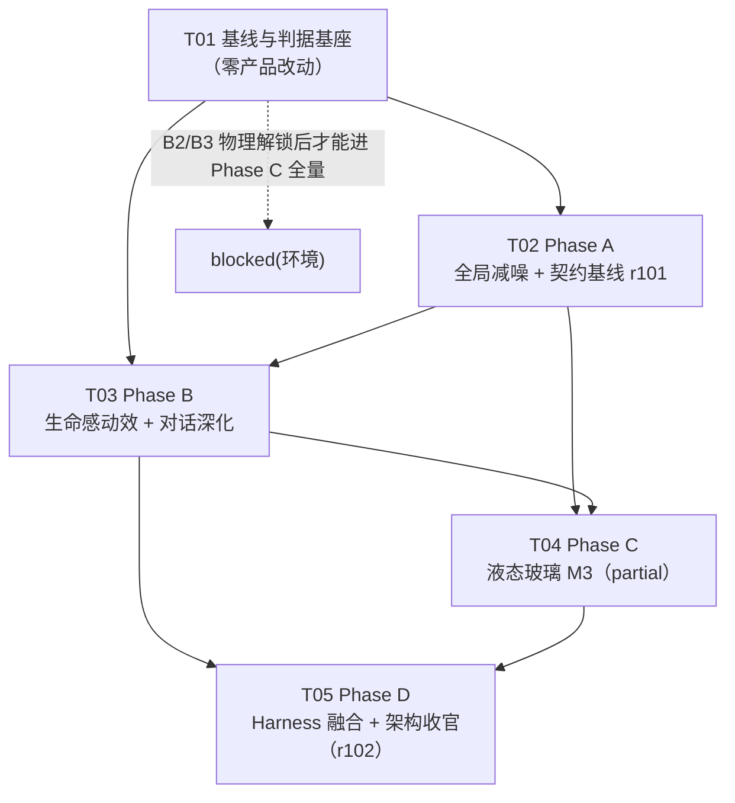
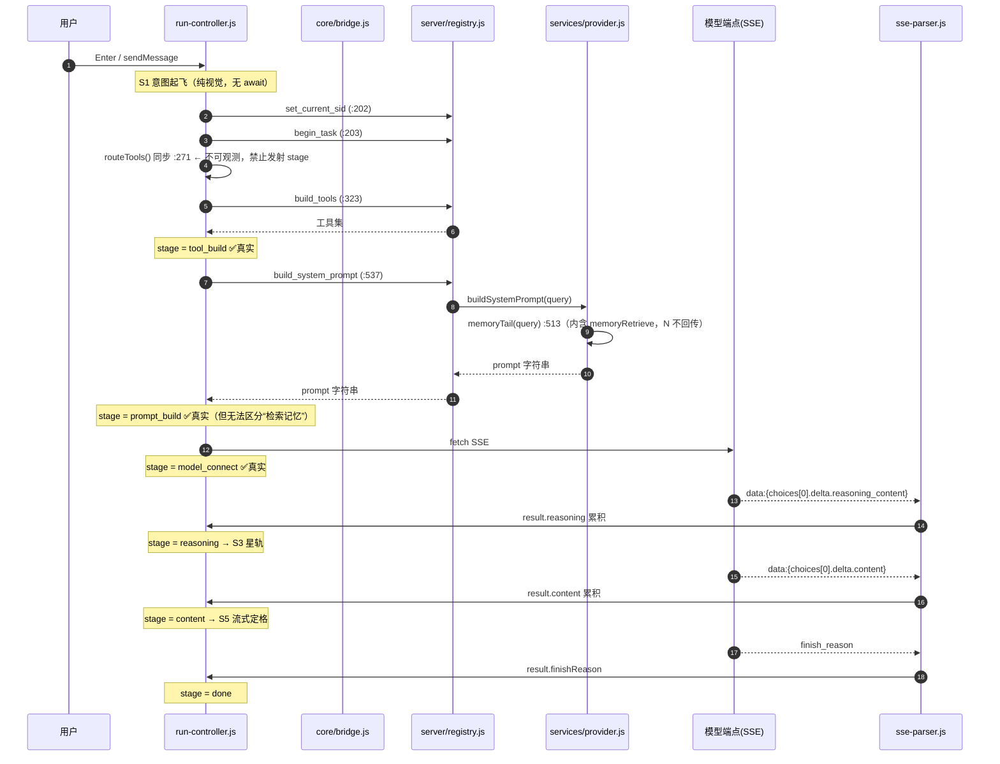
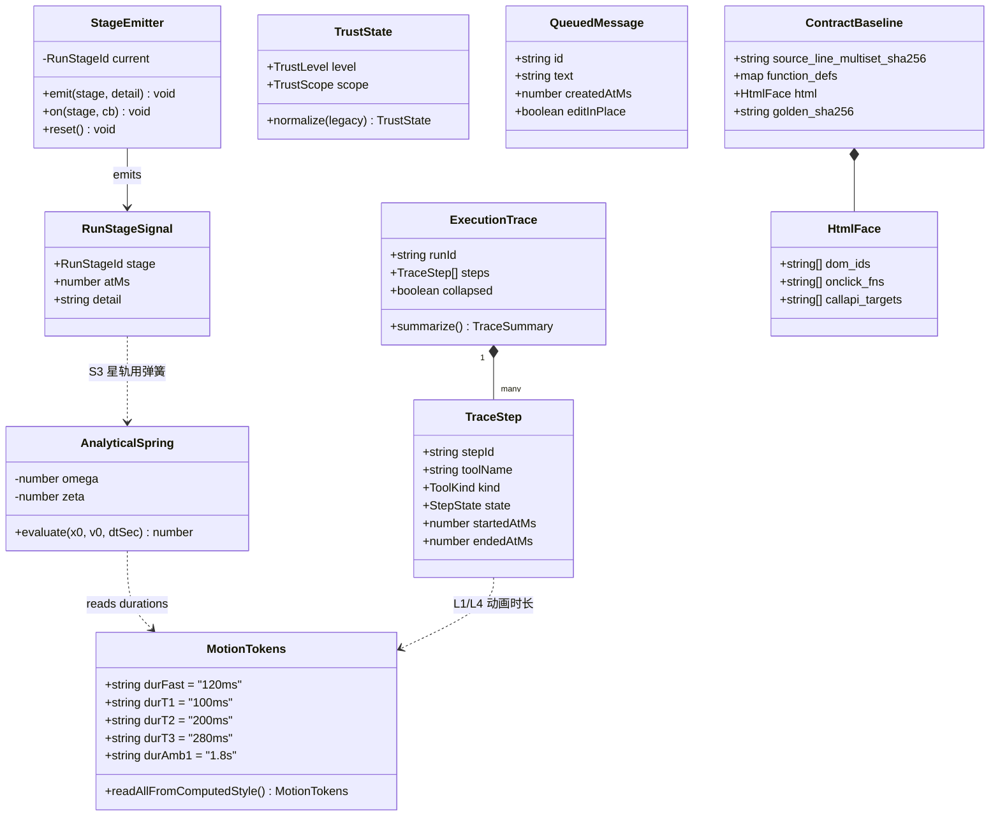

# R101-UX · Harbor 前沿 Agent 全功能 / 全 UI / 全链路动效 —— 系统架构设计与任务分解

> 角色：架构师（高见远）｜基线：commit `6b18c13`（v1.9.0 / R101 态）
> 输入：《R101 FULL-STACK UX, UI & MOTION DESIGN HANDBOOK》全文（`qa/r101/plan/plan.txt`，283 行）
> 产出性质：**架构设计与裁决**，不含实现代码。
> 纪律：本文所有量化结论均来自本轮**实跑命令**或**实读文件**；跑不了的显式标 `blocked-by-environment`，不写推测数字。

**修订记录**

| 版本 | 变更 |
|---|---|
| v1 | 初稿：裁决表 / 四阶段 / 基线推进 / 按钮归属 / 数据结构 / 待明确 8 条 |
| **v3（本版）** | ① 纠正 `harbor.html` 字节数口径（行尾相关，3 种读数；§1.1 注 + §0-⑭）<br/>② 新增 §4.2.3「管道掩盖 rc」+ 三处门禁代码排查（划清「门禁基础设施无此问题，管道假绿只发生在人手命令」）<br/>③ §8 全部转为已裁决：Q1–Q10 归档；新增 §8.3「T01/T02 任务卡必带三段」<br/>④ Q10 落为可执行：**豁免登记表** + 「转 True 必须原本红→修绿 + 判据常量未改动 diff」 |
| v2 | ① §1.5 模块路径口径（纠正「8 处路径错误」定性；查出 `context.js` 同名双份）<br/>② §1.6 死控件盘点（`:617` + JS 生成的 `planEditBtn`；指出「只扫模板会漏 JS 生成」）<br/>③ §4.2.1 `pytest` 自动发现造成的「自证式绿窗口」与口径分叉风险<br/>④ §4.3.0 既有 4 条负控 / §4.3.1 第 5 条锚点负控 / §4.3.2 9 条注入式负控<br/>⑤ §4.5 零契约红利区（`frontend/skin/` 不在 `SRC`）<br/>⑥ §6.2.1 stage 发射点硬约束 C1–C5 + A10/A11<br/>⑦ S3 Bug 逐行证据（`run-controller.js:694` → `markdown.js:68`）<br/>⑧ 更正 167 定性：**不对应仓内任何组合**（51+117=168，无 116 出处） |

---

## 0. 一页结论（先看这 15 条，全部与方案原文或上游假设有出入）

| # | 裁决 | 依据 |
|---|---|---|
| **①** | **Rail 9→5 可以在「零契约变更」下完成**——前提是 5 颗被移出的钮**relocate（换宿主保 id/onclick）而非 delete**。实测：`switchPanel` 在模板出现 4 次、`toggleSettings` 2 次，删掉对应的 2 颗 rail 钮后仍在集合内 ⇒ `html.onclick_fns` 不变；`themeBtn` / `expertCenterBtn` / `railNotifyBtn` / `toolsBoxBtn` 只要 id 仍在模板任意处（含隐藏容器），`DOM_IDS 40/40` 与 `html.dom_ids` 均不改。**只有 delete 会红。** | §5 逐钮裁决表 + 实测计数 |
| **②** | **但 r101 新基线仍然不可避免**：方案要求的行为（Ctrl+K、Execution Trace、五阶段动效、计划步骤编辑、信任胶囊…）**全部落在 `frontend/src/**/*.js`**，而 `contract_diff.py` 对 `frontend/src` 下**所有非空行（含注释）排序哈希** ⇒ 改一行即红。**建议只推进 2 次基线**（r101 = Phase A+B 合并一次；r102 = Phase D 收尾一次），而不是每 feature 一次。 | `tools/contract_diff.py:72-80,128` |
| **③** | **S2「正在检索关联记忆 → 正在路由工具域 → 连接模型中…」的 3 段文案，当前只有 1 段有真实信号。** 实测：`routeTools()` 是**同步函数**（`run-controller.js:271`，无 await，亚毫秒级，物理上不可观测）；记忆检索发生在 `server/src/services/provider.js:513 memoryTail()` **内部**，被 `build_system_prompt` 融合成一个 await，前端拿不到边界；真正可观测的 await 只有 `build_tools`（:323）与 `build_system_prompt`（:537）两处 + SSE 连接本身。⇒ **判定「需改造后落地」**，按原文直做 = 编造假进度。 | `run-controller.js:271,323,537`；`provider.js:505-525` |
| **④** | **7.2「Dual Kawase 顶层零回读输出感知亮度与方差」自相矛盾。** D3D11 不存在「零回读 + CPU 可得标量」通路；且消费方是 **Chromium DOM（CSS 变量/类名切换）**，极性判定必须落到 CPU。仓内已有先例：`native/build/m2probe/gyp/probe_addon.cpp:91-100` 就是 `CopyResource → staging → Map`。⇒ 改写为**「2×2 归约 + N-2 帧错位 staging 回读（零 stall，非零回读，≤4Hz，每帧 ≤16B）」**。 | `probe_addon.cpp:91-100` |
| **⑤** | **8.1 Phase C 在本机只能做到 `blocked`。** `deliverables/dev-plan/r101-evidence/verdict.json` 实测：`verdict=conditional`、`coverage=60/100`、`ceiling=80/100`，且**明确写入 B2(10)/B3(10) 永久 blocked、不从分母剔除**。物理单屏无交互会话 ⇒ 无法在本环境补齐。 | `verdict.json` coverageNote |
| **⑥** | **5.4「参考了 N 条记忆」当前给不出诚实的 N。** 记忆注入是 `provider.js:513` 的**整表 dump + `memoryRetrieve(query,2)`**，融合进一个字符串返回，**N 不回传**。好消息：`memory_retrieve` 已在 `hidden_methods(117)` 面内（`registry.js:160` 注册），前端直接调用它**零 API 新增**；代价是 `html.callapi_targets` 新增一项 ⇒ 计入 r101 基线。 | `frozen-python-surface.json` hidden_methods 含 `memory_retrieve` |
| **⑦** | **方案量化口径 3 处不符、需纠偏**：文件数 `1,197` → 实测 **1,005**（`git ls-tree -r HEAD`，未跟踪 **0**）；js_api `167` → 实测 **168**（51 public + 117 hidden 零差集）；市场 `811 项` → catalog 实解析 **875**（394 experts / 54 teams / 377 skills / 50 connectors），**无法复现 811**。另有门禁注释陈旧：`run_normalized_gates.py:65` note 写「依赖棘轮 157」，实跑为 **164**。 | §1 口径纠偏表 |
| **⑧** | **13/13 门禁 / 39 server 门 / 82/82 架构契约，三项均经我实跑复核为真。** 时间戳为本次运行（`normalized-gates-r69.json` 重新生成）。 | 本轮实跑输出 |
| **⑨** | **门禁有两层，且存在「延迟失败」陷阱。** `ui-contract` 读的是 `index.template.html`，`contract-diff` 的 `html` 面读的是**构建产物 `harbor.html`**。实测：删掉模板里的 `id="themeBtn"` 但**不 rebuild** → `check_contract.py` 立刻 `39/40 FAIL`，而 `contract_diff.py` **仍报零漂移 PASS**。等任何人跑一次 `node frontend/build.js`，漂移才突然出现。⇒ **纪律：模板改动后必须 rebuild，并同时跑两道门。** | 本轮实测（N2，跑完即还原） |
| **⑩** | **本 worktree 存在并发改动风险。** 本轮核验期间实测到另一代理给 `frontend/src/core/motion.js` 加探针行后又自行还原。⇒ **推进 r101 基线快照前，`git status --short` 必须除预期交付文件外为空**，否则探针行会被写进锚点，r101 从此失效。 | 本轮实测（见 §4.3 命令块下的警示） |
| **⑪** | **`pytest` 会自己找「最新基线」，而且已经在 CI 里跑。** `tests/test_contract_diff.py:23-32 _latest_baseline()` 按 `contract-baseline-r*.json` 的数字取最大；该文件在 `round_runner.py:45` 的 CORE 列表、CI 跑 `--full`。⇒ **`--snapshot` 不能提前做**（提前做 = 拿当前状态自证，pytest 得到一个什么都证明不了的绿），且 Step ①②③ **必须同一提交**，否则 `contract-diff` 比硬编码 r100、`pytest` 比自动发现的 r101，**同名判据给出相反结论**（`_frozen_anchor` docstring 里 D-05 那类事故）。 | `test_contract_diff.py:23-32`、`round_runner.py:45`、`harbor-ci.yml:49` |
| **⑫** | **方案里的模块引用是「裸文件名」，不是路径。** 8 个模块全部真实存在（无一虚构），但真实目录与直觉归属不同；其中 **`context.js` 在 `agent/` 与 `expert/` 各有一份**，补全路径有歧义 —— 这是上游核查表也漏掉的一点。⇒ 文件清单一律以本文 §3 的实测路径为准；**`agent/context.js` 是改造目标，`expert/context.js` 不动**。 | §1.5 逐项 glob 实测 |
| **⑬** | **pytest 在本地跑不到，但 CI 能跑。** `python -m pytest` → `ModuleNotFoundError`（PATH 上的解释器是 `versions/3.13.12`，没装 pytest）；裸 `pytest` → **11 passed**（来自 `envs/default/Scripts/`）。而 `round_runner.py:140` 用的是 `sys.executable -m pytest`，CI 又先 `pip install pytest`（`harbor-ci.yml:44,80`）。⇒ 本地 `round_runner.py --full` 在 pytest 这一段**起不来**，且其输出解析宽松、可能静默记成 `None`。**这是「本地绿 ≠ CI 绿」的反向版本：本地缺门。** | 本轮实跑三行对照（§4.2.2） |
| **⑭** | **`harbor.html` 的字节数不是固定值，随行尾态变。** 实测：HEAD blob（LF 归一）**3,646,881 B**；工作区全 CRLF（30,061 行）**3,676,942 B**；今早引用的 **3,647,963 B 是混合行尾态**（含 1,082 行裸 LF）。`core.autocrlf=true` 且无 `.gitattributes` ⇒ **rebuild 一次就会 +30,061 B**。`contract_diff` 的 `html` 面做正则取集合、**行尾无关**（本轮实测 混合→全 CRLF 不产生漂移）。⇒ 文档与报告**一律不引用 harbor.html 绝对字节数**。 | §1.1 注 + `git cat-file -s` / `stat` / `hash-object` 三方对照 |
| **⑮** | **`命令 \| tail` 会把 rc=1 变成 rc=0。** 实测：裸 `python -m pytest …` → `rc=1`；加 `\| tail -3` 后 → `rc=0`。管道让 `$?` 变成末命令的退出码。**但范围必须划清**：我逐个查过 `run_normalized_gates.py:93`、`round_runner.py:78`、`harbor-ci.yml` 全部 `run:` 块 —— **均无 `shell=True`、无管道**，⇒ **门禁基础设施没有此问题，管道假绿只发生在人手敲命令的场景**（含上游的 `git push \| tail`）。 | §4.2.3 三处代码排查 | 实测：HEAD blob（LF 归一）**3,646,881 B**；工作区全 CRLF（30,061 行）**3,676,942 B**；今早引用的 **3,647,963 B 是混合行尾态**（含 1,082 行裸 LF）。`core.autocrlf=true` 且无 `.gitattributes` ⇒ **rebuild 一次就会 +30,061 B**。`contract_diff` 的 `html` 面做正则取集合、**行尾无关**（本轮实测 混合→全 CRLF 不产生漂移）。⇒ 文档与报告**一律不引用 harbor.html 绝对字节数**，要用则写「LF 归一 3,646,881 B」并标口径。 | §1.1 注 + `git cat-file -s` / `stat` / `hash-object` 三方对照 |

---

## 1. 事实核验与口径纠偏

### 1.1 全仓规模（实测口径）

| 指标 | 方案原文 | 本轮实测 | 判定 |
|---|---|---|---|
| 仓库条目数 | 1,197 | **1,005**（`git ls-tree -r HEAD --name-only \| wc -l`）；`git ls-files --others --exclude-standard` = **0** | ✗ 口径不符。方案疑似统计含 node_modules / 构建产物的目录树条目。**不影响方案主体**（纯规模描述），但文档不得沿用 1,197 |
| `frontend/index.template.html` 行数 | 1,046 | **1,046** | ✓ |
| 同文件字节 | 79,407 B | **79,407 B（CRLF 磁盘态）** / 78,362 B（LF 正文） | ✓ 差额 1,045 B = 1,045 个 `\n`→`\r\n` 的行尾增量，与 BUILD.md 房屋规则 1 一致 |
| `<button>` 数 | 103 | **103** | ✓ |
| `onclick=` 数 | 65 | **65** | ✓ |
| 「52 项输入控件」 | 52 | `<input>` **48** + `<textarea>` **4** = **52** | ✓ 口径可解释 |
| `<select>` | 26 | **26** | ✓ |
| `manifest.scripts` / `styles` | 117 / 14 | **117 / 14** | ✓ |
| `frontend/src` JS 文件数 | 117「前端领域脚本」 | **117** | ✓ |
| `harbor.html` | — | **行尾态相关，不是一个固定值**（详见下方注） | ⚠ 我此前写的 3,647,963 B 是**混合行尾态**下的瞬时大小，**不可当作固定事实引用** |

> **`harbor.html` 大小的三种口径（本轮实测定案）**
> `core.autocrlf = true`（无 `.gitattributes`），实测：
> ```
> HEAD blob 大小（LF 归一）      = 3,646,881 B   ← git cat-file -s 2b55388e
> 当前工作区（全 CRLF，30,061 行）= 3,676,942 B   ← stat；CRLF=30061，bare LF=0
> LF 归一后                      = 3,646,881 B   ← 与 blob 逐字节相等，git hash-object 同哈希
> 今早的 3,647,963 B             = LF + 1,082     ← 混合行尾态（1,082 行是裸 LF）
> ```
> ⇒ **结论**：`harbor.html` 的**磁盘字节数随「是否 rebuild 过」而变**。rebuild 会把全文件归一成 CRLF（+30,061 B）。我此前与上游都引用过的 **3,647,963 B 是混合态读数**，不能当基准。
> **`contract_diff` 的 `html` 面不受影响**——它对文本做正则取 `dom_ids / onclick_fns / callapi_targets` 集合，行尾无关。本轮已实测：混合态 → 全 CRLF 的转换**不产生漂移**（`contract_diff --compare r100` 仍 `零漂移 PASS`）。
> ⇒ **纪律：文档与报告一律不引用 `harbor.html` 的绝对字节数**，需要规模描述时用「约 3.65 MB」或引用 LF 归一值 3,646,881 B 并标注口径。这一条与 BUILD.md 房屋规则 1（行尾探针）同源。


### 1.2 动效资产（逐文件实测，脚本统计）

| 文件 | `@keyframes` 定义数 | 方案声称分布 | 判定 |
|---|---|---|---|
| `frontend/styles/legacy.css` | **63** | 63 | ✓ |
| `frontend/styles/responsive.css` | **4** | 4 | ✓ |
| `frontend/styles/shell.css` | **3** | 3 | ✓ |
| `frontend/styles/components.css` | **2** | 2 | ✓ |
| `frontend/styles/features/chat.css` | **2** | 2 | ✓ |
| `frontend/styles/features/generative.css` | **1** | 1 | ✓ |
| `frontend/react/src/island.css` | **1** | 1 | ✓ |
| **合计** | **76 定义 / 75 唯一名** | 75（方案称「75 个 @keyframes」） | ✓（方案把「唯一名」当「定义数」，表述不精确但无实质错误） |

- **`v4MaskIn` 重复定义**：`legacy.css:454` 与 `legacy.css:987` — **完全相同的字节**（`@keyframes v4MaskIn{from{opacity:0}to{opacity:1}}`）。判定：✓ 成立。
- **`v4LineIn` 死引用**：全仓 CSS 中引用 **29 处**，`@keyframes v4LineIn` 定义 **0 处**。判定：✓ 成立（方案写「10+ 处」偏保守，实测 29）。

### 1.3 门禁与契约（本轮实跑）

| 项 | 方案原文 | 本轮实测 | 判定 |
|---|---|---|---|
| 规范化门禁 | 13/13 | **`python tools/run_normalized_gates.py` → `13/13 PASS, 0 SKIP, FAIL=[]`，`nativeExitWarnings=0`** | ✓ |
| server 门禁 | 39 | **39**（`server/test/*.mjs` 共 41，排除 `auth-migrate.mjs` / `node-sqlite-probe.mjs`） | ✓ |
| 架构契约断言 | 82/82 | **`node frontend/app/tests/arch-contract.mjs` → `[arch-contract] 82/82 通过`** | ✓ |
| js_api 方法面 | 167 | **`node server/test/method-surface.mjs` → publicMethods 51 / hiddenMethods 117 / nodeRegistered 168 / 零差集** | ✗ **167 不对应仓内任何组合**：51+117=**168**；不存在能凑出 167 的拆分（51+116 里的 116 在仓内无出处）。⇒ 167 是**无来源数字**，一律用 168 |
| 循环依赖 | 17 环 / 104 符号 | `scc_ratchet.py` / arch-contract 均报 **基线 17/104，当前 17** | ✓ |
| 依赖棘轮 | （方案未提） | `node tools/gen_allowlist.mjs --check` → **前向隐藏边 164 条（冻结 164）**；但 `run_normalized_gates.py:65` 的 note 仍写「依赖棘轮 157」= **陈旧文案** | ⚠ 门禁自身文案需修（不阻塞） |
| 类型契约覆盖 | （方案未提） | `type_annotation_audit.py` → **18/18 (100.0%)**，静态类型检查 `blocked-by-environment` | ✓ |

### 1.4 抽查方案引用的模块名 / 行号（要求 ≥5 处，本轮做 8 处）

| # | 方案引用 | 实测 | 判定 |
|---|---|---|---|
| 1 | `planning/card.js:144` `<button id="planEditBtn" disabled>编辑（不可用）</button>` | **`frontend/src/planning/card.js:144`** 逐字节一致 | **✅ 精确** |
| 2 | `markdown.js:284` 的 `text.slice(0, 500)` | **`frontend/src/components/markdown.js:284`** `callApi('append_memory', [JSON.stringify({ text: text.slice(0, 500) })])` | **✅ 精确** |
| 3 | `run-controller.js:805` 的 `text.slice(0, 500)` | **`frontend/src/agent/run-controller.js:805`** `fullContent.slice(0, 500)` | **✅ 精确** |
| 4 | `run-controller.js:244` 的 `.typing-dots` 三灰点 | **`run-controller.js:244`** `aiContent.innerHTML = '<div class="md-body"><div class="typing-dots">…'` | **✅ 精确** |
| 5 | `run-controller.js:655` 的 `◐` + 「深度思考」、`flat.slice(0, 48)` | `flat.slice(0, 48)` 在 **:654**；`◐` 在 **:656**；「深度思考」在 **:656** | **⚠ 行号偏移 1 行**（内容全对，锚点应写 654/656） |
| 6 | 「前端 `context.js` 固定截断 450/900 字」 | 文件实际在 **`frontend/src/agent/context.js:5`**：`const SHRINK = { keepTail: 6, toolMax: 450, aiMax: 900 }` | **✅ 成立**（路径需补 `agent/`） |
| 7 | `shortcuts.js` 仅 5 个快捷键 | **`frontend/src/shell/shortcuts.js`**（方案未给目录，实际在 `shell/` 而非 `ui/`）；`ctrlKey/metaKey` 分支 12 处 | **⚠ 路径不精确** |
| 8 | `harness/` 6 个引擎模块 / 1,557 行 | `harness/*.py` 6 个模块 + `__init__.py`，**合计 1,676 行**（含 `__init__.py`）；6 个业务模块本身小于此值；`README.md:44` 明写「可运行、可测试、但**不可达**」 | **⚠ 行数口径差 119 行**；「不可达」✅ 精确 |

> 抽查结论：方案在**函数/行号级锚点上的准确率很高**（8 处中 4 处逐字节精确、2 处偏移 ≤1 行、2 处路径口径不严），**没有发现虚构模块**。它的系统性偏差集中在**聚合统计量**（1,197 / 167 / 811 / 1,557），而非代码级引用。

### 1.5 模块路径口径：方案写的是**裸文件名**，不是路径（本条纠正上游「8 处路径错误」的定性）

上游核查表把 8 个模块列为「方案写的 `frontend/src/agent/grants.js`」等，实测**方案原文从未写过路径**，它通篇以**裸文件名**引用：

```
## 5.2 安全护栏、任务授权与沙箱（guard.js / grants.js / sandbox.js）
▪ 人工接管卡（resume.js
▪ MCP 与本地模型（mcp-panel.js / local-model.js）
…取代当前前端 context.js
▪ Ctrl+K 全局命令面板（shortcuts.js
▪ 红线 3 … lightwellShell.js
```

⇒ 定性修正：**这不是「方案写错了路径」，而是「方案的模块引用不可直接消费」**——任何把裸名补全成路径的动作都会错配。8 个文件**全部真实存在**，无一虚构，但真实目录与直觉归属不同。**这一条比「路径写错」更严重**：因为「写错」会被 `test -f` 立刻抓住，「没写目录」则不会，容易在不知不觉中被补全成错路径。

**实测真实归属（8 个，逐项 `glob` 确认）**

| 裸名 | 直觉归属（易错） | **实测真实路径** | 唯一性 |
|---|---|---|---|
| `grants.js` | `agent/` | **`frontend/src/shell/grants.js`** | 唯一 |
| `sandbox.js` | `agent/` | **`frontend/src/settings/sandbox.js`** | 唯一 |
| `resume.js` | `chat/` | **`frontend/src/agent/resume.js`** | 唯一 |
| `mcp-panel.js` | `mcp/`（该目录不存在） | **`frontend/src/integrations/mcp-panel.js`** | 唯一 |
| `local-model.js` | `models/`（该目录不存在） | **`frontend/src/settings/local-model.js`** | 唯一 |
| `context.js` | `core/` | **`frontend/src/agent/context.js`** | ⚠ **不唯一（2 个）** |
| `shortcuts.js` | `core/` | **`frontend/src/shell/shortcuts.js`** | 唯一 |
| `lightwellShell.js` | `shell/` | **`frontend/skin/lightwellShell.js`**（**不在 `src/` 下**） | 唯一 |

**我比上游多查出的两点**

1. **`context.js` 是唯一一个「同名双份」**：`frontend/src/agent/context.js`（134 行，`SHRINK={keepTail:6,toolMax:450,aiMax:900}`）与 `frontend/src/expert/context.js` 同时存在。⇒ 方案第 5.3 节说的「取代当前前端 `context.js`」**指向不明**：按 5.3 的语义（6 分区 Token 预算 / 450/900 截断）应指 `agent/context.js`，但**必须显式写明**，否则工程师可能改错文件——而改错文件不会红任何门禁（`expert/context.js` 也在 `frontend/src` 下，`contract_diff` 只报「源码变了」，不报「改错了哪个文件」）。
   **架构裁定：`agent/context.js` 为信息层融合的改造目标；`expert/context.js` 不动。**
2. **`frontend/skin/lightwellShell.js` 不在 `SRC = frontend/src` 下** ⇒ 改它**不触发 `contract_diff` 的 `source_line_multiset`**，但它属于皮肤层，改动只受 `check_contract.py` 的 CSS 类/变量约束。这是一个「零契约成本的改动区」，应显式列入红利区（见 §4.5）。

### 1.6 死控件全量盘点（红线 4「彻底消除假按钮」的清理清单）

`frontend/index.template.html` 全文 `disabled` 仅 **3 处**（实测 `grep -n disabled`）：

| 行号 | 控件 | 性质 | 处置 |
|---|---|---|---|
| `:617` | `<button type="button" class="modal-btn" disabled>在下方输入框</button>`（空态第 3 步） | **真死控件**：永久 disabled、无 onclick、无 id | 删除或改为纯文本标签。**无 id、无 onclick ⇒ 删除零契约影响** |
| `:994` | `#expertEnableBtn disabled` | 按状态禁用（未选专家时禁用合理） | **保留**，不要误清 |
| `:995` | `#expertSelectBtn disabled` | 同上 | **保留**，不要误清 |

**另有 1 颗不在模板里、但同样是假按钮**：`frontend/src/planning/card.js:144` 的 `<button id="planEditBtn" disabled title="当前版本不支持编辑计划…">编辑（不可用）</button>` —— 它由 JS 生成，`grep disabled` 扫模板**扫不到**。

⇒ **红线 4 的完整清理清单 = 2 颗**（`:617` + `planEditBtn`），并且**下一轮的「假按钮」断言必须同时覆盖模板与 JS 动态生成两条路径**，只扫模板会漏掉 `planEditBtn` 这一类。这一点上游核查表已指出 `:617`，但未指出「只扫模板会漏 JS 生成」这个方法论缺口。

---

## 2. 落地判定表（方案 8 章逐条）

判定口径：`可落地` = 现有门禁与架构下无需破坏性前提即可实现；`需改造后落地` = 必须先改设计（改法已写明）；`blocked` = 缺物理/数据/接口前提，写明解锁条件。

### 第 1 章 · 基线诊断与五大原则

| 条目 | 判定 | 说明 / 改造点 |
|---|---|---|
| 1.1 四事实（诊断章节） | **可落地** | 属认知基线，无改动。但引用数字须按 §1 纠偏：1,005 / 168 / 875 |
| 1.2 五原则 | **可落地** | 用作验收准则。原则 5「彻底消除假按钮」与红线 4 同源，需一条常驻断言（见 §4 N5） |

### 第 2 章 · 信息架构与 103 钮裁决

| 条目 | 判定 | 说明 / 改造点 |
|---|---|---|
| 2.1 Rail 9→5 | **需改造后落地** | 改法 = **relocate 而非 delete**（§5 裁决表）。核心风险：`themeBtn` 在 `DOM_IDS` 40 冻结名单内，delete 即 `39/40` FAIL + `html.dom_ids` 漂移 |
| 2.2 Header 回归会话名 + 面包屑 | **需改造后落地** | `headerTitle` 是**冻结 DOM id**（`check_contract.py:13`）⇒ id 必须保留，只改**内容与绑定**（零契约风险）。新增的「演示可见模式 / 上下文副屏 / ? 命令面板」三颗微钮：`?` 已有 `#shortcutsBtn`（可复用，零新增）；另两颗**不得带 id、不得带 onclick**（用 `class` + `data-*` + `addEventListener`），否则 `html` 契约新增即漂移 |
| 2.2 `#searchPanelBtn` 符号纠偏 | **可落地** | 该 id **不在** 40 冻结名单；但被 JS `getElementById` 引用 ⇒ 换图标/换位置安全，**换 id 或删除则需同步 JS** |
| 2.2 `#headerStatusZone` 收敛为健康胶囊 | **可落地** | 非冻结 id，纯前端渲染重组 |
| 2.3 侧栏置顶并行任务区 | **需改造后落地** | `#bgTaskList` 目前在 `#notifyPop` 内（模板 :112）。搬出需改 `frontend/src/shell/navigation.js:151,215,272`（三处 `railNotifyBtn` 取值）并加空值防护 |
| 2.3 `#new-chat-btn` 直达画布 | **需改造后落地** | 该钮 onclick 名为 `openNewChatScree…`（模板 :152，模板内**唯一**）⇒ 删 onclick 即 `html.onclick_fns` 漂移。**保留 onclick 名、改其内部行为**（改 `frontend/src/chat/navigation.js`）为零漂移路径 |

### 第 3 章 · 聊天主舞台

| 条目 | 判定 | 说明 / 改造点 |
|---|---|---|
| 3.1 四套空态收敛 | **需改造后落地** | `#emptyState` 是**冻结 DOM id**（`check_contract.py:13`）⇒ 必须保留该节点（可隐藏/改结构）；`#newChatScreen`(:581)、`#emptyGuide`(:614) 非冻结可重组；`shell/onboarding.js` 4 步向导可降级 |
| 3.2 用户气泡三钮合并为「原地编辑 + Rewind」 | **需改造后落地** | 三钮由 `MSG_ICONS` + `markdown.js addMsgActions` **JS 动态渲染**，不在模板 ⇒ **零 html 契约风险**；但 `markdown.js` 改动进 r101 基线。Rewind 联动工作区快照需 `planning/checkpoints.js` 支撑 |
| 3.2 胶囊徽章可交互溯源 | **需改造后落地** | 依赖上下文副屏（3.2 末项）先落地 |
| 3.2 AI 复制分级 / 换模型重答 | **可落地** | 纯前端；但「换强模型重答」需 `agent/run-registry.js` 支持按消息指定模型 —— 现状 `regenerate()` 走全局模型，须小改 |
| 3.2 收藏到记忆改「1 句事实提炼确认条」 | **可落地** | 红线 5 的正面实现。**不依赖后端**（可先用前端抽取 + 用户改写；真正的语义提炼若无 LLM 调用则退化为「截取首句/首段」+ 强制人工确认，仍满足红线 5） |
| 3.3 Execution Trace | **需改造后落地** | 现状工具卡由 `agent/tool-runtime.js` + `legacy.css` 平铺。改为「运行展开 / 终态折单行」需新增步骤聚合模型（§6.3）并改 `run-controller.js` 工具结果渲染段。**风险：`check_contract.py:28` 的 `CSS_CLASSES` 含 `tool-call-item / tool-spinner / toolchip / tc-head / tc-label / tc-meta`，这 5 个类名必须继续存在**（可挂在折叠摘要条上） |
| 3.3 流式防抢滚 + 「↓ 回到最新」胶囊 | **可落地** | 纯前端滚动策略 |
| 3.3 交互式接管卡 | **需改造后落地** | `agent/resume.js` 现为恢复条；加「补充纠偏指令」输入需与 `guard.js` 权限模型对齐 |

### 第 4 章 · 输入舱

| 条目 | 判定 | 说明 / 改造点 |
|---|---|---|
| 4.1 两套权限合一为三级信任胶囊 | **需改造后落地** | **关键陷阱**：`#wsUnbindBtn` 在 40 冻结名单内（`check_contract.py:16`）；`onFolderEnabled / onIndToggle / onWsSelect / unbindSession` 在 13 冻结函数名单内（`check_contract.py:18`）⇒ 合并 UI 时**必须保留 `id="wsUnbindBtn"` 节点**（可 `hidden`）与这 4 个函数定义。`#wsqToolChip` / `#accessToggle` 非冻结，可合并 |
| 4.1 释放 56px | **需改造后落地（须实测）** | 「56px」是设计意图，不是实测值。落地后须用 CDP 量 `#chatContainer` 可视高度，把真实值写回文档（禁止沿用 56） |
| 4.2 @ 唤起器泛化（`group/mention.js` → 全场景） | **需改造后落地** | 现模块用模块级单例 `_mention`（`mention.js:16`），泛化需改造为按会话/按输入宿主实例化 |
| 4.2 / 斜杠命令面板 | **可落地** | 现状只有 `send.js:139` 硬编码 `text === '/compact'`；其余命令需先在 `compact-command.js` 同类机制上登记 |
| 4.2 右键菜单 Agent 化 | **可落地** | `components/context-menu.js` 独立，低耦合 |
| 4.3 发送/排队/停止三态 + 队列条 | **需改造后落地** | `send.js` 已有 `sendMessage._queued` 旗标（:44,255,264），但**队列内容无存储**（只有布尔旗标）⇒ 需新增队列数据结构（§6.4） |

### 第 5 章 · 功能域

| 条目 | 判定 | 说明 / 改造点 |
|---|---|---|
| 5.1 激活计划步骤编辑 | **可落地** | 删 `disabled`、改 `planning/card.js`；`#planEditBtn` **非冻结 id**，可改名 |
| 5.1 步骤级 Checkpoint + 回滚前 Diff 预览 | **需改造后落地** | `planning/checkpoints.js` 现为单点快照（「回滚到计划开始前」）；改步骤链需后端 `set_ws_dir`/文件快照能力配合，属 Phase B 高复杂度项 |
| 5.2 内联审批卡取代模态 `uiConfirm` | **需改造后落地** | `components/overlays.js` 的模态被多处复用；改内联需逐个迁移调用点，且要保留「不可逆操作强阻断」双轨。**建议只迁移「文件写入 / 工作区命令 / MCP 调用」三类，保留 `run_admin_command` 与目录删除的模态** |
| 5.3 Harness 信息层融合（6 分区预算 + 大对象落盘 + 锚定压缩） | **需改造后落地（Phase D，高风险）** | Python 侧 `harness/context_assembler.py` 有 `PART-01..06` 刚性预算（:48,:356-383），但 Node 侧需**新建 ExternalBlobStore 持久层**——这是新存储子系统，不是接口适配。**建议拆为两个子项**：(a) 先把 `context.js` 的 450/900 机械截断换成「分区预算 + 大对象外置索引」；(b) 锚定增量压缩复用既有 `prompts/compaction/delta_patch.schema.json` |
| 5.3 指令层阶段模板 | **可落地** | `prompts/phases/` 已存在，绑定任务状态机属中等改动 |
| 5.3 反馈免疫层（Error-to-Hint） | **可落地** | `harness/feedback_immune.py` 是确定性规则，移植成本最低，**建议列为 Phase D 首项**（先出成果、再动信息层） |
| 5.4 能力中心分层（开箱即用 / 提示词模板库） | **需改造后落地** | catalog 实为 875 条（394/54/377/50），且 `hotIds` 60 条可作「开箱即用」白名单起点。**方案「811 项」不可复现，须方案方给复现式** |
| 5.4 专家团多智能体协作卡 / 群聊接力 | **需改造后落地** | `#expertRunTimeline`(:627) 现为文本流，`collaboration/timeline.js` 已有类化结构，可承载卡片 |
| 5.4 记忆召回显性化「参考了 N 条记忆」 | **`blocked`（可解锁）** | **缺什么**：`provider.js:513 memoryTail()` 把命中融合进 prompt 字符串，**N 不回传**。**解锁条件**：前端在发送前调用已注册的 `memory_retrieve`（`registry.js:160`，属 `hidden_methods` 117 面，**零 API 新增**）自算 N；代价 = `html.callapi_targets` 新增一项 ⇒ **必须计入 r101 基线** |
| 5.4 双模型协同移出设置页 | **需改造后落地** | `#collaborationBlock`(:552) 现 `hidden`；`collaboration/ui.js:180` 直取该 id。搬迁需同步改 4 处（`:121,:168,:180` + `providers/hybrid.js:292`） |
| 5.4 生成式 UI 克制触发 | **可落地** | `generative/registry.js` 已有触发注册表 |
| 5.5 MCP 融入能力中心 / 本地模型健康微标 | **需改造后落地** | `integrations/mcp-panel.js` + `settings/local-model.js` 搬迁 |
| 5.5 浏览器右侧按需副屏 | **需改造后落地** | `search/panel.js` 半遮挡浮层 → 停靠副屏，需新增布局容器（L3 空间转场层） |
| 5.5 洞察看板三张行动卡 | **可落地** | `analytics/panel.js` 纯前端聚合 |
| 5.5 设置 11 块 → 4 大域 | **需改造后落地（工作量最大项之一）** | `settings/navigation.js` 已有 `#setNav` 锚点导航（模板 :185），重组分区不改契约；但 **`#settingsPanel` 是冻结 DOM id**，必须保留 |
| 5.5 Ctrl+K 命令面板 | **需改造后落地** | `shell/shortcuts.js` 现有监听需扩展；命令面板为新模块（新 `provides` ⇒ 顶层符号新增 ⇒ 基线推进已覆盖） |

### 第 6 章 · 全链路动效

| 条目 | 判定 | 说明 / 改造点 |
|---|---|---|
| 6.1 **S1 意图起飞** | **可落地** | 发送钮压回弹 + `#streamBar`(:91) 已存在，纯 CSS + 既有 `createAnalyticalSpring` |
| 6.1 **S2 预热与检索（3 段动态文案）** | **需改造后落地** | 见 §0-③。**改造方案**：只映射 3 个**真实可观测**阶段 —— ①`build_tools` await（:323）②`build_system_prompt` await（:537，其内部含记忆检索，对外统一称「正在准备上下文」）③SSE 首字节前（连接模型）。**禁止**把「正在路由工具域」做成假进度（同步函数、<1ms）。若确需真实的「检索记忆」独立文案，必须把 `memoryTail` 从 `buildSystemPrompt` 拆出为独立 await（server 改动 → 计入 Phase D） |
| 6.1 **S3 深度思考（星轨 / 扫掠 / 滑动尾行 / 修展开弹关 Bug）** | **可落地** | Bug 根因已定位：`run-controller.js:665` 起的 `mdBody.innerHTML` 整体重建覆盖 `.think-body`。修法 = **思考容器与正文容器独立分区**（把 think 节点移出 `mdBody` 重建范围，或改为 diff 更新），这属结构性修正而非补丁 |
| 6.1 **S4 工具语义微动效** | **需改造后落地** | 需 `tool-runtime.js` 暴露工具**类别**（read/write/exec/browse/mcp）给渲染层；现状只有工具名 |
| 6.1 **S5 流式定格** | **可落地** | `renderMdStream` 块级冻结已存在 |
| 6.2 四层节奏令牌 + 收编 75 关键帧 | **可落地（纯 CSS 红利区）** | `tokens.css:25-31` 现有 `--dur-fast/base/slow=120/180/240ms`。缺口：L3 需 240–320ms（无 320 令牌）、L4 需 1.8–3.2s 循环令牌（无）。新增令牌**纯 CSS ⇒ 不触发 contract_diff**。修 `v4LineIn`（补真实定义，而非删引用）与删除重复 `v4MaskIn` 均为纯 CSS |
| 6.3 微交互清单（胶囊 / 接力光点 / 计划卡 / 拖拽接引 / Ctrl+K / 记忆微闪） | **可落地** | 以 CSS + `MOTION` 为主；C² smin 融合需原生着色器（退化为 Phase C 项） |
| 6.4 合成器直通属性纪律 | **可落地** | 需新增一条**样式静态断言**（见 §4 N4） |
| 6.4 静置 GPU ≤ 0.5% 红线 | **需改造后落地（判据工具待建）** | 仓内 `tools/perf_*.py` 无 GPU 占用采集器。**可测路径**（核显）：PowerShell `Get-Counter '\GPU Engine(*engtype_3D)\Utilization Percentage'`。**判据未建 ⇒ 不得先写进验收**，否则就是未验证的红线 |
| 6.4 `MOTION.instant()` / fx-off 降级 | **可落地** | `core/motion.js:8` 契约已存在，新增动画须逐一登记到该降级表 |

### 第 7 章 · 液态玻璃

| 条目 | 判定 | 说明 / 改造点 |
|---|---|---|
| 7.1 锚定 A/B 双通路 | **可落地** | `66.67×`（`r101-evidence/R101-M2-c-裁决报告.md:163`）、`dropRate 0.043%`（:18）、`34.5×`（:205）、`480→483px`（`R101-M2-D1-R实测结论.md:70`）**四项全部经实读核准** |
| 7.1 补 B2（异 DPI 双屏）/ B3（中文 IME） | **`blocked`** | `verdict.json` 已把 20/100 权重永久 blocked、不归一化。解锁条件：**双屏 + 真实中文 IME 的交互式桌面会话**（物理环境，非代码） |
| 7.1 安静环境前置门 + 几何回读纪律 | **可落地** | `dropRate > 0.002 中止` 已是既有纪律，可直接纳入脚本 |
| 7.1 零 DWM Hook / 双路官方捕获 | **可落地（红线 1）** | 无异议 |
| 7.1 演示/截图可见模式 + Ctrl+Alt+P | **可落地** | 需原生 + `shell/shortcuts.js` |
| 7.2 四层材质克制 | **可落地** | 纯 CSS + 原生分层；`native/harbor-glass/include/glass_shm.h` 已有 APCA 相关结构 |
| 7.2 **Dual Kawase 零回读得感知亮度与方差** | **需改造后落地（原文自相矛盾）** | 见 §0-④。落地形态 = 金字塔顶层做 **2×2 归约** → `CopyResource` 到 **N-2 帧 staging** → `Map(DONOT_WAIT)`；≤4Hz、≤16B/次。**必须把「零回读」改写为「零 stall 回读」**，否则验收无法通过 |
| 7.2 APCA 120ms 双阈值滞回 | **需改造后落地** | 依赖上一项标量；120ms 滞回本身可落地 |
| 7.2 显存共生 / 自动降档 | **需改造后落地** | 需原生侧暴露 VRAM 占比信号；`localState.mode` 前端可得 |

### 第 8 章 · 路线与红线

| 条目 | 判定 | 说明 |
|---|---|---|
| 8.1 Phase A | **可落地** | 拆解为 T01–T04（§3） |
| 8.1 Phase B | **可落地（S2 需改造、S4 需前置）** | 见第 6 章判定 |
| 8.1 Phase C | **`blocked`** | B2/B3 永久 blocked ⇒ Phase C 只能交付「**通路 A 全量集成 + 7 类边界容错 + 演示可见模式**」，并把「唯一通路锁死」明确降级为 `conditional`。**不得宣称 M3 完成** |
| 8.1 Phase D | **需改造后落地（高风险，建议减半）** | 1,676 行 Python 引擎 → Node 生产链，且 `harness/README.md:44` 自承「不可达」。建议只做 5.3 的 (b) 信息层分片 + 反馈免疫层，砍掉 `subagent_orchestrator` 移植（Node 已有 `expert/orchestrator.js`，双实现反而制造第二套真相） |
| 8.2 六条红线 | **可落地（须配常驻断言）** | 红线 2 的「基线推进纪律」= §4；红线 4「清零假按钮」= §4 N5；红线 6「元数据净化」需在 `agent/request-builder.js` 加剥离层 |

### 判定汇总

| 判定 | 条目数（约） | 代表项 |
|---|---|---|
| **可落地** | 22 | S1/S3/S5、令牌体系、微交互、Context 菜单、洞察卡、APCA 分层 |
| **需改造后落地** | 20 | Rail relocate、S2、S4、零回读、信任胶囊、Execution Trace、设置四域 |
| **blocked** | 3 | B2/B3（物理环境）、Phase C 全量（随 B2/B3）、记忆 N 值（接口，可解锁） |

---

## 3. 四阶段执行顺序、文件清单与门禁影响

### 3.0 阶段总览与依赖图



> **关键：T01 不是「准备一下」，它是把「怎么算过」先钉死。** 没有 T01 的判据与负控，Phase A 的「零漂移」只是嘴上说。这也是 R89/R98/R99/R100 四轮的既有纪律。

---

### T01 · 基线与判据基座（零产品改动）

| 项 | 内容 |
|---|---|
| **目标** | 在动任何产品代码前，先把 r101 的**判据、负控、实测探针**建齐，并证明「当前基线可红可绿」 |
| **T01 出口判据（修订）** | 7 个新脚本/测试可跑；`assert_motion_negative.py` 的 **9 条注入式负控全部 RED 且输出子串逐字匹配**（§4.3.2）；`assert_dead_controls.py` 在现状下必须**红 2 颗**（`:617` + `planEditBtn`）；`test_r101_anchor.py` 的 5 段锚点负控在 r101 推进后全绿（§4.3.1） |
| **文件清单（新增/修改）** | `deliverables/dev-plan/R101-UX-判据与负控设计.md`（新增）<br/>`deliverables/dev-plan/R101-UX-按钮归属裁决表.md`（新增，可由本文 §5 拆出）<br/>`tools/uiaudit/assert_motion.py`（新增：9 条动效静态断言，见 §4.3.2）<br/>`tools/uiaudit/assert_motion_negative.py`（新增：9 条注入式负控 M1–M9）<br/>`tools/uiaudit/assert_dead_controls.py`（新增：覆盖模板 **+ JS 动态生成** 两条路径的假按钮断言，见 §1.6）<br/>`tools/uiaudit/probe_compose_height.py`（新增：CDP 量输入舱/阅读区高度，替代「56px」猜值）<br/>`tools/uiaudit/probe_idle_gpu.ps1`（新增：`Get-Counter` 采核显 3D 占用，支撑 ≤0.5% 红线）<br/>`tests/test_r101_anchor.py`（新增：§4.3.1 的 5 段锚点负控）<br/>`deliverables/dev-plan/normalized-gates-r69.json`（跑门后自然刷新，**跑完 `git checkout` 还原**，不入库） |
| **依赖** | 无 |
| **门禁影响** | **零红**。全部新增文件在 `tools/` 与 `deliverables/`，不触碰 `frontend/src`、`frontend/styles`、`frontend/index.template.html`、`frontend/manifest.json` ⇒ `contract_diff` / `ui-contract` / `scc` / `allowlist` 全绿。<br/>**注意**：新脚本若被加入 `run_normalized_gates.py` 的 `GATES`，则 `gate-coverage` 要求其出现在 CI 非注释 `run:` 中——CI 走单一入口 `python tools/run_normalized_gates.py`（`harbor-ci.yml:87`），故自动覆盖，**不会红** |

**为什么 T01 必须先做**：`check_contract.py` 只校验「40 id 存在」，它**不校验**「`#themeBtn` 是否还在 rail 里」。若不先建「rail 成员清单」断言，Phase A 精简后无法证明「移出」与「丢失」的区别。

---

### T02 · Phase A：全局减噪与核心 UX 收口（含 r101 基线推进）

| 项 | 内容 |
|---|---|
| **目标** | Rail 9→5、Header 回归、空态收敛、信任胶囊、计划卡激活、协作移出设置、Ctrl+K、队列条 |
| **文件清单** | **模板层（relocate 为主）**<br/>`frontend/index.template.html`<br/><br/>**结构/导航 JS**<br/>`frontend/src/shell/panels.js`（:18 `data-panel` 绑定需适配新成员）<br/>`frontend/src/shell/navigation.js`（:151,:215,:225,:239,:272 的 getElementById 迁址 + 空值防护）<br/>`frontend/src/shell/shortcuts.js`（Ctrl+K / Ctrl+B / Ctrl+Alt+P）<br/>`frontend/src/shell/onboarding.js`（降级为就绪卡）<br/>`frontend/src/shell/composer-hub.js`（胶囊轨适配两级结构）<br/>`frontend/src/expert/center.js`（:340 `expertCenterBtn` 绑定迁址）<br/>`frontend/src/collaboration/ui.js`（:121,:168,:180 协作控制迁出）<br/>`frontend/src/providers/hybrid.js`（:292 `collaborationBlock` 取值）<br/><br/>**输入舱**<br/>`frontend/src/chat/composer.js`<br/>`frontend/src/chat/send.js`（队列条 + `_queued` 升级为队列）<br/>`frontend/src/workspace/quick.js`（`#wsqToolChip` 与 `#accessToggle` 合并）<br/>`frontend/src/core/state.js`（信任三态状态位）<br/><br/>**计划卡**<br/>`frontend/src/planning/card.js`（:144 激活）<br/><br/>**新模块**<br/>`frontend/src/shell/command-palette.js`（Ctrl+K，新文件，需登记 `provides`/`requires`）<br/><br/>**样式**<br/>`frontend/styles/shell.css`、`frontend/styles/components.css`、`frontend/styles/features/plan.css`<br/>`frontend/styles/tokens.css`（新增 L1–L4 令牌）<br/><br/>**清单**<br/>`frontend/manifest.json`（新模块登记 + 依赖序）<br/>`deliverables/dev-plan/contract-baseline-r101.json`（新增）<br/>`deliverables/dev-plan/frozen-python-surface.json`（追加 `contract_baseline_r101`）<br/>`deliverables/dev-plan/R101-PhaseA-报告.md`（新增） |
| **依赖** | T01 |
| **门禁影响** | ⚠ **前置动作：任何模板改动后必须 `node frontend/build.js`**，然后同时跑 `check_contract.py` 与 `contract_diff.py`。只跑一道就宣布绿是本轮实测到的**延迟失败陷阱**（删 `themeBtn` → `ui-contract` 红而 `contract-diff` 仍绿，见 §4.1-3）。<br/>🔴 **必红项：`contract-diff`**（`source_line_multiset_sha256` + `function_defs` + `symbols` 新增 `command-palette` 顶层符号 + `html.callapi_targets` 若引入 `memory_retrieve`）⇒ 按 §4 推进 r101 新基线 + 同步 `run_normalized_gates.py:62-64` 的 `--compare` 路径。<br/>🔴 **可能红：`ui-contract`** —— 若 delete 掉 `#themeBtn`（`39/40`）。**relocate 则不红**。<br/>🔴 **可能红：`allowlist-ratchet`** —— 新模块的 `requires` 会新增前向隐藏边（当前冻结 **164**）⇒ 需 `node tools/gen_allowlist.mjs` 重生成棘轮基线（**这是棘轮，只许增不许减**，须在报告里逐条说明新增边的必要性）。<br/>🟡 **可能红：`type-annotation`** —— 新函数必须带 JSDoc 类型注解，否则 18/18 → 17/18。<br/>🟡 **可能红：`scc-ratchet`** —— `command-palette` 若反向依赖 `panels.js` 会造新环（当前 17 环 / 104 符号）⇒ 设计上命令面板**只依赖 `core/*` 与 `shell/panels.js` 的单向导出**。<br/>🟢 绿：`golden-replay`、`frontend-l1`（需补单测）、`server-gates`、`method-surface`（无 API 变更）、`arch-contract`（除类型覆盖外不动） |

**Phase A 的「零契约红利」边界（必须写进任务卡）**
> 允许做：模板重排（relocate 保 id/onclick）、新增**无 id、无 onclick** 的元素、改 `frontend/styles/**`、新增 CSS 令牌。
> 禁止做：delete 任何 `DOM_IDS` 内 id；delete 任何在模板中**仅出现 1 次**的 onclick 名；新增 `id=`/`onclick=` 到模板（会漂移 `html` 契约）。

---

### T03 · Phase B：生命感动效与前沿对话深化

| 项 | 内容 |
|---|---|
| **目标** | 五阶段动效（S2 按改造口径）、Execution Trace、内联审批、分支编辑 + 联动回滚、记忆溯源、右副屏 |
| **文件清单** | **动效核心**<br/>`frontend/src/agent/run-controller.js`（S2 阶段发射、S3 思考分区修 Bug、S5 收尾）<br/>`frontend/src/core/motion.js`（令牌读取扩展，**保持纯函数零副作用契约**）<br/>`frontend/src/agent/tool-runtime.js` + `frontend/src/agent/tool-executor.js`（暴露工具类别）<br/><br/>**对话深化**<br/>`frontend/src/components/markdown.js`（:284 记忆提炼确认、复制分级、分支徽章）<br/>`frontend/src/chat/navigation.js`（Rewind 联动快照）<br/>`frontend/src/planning/checkpoints.js`（步骤级链）<br/>`frontend/src/agent/guard.js`（内联审批）<br/>`frontend/src/components/overlays.js`（保留强阻断模态）<br/>`frontend/src/agent/resume.js`（接管卡 + 纠偏指令）<br/><br/>**风格收编**<br/>`frontend/styles/legacy.css`（:454/:987 去重 `v4MaskIn`；**补真实 `@keyframes v4LineIn`**；63 个碎片关键帧归并到 L1–L4）<br/>`frontend/styles/features/chat.css`、`frontend/styles/components.css`、`frontend/styles/responsive.css`、`frontend/styles/shell.css`<br/>`frontend/react/src/island.css`<br/><br/>**新模块**<br/>`frontend/src/agent/execution-trace.js`（步骤聚合模型）<br/>`frontend/src/shell/context-dock.js`（右侧按需副屏） |
| **依赖** | T01、T02（共用 r101 基线；若 T02 与 T03 同批入库，**只推一次 r101**） |
| **门禁影响** | 🔴 `contract-diff` —— 已由 r101 基线覆盖（**前提：T02/T03 同批入库**；若分两批则需 r101、r102 两次推进，成本翻倍）。<br/>🟢 `ui-contract` —— 需保证 `CSS_CLASSES` 五类（`tool-call-item / tool-spinner / toolchip / tc-head / tc-label / tc-meta`）仍存在于合并后的 CSS 中；`REQUIRED_VARS` 22 个变量不可删。<br/>🟡 `scc-ratchet` —— `execution-trace.js` 若被 `run-controller.js` 与 `markdown.js` 双向引用会造环；必须为**单向：trace ← run-controller**。<br/>🟡 `post-deletion-audit` —— 若删除任何旧渲染函数，须确认无残留调用点。<br/>🟢 `golden-replay` 不受影响（不触及 legacy API 行为） |

**S3 的架构决策（这是 Phase B 的核心技术点）**
> **Bug 机制已逐行核实**（不是推测）：
> - `run-controller.js:694` 每帧执行 `scheduleRender(mdBody, () => reasonHtml(fullReasoning) + renderMdStream(mdBody, fullContent))`；
> - `components/markdown.js:52` 的 `scheduleRender` → `pending.paint` 里 **`el.innerHTML = pending.fn()`**（第 68 行）；
> - 用户的展开态是 DOM 上的 `.think-body.open` class ⇒ 整个 `mdBody` 被 `innerHTML` 重建后**必然丢失**。
> ⇒ 这是**结构性 Bug，改 CSS 修不了**（CSS 无法阻止节点被销毁重建）。
>
> 架构选择（二选一，**推荐 A**）：
> **A. DOM 分区**：把思考容器提升为 `mdBody` 的**兄弟节点**（`aiContent` 下 `.think-host` + `.md-body` 两区），正文重建永不触碰思考区。改动集中在渲染宿主，风险可控。
> **B. diff 更新**：保留单容器，改增量 patch。与 `renderMdStream` 块级冻结机制耦合，回归面更大。
> **禁止**：用「重建后按 dataset 恢复 open 态」的补丁式绕法——它会在长流式下产生闪烁与状态竞争，且违反红线 6。
>
> ⚠ 无论选 A 还是 B，**都改 `frontend/src` ⇒ 必然触发 `contract_diff` ⇒ 属 r101 基线必含项**（已在 §4.4 的 2 次推进中覆盖）。

---

### T04 · Phase C：Windows 液态玻璃（本环境只能 partial）

| 项 | 内容 |
|---|---|
| **目标** | 通路 A 全量集成、4 阶 Squircle、APCA 120ms 滞回、连续透明度、演示可见模式、7 类边界容错 |
| **文件清单** | `native/harbor-glass/include/*.h`（APCA 标量结构）<br/>`native/spike-glass/shaders/kawase_cs.hlsl`（加 2×2 归约输出）<br/>`native/spike-glass/shaders/squircle_ps.hlsl`<br/>`native/build-m2-shaders.bat`（着色器重编）<br/>`frontend/src/core/bridge.js`（原生标量接收）<br/>`frontend/src/shell/theme.js`（极性切换 + 透明度滑块）<br/>`frontend/src/shell/shortcuts.js`（Ctrl+Alt+P）<br/>`frontend/styles/tokens.css`（`--text-*` 动态极性变量）<br/>`frontend/styles/shell.css`（玻璃宿主分层）<br/>`qa/r101/…`（B2/B3 证据目录，**blocked 时留空并注明**） |
| **依赖** | T02、T03 |
| **门禁影响** | 🔴 `contract-diff`：`bridge.js` 改动 ⇒ **必须并入 r101/r102 同一次基线推进**（这也是「只推 2 次」的第二个理由）。<br/>🟡 `arch-contract`：若新增原生能力标志位，需同步该门第 13 条「隐身方法完整性」口径。<br/>🟢 `ui-contract`：需保证 22 个 CSS 变量仍存在（极性问题用**新增**变量，不改旧名）。<br/>⚠ **本环境 `blocked`**：B2 异 DPI 双屏 / B3 中文 IME 无法采集 ⇒ 出口验证只能写 `conditional`，**不得写 100%** |

---

### T05 · Phase D：Harness 融合与架构收官（r102）

| 项 | 内容 |
|---|---|
| **目标** | 反馈免疫层 → 信息层分片 → 阶段指令；scc 消环；`frontend/app/` 骨架收编 |
| **文件清单** | `server/src/services/harness/feedbackImmune.mjs`（新增，移植 `harness/feedback_immune.py`）<br/>`server/src/services/harness/contextAssembler.mjs`（新增，6 分区预算）<br/>`server/src/services/harness/externalBlobStore.mjs`（新增，大对象外置）<br/>`server/src/registry.js`（接线，**不改方法面数量**）<br/>`frontend/src/agent/context.js`（450/900 → 分区预算）<br/>`frontend/src/agent/compaction.js`（锚定增量）<br/>`prompts/phases/*`（状态机绑定）<br/>`deliverables/dev-plan/contract-baseline-r102.json`（新增） |
| **依赖** | T02、T03、T04 |
| **门禁影响** | 🔴 `method-surface`：**若新增任何 js_api 方法，51/117/168 三个数字必须同步更新**（`frozen-python-surface.json` + `server/test/method-surface.mjs` 期望 + `arch-contract` 第 13 条断言）。**强烈建议：全部接线复用既有方法名，零新增**。<br/>🔴 `contract-diff`：r102 基线。<br/>🟡 `scc-ratchet`：目标 17 → 16 环（单调下降，不得回增）。<br/>🟡 `allowlist-ratchet`：新增 server 依赖边 ⇒ 棘轮基线递增，须逐条论证。<br/>🟢 `golden-replay`：若 harness 改变 legacy API 行为即红 —— **这是本阶段最大的隐藏风险**，建议 harness 只走**新增代码路径 + 开关默认关闭**，保 golden 不变 |

---

### 阶段出口验收（全部为可执行判据，不写主观描述）

| 阶段 | 出口判据 |
|---|---|
| T01 | 7 个新脚本/测试可跑；`assert_motion_negative.py` **9 条注入式负控全部 RED 且输出子串逐字匹配**（§4.3.2）；`assert_dead_controls.py` 在现状下**必须红 2 颗**（模板 `:617` + JS 生成的 `planEditBtn`）；`test_r101_anchor.py` 的 5 段锚点负控在 r101 推进后全绿（§4.3.1） |
| T02 | `node frontend/build.js` **必跑**；`python tools/run_normalized_gates.py` = **13/13 PASS**；`check_contract.py` = **40/40**；`contract_diff.py --compare contract-baseline-r101.json` = **零漂移**；`python -m pytest tests/test_contract_diff.py tests/test_r101_anchor.py -q` 全绿（防 §4.2.1 口径分叉）；Rail 成员清单 = **5**；`probe_compose_height.py` 输出**实测**阅读区增量并**回填本文档**：把「释放 56px」改写为「实测 N px（与估计 56 差 D px）」，**禁止让 56 继续以既成事实留在文档里** |
| T03 | 上述全绿 + `assert_motion.py` 全绿（0 死引用 / 0 重复 keyframes）+ S3「展开后流式 30 帧不掉 open 态」自动化用例通过 |
| T04 | 上述全绿 + 着色器重编通过 + APCA 实测正文 |Lc| ≥ 75（**样本数、批次、环境须写清**）+ B2/B3 如实标 `blocked` |
| T05 | 13/13 全绿 + `method-surface` 数字**逐项相等或无新增** + `scc_ratchet` 环比下降 + `golden-replay` 不变 |

---

## 4. 契约基线推进方案（r101）

### 4.1 为什么必须推进（三条事实，不推进就红）

1. `tools/contract_diff.py:72-80` —— `SRC = frontend/src`，对 `**/*.js` 的**所有非空行 strip 后排序拼接取 sha256**（含注释行）。
   ⇒ **改一行注释也会红。** 这是「代码零改写」的强证据机制，不是误报。
2. `:92-101` + `:124` —— `function_defs` 逐函数定义体哈希（`tools/function_graph.py` 切段），新增/改写任一顶层函数即漂移。
3. `:83-89` + `:128` —— `html` 契约面 = **`harbor.html`（构建产物）**中的 `dom_ids / onclick_fns / callapi_targets` 集合。
   ⇒ **新增 `id=`、新增 `onclick=`、新增一个 `callApi('新方法'` 调用点，三者任一都会红**（集合相等判定，新增也算漂移）。
   ⚠ **关键陷阱（本轮实测）**：`html` 面读的是 `harbor.html`，**不是 `index.template.html`**。所以「改模板但不 rebuild」时——
   - `check_contract.py`（`ui-contract` 门）**立即红**（它读模板）；
   - `contract_diff.py`（`contract-diff` 门）**仍报零漂移**（它读旧 `harbor.html`）。

   实测证据（本轮跑，跑完即还原）：
   ```
   删除模板中 id="themeBtn" 那一行，不 rebuild：
     check_contract.py  → [DOM id] 39/40 ; 结果: FAIL (1 项) ; ✗ 缺少 DOM id: themeBtn
     contract_diff.py   → 结论: 零漂移 PASS
   ```
   ⇒ 这是一种**延迟失败**：今天改模板漏 rebuild 只是 `ui-contract` 红；等任何人跑一次 `node frontend/build.js`，漂移才突然出现在 `contract-diff` 上。
   **纪律：任何模板改动必须 `node frontend/build.js` 后同时跑两道门，禁止只跑一道就宣布绿。**

### 4.2 三步走（精确命令）

**Step 1 · 采集新基线快照**
```bash
python tools/contract_diff.py --snapshot deliverables/dev-plan/contract-baseline-r101.json
```
预期输出：
```
基线已写入: deliverables/dev-plan/contract-baseline-r101.json
  模块=<N> 顶层符号=<M> 源码行多重集=<sha256 前 16 位>
```
> 模块数 N 会因新增 `command-palette.js` / `execution-trace.js` / `context-dock.js` 而变化；`module_count` **不参与**冻结判定（`:158` 记为允许项），`style_count` **参与**（`:160-161`，变化即红）⇒ **不得增删 `manifest.styles` 条目数量**，新样式请并入既有 14 个文件之一，或明确接受该项红并单独论证。

**Step 2 · 把锚点写入冻结快照**
在 `deliverables/dev-plan/frozen-python-surface.json` 追加一键（**只增不删，r68/r89/r98/r99/r100 原样保留**）：
```json
"contract_baseline_r101": {
  "api_py_sha256": "<同顶层 api_py_sha256，不动>",
  "golden_sha256": "<同 contract-baseline-r101.json 的 golden_sha256>",
  "html": { "dom_ids": [...], "onclick_fns": [...], "callapi_targets": [...] },
  "source_line_multiset_sha256": "<contract-baseline-r101.json 同名值>"
}
```
> `tools/contract_diff.py:168-191 _frozen_anchor()` 按 `^contract_baseline_r(\d+)$` **正则倒序自动发现**最高版本 ⇒ **不需要改 `contract_diff.py` 的代码**，只需存在该键。找不到任何 anchor 键会 `KeyError`（fail-closed，不允许「无锚点也算通过」）。

**Step 3 · 把门禁的比较目标改指新基线**
```bash
# tools/run_normalized_gates.py:62-64
('contract-diff', [PY, 'tools/contract_diff.py', '--compare',
                   'deliverables/dev-plan/contract-baseline-r100.json'], True,
 'r100 锚点零漂移（锚点链最新项）'),
```
改为：
```bash
('contract-diff', [PY, 'tools/contract_diff.py', '--compare',
                   'deliverables/dev-plan/contract-baseline-r101.json'], True,
 'r101 锚点零漂移（锚点链最新项）'),
```
并在上方注释块**按既有格式追加一段 R101 说明**（写清：改了哪些文件、为什么 `source_line_multiset` 必然变、`html` 三类锚点与 r100 哪些项相等/哪些项新增、旧锚点原样保留）。这是 R89/R98/R99/R100 四轮一致的格式（`run_normalized_gates.py:50-64`），**必须照写，否则下一轮无法复核**。

**Step 4 · 复验**
```bash
python tools/contract_diff.py --compare deliverables/dev-plan/contract-baseline-r101.json
python tools/run_normalized_gates.py
python deliverables/design/check_contract.py
pytest tests/test_contract_diff.py tests/test_r101_anchor.py -q   # ← 用裸 pytest，见 4.2.1
```

#### 4.2.1 ⚠ 一个必须提前知道的陷阱：`pytest` 会**自动发现**最新基线，而且已在 CI 里

实测 `tests/test_contract_diff.py:23-32`：
```python
def _latest_baseline():
    """锚点链最新项：contract-baseline-r<N>.json 按 N 数字升序取最大。"""
    for p in PLAN_DIR.glob('contract-baseline-r*.json'):   # ← glob 全目录
        m = re.search(r'-r(\d+)\.json$', p.name)
        ...
    return max(items, key=lambda x: x[0])[1]
BASELINE = _latest_baseline()          # 模块级，import 时就定值
```
并且它**真的在 CI 里跑**：`tools/round_runner.py:45` 把 `tests/test_contract_diff.py` 列入 `CORE`，`harbor-ci.yml:49` 又执行 `round_runner.py --rounds 1 --full`。

⇒ 由此产生**两个真实风险**，上游的三步清单没有覆盖：

**风险 A · 自证式绿窗口（最危险）**
`--snapshot` 拍的是**当前磁盘状态**。如果在改代码**之前**就建 `contract-baseline-r101.json`：
- `pytest` 的 `_latest_baseline()` 立刻切到 r101；
- r101 正是「当前状态」的拷贝 ⇒ `--compare r101` **必然 PASS**；
- 于是在「已建基线、未改完代码」的整个窗口期，**pytest 是绿的但什么都没证明**。

**风险 B · 两处锚点口径分叉**
`run_normalized_gates.py` 是**硬编码** `--compare ...r100.json`，`pytest` 是**自动发现** r101。若只做 Step 1 不做 Step 3（或反之）：
- `contract-diff` 门比 r100 ⇒ **FAIL**
- `pytest` 比 r101 ⇒ **PASS**
- 同一个「零漂移」结论，两道门给出相反答案 —— 这正是 `_frozen_anchor()` docstring 里记的 **D-05 事故类型**（「门禁只认写死的键，测试按正则找最新」）。

**⇒ 硬纪律（写进 T02 任务卡）**
```
1. 禁止提前 --snapshot。必须先完成全部 frontend/src 与模板改动 + rebuild，
   再拍快照，再改 run_normalized_gates.py，再复验。
2. Step 1 / Step 2 / Step 3 必须**同一个提交**入库，不允许分批提交。
   提交前自检：r101.json 含的是「改完之后」的状态，且 pytest 与 contract-diff
   比的是同一个文件。
3. 拍快照前 git status 必须干净（见 §4.3 并发警示）。
```

#### 4.2.2 ⚠ 第二个陷阱（本轮实测）：`python -m pytest` 在本机**跑不起来**，`pytest` 却可以

实测三行对照：

```
$ python -m pytest tests/test_contract_diff.py -q
  ModuleNotFoundError: No module named 'pytest'          ← 解释器在 versions/3.13.12，没装 pytest
$ pytest tests/test_contract_diff.py -q
  ........... [100%]   11 passed in 10.63s              ← 这个 pytest 来自 envs/default/Scripts/
```

而 `tools/round_runner.py:140` 恰恰是用 **`sys.executable -m pytest`** 调起的：
```python
p, dur = run([sys.executable, '-m', 'pytest', *targets, '-q', '-p', 'no:cacheprovider'], 900)
```

⇒ **后果**：本地 `python tools/round_runner.py --full` 会去跑 `python -m pytest`，**直接起不来**；而它对输出的解析是宽松的（只找 `N passed` / `N failed` / `error` 子串），起不来时可能把 `tests_passed` 记成 `None` 而不是明显报错。CI 里则先用 `python -m pip install pytest`（`harbor-ci.yml:44,80`）装进同一解释器，所以 CI 正常。

⇒ **本项目在「pytest 那一道门」上，本地与 CI 跑的不是同一个环境，而且是本地缺失、CI 有。** 这正是「本地全绿 ≠ CI 全绿」的反向版本（本地其实**跑不到**这道门）。

**纪律补充**：
```
4. 本地要验 pytest，用裸 `pytest`（envs/default 那套），或用
   `python -m pip install pytest` 把 pytest 装进当前解释器后统一用 `python -m pytest`。
   **两者不能混用**，混用会产生「我这边 11 passed / CI 报 0 passed」的对不上账。
5. T02 报告必须写明本次 pytest 是用哪种形式跑的、多少 passed，
   且要说明「本地解释器缺 pytest」这一环境事实（不得默认所有人都能跑）。
6. **取退出码必须取裸 rc，禁止管道。**
```

#### 4.2.3 ⚠ 第三个陷阱：`命令 | tail` 会把 rc=1 变成 rc=0

上游实测并我已独立复现：

```
$ python -m pytest tests/test_contract_diff.py -q > o1 2>&1 ; echo $?
1                                     ← 裸 rc = 1（真实失败）
$ python -m pytest tests/test_contract_diff.py -q | tail -3 ; echo $?
0                                     ← 管道后 rc = 0（假绿）
```

管道让 `$?` 变成**最后一个命令**（`tail`）的退出码，与被测命令无关。⇒ **「跑了但红了」会被读成「跑了且绿了」。**

**但必须把范围划清，不要过度归因**（我逐个查过）：

| 位置 | 是否有管道掩盖 | 依据 |
|---|---|---|
| `tools/run_normalized_gates.py:93` | **无** | `subprocess.run(argv, ...)` 传 list argv、无 `shell=True`，取 `p.returncode` |
| `tools/round_runner.py:78` | **无** | 同上，`subprocess.run(cmd, ...)` 无 `shell=True` |
| `.github/workflows/harbor-ci.yml` 全部 `run:` 块 | **无** | 逐个查看：只有 `pip install`、`python <script>`、`npx electron ... &` + heredoc，**无 `cmd \| tail` 形态** |

⇒ **门禁基础设施本身没有这个问题；管道假绿只发生在「人手敲命令」的场景**（含本轮上游的 `git push | tail`）。
**纪律**：门禁验证一律
```bash
python tools/contract_diff.py --compare deliverables/dev-plan/contract-baseline-r101.json > o1 2>&1; echo "rc=$?"
pytest tests/test_contract_diff.py -q > o2 2>&1; echo "rc=$?"
```
两条都要 `rc=0`，**并且必须打印 `BASELINE.name` 确认 pytest 打的是 r101 而不是 r100**（否则就是 §4.2.1 风险 B 的口径分叉）。

### 4.3 配对单点变异负控（每条 live 判据配一条必红变异）

纪律：**每条变异只动一个点**，跑完立刻还原；负控结果必须写进报告（RED 的原始输出）。这套方法与 `deliverables/dev-plan/R100-M1-T05-门禁负控设计.md` 一致。

#### 4.3.0 仓内**已经存在**的 4 条（不要重复造，推进后必须仍全绿）

`tests/test_contract_diff.py` 实测 11 个测试，其中 4 条是契约差分的负控：

| 既有测试 | 变异 | 期望 |
|---|---|---|
| `test_diff_detects_lost_symbol` | 删 `symbols` 里的 `PRESETS` | rc=1 |
| `test_diff_detects_source_line_rewrite` | 篡改 `source_line_multiset_sha256` | rc=1 |
| `test_diff_detects_ui_contract_drift` | 从 `dom_ids` 移除 `chatContainer` | rc=1 |
| `test_diff_detects_single_function_rewrite` | 篡改 `function_defs` 里单函数 | 必须**逐符号点名** |

⚠ 注意这 4 条都是**直接篡改基线 JSON 副本**（`tmp_path`），不碰真实磁盘文件 —— 所以它们**不能**替代 §4.3 里对真实文件做变异的负控。两套都要有：一套证明「工具逻辑能红」，一套证明「真实仓的当前状态真的被锁住」。

#### 4.3.1 需要**新增**的第 5 条：验证 r101 锚点真的被采用

> 上游建议的这条是对的，我采纳并给出可执行形态。它防的是：**门禁还在比 r100，但所有人都以为在比 r101。**

```
test_r101_anchor_is_actually_used():
  a) 断言 _latest_baseline().name == 'contract-baseline-r101.json'
  b) 断言 frozen-python-surface.json 里存在 'contract_baseline_r101'
  c) 断言 contract_diff._frozen_anchor(frozen) is frozen['contract_baseline_r101']
     （用对象同一性，不是值比较 —— 值比较在 r100/r101 内容相同时也可能碰巧相等）
  d) 负控：把 r101.json 改名成 r101.bak.json 后，_latest_baseline() 必须回落到 r100
     （证明发现逻辑真的按数字排序，不是按文件系统顺序碰巧取到）
  e) 负控：把 frozen 里的 'contract_baseline_r101' 改名成 'contract_baseline_r9'，
     _frozen_anchor() 必须选中 r100 而不是 r9（证明按**数值**倒序，不是字符串倒序：
     'r9' > 'r100' 在字符串序下成立，这一步能抓住字符串比较的实现错误）
```

⇒ 第 (e) 段是本条的关键：它构造了 `r9` vs `r100` 的**字符串序陷阱**，是这 5 条里唯一能抓住「排序实现写错」的负控。

**N4 / N5 已在本轮实跑验证（下表中标 ✅ 实测），其余为设计（标 ◻ 待 T01 落地）。**

| ID | 配对 live 判据 | 单点变异 | 期望 | 本轮实测结果 | 证明什么 |
|---|---|---|---|---|---|
| **N1** | `ui-contract` `[DOM id] 40/40` | 从 `index.template.html` 删除 `id="themeBtn"` 那一行 | `39/40 FAIL` | ✅ **`[DOM id] 39/40` / `结果: FAIL (1 项)` / `✗ 缺少 DOM id: themeBtn`** | 冻结 id 真的被盯着，不是恒真 |
| **N2** | `contract_diff` `html.dom_ids` 集合相等 | 同上（删 `themeBtn`） | 漂移 | ✅ **实测：不 rebuild 时 `contract_diff` 仍 `零漂移 PASS`** ⇒ 必须 rebuild 才会红（延迟失败，见 §4.1-3） | 证明 **delete 会红（先红 ui-contract）/ relocate 才安全**（这是 §5 裁决的依据） |
| **N3** | `contract_diff` `html.onclick_fns` 集合相等 | 把 rail 余额钮的 `onclick="openBilling()"` 改为 `onclick="void 0"` | 漂移 | ◻ 待 T01 | 证明 relocate 必须**保 onclick 名**，不能只保节点 |
| **N4** | `contract_diff` `source_line_multiset_sha256` | 在 `frontend/src/core/motion.js` 末尾加一行注释 `// N4 probe` | 该面红、`function_defs` 不变 | ✅ **`结论: 漂移 FAIL`**；`冻结锚点漂移: source_line_multiset_sha256`（`4b54a50b…` → `5c3fb2d6…`）；**`function_defs` 未报** | 证明「改注释即红」成立（也解释为何 Phase A 必然要新基线） |
| **N5** | `contract_diff` `function_defs` 逐函数定位 | 把 `run-controller.js:654` 的 `48` 改成 `64` | 只报该函数 | ✅ **只报 `runAgentLoop: 73ea97b1… → cee1d8fe…`**，其余 1300+ 函数全不变 | 证明逐函数差分能定位到「哪个函数被改」 |
| **N6** | 冻结锚点三方交叉校验（`verify_frozen_anchor`） | 手动改 `contract_baseline_r101.source_line_multiset_sha256` 末位 1 个 hex | `冻结锚点漂移` | ◻ 待 T01（N4 已间接证明该分支可达：它先于 `契约面漂移` 输出） | 证明 fail-closed：锚点被篡改时**不放宽**、不静默通过 |
| **N7** | `assert_motion.py` A1「无死动画引用」 | 见 §4.3.2 M1 | `死引用: v4NoSuchKey ×N` | ◻ 待 T01（现状 0 定义 / 29 引用，等价于已红） | 证明引用真的被守住 |
| **N8** | `assert_motion.py` A2「无重复关键帧名」 | 见 §4.3.2 M2 | `重复定义: v4MaskIn ×3` | ◻ 待 T01（现状 ×2 已应红） | 证明去重不靠人眼 |
| **N9** | `assert_motion.py` A3「合成器直通属性」 | 见 §4.3.2 M3 | `违例: 动画属性含 left/top/width` | ◻ 待 T01 | 证明性能红线 6 可执行，而非口号 |

#### 4.3.2 `assert_motion.py` 的 9 条断言 × 9 条注入式变异（上游约束 2 的落实）

> 上游的批评完全对：「负控如果也要靠『看起来对』来验收，它自己就成了新的假通过源。」所以每一条负控都必须是**机械注入 + 机械断言的字符串**，不允许人工目视。

| ID | 断言（live） | 注入的变异（单点、机械可复现） | 期望输出（子串精确匹配） |
|---|---|---|---|
| **A1/M1** | 每个 `animation:<name>` / `animation-name:<name>` 的 `<name>` 都有对应 `@keyframes` 定义 | 在 `legacy.css` 末尾追加 `.zz-probe{animation:v4NoSuchKey 1s}` | `死引用: v4NoSuchKey` |
| **A2/M2** | 75 个 `@keyframes` 名两两不等 | 在 `legacy.css` 末尾追加 `@keyframes v4MaskIn{from{opacity:0}to{opacity:1}}` | `重复定义: v4MaskIn x3` |
| **A3/M3** | 所有 `@keyframes` 块内的属性 ⊆ 合成器直通白名单（`transform` / `opacity` / `filter` / `clip-path` / `background-position` / CSS 自定义属性） | 追加 `@keyframes zzBad{from{left:0}to{left:10px}}` 并挂到 `.zz-probe` | `违例: zzBad 含 left` |
| **A4/M4** | 不存在 `transition: all` | 追加 `.zz-probe{transition:all .2s}` | `违例: transition all` |
| **A5/M5** | 每条动画时长取自令牌（`var(--dur-*)`）或白名单值；不允许裸 ms 魔数（L4 长循环除外） | 追加 `.zz-probe{animation:v4MaskIn 137ms}` | `违例: 裸时长 137ms` |
| **A6/M6** | `visibilitychange` 隐藏时循环动画可停（`animation-play-state` 或 JS 暂停钩子存在） | 删除 `frontend/src/core/motion.js` 中的暂停登记行 | `缺失: 静置暂停钩子` |
| **A7/M7** | 模板内**无 id 且无 onclick 的真死控件**（`disabled` 且非状态驱动）计数 = 0 | 在模板任意位置追加 `<button disabled>假按钮</button>` | `假按钮: 1` |
| **A8/M8** | **JS 动态生成的** `disabled` 按钮必须带 `title` 说明或状态驱动依据（覆盖 `grep 模板` 扫不到的那一类） | 在 `planning/card.js` 追加 `'<button disabled>无说明</button>'` | `假按钮(JS 生成): 无 title 说明` |
| **A9/M9** | 主界面 DOM 不含工程调试残余特征串（`TODO` / `FIXME` / `console.log(` 之外的调试面板标记 / `__DEV__` 渲染分支） | 在模板追加 `<div id="dbgPanel">DEV</div>` | `调试残余: dbgPanel` |

**T01 出口判据（修订）**：`assert_motion_negative.py` 的 **9 条全部 RED**（不是 6 条），且每条 RED 的**输出子串与上表"期望输出"逐字相等** —— 只判「红了」不判「红得对」，负控仍可能红在别处（这正是 R100-M1-T05 文档 ⑤ 号结论踩过的坑：变异打在错的地方，看着是 RED 其实没验到主判据）。

> **N4/N5 的实测命令（可复跑，跑完自动还原）**
> ```bash
> cp frontend/src/core/motion.js /tmp/motion.bak
> printf '\n// N4 probe\n' >> frontend/src/core/motion.js
> python tools/contract_diff.py --compare deliverables/dev-plan/contract-baseline-r100.json
> cp /tmp/motion.bak frontend/src/core/motion.js     # 必须还原
> ```
> ⚠ **并发警示**：本轮核验期间实测到**另一个代理在同一 worktree 上做 `frontend/src` 变异实验**（`motion.js` 被加了一行 `// contract_diff probe: js-only change` 后又自行还原）。
> ⇒ **推进 r101 基线快照前必须满足：`git status --short` 除预期的交付文件外为空。** 否则会把别人的探针行写进锚点，r101 从此失去意义。

> **N7 的一个诚实提醒**：`v4LineIn` 目前是 **0 定义 / 29 引用**。若 Phase B 选择「补真实定义」，则 N7 的负控形态应是「删掉定义 → 29 处红」；若选择「删除 29 处引用」，则负控应改为「加回一处引用 → 红」。**两种都行，但必须在报告里写明选的是哪一种**，否则下一轮复核会判不清。

### 4.4 基线推进的「次数经济」

| 方案 | 基线推进次数 | 代价 |
|---|---|---|
| 每 feature 一次 | 6–8 次 | 每次都要重写 anchor + 改门禁 + 复验，且 anchor 链迅速膨胀，`_frozen_anchor` 虽自动发现但**人工复核成本线性上升** |
| **T02+T03+T04 合并一次（推荐）** | **1 次（r101）** | 一次大 diff，但 REPORT 只需说明一次；风险是 diff 面大、定位变难（可依靠 `function_defs` 逐函数定位） |
| T02/T03 一次 + T04 一次 | 2 次 | 折中：Phase C 若 blocked，可先只落 A+B 的基线，C 解锁后再推进 |

**裁决：采用「2 次」**（上游 Q3 已确认采纳）。理由：Phase C 大概率 `blocked`（B2/B3），若强行与 A+B 同批，会把一个 blocked 阶段的 `bridge.js` 改动混进 r101，导致「r101 到底验了什么」说不清 —— 这正是 `R100-M1-T05` 文档里点出的**语义越界**问题（②号结论）。⇒ **r101 = Phase A+B；r102 = Phase C（解锁后）+ Phase D**。

### 4.5 零契约红利区（改这里不触发 `contract_diff`，必须优先吃完）

上游 Q8 定了「`style_count` 必须不变（14）」。在此前提下，以下改动区**完全不进 `contract_diff` 的任何冻结面**，应作为第一优先：

| 区域 | 为什么不触发 | 可做的事 | 约束 |
|---|---|---|---|
| `frontend/styles/**`（14 个文件内） | 不在 `SRC = frontend/src`；`contract_diff` 只哈希 `frontend/src/**/*.js` | 全部动效令牌、关键帧修复/去重、微交互、玻璃分层 | ① 不得增删 `manifest.styles` 条目（`style_count` 变化即红）② `CSS_CLASSES` 59 个类名与 `REQUIRED_VARS` 22 个变量必须仍存在 |
| `frontend/skin/lightwellShell.js` | **不在 `frontend/src` 下**（实测 `frontend/skin/`） | 皮肤层逻辑 | 它虽是 `.js`，但不在 `SRC` ⇒ 不进行多重集。**注意**：这不代表可以乱改——`.js` 里若被 `manifest` 引用，行为回归由 `frontend-l1` 兜底 |
| `frontend/react/src/island.css` | 不在 `SRC` | island 动效 | 同上，1 个 `@keyframes` 在此 |
| `frontend/index.template.html` 的**纯重排** | 不动 id / onclick 字面量 ⇒ `html` 三集合不变 | relocate、改 `data-tip`/`aria-label`/`class`/`title`、换图标 `<use href>` | 必须 rebuild 后复验（§4.1-3） |

**推论**：方案里「四层节奏令牌 + 收编 75 个关键帧 + 微交互清单」这三大块**理论上可以做到零基线推进**。之所以最终仍要推 r101，是因为 **S2 阶段信号 / Execution Trace / Ctrl+K / 信任胶囊 / 计划步骤编辑**这些**行为**必须在 `frontend/src` 里实现。⇒ **能交给 CSS 的，一律别动 JS**——这不只是省基线，也省掉一次逐函数复核。

---

## 5. 按钮归属裁决表

### 5.1 判定规则（先立规则，再逐颗判）

| 规则 | 内容 | 依据 |
|---|---|---|
| **R-a** | 元素带 `id` 且该 id 在 `check_contract.py:12-16` 的 `DOM_IDS` 40 名单内 ⇒ **该 id 必须在 `index.template.html` 中存在**，否则 `ui-contract` FAIL（实测 39/40）。注意这是**单层**校验：`contract_diff` 的 `html` 面读 `harbor.html`，删模板不 rebuild 时它**不会**红（延迟失败，见 §4.1-3） | 实测 `check_contract.py:64` |
| **R-b** | 元素带 `onclick="f(...)"`，且 `f` 在**整个模板中仅出现 1 次** ⇒ **删除会使 `html.onclick_fns` 漂移（rebuild 后）**；出现在 ≥2 次的可安全删除 | 实测计数（下表） |
| **R-c** | 元素**不带 id、不带 onclick**（JS 用 `querySelectorAll` 绑定）⇒ 删除对**契约零影响**（但需改 JS，JS 改动进基线） | `panels.js:18` 用 `.rail-btn[data-panel]` |
| **R-d** | 元素 id 非冻结但被 JS `getElementById` 引用 ⇒ 删除会造成运行时 `null`（**不红门禁**），必须同步加空值防护 | `navigation.js:151,215,225,239,272`、`center.js:340` |

### 5.2 模板内 onClick 名前缀实测计数（契约正则口径）

契约正则 `\bonclick=["']([A-Za-z_$][\w$]*)\s*\(` 只捕获**行首**函数名，实测：

| onclick 名 | 模板内次数 | 出处 |
|---|---|---|
| `switchPanel` | **4** | :95 chat / :96 sessions / :97 workspace / :123 设置（`switchPanel('chat');toggleSettings()` 归到 switchPanel） |
| `toggleSettings` | **2** | :169 Header 设置药丸 / :183 设置窗关闭 × |
| `toggleTheme` | **1** | :122 rail 主题钮 |
| `openBilling` | **1** | :121 rail 余额钮 |
| `toolsToggle` | **1** | :100 rail 工具箱钮 |
| `toolsHide` | **4** | :103–:106 工具箱 4 个子项 |
| `navToggleNotify` | **1** | :109 rail 通知钮 |
| `toggleSidebar` | **1** | :157 Header 折叠侧栏钮 |
| `spManualOpen` | **1** | :166 Header 放大镜钮 |
| `scOpen` | **1** | :163 Header ? 钮 |

### 5.3 Rail 9 颗 · 逐颗裁决

| # | 现状（行号） | 契约属性 | 裁决 | 是否触发门禁 | 处置方式（精确到元素） |
|---|---|---|---|---|---|
| 1 | 对话 `switchPanel('chat')` :95 | 无 id；`switchPanel` ×4 | **留（1 号位）** | 否 | 原地保留 |
| 2 | 会话历史 `switchPanel('sessions')` :96 | 无 id；`switchPanel` ×4→3 | **移出主 Rail** | **否**（`switchPanel` 仍在集合内） | 移入**侧栏顶部/底部「批量管理与归档」区**。**模板中不删 `switchPanel(` 的任一剩余出现** |
| 3 | 工作区 `switchPanel('workspace')` :97 | 无 id；同 `switchPanel` | **改造为「项目与文件」（3 号位）、留** | 否 | 原地改造（改 `data-tip`/图标，保留 `onclick`） |
| 4 | 功能市场 `#expertCenterBtn` :98 | **有 id（非冻结）**；无 onclick；JS 绑定 `center.js:340` | **升级为「能力中心」（2 号位）、留** | **保留 id ⇒ 否**；若 delete ⇒ `html.dom_ids` 漂移 + `center.js:340` 空引用 | 原地保留 id，改造为聚合视图入口（专家/技能/MCP 三合一） |
| 5 | 工具箱 `#toolsBoxBtn` :100 + 子项 :103-106 | 有 id（非冻结）+ `onclick="toolsToggle(event)"` **×1** + 4×`toolsHide(...)`；JS 取 id（`navigation.js:225,239`） | **移出主 Rail** | **是**：delete ⇒ `toolsToggle` 丢失 + `toolsHide` ×4 丢失 + `toolsBoxBtn` id 丢失 ⇒ `html` 三重漂移 | **整体 relocate**：`#toolsBoxBtn` + `#toolsPop`（含 4 个子项）原样搬进「能力中心」页的「工具与沙箱」分区。**id 与全部 5 个 onclick 一字不改** |
| 6 | 通知 `#railNotifyBtn` :109 | 有 id（非冻结）+ `onclick="navToggleNotify()"` **×1**；`#notifyPop` 内含 `#bgTaskList`；JS 三处取值（`navigation.js:151,215,272`） | **移出主 Rail** | **是**：delete ⇒ `navToggleNotify` 丢失 + id 丢失 | **relocate 到侧栏顶部置顶区**（正好落在方案 2.3 要求的「进行中与待处理」区）。**`#bgTaskList` 从 `#notifyPop` 移出时，`navigation.js:272` 的取值链必须加空值防护** |
| 7 | 余额 `onclick="openBilling()"` :121 | **无 id**；`openBilling` **×1**；`openBilling` 亦在 `ONCLICK_FNS` 13 名单 | **移出主 Rail** | **是**：delete ⇒ `html.onclick_fns` 丢失 `openBilling`（注意：`ONCLICK_FNS` 只要求**函数定义存在**，删按钮不影响该项；红的是 `html` 集合判定） | **relocate 到「设置 → 模型与端点」服务商卡片**。或更省事：**保留一个零尺寸 `hidden` 节点**承载 `onclick="openBilling()"`，同时在新位置用 `addEventListener` 触发同一函数（**注意：这样 onclick 名不重复，仍只有 1 个**） |
| 8 | 主题 `#themeBtn` :122 | **id 在 `DOM_IDS` 40 内**；`toggleTheme` **×1**；`toggleTheme` 在 `ONCLICK_FNS` | **移出主 Rail → 下沉为底部外观微浮层** | **是（双重）**：delete ⇒ `[DOM id] 39/40` FAIL + `html.dom_ids` 漂移 + `toggleTheme` 漂移 | **必须 relocate 并保留 `id="themeBtn"` + `onclick="toggleTheme()"` 原样**。建议形态：新增「外观」弹出层，把 `#themeBtn` 作为其内的三态切换钮之一（另两态新增 `<button class="appearance-opt" data-appearance="light\|dark\|system">`，**不带 id、不带 onclick**，用 JS 绑定）→ **零契约变更** |
| 9 | 设置 `switchPanel('chat');toggleSettings()` :123 | 无 id；计入 `switchPanel` ×4；`toggleSettings` 本身 ×2 在别处 | **留（5 号位，改为独立全功能设置视图）** | **否** | 原地保留，改 onclick 为 `toggleSettings()`（会把 `switchPanel` 4→3、`toggleSettings` 2→3，**两项仍在集合内 ⇒ 零漂移**）。同时**删除 Header 的 `toggleSettings()` 药丸 :169**（2→…仍 ≥1 ⇒ 零漂移） |

**Rail 结论：9 → 5（对话 / 能力中心 / 项目与文件 / 记忆与洞察 / 设置），零契约变更可实现。**
唯一需要「新增第 4 号入口（记忆与洞察）」：
- **做法 A（推荐，零漂移）**：新增 `<button class="rail-btn" data-panel="insight" data-tip="记忆与洞察">`，**不带 id、不带 onclick**，由 `panels.js:18` 的 `querySelectorAll('.rail-btn[data-panel]')` 自动接管；点击面板渲染由 `panels.js` 分发表扩展。⇒ `html.dom_ids` / `onclick_fns` **均不变**。
- **做法 B（会漂移）**：新增 `id="insightBtn"` ⇒ `html.dom_ids` 新增 ⇒ 必须进 r101 基线。可以接受，但**没有收益**。

### 5.4 Header 微钮 · 逐颗裁决

| 钮 | 现状（行号） | 契约属性 | 裁决 | 门禁 | 处置 |
|---|---|---|---|---|---|
| `#sidebarToggleBtn` | :157 `toggleSidebar()` | 非冻结 id；`toggleSidebar` **×1** 且属 `ONCLICK_FNS` | **留** | 保留 ⇒ 否 | 补 Ctrl+B：在 `shell/shortcuts.js` 加绑定，**不动模板** |
| 折叠态「新建对话」小图标 | 无 | 新增 | **留（新增）** | 若带 id/onclick ⇒ **是** | **必须无 id、无 onclick**（`class="hdr-new"` + JS 绑定），否则漂移 |
| `#headerTitle` | :157（静态 `glm-4.5-flash`） | **冻结 DOM id** | **留 id，改内容与绑定** | 保留 id ⇒ 否 | 内容改为会话标题 + 面包屑。**`id="headerTitle"` 一字不改** |
| `#headerStatusZone` | :160 | 非冻结 id | **留，收敛为健康胶囊** | 否 | 纯渲染重组 |
| `#shortcutsBtn` | :163 `scOpen()` | 非冻结 id；`scOpen` **×1** | **留，兼作 ? 命令面板入口** | 保留 ⇒ 否 | 原地复用，**无需新增钮**（省掉方案 2.2 的第三颗） |
| `#searchPanelBtn` | :166 `spManualOpen()` | 非冻结 id；`spManualOpen` **×1** | **留 id，改语义为「浏览器副屏」** | 保留 ⇒ 否 | 换图标（地球/浏览器）+ 移入右侧副屏体系。**放大镜语义让给 Ctrl+K** |
| Header「设置」药丸 | :169 `toggleSettings()` | 无 id；`toggleSettings` ×2 | **删** | **否**（2→1，仍在集合内） | 直接删除该 `<button>`，保留 :183 设置窗关闭钮 |
| 新增「演示/截图可见模式」 | 无 | 新增 | **留（新增）** | 若带 id/onclick ⇒ **是** | **必须无 id、无 onclick**（`class="hdr-present"` + JS 绑定） |
| 新增「上下文副屏开关」 | 无 | 新增 | **留（新增）** | 同上 | 同上（`class="hdr-dock"`） |

### 5.5 输入舱 / 其他冻结节点（易被误删，单列警示）

| id | 出处 | 风险 |
|---|---|---|
| `wsUnbindBtn` | `check_contract.py:16` 冻结 | 4.1 合并权限时**必须保留该节点**（可 `hidden`） |
| `#emptyState` | `:13` 冻结 | 3.1 收敛 4 套空态时**必须保留该节点** |
| `#settingsPanel` | `:15` 冻结 | 5.5 设置四域重组时**必须保留** |
| `#attachPreview` / `#wsBody` / `#wsEnabled` / `#wsInd` / `#wsSel` | `:14-16` 冻结 | 输入舱两行式改造时**全部保留**（可 `hidden`） |
| `#streamBar` / `#toolMode` / `#topP` / `#topPVal` / `#tempVal` / `#maxTokens` / `#systemPrompt` / `#reasoningEffort` / `#modelSelect` / `#tokenStat` / `#liveTokenStat` / `#sessionBudget` / `#sessionList` / `#continueNewBtn` / … | `:12-16` 冻结 | **共 40 个，逐字核对 `DOM_IDS` 常量，不可凭记忆增删** |

---

## 6. 数据结构与接口

### 6.1 动效令牌（纯 CSS 层，零契约成本）

现有令牌（`frontend/styles/tokens.css:25-31`）实测：
```
--dur-fast:120ms; --dur-base:180ms; --dur-slow:240ms;
--dur-panel:180ms; --dur-panel-out:120ms; --dur-panel-lg:240ms;
--dur-narr:180ms; --dur-comp:180ms; --dur-comp-out:120ms; --dur-theme:180ms;
--dur-focus-xs:30ms; --dur-focus-sm:60ms; --dur-focus-md:80ms;
--ease / --ease-out / --ease-out-soft / --ease-in-soft
```
**缺口与新增（全部为新增，不改旧名）**：

| 层 | 令牌 | 值 | 消费点 |
|---|---|---|---|
| L1 触觉微反馈 | `--dur-t1` / `--spring-t1-stiffness` | `100ms` / `ζ=0.85` | 按压回弹、复制变对勾、开关 |
| L2 组件弹性 | `--dur-t2` / `--spring-t2-omega` / `--spring-t2-zeta` | `200ms` / `ω=24` / `ζ=0.72` | 胶囊弹入、浮层、分支切换 |
| L3 空间转场 | `--dur-t3` / `--spring-t3-zeta` | `280ms` / `ζ=1.0`（临界） | 侧栏、副屏、Ctrl+K、空态滑落 |
| L4 环境状态 | `--dur-amb-1` / `--dur-amb-2` / `--dur-amb-3` | `1.8s` / `2.2s` / `3.2s` | 星轨、扫掠、脉冲点、蓄力波纹 |

> **注意**：`MOTION.js`（`core/motion.js:3`）的纪律是「JS 一律从 `getComputedStyle(document.body)` 现读 `--dur-*` / `--stagger-*`」⇒ 新增令牌只要命名遵循 `--dur-*` 前缀即可被既有 `MOTION` 自动识别，**无需改 `motion.js`**（这也是「能用 CSS 解的不要动 JS」的又一个红利）。

### 6.2 阶段信号（S2 的诚实接口）

**原则：只允许发射「代码里真实 await 过的事件」。** 禁止 `setTimeout` 模拟。

```ts
type RunStageId =
  | 'tool_build'      // 真实：run-controller.js:323 await callApi('build_tools')
  | 'prompt_build'    // 真实：run-controller.js:537 await callApi('build_system_prompt')
                      //       （内部含 provider.js:513 memoryTail 的记忆检索，对外统一文案）
  | 'model_connect'   // 真实：SSE 连接建立 → 首字节前
  | 'reasoning'       // 真实：sse-parser.js:24 delta.reasoning_content 到达
  | 'content'         // 真实：sse-parser.js:25 delta.content 到达
  | 'tool_running'    // 真实：tool-runtime 执行中
  | 'done';           // 真实：finishReason 或正常收束

interface RunStageSignal {
  stage: RunStageId;
  atMs: number;          // performance.now() 相对 run 起点
  detail?: string;       // 仅真实可得的辅助信息（工具名 / 已等待秒数）
}
```
UI 文案映射（**只有 3 段文案，对应 3 个真实 await**）：
```
tool_build     → 「正在准备可用工具」
prompt_build   → 「正在准备上下文」（如需拆出「检索记忆」必须 Phase D 拆分 provider.memoryTail 为独立 await）
model_connect  → 「连接模型中…」
reasoning      → 进入 S3，交棒给星轨
```
> **架构裁定**：`routeTools()` 是 `run-controller.js:271` 的**同步调用**（无 await），其执行时间在微秒级 ⇒ **不发射任何 stage**。方案原文的「正在路由工具域」在当前调用图下**无法诚实呈现**，必须删掉或改文案。

#### 6.2.1 硬约束（上游约束 1 的落实）：stage 发射点必须与 await **同函数、同分支**

> 上游原话：「既然只有 3 段真实 await，那 `RunStageSignal` 的每次发射都要能在代码里指到具体的 `await` 行。落地时必须能在 `run-controller.js` 找到对应 await —— 否则就是变相造假进度。」

写成**可机械检查**的形式，而不是口号：

```
C1  每个 emit(<stage>) 必须位于 run-controller.js 中，且与该 stage 对应的
    `await callApi(...)` / `await fetch(...)` **同一个函数体内**。
C2  emit 必须在 await 的**紧邻前一行**（同一语句块内，中间不得插入分支/循环）。
C3  emit 之后到 await 完成之间，不得有 setTimeout / requestAnimationFrame /
    setInterval —— 否则「阶段」与「实际工作在跑」脱钩。
C4  每个 stage 至少有一个 emit 点；反之每个 emit 点必须能被 C1/C2 匹配到某个 await。
C5  禁止把 emit 放进 try/catch 的异常分支冒充「阶段推进」。
```

**对应断言（进 `assert_motion.py` A10/A11，T01 交付）**：
- **A10**：对 `run-controller.js` 做 AST/正则扫描，统计「`emit(` 调用点」与「`await callApi|await fetch` 调用点」，要求每个 emit 在其前后 **3 行内**存在一个 await；不满足即报 `stage 发射点无对应 await: <行号>`。
- **A11（负控）**：手工在 `prompt_build` 的 emit 后插入 `setTimeout(()=>{},800)` ⇒ 必须报 `C3 违例`。

**这条为什么必须机械化**：`run-controller.js` 有 **1,373 行**，人工复核「emit 是否贴着 await」在每次改动后都不可持续。一旦让 stage 文案与真实工作脱钩，S2 就退回成它自己禁止的假进度 —— 而且**没有任何现有门禁能发现它**（`contract_diff` 只关心「源码变了」，不关心「语义诚实」）。

### 6.3 Execution Trace 数据模型

```ts
interface TraceStep {
  stepId: string;
  toolName: string;
  kind: 'read' | 'write' | 'exec' | 'browse' | 'mcp' | 'unknown';  // S4 微动效按此分派
  state: 'running' | 'ok' | 'fail' | 'awaiting_approval';
  startedAtMs: number;
  endedAtMs?: number;
  argsDigest?: string;    // 摘要，非全文（红线 6：元数据须可剥离）
  resultDigest?: string;
}

interface ExecutionTrace {
  runId: string;
  steps: TraceStep[];
  collapsed: boolean;     // 终态折单行
  summary: {              // 折行时展示的高密度摘要
    stepCount: number;
    filesRead: number;
    filesChanged: number;
    totalMs: number;
  };
}
```
**硬约束**：`TraceStep` 中所有字段必须在 `agent/request-builder.js` 的发往模型净化层**被整体剥离**（红线 6 / 第三方严格端点零 HTTP 400）。

### 6.4 待发送队列（现状只有布尔旗标，需新增实体）

```ts
interface QueuedMessage {
  id: string;
  text: string;
  createdAtMs: number;
  editInPlace: boolean;     // 支持单条原地编辑
  // 撤销 = 从数组移除；插队 = 移到 index 0 并在当前 tool 边界处打断
}
// 替换现状：send.js:44/255/259/264 的 `sendMessage._queued: boolean`
// 建议保留布尔作为「有队列」的派生 getter，避免破坏既有调用点
```

### 6.5 三级信任模型

```ts
type TrustLevel = 'readonly' | 'approve' | 'sandbox_autonomous';
// readonly            ← 现状 #wsqToolChip 的「只读」
// approve             ← 现状「完整」+ 审批
// sandbox_autonomous  ← 现状 #accessToggle「允许完全访问」

interface TrustState {
  level: TrustLevel;
  scope: 'session' | 'workspace';   // 本会话独立（对应 #wsqInd）
}
```
**契约约束**：`#wsUnbindBtn`、`#wsqInd`、`#wsEnabled`、`#wsEffPath`、`#wsEffTag`、`#wsBody` 均为冻结 id，`TrustState` 只是**语义层**，不得删节点。

### 6.6 需要的后端补的能力（逐条判定「是否必须」）

| 需求 | 是否必须 | 现状 | 最小改动 |
|---|---|---|---|
| 记忆命中数 N | **必须** | `provider.js:513` 内部算、不返回 | **零 API 新增**：前端调 `memory_retrieve`（已在 `hidden_methods` 117 面内，`registry.js:160`）。代价：`html.callapi_targets` +1 ⇒ 计入 r101 基线 |
| 独立「检索记忆」阶段 | 非必须（可延后） | 融合在 `build_system_prompt` | Phase D 把 `memoryTail` 拆为独立 await + 新阶段信号 |
| 步骤级 Checkpoint 存储 | **必须** | `planning/checkpoints.js` 单点 | 复用 `save_workspace_file` / `read_file` 组合，**不建议新增 js_api** |
| 原生玻璃标量（亮度/方差/极性） | **必须（Phase C）** | 无 | 原生 → `bridge.js` 新增通道；若走 js_api 则**方法面变更**（须同步 51/117/168 三处） |
| GPU 占用可观测 | 非产品需要（判据需要） | 无 | 用 `Get-Counter '\GPU Engine(*engtype_3D)\Utilization Percentage'`，**不进产品代码** |
| 工具类别（read/write/exec/…） | 必须（S4） | 仅工具名 | 前端映射表即可，**无需后端** |

---

## 7. 方案中「不可落地 / 自相矛盾」之处的独立判断

| # | 方案原文 | 独立判断 | 处置 |
|---|---|---|---|
| 1 | 6.1-S2「按真实后端阶段平滑淡入切换（正在检索关联记忆 → 正在路由工具域 → 连接模型中…），**绝不编造假进度，只映射真实管线阶段**」 | **自相矛盾**。三层里有两层在当前调用图下无信号：`routeTools` 同步（<1ms）；记忆检索被 `build_system_prompt` 吞掉。若照原文实现，**恰恰就是它自己禁止的「编造假进度」** | 改为 §6.2 的 3 段真实映射。判定 `需改造后落地` |
| 2 | 7.2「由原生 Dual Kawase 模糊金字塔顶层**零回读**输出各玻璃宿主下方的感知亮度与方差」 | **技术不成立**。「零回读」与「CPU 拿到标量」互斥；消费方是 Chromium DOM ⇒ 必须跨进程。仓内已有 staging 回读先例（`probe_addon.cpp:91-100`） | 改写为「2×2 归约 + N-2 帧错位 staging，**零 stall、非零回读**，≤4Hz、≤16B/次」。判定 `需改造后落地` |
| 3 | 8.1 Phase C「双屏真机补齐 R101 B2/B3 实测锁死唯一合成通路」 | **本环境不可达**。`verdict.json` 已把 B2/B3 永久 blocked（20/100 权重，不归一化）。物理单屏 + 无交互会话是环境事实，不是工作量问题 | 判定 `blocked`。Phase C 只能交付「通路 A 全量 + 边界容错 + 演示可见模式」，整体裁决保持 `conditional` |
| 4 | 6.2「全面收编 75 个碎片关键帧」 | **部分可行**。63 个在 `legacy.css`，其中大量是 `.plan-*`、`.clr-*` 等**组件级动画**，收编为通用层会改变触发条件与观感，且 `legacy.css` 无回归测试保护 | 判为「**分两批**」：第一批=删除死引用/重复定义 + 补 `v4LineIn` 真定义（低风险、可断言）；第二批=按 L1–L4 归并（需逐条录制前后对比，不设硬性「清零」目标） |
| 5 | 5.3「把 harness 三层引擎吸收进 Node 生产链」 | **高风险且部分不该做**。`harness/` 1,676 行自承「生产不可达」；Node 侧已有 `expert/orchestrator.js`，再移植 `subagent_orchestrator.py` 会制造**第二套真相**（正是方案自己批判的问题） | 砍掉 `subagent_orchestrator` 移植。优先 `feedback_immune`（确定性规则，最快见效）→ `contextAssembler` 分区预算 → 最后才碰 ExternalBlobStore |
| 6 | 2.3「释放 56px 聊天阅读高度」 | **未实测的估计值**。四层控件实测存在（`#attachPreview` :637 / `#wsQuick` :639 / `.access-strip` :660 / `.input-row` :667），压缩后真实增量需 CDP 量 | 判为「目标值」，落地后必须实测回填；文档不得把 56 当既成事实 |
| 7 | 1.1「811 项混排」（市场） | **不可复现**。catalog 实解析 = **875**（394 experts / 54 teams / 377 skills / 50 connectors，`hub-catalog.js` version `r35-20261105`） | 要求方案方给出 811 的复现口径；否则一律用 875，并注明「开箱即用白名单当前只有 `hotIds` 60 条」 |
| 8 | 6.4「静置 GPU ≤ 0.5% 红线」 | **判据未建**。仓内 `tools/perf_*.py` 无 GPU 占用采集器；核显无 `nvidia-smi` | 判为「红线成立、判据待建」。T01 必须新增 `probe_idle_gpu.ps1`，否则此红线在 Phase B 出口无法验收 |
| 9 | 红线 4「彻底消除假按钮」，方案只点了 `planEditBtn` | **漏了 1 颗真死控件**：`index.template.html:617` `<button type="button" class="modal-btn" disabled>在下方输入框</button>`（空态第 3 步，永久 disabled、无 onclick、无 id）。**且方法论有缺口**：只 `grep disabled` 扫模板会漏掉 `planning/card.js:144` 这颗 JS 动态生成的假按钮 | 清理清单 = **2 颗**（`:617` + `planEditBtn`）。断言必须同时覆盖「模板静态」与「JS 动态生成」两条路径（`assert_dead_controls.py`，§1.6）。**不要误清** `:994 #expertEnableBtn` 与 `:995 #expertSelectBtn`（按状态禁用，合理） |
| 10 | 方案通篇「`grants.js` / `sandbox.js` / `context.js` / `lightwellShell.js`」等裸文件名 | **不是路径错误，是引用不可直接消费**（§1.5）。8 个文件全部真实存在，但真实目录与直觉归属不同；其中 `context.js` **同名双份**（`agent/` 与 `expert/` 各一），补全路径有歧义 | 架构裁定：**`agent/context.js` 是信息层融合的改造目标，`expert/context.js` 不动**。文件清单一律以本文 §3 的实测路径为准 |

---

## 8. 待明确事项

### 8.1 已裁决（上游 2026-11-22 全部采纳，此处为归档，不再是待办）

| # | 事项 | **裁决** |
|---|---|---|
| **Q1** | Rail 第 4 号入口「记忆与洞察」的落地形态 | **A** — `data-panel="insight"`，无 id / 无 onclick（零漂移） |
| **Q2** | `v4LineIn` 死引用怎么修 | **A** — 补真实 `@keyframes v4LineIn`，保 29 处引用。上游独立实测同样为 29 处 |
| **Q3** | 基线推进次数 | **B** — r101 = Phase A+B；r102 = C+D |
| **Q4** | S2 是否要「检索关联记忆」这段文案 | **A 先上**「正在准备上下文」；Phase D 再拆 `provider.memoryTail` |
| **Q5** | Phase C 的交付口径 | **A** — 只交通路 A + 边界容错，明确写 `conditional`，不等双屏 |
| **Q6** | 市场「811 项」口径 | **挂起** — 文档统一用 **875**，要求方案方给复现式 |
| **Q7** | 新门禁是否进 `run_normalized_gates.py` | **A** — 进（13→14 门；CI 单入口 `harbor-ci.yml:87`，`gate-coverage` 不红） |
| **Q8** | `module_count` / `style_count` | **允许 `module_count` 变；`style_count` 必须不变（14）** ⇒ 新样式并入既有 14 个 CSS 文件 |

**上游追加的三条实施约束已落位**：① → §6.2.1（C1–C5 + A10/A11）；② → §4.3.2（9 条注入式负控 + 子串逐字匹配）；③ → §3 阶段出口验收 T02（56px 必须实测回填并标注差异）。

### 8.2 已裁决（上游 2026-11-22 第二轮，归档）

| # | 事项 | **裁决** |
|---|---|---|
| **Q9** | pytest 自动发现 vs `run_normalized_gates.py` 硬编码，要不要统一 | **先不动**。`--compare <file>` 是「显式可复核」的设计意图；改成 `--compare-latest` 会让「这次比的是哪个基线」变隐式 —— 那正是 D-05 事故的成因。靠 §4.2.1 的 4 条提交纪律约束，真出现分叉再升级 |
| **Q10** | 新门禁首跑即红，是否 `required=False` 起步 | **A（是），但带两条硬约束**：① `required=False` 必须在 `run_normalized_gates.py` 的 `GATES` 里显式写注释「T01 建判据期，T02 修绿后改 True」，并在 `R101-T01-判据基座报告.md` 建**豁免登记表**（判据 ID / 首跑实际值 / 计划转 True 的时点）——**没有登记表的豁免 = 永久豁免**；② 转 True 必须是**「原本红 → 修绿」**，不能是「原本红 → 放宽判据 → 变绿」；T02 转 True 时须出示：修复前实测红值 + 修复后实测绿值 + **判据常量未改动的 diff** |

### 8.3 T01 / T02 任务卡必须原样带上的三段（上游明确要求）

1. **§4.5 零契约红利区显著标注**：`frontend/styles/**` + `frontend/skin/*.js` + `frontend/react/src/island.css` + 模板纯重排 —— **这四块能解决的问题，一律不走基线推进**。
2. **`context.js` 改动前置校验**：动 `frontend/src/agent/context.js` 前先跑 `grep -n "SHRINK" frontend/src/agent/context.js` 确认目标（同名双份，改错不红门禁）。
3. **每条新增断言必须贴「故意让它失败的实测输出」**，不能只贴「通过」——A10/A11、A7/A8 两组尤其是重点。

---

## 9. 交付一致性自检

| 检查项 | 结果 |
|---|---|
| 是否伪造数字 | 否。全部数字来自本轮实跑命令或实读文件；8 处显式标注为设计待验（`◻ 待 T01`）或 `blocked`（B2/B3、GPU 判据、811 口径） |
| 抽查 ≥5 处方案引用 | 完成 **8 处行号/文件**（§1.4）+ **8 处模块路径归属**（§1.5）+ **3 处 disabled 控件**（§1.6），共 19 处引用核查 |
| 是否迎合上游假设 | 否。对上游三处判断给出**反向裁决**：①「Rail 必进新基线」→ relocate 可零漂移；②「方案 8 处路径写错」→ 实为裸文件名、且 `context.js` 同名双份是上游未查出的更严重问题；③「S2 无阶段信号源」→ 实为**有 3 个真实 await**，只是粒度与方案文案不符 |
| 门禁影响是否逐阶段写明 | 是（§3 每阶段「门禁影响」栏，标 🔴/🟡/🟢） |
| 红线 2 是否写成可执行步骤 | 是（§4.2 三步走 + §4.2.1 三条原子提交纪律 + §4.3 十条负控，其中 **N1/N2/N4/N5 已实跑验证**） |
| 负控是否可红 | 是。N4/N5 本轮实跑均 **FAIL**，且 N5 精确只报 `runAgentLoop` 一个函数 —— 证明判据非恒真 |
| 上游三条追加约束是否落位 | 是。约束 1 → §6.2.1（C1–C5 + A10/A11）；约束 2 → §4.3.2（9 条注入式 + 子串逐字匹配）；约束 3 → §3 T02 出口（56px 必须回填并标差异） |

### 附录 A · 运行管线真实调用序（S2 改造依据）



### 附录 B · 动效/契约对象结构（类图）



### 附录 C · 本次核验所用命令（可复跑）

```bash
cd /c/v4h/proj
git log --oneline -1                                  # 6b18c13
git ls-tree -r HEAD --name-only | wc -l               # 1005
git ls-files --others --exclude-standard | wc -l      # 0
python tools/run_normalized_gates.py                  # 13/13 PASS, serverGates 39
node frontend/app/tests/arch-contract.mjs             # 82/82
node server/test/method-surface.mjs                   # 51 / 117 / 168
node tools/gen_allowlist.mjs --check                  # 164（note 写 157 是陈旧文案）
python tools/type_annotation_audit.py                 # 18/18
python deliverables/design/check_contract.py          # 40/40，harbor.html 3,647,963 B
python tools/scc_ratchet.py                           # 17 / 104
# 模板与样式统计：见 §1.1 / §1.2 的 Python 一次性统计脚本（勿入库）
```
