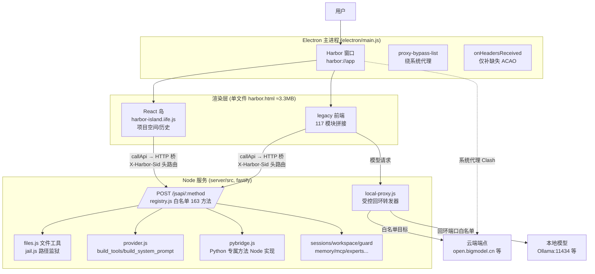
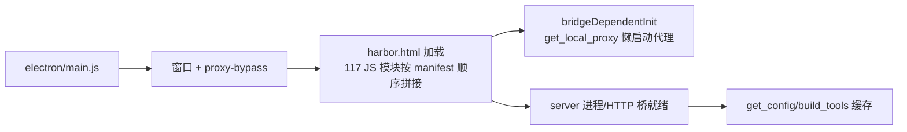
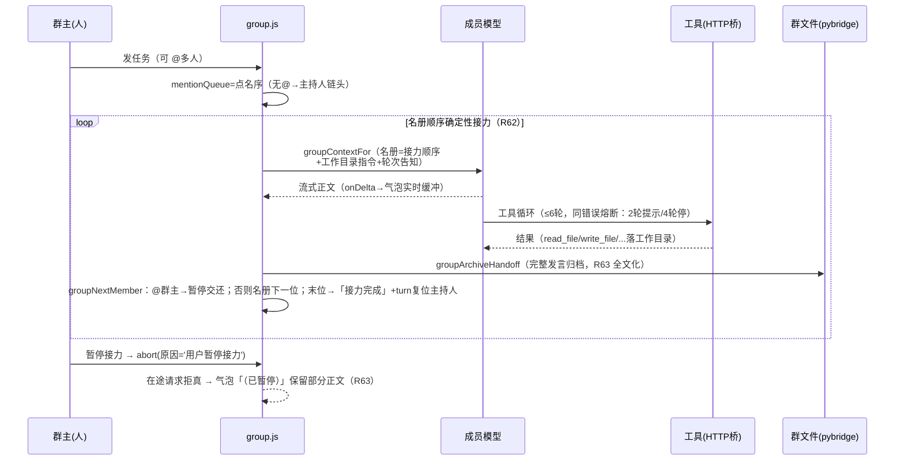
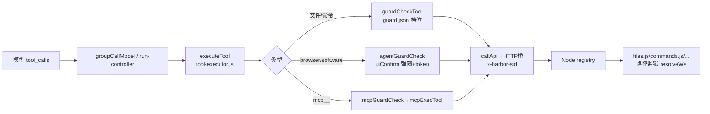
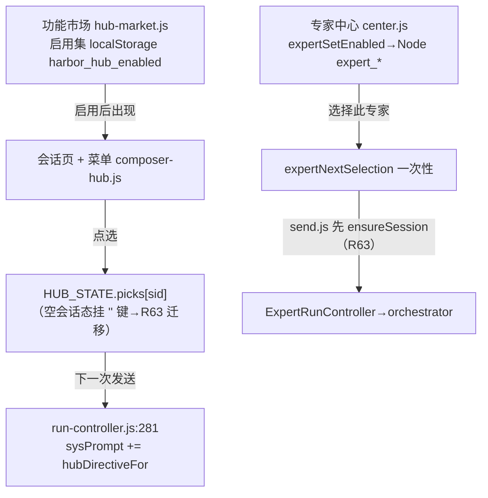

# Harbor 架构全景与 Agent 重设计提案（R63）

> 2026-11-10。应用户要求：浏览全源码、画出详细架构图、给出代码拆分/延迟优化方案、
> Agent 调研与整体重设计提案、激进测试清单。本文所有图均为 Mermaid，可在支持
> Mermaid 的查看器渲染；所有结论基于本轮逐文件实测阅读，标注了源码位置。

---

## 一、系统总览（生产链）



**关键设计**：浏览器只访问 `127.0.0.1:<随机端口>`（local-proxy），真正的外网/本地模型请求由
Node 发出——Node 不读 Windows 系统代理，从而绕开 Clash 拦截（R61c 根因）。

---

## 二、启动与加载顺序（延迟视角）



**已做**（R60）：server 导入图 781→352ms（prisma Proxy 懒化、playwright/MCP SDK 单飞）。
**剩余延迟点与拆分建议**（按收益排序）：

| # | 延迟点 | 现状 | 建议 |
|---|---|---|---|
| 1 | `harbor.html` 单文件 ≈3.3MB 全量加载后首帧才可用 | 117 模块一次拼接 | ①拆 `boot-core`（会话/发送/设置）与 `lazy-hub`（功能市场 448 条目目录、专家中心、群文件面板）——非首屏模块按需 `import()`；②`libs/`（highlight/marked/purify ≈1MB）已有预编译，改 defer 加载 |
| 2 | `hub-catalog.js` 内置 800+ 条目录数据全量常驻 | 数组常量 | 改按页异步取（已有分页渲染，只差数据源） |
| 3 | 群聊 `groupLoadTools` 每 60s 缓存 build_tools | 一次 RPC/分钟 | 已够用；若省，可由 server 推送版本号做失效 |
| 4 | `contract_diff`/`gen_allowlist` 门禁（构建期） | 逐文件扫描 | 已单遍词法化（R62）；无需再动 |

> 注意红线：manifest `provides/requires` 与 build.js 顶层符号校验是拆分的硬约束——
> 任何「按需加载」改造必须同步提供 stub 符号或改用 uiSeam 缝注册，属于独立大轮。

---

## 三、模型请求路由（云端 / 本地 / 群聊成员）

```mermaid
flowchart TB
    REQ[ModelTransport.stream<br/>providers/request.js]
    REQ -->|local=false| INNER[_modelTransportStreamInner<br/>免费档节流/429 退避/5xx 重试]
    REQ -->|local=true| SLOT[_acquireLocalSlot<br/>同端点 FIFO 串行<br/>流消费完释放]
    SLOT --> INNER
    INNER --> FETCH[fetch endpoint]
    FETCH -->|代理可用| P[127.0.0.1:随机端口<br/>local-proxy.js]
    FETCH -->|代理不可用| DIRECT[直连——会被 Clash 拦]
    P -->|X-Harbor-Target| T[目标端点]
    subgraph R63fix["R63 修复"]
        W[_wrapBodyWithSlotRelease<br/>包装器锁原流]
        RB[new Response(wrapped)<br/>替代 resp.body 赋值<br/>——Response.body 只读 getter<br/>赋值静默失败=本地模型全挂根因]
    end
    SLOT --> W --> RB --> PARSE[parseSseStream<br/>sse-parser.js]
```

- 云端正常/本地报错的分叉点就是 `local=true` 才走的包装器（request.js:96）。
- 群聊成员与主聊天共用此 transport；群成员经 `groupCallModel`（group.js）带工具循环（≤6 轮）。

---

## 四、群聊接力（R62/R63 后的完整时序）



---

## 五、工具调用链



**已知边界**（不是 bug，是口径）：群聊未绑工作区时文件工具落 server cwd（安装目录）——R62 起
上下文预告知+「未绑定」chip；护栏默认 run_command=off 档。

---

## 六、专家/功能市场链（R63 修复后）



---

## 七、Agent 调研与整体重设计提案

**用户判断**：「大致功能做出来了，但实际运用问题多、不方便、不符合用户体验」。结合本轮全部真机
报障，问题集中在一个根因：**过程不可见**。

| 真机痛点 | 本质 | 本轮已做 | 重设计方向（建议下轮立项） |
|---|---|---|---|
| 「没办法知道他在输出什么」 | 主/群聊都只有字数或气泡摘要 | 群聊工作气泡可点开**实时详情**（流式正文+工具动态） | 主聊 Agent 循环同样提供「实时过程面板」：当前步骤/工具调用/中间结果全可折叠查看（60-agent-loop 已有 tool-item 雏形，缺流式正文视图） |
| 工具失败反复重试 | 失败对用户不可见，模型自嗨重试 | 群聊同错误熔断 | 失败**浮出**：连续 2 次同错误 → 顶栏横幅「AI 被某工具卡住了，点此查看/接管」；接管=注入用户指引而非干等 |
| 交接文档不全 | 归档丢正文 | 归档完整发言 | 交接文档卡片化下钻：群文件详情页直接渲染结构化卡（现仅有正文 markdown） |
| 本地模型不可用 | Response.body 只读赋值静默失败 | Response 重建修复 | 回归测试已固化（tests/test_r63_frontend_fixes.py） |
| 专家启用不生效 | 两步语义+空会话键丢失 | 键迁移修复 | 产品决策：「启用」是否直接对当前会话生效（一步化） |
| 顺序/分工错乱 | 自由路由不可预测 | 名册确定性接力 | 群聊管理里可视化接力顺序（↑↓ 已支持，缺拖拽+预览链路图） |

**Agent 循环重设计三原则**（提案，待拍板后实施）：
1. **一切过程可见**：任何 run（单聊/群聊/专家）都有「过程面板」——步骤流 + 工具调用 + 耗时 + 可中断。
2. **失败即接管点**：错误不是死胡同，是用户介入入口（重试/改指令/换工具三选一浮层）。
3. **配置即生效**：绑定类操作（专家/工作目录/端点）即时反馈到 chip 与上下文，杜绝「配了但没用上」。

---

## 八、激进测试（本轮新增 + 已知边界清单）

**本轮新增**：`tests/test_r63_frontend_fixes.py` 3 项（本地流双锁/中止分类/归档全文化，vm 零网络确定性流）；
`server/test/group-files.mjs` 扩到 **15 项**（config 族边界：默认目录/自定义绑定/写入落点/系统目录拒绝/
非法 JSON/恢复默认）。

**刻意碰撞已覆盖的边界**：群聊无工作区（上下文预告知+熔断）、暂停中途中止（partialText 保留）、
同错误连续失败（2 提示/4 硬停）、同秒同名归档（-N 序号）、群文件目录指到 C:\Windows（拒）、
空会话选专家（键迁移）、@队列含已删成员（find→null→链尾交还）。

**下轮激进测试候选**（需真机或更长链路，本轮未做）：
- 双群并行 + 同一本地模型端点排队（槽位链竞争）；
- 群聊工具轮中切换会话（bubble 脱离 DOM 后 __finish 空引用路径——已有 `bubble && ` 守卫，未实测）；
- 交接文档超 1600 字截断提示链（上下文注入侧）；
- 代理 5 分钟超时 vs 本地大模型长输出（FORWARD_TIMEOUT_MS 边界）；
- guard.json 全档 always 时群聊成员弹窗风暴（确认队列）。

---

## 九、本轮（R63）代码修复清单

| # | 修复 | 文件 |
|---|---|---|
| 1 | 本地模型流双锁——Response 重建 | frontend/src/providers/request.js |
| 2 | group_files_config_get/set 补移植（[object Object] 根治）+ 系统目录校验 | server/src/services/pybridge.js、registry.js |
| 3 | 暂停中止优雅化：abort 带原因 + 部分正文保留 + groupIsAbortError | frontend/src/group/group.js |
| 4 | 群文件归档完整发言 | frontend/src/group/files.js |
| 5 | 群文件面板错误对象人话化（4 处） | frontend/src/group/files.js |
| 6 | 工作中气泡点击 → 实时详情页（流式正文+工具动态+400ms 刷新+完成即停） | frontend/src/group/group.js、legacy.css |
