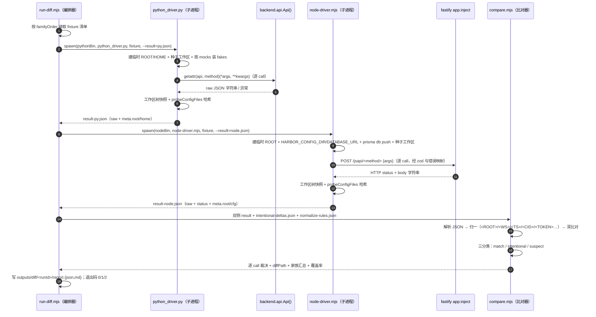
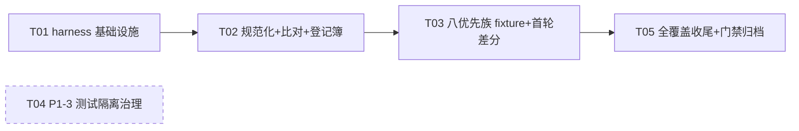

# 设计文档：P0-1 跨语言行为差分契约 harness 与 P1-3 测试隔离治理

- 日期：2026-10-30（设计基线：交接报告 `outputs/handover-2026-10-30-node27-react-full-migration.md`）
- 作者：架构师（software-architect / 高见远）
- 交付对象：工程师（寇豆码）可直接执行
- 范围：
  - **P0-1**：建立 Python `backend/api.py Api()` ↔ Node `server/src/registry.js` 的行为级差分测试 harness，覆盖 145 个 js_api 方法的返回形状 / 错误形状 / 副作用比对，为 P0-4 桌面切换扫清风险。
  - **P1-3**：Python 全量测试连跑 24 failed、逐项隔离复跑全过的共享状态污染定位与治理。
- 红线遵守声明：本设计 **不改动** `get_api_info()` 的任何输出（`API_VERSION='v1.0.0'` 冻结）；双侧配置全部走独立临时目录，**config.json 零污染**；不涉及 `harbor.html`；设计中的代码片段均为 10–30 行的规范示意，不是实现。

---

## 1. 背景与问题定义

### 1.1 当前状态（事实基线）

- 145 个 js_api 方法名称 + 参数签名已与 Python 契约零漂移（`server/test/contract-*.mjs`）。
- Node 侧 16 组服务测试全过（`server/test/`，临时配置 + mock，不依赖公网）。
- **缺口**：行为级等价未证明——同一输入下双侧返回 JSON 形状、错误形状（`ok:false + code/message/hint`）、副作用（文件系统 / 会话状态）、边界条件未系统比对。名称与签名正确但行为不同，会在 P0-4 桌面切换后才暴露故障。
- 桌面生产链路仍是 pywebview（Python 优先），Node HTTP 仅在原生方法缺失时回落。

### 1.2 P0-1 目标与验收（对齐交接报告 §7.1 与 §10 阶段 A）

- 目标：同一 fixture 输入分别驱动 Python `Api()` 与 Node registry，产出逐方法的三分类结论：**一致 / 有意差异（已登记评审）/ 疑似缺陷**。
- 验收：145 个方法全部有明确「一致 / 有意差异」结论；无未评审差异；有意差异有前端兼容性说明。
- 优先级：会话 / 历史目录 / 计划检查点 / 护栏 / 命令 / 导出 / 浏览器 / 软件八族先做（高风险在前），其余族收尾。

### 1.3 P1-3 现象

- 全量连跑：1744 passed / 24 failed / 2 skipped（`-k "not test_silent_install_uninstall_roundtrip"` 基线）。
- 24 个失败项按文件/用例组隔离复跑**全部通过** → 判定为共享状态污染（测试顺序依赖），非用例本身缺陷。
- 报告建议优先排查三组：专家包组（内置专家导入、专家 API/安全/服务）、安装器组、搜索缓存组（TTL/索引）；其余失败组：ghost manifest、git 检查点、原子写、更新哈希、浏览器 profile 清理、wave guard。
- 验收：同一工作区连续两次全量 pytest 均 0 failed，无需隔离解释。

---

## 2. P0-1 实现方案与选型理由

### 2.1 总体架构：三进程差分模型

```text
npm run diff / diff:all（server/package.json）
  └─ 编排器 run-diff.mjs（Node，常驻）
       ├─ 对每个 fixture（按家族优先级排序）：
       │    1. spawn「Python 驱动」子进程  tools/diff/python_driver.py <fixture> --result py.json
       │    2. spawn「Node 驱动」子进程   node server/test/diff/node-driver.mjs <fixture> --result node.json
       │    3. 读取双侧 result JSON → 规范化（normalize.mjs，唯一实现）
       │    4. 深比对 + 三分类（compare.mjs，结合 intentional-deltas.json）
       └─ 汇总输出 outputs/diff/<runId>/report.json + report.md + 覆盖率清单
```

**为什么是「编排器 + 双侧子进程」而不是单进程内互调：**

| # | 设计决策 | 理由 |
|---|---|---|
| D1 | Python 侧用**子进程脚本**驱动 | `tests/conftest.py` 的 fake 注入（webview/PIL/windll）与 HOME 重定向发生在 `sys.modules`/`os.environ` 层面，必须在全新解释器里做才可复现且不污染编排进程；`AGENTS.md` 已证明未武装环境可直接 `Api()` 实例化调用 |
| D2 | Node 侧也用**子进程**（每 fixture 一个） | Node 服务有模块级单例（toolcache 内存、guard 运行态、浏览器会话池、`runtime.currentSid`、命令去重窗口）；同进程跑多个 fixture 会互相污染——这正是 P1-3 的病灶，不能在差分 harness 里复发 |
| D3 | 环境变量在**子进程内**设置 | `HARBOR_CONFIG_DIR` / `DATABASE_URL` / HOME 重定向只作用于子进程；编排器进程环境保持干净，fixture 之间零串扰 |
| D4 | Node 侧经 `app.inject()` 走真实 `/jsapi/:method` 路由 | P0-4 后前端走 HTTP；zod body 校验、`JsApiError→200+结构化错误`、`PATH_JAIL→{error:text}`、`500 INTERNAL` 的错误映射本身就是 Node 行为面的一部分，必须在比对边界内。`app.inject()` 不占端口、不发网络，是既有 16 组测试的成熟模式（`smoke.mjs`） |
| D5 | Python 侧直接 `getattr(api, method)(*args)` | 这就是 pywebview `callApi` 的生产语义；双侧各自对齐自己的生产调用边界，比对结果即「前端可观察行为等价」 |
| D6 | 比对在**解析后的 JSON 结构层**做深比较，不做字节比较 | Python `json.dumps` 默认转义非 ASCII（`\uXXXX`）而 Node 原样 UTF-8；键序不是契约。字节级差异属于序列化实现细节，不是行为差异（报告已声明不追求"逐字节等价"） |
| D7 | 规范化引擎**只有一份实现**（Node 侧，比对器内） | 双侧各自实现规范化会漂移。驱动只产出 raw 结果 + 本侧元数据（临时根路径等），由比对器统一归一 |
| D8 | fixture 是**数据**（JSON），不是代码 | 可评审、可 diff、覆盖率可机器统计；同一份 fixture 天然驱动双侧；工程师按家族扩充即可，不需要写两份测试代码 |

### 2.2 比对边界与「前端可观察行为」定义

- Python 侧观测点 = `Api()` 方法返回值（JSON 字符串原文）+ 未捕获异常（`type: message`）。
- Node 侧观测点 = `POST /jsapi/:method` 的 HTTP 状态码 + 响应 body 字符串原文（fastify 注入响应）。
- 比对语义：
  - Node `200` → 双侧 body 解析后深比较（结构、键集、类型、值）。
  - Node `400/500` → body 中的结构化错误与 Python 侧「返回的 `ok:false/error` JSON」或「未捕获异常」对齐比对：Python 正常返回而 Node 抛 500 = 疑似缺陷（除非登记）。
  - 错误比对分两级：`error.code`（或 `ok:false` 的形状）**严格一致**；`error.message` 文案允许规范化后比对，文案级差异走 intentional 登记（见 §6.4）。

### 2.3 145 方法的可比性分类模型

不是所有方法都能离线直接比对，分三类（分类结果登记在 fixture 与 `uncovered.json`）：

| 类别 | 定义 | 驱动方式 | 示例 |
|---|---|---|---|
| A 直接可比 | 双侧纯本地确定性 IO，无外部依赖 | 临时目录 + 固定输入 | 会话、历史目录、计划/检查点、护栏判定链、文件、工作区、记忆、独立 JSON 配置族、导出一次性路径、rpc |
| B mock 对等 | 行为依赖外部进程/系统调用，但双侧可用**共享 canned 表**注入等价桩 | fixture 声明 `mocks`，两侧各按同一张 mock 表打桩 | 命令族（echo/tasklist/PowerShell）、进程列表、剪贴板、对话框 |
| C 环境绑定 | 依赖真实窗口/网络/外部软件/真实端点 | 不做跨语言差分，登记 `uncovered.json`（原因 + 跟踪项）；其**错误路径**若离线确定仍纳入 A 类 fixture | 真实公网导航正向、真实 MCP stdio 工具调用、真实 WebDAV、真实模型端点、真机截图正向 |

**B 类的核心机制：共享 mock 表**（`tools/diff/mock-table.json`）——Python 的 `fakes.py` 与 Node 的 `preload-mocks.mjs` 读**同一张** canned 响应表（echo 输出、tasklist CSV、PowerShell 输出、剪贴板初值、对话框返回路径），保证两侧服务层收到相同字节，从而输出可比。这与 `tests/conftest.py` 的 fake `subprocess.run`、`GLM_TEST_PICK`、fake windll 剪贴板是同一思路的跨语言版本。

Node 侧打桩机制：`node --import server/test/diff/preload-mocks.mjs` 预载补丁 `node:child_process` 等内置模块导出（ESM 链接期取到补丁后的绑定），在服务模块导入前生效——不需要改动任何生产服务代码。

对话框 seam：沿用既有 `HARBOR_BROWSER_ALLOW_LOOPBACK`（仅测试进程生效的例外）先例，Node 侧 `pick_folder/pick_save_path` 增加 `HARBOR_TEST_PICKED_PATH` 测试例外（默认空 = 真实对话框），与 Python 侧 `GLM_TEST_PICK` 对等。这不改变任何契约方法输出形状（`get_api_info` 不涉及）。

### 2.4 家族优先级与 145 方法覆盖策略

| 顺序 | 家族（fixture 目录名） | 覆盖方法（节选） | 类别 | 风险理由 |
|---|---|---|---|---|
| 1 | `meta` | get_api_info | A | 冻结契约面，跑通端到端管路的最小验证 |
| 2 | `sessions` | get/save_sessions、set_current_sid、session_purge | A | 桌面最热路径；Prisma vs sessions.json 是已知存储分叉 |
| 3 | `history-dir` | history_dir_get/set | A | 已知兼容字段保留但实际存储不同 |
| 4 | `plans-checkpoints` | plan_*（4）、checkpoint_*（3）、begin_task | A | 回滚语义（CONFIRM_REQUIRED、`.rollback-bak`）安全关键 |
| 5 | `guard` | guard_check/confirm_token/session_trust/rule_*/task_*/approval_budget、guard_audit、get_audit_log、guard_get/save_config | A | 判定链顺序与 fail-closed 是安全边界 |
| 6 | `commands` | run_command/run_powershell/run_admin_command、begin_task | B | 去重窗口、token 一次性、超时强杀、输出截断 |
| 7 | `export` | save_export_file、pick_save_path | A+B | 一次性登记路径约束（8MB 上限、先校验再消费） |
| 8 | `browser` | 六原语错误路径 + browser_sessions/set_mode/takeover/search 的错误分支 | A（错误路径） | SSRF/BAD_PARAMS 等错误形状离线确定；正向导航属 C |
| 9 | `software` | software_list/probe/call（校验拒绝路径） | A/B | violations/example 错误结构、高危 token |
| 10 | `files` | list/read/write/append/search_replace/make_dir/get_file_info/read_more/cache_tool_output | A | 编码（GBK/BOM）、截断、二进制拒绝 |
| 11 | `workspace` | set_workspace、session_ws 族、copy/move/delete_path、save_workspace_file、copy_into_ws | A | 路径监狱与越狱拒绝 |
| 12 | `memory` | get/append/delete/retrieve | A | |
| 13 | `misc-config` | guard/sandbox/hybrid/webdav_get/save_config、model_prefs_*、reader_config_*、sandbox_status、clear_caches、search_*_stats/status | A | 独立 JSON 文件族（config.json 零污染面） |
| 14 | `provider` | build_tools、build_system_prompt、prompt_get、clarify_collect、ui_nudge、trace_new、get_local_proxy | A | 工具清单/提示词形状影响 Agent 行为 |
| 15 | `os-system` | get_platform_info、list/kill_process、clipboard、open_*、take_screenshot（错误路径） | A/B | 危险操作护栏挂点 |
| 16 | `update` | check_update 等（错误路径：坏 URL/哈希不符） | A | 错误形状 |
| 17 | `webdav` | webdav_test/export/restore（错误路径） | A/C | |
| 18 | `experts` | expert_list（空库）/import_directory/get/read_resource/preferences/enabled/delete | A | 快照与安全拒绝路径 |
| 19 | `mcp` | mcp_list/save/delete/get_detail（配置往返）、check_tool（错误路径） | A/C | 真实 stdio 调用属 C |
| 20 | `rpc` | rpc 透传（kwargs 映射） | A | |

- Phase 1（T03）：家族 1–9（报告点名的八族 + meta）。
- Phase 2（T05）：家族 10–20 补齐到 145 全结论；C 类方法全部登记 `uncovered.json`。

### 2.5 与既有 16 组 Node 测试 / 1744 个 Python 测试的关系

- **零改动**：不修改 `server/test/` 既有 16 个 `.mjs` 与 `tests/` 既有用例（P1-3 的 conftest 改动除外，且仅追加）。
- **只复用模式不复用代码路径**：临时目录/env 注入/`app.inject()`/prisma db push 的做法照搬 `smoke.mjs`；Python fake 注入照搬 `tests/conftest.py` 的思路到独立 `tools/diff/fakes.py`（拷贝适配，不 import pytest，不改 conftest）。
- **入口隔离**：差分走独立 npm scripts（`diff` / `diff:all` / `diff:coverage`），不进入 `test:all`（未来统一入口也不默认包含，直到覆盖率完成并经 team-lead 批准）。差分失败不影响既有测试绿灯。
- 报告与临时产物写 `outputs/diff/`（`outputs/` 已是临时产物惯例目录），不进 git 跟踪。

---

## 3. 文件列表

```text
server/test/diff/run-diff.mjs            # 差分编排器：读 fixture → spawn 双侧驱动 → 调比对器 → 出报告与退出码（diff/diff:all 入口）
server/test/diff/node-driver.mjs          # Node 侧驱动：临时环境(env+prisma db push) → app.inject 逐 call → 快照 → result JSON
server/test/diff/preload-mocks.mjs        # Node 桩预载（--import）：按共享 mock-table 补丁 node:child_process 等内置模块
server/test/diff/normalize.mjs            # 规范化引擎（唯一实现）：路径/分隔符/时间戳/随机 id/键控掩码/集合序
server/test/diff/compare.mjs              # 深比对 + 三分类 + diffPath 定位；消费 intentional-deltas.json
server/test/diff/report.mjs               # report.json / report.md（家族汇总+逐 call 明细+未覆盖清单）与覆盖率渲染
tools/diff/python_driver.py               # Python 侧驱动：临时 HOME + fake 注入 + Api() 逐 call → 快照 → result JSON
tools/diff/fakes.py                       # conftest 风格 fake 的独立拷贝（webview/PIL/windll/subprocess/dialog），不依赖 pytest
tools/diff/mock-table.json                # 双语言共享 canned 响应表（echo/tasklist/PowerShell/剪贴板状态机/对话框路径）
tools/diff/normalize-rules.json           # 非确定字段规范化规则（正则清单 + 键控掩码 + 白名单键）
tools/diff/intentional-deltas.json        # 有意差异登记簿（fixture+call 定位 / 理由 / 评审人 / 日期 / 兼容说明）
tools/diff/uncovered.json                 # C 类（环境绑定不可差分）方法登记簿（原因 + 跟踪项 + 计划阶段）
tools/diff/diff-config.json               # 家族优先级顺序、pythonBin/nodeBin、超时与全局开关
tools/diff/fixtures/<family>/<name>.json  # 全部 fixture（T03 交付家族 1–9；T05 交付 10–20；见 §8 任务）
tools/diag/bisect_pollution.py            # P1-3：最小污染对自动二分定位（pytest 包装，候选池收缩）
tools/diag/state_probe.py                 # P1-3：pytest 状态探针插件（cwd/env/HOME 树/线程/单例快照 → 泄漏清单）
tests/helpers/state_reset.py              # P1-3：跨用例单例复位集中表（sandbox _STATS 模式推广到搜索缓存/专家注册表/安装器状态）
tests/helpers/order-pinned.json           # P1-3：临时顺序钉死登记（默认空数组；仅无法根治时的显式过渡缓解）
server/package.json                        # 追加 diff / diff:all / diff:coverage 三个 script（不动既有 16 组）
package.json（根）                          # 追加 diff:all 委托（npm --prefix server run diff:all）
tests/conftest.py                          # P1-3：仅追加 state_reset 调用 + cwd 恢复 + 后台线程停机钩子（不重构）
outputs/diff/<runId>/                      # 每次运行产物：report.json / report.md / py-result 与 node-result 原文
```

---

## 4. fixture 数据结构与具体示例

### 4.1 Schema

```jsonc
{
  "id": "kebab-case 唯一 id（= 文件名去 .json）",
  "family": "家族名（= 目录名，须在 diff-config.json familyOrder 中）",
  "priority": "P0|P1|P2",
  "mode": "strict | shape",              // 默认 strict；shape=只比键集+类型（环境绑定输出）
  "mocks": ["subprocess", "dialog", "windll"],   // B 类声明，双侧按共享 mock 表打桩
  "description": "一句话目的（进报告）",
  "setup": {
    "workspaceFiles": [ {"path": "相对工作区路径", "content": "文本", "encoding": "utf-8|gbk|binary-hex"} ],
    "callsBefore": []                     // 可选：前置调用（同样会被比对），用于 set_workspace 等
  },
  "calls": [
    {
      "id": "c01",                        // fixture 内唯一，零填充两位
      "method": "js_api 方法名",
      "args": [ ... ],                    // 位置参数（Python *args / Node registry invoke）
      "kwargs": {},                       // 可选：仅 Python **kwargs + Node 按签名名映射位置
      "mode": "shape",                    // 可选：call 级覆盖
      "unordered": true,                  // 可选：该 call 返回数组按多重集合比较
      "note": "给读者的说明（进报告）"
    }
  ],
  "sideEffects": {
    "snapshotWorkspace": true,            // 结束时快照工作区树（相对路径+sha256）双侧比对
    "probeConfigFiles": ["guard.json"]    // 双侧各自配置目录中需比对内容的独立文件名
  }
}
```

**占位符规范（fixture 参数中的侧相关值）**：

| 占位符 | Python 侧替换为 | Node 侧替换为 | 规范化回写为 |
|---|---|---|---|
| `{ROOT}` | 本侧临时根（含 HOME） | 本侧临时根（含 config/ws/db） | `<ROOT>` |
| `{WS}` | `HOME/Desktop/GLM-Workspace` | `tmp/ws` | `<WS>` |
| `{CFG}` | `~/.glm-chat` | `HARBOR_CONFIG_DIR` | `<CFG>` |
| `{PICKED}` | `GLM_TEST_PICK` 值 | `HARBOR_TEST_PICKED_PATH` 值 | `<PICKED>` |

替换使用各侧**原生路径分隔符**（双侧输入等价）；比对时统一归一。fixture 里不出现任何真实机器绝对路径。

### 4.2 示例一：会话族 `tools/diff/fixtures/sessions/sessions-basic.json`

```json
{
  "id": "sessions-basic",
  "family": "sessions",
  "mode": "strict",
  "description": "会话族：空起步→保存两条→回读→替换保存→回读（messages 保真）",
  "setup": { "workspaceFiles": [ { "path": "note.txt", "content": "工作区种子\n" } ] },
  "calls": [
    { "id": "c01", "method": "get_sessions", "args": [] },
    { "id": "c02", "method": "save_sessions", "args": [
      "[{\"id\":\"s1\",\"title\":\"差分会话A\",\"messages\":[]},{\"id\":\"s2\",\"title\":\"差分会话B\",\"messages\":[{\"role\":\"user\",\"content\":\"你好\"}]}]" ] },
    { "id": "c03", "method": "get_sessions", "args": [] },
    { "id": "c04", "method": "set_current_sid", "args": ["s1"] },
    { "id": "c05", "method": "save_sessions", "args": ["[{\"id\":\"s1\",\"title\":\"差分会话A2\",\"messages\":[]}]" ] },
    { "id": "c06", "method": "get_sessions", "args": [] },
    { "id": "c07", "method": "session_purge", "args": ["s1", "[]"] }
  ],
  "sideEffects": { "snapshotWorkspace": true, "probeConfigFiles": [] }
}
```

> 存储实现分叉（Python sessions.json ↔ Node Prisma DB）不出现在比对面：双侧都是「save→get 的 JSON 字符串往返」语义；工作区快照双侧一致即副作用等价的可见部分。

### 4.3 示例二：命令族（带护栏）`tools/diff/fixtures/commands/commands-guarded.json`

```json
{
  "id": "commands-guarded",
  "family": "commands",
  "mode": "strict",
  "mocks": ["subprocess"],
  "description": "命令族：护栏放行/去重窗口/超时强杀/admin token 一次性",
  "calls": [
    { "id": "c01", "method": "run_command", "args": ["echo hello"] },
    { "id": "c02", "method": "run_command", "args": ["echo hello"], "note": "短窗口去重应命中" },
    { "id": "c03", "method": "run_powershell", "args": ["Get-Date"] },
    { "id": "c04", "method": "run_command", "args": ["raise-timeout", 5], "note": "超时错误形状" },
    { "id": "c05", "method": "run_admin_command", "args": ["echo hello", "bad-token"], "note": "坏 token 拒绝" },
    { "id": "c06", "method": "begin_task", "args": [] },
    { "id": "c07", "method": "run_command", "args": ["echo hello"], "note": "begin_task 重置去重窗口后应放行" },
    { "id": "c08", "method": "run_command", "args": ["echo BIG"], "note": "超长输出截断+full_ref" }
  ],
  "sideEffects": { "snapshotWorkspace": true }
}
```

### 4.4 示例三：导出族 `tools/diff/fixtures/export/export-once-path.json`

```json
{
  "id": "export-once-path",
  "family": "export",
  "mode": "strict",
  "mocks": ["dialog"],
  "description": "导出族：一次性登记路径约束（未登记拒写 / 登记后一次 / 复用拒绝）",
  "calls": [
    { "id": "c01", "method": "save_export_file", "args": ["{ROOT}/out/unregistered.txt", "内容A"],
      "note": "未登记路径必须被拒" },
    { "id": "c02", "method": "pick_save_path", "args": ["report.txt"] },
    { "id": "c03", "method": "save_export_file", "args": ["{PICKED}", "导出内容B"] },
    { "id": "c04", "method": "save_export_file", "args": ["{PICKED}", "第二次写入必须被拒"],
      "note": "登记的一次性消费" }
  ],
  "sideEffects": { "snapshotWorkspace": true }
}
```

### 4.5 示例四（错误形状族，示意）：`tools/diff/fixtures/browser/browser-offline-errors.json`

```json
{
  "id": "browser-offline-errors",
  "family": "browser",
  "mode": "strict",
  "description": "浏览器族离线确定错误路径：SSRF/坏参数/未知会话（无网络依赖）",
  "calls": [
    { "id": "c01", "method": "browser_navigate", "args": ["ftp://example.com"], "note": "非 http(s) 拒绝" },
    { "id": "c02", "method": "browser_navigate", "args": ["http://127.0.0.1:9/"], "note": "环回默认拒绝（双侧一致，无需 loopback 例外）" },
    { "id": "c03", "method": "browser_navigate", "args": ["http://192.168.1.1/"], "note": "内网保留地址拒绝" },
    { "id": "c04", "method": "browser_sessions", "args": [] },
    { "id": "c05", "method": "browser_close", "args": ["no-such-session"], "note": "SESSION_CLOSED 错误形状" },
    { "id": "c06", "method": "browser_extract", "args": ["main", "markdown"], "note": "无活动会话时的错误" }
  ],
  "sideEffects": { "snapshotWorkspace": false }
}
```

---

## 5. 双侧驱动调用流程

### 5.1 时序图



### 5.2 Python 驱动骨架（规范示意，非实现）

```python
# tools/diff/python_driver.py —— 关键步骤（示意）
def main():
    fixture = json.loads(Path(sys.argv[1]).read_text(encoding='utf-8'))
    result_path = sys.argv[sys.argv.index('--result') + 1]
    root = Path(tempfile.mkdtemp(prefix='glm-diff-py-'))
    home = fakes.setup_home(root, fixture)          # USERPROFILE/HOME/HOMEDRIVE/HOMEPATH + GLM_TEST_PICK + 种子文件
    fakes.install(fixture.get('mocks', []))          # webview/PIL/windll/subprocess/dialog 按声明注入（读共享 mock-table.json）
    sys.path.insert(0, PROJECT_ROOT)
    from backend.api import Api
    api = Api()                                      # 未武装环境 guard 放行（AGENTS.md 实证）
    calls = []
    for c in fixture['calls']:
        args, kwargs = fakes.substitute(c, root)     # {ROOT}/{WS}/{CFG}/{PICKED} → 本侧原生路径
        try:
            calls.append({'id': c['id'], 'method': c['method'],
                          'raw': getattr(api, c['method'])(*args, **kwargs)})
        except Exception as e:                        # 未捕获异常也是行为面
            calls.append({'id': c['id'], 'method': c['method'],
                          'exception': f'{type(e).__name__}: {e}'})
    write_result(result_path, meta={'root': str(root)}, calls=calls,
                 side_effects=fakes.snapshot(root, fixture))
```

### 5.3 Node 驱动骨架（规范示意，非实现）

```js
// server/test/diff/node-driver.mjs —— 关键步骤（示意）
const fixture = JSON.parse(fs.readFileSync(process.argv[2], 'utf8'))
const tmp = fs.mkdtempSync(path.join(os.tmpdir(), 'harbor-diff-node-'))
process.env.HARBOR_CONFIG_DIR = path.join(tmp, 'config')     // 子进程内设置，config.json 零污染
process.env.DATABASE_URL = `file:${path.join(tmp, 'diff.db').replaceAll('\\', '/')}`
process.env.LOG_LEVEL = 'silent'
if (fixture.mocks?.includes('dialog')) process.env.HARBOR_TEST_PICKED_PATH = path.join(tmp, 'out', 'report.txt')
seedWorkspace(path.join(tmp, 'ws'), fixture)                  // setup.workspaceFiles + {ROOT}/{WS} 占位替换
await pushPrismaSchema()                                      // 复用 smoke.mjs：execFile(process.execPath, [prisma CLI JS 入口, db push])
const { buildServer } = await import('../src/app.js')         // 动态 import：env 先于 config 解析生效
const app = await buildServer()
const calls = []
for (const c of fixture.calls) {
  const args = substitute(c.args, tmp)                        // 占位符 → 本侧原生路径；kwargs 按 listSignatures() 映射位置
  const res = await app.inject({ method: 'POST', url: `/jsapi/${c.method}`, payload: { args } })
  calls.push({ id: c.id, method: c.method, status: res.statusCode, raw: res.body })
}
await writeResult(resultPath, { meta: { root: tmp }, calls, sideEffects: snapshot(tmp, fixture) })
```

### 5.4 编排器关键行为规范

1. **子进程环境净化**：spawn 时构造干净 env（`PATH`/`SYSTEMROOT` 等白名单 + 本侧变量），不继承编排器自身的 `HARBOR_*`；Python 子进程附 `PYTHONIOENCODING=utf-8`、`cwd=项目根`。
2. **超时与续跑**：单 fixture 双侧总超时默认 300s（diff-config.json 可调）；超时/崩溃记为 `error` 裁决并**继续**后续 fixture，不中断整轮。
3. **顺序执行**：fixture 严格按 familyOrder 顺序单线程执行（确定性优先；并行化列为未来非目标）。
4. **退出码**：`0` = 全部 match/intentional 且覆盖检查通过；`1` = 存在 suspect；`2` = 基础设施错误（驱动崩溃/配置错）。
5. **report 双产物**：`report.json`（机器可读，含双侧 raw 原文）+ `report.md`（人类可读：家族汇总表 + suspect 明细 + intentional 索引 + 未覆盖清单）。
6. **prisma db push 优化**（可选）：首轮 db push 产出模板空库后按 fixture 复制模板文件代替重复 push（正确性优先，默认仍逐 fixture push）。

---

## 6. 比对与分类规范

### 6.1 规范化规则清单（`tools/diff/normalize-rules.json`，比对器唯一消费方）

| 规则 id | 类别 | 模式 / 键 | 归一为 |
|---|---|---|---|
| N01 | 路径分隔符 | 值内 `\` | `/` |
| N02 | 侧根替换 | 值含本侧 ROOT/WS/CFG/PICKED 前缀 | `<ROOT>`/`<WS>`/`<CFG>`/`<PICKED>` |
| N03 | 盘符大小写 | `^[a-z]:` | 大写 |
| N04 | ISO 时间 | `\d{4}-\d{2}-\d{2}[T ]\d{2}:\d{2}:\d{2}` | `<TS>` |
| N05 | 文件名时间戳 | `\d{8}_\d{6}(_\d{3})?` | `<TSFN>` |
| N06 | 短日期 | `\d{2}-\d{2} \d{2}:\d{2}` | `<DTS>` |
| N07 | epoch 数值 | 键 ∈ {ts, updatedAt, createdAt, mtime, timestamp, expires_at, lastUsed} | `<EPOCH>` |
| N08 | toolcache id | `tc\d+_\d+` | `<CID>` |
| N09 | 随机 token | 32+ 位 hex / `tok_`/`tk_` 前缀 | `<TOKEN>` |
| N10 | 生成 id | 键 ∈ {sessionId, grantId, taskId, takeoverId, runId, snapshotId}（fixture 可扩展 maskIdKeys） | `<ID>` |
| N11 | 耗时 | 键 ∈ {duration_ms, elapsed, timeout_used, costMs} | `<MS>` |
| N12 | pid | 键 = pid / 数值型 process id | `<PID>` |
| N13 | 集合序 | call 声明 `unordered:true` | 数组排序后比较 |
| N14 | 剪贴板/桩值 | mock 表中的 dialog 路径 | `<PICKED>` |

> 规则引擎 = 「正则序贯替换（顺序敏感，参照 `tests/test_api_contract.py` NORM_RULES 的先后次序教训）」+「键控掩码（递归遍历 JSON，键命中即掩值）」。平台/宿主标识（`exe`、解释器版本串）**不归一**，一律走 intentional 登记（见 §6.4 ID-001）。

### 6.2 深比对算法

1. 双侧 raw 尝试 `JSON.parse`；双侧都能解析 → 结构深比较（键集、类型、嵌套值，递归）。
2. 任一侧非 JSON 字符串 → 按 N01–N05 正则归一后字符串比较。
3. `mode:"shape"` 的 call：仅比较键集 + 值类型树（用于版本串/平台串等环境绑定输出）。
4. 首个差异记录 `diffPath`（如 `error.code`、`[0].messages[2].content`）进报告。
5. 工作区快照比较：相对路径集合 + 每文件 sha256（双侧种子与操作序列相同 → 应逐字节一致；`.rollback-bak`/检查点目录内文件名时间戳先归一）。`probeConfigFiles` 比较同名独立配置文件的解析后 JSON（覆盖 guard.json / sandbox.json 等独立文件面，**不含** config.json——双侧都不会写它）。

### 6.3 三分类裁决

| 裁决 | 判定条件 |
|---|---|
| `match` | 归一后双侧结构+值一致（含双侧同为异常、同为同一错误 code） |
| `intentional` | 双侧不一致，但 `intentional-deltas.json` 存在 (fixture id, call id) 的有效登记（未过期、已评审） |
| `suspect` | 双侧不一致且无登记 —— **疑似缺陷**，不自动修复，进报告移交评审 |
| `error` | 驱动崩溃/超时/方法在某侧不存在（双侧方法集对账失败也记此项） |
| `skipped` | fixture/call 显式 skip（须附原因，进未覆盖统计） |

### 6.4 intentional delta 登记簿格式（`tools/diff/intentional-deltas.json`）

```json
{
  "version": 1,
  "deltas": [
    {
      "id": "ID-001",
      "fixture": "meta/api-info",
      "callId": "c01",
      "method": "get_api_info",
      "reason": "exe 字段披露实现宿主（Python 原生 exe 路径 vs node(server/src/index.js)）；version 与 methods 51 项清单按冻结契约严格比对，不允许差异",
      "approvedBy": "team-lead",
      "date": "2026-10-31",
      "expires": null,
      "frontendCompat": "前端不依据 exe 字段做分支；契约面（version/methods）任何漂移都会让本 call 回到 suspect"
    }
  ]
}
```

- 匹配粒度 = **(fixture id, call id)** 精确匹配（最可审计）；登记必须含理由与前端兼容说明；`expires` 到期自动回到 suspect 强制复审。
- 新增 intentional 的流程：差分报告出现 suspect → 工程师判定「确实是预期差异」→ 填登记（reason/frontendCompat）→ team-lead sign off（approvedBy）→ 复跑变绿。

### 6.5 报告格式

`report.md` 骨架：

```text
# 跨语言差分报告 <runId>
## 总览：fixtures N / calls M / 方法覆盖 138/145
| 家族 | fixtures | match | intentional | suspect | error |
## 疑似缺陷明细（suspect）
### [guard-chain / c07] guard_check — diffPath: error.code
  Python: {…归一后摘要…}   Node: {…归一后摘要…}
## 有意差异索引（intentional）→ ID-001 …
## 未覆盖方法清单（uncovered / skipped，含原因与跟踪项）
```

`report.json` 为同构机器可读版 + 双侧 raw 原文（复核用）。

### 6.6 覆盖率门禁（`npm run diff:coverage`）

- 静态计算：fixtures 中出现的方法集合 ∪ uncovered.json 登记集合，必须 == `registry.listMethods()`（145）∪ Python `backend/api.py` 公开+_V12_EXTRA 方法集。
- 任一方法既无 fixture 也未登记 → 覆盖门禁失败（exit 1）并打印缺口清单。
- 这是 P0-1 验收「全部方法有明确结论」的机器化判据。

---

## 7. P1-3 测试隔离治理设计

### 7.1 污染源假设分类（六类）

| 类别 | 机理假设 | 对应失败组的匹配线索 |
|---|---|---|
| S1 模块级单例累积 | 搜索缓存 TTL 索引、专家注册表/快照缓存、安装器状态机、guard 预算计数等模块级可变全局跨用例残留（`sandbox_service._STATS` 已是实证先例） | 搜索 TTL/索引组、专家四文件组 |
| S2 共享 HOME 的后台线程迟写 | conftest HOME 是进程级单例临时目录，`fresh_home` 在 teardown rmtree 重建；若有测试启动的后台线程（搜索索引器、浏览器 profile 清理器）在其后仍写 HOME → 毁掉下一个用例的种子 | 浏览器 profile 清理组、搜索组 |
| S3 安装器真实路径写入 | installer 测试写 `LOCALAPPDATA`/`PROGRAMDATA`/固定相对目录等 HOME 之外位置，teardown 未回收 | 安装器组、ghost manifest |
| S4 cwd 漂移 | 某用例 chdir 进临时目录未恢复，后续相对路径解析错位 | git 检查点、原子写 |
| S5 Windows 文件句柄/锁 | 句柄未关 → rmtree 静默失败（`ignore_errors=True` 掩盖）→ 半重建 HOME | 原子写、检查点、更新哈希 |
| S6 跨文件顺序耦合断言 | 断言依赖「起步计数/起步状态」（_STATS 同款模式的其他实例） | wave guard、专家组 |

### 7.2 排查方案（三阶段，先便宜后昂贵）

**Phase 0 —— 失败签名固化（半天）**
1. 用报告 §9.6 同款命令连跑两轮，各带 `--junitxml=outputs/pytest-tmp/diag-run{1,2}/junit.xml`。
2. 解析两轮 failed 节点 id + 断言摘要，产表：两轮失败集合是否稳定？稳定 → 顺序型污染（S1–S5 主嫌疑）；不稳定 → 时间/并发型（S2 主嫌疑）。
3. 按错误类型分桶：断言值漂移 / FileNotFoundError / 权限或占用 / 超时。

**Phase 1 —— 假设矩阵验证（1 天，定向组合跑）**
- 嫌疑污染源池（报告 §8 点名三组优先）：`test_builtin_experts_import.py`、`test_expert_package_{api,security,service}.py`、`test_installer.py`、搜索缓存组（`test_v18_search_service.py`、`test_v19_search_upgrade.py`、`test_v19_reader.py`）。
- 受害者池 = 24 个失败项所在文件/用例组（内置专家、专家 API/安全/服务、安装器、ghost manifest、git 检查点、原子写、更新哈希、浏览器 profile 清理、wave guard、搜索 TTL/索引）。
- 矩阵执行：`python -m pytest <嫌疑污染源文件…> <受害者组> -q --basetemp=<独立目录>`，记录哪些「污染源×受害者」组合复现失败 → 产出**污染映射表** `outputs/pytest-tmp/diag-*/pollution-map.json`。

**Phase 2 —— 最小对定位 + 状态审计（2–3 天）**
1. `tools/diag/bisect_pollution.py`：对每个复现组合，在「同进程内按顺序执行」的约束下对候选污染源做**集合收缩二分**（先文件级、后用例级 node id 级），自动找到最小污染集 (P, V)。二分包装 pytest（`-p no:cacheprovider`，只传 `--basetemp` 独立目录），复用 Phase 1 的受害者 node id 清单，避免全量跑。
2. `tools/diag/state_probe.py`（pytest 插件，`-p state_probe` 挂载，诊断期专用、不进常规链路）：每个用例 setup/teardown 各快照一次——`os.getcwd()`、`os.environ` 与基线的差集、HOME 目录树哈希+文件数、`threading.enumerate()` 线程名列表、指定单例（搜索缓存索引、专家注册表、安装器状态、`legacy._RT`、guard 预算）的值指纹、psutil 可用时附进程级 open_files 数。teardown 快照 ≠ setup 快照且差异未登记豁免 → 记入 `state-leaks.json`。跑一遍全量即可定位「哪个用例泄漏了什么状态」。
3. 污染机理归因：把 (P, V) 对与泄漏清单对齐，落到 §7.1 的 S1–S6 之一。

### 7.3 治理路径（按机理对症，不按症状钉顺序）

| 机理 | 治理 | 落点 |
|---|---|---|
| S1 单例 | `tests/helpers/state_reset.py` 集中复位表（推广 `_reset_sandbox_stats` 模式：每项注明机理注释与对应失败用例），conftest autouse `fresh_home` 中调用 | conftest 追加 5–10 行 |
| S2 后台线程 | conftest teardown 增加后台停机钩子：优先调用对应 service 的既有 close/stop API（搜索索引器 flush、浏览器 profile 清理 join），停不掉的记失败暴露而非静默 | conftest + service 既有 API |
| S3 真实路径 | installer 相关 fixture 把 `LOCALAPPDATA`/`PROGRAMDATA` 重定向到 basetemp 子目录（env 级隔离）；红线：绝不运行真实安装器 `TestSilentEndToEnd`（保持既 deselect） | 对应测试文件的 fixture |
| S4 cwd | autouse fixture 记录并恢复 `os.getcwd()`（防御性，成本≈0） | conftest 追加 |
| S5 句柄 | state_probe 的 open_files 对比定位泄漏文件 → 修复为 with/close 显式释放；`reset_home()` 的 `ignore_errors=True` 改为「失败即抛」以便暴露（治理期） | 对应测试/服务 |
| S6 顺序耦合断言 | 逐个改为增量式断言（st0→st1 差值），参照 `_reset_sandbox_stats` 注释中的既定修复模式 | 对应断言 |

**顺序钉死不是首选治理**（掩盖而非根治）。仅当某污染短期无法根治时，登记 `tests/helpers/order-pinned.json`（用例对 + 原因 + 目标根因编号 + 复审日期）作为显式过渡缓解，验收前必须清零或逐项评审。

### 7.4 验收标准

1. 同一工作区、同一命令（保持 `-k "not test_silent_install_uninstall_roundtrip"` 与 `--basetemp` 独立目录的既有基线约定）**连续两次全量 0 failed**。
2. `state_probe` 全量诊断报告：0 个未恢复状态项（或全部在豁免清单且有复审日期）。
3. `pollution-map.json`、最小对清单、每项根因与修复提交链接归档至 `outputs/pytest-tmp/diag-final/`。
4. `order-pinned.json` 为空或每项均有 team-lead 评审记录。
5. 与 P0-1 的协同：python_driver 为独立子进程/全新解释器，天然免疫 pytest 进程内污染（设计层面已隔离）。

---

## 8. 任务列表（工程师可直接执行）

> 硬约束：任务间依赖尽量浅；T04 与 T01–T03/T05 完全并行；每任务 ≥3 个文件；配置与入口集中在 T01。

### T01：差分 harness 基础设施（编排器 + 双侧驱动 + meta 族端到端跑通）

- **文件**：`server/test/diff/run-diff.mjs`、`server/test/diff/node-driver.mjs`、`server/test/diff/preload-mocks.mjs`、`tools/diff/python_driver.py`、`tools/diff/fakes.py`、`tools/diff/diff-config.json`、`tools/diff/mock-table.json`、`tools/diff/fixtures/meta/api-info.json`、`server/package.json`（+3 scripts）、根 `package.json`（+1 委托 script）
- **依赖**：无
- **内容**：三进程模型落地；双侧临时环境（Python：HOME 重定向 + fake webview/PIL；Node：HARBOR_CONFIG_DIR/DATABASE_URL + prisma db push + `app.inject()`）；占位符替换；mock 表桩（Python fakes + Node preload）；`diff`/`diff:all`/`diff:coverage` 入口；meta fixture 首跑。
- **验收**：
  1. `npm run diff -- meta` 端到端产出 `outputs/diff/<runId>/report.{json,md}`；
  2. get_api_info 的 version+methods 比对为 match，`exe` 字段差异在手工预置 ID-001 登记后裁决为 intentional，退出码 0；
  3. 临时目录断言：运行后真实 `~/.glm-chat` 与项目 `config.json`、`server/data/` 零变化；
  4. 既有 16 组 Node 测试与 `python -m pytest tests/test_api_contract.py` 全部保持绿（harness 未触碰它们）。

### T02：规范化引擎 + 比对器 + 登记簿 + 报告

- **文件**：`server/test/diff/normalize.mjs`、`server/test/diff/compare.mjs`、`server/test/diff/report.mjs`、`tools/diff/normalize-rules.json`、`tools/diff/intentional-deltas.json`、`tools/diff/uncovered.json`
- **依赖**：T01
- **内容**：§6 全部规范落地——正则序贯 + 键控掩码 + unordered 集合比较；shape 模式；diffPath；三分类与登记簿匹配（含 expires）；报告双产物；覆盖率静态计算。
- **验收**：
  1. 用 T01 的 meta fixture + 2 个人造对照 fixture（一个刻意的值差异、一个刻意的形状差异）验证三分类与 diffPath 输出正确；
  2. 删除 ID-001 登记后同 fixture 变 suspect、退出码 1；
  3. `npm run diff:coverage` 对「有缺口」状态报错退出并列出缺口方法名。

### T03：八个优先族 fixture 编写与首轮差分

- **文件**：`tools/diff/fixtures/{sessions,history-dir,plans-checkpoints,guard,commands,export,browser,software}/*.json`（每族 1–3 个，约 12–20 个文件）+ 按需更新 `tools/diff/intentional-deltas.json`、`tools/diff/uncovered.json`
- **依赖**：T02
- **内容**：按 §2.4 家族 2–9 编写 fixture（覆盖正向、边界、错误路径三档）；跑 `npm run diff:all`；对每个 suspect 先判定「实现缺陷 or 预期差异」——预期差异填登记（附前端兼容说明），实现缺陷**不修**，只产出缺陷清单（修复属于后续 P0-1b 任务，避免本任务膨胀）；C 类正向（浏览器正向导航等）登记 uncovered。
- **验收**：
  1. 八族每个方法至少被一个 fixture 调到或登记 uncovered；
  2. `npm run diff:all` 产出报告：八族范围内 0 个「无结论」call（全部 match/intentional/suspect 之一且 intentional 均有登记条目）；
  3. suspect 清单以 Markdown 交付 team-lead 评审（每项含双侧归一输出与 diffPath）；
  4. 双侧临时目录零残留策略生效（运行结束清理 temp 根，保留 report）。

### T04：P1-3 Python 测试隔离治理

- **文件**：`tools/diag/bisect_pollution.py`、`tools/diag/state_probe.py`、`tests/helpers/state_reset.py`、`tests/conftest.py`（仅追加）、`tests/helpers/order-pinned.json`（默认空）
- **依赖**：无（与 T01–T03 并行）
- **内容**：§7.2 三阶段排查（失败签名固化 → 假设矩阵 → 最小对二分 + 状态探针）→ §7.3 对症治理（单例复位表、后台停机钩子、安装器路径重定向、cwd 恢复、句柄修复、增量断言）。conftest 仅允许追加式修改，禁止重构既有逻辑。
- **验收**：§7.4 五条全部满足（核心：同一工作区连续两次全量 0 failed）。

### T05：差分收尾——剩余方法族覆盖 + 覆盖率门禁归档

- **文件**：`tools/diff/fixtures/{files,workspace,memory,misc-config,provider,os-system,update,webdav,experts,mcp,rpc}/*.json`、`tools/diff/uncovered.json`（补全）、`deliverables/dev-plan/` 下的差分结论文档（`diff-conclusions-<日期>.md`）
- **依赖**：T03
- **内容**：家族 10–20 fixture 补齐；把 T03 的 suspect 处置结果（已修复复绿 / 已登记 / 待修）汇总；145 方法全覆盖复核；覆盖门禁纳入常规验证清单（仍不自动进 `test:all`，是否纳入由 team-lead 批准）。
- **验收**：
  1. `npm run diff:coverage` exit 0（145 方法 = fixture 覆盖 ∪ uncovered 登记，无缺口）；
  2. `npm run diff:all` 的 report 中 145 方法全部 match 或 intentional（suspect 必须为 0 或已逐项评审记录处置）；
  3. 差分结论文档按「方法族 → 结论 → intentional 索引 → 前端兼容影响」结构归档，作为 P0-2/P0-3/P0-4 的输入。

### 任务依赖图



---

## 9. 共享知识（跨文件约定）

1. **目录归属**：Node 侧代码在 `server/test/diff/`（复用 serverRoot 解析与 npm scripts 邻近性）；Python 侧与语言中立数据（fixtures/mock 表/登记簿/配置）在 `tools/diff/`；诊断工具在 `tools/diag/`；产物在 `outputs/diff/<runId>/`（runId = `YYYYMMDD-HHMMSS`）。
2. **命名规范**：fixture id = `<family>-<topic>` kebab-case；call id = `c01…` 零填充；家族名 = snake-kebab 目录名且必须出现在 `diff-config.json familyOrder`；intentional 登记 id = `ID-###`；uncovered 登记含 reason + tracking（P0-1b 等阶段编号）。
3. **双语言驱动约定**：
   - Python 子进程：`cwd=项目根`、`PYTHONIOENCODING=utf-8`、解释器取 `diff-config.json pythonBin`（默认 `python`，可用 `HARBOR_DIFF_PYTHON` 环境变量覆盖）。
   - Node 子进程：`nodeBin` 默认 `process.execPath`；带 mocks 时用 `--import preload-mocks.mjs` 启动。
   - 双侧 result JSON 结构一致：`{meta:{root,ws,cfg,picked}, calls:[{id,method,raw,status?,exception?}], sideEffects:{workspace:[…], probeFiles:{…}}}`——**驱动只产 raw，不做任何归一**。
   - kwargs 规则：Python `*args,**kwargs` 直传；Node 驱动按 `registry.listSignatures()[method]` 的参数名把 kwargs 映射为位置参数（`search_replace` 的 `new` 保留字场景由显式签名元数据覆盖，registry 已有）。
4. **非确定字段规范化清单**：见 §6.1 表（N01–N14），唯一消费方 `normalize.mjs`；新增规则改 `normalize-rules.json` 而非改代码。
5. **错误形状比对两级**：`error.code`/`ok:false` 形状严格；`error.message` 文案归一后比对、差异走 intentional 登记。
6. **退出码契约**：编排器 0/1/2（见 §5.4）；Python 驱动自身崩溃 exit 3；Node 驱动崩溃 exit 4——编排器统一折算为该 fixture 的 `error` 裁决。
7. **零污染纪律**：双侧只写各自临时根（HOME / HARBOR_CONFIG_DIR / DATABASE_URL）；`HARBOR_BROWSER_ALLOW_LOOPBACK` 在差分中**不设置**（默认拒绝环回正是可比的确定路径）；绝不写真实 `config.json`、`~/.glm-chat`、`server/data/`、历史目录与 release 候选。
8. **红线映射**：`get_api_info` 输出零改动（ID-001 只登记不修改）；`API_VERSION='v1.0.0'` 冻结；`harbor.html` 不在改动面；报告/日志中不出现真实凭证（fixture 里全是假 key/假 URL）。
9. **Mock 对等契约**：`mock-table.json` 是双语言唯一事实源；两侧桩语义必须一致（含最小状态机：剪贴板一个槽位、对话框单值）；改表必须双侧同步生效（读同一文件即天然同步）。
10. **pytest 基线约定**：全量必须限定 `tests/` 目录（避免误收 `deliverables/wave-backups`）；保持 `--basetemp` 独立目录与既有 `-k` deselect 口径，验收对比在同口径下进行。

---

## 10. 待明确事项（需要 team-lead / 用户决策）

1. **Python 解释器口径**：差分默认 `python`（PATH 解析），可 `HARBOR_DIFF_PYTHON` 覆盖；报告 §9.1 记录的专用解释器 `C:/Users/陈/.workbuddy/binaries/python/envs/default/Scripts/python.exe` 是否为 canonical？若固定，我将把 diff-config 默认值改为该绝对路径（缺点是机器绑定）。
2. **suspect 的处置流程**：T03 产出疑似缺陷清单后，是「本轮只登记、修复另开任务（我当前假设）」，还是要求工程师在 T03 内顺手修复 Node 侧？前者利于控制范围，后者加快 P0-4。
3. **intentional delta 的评审权**：`approvedBy` 是否必须 team-lead 本人 sign off，还是可以授权工程师自审 + 抽查？
4. **`get_api_info` 的 `exe` 字段**：唯一合规路径是登记为永久 intentional（红线禁止改动输出使双侧对齐）。请确认接受该登记语义（ID-001）。
5. **P1-3 验收口径**：是否保留 `test_silent_install_uninstall_roundtrip` 的既有 deselect（当前全量基线即如此），还是要求把它也修到可连跑（涉及真实安装器，风险高）？
6. **浏览器族正向路径**：正向导航需双侧可用的本机 mock HTTP 服务（Node 侧已有 loopback 例外先例，Python 侧需等价机制）。是否在 T05 加一个 `tools/diff/mock-http-server.mjs` 做正向差分，还是正向维持 uncovered 登记交给真机验收（P1-2 阶段）？
7. **差分报告归档位置**：`outputs/diff/` 是否符合预期（outputs/ 是临时产物惯例，不入 git；若需要版本化结论，T05 的结论文档放 `deliverables/dev-plan/` 已在设计中体现）。

---

## 附录 A：与方法族无关的关键既有事实（工程师速查）

- `server/src/registry.js`：145 方法显式白名单注册；`listMethods()`/`listSignatures()` 可用于覆盖统计与 kwargs 映射；`JsApiError` 经 `/jsapi` 路由映射为 200+结构化错误串。
- `server/src/routes/jsapi.js`：body 上限、zod 校验、`PATH_JAIL` 特例、500 兜底——比对边界包含这一层。
- `tests/conftest.py`：HOME 隔离 + fake webview/PIL/windll/subprocess 的既有实现（`tools/diff/fakes.py` 的蓝本，不修改原文件）。
- `tests/test_api_contract.py`：legacy↔重构 Python 的差分先例；NORM_RULES 的时间戳/cache id 归一次序是 N01–N14 的直接参照。
- `AGENTS.md`：未武装环境 `Api()` guard 放行的实证；红线清单。
- `server/test/smoke.mjs`：临时 env + prisma db push（`execFile(process.execPath, prisma CLI JS 入口)`，规避 Windows spawn 'npx' ENOENT）+ `app.inject()` 模式。
