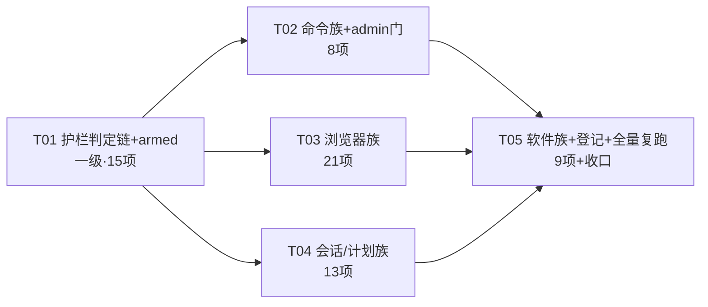

# P0-1b 修复方案设计：首轮差分 66 项 suspect 的契约对齐

- 日期：2026-10-30
- 作者：架构师（software-architect）
- 输入：首轮差分报告 `outputs/diff/20261030125905/report.md`（66 suspect 逐项 diffPath + 双侧输出）、QA 验收报告 `outputs/acceptance-2026-10-30-p0-1-diff-harness.md`（7 项抽查零误报 + 深层源码发现）、双侧源码复核（本轮设计期间完成）
- 交付对象：工程师（寇豆码）
- 范围：66 项 suspect 的修复方向、涉及文件、风险标注、优先级、任务分解与复跑策略
- 红线遵守：`API_VERSION='v1.0.0'` 冻结、`get_api_info()` 零改动（ID-001 已签核）、`config.json` 零污染、不碰 `harbor.html`、本方案为设计（代码片段 ≤30 行示意）、**Python 侧零改动**（§8 论证）

---

## 1. 根因分析总览：66 项 suspect 收敛为 5 类结构性根因

逐项复核双侧源码后，66 项差异不是 66 个孤立缺陷，而是 **5 类结构性根因的投影**：

| 根因 | 描述 | 证据（源码级） | 覆盖的 suspect |
|---|---|---|---|
| **R1 护栏语义层整体未对齐** | scope 分类学（`workspace_write/exec/app_launch` vs `fs:*/cmd:exec/os:*`）、默认档位矩阵、confirm 回执形状（`label` vs `tier`）、token/grant/trust 响应契约、审计链、配置归一化——Node guard.js 是"形似而法不同"的独立实现 | Python `guard_service.py`：`GUARD_OPS`(17 op)、`DEFAULT_TIERS` 全矩阵、`GRANT_SCOPES=('workspace_write','exec','app_launch')`、`_OP_GRANT_SCOPES`(仅 5 op 有映射)、`OP_LABELS`、`issue_confirm_token`→`{token,ttl:60}`、`GRANT_IDLE_SECONDS=1800`；Node `guard.js`：`OP_SCOPES` 8 个自造 scope、`tierOf` 缺省 `'session'`、confirm 带 `tier`、`TOKEN_TTL_MS=120000`、grant 无校验 | guard 15 项、commands 的 guard.json probe、browser offline 的 CONFIRM_REQUIRED 类（部分） |
| **R2 武装（armed）语义缺失** | Python guard 有 `armed` 标志：桌面 UI 会话激活（`Api._set_window`→`arm()`）后 always/session 档才在**执行点**强制 token/信任校验；**未武装环境（无窗口）执行点直接放行**（`guard_service.py:476 if not self._armed: return None`）。差分环境 Python 恒为未武装；Node 无此概念，恒为武装态 | `backend/api.py:130-138`（`_set_window`→`self._guard.arm()`）；`guard_service.py:476`；AGENTS.md「未武装环境：guard 放行」 | browser offline 8 项（c01-c03/c07-c11 的 CONFIRM_REQUIRED vs 语义错误）。**注意：这类差异在生产环境（双侧均武装）并不存在——Python 武装态同样先 CONFIRM_REQUIRED；本质是差分环境的可比性问题，但修法是给 Node 补武装语义（生产对等需要它）** |
| **R3 错误响应方言混用** | Python 按 api 包装层分方法采用三种错误方言：①拍平 `{error:文本}`（plan get/update、save_sessions 校验）；②`{ok:false,error:文本}`（checkpoint rollback 透传）；③结构化 `{ok:false,error:{code,message,hint?}}`（浏览器/软件族）。Node 统一用了 ②/③ 混合，未逐方法对齐 | `backend/errors.py`（`err()`=拍平）；`api.py:1317/1325`（plan 用 err 拍平）、`api.py:1347-1353`（rollback 结构化透传）；`routes/jsapi.js`（Node 统一结构化） | plans 2 项、checkpoints 2 项、sessions 校验 3 项、browser 文案/hint 类 |
| **R4 服务内校验顺序分叉** | Python：参数/协议校验 → 语义校验 → 护栏确认 → 安装探测 → 执行（browser 先协议/SSRF 后护栏；software 先 schema 后危险确认后安装）。Node：护栏先于参数、安装先于 schema | `backend/api.py:235-306`（browser 原语经 `_execute_guarded` 包裹，协议校验在 executor 内）；`software_service.py`（§3.2 SCHEMA_INVALID 自校正回显在前）；Node `browser.js:156-159`（guard 先行）、`software.js`（安装态短路） | browser offline c05/c06（会话先于 mode 校验）、takeover c13/c14（action 先于 id）、software c06/c08/c09（安装检查过早） |
| **R5 mock 对等缺口** | 共享 mock 表未覆盖软件探测命令形态（`where`/`--version`），Node 侧探测走真实命令得到 missing；Python 侧桩命中得到 probed/2.50.1 | 差分报告 software c07/c09；`mock-table.json` 现有条目 | software c07/c09 + probe software.json |

另有一类**登记不修**：存储实现分叉（sessions 原文保底 vs Prisma 结构化；history migrate 搬 sessions.json vs DB）——P0-2 范围（§5 登记 ID-101/102/103）。

---

## 2. 修复总原则与对齐策略（主理人裁定落地）

1. **默认：Node 向 Python 契约对齐**。判定基准 = Python 在**武装生产态**的行为形状（差分报告里 Python 输出即该基准，因差分环境对 Python 的唯一系统性偏差是 R2，且 R2 只影响"是否拒绝"不影响"成功路径形状"）。
2. **例外（择优/增强）逐项标注**，本轮共 4 处例外裁决，其余 62 项全部为纯 Node 对齐：
   - **audit 哈希链**（c23）：Python 更强 → Node 采纳（Python 零改动）；
   - **stdout/stderr 分离**（commands c01/c03/c07）：Node 内部实现保留分离（日志/截断逻辑），**响应契约收敛为 Python 的 `{exit_code, output}`**——理由：legacy 前端只消费 exit_code/output，P0-4 验收口径是前端零感知，富形状登记 intentional 反而要求前端双形状兼容，违背目标；增强折叠为内部实现细节，不登记；
   - **Node 校验更严的场景**（checkpoint_create 非法 task_id、software 安装前置检查）：按 Python 契约放宽到 Python 的**降级语义**，但内部保留安全底线（见 §4 安全评估 E3/E5）；
   - **Node 侧危险面**（admin 无确认门）：Python 更强（MessageBox 人审）→ Node 补齐对等门（fail-closed 缺省）。
3. **修复不得改变 Python 侧行为**：本轮 **Python 侧零文件改动**（§8）。
4. **复跑收敛目标**：`npm run diff` 全量复跑 suspect 66 → 0（全部 match / intentional）；新出现差异必须能归因（报告逐 call diffPath 可查）；16 组 Node 测试更新后全绿；Python 测试零改动全绿。

---

## 3. 逐项修复清单（66 项 → 62 修 + 4 登记）

> 表内缩写：〔P1 安全/P2 前端形状/P3 一致性〕；文件路径相对 `server/`。所有 Node 侧修复同时更新对应 Node 测试（§6 任务内含）。

### 3.1 guard 族 15 项（根因 R1；文件：`src/services/guard.js`、`src/services/misc.js`）

| call | 差异摘要 | 修复方向 | 风险 |
|---|---|---|---|
| c01 | run_command 缺省档：Py `off→allow` vs Node `session→confirm` | **G1**：引入 `GUARD_OPS`（17 op 白名单）+ `DEFAULT_TIERS` 全矩阵（含 run_command/run_powershell/run_admin_command/open_app/web_search=off、browser_click/fill=always 等）；`tierOf` 查矩阵，缺省 `always`；不在 `GUARD_OPS` 的 op → 直接 `{action:'allow'}`（c03 同修） | P1（unknown-op allow 的 fail-open 评估见 §4-E2） |
| c02/c04 | confirm 回执：Py `{action,op,label}` vs Node `{action,op,tier}` | **G2**：建 `OP_LABELS` 表（Python 逐字：删除文件/目录、结束进程、写入剪贴板…）；confirm 回执换 `label`；enforceExec 拒绝文案改用内部 `tierOf(op)` 取档位值 | P2 |
| c05 | confirm_token：Py `{token,ttl:60}` vs Node `{ok,token,op,expires_in:120}` | **G3**：响应改 `{token, ttl:60}`；TTL 120s→60s；op 校验 ∈ `GUARD_OPS ∪ {mcp_call}`，未知 → `{error:'未知护栏操作: %s'}`；签发计一次审批（已有） | P2（前端确认倒计时口径） |
| c07 | session_trust 未知 op：Py 拒绝 vs Node 接受 | **G4**：op ∈ `GUARD_OPS` 校验，拒绝文案 `'未知护栏操作: %s'`；成功登记计一次审批（配合 c17） | P1 |
| c11 | rule_remove 幂等回执缺 `removed` | **G5**：返回 `{ok:true, removed:bool}`（该 id 是否真实存在过） | P3 |
| c12/c13 | task_grant 响应缺 4 键 + idle 语义 7200 vs 1800 | **G6**：完整响应 `{ok, grant_id, expires_at(ISO), idle_deadline(ISO), remaining_s, scope(排序), granted_by:'user'}`；`expires_at=now+ttl`、`idle_deadline=now+1800`（`GRANT_IDLE_SECONDS`）；status 的 `remaining_s=min(expires,idle)-now`；授权内操作刷新 idle（已有） | P2 |
| c16 | bogus scope 静默接受 + TTL 无范围校验 | **G7**：scope ⊆ `('workspace_write','exec','app_launch')` 非空枚举数组，否则 `'scope 需为非空枚举数组（合法值: workspace_write/exec/app_launch）'`；TTL 整数 60–86400 不夹逼（`Math.max(1,…)` 删除），越界/非整数按 Python 文案拒绝 | **P1（QA 深层发现）** |
| c17 | used 计数 2 vs 1 + grant_active 级联 | **G8**：`guardSessionTrust` 成功登记计一次审批（G4 同处）；grant_active 由 G7 修复级联收敛 | P3 |
| c19 | guard_get_config：Py 归一全量 vs Node 裸 `{}`/增量 | **G9**：load 时归一合并（默认全量 + 文件覆盖 + tiers 仅收 GUARD_OPS 合法值 + trustedOps 白名单过滤 + protect_paths/processes 归一）；`guard_get_config` 返回归一全量 `{tiers(17), protect_paths, protect_processes, trustedOps, approval_budget:{limit,used,escalated}, allow_rules}` | P2 |
| c21 | guard_check 误含 `via:'trusted-session'` | **G10**：会话信任判定**从 guardCheck 移除**（Python 的 check() 不查会话信任），仅保留在 enforceExec 执行点（对齐 Python enforce_exec 结构） | P1（判定链语义） |
| c23 | get_audit_log：Py `{ok,total,entries}` + 哈希链条目（10 条）vs Node 2 条 + 回显键 + `chain:null` | **G11**：①审计条目扩为 Python 形状 `{ts,op,action,detail,decision,trace,identity:{sid,principal:'user'},intent:{trace,summary:'<op> <decision>'},prev_hash,hash}`，哈希链 `sha256(prev_hash+canonical)`；②响应删 `limit/offset/verify_all/chain` 回显键；③**审计点位对齐**：以 Python `guard_service.py` 全部 `self._audit`/`audit(` 调用点（grep 清单）为基准在 Node 建立一一对应（当前 Node 只在 2 处落审计，Python 在规则命中/授权放行/持久信任/token 确认/信任登记/授权签发/撤销/预算等 ~10 处） | P1（审计面完整性） |
| probe guard.json ×2（guard-chain + commands） | 文件形状：Py 归一全量 vs Node 增量+杂键 `rules` | **G12**：save_config 校验全量（trustedOps 数组/未知 op 拒绝，文案对齐）后**归一化整写** guard.json；`guardRuleAdd/Remove` 只操作归一 cfg 的 `allow_rules`，不再写杂键 | P2（数据兼容见 §4-E6） |

**guard 附加项（差分未覆盖、源码对齐）**：预算超限分支（Python `_count_approval` 超限 → 拒绝并提示升级任务授权）与 `refund_token` 语义按 Python 源码对齐，防止后续 fixture 扩展再爆差分。

### 3.2 commands 族 8 项（根因 R1/R3/R5；文件：`src/services/commands.js`、`tools/diff/mock-table.json`、驱动 env 支持）

| call | 差异摘要 | 修复方向 | 风险 |
|---|---|---|---|
| c01/c03/c07 | 响应字段族：Py `{exit_code,output}` vs Node `{ok,code,cwd,stdout,stderr,truncated,duration_ms}` | **C1**：run_command/run_powershell 成功响应改 `{exit_code, output}`（output=合并输出，空输出加 `note:'命令执行完毕，无任何输出'`）；stdout/stderr 分离保留为内部实现（择优裁决见 §2.2） | **P2（前端直接消费面）** |
| c02 | 去重回执：Py `{info,skipped:true}` vs Node `{ok,deduped,note}` | **C2**：改 `{info:'与上一条命令完全相同，已拒绝；如需刷新结果请加参数或说明目的。', skipped:true}`（逐字） | P2 |
| c04 | 超时：Py `{error:'命令执行超时(5s)'}` vs Node 结构化 | **C3**：超时改拍平 `{error:'命令执行超时(%ds)'}`；采纳 W1 语义：超时/执行失败**回滚去重登记**放行合法重试（Node 现无） | P2 |
| c05 | admin 通道：Py 去重拒绝（MessageBox 未达）vs Node 直接执行 | **C4**：①去重键改**用户原命令**域（去掉 `${shell}:` 前缀；admin 不用包装后脚本算键——对齐 Python W5）→ c05 双侧去重拒绝收敛；②**admin 人审门**：`runAdminCommand` 增加执行前确认（对齐 Python MessageBox 语义）：测试 seam `HARBOR_TEST_MSGBOX`（6=放行/7=拒绝→`{info:'用户拒绝了本次管理员命令，请改用无需提权的方案。',skipped:true}`）；**无 seam 无 UI 钩子时 fail-closed 拒绝**；UAC（Start-Process -Verb RunAs）保留为第二道门；Electron 对话框接线列入 P0-4 | **P1（QA 深层发现）** |
| c08 | 截断阈值 6000 vs 60000 + toolcache 续读 | **C5**：MAX_OUTPUT 6000（admin 通道 60000 保留）；截断标记与续读引用按 Python `cmd_service.py:218-232` 逐字对齐（含 toolcache id 键） | P2 |
| probe guard.json | — | G12 级联收敛 | — |

**配套 harness 扩展（测试代码）**：fixture schema 增可选 `"env": {"python": {…}, "node": {…}}`（驱动进程启动时注入，`tools/diff/python_driver.py` + `server/test/diff/node-driver.mjs` 各 ~5 行）；新增 `tools/diff/fixtures/commands/commands-admin-approve.json`（双侧 msgbox=6：MessageBox 放行→mock 执行→`{exit_code,output,note:'已通过管理员权限执行'}`）与 `commands-admin-deny.json`（双侧=7：拒绝回执）；`mock-table.json` 增软件/admin canned 段（R5）。

### 3.3 browser 族 21 项（根因 R1/R2/R3/R4；文件：`src/services/browser.js`）

| call | 差异摘要 | 修复方向 | 风险 |
|---|---|---|---|
| offline c01/c02/c03、c07-c10、c11 | Node 先弹护栏 CONFIRM_REQUIRED vs Py 直达语义错误 | **B1（armed 补齐）**：guard.js 增 armed 状态（生产缺省武装=true）；测试 seam `HARBOR_GUARD_ARMED=false`（仅模块 init 时读取，生产入口 index.js/app.js 永不设置——同 `HARBOR_TEST_PICKED_PATH` 先例）；未武装时 enforceExec 在 block/规则/授权/持久信任之后、会话信任/token/档位确认之前放行（逐行对齐 Python enforce_exec 结构）；**Node 差分驱动对全部 fixture 设 false**（Python 差分环境恒未武装）；guardCheck 不受 armed 影响（c02 实证） | **P1（安全边界，QA 深层发现）** |
| offline c04 + tier c06 | browser_sessions 缺 `ok:true` | **B2**：包一层 `{ok:true, version, sessions}` | P2 |
| offline c05 + tier c07 | set_mode 无会话：Py BAD_PARAMS vs Node 幂等成功 | **B3**：无会话（且未指定 session_id）→ `BAD_PARAMS '没有可用浏览器会话'`；校验顺序对齐：会话存在性先于 mode 合法性（同修 offline c06） | P2（语义收紧） |
| offline c06 | 非法 mode：Py 报"没有会话" vs Node 报"mode 非法" | B3 的顺序修正级联 | P3 |
| offline c11 + tier c05 | browser_close：Py `{ok,closed:[],note}` vs Node `{ok,closed:0}` | **B4**：`closed` 改**已关会话 id 列表** + 空列表时 `note:'会话不存在或已关闭'`（有会话时的完整形状按 Python driver.close 源码对齐） | P2 |
| offline c12 | browser_search 空 query 文案/hint | **B5**：`BAD_PARAMS 'query 不能为空（1-500 字符的检索词）'` + `hint:'例如 {"query": "python 教程"}'` | P3 |
| offline c13/c14 | takeover：Py TAKEOVER_NOT_FOUND/BAD_PARAMS vs Node SESSION_CLOSED | **B6**：action 合法性先于 id 查找：非法 action → `BAD_PARAMS 'action 仅支持 continue/abort'`；未知/过期 id → `TAKEOVER_NOT_FOUND '接管会话不存在或已被清理'` + `hint:'请重新发起搜索'`（Python 另有 TAKEOVER_EXPIRED 变体按源码对齐） | P2 |
| tier c01/c02/c03 | NAV_BLOCKED/SSRF_BLOCKED 文案与 hint | **B7**：错误文案逐字对齐 Python：NAV_BLOCKED `'已阻止非 http(s) 导航: <url>'` + hint `'浏览器仅支持 http/https 链接'`；SSRF_BLOCKED `'已阻止访问内网/环回地址: <url>'` + hint `'禁止访问内网/环回地址'`（消息含完整 URL 而非裸主机名；DNS 失败/带凭证/超长 URL 变体按 Python service 源码逐字对齐） | P3 |
| tier c04 | 无会话提取：BAD_PARAMS vs SESSION_CLOSED | **B8**：无会话错误改 `BAD_PARAMS '没有可用浏览器会话（先 browser_navigate）'` + `hint:'会话可能已被回收，请重新导航'`；SESSION_CLOSED 保留给"会话存在但中途关闭"场景（对齐 Python taxonomy 用法） | P2 |

> B1 落地后 offline c01-c03/c07-c10 先经 armed 放行再命中 B7/B8 的对齐文案 → 全部收敛；c11 = B1+B4。生产等价性：武装态双侧均先 CONFIRM_REQUIRED（Python `_execute_guarded` 结构同构），拒绝文案逐字对齐 Python enforce 文案（见共享知识 §9.1）。

### 3.4 sessions 族 7 项（根因 R3 + 存储分叉；文件：`src/registry.js`、`src/services/provider.js`、`src/services/sessions.js`）

| call | 差异摘要 | 修复方向 | 风险 |
|---|---|---|---|
| basic c04 | set_current_sid：Py `{"ok":true}` vs Node 裸 sid | **S1**：registry.js 处理器改返回 `'{"ok":true}'`（内部 `setCurrentSid(sid)` 语义不变） | **P2（bridge 直接消费）** |
| basic c07 | session_purge 缺 `sid` 键 | **S2**：provider.js sessionPurge 响应加 `sid`（removed 四键已有，键序无关） | P3 |
| val c01 | 非法 JSON：Py `{error:CPython文案}` 200 vs Node 500 INTERNAL | **S3**：sessions.js 捕获解析/校验异常返回 200 + `{error:文本}`；**ID-104 登记**（解析器文案差异：CPython vs V8 文本天然不同，形状同构，前端仅展示字符串） | P2 |
| val c02 | 非数组：Py `{error:'sessions 必须是 JSON 数组，未写入'}` vs Node zod 500 | **S3**：逐字复刻该手写文案 | P2 |
| val c03/c04 | 数组条目非对象：Py 保底写入+回读 `[1,2]` vs Node zod 拒绝+空库 | **登记 ID-101/102（P0-2 交接）**：存储实现分叉（sessions.json 原文 vs Prisma 结构化）；Node 拒绝路径经 S3 后同为 200+`{error}` 形状；前端恒发合法会话对象数组，且 Node 拒绝更严格（fail-closed） | 数据兼容（P0-2 复评） |
| val c06 | 数字 id String 化 | **S4**：SessionEntry 的 `id` 去掉 `.transform(String)`——payload 存**原文**（类型保真），DB 主键另用 `String(entry.id)`（仅索引用途）；get_sessions 原文回读已有 | P2（前端严格相等比较） |

### 3.5 history-dir 族 1 项

| call | 差异 | 方向 |
|---|---|---|
| basic c05 | migrate：Py true（搬 sessions.json）vs Node false（DB 无文件可搬） | **登记 ID-103（P0-2 交接）**：DB 存储下 migrate 语义需 P0-2 重定义（如导出/导入），本轮不伪造 migrated=true |

### 3.6 plans/checkpoints 族 5 项（根因 R3；文件：`src/services/plans.js`）

| call | 差异摘要 | 修复方向 | 风险 |
|---|---|---|---|
| plans c03/c07 | 错误形状：Py 拍平 `{error}` vs Node `{ok:false,error}` | **P4**：plan_get/plan_update 错误路径改拍平 `{error:文本}`（api.py:1317/1325 err() 包装语义）；**plan_create 例外**：其错误保持 `{ok:false,error}`（api.py:1312 经 ok() 直通，不拍平——源码核对结论） | P2（前端 if(r.error) 分支） |
| ck c05 | rollback 多 `deleted` 键 | **P1**：`deleted` 仅 git 模式返回（Python `_rollback_git` 有、`_rollback_snapshot` 无） | P3 |
| ck c07 | rollback 未找到：Py 结构化 `{ok:false,error:{code:'ROLLBACK_FAILED',message}}` vs Node 拍平 | **P2**：对齐结构化（api.py:1347-1353 透传语义：无 failed 键的失败 → `{'code':'ROLLBACK_FAILED','message':str(e)}`）；带 failed 的 git 失败 `{ok:false,mode,restored,failed}` 原样透传 | P2 |
| ck c08 | create 非法 task_id：Py 降级 `{ok:true,mode:'none',git_head:'',snapshot_count:0,pruned:[],warnings:[…]}` vs Node BAD_PARAMS 拒绝 | **P3**：采纳 Python 降级语义（记录-only）；**安全底线保留**：非法 tid 不做任何文件系统写（mode none = 无快照目录创建），路径监狱内部校验不动 | P2（安全评估 §4-E3） |

### 3.7 software 族 9 项（根因 R3/R4/R5；文件：`src/services/software.js`、`tools/diff/mock-table.json`）

| call | 差异摘要 | 修复方向 | 风险 |
|---|---|---|---|
| c01 | arg_schema 属性缺 `description` | **SW1**：PRESETS 全部属性补 `description`（Python 注册表逐字：如 archive=`'压缩包路径（工作区内）'`）——影响 LLM 参数选择质量 | P3 |
| c03/c04/c05 | 错误文案缺 `%r` 引号（`'nosuch'` vs `nosuch`） | **SW2**：软件名/动作名按 Python `%r` 语义加单引号（hint 文案已同） | P3 |
| c06 | 缺 message：Py SCHEMA_INVALID+violations/example vs Node NOT_INSTALLED | **SW3**：**校验顺序重排**：参数解析 → 软件解析（UNKNOWN_SOFTWARE）→ 动作解析（BAD_PARAMS）→ **arg_schema 校验（SCHEMA_INVALID `{code,message:'参数校验失败',hint:'请按 example 修正后重试（Agent 自校正 ≤2 次）',violations:[{path,expect,got}],example:{…}}`）→ 危险动作确认（CONFIRM_REQUIRED 含 `op:'software_call'`，文案对齐）→ 安装探测 → 执行**（安装检查从最前移到执行前） | **P1/P2（校验顺序安全相关）** |
| c07 | probe：Py probed/2.50.1 vs Node missing/null | **SW4**：mock 表增 `software` 段（可执行解析 `where/which`、`--version`、git 动作的 canned 输出；命令形态双侧不一致时按侧分键、**canned 值相同**）；Node probe 命令构造与 mock 键对齐；`version:null` 键语义对齐（Python 对无版本软件显式 `version:null`，Node 省略键的场景补键） | P3 |
| c08 | 危险动作：Py CONFIRM_REQUIRED vs Node NOT_INSTALLED | SW3 顺序重排级联 | P1 |
| c09 | 成功形状：Py `{ok,software,action,kind,exit_code,stdout,stderr,duration_ms,sandboxed,truncated,untrusted,source}` vs Node NOT_INSTALLED | **SW5**：执行路径打通（mock 解析出可执行 → 执行 → 成功形状逐键对齐） | P2 |
| probe software.json | 持久化格式：Py `{version:1,user:{},probe_cache:{仅探测项}}` vs Node 全量+缺 version/user | **SW6**：persist 格式对齐 `{version:1, user:{}, probe_cache:{已探测条目}}` | 数据兼容（§4-E7） |

---

## 4. 安全评估专节（改动护栏/授权面必须逐项论证）

| # | 改动 | 安全性论证 |
|---|---|---|
| E1 | **scope 分类学替换**（OP_SCOPES 8 域 → Python 3 域 5 op 映射） | **授权面严格缩小**：现 Node 把 write_file/delete_path 等 9 个 fs 操作映射到 `fs:write`——grant `fs:write` 可授权删除；Python 映射仅 delete_path/run_*/open_app 5 op，文件写操作**永不因任务授权放行**。替换后 fail-closed 原则保留（未映射 op 不经授权放行，与 Python S2 修复同构）。无别名映射（`exec`≠`cmd:exec`）正是功能失效根因，统一到 Python 枚举后既有前端授权调用立即恢复语义 |
| E2 | **unknown op → allow**（c03） | 仅影响 guard_check **自省面**；执行点（enforceExec）硬编码于已知 op 的服务调用处，未知 op 无执行点可放行；与生产 Python 行为逐字节一致（GUARD_OPS 之外不设防是契约设计：新增危险 op 必须先注册 GUARD_OPS）。**不构成新暴露面** |
| E3 | **checkpoint_create 降级语义**（c08） | 降级=mode:'none'（仅记录，无文件系统写）；Node 内部路径监狱/tid 消毒保留——**不因对齐响应形状而打开路径逃逸**（对照 Python：非法 tid 同样不建快照目录） |
| E4 | **admin 人审门 fail-closed 缺省**（C4②） | 当前 Node 可静默走 UAC（OS 级门，但不含命令上下文）；修复后无 UI 钩子即拒绝（IDNO 同款回执）——**收紧**；P0-4 接 Electron 对话框后与 Python 双门（人审+UAC）完全同构 |
| E5 | **software 校验顺序**（SW3） | schema→危险确认→安装：SCHEMA_INVALID 在确认**之前**=坏参数不消耗用户确认（Python 同序）；危险确认在安装**之前**=高危动作永远需要 token（当前 Node 安装缺失时连确认都不给，语义错误） |
| E6 | **guard.json 归一化整写**（G12） | load 侧兼容旧增量文件（缺省合并）；写侧全量归一（Python 同构）。文件在 `HARBOR_CONFIG_DIR` 独立存储，**不涉 config.json** |
| E7 | **armed seam**（B1） | `HARBOR_GUARD_ARMED` 仅模块 init 读取、生产入口永不设置（QA 已认证同款先例 `HARBOR_TEST_PICKED_PATH`）；生产缺省武装=true=现行为不变；未武装跳过的只是会话信任/token/档位确认，block/规则/授权/持久信任**仍然生效**（与 Python 未武装路径逐行同构） |
| E8 | **审计链采纳**（G11） | 纯增强：条目防篡改（prev_hash 链）+ 覆盖面从 2 点扩到 Python 全点位；无授权面变化 |

---

## 5. intentional 登记新增（4 项，均需 team-lead 签核）

| 登记号 | fixture/call | 理由 | 前端兼容论证 | 到期/跟踪 |
|---|---|---|---|---|
| ID-101 | sessions-validation/c03 | 存储实现分叉：Python sessions.json 原文保底写入任意数组条目 vs Node Prisma 结构化校验拒绝 | 前端 save_sessions 调用方恒发合法会话对象数组；对抗性输入在 Node 得到更显式拒绝（fail-closed 增强） | P0-2 复评（存储语义定案） |
| ID-102 | sessions-validation/c04 | ID-101 的回读级联（`[1,2]` vs `[]`） | 同上 | P0-2 |
| ID-103 | history-dir-basic/c05 | DB 存储无 sessions.json 可搬，migrate 语义需重定义 | 前端仅在显式勾选"迁移历史"时读取 migrated 字段展示 toast；P0-2 以导出/导入等价语义补齐 | P0-2 |
| ID-104 | sessions-validation/c01 | JSON 解析器错误文案天然不同（CPython `Expecting property name…` vs V8 `Expected property name…`）；形状同构 `{error:string}`，HTTP 200 | 前端仅将 error 字符串原样展示给用户，无文案分支逻辑 | 永久（解析器实现细节） |

---

## 6. 任务分解（寇豆码可直接执行；顺序=先安全后形状后一致性）

### T01：护栏判定链与授权语义对齐（一级）

- **文件**：`server/src/services/guard.js`（主体：G1/G2/G3/G4/G6/G7/G8/G10 + armed 状态）、`server/src/services/misc.js`（G11 审计链与点位）、`server/test/guard.mjs`（契约断言更新）、`server/test/diff/node-driver.mjs`（驱动设 `HARBOR_GUARD_ARMED=false`，1 行）
- **依赖**：无
- **内容**：§3.1 的 G1–G12（G9/G12 配置面含内）+ 预算超限/refund 附加对齐；guardCheck/enforceExec 按 Python check()/enforce_exec 结构重排（见 §9.1 判定链对照）
- **验收**：①`npm run diff -- guard`：guard 族 15 suspect → 0（全部 match）；②`npm run test:guard` 全绿（断言更新后）；③scope 枚举校验单测：bogus scope / 越界 TTL / 非整数 TTL 三拒绝路径；④armed seam 单测：未武装跳过档位确认但保留 block/规则/授权
- **风险**：guard.mjs 25 项断言大面积更新（形状变更是本任务目的）

### T02：命令执行族契约对齐 + admin 人审门（一级/二级）

- **文件**：`server/src/services/commands.js`（C1–C5）、`tools/diff/mock-table.json`（software/admin canned 段）、`tools/diff/python_driver.py` + `server/test/diff/node-driver.mjs`（fixture `env` 字段支持，各 ~5 行）、`tools/diff/fixtures/commands/commands-admin-approve.json` + `commands-admin-deny.json`（新增 2 fixture）、`server/test/commands.mjs`（断言更新）
- **依赖**：T01（enforceExec 接口与 armed seam 先行）
- **内容**：响应族重塑、dedup 键域+回执、超时拍平+W1 回滚、截断 6000+续读键、admin 人审门（seam+fail-closed 缺省）、mock/harness 扩展
- **验收**：①`npm run diff -- commands`：8 suspect → 0；②admin 双 fixture（approve/deny）收敛；③`npm run test:commands` 全绿；④admin 无 seam 时 fail-closed 拒绝的单测
- **风险**：admin fail-closed 缺省改变现 Node 测试的执行预期（属目的性收紧）

### T03：浏览器族错误契约对齐（二级）

- **文件**：`server/src/services/browser.js`（B2–B8；B1 的消费侧在 T01 已建）、`server/test/browser.mjs`（断言更新）
- **依赖**：T01（armed seam + enforceExec 结构）
- **内容**：sessions/close/set_mode/搜索/takeover 形状与顺序、NAV/SSRF/无会话错误码与文案 hint 逐字对齐
- **验收**：①`npm run diff -- browser`：21 suspect → 0（offline 8 项经 armed 放行后命中对齐文案；tier-aligned 7 项直接收敛）；②`npm run test:browser` 全绿
- **风险**：文案逐字对齐需以 Python service 源码为单一事实源（禁止手打记忆）

### T04：会话与计划/检查点族契约对齐（二级）

- **文件**：`server/src/registry.js`（S1 set_current_sid）、`server/src/services/provider.js`（S2 purge sid）、`server/src/services/sessions.js`（S3/S4）、`server/src/services/plans.js`（P1/P2/P3/P4）、`server/test/state-services.mjs` + `server/test/checkpoint-git.mjs`（断言更新）
- **依赖**：T01（同批复跑需要；代码面独立，可与 T02/T03 并行）
- **验收**：①`npm run diff -- sessions history-dir plans-checkpoints`：13 suspect → 4 intentional（ID-101/102/103 + ID-104）、其余 match；②`npm run test:state` + `npm run test:checkpoint-git` 全绿；③id 类型保真单测（数字 id 回读仍为数字）
- **风险**：sessions id 去 transform 后 Prisma 主键仍 String（仅索引），payload 原文类型保真——回归 get_sessions 排序（updatedAt 列）

### T05：软件族对齐 + 登记收口 + 全量复跑（三级收尾）

- **文件**：`server/src/services/software.js`（SW1–SW6）、`tools/diff/intentional-deltas.json`（ID-101..104）、`tools/diff/mock-table.json`（若 T02 未覆盖的 probe 命令补齐）、`server/test/commands.mjs`（software 断言更新）、`deliverables/dev-plan/p0-1b-fix-conclusions-<日期>.md`（结论文档）
- **依赖**：T01–T04 全部
- **内容**：软件注册表 description/校验顺序/成功形状/持久化格式/文案引号；4 项登记（含理由与前端兼容论证，待签核）；全量复跑与结论归档
- **验收**：①`npm run diff`（全量）：suspect 66 → 0、intentional 1 → 5（ID-001 + 新 4 项）、exit 0；②`npm run diff:coverage` 维持 48/145 无回退；③16 组 Node 测试逐组全绿（check 数对照基线更新表）；④Python 全量零改动回归（1745 passed / 23 failed 基线不变——23 为 P1-3 范围既有失败）；⑤新出现差异逐项归因记录（报告 diffPath 对照）
- **风险**：software.json 格式变更——待明确事项 Q1（生产无 Node 持久化数据则安全）

### 任务依赖图



### 修复顺序与复跑防交叉策略

1. **批间全量复跑**：每任务完成即跑该族差分 + 全量 `npm run diff` 一次（防止已收敛项被后续改动翻回——报告逐 call diffPath 使任何翻转可见且可归因）。
2. **同批内先语义后文案**：guard 先 taxonomy/判定链、后 label 文案；browser 先 armed/顺序、后 hint 文案。
3. **登记最后落笔**：ID-101..104 在 T05 统一登记（避免中途登记掩盖仍在修复中的真差异）。
4. **Python 基线对照**：每批复跑后抽查 1 项 Python raw 输出未变（`outputs/diff/<runId>/` 保留双侧原文）。

---

## 7. Node 侧错误响应「方言表」（共享知识核心，工程师对齐时逐方法查表）

| 方法族 | 成功 | 业务错误 | 校验错误 |
|---|---|---|---|
| run_command/run_powershell | `{exit_code,output[,note]}` | `{error:文本}`（超时/黑名单/去重拒绝含 info+skipped 变体） | 同左 |
| run_admin_command | `{exit_code,output,note:'已通过管理员权限执行'}` | 拒绝：`{info,skipped:true}`；输出读取超时：`{exit_code:null,output:'（命令已执行，输出读取超时，退出码未知）'…}` | 同左 |
| plan_get/plan_update | `{ok:true,…}` | 拍平 `{error:文本}` | 同左 |
| plan_create/checkpoint_* | `{ok:true,…}` | `{ok:false,error:…}`（rollback 未找到/需确认 → 结构化 `{code,message}`） | 同左 |
| save_sessions | `{"ok":true}` | `{error:文本}`（200） | 同左 |
| set_current_sid | `{"ok":true}` | — | — |
| session_purge | `{ok,sid,removed{四键}}` | — | — |
| browser 六原语/search/takeover | `{ok:true,…}` | 结构化 `{ok:false,error:{code,message,hint?}}` | 同左（BAD_PARAMS 先于护栏） |
| software_call | `{ok,software,action,kind,exit_code,stdout,stderr,duration_ms,sandboxed,truncated,untrusted,source}` | 结构化（含 violations/example、CONFIRM_REQUIRED 带 op） | 同左 |
| guard_* | 见 §3.1（token `{token,ttl}`；grant 全键；trust/rule 拒绝 `{error}`） | — | — |
| get_audit_log | `{ok,total,entries[]}`（条目含哈希链八键组） | — | — |

**guard 判定链对照（Node 重排目标，与 Python check()/enforce_exec 同构）**：

```text
guardCheck(op, detail):                    enforceExec(op, detail, token):
  op ∉ GUARD_OPS → {action:'allow'}          r = guardCheck(op, detail)
  ① 保护名单 → block{reason}                 r.action=block → 拒绝(reason)
  ② deny/allow 规则 → block/allow{via}       r.action=allow → 放行
  ③ 任务授权(仅 5 映射 op) → allow{via}      持久信任 → 放行(审计)
  ④ 持久信任 trustedOps → allow{via}          未武装(armed=false) → 放行
  ⑤ tier off → allow                          会话信任 → 放行
  ⑥ tier list → listless? confirm : allow     tier off/list → 放行
  ⑦ 其余 → confirm{action,op,label}          token 有效 → 放行(审计)
                                              否则 → 拒绝(档位文案)
```

---

## 8. Python 侧改动：零（论证）

- 全部 62 项修复的修改面在 Node（对齐方向单向）；
- 4 处例外裁决均不需 Python 变更：审计链 Python 已有（Node 采纳）；stdout/stderr 分离折叠为 Node 内部实现（响应收敛 Python 形状）；两处"Node 更严"按契约放宽到 Python 降级语义（安全底线内部保留）；admin 门是 Node 补齐 Python 已有语义；
- **结论：P0-1b 不提交任何 `backend/` 文件变更。** Python 全量测试作为只读回归基线（1745/23/2/1 口径不变，23 项属 P1-3 范围）。

---

## 9. 共享知识更新

1. **单一事实源**：Python `backend/` 源码是对齐基准——所有文案/键集/顺序以源码为准（禁止凭差分报告转抄记忆，报告可能截断长输出）。
2. **测试 seam 清单（生产入口永不设置）**：`HARBOR_GUARD_ARMED`（T01）、`HARBOR_TEST_MSGBOX`（T02）、`HARBOR_TEST_PICKED_PATH`（既有）、`GLM_TEST_MSGBOX`/`GLM_TEST_PICK`（Python 侧既有）。
3. **fixture env 字段**：`"env": {"python": {...}, "node": {...}}` 由驱动在进程启动时注入（新增 harness 能力，向后兼容）。
4. **时间抖动防护**：若 `remaining_s` 修复后出现 ±1 级 flake，在 `tools/diff/normalize-rules.json` 增数值容差规则（±2s，保留对 7200/1800 级语义差的捕捉），不整键掩蔽。
5. **Node 测试断言更新纪律**：形状变更是任务目的；每任务提交附「断言变更 ↔ Python 源码行号」对照注释，QA 抽查锚点。
6. **复跑产物归档**：每批 `outputs/diff/<runId>/` 保留；T05 结论文档按「根因 → 修复 → 收敛证据（runId）→ 残留 intentional」结构归档，供 P0-2/P0-3/P0-4 消费。

---

## 10. 待明确事项（需 team-lead / 用户决策）

1. **Q1 software.json 数据兼容**：Node 侧生产环境（桌面未切换前）理论上无持久化 software.json 用户数据——确认后 SW6 直接改格式；若存在测试残留数据则需一次性清理脚本。
2. **Q2 admin fail-closed 缺省的上线窗口**：Node 在 P0-4 Electron 对话框接线完成前，admin 命令将一律人审拒绝（收紧）。确认接受该过渡行为，或要求 P0-1b 内先接一个最小 PowerShell MessageBox 实现（不推荐——引入子进程 UI 反模式）。
3. **Q3 ID-104（解析器文案）签核**：确认「永久 intentional」口径，还是要求 Node 仿写 CPython 文案（不推荐，脆弱且无前端收益）。
4. **Q4 armed seam 命名**：`HARBOR_GUARD_ARMED` 是否并入现有测试例外清单文档（QA 验收报告 §5 先例），由 QA 更新。
5. **Q5 browser_set_mode 收紧的用户面影响**：对齐后无会话时 set_mode 返回 BAD_PARAMS（Python 现行为）；React 侧栏岛若有依赖幂等成功的调用点需同步确认（属 P0-3 前端范围，本方案仅登记交接）。
