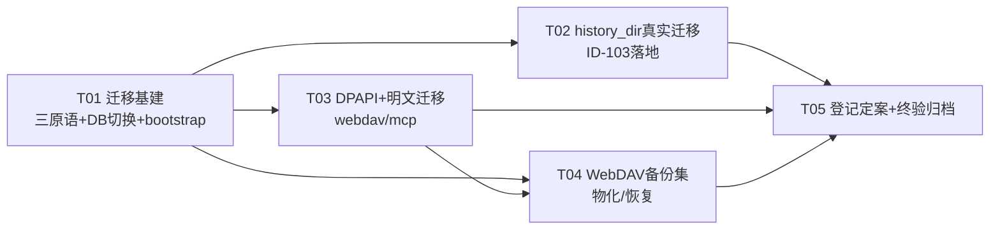

# P0-2 设计文档：运行时存储统一与 DPAPI 加密迁移

- 日期：2026-10-31
- 作者：架构师（software-architect）
- 输入：交接报告 §9 P0-2、P0-1/P0-1c 结论文档、intentional 登记簿（ID-101/102/103 全文与签核口径）、QA 终验 `outputs/acceptance-2026-10-31-p0-1c-fixes.md`（webdav 专项评估 + 泄漏事件 9c6fa8c 教训）、双侧源码复核（`sessions.js`/`db.js`/`worklog.js`/`workspace.js`/`misc.js` historyDirSet、`config_service.py` history_dir 全实现、`webdav_service.py` + `mcp_dpapi.py`）
- 交付对象：工程师（寇豆码）；裁决项待 team-lead 签核（§3、§9）
- 红线遵守：`API_VERSION` 冻结、`get_api_info` 零改动、`config.json` 零污染（新配置一律独立文件）、不碰 `harbor.html`、不启动 dist、`backend/` 零改动、**真实用户数据 `~/.glm-chat` 绝不在迁移测试中被污染或删除**（一切迁移验证在临时副本/隔离环境）；设计非实现（代码片段 ≤30 行）

---

## 1. 现状盘点：双侧存储面清单与分叉点

| 数据面 | Python（生产链） | Node（现实现） | 分叉/处置判定 |
|---|---|---|---|
| 会话（get/save_sessions、session_purge） | `~/.glm-chat/sessions.json`（原文数组，任意条目保底写入） | **Prisma/libsql** `Session{id,title,createdAt,updatedAt,runStatus,project*,payload原文}`（zod 校验拒绝非对象条目） | **ID-101/102 登记分叉**（合法输入双侧逐字节一致）；P0-2 核心：存量导入 + 定案 |
| 历史目录设置 | `history.json{dir}` + `sessions_path()` 跟随（运行时可切换存放目录） | `history.json{dir}`（**仅记录不生效**——DB 位置由 `DATABASE_URL` env 绑定，migrate 无文件可搬恒 false） | **ID-103**：migrate 语义未实现，需重定义（§3.3/§4.2） |
| WebDAV 备份集 | `BACKUP_SCOPE=('config.json','sessions.json','audit_log.jsonl')` + manifest sha256 | 同三文件（P0-1c 已对齐 plan/manifest 形状）——但 sessions.json 是**独立数据源**语义残留 | 改为「DB 物化导出/恢复导入」，契约形状不变（§4.3） |
| 工作日志 `_glm_worklog.md` | 工作区根产物文件（用户可见可编辑） | 同（worklog.js 文件实现，已 match） | **裁决：不迁入 Prisma**（用户工作区产物，非运行时状态；§2.2 分类原则） |
| 工作区绑定态（session_ws/recent/ws_enabled） | `session_ws.json` 等 + 内存态 | `harbor-node-runtime.json`（P0-1c 补齐持久化） | **裁决：本批不动**（无双侧双轨问题，行为已对齐；二期可选入 DB，§9-Q2） |
| 长期记忆 memory.json | 独立 JSON 文件（差分 probe 契约面） | 同（已 match 含 ts_iso） | **不动**（probe 契约已闭环） |
| 护栏 guard.json / 审计 audit_log.jsonl | 独立文件（probe 契约 + 哈希链日志） | 同（P0-1b 已归一） | **不动**（契约面 + append-only 日志天然文件形态） |
| 专家包 experts.json + snapshots/ | 独立文件 + 内容寻址快照目录 | 同（P0-1c 内置导入器已对齐） | **不动**（快照是文件资产，staging 泄漏教训见 §7-R6） |
| 计划/检查点 plans/*.json + checkpoints/ | 文件 + 目录快照 | 同 | **不动**（快照是文件产物） |
| 各配置（mcp/webdav/model_prefs/reader/sandbox/hybrid） | 独立 JSON + DPAPI 字段级加密（mcp/webdav） | 独立 JSON，**webdav/mcp 当前明文落盘 + W17 warning** | **DPAPI 迁移**（§5）；文件形态保留（config-specs 契约） |
| config.json（模型设置等） | 有 | 有（config.js） | 保留；**零污染红线=新配置独立文件**，不动它 |

---

## 2. 目标架构

### 2.1 数据源拓扑（「Prisma/libsql 唯一运行时数据源」的精确含义）

```text
┌─ 运行时权威存储（Prisma/libsql，单 DB 文件）────────────────┐
│  Session 表（id/title/…/payload原文）                        │
│  ＋ Meta 表（schema_version、migration 标记——本方案新增）    │
└──────────────────────────────────────────────────────────────┘
        ▲ 一次性/增量导入                ▼ 物化导出（只读视图）
legacy sessions.json ────────────►  DB  ────────────► sessions.json（导出物）
（Python 时代存量，永不删除）              （WebDAV 备份 / history migrate / 回退保险）

独立 JSON 文件纪律保留（不是「第二数据源」，是配置/状态/契约面）：
  config.json、guard.json、audit_log.jsonl、memory.json、experts.json、
  plans/、checkpoints/、mcp.json、webdav.json、model_prefs.json、reader.json、
  sandbox.json、hybrid.json、history.json、harbor-node-runtime.json

工作区产物文件保留：_glm_worklog.md、save_workspace_file/copy_into_ws 产物、导出文件
```

**「唯一运行时数据源」= 会话数据在运行时的唯一权威是 DB；`sessions.json` 降级为纯导入/导出物化格式（不再是任何一侧的运行时读写目标）。** 不是「一切数据进 DB」——独立 JSON 文件是差分 probe 契约面与配置纪律，工作区产物是用户数据，二者都不属于「运行时数据源」范畴。

### 2.2 数据分类原则（裁决依据）

| 类别 | 判定标准 | 存储 |
|---|---|---|
| 运行时状态（会话） | 高频读写、需事务与索引、有双轨分叉史 | **Prisma** |
| 配置/契约状态文件 | 差分 probe 契约面、独立文件纪律（config.json 零污染）、人可编辑 | 独立 JSON |
| 内容寻址资产 | 快照/检查点目录（文件本体即数据） | 文件系统 |
| 用户工作区产物 | 用户可见可编辑的工作区文件 | 文件系统（**worklog 据此不入 DB**） |

### 2.3 node:sqlite 兜底与 Prisma 的关系

维持交接报告 §4.2 口径不变：Prisma 为主路径，`node:sqlite` 仅作「无第三方原生模块时的启动兜底」。**迁移器只在 Prisma 主路径可用时执行**——Prisma 初始化失败则不启动数据迁移（fail-safe，不用兜底路径写数据；兜底模式的迁移属后续单独评估）。

---

## 3. intentional 登记逐项定案

### 3.1 ID-101/102（save_sessions/get_sessions 存储分叉）→ **裁决建议：正式化（转长期契约差异，永久登记）**

**理由（四点）**：
1. **合法输入双侧已逐字节一致**（P0-1 差分 267 match 覆盖 sessions-basic 全路径）。分叉仅存于「数组条目非对象」的对抗性/误用输入。
2. **Python 的保底写入在 Prisma 模型下无自然等价物**：为非对象条目引入「特殊 raw 行/整数组快照行」会污染存储模型（get_sessions 列表语义、purge/排序、迁移器都要特判），为对齐一个无真实消费者的宽容度付出长期复杂度。
3. **Node 的严格拒绝是更优语义**（fail-closed：错误即知，不写坏存储）——与 P0-1b「Node 增强折叠为内部实现」不同，这里是**行为面**差异，但属于「Python 缺陷级宽容，不值得继承」类。前端 save_sessions 调用方恒发合法会话对象数组（会话管理器构造），误用输入在 Node 得到 200+`{error}` 的显式拒绝，**比静默写坏更利于排查**。
4. **P0-4 后 Python 运行时退役**，保底写入语义的消费者消失——为一个即将退役的运行时对齐宽容度收益为零。

**落地**：登记簿 ID-101/102 的 `expires` → `2099-12-31`（永久），`reason` 更新为定案表述（Prisma 结构化校验为定案行为；Python 保底写入语义不迁移）；`sessions-validation` fixture 永久保留（c03/c04 成为「长期契约差异」的存证用例，而非待办缺陷）。

### 3.2 ID-103（history_dir_set migrate）→ **裁决建议：实现真实迁移语义（DB→DB + 物化导出双产物），登记降级为「介质披露值差异」**

Python 语义复核（`config_service.py:243-287`）：`history_dir_set(dir)` 切换 `sessions_path()` 生效目录；`migrate=true` 时 `shutil.copy2` 当前生效 sessions.json 到新目录（**目标已存在则跳过不覆盖；源文件不删除**）。

**Node 等价语义 = 历史 DB 的存放位置切换 + 数据搬移**（不是「导出一份静态副本」——后者不满足「切换后新会话写到新目录」的用户意图）。真实实现路径见 §4.2。落地后：
- `migrated:true` 与 Python 一致（原「恒 false」登记事由消除）；
- `migrated_from` 值为**旧 DB 文件路径**（Python 为旧 sessions.json 路径）——这是**存储介质披露**，与 ID-001（exe）/ID-202（python 键值）同构：**语义已对齐，值披露实际介质**。
- 登记 ID-103 **保留但改写语义**：从「功能未实现」改为「migrate 已实现 DB→DB 等价迁移（含 sessions.json 物化导出）；`migrated_from`/`sessions_file` 值披露存储介质（.json vs .db）」；expires 维持 P0-2 复评标记直至 QA 复验后转永久或撤销（差分 fixture history-dir/c05 的归一预期需同步——见 §6-T02 验收）。

### 3.3 ID-201（沙箱尾注）

**本批不动**（主理人已裁定沙箱迁移单列立项）。本方案 §5 的 DPAPI 与 §4 的存储迁移均不触碰 build_system_prompt 尾注。

---

## 4. 数据迁移设计（安全优先）

### 4.1 核心机制：legacy → DB 迁移器 + 物化导出/导入（`server/src/services/session-store.js` 扩展 + 新 `session-migrate.js`）

**三个可复用原语**（供 bootstrap、history migrate、WebDAV 三处共用）：

```js
// session-migrate.js —— 三原语（示意）
export async function importLegacySessions(sourceJsonPath, { mode = 'merge' } = {})
//   读 legacy 数组 → 逐条 upsert（payload 原文，id/title/updatedAt 索引列照现规则）
//   mode:'merge'  → DB 已有同 id 跳过（保守不覆盖，bootstrap 默认）
//   mode:'replace'→ 事务内 deleteMany+insert（WebDAV restore 语义）
//   非对象条目 → 跳过并 warning 计数（不阻塞迁移）
//   返回 {ok, imported, skipped, warnings}
export async function materializeSessions(destJsonPath)
//   DB → legacy 数组原文（payload 逐条 JSON.parse 后按 updatedAt desc）原子写
export async function switchDatabase(newDbPath)
//   见 §4.2 —— history_dir_set 专用，含互斥锁与旧 client 延迟断开
```

**触发纪律（staging 泄漏 9c6fa8c 教训的直接固化）**：
- 迁移器**绝不在模块 import 期执行**（experts 顶层 await 的教训）。
- bootstrap 导入仅在两个显式入口发生：①`server/src/index.js` 生产启动流程中 `await`（listen 成功后、标记为一次性后台任务）；②独立 CLI `npm run migrate:legacy -- --source=<path> --db=<path>`（临时副本验证专用）。
- 所有验证/差分/契约测试入口（run-diff、contract-*、node-driver）在隔离 CONFIG_DIR 下运行，import 服务链不得产生任何真实目录副作用（QA 9c6fa8c 已修三入口，本方案将其列为**回归验收项**）。

**bootstrap 导入算法（幂等可重入）**：
1. 检测：Meta 表 `migration_legacy_sessions` 标记不存在 **且** 默认/配置 history 目录下存在 sessions.json；
2. **备份先行**：`sessions.json` → `sessions.json.pre-node-migration.bak`（已存在备份则不再覆盖——重入不刷备份时间）；
3. `importLegacySessions(..., {mode:'merge'})`（跳过 DB 已有 id；非对象条目 warning）；
4. 写 Meta 标记 `{at, source, imported, skipped}`；**原 sessions.json 永不删除/不改写**（Python 回退路径完整可用）；
5. 崩溃恢复：导入在**单事务**内做整批 upsert（失败整批回滚 → 标记未写 → 下次启动重试，幂等天然成立）。

**并存期（P0-4 切换前）语义**：Node 非生产链，无真实双写；若用户回退 Python 产生新会话，Node 下次启动**增量 merge**（只补 DB 没有的 id）。**P0-4 切换后 Python 不再写 sessions.json**（无后续双写）。

### 4.2 history_dir_set 的真实迁移实现（ID-103）

```text
history_dir_set(dir, migrate)（互斥锁整段，对齐 Python W4 持锁口径）
  校验（目录存在/可写/非系统目录/realpath——现状已对齐，保留）
  dir='' → 目标=CONFIG_DIR 默认库；否则目标=<dir>/harbor.db
  migrate=true：
    ① 源=当前 DB 文件（含此前切换过的历史目录——对齐 Python W9「源取当前生效」）
    ② 目标 DB 已存在 → 跳过复制（不覆盖，对齐 Python）
    ③ 复制 DB 文件 → 物化导出 sessions.json 到目标目录（legacy 可读副本）
    ④ switchDatabase(目标)：PrismaClient 重建 + 原子换绑
    ⑤ migrated_from=源 DB 路径
  migrate=false：
    目标为空库（不存在则建库+schema push）——旧库原地保留（同 Python 旧文件留旧目录）
  写 history.json{dir}；history_dir_get 的 sessions_file 返回当前 DB 文件路径
```

**switchDatabase 实现要点（≤30 行核心）**：
- `db.js`：`export let prisma`（**ESM live binding**——所有 `import { prisma }` 的消费方零改动，换绑后自动见新 client）；
- 切换序列：目标文件就绪（复制/初始化+schema push 验证）→ 同步换绑引用（一行）→ 旧 client **延迟 ~1s 后** `$disconnect()`（让在途查询完成；Node 单线程下无新查询进入旧引用）；
- `disconnectDb()` 兼容未切换/已切换两种状态；
- 失败回滚：目标初始化失败 → 不换绑（旧 client 继续服务），返回 `{error:...}`（绝不指向半初始化库）。

### 4.3 WebDAV 备份集物化/恢复（契约形状零变化）

- **export**：`plan` 仍 = `config.json / sessions.json / audit_log.jsonl`（BACKUP_SCOPE 不动）；sessions.json 由 `materializeSessions()` 在导出暂存区生成（sha256 入 manifest——每次导出内容随 DB 当前态，与 Python 文件直读语义等价）。
- **restore**：读回 sessions.json → `importLegacySessions({mode:'replace'})`（事务内全量替换——对齐 Python 文件级替换语义）；**restore 前自动物化备份当前 DB**（`harbor.db.pre-restore.bak` 于 CONFIG_DIR，回滚保险）。
- manifest 校验、明文密码字段处理（下节）均不动。

### 4.4 验证策略（真实数据零污染）

- **临时副本验证**（`tools/verify-migration.mjs`）：`~/.glm-chat` **完整复制**到临时目录 → 以 `HARBOR_CONFIG_DIR=<副本>` + `DATABASE_URL=<副本>/harbor.db` 跑迁移器 → 断言：条目数一致、messages 逐条保真（抽样全文 hash）、id 类型保真、幂等重跑 `imported=0/skipped=N`、原 sessions.json 与备份字节不变。
- **故障注入**：导入中途 kill 进程 → 重跑幂等收敛（事务回滚+标记未写）；目标目录已存在 sessions.json → 不覆盖（history migrate）；DB 已有同 id → merge 跳过。
- 真实 `~/.glm-chat` 指纹（469 文件 MD5）在全部验证前后不变（QA 既有口径沿用）。

---

## 5. WebDAV/MCP DPAPI 加密迁移（三子项）

### 5.1 DPAPI 原语层（新 `server/src/services/dpapi.js`，与 Python `mcp_dpapi.py` 同格式同兜底）

**格式契约**：加密值 = `'dpapi:' + base64(ciphertext)`；不可用 → 原样明文 + 日志；解密失败（换机/换用户）→ 返回内层串 + 面板告警语义（与 Python 逐字对齐，含 W17 warning 文案）。

**实现路径优先级**（无新增原生依赖——**离线约束**排除 koffi/ffi-napi 类包）：

| 优先级 | 路径 | 说明 |
|---|---|---|
| 1 | **Electron safeStorage**（`process.versions.electron` 存在时） | P0-4 主进程注入；底层同为 CryptProtectData(CurrentUser)，密文跨语言可互解 |
| 2 | **PowerShell .NET `ProtectedData.Protect/Unprotect`**（独立 Node 主路径） | .NET ProtectedData 即 CryptProtectData 托管封装（CurrentUser 域、UI_FORBIDDEN）——与 Python ctypes 调用同一底层 API，**跨语言密文兼容** |
| 3 | 不可用 → 明文兜底 + W17 warning | 与 Python 完全一致（QA 已证双侧兜底文案逐字一致） |

实现纪律：
- **敏感值经 stdin 管道传入** PowerShell（`execFile`+input），**不走命令行参数/环境变量**（命令行进进程列表=新增泄漏面）；
- `isAvailable()` 启动探测一次并缓存；加解密支持**批量**（一次 PS 调用处理 JSON 数组——MCP env/header 多值场景，避免 N 次进程启动开销）；
- 密文兼容性验证（验收项）：**Node 加密 → Python `mcp_dpapi.decrypt_value` 可解**（临时文件上进行，双向互解各一例），以及 Node 能解 Python 历史密文。

### 5.2 存量明文迁移（幂等可重入）

```text
启动后台任务（index.js 生产启动流程；不在 import 期；不阻塞 listen）
  扫描 webdav.json / mcp.json：
    webdav.password 非 dpapi: 前缀 → 待加密
    mcp.servers[*].env[*]/headers[*] 非 dpapi: 前缀 → 待加密
  无待迁移项 → 写标记 dpapi-migration-v1.done{at,skipped:0} 退出
  有待迁移项：
    ① 备份：webdav.json → webdav.json.pre-dpapi.bak（mcp.json 同理；已存在不覆盖）
    ② 批量加密 → 原子写回（atomicWriteJson 既有）
    ③ 写标记 {at, migrated:n}
  DPAPI 不可用 → 保持明文 + W17 warning（不强制失败，与 Python 同口径）
  崩溃恢复：原子写 + 标记最后写 → 重入幂等
```

- **备份含明文**：保留于同目录 ACL 下（不删除——数据保护红线）；登记 P0-3「用户确认迁移成功后手动清理 .pre-dpapi.bak」的前端提示。
- 加密读路径：`webdav_get_config`/`mcp_get_server_detail` 解密返回明文（现状行为不变——`decrypt_failed` 列表语义沿用）。

### 5.3 warning 展示升级（P0-3 前端交接）

- **契约面不动**：js_api 145 方法零新增（get_api_info 冻结红线）。W17 warning 继续挂在 save 响应（与 Python 一致）。
- **新增非 js_api 诊断端点** `GET /storage/security`（fastify 普通路由，不占契约面）：返回 `{dpapi_available, webdav:{plaintext_password:bool}, mcp:{plaintext_fields:int}, migration:{done:bool, pending:int}}`——P0-3 设置面板常驻提示/首启横幅的数据源（明文状态可被前端持续轮询，而非一次性 save 警告）。
- P0-3 交接登记：常驻提示 UI + 备份清理入口 + `python` 键展示文案等既有项。

---

## 6. 任务分解（5 任务；每批验收 = 差分行为不回退 + 双语言回归 + 迁移正确性验证）

### T01：存储迁移基建（三原语 + DB 切换 + bootstrap 导入）

- **文件**：`server/src/services/session-migrate.js`（三原语新建）、`server/src/db.js`（live binding + switchDatabase）、`server/prisma/schema.prisma`（+Meta 表）、`server/src/index.js`（启动挂接 bootstrap 导入，生产路径）、`server/package.json`（`migrate:legacy` script）、`tools/verify-migration.mjs`（临时副本验证器）、`server/test/migration.mjs`（新测试组：导入/物化/切换/幂等/故障注入）
- **依赖**：无
- **验收**：①临时副本全量迁移正确（§4.4 全部断言）；②幂等重跑零重复导入、原文件与备份字节不变；③switchDatabase 后既有 `test:state`（31）/smoke（37）全绿（live binding 零消费方破坏）；④八族差分零翻转（bootstrap 不触发于 diff 入口——隔离验证）

### T02：history_dir_set 真实迁移（ID-103 落地）

- **文件**：`server/src/services/misc.js`（historyDirSet/ Get 重写接 switchDatabase/materialize）、`server/src/services/session-migrate.js`（复用）、`tools/diff/intentional-deltas.json`（ID-103 语义改写——介质披露口径）、`tools/diff/fixtures/history-dir/history-dir-basic.json`（c05 预期语义更新 + 补充「目标已存在跳过」「migrate=false 空库切换」calls）、`server/test/state-services.mjs`（history 断言更新）
- **依赖**：T01
- **验收**：①`npm run diff -- history-dir`：c05 收敛为「migrated:true 双侧一致 + migrated_from 介质差异按 ID-103 新口径登记」；②DB 切换后 get/save_sessions 在新库读写正确、旧库文件原地保留；③目标已存在 sessions.json/DB 不覆盖；④`test:state` 全绿；⑤history-dir 全 fixture 两次复跑零翻转

### T03：DPAPI 原语层 + webdav/mcp 字段加密 + 存量明文迁移

- **文件**：`server/src/services/dpapi.js`（新建）、`server/src/services/webdav.js`（save/get 加解密接 dpapi.js）、`server/src/services/mcp.js`（env/header 值同模式）、`server/src/index.js`（启动后台明文迁移任务）、`server/src/routes/storage-status.js`（新 `GET /storage/security` 诊断端点——非 js_api 面）、`server/test/webdav.mjs` + `server/test/mcp.mjs`（加密/迁移/兜底断言）
- **依赖**：T01（生产启动挂接点；可与 T02 并行）
- **验收**：①跨语言互解验证（Node 加密→Python 解密、Python 历史密文→Node 解密，各≥1 例，临时文件上）；②明文迁移幂等（重跑 migrated=0、备份不覆盖、dpapi: 前缀跳过）；③DPAPI 不可用路径=W17 warning 与 Python 逐字一致；④`npm run diff -- webdav mcp` 零翻转（读路径解密后行为对称）；⑤诊断端点不回显任何密码明文（仅状态计数）

### T04：WebDAV 备份集物化/恢复

- **文件**：`server/src/services/webdav.js`（export 物化暂存 + restore 接 importLegacySessions(mode:'replace') + restore 前 DB 自动备份）、`server/src/services/session-migrate.js`（复用）、`server/test/webdav.mjs`（导出/恢复往返断言）
- **依赖**：T01、T03（加密层先就位，避免导出暂存明文密码管理两套逻辑）
- **验收**：①export plan/manifest 形状零变化（`npm run diff -- webdav` 零翻转）；②恢复往返：导出→清空 DB→恢复→get_sessions 与导出前逐条一致；③restore 失败路径（sha256 不符拒恢复）与 Python 一致；④`test:webdav` 全绿

### T05：登记定案 + 全量终验 + 结论归档

- **文件**：`tools/diff/intentional-deltas.json`（ID-101/102 转永久正式化、ID-103 新口径）、`deliverables/dev-plan/p0-2-storage-conclusions-<日期>.md`（定案裁决 + 迁移证据 + 拓扑定稿 + P0-3/P0-4 交接累积）、`tools/diff/fixtures/selftest/fixed-shape-canary.json`（按需补 1 条 history migrate 介质披露金丝雀）
- **依赖**：T01–T04 全部
- **验收**：①`npm run diff:all` 两次复跑零翻转（suspect=0 维持，intentional 语义更新为定案表述）；②`npm run diff:coverage` exit 0 维持；③16 组 Node 测试 + 新 migration 组全绿；④Python 全量 `1767/0/3/1` 基线保持（新口径 `CODEBUDDY_SAFE_DELETE_ENABLED=0` + tests/ 限定 + 独立 basetemp + 静默串行）；⑤真实 `~/.glm-chat` 指纹全程不变；⑥结论文档含 ID-101/102/103 定案全文与迁移/加密证据链

### 任务依赖图



**复跑防交叉**：每批后全量 `npm run diff:all`（行为不回退判定）；登记定案（ID-101/102/103 文案）在 T05 统一落笔；任何迁移验证先临时副本、后隔离环境、**永不直接对真实 `~/.glm-chat` 执行**。

---

## 7. 风险与回滚（存储迁移特有）

| # | 风险 | 对策 |
|---|---|---|
| R1 | **真实用户数据丢失/损坏**（最高红线） | 全程**只复制不删除**：legacy sessions.json 永不删除不改写；导入前 `.pre-node-migration.bak`；restore 前 `.pre-restore.bak`；DPAPI 迁移前 `.pre-dpapi.bak`；原子写；一切验证在临时副本 |
| R2 | 双写不一致（并存期） | 明确时序语义：bootstrap=一次性/增量 merge；P0-4 后 Python 退役无双写；merge 冲突=DB 已有跳过（不覆盖） |
| R3 | DB 切换竞态（history_dir_set） | 互斥锁整段 + live binding 同步换绑 + 旧 client 延迟断开 + 目标未就绪不换绑（fail-safe 回退旧库） |
| R4 | 迁移器缺陷致半导入 | 单事务整批（失败整批回滚）+ Meta 标记最后写 + 重入幂等；DB 可删后从原文件重导=天然回滚 |
| R5 | 明文密码新泄漏面 | PS 传值走 stdin（非命令行/env）；备份明文保留期同目录 ACL + P0-3 清理提示；诊断端点仅计数不回显 |
| R6 | **import 期副作用**（staging 泄漏 9c6fa8c 教训） | 迁移器/导入器只在生产启动流程或显式 CLI 触发，**禁止模块顶层 await 副作用**；三处测试入口隔离 CONFIG_DIR 列为回归验收项；真实指纹前后比对 |
| R7 | DPAPI 跨机/换 Windows 用户 | 解密失败→内层串兜底+面板告警（Python 同款）；不锁死用户配置 |
| R8 | Prisma 主路径不可用 | 不启动迁移（fail-safe）；node:sqlite 兜底仅启动保底，不写迁移数据 |
| R9 | 物化导出与 DB 写并发 | 物化在暂存区生成+原子改名；manifest sha256 按物化后字节计算（与 Python 文件直读等价） |

---

## 8. 共享知识/纪律（跨文件约定）

1. **物化视图纪律**：任何需要 sessions.json 文件的场景（WebDAV export、history migrate、回退保险）一律经 `materializeSessions()` 生成——**禁止手写第二份 DB→JSON 转换逻辑**；legacy→DB 一律经 `importLegacySessions()`。
2. **备份命名**：`<file>.pre-node-migration.bak` / `<file>.pre-dpapi.bak` / `harbor.db.pre-restore.bak`；已存在不覆盖（保留最早证据）。
3. **Meta 表键**：`migration_legacy_sessions`、`dpapi-migration-v1.done`（含 at/counts/source）；新配置/标记绝不写 config.json。
4. **入口纪律**：`index.js` 生产启动可触发一次性后台任务；`run-diff.mjs`/`contract-*.mjs`/`node-driver.mjs` 等测试入口**永远隔离 CONFIG_DIR 且不得触发迁移**（QA 9c6fa8c 模式为唯一允许范式）。
5. **差分 fixture 更新纪律**：history-dir-basic 的 c05 语义更新属「契约行为变化的有意变更」——须随 ID-103 新口径同提交，复跑归因记录；不得为消 suspect 而改 fixture 掩真差。
6. **Python 回归口径**：`CODEBUDDY_SAFE_DELETE_ENABLED=0` + tests/ 限定 + 独立 basetemp + 静默串行（QA 终验采纳口径，本方案沿用）。

---

## 9. 待明确事项（需 team-lead / 用户决策）

1. **Q1 ID-101/102 正式化裁决**：建议转永久契约差异（§3.1 四点理由）——确认，或要求 Node 改为保底写入（我不建议：存储模型污染 + 无真实消费者）。
2. **Q2 运行时绑定态（session_ws/recent/ws_enabled/memory）是否二期入 Prisma**：本批建议不动（无双轨问题、probe 契约已闭环）。若坚持「一切运行时状态入 DB」字面口径，请指示二期范围——代价是 workspace/memory 的 probe 契约面需重定义为物化导出（同 sessions 模式）。
3. **Q3 history_dir_set 的 DB 切换方案**：建议完整 DB 位置切换（§4.2，忠实 Python「切换后写入跟随」语义）；备选降级=仅物化导出静态副本（实现简单但语义偏离）。确认主方案。
4. **Q4 DPAPI 主路径选型**：PowerShell .NET ProtectedData（零新增依赖、跨语言密文兼容、~150ms/次批量可摊销）vs Electron safeStorage（仅 P0-4 可用）。建议双路径优先级实现（§5.1），确认。另：**跨语言互解验证**需要一次性运行 Python 解密脚本（临时文件上），确认允许该验证方式。
5. **Q5 存量明文备份的保留期**：`.pre-dpapi.bak` 含明文密码，建议保留至 P0-3 前端提供「确认后清理」入口。是否接受保留期内同目录 ACL 的明文副本，还是要求迁移成功后立即删除备份（删除备份 vs 数据保护红线的权衡——我倾向保留+提示）。
6. **Q6 诊断端点 `/storage/security`**：新增非 js_api fastify 路由（不占 145 契约面、不违 get_api_info 冻结），供 P0-3 常驻提示。确认该旁路面合规性。
7. **Q7 worklog 不迁 Prisma 的裁决**：§2.2 以「用户工作区产物」为由不入 DB——确认（主理人范围描述中「工作日志等」的字面包含与此裁决相左，需明确）。

---

## 附录：P0-3/P0-4 交接累积（本轮新增）

- **P0-3**：`/storage/security` 常驻提示 UI（明文状态横幅）+ `.pre-dpapi.bak` 清理入口 + `python` 键展示文案 + save_workspace_file 裸路径消费点（既有）等。
- **P0-4**：Electron safeStorage 注入（DPAPI 路径 1 启用）；bootstrap 迁移随桌面切换正式生效（生产链 Python 退役）；沙箱迁移单列立项（ID-201 解除条件，本批不含）。
