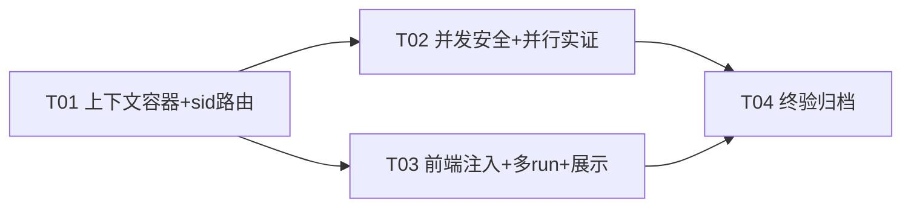

# P0-3 设计文档：并行会话与 sid 隔离方案

- 日期：2026-10-31
- 作者：架构师（software-architect）
- 输入：交接报告 §9 P0-3 + §4、P0-2 存储结论文档、现状代码复核（`runtime.js` / `registry.js` / `routes/jsapi.js` / `app.js` / `index.js` / 服务层 currentSid 全部消费点 / `frontend/src/core/bridge.js` / `agent/run-controller.js` / `agent/tool-executor.js` / `sessions/controller.js`）
- 交付对象：工程师（寇豆码）；裁决项待 team-lead 签核（§9）
- 红线遵守：`API_VERSION` 冻结、`get_api_info` 零改动、`config.json` 零污染、不碰 `harbor.html` **构建产物**（`frontend/src/` 源码可改，`build:all` 幂等验证）、不启动 dist、`backend/` 零改动、真实 `~/.glm-chat` 零污染、设计非实现（代码片段 ≤30 行）
- 核心兼容性发现（设计支点）：前端 `tool-executor.js:12` **在每次工具调用前 `set_current_sid`**，但**真正的调用载荷（`callApi(name, argsArray)`）不带 sid**——并行化不能依赖「先 set 后调」的时序（A.set(A)→B.set(B)→A.call 即串扰），必须做**请求级 sid 路由**；而该既有模式也证明：前端拥有每次调用时的 run 会话标识，注入成本极低。

---

## 1. 现状盘点：全局态依赖图

### 1.1 调用链现状（无 sid 载荷）

```text
前端 run-controller（run{ id, sessionId }）
  └─ tool-executor.executeToolRaw(name,args)
       ① callApi('set_current_sid',[currentSessionId])   ← 全局写入（竞态源）
       ② guardCheckTool → confirm token（全局护栏态）
       ③ callApi(name,args) ──HTTP──► POST /jsapi/<method> {args:[…]}（无 sid）
                                        └─ registry.invoke → 服务层读 runtime.currentSid
```

### 1.2 全局态消费点清单（源码实测）

| 全局态 | 位置 | 消费点 | 并行化分类 |
|---|---|---|---|
| `runtime.currentSid`（进程级单值） | `runtime.js` | `commands.js:143`（执行 cwd）、`jail.js:20/51`（路径监狱/短路径缺省 sid）、`plans.js:166/252`、`provider.js:331/386/387`（ws_enabled/system prompt/tools）、`software.js:377`、`worklog.js:36/40`、`workspace.js:34/66/160/182/227`、`guard.js:371/565`（会话信任）、`misc.js:96`（审计 identity.sid） | **改为请求上下文读取**（§2） |
| `runtime.cwd`（全局 cwd） | `runtime.js` | `effectiveRoot` 的回退根 | 全局保留为 legacy 默认；header 请求走 per-sid 覆盖（§3.3） |
| `runtime.sessionWs`（per-sid 绑定表） | `runtime.js` | `effectiveRoot(sid)` | **天然 per-sid，保留** |
| `trustedSid`+`sessionTrust`（单值+Set，切会话清空） | `guard.js:371-373,565` | 会话信任判定 | **per-sid Map**；global 路径保留 clear-on-switch（零翻转） |
| `grant`（单值任务授权） | `guard.js` | 授权覆盖判定 | **per-sid Map** |
| `approvalUsed/approvalEscalated`（审批计数） | `guard.js` | 预算判定 | **per-sid Map**（Python 注释即「会话级」语义） |
| `recent`（命令去重窗口，`${shell}:${cmd}` 键） | `commands.js` | 去重拒绝；`begin_task` 重置 | **per-sid 键命名空间** |
| `cursor`（浏览器游标会话） | `browser.js` | extract/click/fill/screenshot 作用于最近导航 | **per-sid Map**；池本身全局共享（上限 3 不变） |
| `tokens`（一次性 confirm token） | `guard.js` | 消费校验 | **全局保留**（单用即毁天然安全） |
| `textCache`/file 指纹/toolcache | `files.js` | read_more/unchanged | **全局保留**（内容寻址、只读、无副作用） |
| Prisma DB / 配置 JSON / audit_log / memory.json / MCP 客户端池 | 各服务 | 共享数据与设置 | **全局共享（本就该共享）** |

---

## 2. 目标架构：请求级会话上下文（AsyncLocalStorage）

```text
POST /jsapi/<method>
  │  headers: x-harbor-sid: <sid>（可选——缺省=legacy 路径）
  ▼
jsapi 路由：ctx = resolveContext(request)
  ├─ 有 header → { sid: headerSid, explicitSid: true }
  └─ 无 header → { sid: runtime.currentSid（请求时读全局）, explicitSid: false }
  ▼
als.run(ctx, () => invoke(method, args))     ← 每个 HTTP 请求的异步链独立持有 ctx
  ▼
服务层统一访问器（session-context.js）：
  ctxSid()   = als.getStore()?.sid ?? runtime.currentSid   // 缺省与现状逐字节一致
  ctxExplicit()= als.getStore()?.explicitSid ?? false
```

**为什么选 ALS 而非「逐函数传 sid 参」**：js_api 145 方法的签名与响应形状冻结——不能给服务函数加 sid 参数（registry 签名面变动会破坏 `contract-signatures` 契约门）。ALS 使 sid 路由**完全发生在运行时层**，对外 API 形状零变化。Node 27 原生 `async_hooks` 支持，无新增依赖。

**新文件 `server/src/session-context.js`**：ALS 实例 + `resolveContext(request)` + `ctxSid()/ctxExplicit()/ctxCwd()` 访问器 + per-sid 状态容器的注册/清理接口。服务层改造点 = §1.2 表中 ~15 处 `runtime.currentSid` 直读 → `ctxSid()`（**单点收口**；并加一条回归 lint/测试断言：禁止 `runtime.currentSid` 在服务层被直接读取（runtime.js/session-context.js 除外），防新代码绕过）。

### 2.1 每会话上下文生命周期

- **创建**：首个带 sid 的请求到达即建（懒初始化，无预注册表——per-sid 状态容器随取随建）。
- **活跃**：同一 sid 的多个请求各自 ALS 独立，但共享该 sid 的状态容器（trust/grant/dedup/cwd/cursor——同一会话内状态连续，正确语义）。
- **清理**：`session_purge(sid)` 挂接清理该 sid 的全部容器项（trust/grant/budget/dedup/sessionCwds/cursor）；进程级 LRU 上限（如 200 sid）防长期驻留泄漏（上限内不驱逐活跃 run 的 sid）。
- **持久化**：`harbor-node-runtime.json` 结构不变（currentSid/cwd/sessionWs——全局默认三键）；**per-sid 易变容器不持久化**（与 Python 一致：trust/grant/dedup 本就进程级易失态）；sessionCwds 若需重启保留，并入 runtime.json 增键 `sessionCwds`（独立文件、不碰 config.json，向后兼容缺省 `{}`）。

---

## 3. sid 路由与 API 兼容策略（核心）

### 3.1 路由规则

| 调用形态 | 上下文解析 | 行为 |
|---|---|---|
| `X-Harbor-Sid: s1` 头 | `{sid:'s1', explicitSid:true}` | 全部服务读 s1 的上下文；**不触碰全局 activeSid** |
| 无头（legacy 前端/pywebview 现状） | `{sid:runtime.currentSid, explicitSid:false}` | **与现状逐字节一致** |
| `set_current_sid(sid)`（API 本身） | 设置全局 activeSid | 响应 `'{"ok":true}'` 不变；语义=「设置**默认（活跃）会话**」——供无头调用回落；**不得影响已 pin 的 header 请求上下文** |
| `set_current_sid` 触发切会话 | 全局路径 | **保留 legacy clear-on-switch**（清空旧 sid 的会话信任项——P0-1 差分相关语义零翻转） |

优先级：**header 永远优先于全局 activeSid**；header 请求的 `set_current_sid` 仍只写全局（它本来就是全局语义的方法），不 retroactively 改本请求 ctx（ALS 已 pin）。

### 3.2 get/set_current_sid 的兼容语义

- `set_current_sid`：形状与返回值不变；语义精化为「设置默认上下文」（前端活跃会话切换的既有用途不变）。
- 无 `get_current_sid` 方法（145 面中无此方法）——自省经 `get_effective_ws`（返回 `{sid,ws,source,exists}`）：**header 请求下返回该请求 sid**（自省与路由一致）；无头时返回全局 sid（现状）。
- 全局 activeSid 永久保留（契约方法存在即需语义），**不废弃**——它是 legacy 客户端的唯一上下文机制。

### 3.3 cwd/set_workspace 的兼容语义

- `effectiveRoot(sid)` 解析序：`sessionWs[sid]`（显式绑定，per-sid 全局表）→ `sessionCwds.get(sid)`（**仅 explicitSid 请求**的 set_workspace 覆盖）→ 全局 `runtime.cwd`（现状回退）。
- `set_workspace(path)`：**无头调用=写全局 cwd**（现状）；**header 调用=写该 sid 的 sessionCwds**（不污染其他会话的全局 cwd）。
- 单会话默认路径下此分支永不触发差异（无头=纯 legacy 行为）。

### 3.4 增强的边界（不产生新 intentional 登记）

并行能力 = Node 增强，超出 Python 串行语义——**不属于 145 方法差分面**（Python 无并行对应物）。判定依据：单会话默认路径响应逐字节不变（§6 纪律保证），并行面正确性由 Node 侧 `parallel.mjs` 实证（§5/§6）而非跨语言对拍。`uncovered.json`/结论文档中注明该边界即可，**无需新增登记**。

---

## 4. 前端多任务状态展示

### 4.1 改造点（`frontend/src/` 源码；构建产物 `harbor.html` 由 `build:all` 幂等再生）

| 文件 | 改造 |
|---|---|
| `core/bridge.js` | `callApiHttp` 增加 `x-harbor-sid` 头：值=**当前 run 的 sessionId**（run-controller 暴露 `getActiveRunSid()`）；无 run 的 UI 调用（设置/列表）**不带 header**（保持全局语义） |
| `agent/tool-executor.js` | HTTP 路径下**移除每次调用前的 `set_current_sid`**（由 header 取代——消除 A/B 竞态源）；pywebview 路径保持现状（生产链不动） |
| `agent/run-controller.js` | **多 run 实例管理**：`runs: Map<sessionId, run>` + `activeRunId` 指针；`run{ id, sessionId, status, step, … }` 既有结构复用；新增「对指定会话启动/继续 run」入口（原仅活跃会话）；run 状态写回 `session.runStatus`（既有持久化字段） |
| `sessions/controller.js` | 会话切换不再强制停他会话 run；`set_current_sid` 仍用于「活跃会话」切换（全局默认上下文语义不变） |

### 4.2 状态展示方案（建议：React 岛扩展，见 §9-Q2 待裁决）

- **会话列表项 run 徽标**：working/completed/paused/failed 四态（runStatus 既有枚举）+ 进行中步骤计数；多会话并行时各自独立展示（数据源=get_sessions 现有字段 + 前端 runs Map 实时态）。
- **多任务状态面板（React 岛）**：并发 run 列表（每 run：会话名/状态/当前工具/耗时/停止按钮）；数据来自 run-controller 的 runs Map（**不新增 js_api 方法**——run 状态是前端本地运行时态，后端无 agent loop）。
- legacy 主区交互模式不变（默认单活跃会话）；并行入口=列表项「并行运行」按钮 + 面板汇总。

---

## 5. 隔离正确性设计

### 5.1 状态隔离矩阵（实现级）

| 状态 | 改造 | 并行保证 |
|---|---|---|
| 会话信任 | `sessionTrust: Map<sid,Set<op>>`；`guardSessionTrust/guardCheck` 读 `ctxSid()` 键 | A 的信任永不命中 B；global 切换保留 clear-on-switch（§3.1） |
| 任务授权 grant | `grants: Map<sid,grant>`；status/revoke 按 ctxSid | 授权互不覆盖 |
| 审批预算 | `approvalUsed/Escalated: Map<sid,…>` | 计数独立（Python「会话级」语义落地） |
| 命令去重 | `recent` 键改 `${ctxSid()}:${shell}:${cmd}`；`begin_task` 只清当前 sid 项 | A 的「与上一条相同」不拒 B |
| 工作区根 | §3.3 解析序 + per-sid sessionCwds | 两会话各自 cwd/绑定根 |
| 浏览器游标 | `cursors: Map<sid,sessionId>`；池全局（上限 3、驱逐最旧空闲——共享资源口径不变） | A 的 extract 不落到 B 的页面 |
| 一次性 token | 全局 Map（单用即毁） | 天然安全 |
| 审计 | `identity.sid=ctxSid()` | 条目归属正确，共享日志文件 append-only |

### 5.2 共享资源并发安全

- **Prisma/libsql**：单写者由驱动串行；`save_sessions` 全量覆盖语义在事务内（现状）。并行下两会话各自 save_sessions（各含自己会话条目数组）——**遗留风险**：save_sessions 是「全量覆盖」语义（不在列表中的条目删除）！若 A 的列表只含 A 会话，B 的列表只含 B 会话，A/B 交替 save 会互相删除对方条目。**处置**：前端 save_sessions 的载荷=**全量会话数组**（现状即如此——前端 sessions 集合是全局列表，非按 run 切片），并行 run 只改自己 run 的状态字段后仍提交全量数组（run-controller 现状语义保持）。**设计约束写入共享知识：并行 run 不得对 sessions 做局部切片保存**；后端 save_sessions 语义不变。
- **文件系统（per-root 写互斥）**：`withRootLock(root, fn)`——promise-chain 互斥（Map<root,tailPromise>），包裹 `write_file/append_file/search_replace/make_dir/delete_path/move_path/copy_path/save_workspace_file/copy_into_ws`。这把 Python「写文件串行」硬规则从**进程级**精化为**工作区级**：同 root 写操作串行（不撕裂），跨 root 并行。命令执行（run_command 等）不加锁（各自子进程，与 Python 语义一致）。
- **MCP**：客户端池共享（server 级资源）；工具 tier 全局配置；调用按 requestId 并发（SDK 原生支持）；护栏 trust 按 sid（§5.1）。
- **读操作**（read_file/list_dir/get_sessions 等）不加锁（只读安全；文件指纹/内容缓存只读）。

### 5.3 并行实证（新测试组 `server/test/parallel.mjs`，不占差分面）

1. **交错隔离**：A/B header 交替 set_workspace/get_cwd/get_effective_ws/get_ws_state——各自目录与 recent；A.guard_session_trust 后 B.guard_check 不命中信任；A.run_command×2 去重拒绝、B.run_command 同命令不拒（per-sid dedup）。
2. **写互斥**：同 root 两会话并发 `write_file` 同一文件 50 次——最终文件为某次完整写入（无撕裂字节），且 per-root 锁等待发生。
3. **legacy 混用**：无头调用走全局 activeSid（set_current_sid 切换生效），与 header 调用互不污染。
4. **purge 清理**：session_purge(sid) 后该 sid 的 trust/grant/dedup/sessionCwds/cursor 全清；其他 sid 不受影响。
5. **差分零翻转**：`npm run diff:all` 全量（无头路径）作为每批验收底线。

---

## 6. 迁移与兼容（差分零翻转的实现纪律）

1. **默认上下文 = 请求时读全局 activeSid**：无头路径的每一次调用与现状逐字节一致（差分 275 call 为回归底线）。
2. **per-sid Map 的单会话等价**：单 sid 时 Map.get(sid) 行为与原单值变量一致；clear-on-switch 仅发生在全局 `set_current_sid`（legacy 语义原样保留）。
3. **访问器单点收口 + 防回归断言**：所有 `runtime.currentSid` 服务层直读收口到 `ctxSid()`；新增静态检查（grep 断言/简单 lint）：`services/**` 不得再出现 `runtime.currentSid` 直读（除注释）。
4. **金丝雀**：`fixed-shape-canary.json` 维持全 match；新增 1 个「默认上下文等价」自检 fixture（无头序列混合 set_current_sid/get_effective_ws/guard trust/dedup——验证旧语义原样）。
5. **响应形状零新增字段**：并行能力不往任何 js_api 响应里加键（sid 路由是传输层 concern）；`get_effective_ws` 的 sid 字段在 header 请求下返回请求 sid（语义自省，非新增字段）。
6. **每批验收**：`npm run diff:all` 零翻转 + 16 组 Node 测试 + parallel.mjs + Python 全量 1767/0/3/1 基线（零改动只读回归）+ 真实 `~/.glm-chat` 指纹不变。

---

## 7. 任务分解（4 任务；每批验收 = 差分零翻转 + 双语言回归 + 并行正确性实证）

### T01：上下文容器与 sid 路由基建

- **文件**：`server/src/session-context.js`（ALS + resolveContext + 访问器 + per-sid 容器与清理接口，新建）、`server/src/routes/jsapi.js`（header 解析 + als.run 包裹 invoke）、`server/src/runtime.js`（保留全局默认三键 + sessionCwds 兼容读取）、`server/src/services/{guard,commands,workspace,browser,worklog,misc,jail,plans,provider,software}.js`（~15 处 currentSid 直读 → ctxSid() + per-sid Map 改造）、`server/test/guard.mjs` + `server/test/state-services.mjs`（单会话语义不变回归）
- **依赖**：无
- **验收**：①`npm run diff:all` 零翻转（无头路径逐字节）；②per-sid Map 单测（trust/grant/dedup/cwd/cursor 隔离）；③防回归静态断言（服务层无 currentSid 直读）；④16 组测试全绿（允许断言更新仅限并行新增语义——单会话面不允许动）

### T02：共享资源并发安全 + 并行实证

- **文件**：`server/src/session-context.js`（withRootLock 实现）、`server/src/services/files.js` + `workspace.js`（写操作接锁）、`server/src/services/provider.js`（sessionPurge 挂接 per-sid 清理）、`server/test/parallel.mjs`（§5.3 五组实证新建）、`server/package.json`（`test:parallel` script）
- **依赖**：T01
- **验收**：①parallel.mjs 五组实证全过（交错隔离/写互斥无撕裂/legacy 混用/purge 清理）；②并发写压测（同文件 50 次并发写）内容完整；③`npm run diff:all` 零翻转维持；④全量 Node 测试 + parallel 组全绿

### T03：前端 sid 注入与多 run + 状态展示

- **文件**：`frontend/src/core/bridge.js`（x-harbor-sid 注入）、`frontend/src/agent/tool-executor.js`（HTTP 路径去全局 set_current_sid）、`frontend/src/agent/run-controller.js`（多 run Map + 并行启动入口 + run 状态回写）、`frontend/src/sessions/controller.js`（活跃切换与 run 解耦）、React 岛会话列表/多任务面板组件（`frontend/src/` 或 agent-ui 对应工程——按 Q2 裁决落点）、`server/test/parallel.mjs`（补端到端用例——注入 bridge 语义模拟）、`package.json`（build:all 幂等验证）
- **依赖**：T01（后端路由）；可与 T02 并行（代码面独立）
- **验收**：①并行 run 端到端（两会话同时 run：各自工具调用落在各自工作区——用 Node 后端 + 模拟前端调用序列实证）；②`npm run build:all` 幂等（harbor.html SHA256 变化仅限预期源码改动 diff，构建可复现）；③单 run 使用习惯零变化（活跃会话默认路径回归）；④run 状态四态展示与 sessions.runStatus 持久化一致

### T04：终验与结论归档

- **文件**：`deliverables/dev-plan/p0-3-parallel-sid-conclusions-<日期>.md`（架构定稿 + 兼容语义表 + 并行实证证据 + P0-4 交接累积）、`tools/diff/fixtures/selftest/`（默认上下文等价金丝雀 1 个）、`tools/diff/uncovered.json`（并行面边界注明——非差分面增强，无需登记）
- **依赖**：T01–T03
- **验收**：①差分全量两次复跑零翻转（suspect=0 维持）；②coverage exit 0；③parallel.mjs + 16 组全绿；④Python 1767/0/3/1 基线；⑤真实指纹不变；⑥结论文档含「并行=Node 增强非契约差异」的判定与前端兼容论证（P0-4 切换复核点）

### 依赖图



**回滚策略**：T01–T02 为纯运行时增量（header 缺省即旧行为），任一批次回滚=移除 header 路由与 per-sid Map 即回单值全局（git revert 单批）；T03 前端独立 revert；默认路径始终可走旧行为，无不可逆迁移。

---

## 8. 风险与回滚（全局态改造特有）

| # | 风险 | 对策 |
|---|---|---|
| R1 | **上下文串扰**（ALS 泄漏/服务绕过访问器直读全局） | 单点收口 + 静态防回归断言 + 交错实证 + code review 清单（§1.2 消费点全表） |
| R2 | 旧调用兼容破坏（无头路径行为漂移） | 默认上下文=请求时全局读 + 差分 275 call 逐字节兜底 + clear-on-switch 保留 |
| R3 | per-sid 容器内存泄漏（长期多 sid 驻留） | session_purge 挂接清理 + LRU 上限（200，护活跃 run）+ 易失态不持久化 |
| R4 | **save_sessions 全量覆盖语义下的并行互相删除** | 共享知识硬约束：前端恒提交全量会话数组（现状语义），禁止按 run 切片保存；parallel.mjs 增「A/B 交替 save 全量数组不丢条目」用例 |
| R5 | 写互斥死锁/长队列 | 单操作粒度非重入锁（无嵌套获取）；锁仅包文件写工具（不含长命令）；队列有界于在途请求 |
| R6 | header 与全局 set_current_sid 混用语义混乱 | 规则文档化：header 优先、set_current_sid 只写全局默认、不影响已 pin 请求；混用用例入 parallel.mjs |
| R7 | 浏览器池全局上限 3 在并行下互相驱逐 | 现状共享口径保留（资源保护）；cursor per-sid 隔离游标语义；如需扩容见 Q4 |
| R8 | 前端多 run 状态错乱（runStatus 回写竞态） | run-controller 以 run.id 为唯一写者（每 run 只写自己 session 的状态字段）；save 全量数组纪律（R4） |
| R9 | pywebview 生产链被误改 | 前端改造仅 HTTP 路径；pywebview 路径逐行保留（现状生产）+ backend/ 零改动 |

---

## 9. 待明确事项（需 team-lead / 用户决策）

1. **Q1 并行范围**：建议本批=**agent run 工具面并行 + 会话绑定态隔离**（cwd/trust/grant/dedup/cursor/browser cursor），UI/设置/配置面保持全局（用户级设置天然单例）。是否同意，还是要求「全部 API 并行」（含设置面——语义需另议）？
2. **Q2 前端展示落点**：建议 **React 岛扩展**（会话列表 run 徽标 + 多任务面板）承担并行状态展示，legacy 主区交互不变。备选=legacy 源码同步改造（工作量更大但单轨）。请裁决落点（frontend/src 岛 or agent-ui 工程）。
3. **Q3 set_workspace 在 header 请求下写 per-sid cwd**（§3.3）：确认「header 请求的工作区切换只影响本会话」语义——这是并行正确性的必要语义变化（无头路径不受影响）。若担心前端既有「set_workspace 即全局」的消费预期，需逐点核对 React/legacy 调用方（已列入 T03 验收）。
4. **Q4 浏览器池上限**：并行会话增多后，全局池上限 3 是否提高（如 5）？建议本批保持 3（资源保护 + 驱逐语义已验证），后续按真机并行体验评估。
5. **Q5 并行 run 的 UX 入口**：建议默认保持单活跃会话习惯，显式「并行运行」入口开启多 run（不默认全并行——避免用户无感触发多 Agent 同时写盘）。确认交互口径。
6. **Q6 全局 activeSid 的长期角色**：建议永久保留为 legacy 默认上下文（契约方法不废弃），header 成为并行客户端首选。确认。

---

## 附录：P0-4 交接累积（本轮新增）

- 桌面 Electron 化后，并行 run 的 UI 展示与 admin 对话框/浏览器窗口的会话归属（哪个会话的确认弹窗）需按 sid 路由到对应窗口——P0-4 窗口管理设计输入。
- 差分 harness 的并行面扩展（如需）：driver 支持 `X-Harbor-Sid` 注入后可做「并行增强面的双版本回归」（Python 侧无并行对应物——仅 Node 侧 parallel.mjs 实证，边界已注明）。
- pywebview 生产链（P0-4 前）保持串行语义不变——并行能力仅在 Node 后端路径生效。
