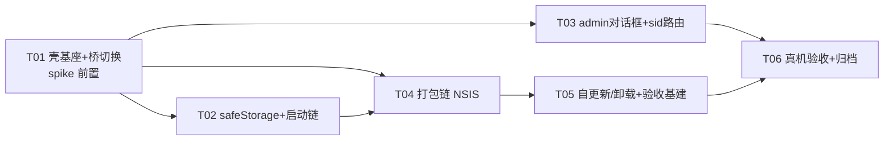

# P0-4 设计文档：桌面桥（Electron）切换、打包链与真机验收

- 日期：2026-10-31
- 作者：架构师（software-architect）
- 输入：P0-1/P0-1c/P0-2/P0-3 四份结论文档的 P0-4 交接累积、`tools/diff/uncovered.json`（C 类环境绑定登记）、`macos-browser-plan-2026-10-21.md`（M8.5/M8.8/M9 边界）、现状代码只读复核（`main.py`、`backend/api.py`、`backend/application/native_ui.py`、`backend/domains/integrations/browser/{driver,win_capture,session_win}.py`、`backend/domains/workspace/cmd_service.py`、`server/src/{index,app,runtime,config,paths,db}.js`、`server/src/services/{dpapi,dpapi-migrate,update,browser,commands,system,provider,expert-builtin}.js`、`server/src/routes/jsapi.js`、`frontend/src/core/bridge.js`、`frontend/src/agent/tool-executor.js`、`frontend/src/integrations/{mcp-exec,browser-driver}.js`、`package.json`、`server/package.json`、`Harbor.spec`、`Harbor-mac.spec`、`installer/{Harbor-Setup.spec,installer_core.py}`、`requirements-win.txt`、`tools/diff/diff-config.json`、`开发说明.txt`、`KNOWN_ISSUES.md`）
- 交付对象：工程师（寇豆码）；裁决项待 team-lead 签核（§10 Q 清单——**不可逆决策全部列入 Q，本方案不自行拍板**）
- 红线遵守：`API_VERSION='v1.0.0'` 冻结（P0-4 **零新增 js_api 方法**）；`get_api_info` 逐字节零漂移（新增桌面桥接面一律走 `_V12_EXTRA` 隐身登记——本方案设计为无需新增）；`config.json` 零污染（桌面壳配置独立文件）；工具 schema strict 不触碰；页面内容 UNTRUSTED DATA 经 provenance 包裹（`server/src/services/browser.js` 已内建，切换不新增裸注入路径）；`harbor.html` 仅 `build:all` 幂等再生；`dist/` 不启动不手改；真实 `~/.glm-chat` 零污染（一切产物级回归走隔离 CONFIG_DIR）；设计非实现（代码片段 ≤30 行）

---

## 0. 背景与目标

P0 序列前三阶段已完成 Node 后端的**契约对等**（P0-1/P0-1c：145 方法差分 suspect=0）、**存储统一**（P0-2：Prisma 唯一运行时数据源 + DPAPI 字段加密 + bootstrap 迁移器）与**并行隔离**（P0-3：请求级 sid 路由 + 多 run 实证）。但生产链仍是 Python/pywebview：并行能力、safeStorage、存储统一在生产上全部不生效。

P0-4 目标：
1. **生产链切换**：Electron 主进程 + Node 后端全面接管桌面生产链（形态裁决见 Q1/Q2）；
2. **激活 P0-2 预埋**：DPAPI 路径 1（Electron safeStorage）接线启用；bootstrap 存储迁移随桌面切换正式生效；
3. **补齐唯一功能缺口**：admin 人审对话框接线（Node 侧现为 fail-closed 桩）+ 并行 run 的窗口 sid 路由；
4. **打包链与发布面**：Electron 产物打包、自更新/卸载/升级路径；
5. **真机验收**：C 类环境绑定方法正向验收 + 分层回归执行矩阵。

设计支点（现状复核发现）：前端桥 `bridge.js` 已是**双后端桥**——`window.pywebview.api` 存在走 pywebview，否则走 `HARBOR_API_BASE` HTTP。生产链切换对前端而言是**一次 preload 注入**，不是前端改造。

---

## 1. 现状盘点

### 1.1 双链现状

| 维度 | Python 生产链（现状） | Node 后端（P0-1~P0-3 已就绪） |
|---|---|---|
| 入口 | `main.py`（pywebview，webview 延迟导入，WebView2 前台化补丁，搜索次窗，GLM_CDP_PORT seam） | `server/src/index.js`（fastify loopback，listen 后挂 bootstrap 迁移后台链） |
| 契约面 | `backend/api.py` 1544 行，145 方法，`_V12_EXTRA` 隐身 | registry 全量迁移，差分 279 call / match=268 / intentional=11 / suspect=0 |
| 窗口 | pywebview 主窗 1180×800 + 隐藏搜索次窗 | 无（HTTP 服务，无壳） |
| 存储 | sessions.json 原文 + 独立 JSON | Prisma/libsql + 物化导出 + bootstrap merge 导入器 |
| DPAPI | `mcp_dpapi.py`（ctypes CryptProtectData） | `dpapi.js`（PS .NET ProtectedData 主路径；**Electron safeStorage 分支已预埋未激活**） |
| 并行 | 串行（全局 currentSid） | 请求级 sid 路由 + per-sid 容器 + parallel.mjs 11/11 实证 |
| admin 人审 | ctypes `MessageBoxW`（cmd_service.py:366-397，无限期阻塞） | **fail-closed 桩**（commands.js:194-203 注释即「生产：P0-4 接 Electron 对话框」） |
| 打包 | PyInstaller onefile（Harbor.spec）+ PyInstaller 安装器（NSIS 语义自实现，HKCU 卸载键） | 无打包链 |
| 浏览器六原语 | pywebview 次窗通道 + win32 PrintWindow 捕获（win_capture.py） | playwright-core + 系统 Edge/Chrome 发现（edgePath()）+ page.screenshot |

### 1.2 Python↔Node 依赖面盘点（切换边界的核心事实）

逐个盘点「backend/ 里哪些东西仍被 Node 侧依赖」，**这是本方案最重要的结论**：

| backend/ 资产 | Node 侧消费点 | 消费性质 | 切换处置 |
|---|---|---|---|
| `backend/api.py` | `server/test/contract-coverage.mjs` **源码正则解析方法名**；`tools/diff/extract_rpc_defaults.py` AST 提取默认值表；差分 harness Python 驱动的契约基准 | dev/test 期**契约唯一事实源** | **永久保留**（不能删——删了契约门与差分面即失锚） |
| `backend/prompts/` | `server/src/services/provider.js:19` `PROMPTS_DIR = <PROJECT_ROOT>/backend/prompts` | **Node 运行时资产**（build_system_prompt/prompt_get 直读） | 保留并**随 Electron 产物分发** |
| `backend/experts_builtin/`（8 内置专家包） | `server/src/services/expert-builtin.js:25` `DEFAULT_BUILTIN_DIR = <root>/backend/experts_builtin`（`HARBOR_BUILTIN_EXPERTS_DIR` 已 env 化） | **Node 运行时资产** | 保留并**随 Electron 产物分发**（或经 env 指向产物内拷贝） |
| `backend/domains/integrations/browser/`（driver/win_capture/session_win 等） | **无**——Node 侧 `services/browser.js` 用 playwright-core 独立实现全部六原语+search+takeover，截图走 `page.screenshot`（非 win32 窗口捕获） | 无运行时依赖；差分 harness 的 Python A 侧实现 | 保留为**差分 heritage**（不随产物分发） |
| `backend/application/native_ui.py` + `cmd_service.py` MessageBox | **无**——Node 无窗口亲和分发；admin 人审为 fail-closed 桩；`ui_nudge` 有简化实现（provider.js uiNudge） | 无运行时依赖 | Python 实现保留为 heritage；**Electron 侧等价物是 P0-4 唯一功能级接线点** |
| `backend/` 其余 Python 运行时实现（application/domains/services/…）+ `main.py` | 无——145 方法 Node 全量对等 | 差分 A 侧 + 1767 pytest 基线的被测体 | 保留为 **dev 期回归资产**（退役另裁，见 Q6） |
| `VERSION` | `server/src/services/update.js` appVersion() 读 ROOT/VERSION | Node 运行时资产 | 随产物分发（asar 根） |
| `tools/diff/` Python 侧 + `tests/`（1767 基线） | `diff-config.json pythonBin` 指向**外部 vendored Python**（`~/.workbuddy/binaries/python/...`） | dev 期回归工具 | 保留；**差分 harness 是迁移工具，不构成生产运行时依赖** |
| vendored Python 3.13 | 打包构建（PyInstaller 必须用 3.13——cp313 依赖，3.15 启动即崩历史教训）+ 差分 pythonBin + pytest | **构建期 + dev 期** | 生产打包不再需要（Electron 自带运行时）；dev 回归继续用（Q6） |

**推论**：「Python 运行时退役」≠「backend/ 目录删除」。退役的是 *pywebview+backend 运行时代码路径*；`backend/api.py`（契约源）、`backend/prompts/`、`backend/experts_builtin/`、`VERSION` 是 Node 路径的**活资产**，必须保留并随产物分发。

### 1.3 打包链现状

- `Harbor.spec`：PyInstaller onefile，datas=harbor.html/libs/VERSION/prompts/experts_builtin，hiddenimports=pywebview+pythonnet/clr 链，excludes pywin32 族（3.13 构建环境硬约束）。
- `installer/Harbor-Setup.spec`：同一 spec 双构建（`HARBOR_BUILD=setup|uninstaller`）；setup 内嵌 payload/Harbor.exe + 卸载器，**载荷 sha256 随包强校验**。
- `installer/installer_core.py`：每用户装 `%LOCALAPPDATA%\Programs\Harbor`（无 UAC）、开始菜单快捷方式、HKCU 卸载键（NoModify/NoRepair）、`uninstall(purge_data=False)` **默认保留 ~/.glm-chat**。
- `dist/`：Harbor-Setup-1.9.0.exe / Harbor-Uninstall.exe / Harbor.exe（**恒冻结，不启动不手改**）。
- 遗留风险（KNOWN_ISSUES #6/#7）：PyInstaller onefile 杀软误报；无 WebView2 Runtime 的旧 Win10 无法启动（Electron 自带 Chromium 后 #7 自然消除，#6 误报面变化——见 R6）。

### 1.4 回归资产现状（验收矩阵的原料）

- 差分：`npm run diff:all`（29 fixtures / 279 calls / suspect=0 门禁）+ `diff:coverage` exit 0（139/145 + uncovered 13）；harness 双侧驱动=外部 pythonBin（Python）+ node-driver（源码树 `app.inject`）。
- Node：17 组测试 + `parallel.mjs` 11/11。
- Python：1767/0/3/1 基线（`CODEBUDDY_SAFE_DELETE_ENABLED=0` + tests/ 限定 + 独立 basetemp + 静默串行 + deselect 安装器）。
- 前端：`build:all` 幂等（harbor.html SHA256 可复现）。

---

## 2. 方案设计（一）：生产链切换形态

### 2.1 三形态对比（建议 A，Q1 裁定）

| 形态 | 内容 | 利 | 弊 |
|---|---|---|---|
| **A. Electron 主进程 + Node 后端全面接管**（建议） | Electron 壳承载 harbor.html；server（fastify）运行于 Electron 宿主（拓扑子选项见 §2.2）；pywebview 生产链停发 | 契约已对等（suspect=0）；并行/存储统一/safeStorage 全部落地；单链消除双侧实现税；WebView2 依赖与「无 Runtime 无法启动」问题消失 | 换壳一次性工程量；新打包链（Q3）；Electron 包体 ↑ |
| B. pywebview 保留 + Electron 仅壳 | 不成立——两套窗口系统叠加，pywebview 链无 Node 后端服务能力 | 无 | 语义矛盾，无收益 |
| C. 双链并存灰度 | 安装包双轨，用户自选 | 回退保险 | 存储双数据源问题永久化（sessions.json vs DB）；并行在生产不生效；每次契约变更双侧实现+差分（差分是迁移工具，不该是永久架构税） |

**A 的回退保险不靠双链并存**，靠三件事：①Python 链代码与打包链**冻结不删**；②数据面双向兼容——Node 侧 bootstrap merge 幂等导入 + `materializeSessions` 物化导出（P0-2 机制直接复用），Python 链可从 sessions.json 完整恢复；③发布面可回退（旧 Setup 可重装，`~/.glm-chat` 卸载不删——installer_core 既有语义）。

### 2.2 服务宿主拓扑（A 内部子选项，Q2 裁定 + spike 前置）

| 选项 | 拓扑 | safeStorage 路径 1 | 关键约束/风险 |
|---|---|---|---|
| **A1. server 运行于 Electron 主进程**（建议） | `app.whenReady()` 后 `import('./server/src/app.js')` 起 fastify，同进程 | **零改动激活**：`process.versions.electron` 置位，`dpapi.js` 的 `import('electron')` 原生可用 | 主进程稳定性耦合（R2）；内嵌 Node 版本必须 ≥ 实测验证基线（spike，见下） |
| A2. utilityProcess | Electron 官方 Node 子进程 + MessagePort | safeStorage 属主进程模块，子进程不可直接持有 → 需 IPC 代理改 `dpapi.js`（动 P0-2 已测代码） | 崩溃隔离好；路径 1 目标打折 |
| A3. 独立 node.exe 子进程（ELECTRON_RUN_AS_NODE） | 打包独立 Node 运行时，主进程 spawn | `ELECTRON_RUN_AS_NODE` 下 `process.versions.electron` 未定义 → 路径 1 不触发，需主进程 IPC 代理（`server/src/host.js` 接缝，§4.2 同一机制） | Node 版本完全自主（解耦 Electron 内嵌版本）；包体 +；拓扑最解耦 |

**spike 前置事实**（T01 首项验证）：`engines` 写 `>=27.0.0-alpha` 但**实跑验证基线是 v24.22.0**（17 组测试与全部差分均在 v24.22.0 上跑绿）——Electron 选型按「内嵌 Node ≥ 24.22 验证基线」而非 engines 字面。另两个 spike 点：`db.js` 直接 `import './generated/prisma/client.ts'`（依赖 Node 类型擦除，23.6+ 默认开）；`@libsql` 原生绑定在 Electron 主进程可加载。spike 不过 → 降级 A3（预授权降级路径，A1/A3 最终由 spike 结果定，Q2 追认）。

### 2.3 Electron 壳基座（A1 口径）

```js
// electron/main.js 核心时序（示意，≤30 行纪律）
app.whenReady().then(async () => {
  log safeStorage.isEncryptionAvailable()          // 路径 1 直证（先于 server 启动）
  env 注入: HARBOR_CONFIG_DIR(默认 ~/.glm-chat)、DATABASE_URL=file:<CONFIG_DIR>/harbor.db、
           HOST=127.0.0.1、PORT=0(动态端口)
  const app2 = await import('../server/src/app.js')  // server 宿主（A1）
  const port = 取 listen 实际端口
  win = new BrowserWindow({ webPreferences: { preload, contextIsolation: true, nodeIntegration: false } })
  win.loadFile('harbor.html')                       // 桥切换=preload 注入（§2.4）
})
win.on('closed', 优雅停机: mcpShutdown + browserShutdown + app.close + disconnectDb → app.quit)
```

- **单实例锁**：`app.requestSingleInstanceLock()`——防双开双 server（Python 时代 onefile 父子进程残留教训的 Electron 侧对位）。
- **弹窗面收口**：`setWindowOpenHandler(() => ({action:'deny'}))`——页面内容是 UNTRUSTED DATA，禁 `window.open` 逃逸面（与 provenance 纪律同向）。
- **资源定位**：`harbor.html`/`libs/`/`backend/prompts/`/`backend/experts_builtin/`/`VERSION` 打进 asar（原生模块 asarUnpack，R5）；`PROJECT_ROOT` 相对链在 asar 内的解析为 spike 验证项（不过则改 env 指向 `process.resourcesPath`——`HARBOR_BUILTIN_EXPERTS_DIR`/prompts 定位已 env 化或单一常量，改动面收敛）。
- **数据库锚定**：`db.js` 的 `DATABASE_URL` 相对路径按 CWD 解析（`file:./data/harbor.db` dev 缺省）——生产由主进程 env 注入绝对路径锚定 CONFIG_DIR，**db.js 零改动**。
- **pywebview 生产链冻结**：`main.py`/`backend/` Python 实现一行不改（P0-3 同款纪律）；`GLM_CDP_PORT` 的 Electron 对位=Electron 自带 `--remote-debugging-port`（无需新 seam）。

### 2.4 桥切换语义（前端零改动）

- `bridge.js` 判序：`window.pywebview.api` 存在→pywebview；否则 `HARBOR_API_BASE` 非空→HTTP（含 P0-3 的 `x-harbor-sid` 注入）。Electron 下 pywebview 永不存在——**preload 一行 `contextBridge.exposeInMainWorld('HARBOR_API_BASE', base)` 即完成切换**，前端源码零改动。
- P0-3 并行能力随之在生产生效（HTTP 路径），pywebview 串行语义随 Python 链退役自然消亡（P0-3 交接项闭合）。
- 端口动态分配（PORT=0）：preload 在 server listen 后由主进程生成（时序：server ready → 创建窗口 → 注入端口）。开发模式沿用 `HARBOR_API_BASE` env 直注（`tools/test_bridge_http.mjs` 既有范式）。

---

## 3. 方案设计（二）：safeStorage/DPAPI 路径 1 激活 + bootstrap 迁移触发

### 3.1 激活接线点

- `dpapi.js` **零改动**：`isAvailable()` 已按 `process.versions.electron` → `import('electron')` → `safeStorage.isEncryptionAvailable()` 分支；`encryptValues/decryptValues` 已含 safeStorage 加解密路径。激活条件=**宿主**：server 进程内 `process.versions.electron` 置位且 electron 模块可解析——A1 拓扑天然满足（Q2 裁定的落点即此项）。
- **时序门**：safeStorage 要求 app ready 后调用——主进程严格 `app.whenReady()` 后才起 server（§2.3 时序），`isAvailable()` 的首个探测（缓存）必然发生在 ready 后。
- **真机证据链**（路径 1 已激活的判定，PS 路径下 `dpapi_available` 同样为 true，不能仅凭诊断端点）：①主进程启动日志记录 `safeStorage.isEncryptionAvailable()` 直证；②Electron 加密产物可被 PS `.NET ProtectedData` Unprotect、可被 Python `mcp_dpapi.decrypt_value` 解（互解实证——`tools/verify-dpapi-interop.mjs` 模式，真机临时文件上，双向各 ≥1 例）；③存量场景实证：PS 路径历史密文 → Electron 首启解密读回正确（迁移路径对称性）。
- **诊断面**：`/storage/security`（P0-2 既有旁路端点，非 js_api 面）可选增一字段披露探测路径（`source: 'electron-safeStorage'|'powershell'|'unavailable'`）——**新旁路端点字段=不占契约面**，与 P0-2 立端点先例同构（是否加，随 T02 定，不强制）。

### 3.2 bootstrap 迁移触发时机

- 机制**已就绪**（`index.js:36-49`：listen 成功后后台链 `bootstrapLegacyImport`（merge 幂等）→ `migratePlaintextSecrets`）——P0-4 **零新迁移代码**，只需保证桌面生产入口走该链（A1 下 server 生命周期由 main 编排，挂接点语义不变：listen 后、不阻塞、不在 import 期——P0-2 触发纪律原样继承）。
- **触发日=切换日**：Electron 版首次生产启动即执行。并存期语义（P0-2 §4.1 已定义，原样适用）：用户回退 Python 链产生新会话→Electron 下次启动**增量 merge**（只补 DB 没有的 id，永不覆盖）；Python 链停发并完成卸载引导后无双写。
- **备份纪律原样**：`sessions.json.pre-node-migration.bak` / `webdav.json.pre-dpapi.bak` 已存在不覆盖；原文件永不删除。真实 `~/.glm-chat` 验证一律临时副本（`tools/verify-migration.mjs` 既有范式）。

---

## 4. 方案设计（三）：并行 run 的窗口管理与 sid 路由

### 4.1 窗口拓扑定案（建议单主窗，Q8 裁定）

```text
Electron 主进程
 ├─ 主窗 BrowserWindow ×1（harbor.html）
 │    ├─ 会话列表 run 徽标 + 多任务面板（P0-3 React 岛既有）
 │    ├─ guard/mcp 确认 overlay（前端已有——并行 run 各自弹出，带会话标识标注）
 │    └─ browser-driver 手动工具条（browser_set_mode visible/hidden 等）
 ├─ admin 人审：Electron 原生 dialog（§4.2）——按 sid 标注、并发排队
 └─ 浏览器窗口：Playwright 进程自有（非 Electron 窗口）——按 session_id 归属（§4.3）
```

不建议「每会话独立 BrowserWindow」（多窗状态同步、save_sessions 全量数组纪律的 UI 复杂度、P0-3 岛设计全部推翻——收益不成比例）。

### 4.2 admin 人审对话框接线（唯一功能级缺口）

- **现状**：`commands.js adminMessageBoxDecision` = seam（`HARBOR_TEST_MSGBOX`=6/7）→ 无宿主 fail-closed（注释明示 P0-4 接线）。
- **接缝设计**（拓扑无关）：新 `server/src/host.js` 暴露宿主服务注册口（`setHostDialogProvider(fn)`）；`runAdminCommand` 在人审点调用 provider；**Electron main 注册 `dialog.showMessageBox` 实现**（模态、含命令全文 + 会话标识 + 允许/拒绝）；**无宿主（dev/差分/测试环境）= fail-closed 桩原样**（不放松，R9）。A3 拓扑下 provider 实现自动换为 IPC 代理——`commands.js` 消费面不变。
- **sid 路由**：`runAdminCommand` 处于 ALS 请求上下文，`ctxSid()` 取当前会话——对话框标注会话名（title 经 DB 可查则用 title，否则短 sid）；**并发排队**：多并行 run 同时触发 admin 人审 → provider 内 Promise 队列串行弹窗（按 requestId 路由回执），杜绝「确认框与来源会话错位」。
- **契约面**：`run_admin_command` 签名/响应/dedup 语义零变化（「用户拒绝了本次管理员命令…」文案逐字保留）；seam 测试（server/test/commands.mjs）零回退；差分环境无宿主恒 fail-closed——差分零翻转天然成立。

### 4.3 浏览器窗口归属（无需 Electron 路由）

- Node 六原语的窗口是 **Playwright 自有浏览器进程**（session_id 键控，池上限 3），CAPTCHA 接管（browser_takeover）置顶对应 session 的窗口——归属关系天然按 session_id 索引，**不存在「Electron 窗口 ↔ sid」路由问题**（与 Python 时代「共享隐藏次窗」拓扑本质不同）。
- 游标 per-sid（P0-3 cursors Map）已保证「哪个会话的 extract 落到哪个会话的页面」。
- **MCP guard helpers runSid 透传**（`frontend/src/integrations/mcp-exec.js`，P0-3 登记的可选评估项）：建议本批**不做**（MCP 客户端池共享语义未变、护栏 trust/grant 已 per-sid；透传只影响「MCP 工具确认弹窗的归属标注」——overlay 内标注会话名即可覆盖主要体验）——Q9 追认。

### 4.4 确认 overlay 的 sid 标注（前端小改）

- 多并行 run 时，guard/mcp 确认 overlay 需标注来源会话（会话名徽标）——`frontend/src/` 源码小改，`build:all` 幂等再生；交互模式不变（P0-3 Q5 裁定：默认单活跃 + 显式并行入口）。
- 顺手核对既有交接残留：`browser_set_mode` 收紧确认在 React 岛的确认路径（P0-1 §四.4 登记）在真机一并验证（§6 L2）。

---

## 5. 方案设计（四）：打包链、升级与卸载

### 5.1 打包链选型（建议 electron-builder NSIS，Q3 裁定——不可逆工具链决策）

| 维度 | electron-builder（NSIS target） | 复用现有 PyInstaller 安装器链 |
|---|---|---|
| 载荷模型 | 目录产物（exe + resources）→ NSIS 标准安装 | onefile 安装器内嵌 payload——Electron 目录数百 MB，`_MEIPASS` 解压慢、内存尖峰 |
| 卸载器/HKCU 卸载键 | 自动生成（per-user 语义与 installer_core 对齐） | 现成（但载荷模型不符） |
| 自更新 | blockmap 差量 + electron-updater（可选启用） | 需自研整目录替换（update.js 单 exe 替换假设失效） |
| 工具链成本 | 新依赖、CI 配置 | 零新增，但两处重写（载荷、apply）+ 长期维护 PyInstaller-装机器 |

**建议**：electron-builder 产 NSIS per-user 安装器（装 `%LOCALAPPDATA%\Programs\Harbor` 同位）；产物输出**独立目录 `dist-electron/`**（`dist/` 恒冻结）；Python 打包链（Harbor.spec / installer/）**冻结不删**（回退发布面，Q6 联动）。

### 5.2 vendored Python 去留

- **生产打包**：不再需要（Electron 自带 Chromium + Node 运行时；server 随 asar 分发）——「构建必须 vendor 3.13」约束随 PyInstaller 链冻结而消亡。
- **dev 回归**：继续需要（差分 pythonBin + 1767 pytest 基线 + extract_rpc_defaults）——从「生产构建依赖」降级为「开发机回归资产」，保留至差分 harness 退役（Q6 边界）。

### 5.3 自更新路径（Q4 裁定）

- 现状：`update.js applyUpdate` 假设 `process.pkg`/`HARBOR_FROZEN_EXE` 单 exe 自替换——**Electron 下失效**（exe≠应用整体，asar 在 resources 内）。
- **建议本批**：check/download（sha256 校验链不动）→ `applyUpdate` Electron 分支=**拉起已校验的 Setup 安装包静默安装（/S）→ 退出**；manifest 契约 `{version,url,sha256,notes}` 不变（url 指向 Setup）。NSIS 覆盖安装的原子性 + 现有 sentinel/bat 思路保留为回退记录。
- electron-updater 差量更新=后续可选增强（本批不引入，避免一次吃两个新机制）。

### 5.4 卸载与旧版共存（Q5 裁定）

- NSIS 卸载器：删安装目录 + 自身卸载键；`~/.glm-chat` 保留（对齐 installer_core `purge_data=False` 语义）。
- 旧版共存：同位安装（%LOCALAPPDATA%\Programs\Harbor）覆盖后，旧 HKCU 卸载键指向已不存在的 Harbor-Uninstall.exe 成为死键——建议 NSIS 安装器**检测旧卸载键并清理**（或发布说明引导先卸旧版），二选一见 Q5。

---

## 6. 验收口径（真机执行矩阵）

### 6.0 总则

- **打包前（L0）在源码树**；**打包后（L1-L3）在产物**；产物级一切回归走隔离 CONFIG_DIR（`HARBOR_CONFIG_DIR`/`DATABASE_URL` env 直通 + `HARBOR_HEADLESS` server-only 入口——见 6.5 与 Q10），**真实 `~/.glm-chat` 零污染**（指纹前后比对，P0-2 口径 4196 文件清单 hash）。
- 门禁数字沿用三阶段既定口径：diff 29/279 suspect=0、coverage exit 0、Node 17 组 + parallel 11、Python 1767/0/3/1。

### 6.1 分层矩阵

| 层 | 环境 | 内容 | 门禁 |
|---|---|---|---|
| **L0 打包前** | 源码树（开发机） | `diff:all` ×2 零翻转；`diff:coverage` exit 0；17 组 + parallel.mjs；Python 基线；`build:all` 幂等；真实指纹 | 全绿 + suspect=0 |
| **L1 产物冒烟** | 打包产物 | 安装→启动→主窗加载（HTTP 桥）；`GET /health` methods=145；启动日志链（safeStorage 直证 / bootstrap 导入 / DPAPI 迁移）；`/storage/security` 状态；退出干净（进程树无残留——pywebview 关窗残留教训的 Electron 对位验证）；单实例锁 | 逐项 PASS 记录 |
| **L2 核心链路** | 打包产物 | ①浏览器族正向 8：browser_navigate/extract/click/fill/screenshot/close + browser_search + browser_takeover（takeover 条件项：需真实在途 CAPTCHA 会话，无则如实标注 skip）；②browser_open 正向；③os-system C 类 5：take_screenshot/open_app/open_url/open_billing/list_processes；④run_admin_command 人审全链（对话框→UAC→执行 / 拒绝语义）；⑤并行双会话端到端（P0-3 T03 模式上产物）；⑥webdav/mcp DPAPI 加密落盘产物检查；⑦会话持久化跨重启（DB）；⑧browser_set_mode 收紧确认（React 残留项） | 逐项证据归档；uncovered C 类逐条销项记录 |
| **L3 升级/卸载** | 打包产物 | 1.9.0(旧 Setup) → 新版升级数据保留；卸载→目录删净/~/.glm-chat 保留→重装会话仍在 | §5.4 断言全过 |

### 6.2 差分 harness 与打包产物的关系（Q10）

- 差分 harness 的双侧驱动（外部 pythonBin + 源码树 app.inject）**不能**在产物上原样复跑——产物无 Python 运行时（正是退役目标），app.inject 需源码树。
- **建议**：harness 增加 **live 模式**（dev 工具，不动差分面/fixture/比较器）：对产物内嵌 server 走 HTTP 驱动，回放只读+低副作用子集（meta/sessions 读/guard 读/misc-config 读/provider prompts 等 ~60 calls），期望值锚定最近一次源码树全量差分 raw——系统性捕捉**资产/环境漂移**（prompts 缺失→build_system_prompt 即刻 suspect）。产物 server 以 `HARBOR_HEADLESS=1`（server-only，不开窗）+ 隔离 CONFIG_DIR 拉起（生产入口的一个 env 分支，先例=main.py `GLM_CDP_PORT` seam）。
- 备选（若 Q10 裁不做）：L1/L2 冒烟已覆盖资产在位（health 145 / expert_list 8 包 / prompts 链路）——差分面与产物面的一致性由「同一份源码树打包」过程保证。

### 6.3 执行矩阵汇总（各回归资产 × 环境）

| 资产 | L0 源码树 | L1-L3 产物 |
|---|---|---|
| 差分 harness（全量 279） | ✅ ×2 零翻转 | live 子集（Q10） |
| diff:coverage 门禁 | ✅ exit 0 | —（静态） |
| Node 17 组 + parallel.mjs 11 | ✅ | —（parallel 双会话以 L2-⑤ 产物实证承接） |
| Python 1767 基线 | ✅（heritage 回归） | 不适用（无 Python 运行时） |
| build:all 幂等 | ✅ | 产物内 harbor.html SHA256 与源码树一致 |

### 6.4 macOS 栈边界（建议不并入 P0-4，单列，Q11）

理由三点：
1. **交付物不相交**：macos-browser-plan 的 M8.5（Keychain ACL 审计）/M8.8（双端安全出口）/M9（真机矩阵）全部挂在 **session_mac PyObjC 浏览器栈**与 mac 打包身份（.app/.dmg/Gatekeeper）上；P0-4 是 Windows 桌面桥，二者无共享交付物。
2. **外部硬依赖阻塞**：Apple Developer 账号、mac 真机（Intel+AS）为 M4/M9 硬前置——并入会让 P0-4 出口被非本批依赖卡死。
3. **Electron 化使 mac 链决策重构**：`Harbor-mac.spec`（PyInstaller .app）与 `Harbor.spec` 同构面临「Electron 化 or 维持」决策——那是与 P0-4 同构的独立立项（含 Keychain/safeStorage 的 mac 语义、签名公证），不是本批子集；提前并入只会把未裁决的 mac 决策混入 Windows 验收。

### 6.5 沙箱迁移边界确认（本批不含）

- ID-201（build_system_prompt 沙箱尾注缺失——Node 无 Job 沙箱不注入虚假安全声明）**本批不触碰**。
- **解除条件（写清）**：沙箱迁移单列立项完成——Node 侧 Job 沙箱等价物落地、`build_system_prompt` 注入真实尾注、ID-201 撤销登记。P0-4 不做沙箱相关工作；`get_platform_info` services.sandbox 声明维持现状口径（平台能力声明，不因换壳翻转）。

---

## 7. 兼容语义（零翻转契约）

| 面 | 语义 | 保证机制 |
|---|---|---|
| js_api 145 方法 | **零新增、零签名变化**（admin 对话框是后端内部接线非契约方法；桥切换是传输层 concern） | contract-signatures + contract-coverage + 差分 279 兜底 |
| `_V12_EXTRA` | 若后续确需桌面桥 js_api 方法（本方案设计为不需要），一律 `backend/api.py _V12_EXTRA` 隐身登记 + Node registry 对应 + 差分面影响评估（Node-only 增强则走 P0-3 §3.4 同款「不属差分面」判定并登记 uncovered） | get_api_info 逐字节零漂移门禁 |
| `get_api_info` | 逐字节零漂移 | 既有契约测试 |
| config.json | 零污染；桌面壳配置（窗口尺寸等）入独立文件（如 `desktop-shell.json`，CONFIG_DIR 下） | 新配置独立文件纪律 |
| 前端 | 源码仅 overlay sid 标注小改；`harbor.html` 仅 `build:all` 再生；桥判序不变（pywebview 优先语义对 Python 链保持有效——冻结期内旧包行为不变） | build SHA256 复现 |
| 数据面 | `~/.glm-chat` 沿用；DB 唯一运行时数据源 + sessions.json 物化导出回退保险（P0-2 拓扑原样）；Python 链回退=读 sessions.json（物化导出） | bootstrap merge 幂等 |
| provenance | UNTRUSTED 包裹路径不新增旁路：Electron 渲染层仅多一条「拒绝 window.open」收紧 | setWindowOpenHandler + 既有 browser.js provenance |
| pywebview 生产链 | 代码冻结逐行保留（P0-3 同款纪律）；停发时机=Q6 裁定 | git 零 diff 断言 |

---

## 8. 任务分解（6 任务；每批验收 = 契约零翻转 + 前批门禁维持）

### T01：Electron 壳基座与桥切换（开发模式通路）

- **文件**：`package.json`（electron/electron-builder devDeps + scripts）、`electron/main.js`+`electron/preload.js`（新建）、`server/src/host.js`（宿主接缝新建）、`server/src/app.js`（宿主挂接点，若需）
- **spike 前置**：内嵌 Node ≥ 24.22 验证基线 / Prisma .ts 类型擦除 / libsql 原生绑定 / asar 内资产解析——spike 不过即触发 A1→A3 降级（Q2 预授权）
- **验收**：①开发模式 Electron 起 UI，bridge 全走 HTTP（preload 注入），`/health` methods=145；②单会话链路冒烟（新建会话→run→guard confirm overlay）；③`main.py`/`backend/` Python 实现 git 零 diff；④关窗优雅停机（mcp/browser/db 全链）；⑤差分零翻转维持

### T02：safeStorage 路径 1 激活 + 桌面生产启动链

- **文件**：`electron/main.js`（ready 时序 / env 锚定注入 / safeStorage 直证日志）、`server/src/host.js`（provider 注册位，若 T03 未先行）
- **验收**：①主进程日志 `safeStorage.isEncryptionAvailable()=true` 且 `dpapi.js` 走 electron 分支（探测路径证据）；②互解实证：Electron 加密→PS Unprotect→Python `mcp_dpapi` 解，双向各 ≥1 例（临时文件）；③PS 历史密文→Electron 首启读回正确；④存量明文迁移幂等（备份不覆盖）；⑤bootstrap 导入在副本目录触发、真实 `~/.glm-chat` 指纹不变

### T03：admin 人审对话框 + 并行窗口 sid 路由

- **文件**：`server/src/host.js`（provider 接缝）、`server/src/services/commands.js`（adminMessageBoxDecision → provider 调用，seam 与 fail-closed 保留）、`electron/main.js`（dialog 实现 + 并发队列 + sid 标注）、`frontend/src/`（确认 overlay 会话标注小改）
- **依赖**：T01
- **验收**：①`parallel.mjs` 增 admin 并发用例（A/B 会话人审互不串扰，host mock）；②真机：允许=UAC→执行、拒绝=`'用户拒绝了本次管理员命令，请改用无需提权的方案。'` 逐字；③seam 回归（test:commands 全绿）；④差分环境无宿主 fail-closed——差分零翻转；⑤overlay 标注 `build:all` 幂等

### T04：打包链（electron-builder NSIS）

- **文件**：`electron-builder.yml`（新建；appId/per-user NSIS/asarUnpack 原生模块）、资产清单（harbor.html/libs/VERSION/backend/prompts/backend/experts_builtin/server+prisma generated+生产 node_modules）、`package.json`（dist:win script）
- **依赖**：T01（T02 建议先行——打包含启动链）
- **验收**：①产物装 `%LOCALAPPDATA%\Programs\Harbor`→启动→L1 冒烟全过；②产物内 health=145 + `expert_list` 8 包 + prompts 链路正常（资产在位实证）；③产物输出 `dist-electron/`，`dist/` 零触碰；④Python 打包链文件零改动（冻结）；⑤真实指纹不变

### T05：自更新/卸载升级 + 产物验收基建

- **文件**：`server/src/services/update.js`（applyUpdate Electron 分支：拉起 Setup /S；`HARBOR_FROZEN_EXE` 语义适配）、`tools/diff/live-replay.mjs`（Q10 裁做则新建）、`electron/main.js`（`HARBOR_HEADLESS` server-only 分支 + env 直通）
- **依赖**：T04
- **验收**：①升级：旧版数据（DB/config.json/加密字段）升级后完整可解；②卸载：目录删净、`~/.glm-chat` 保留、重装会话仍在；③live 契约冒烟子集 exit 0（隔离 CONFIG_DIR）；④旧卸载键处置按 Q5 裁定验证

### T06：真机验收执行 + 结论归档

- **文件**：`deliverables/dev-plan/p0-4-desktop-bridge-conclusions-<日期>.md`、`tools/diff/uncovered.json`（C 类逐条销项 evidence：browser 族正向 + os-system 正向；条件项如实标注）、Q 裁定执行记录
- **依赖**：T02/T03/T05 全部
- **验收**：§6 矩阵 L0-L3 全层执行（L0 两次复跑）；L2 逐项证据链；真实 `~/.glm-chat` 指纹前后一致；结论文档含证据 + P1 交接（mac 立项/签名/差分 harness 长期角色）

### 依赖图



**回滚策略**：T01-T02 纯增量（新目录+host 接缝，pywebview 链零触碰）；T03 无宿主=fail-closed 现状（revert 即回桩）；T04 冻结旧打包链——发布面回退=旧 Setup 重装；T05 update.js 分支化（旧逻辑保留）；整体生产切换的回退=重装 Python 链 Setup（数据面物化导出双向兼容）。无不可逆迁移（不可逆决策本身在 Q）。

---

## 9. 风险与回退（桌面桥/打包特有）

| # | 风险 | 对策 |
|---|---|---|
| R1 | 内嵌 Node 版本不满足验证基线（类型擦除/ALS/libsql） | T01 spike 前置；A3 降级路径预授权（独立 node.exe，Q2） |
| R2 | server 宿主于主进程，异常拖垮 UI | 全局 uncaughtException 兜底 + 优雅降级报错窗；隔离诉求升级即 A2/A3（Q2 裁决点保留） |
| R3 | safeStorage 时序（app ready 前调用） | 时序门：server 严格在 whenReady 后启动；isAvailable 缓存首探测 |
| R4 | 密文兼容（safeStorage 与 PS/Python 互解） | T02 双向互解实证 + PS 历史密文迁移读回实证；解密失败兜底语义不变（W17/面板告警） |
| R5 | 打包资产缺漏（prompts/experts_builtin/asar unpack/PROJECT_ROOT 解析） | 资产清单门禁 + 产物内自检（L1：health/expert_list/prompts 断言）；spike 覆盖 asar 解析 |
| R6 | 杀软误报/未签名（KNOWN_ISSUES #6 延续到 Electron） | 发布说明信任提示沿用；代码签名成本决策不随本批强行（列入 P1 发布项） |
| R7 | 自更新半装/失败 | Setup 覆盖安装原子性 + 下载 sha256 预校验不变 + sentinel 回退记录；失败时旧版仍可启动 |
| R8 | 切换期数据分叉（双链并存窗口） | bootstrap merge 幂等 + 物化导出回退保险（P0-2 机制）；停发时机 Q6 明确后无双写 |
| R9 | admin fail-closed 被误改 fail-open | seam 测试 + 无宿主环境差分兜底 + code review 清单（唯一提权门，安全级） |
| R10 | 真机验收污染真实数据 | 产物级回归一律 `HARBOR_HEADLESS`+隔离 CONFIG_DIR；正向矩阵专用测试目录/会话；指纹前后比对（红线） |
| R11 | Electron 窗口后台化重演（pywebview rAF 冻结教训） | Electron Chromium 无 WebView2 后台节流同款问题，但保留 L1 冒烟的流式渲染观察项；必要时 `backgroundThrottling:false` |

---

## 10. 红线约束（违反=契约事故，P0-4 执行全批适用）

1. **`get_api_info` 逐字节零漂移**：P0-4 零新增 js_api 方法；若执行中确需桌面桥方法，一律 `backend/api.py` `_V12_EXTRA` 隐身登记并附差分面影响评估（Node-only 增强不属差分面者登记 uncovered）。
2. **`config.json` 零污染**：桌面壳配置独立文件；一切标记/状态沿用 Meta 表/独立 JSON 纪律。
3. **工具 schema strict**：`additionalProperties:false` + enum + required 不触碰。
4. **页面内容是 UNTRUSTED DATA**：进模型上下文前经 provenance 包裹（Node 侧 `browser.js` 内建 provenance 原样）；Electron 侧新增收紧（setWindowOpenHandler deny）。
5. **`harbor.html` 仅 `build:all` 幂等再生**，不手改。
6. **`dist/` 不启动不手改**（本批设计/开发阶段）；Electron 产物输出 `dist-electron/`；真实 `~/.glm-chat` 零污染（一切验证隔离 CONFIG_DIR/临时副本，指纹前后比对）。
7. **`API_VERSION='v1.0.0'` 冻结**；pywebview 生产链与 Python 打包链冻结不删（停发=Q6 裁定后另行执行）。
8. **backend/ 三类活资产不得删改**：`backend/api.py`（契约源）、`backend/prompts/`、`backend/experts_builtin/`（Node 运行时资产）。

---

## 11. 开放问题（Q 裁定清单）

> 每条=问题+选项（含利弊）+架构师建议+影响面。**不可逆决策（Q1 停发部分/Q3/Q6）必须经主理人裁定，本方案未自行拍板。**

| # | 问题 | 选项与利弊 | 架师建议 | 影响面 |
|---|---|---|---|---|
| Q1 | **生产链切换形态**（§2.1） | A 全面接管（并行/存储统一/safeStorage 落地，单链省税）/ B pywebview 保留+Electron 壳（语义矛盾）/ C 双链灰度（回退保险但存储双源+永久双侧实现税） | **A**；回退保险靠冻结+数据双向兼容+旧 Setup 重装，不靠双链并存 | 全部任务；不可逆部分仅「停发」拆至 Q6 |
| Q2 | **服务宿主拓扑**（§2.2） | A1 主进程（零改动激活路径 1，最简）/ A2 utilityProcess（崩溃隔离但 safeStorage 需 IPC 代理改 P0-2 已测代码）/ A3 独立 node.exe（版本自主+最解耦，路径 1 需 IPC 代理） | **A1 + spike 前置**；spike 不过预授权降级 A3 | T01/T02；dpapi.js 是否被触碰（A1=零触碰） |
| Q3 | **打包链更换**（§5.1）【不可逆工具链】 | electron-builder NSIS（成熟/自动卸载器/差量更新可选）/ 复用 PyInstaller 安装器链（零新工具链但载荷模型不符+两处重写） | **electron-builder NSIS**，输出 `dist-electron/`，旧链冻结 | T04/T05；发布面与 CI |
| Q4 | **自更新机制**（§5.3） | 拉 Setup /S 静默（本批，最小新机制）/ electron-updater 差量（体验好但一次引入双新机制） | **拉 Setup 静默**，electron-updater 列后续可选 | update.js；update-manifest url 语义（指向 Setup） |
| Q5 | **旧版卸载键共存**（§5.4） | 新安装器检测并清理旧 HKCU 死键 / 发布说明引导先卸旧 | **安装器检测清理**（用户零操作） | T05；一次性迁移体验 |
| Q6 | **Python 运行时退役时机与资产边界**【不可逆】 | ①T06 验收通过即停发 Python Setup（backend/ 三类活资产永久保留，Python 实现树+1767 基线保留至差分 harness 退役）；②保守：双轨并行发布一个版本周期后再停发 | **②**（一个版本周期双轨观察后再停发）——切换风险最低；停发动作本身另批执行 | 发布面；vendored Python 角色；P1 差分 harness 退役另裁 |
| Q7 | **admin 人审对话框形态**（§4.2） | Electron 原生 `dialog`（模态、渲染进程卡死时人审仍可达——安全门不依赖页面存活）/ 窗口内 overlay 统一（视觉一致但页面挂起即人审不可达） | **Electron 原生 dialog**（安全门独立性优先） | T03；安全语义 |
| Q8 | **并行窗口拓扑**（§4.1） | 单主窗+overlay/对话框 sid 标注 / 每会话独立 BrowserWindow | **单主窗**（多窗推翻 P0-3 岛设计，收益不成比例） | T03/T04；前端 |
| Q9 | **MCP guard helpers runSid 透传**（mcp-exec.js） | 本批做 / 不做（P0-3 结论：池共享语义未变，trust 已 per-sid） | **不做**，overlay 会话标注覆盖主要体验；登记后续可选 | frontend/src/integrations/mcp-exec.js |
| Q10 | **产物契约冒烟（live 模式 + HARBOR_HEADLESS）**（§6.2） | 做（系统性捕捉产物资产漂移，生产入口多一个 env 分支）/ 不做（仅 L1/L2 冒烟，少一个生产入口分支） | **做**（先例=GLM_CDP_PORT seam；env 分支默认零行为） | T05/T06；差分 harness（dev 工具面） |
| Q11 | **mac 栈不并入确认**（§6.4） | 不并入单列（Windows 交付不被 Apple 硬依赖阻塞；mac Electron 化另立项）/ 并入（边界混乱） | **不并入**；P0-6/P1 mac 立项时统一裁决 mac 链 Electron 化 | macos-browser-plan M8.5/M8.8/M9 |

**主理人裁定（2026-10-31，全部生效，执行依据=本表「架构师建议」列）**：
Q1=A（全面接管）；Q2=A1 主进程宿主（spike 不过预授权降级 A3）；Q3=**electron-builder NSIS**（dist-electron/，旧链冻结）；Q4=本批拉 Setup /S 静默；Q5=安装器检测清理旧 HKCU 死键；Q6=**②双轨一个版本周期**后再停发；Q7=Electron 原生 dialog；Q8=单主窗+sid 标注；Q9=本批不做；Q10=做（live 模式+HARBOR_HEADLESS）；Q11=mac 不并入单列。

**执行偏差记录（工程师交付，主会话核验归档）**：
- **T01（2026-10-31）：无偏差。** spike 4 项全过（electron 45.2.1 / 内嵌 Node 24.22.1 ≥ 24.22 实测基线），A1 维持；验收 ①-⑤ 全过；差分 runId 20261031145045（fixtures=30 / calls=291 / match=280 / intentional=11 / suspect=0 / error=0）零翻转；单实例锁与 window.open deny 附验证。遗留：safeStorage 弃用告警决策归 T02（已决，见下）、fresh-DB 启动链归 T02（已接）。
- **T02（2026-10-31）：重大偏差——safeStorage 路径 1 由「激活」改为「默认停用 + env 选回」，暂行生效待主理人追认（可否决，撤销面=revert dpapi.js/storage-status.js + main.js 日志行）。** 事实（四向实测）：Electron safeStorage 在 Windows 走 Chromium OSCrypt（`v10`+AES-256-GCM，密钥在 `<userData>/Local State` 的 DPAPI 保护键），与 P0-2 的裸 DPAPI 密文契约（`dpapi:` 前缀 CurrentUser CryptProtectData）四向互解全部失败——激活即违反 dpapi.js 自身格式契约，且 Q6 双轨期内密码字段双向锁死。处置：dpapi.js 最小触碰（`useSafeStorage()` = electron 宿主 + `HARBOR_SAFESTORAGE=1` 显式选入；`activeCodecPath()` 唯一事实源），`/storage/security` 增 `source` 字段（旁路端点，不占 145 契约面，§3.1 预授权），PS/DPAPI 默认守恒；互解四向、PS 历史密文读回、明文迁移幂等（二次启动 125 文件 MD5 零变化）、fresh-DB 建表链、真实 ~/.glm-chat 537 文件指纹零漂移——验收 ①-⑤ 全过；Node 19/19 组全绿。v10→DPAPI 迁移工具的全链恢复代码已验证可复用（P1 翻转默认的前置）。弃用告警决策：保留同步 safeStorage API（仅选回路径触达；Electron 未来移除风险已登记）。
  **追认状态（2026-11-01 收口）**：主会话两度向主理人征询未获明示答复——按「可逆默认维持」关闭：**现状维持（PS/DPAPI 守恒，路径 1 选回机制保留）**；任何时点否决即按撤销面回退，P1 翻转前置不变。
- 环境备注（复现用）：Electron 二进制下载被 npm install-scripts 门禁静默跳过，需 `node install.js` 手动补齐（npmmirror 镜像，包内 checksums 校验 sha）。

---

## 附录：交接累积承接与新增

**承接（前三阶段 P0-4 项 → 本方案落点）**：
- P0-2：Electron safeStorage 注入（→ §3.1/T02）；bootstrap 迁移随桌面切换生效（→ §3.2）；沙箱迁移单列、ID-201 解除条件（→ §6.5）。
- P0-3：并行 run UI/admin 对话框/浏览器窗口 sid 路由（→ §4）；MCP runSid 可选评估（→ Q9）；pywebview 串行语义随切换退役（→ §2.4）。
- P0-1/P0-1c：浏览器 6+2 正向与 os-system C 类真机验收（→ §6.1 L2）；admin Electron 对话框接线（→ §4.2/T03）；builtin experts 资产打包 `HARBOR_BUILTIN_EXPERTS_DIR`（→ §1.2/§5.1 T04 资产清单）。

**新增交接（本方案 → P1/后续）**：
- mac 链 Electron 化立项（含 Keychain/safeStorage mac 语义、签名公证）——Q11 关联；
- 差分 harness 长期角色：Python 侧依赖外部 vendored pythonBin，其退役时机与 1767 基线存续绑定（Q6 延伸）；
- 代码签名/杀软白名单（KNOWN_ISSUES #6 Electron 延续）；
- electron-updater 差量更新（Q4 后续可选）；
- React 岛多窗拓扑（若未来按会话开窗——Q8 关闭项重新评估）。
