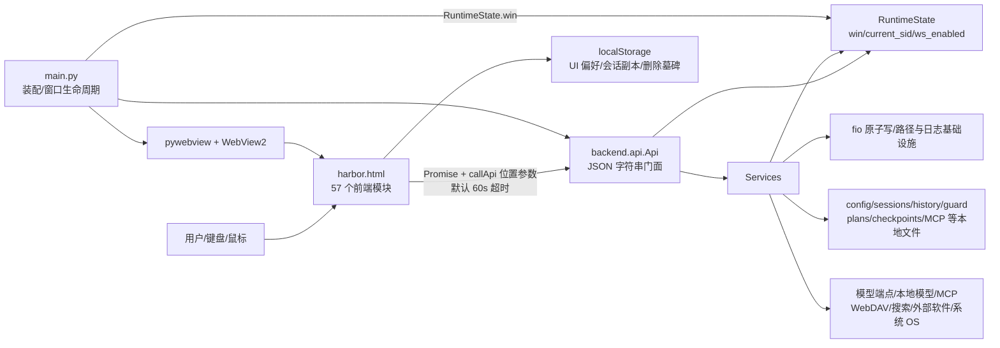
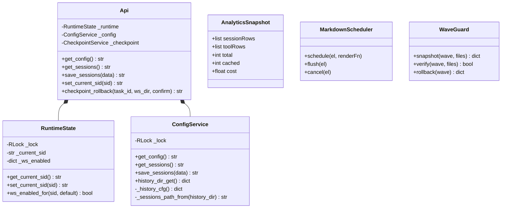
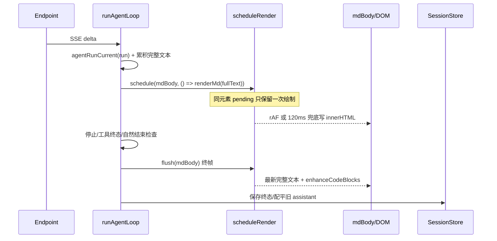
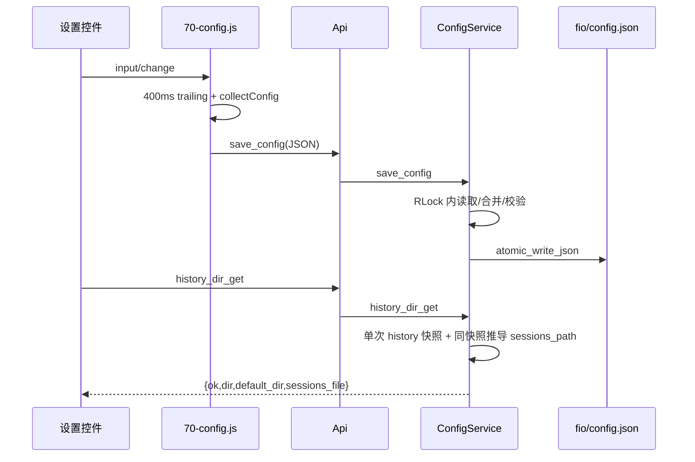
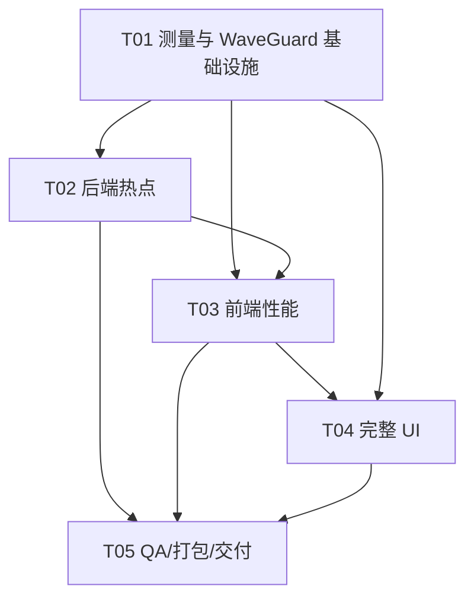

# Harbor v1.9 架构与性能审计设计（第二轮）

- 日期：2026-10-26
- 审计方式：只读源码审计 + 源码函数测量；未改产品代码、未构建、未启动 `dist/Harbor.exe`
- 基线提交：`93fd99cb90f3961b929ec2c475fb9d90da7ee368`
- 现场：审计开始为 26 个 tracked 修改，`git diff --check` 通过；保留全部修改和产物
- 上游：`harbor-v19-performance-ui-prd-2026-10-26.md`、`.ai-memory/20261026/_plan.md`

## 0. 决策摘要

1. 本轮 CSS 冻结的是**变量名称及只增不改契约，不是色值**；`check_contract.py` 也只检查变量名存在。完整 redesign 可调既有变量值，并同步修订模板中“值不变”的旧注释。
2. 当前最明确的可优化证据是：`list_dir` 5000 项源码测量中位数 109.300ms；流式路径对完整增量文本重复 `marked.parse`，且 `scheduleRender` 的闭包在真正绘制时重新读取完整文本；`renderAnalytics()` 每次各调用两次 `aggregateSessions()`、两次 `aggregateTools()`；`history_dir_get()` 单次调用重复读两次 `history.json`。
3. 优化顺序应是：测量工具与正确性门 → 后端小热点/单源化 → 流式与分析渲染 → UI token/控件 → 全页面/浮层 → 独立 QA/打包。不要大拆 `Api` 或 57 个前端模块。
4. 本机未安装 Source Han Sans SC/思源黑体或 JetBrains Mono（系统级及当前用户字体注册表均未匹配）；本轮先按回退链验收，不随包引入字体。
5. 现有窗口外部约束是 `main.py:min_size=(860,620)`，因此当前不能宣称原生窗口 800×600 已支持。本轮将 800×600 CSS viewport/100% 纳入 P0，并在 UI 批次把最小窗调整为 `(800,600)` 后验证；125%/150% 为代表组合，不用“物理窗口 800×600 在所有缩放”作等价要求。
6. 唯一历史 skipped 的可定位原因是 `tests/test_v15_wire.py` 的真实 Ollama 不可达；本轮未重跑全量 pytest，因此 1497/1 skipped 只引用上轮 QA，不伪称本次结果。
7. Wave 回滚采用“指定文件清单 + 前像/后像 SHA256 + 仅最新 Wave 可逆恢复 + 意外后续修改拒绝”的工具机制；禁止 `reset --hard`、整库 `checkout`、全量 stash 和触碰 exe。

---

# Part A：System Design

## 1. Implementation Approach

### 1.1 核心难点与技术选择

| 难点 | 方案 | 理由 |
|---|---|---|
| 公开 js_api、持久化与 UI DOM 契约不能漂移 | 保持 `Api` 门面、`RuntimeState`、现有 services 与数字前缀拼接；只做函数内部或薄私有helper收敛 | 直接复用现有契约测试，避免搬移造成行为变化 |
| 优化必须有同条件证据 | `tools/perf_baseline.py` + `tools/perf_frontend.js` + `tools/perf_browser_cdp.py`，仅 stdlib/Node 内置模块 | 不新增运行时或开发依赖；保存每次样本和元数据 |
| 流式正确性与渲染批处理冲突 | `60-agent-loop.js` 继续拥有请求/取消/工具终态；`50-markdown.js` 只拥有渲染调度，不拥有 run 状态 | 批处理只合并绘制，不合并或丢弃 SSE 数据，不改变工具调用时序 |
| 完整 redesign 与旧 DOM 共存 | 模板 token/布局/组件样式分批；保留隐藏 `mainNav` 等兼容节点；源码改后重建 | `check_contract.py` 对变量只查名称；旧类/id/onclick/callApi 不删 |
| WebView2 与 exe 性能边界 | 浏览器/CDP 只测源码 `python main.py` 或静态页；exe 由用户复验 | 不启动 exe，不把 V8/Edge 数据写成安装后性能 |

不引入 React、MUI、Tailwind、npm 包、Python 包或在线字体。架构仍是“Python 门面/服务 + pywebview + 单文件 HTML/CSS/JS”。

### 1.2 当前架构图

### 1.3 模块职责表

#### 入口、状态与基础设施

| 模块 | 单一主责 | 输入/输出 | 状态所有者 | 主要调用方 |
|---|---|---|---|---|
| `main.py` | 目录/日志/窗口装配、WebView2 补丁、关闭与 atexit | HTML 路径、Api、窗口；返回进程状态 | 窗口由 pywebview，引用由 RuntimeState | 进程入口 |
| `backend/api.py` | 参数适配、Guard/审计挂点、服务委托、公开契约 | 位置参数 → JSON 字符串 | 不拥有业务持久态；`_trace_id`、导出一次性集合为门面运行态 | 前端 `callApi`、main |
| `backend/runtime.py` | `win/current_sid/ws_enabled` 单源及锁 | getter/setter；ws_enabled 原子持久化 | RuntimeState | Api、File/Workspace services |
| `backend/paths.py` | 用户目录、资源路径、WebView 环境 | 路径与环境设置 | 路径常量 | main、全部持久化服务 |
| `backend/fio.py` | tmp+fsync+replace、Win32 重试、残留清理 | 文本/JSON → 原子写 | 无 | Config/Guard/Plan 等 |
| `backend/errors.py`/`logging_setup.py` | 返回协议与日志 | 错误/JSON、logger | 无 | Api/services/main |
| `backend/tools_schema.py` | 工具 schema 唯一数据源 | role/include 参数 → tools | 无 | Api、前端发送链 |

#### 后端 services（按主责归组，不把归组理解成合并文件）

| 文件/子包 | 主责与主要输入/输出 | 状态/持久化 | 调用方 |
|---|---|---|---|
| `config_service.py` | config/sessions/history/memory 门面存储与历史目录迁移 | config.json、sessions.json、history.json | Api |
| `workspace_service.py` | 全局/会话工作区绑定、最近目录、worklog | session_ws/ws_enabled/worklog | Api、File/Cmd/Software |
| `file_service.py` | jail 内文件 CRUD、编码、指纹、目录扫描 | 文件指纹内存；目标工作区 | Api |
| `cmd_service.py` | 命令执行、超时、输出截断/toolcache | 子进程、去重运行态 | Api |
| `process_service.py`/`clipboard_service.py`/`screenshot_service.py` | 进程、剪贴板、截屏 OS 适配 | OS | Api |
| `guard_service.py` | Guard 配置、token/信任/预算、审计链 | guard.json、audit_log.jsonl、会话信任 | Api、MCP/Search/Software |
| `sandbox_service.py` | Job Object 限制与 sandbox 配置 | sandbox.json、OS Job | Api、Cmd/Software |
| `provider_service.py`/`local_model_service.py`/`local_proxy.py` | 云端探测、本地模型/就绪度、本地 CORS 代理 | 端点网络、本地代理进程 | Api、前端发送链 |
| `mcp_config_service.py`/`mcp_service.py`/`mcp_client.py`/`mcp_pool.py` | MCP 配置、工具调用、会话池 | mcp_servers.json、子进程 | Api |
| `mcp_transport_stdio.py`/`mcp_transport_http.py`/`mcp_dpapi.py` | 双传输与 secret 保护 | stdio/http、DPAPI | MCP service |
| `browser/service.py` | 搜索、打开、缓存、CAPTCHA 状态机 | search_cache、任务/takeover 内存 | Api、SearchBrowser/Reader |
| `browser/session_base.py`/`session_win.py`/`session_headless.py` | 六原语状态机、窗口/urllib 通道、提取 | BrowserSession 状态 | BrowserService/SearchService |
| `browser/driver.py`/`adapters.py`/`extract.py`/`win_capture.py` | 浏览器驱动会话池、原语适配、提取/截图 | driver sessions/profiles | Api |
| `browser/platform/{base,win,mac}.py` | secrets/sandbox/screen/trash/path/process/notify 平台面 | OS 平台状态 | 浏览器及平台信息 |
| `search_reader.py`/`hybrid_router.py` | reader 降级/统计与云本地路由 | reader.json、hybrid.json、统计 | Api、SearchService |
| `plan_service.py` | 计划 CRUD/状态机/澄清，检查点委托 | plans/*.json | Api、前端计划卡 |
| `checkpoint_service.py` | 创建、备份、差异回滚、校验、投影 | checkpoints/*、checkpoints.json | Api、PlanService |
| `model_prefs_service.py` | 推理偏好读取/校验/保存及失败回滚 | model_prefs.json | Api |
| `toolcache_service.py` | 大输出分片与 read_more | toolcache | Api、Cmd/Search/MCP |
| `memory_service.py`/`prompt_loader.py` | 记忆检索/分类与版本化提示词 | memory.json、prompts | Config/Api |
| `update_service.py` | 更新检查、下载、备份/应用 | manifest、更新临时文件 | Api、main |
| `webdav_service.py` | WebDAV 配置、连通、导出/恢复/冲突 | webdav.json、远端备份 | Api |
| `software_service.py` | 外部软件注册、探测、Guard 后调用 | software.json、外部端点 | Api |
| `audit_chain.py`/`provenance.py`/`tool_validator.py` | 审计链、来源、工具参数辅助校验 | 审计/参数数据 | Guard/工具链 |

#### 前端状态与持久化

| 模块 | 主责 |
|---|---|
| `00-state.js` | 全局会话、流式、附件、Guard 等前端运行态声明 |
| `05-bridge.js` | `callApi` Promise/超时统一入口 |
| `00-motion.js`/`15-theme.js`/`16-panel-fx.js`/`69-platform.js` | 动效、主题、面板路由、平台外观 |
| `65-session-store.js` | 双源归一、墓碑合并、60 会话上限、300ms 保存串行/节流 |
| `85-session-mgmt.js`/`32-session-search.js` | 会话切换/历史恢复/删除/导出与跨会话搜索 |
| `100-send.js`/`60-agent-loop.js` | 发送编排；run 所有权、SSE、取消、工具循环与终态 |
| `50-markdown.js` | Markdown 消毒、rAF/120ms 绘制、代码增强、消息 DOM |
| `25-tool-exec.js`/`55-tool-route.js`/`62-mcp-exec.js`/`71-browser-driver.js` | 工具路由和各工具族调用 |
| `70-config.js`/`71-provider.js`/`36-connect.js`/`34-local-model.js` | 配置收集/400ms 保存、端点和本地模型 |
| `26-guard.js`/`66-guard-grant.js`/`39-sandbox.js`/`38-ws-quick.js` | Guard、授权、沙箱、工作区状态 |
| `67-plan-card.js`/`71-checkpoint-mgr.js` | 计划审批/步骤/检查点与任务历史 |
| `75-token-stat.js`/`76-cost-estimate.js`/`78-analytics.js` | token/成本与分析聚合/SVG |
| `18-toast.js`/`41-nav.js`/`105-context-menu.js` | toast/模态基础设施、唯一主导航/通知、右键菜单 |
| 其余 `*.js` | 搜索、MCP、WebDAV、更新、记忆、快捷键、附件、压缩、引导等单一特性模块；构建顺序即依赖顺序 |

**依赖审计结论：**未发现服务 import 前端或 `RuntimeState` 反向依赖 `Api` 的循环依赖；`Api → services → runtime/fio` 主方向清晰。`Api` 仍有 Guard、导出、自动检查点等协调逻辑，不宜仅为行数再拆。`ConfigService` 同时含 memory/history 是历史门面，当前不做大迁。

### 1.4 六条关键数据流及异步边界

#### F1 启动 / 晚桥

`window.onload → loadAll → initFx（同步、首个 await 前）→ modelPrefsRefresh/get_memory（await）→ DOM/事件与动态面板初始化 → loadSessions（桥+localStorage）→ get_config（3s 竞速）→ bridgeDependentInit（本地代理、Guard、get_api_info 最多三次）→ 沙箱/导航/token/工作区/分析 → switchSession(latest)`。5 秒无桥先走可见降级；晚到 `pywebviewready → bridgeLateReady → bridgeDependentInit + model/platform/reader/sandbox/budget/token` 补偿。

**边界：**JS 事件循环与 pywebview Promise/RPC；后端构造 `Api()` 时同步装配服务并启动本地代理，主窗/搜索次窗由 main 串行创建。首屏目前被多个 await 和首载分析阻塞，不能把 `window.onload` 当“可交互”。

#### F2 发送 / 流式 / 取消

`sendMessage/ensureSession/saveSessions → runAgentLoop 创建 run → set_current_sid/begin_task/autoCompact → fetch SSE → handleSseLine 累积 fullContent/fullReasoning → scheduleRender(renderMd) → assistant 落 messages → executeRunTool → 工具结果落 messages → saveSessions/finally`。`AbortController` 中止网络，`agentRunCurrent` 阻止旧 run 写新会话/UI；旧 `finally` 只清自己的 timer，仅定向配平旧 assistant。

**边界：**网络流、Promise RPC、rAF/120ms 绘制是三个不同边界。批处理只能延迟绘制，不能延迟消息所有权检查、停止、工具终态或持久化终帧。

#### F3 会话切换 / 持久化

`switchSession → cancelActiveAgentLoop（若在流式）→ 清会话级信任/附件 → renderChatHistory 全量回放 → clear_caches/set_current_sid（异步不等待）→ refreshWsCard`。保存走 `sessions → 深拷贝/媒体与长串裁剪 → localStorage + Api.save_sessions → ConfigService 校验/原子写`；启动双源按 `updatedAt` 合并并应用删除墓碑。

**边界：**切换本身同步，历史动画与两个后端调用异步；不得为提速改变删除墓碑、双源合并或 300ms trailing 最终落盘。

#### F4 工具 / Guard / 审计

`executeRunTool → callApi → Api 参数解析/Guard enforce → token/session trust/budget → File/Cmd/Browser/MCP/Software service → 成功或结构化阻断 → audit → 前端工具卡 ok/fail/skipped`。写顺序工具分批串行边界保留；browser_close 与 kill_process 也有 Guard 前置。

**边界：**`callApi` 默认 60s，工具族可显式覆盖；后端文件/子进程是同步 I/O，经 pywebview 回调线程执行，不能据此宣称全后端异步。

#### F5 计划 / 检查点

`plan_create → planCardRender/用户批准 Promise → plan_update → 100-send 唯一 checkpoint_create → Agent 步骤状态 → planFinishIfNatural（未决不伪 done）→ checkpoint_list → rollback(false) 预检 → rollback(true)`。Api 与 PlanService 共享同一 CheckpointService；回滚仅声明文件、先备份当前版、恢复后 hash 校验。

**边界：**审批、RPC、git/文件 I/O；回滚确认是后端硬门，不可被 UI 批处理绕过。

#### F6 配置 / 端点 / MCP

`控件 change/input → queueSaveConfig(400ms) → collectConfig → localStorage 去密钥副本 + save_config → ConfigService 锁内读-改-原子写`；端点识别/测试走 Provider/LocalModel；MCP 配置走独立 McpConfigService，工具调用经 Guard/MCP pool；WebDAV/sandbox/model_prefs/reader 各有独立文件。

**边界：**配置保存是 trailing 异步；保存失败必须保留/回滚原值并可见提示。不得把独立配置合并进 config.json 或为缓存推迟即时保存。

### 1.5 有实证的重复逻辑、越层与重复 I/O

| 类型 | 证据 | 处置 |
|---|---|---|
| 重复聚合 | `78-analytics.js:295-300` 一次 render 调四个函数；`aggregateSessions` 在 stat/trend 各一次，`aggregateTools` 在 bars/ringAndMs 各一次 | Wave 2 单次 snapshot 注入四个纯渲染函数；输出逐字段一致 |
| 重复 history 读取 | `history_dir_get()` 直接 `_history_cfg()`，再经 `sessions_path()` 调一次；open 探针实测 2 次 | Wave 1 在一次锁内取一份快照并推导路径；不新增 TTL 缓存 |
| 重复全量计算 | `renderSessionList()` 每次结束 `updateTokenStat()`，后者 concat 全部消息再 calcUsage；启动/切换/流式收尾均触发 | 先用分析同一统计快照；按 sessions revision 失效，不按时间猜测 |
| 重复 Markdown | `60-agent-loop.js` 两处 SSE 增量 `scheduleRender(...renderMd(fullContent))`，自然/工具分支还有终态全量 render | 只优化绘制调度与终态复用；不先做脆弱增量 Markdown AST |
| 旧检查点遗留代码 | `plan_service.py` 的 `CKPT_*`、`_prune_old_checkpoints`、`_git_head` 等在迁移后无文件内调用，仓库 grep 仅声明；实际执行已委托 CheckpointService | P2 死代码候选，先补引用检查再删；不是本性能热点 |
| 原子写例外 | `api.save_export_file` 直接 `open(...,'w')`；这是已选定导出路径的新写文件，不是 config 持久化 | 不借统一 fio 改变安全/换行契约；可独立评估原子写，非本轮 P0 |
| 越层 | `Api._driver_open_external` 直接 webbrowser+audit、`Api` 负责一次性导出路径与自动检查点协调 | 属门面协调且量小，保留；不列无证据“服务反向依赖 UI”问题 |

**缓存裁决：**可加入“单次操作快照”与“由 sessions 内容 revision 失效的统计缓存”；可复用现有 `FileFingerprintCache`、搜索 TTL 缓存。不要给 config/history/sessions 文件加 TTL 读缓存，因为即时保存、历史目录切换和双源一致性优先；配置写仍每次落盘。

## 2. Data Structures and Interfaces

本轮不新增公开 js_api。建议私有接口如下：

- `_sessions_path_from(history_dir)` 是私有纯推导，不改变 `sessions_path()` 公共行为。
- `AnalyticsSnapshot` 由 `buildAnalyticsSnapshot(sessions)` 每次进入面板构建一次，四个 renderer 接收同一对象；不必新增文件或类，可用普通对象。
- `MarkdownScheduler` 是逻辑命名，复用 `scheduleRender`，不要求引入类；必须有 `flush` 终帧概念，run 所有权仍在 agent loop。
- `WaveGuard` 只管理审计指定文件，不知道也不许处理 `dist/`、安装器产物。

## 3. Program Call Flow

### 3.1 流式批处理目标流

### 3.2 配置保存与历史目录读取

## 4. PRD 第 10 节逐项回答

1. **变量契约：**名称、两套主题定义、引用兼容只增不改；值可调。允许调整 color/surface/border/shadow/radius/font/duration/easing/spacing/layout/chart 等既有值，也可新增 token。不得改名或删除 21 个基线变量。`check_contract.py` 的 `REQUIRED_VARS` 是名称检查，不是值快照。同步改模板旧注释，避免规范冲突。
2. **测量落点与计时：**通用工具放 `tools/perf_baseline.py`、`tools/perf_frontend.js`、`tools/perf_browser_cdp.py`；契约/阈值测试放 `tests/test_v19_performance_protocol.py`，原始报告放 `deliverables/performance/<revision>/`。复用 `outputs/cdp_probe.py` 的 stdlib WebSocket 思路，但先移除硬编码路径、kill 和自动启动。统一标记：`navigationStart` 为 0；`domContentLoadedEventEnd` 为 DOM 就绪；`loadEventEnd` 为资源加载完成；`bridge_ready = performance.now()` 在 `pywebviewready` 且 `window.pywebview.api` 可用时；`app_interactive = performance.now()` 在 `loadAll()` 完成必要配置/会话恢复、输入与导航事件绑定、`requestAnimationFrame` 已绘制且 `userInput` 可 focus 后。晚桥另报 `late_bridge_ready`、`late_bridge_interactive`，不得混进正常路径。
3. **启动串行/延迟：**`initFx` 必须先同步；`loadSessions → onboardingInit → latest switchSession` 必须保持；配置回填先于依赖配置的 `bridgeDependentInit/local proxy/Guard`；`localState` 先于 `get_local_proxy`；动态自定义 select 在事件绑定前初始化。分析图表、checkpoint 管理数据、MCP 列表、审计、搜索缓存统计、更新检查可延迟到面板/空闲，但 DOM 挂载与兼容状态仍启动完成；modelPrefs/platform/reader/sandbox/budget/token 的晚桥可见补偿不能少。任何延迟不得减少既有必要 API 调用或配置写入，只能改变时机；加载/旧后端不可用状态必须显式。
4. **渲染所有权：**`60-agent-loop.js` 拥有 run/SSE/停止/工具终态；`50-markdown.js` 拥有 `renderMd/scheduleRender/enhanceCodeBlocks/addMessage`；`85-session-mgmt.js` 拥有历史回放和切换；`60-agent-loop.js` 当前直接写 scrollTop，`73-chat-nav.js/32-session-search.js` 拥有导航滚动。批处理以“同元素一帧/120ms 最多一次绘制”为界，完整文本始终保留；停止、取消、切换时旧 run 不 flush 到新 DOM，终帧在持久化/工具终态前 flush，代码增强仅终态或对已闭合代码块执行。
5. **重复读取与缓存：**实证见 §1.5。优先单操作快照与 revision 缓存；不引入 config/session TTL 缓存。文件指纹和搜索 TTL 已有，不重复造。
6. **窗口/缩放：**当前 `min_size=(860,620)` 是唯一已定位外部约束；800×600 当前仅浏览器 CSS 检查，不是原生窗已支持。设计目标是本轮将 800×600@100% 变 P0 正式支持并同步调整 min_size；1024×640@125%、1280×720@150% 等作为代表组合，记录实际 CSS viewport。若 CSS viewport 小于 800×600，标“低于正式最小内容区，检查降级但不阻断发布”，不可谎称所有组合通过。
7. **字体：**本机注册表未发现两者；正文回退 Microsoft YaHei，等宽回退 Cascadia Code/Consolas。默认不内置。若产品后续要求跨机一致，PM 确认是否接受体积，架构确认 `fonts/` 相对资源与 `paths.get_html_path` 布局，工程师修改 `Harbor.spec`/`Harbor-mac.spec` datas 和本地 `@font-face`，QA 验证 OFL 文本、字体子集、体积和冷启动；许可证由发布负责人终审。思源黑体与 JetBrains Mono 均采用 SIL OFL 发行，但必须随实际文件附带对应许可，不仅写声明。
8. **导航归属：**维持现状。rail 四主面板不变；设置、会话搜索、审计、沙箱仍复用原入口/浮层；MCP/WebDAV/更新仍设置分组；通知在 rail；计划/检查点在聊天任务上下文与任务历史；不新增第二套可视 `mainNav`。只做视觉、焦点、窄窗与可达性收敛。
9. **skipped 与用户复验：**历史资料明确 skipped 为真实 Ollama 不可达（`tests/test_v15_wire.py`）。发布口径：“自动测试通过；1 项因本机 Ollama 不可达跳过，非功能通过；其余通过数不掩盖该项。”真实 GLM/FreeToken 流式/断流/length、Ollama/LM Studio/llama.cpp、MCP 真实双传输、WebDAV 真实服务端、更新下载、浏览器六原语与 CAPTCHA、新版 exe 启动/渲染/关闭只能由用户或明确人工环境复验；CAPTCHA 只人工完成，不绕过。
10. **Wave 回滚：**见 §7.4；只用文件白名单快照和 hash 验证，禁止全库回退。

## 5. 性能基线与证据

### 5.1 测量环境和协议

- 测量时间：2026-10-26；机器：12th Gen Intel i7-12700H（14 核/20 逻辑处理器）。
- Bash 测量运行时：Python 3.13.14，Node v22.22.2，Windows build 26300；PowerShell 的系统 `python` 另为 3.15.0，**不可混用报告**。
- WebView2 已安装 155.0.4283.62；Edge 156.0.4314.42（只记录环境，不代表本轮执行了浏览器测量）。
- 样本：每项预热后 7 次，报告中位数和 min/max；未剔除异常。均热缓存/热进程源码函数测量，不是冷启动。
- 原始命令均只调用源码/临时目录，无网络、无 exe；临时文件位于 `%TEMP%/harbor-perf-*`。后台负载未做进程级隔离，故结果用于相对比较，不设绝对 SLA。

### 5.2 源码函数测量原始样本

| 场景/数据规模 | 7 次样本（ms） | 中位数 | min–max | 边界 |
|---|---:|---:|---:|---|
| `FileService.list_dir`，5000 文件 | 109.241, 111.460, 109.376, 108.613, 109.300, 108.155, 109.335 | **109.300** | 108.155–111.460 | Python 源码，含 listdir/isdir/getsize/排序/JSON，不含 IPC |
| `FileService.read_file(force=True)`，20000 行/628890B | 6.154, 6.089, 6.141, 6.096, 6.752, 6.659, 6.929 | **6.154** | 6.089–6.929 | 热读源码，不含 IPC |
| `build_extract_result`，article fixture/2887 字符，20 次/样本 | 0.7854, 0.6677, 0.7070, 0.6831, 0.9202, 0.6848, 0.6595 | **0.6848** | 0.6595–0.9202 | 不含网络/browser |
| `marked.parse`，165600 字符，5 次/样本 | 21.703, 15.794, 15.200, 13.862, 13.011, 14.058, 14.108 | **14.108** | 13.011–21.703 | Node V8；无 DOMPurify/DOM/layout |
| `hljs.highlight(python)`，102600 字符，5 次/样本 | 45.312, 41.717, 39.195, 36.878, 35.469, 35.339, 34.572 | **36.878** | 34.572–45.312 | Node V8；无 DOM |
| `new Function(frontend JS)`，613867 字符，5 次/样本 | 1.931, 0.347, 1.009, 0.356, 0.310, 0.687, 0.336 | **0.356** | 0.310–1.931 | 仅 V8 编译，不是 WebView 初始化 |
| `runSessionSearch`，60×100=6000 消息，10 次/样本 | 0.360, 0.327, 0.249, 0.256, 0.222, 0.238, 0.259 | **0.256** | 0.222–0.360 | 当前关键词提前 100 hits；无真实 HTML layout |
| `aggregateSessions`，同数据集，10 次/样本 | 0.461, 0.411, 0.327, 0.321, 0.391, 0.385, 0.327 | **0.385** | 0.321–0.461 | 单次；一次 render 当前调 2 次 |
| `aggregateTools`，同数据集，10 次/样本 | 2.134, 1.951, 2.159, 1.926, 1.908, 1.866, 1.983 | **1.951** | 1.866–2.159 | 单次；一次 render 当前调 2 次 |

I/O 探针：`ConfigService.history_dir_get()` 对 `history.json` 的 `open` 次数 **2**。这是调用次数事实，不把微小文件耗时外推为启动瓶颈。

资源字节：`harbor.html=963889`，`frontend/index.template.html=228672`，`marked.min.js=35479`，`purify.min.js=21105`，`highlight.min.js=121727`，`flate.js=32665`。四个库合计 210976B；HTML 与库不重复计入“单文件 HTML”。

### 5.3 解释与热点优先级

- **P1 后端热点候选：**5000 项 list_dir 的 109ms 已足以阻塞一个 RPC 回调；先做分页/单目录 entry 扫描与 stat 策略对照，返回形状、`total/truncated` 和排序必须不变。不得只返回 200 项后谎报已优化全部扫描，除非契约评审明确。
- **P1 流式热点候选：**marked 与 hljs 在大文本上有明确成本，且流式反复处理完整前缀。第一步只测调度/闭合代码块增强，不直接做复杂增量解析。
- **P2 聚合低垂优化：**当前数据单次耗时小，但重复次数确定；单 snapshot 改法简单、风险低。大数据集升级后再决定缓存。
- **非热点：**6000 消息搜索在当前“100 hits 提前退出”数据下中位数很小，不应宣称搜索已构成瓶颈；需补无命中全扫描与更长内容样本。
- **启动：**V8 编译值不能代表 WebView2，不据此优化脚本拆分；启动主要等待点应先用 CDP 标出各 await。

### 5.4 浏览器与真机未覆盖

本轮**未执行浏览器测量**。原因不是“本机无浏览器”：WebView2/Edge 均存在，但当前没有不启动产品窗口、可记录 Performance/CDP 的既有只读 harness；`outputs/cdp_probe.py` 会自动 `Popen(python main.py)`、使用硬编码 profile 并 kill 进程，不符合本轮只读审计。Node 无 DOM，不能测 DOMPurify、布局、绘制和可交互。

后续复用其 stdlib WebSocket 实现，新增受控 CDP harness：独立临时 WebView2 profile、只启动 `python main.py`（明确用户许可后）或静态源码页，不启动 exe；每轮关闭自己创建的进程树。采集 navigation/DCL/load/bridge/interactive、LongTask、JS heap、layout/paint、面板切换、历史恢复、长 Markdown、模拟 SSE、取消/连续切换。真实 WebView2 测量标“源码窗口”，不标“exe 真机”。exe 启动/渲染性能本轮保持未覆盖。

## 6. UI redesign 规格与覆盖

### 6.1 Token、控件与内容规则

- 唯一强调色：浅 `#0E7490`，深 `#22D3EE`，以对比度实测校准 hover/pressed；chart 多色收敛为同色系 + 中性 + 语义色。
- 保留所有变量名；正文 `--font-sans:"Source Han Sans SC","Microsoft YaHei","PingFang SC",sans-serif`；技术数据 `--font-mono` + `font-variant-numeric:tabular-nums`。
- 普通表面不叠阴影；1px 分隔线；4–8px 主圆角；输入/按钮主高度 32/36px，关键触摸/窄窗目标至少 44px。
- 状态用文字/图标 + 色；长模型名/标题省略并可 focus 查看完整，路径/错误详情换行或局部滚动，代码/表格自身横向滚动。
- 微交互 90–160ms，面板/模态 160–220ms；删除持续极光、扫光、呼吸和数字滚动的默认必要性。reduced-motion/fx-off 停动画、平滑滚动、stagger 和循环，不丢进度/状态。

### 6.2 全 UI 页面/组件覆盖清单

| 区域 | 必覆盖组件与状态 | 主文件 |
|---|---|---|
| 全局壳 | rail、sidebar、页头/缓存/沙箱、唯一模型显示、主题、余额、外链、backend warning | template、15/16/41/69/75 |
| 对话 | 空态/引导、user/assistant/error、流式条/速度、推理折叠、代码/表格/复制、消息操作、工具卡四态、暂停/继续、预算/授权 | template、25/36/50/60/66 |
| 输入区 | 自动伸缩、附件+/四类附件/预览、DND、粘贴、模型 chip/popover、上下文/费用、发送/停止 | 74/76/90/100 |
| 会话 | 日期分组、激活/导出/删除、空列表、长标题、历史目录弹层、跨会话搜索/跳转 | 32/65/85 |
| 分析 | KPI、趋势 metric seg/折线/hover、工具条/环/耗时、全部空态、长工具名、无 __ms | 75/78 |
| 工作区/Guard | 工作区启用/绑定/独立/解绑/最近目录、三档权限、wsq 菜单、Guard 九类、确认/信任/重置 | 26/38/66、template |
| 设置-模型 | 连接与模型、预设/自定义、Key/URL/模型识别/测试、价格、思考/上下文偏好 | 34/36/70/71 |
| 设置-生成 | 省 Token、生成参数、角色/联网、压缩/归档/恢复、本地模型/混合路由 | 30/34/35/40/65/70/95/97 |
| 设置-数据 | WebDAV 配置/测试/导出/恢复/冲突、记忆列表/删除、历史目录 | 37/69/85 |
| 设置-系统 | 更新、外观/DND、沙箱状态/配置/失败、快捷键 | 27/39/72、template |
| 设置-工具 | MCP 列表/编辑/删除/测试/双传输/工具分级/resources/subscription，外部软件列表/探测/调用 | 29/62/64 |
| 浏览器/搜索 | browser driver mode、搜索面板进度/结果/缓存/空/错误、CAPTCHA/重试/abort、外链 | 63/71 |
| 计划/检查点 | 计划待批准/执行/未决/done/blocked、澄清、偏差、检查点创建/清单/确认/进度/部分失败 | 67/71 |
| 审计 | 列表/筛选/分页/hash 校验/空/错误/长详情 | 28 |
| 全局浮层 | notify pop+双 badge、toast 四态/detail/pinned/overflow、uiConfirm/uiPrompt、图片 viewer、右键/custom select | 10/18/41/50/105 |
| 辅助功能 | onboarding、快捷键帮助、chat nav、更新 dialog、历史目录、任何动态 modal 的 loading/empty/error/disabled | 27/68/72/73/85 |

每行都要留浅/深主题、默认/空/加载/错误/禁用、fx-off 或 reduced-motion 证据；隐藏兼容节点单独列“契约保留”，不冒充用户入口。

### 6.3 响应式检查矩阵

以 CDP `Emulation.setDeviceMetricsOverride` 记录 CSS viewport；Windows 缩放另由用户/源码窗复验。

| 视口/缩放 | 100% | 125% | 150% | 发布口径 |
|---|---|---|---|---|
| 800×600 | P0 全主路径 | 代表：设置+对话 | 代表：对话+弹层 | 调 min_size 后正式支持；所有可见操作可达 |
| 1024×640 | P0 | P0 代表 | 检查 | 无页面级横溢出/异常双滚动 |
| 1280×720 | P0 全页面浅/深 | P0 代表 | P0 代表 | 主验收尺寸 |
| 1440×900 | P0 | 检查 | 检查 | 密度与长内容 |
| 1920×1080 | P0 | 检查 | 检查 | 最大内容宽，避免无限拉宽 |

每格检查：rail/侧栏、聊天输入、会话列表、分析 SVG、工作区两分段、设置左右栏及 10 个设置块、通知/搜索/审计/MCP/沙箱/计划/检查点/toast/modal/menu。低于 800 CSS px 宽时允许侧栏折叠/设置分组变顶部下拉，但主发送/停止/确认不隐藏。

### 6.4 键盘与 reduced-motion 验收

- 仅键盘完成新建、输入/发送、停止、切换会话、rail 四面板、打开设置、分组切换、修改保存、搜索、关闭弹层。
- rail/按钮/select/menu/tab 使用原生元素或补齐 role、aria-label/expanded/selected/controls；焦点环不被 `overflow:hidden` 裁掉。
- 模态打开记录 trigger、Tab/Shift+Tab 焦点圈定、Esc 与取消同义、关闭回 trigger；动态删除 trigger 时回最近合理入口。toast 不抢焦点，pinned/detail/close 可键盘。
- reduced-motion 与 fx-off 分别验证：无 smooth scroll、count-up、stagger、循环极光/扫光/呼吸；stream/tool/plan 仍有静态文字与终态。
- 正文/控件文字对比度 ≥4.5:1，大文本与非文本关键边界 ≥3:1；状态不只靠颜色。

## 7. 分批实现方案、出口与回滚

### 7.1 Wave 1：后端热点与职责（一次一个变量）

| 批次 | 文件 | 实施 | 出口校验 |
|---|---|---|---|
| 1A | `backend/services/config_service.py`、`tests/test_history_dir_purge.py`、`tests/test_v19_performance_protocol.py` | history_dir_get 单快照推导，保持即时路径切换 | 目录切换/失效/并发锁、返回形状、open 次数 2→1、性能前后 7 样本 |
| 1B | `backend/services/file_service.py`、`tests/test_api_contract.py`、`tests/test_v19_performance_protocol.py` | list_dir 扫描/stat 热点最小优化，不碰 jail | list_dir 契约、200 截断/排序、5000 项中位数与离散、全量相关测试 |
| 1C | `backend/services/plan_service.py`、`backend/services/checkpoint_service.py`、`tests/test_plan_service.py`、`tests/test_v19_checkpoint.py` | 可选 P2：删除已证实无调用的旧 checkpoint 残留，不搬功能 | 计划/检查点/回滚/absent 文件/备份失败全绿；无性能结论 |
| 1D | `backend/api.py`、`backend/services/config_service.py`、`backend/fio.py`、`tests/test_review_fixes.py` | 仅在证据需要时处理导出新写原子性；默认不做 | 导出一次性路径/8MB/失败/换行；不扩散 Wave |

### 7.2 Wave 2：渲染与启动热点

| 批次 | 文件 | 实施 | 出口校验 |
|---|---|---|---|
| 2A | `frontend/src/50-markdown.js`、`frontend/src/60-agent-loop.js`、`tests/test_round6_adversarial.py`、`tests/test_v16_batch2.py` | 同元素调度、终帧 flush、闭合代码块增强；保留 rAF+120ms 兜底和 run 守卫 | SSE 分片逐字等价、停止/取消/旧 finally/工具终态/滚动；长文本前后样本 |
| 2B | `frontend/src/78-analytics.js`、`frontend/src/75-token-stat.js`、`frontend/src/85-session-mgmt.js`、`tests/test_v14_experience.py` | 单次 analytics snapshot；token 统计按 revision 复用 | 聚合逐字段相同、图表标签/数值、删除/压缩/切换失效正确 |
| 2C | `frontend/src/110-boot.js`、`frontend/src/16-panel-fx.js`、`frontend/src/78-analytics.js`、`tests/test_review_fixes.py` | 首载分析移至面板首开/空闲；保持启动必要 API 和晚桥补偿 | 正常/晚桥调用清单相同、状态无缺失、CDP interactive 对照 |

### 7.3 Wave 3：完整 UI redesign（小批次）

1. **3A token/基础控件：**`frontend/index.template.html`、`frontend/src/00-motion.js`、`frontend/src/15-theme.js`、`frontend/src/16-panel-fx.js`、`tests/test_harbor_fix.py`。出口：契约、浅深对比、fx-off/reduced-motion、build×2。
2. **3B 对话/会话/分析：**template + `50-markdown.js`、`60-agent-loop.js`、`85-session-mgmt.js`、`32-session-search.js`、`78-analytics.js`、`tests/test_v14_experience.py`。出口：全状态截图、长内容、流式/切换无回退。
3. **3C 工作区/设置/集成：**template + `26-guard.js`、`29-mcp.js`、`33-set-nav.js`、`34-local-model.js`、`36-connect.js`、`37-webdav.js`、`38-ws-quick.js`、`39-sandbox.js`、`64-software-panel.js`、`65-hybrid.js`、`66-guard-grant.js`、`69-memory-panel.js`、`71-provider.js`、`tests/test_v16_mcp_resources_ui.py`。出口：所有分组/危险项/错误保存可达，契约通过。
4. **3D 浮层/响应式/键盘：**template + `18-toast.js`、`28-audit-viewer.js`、`41-nav.js`、`63-search-panel.js`、`67-plan-card.js`、`68-onboarding.js`、`71-checkpoint-mgr.js`、`72-shortcuts.js`、`73-chat-nav.js`、`74-input-plus.js`、`105-context-menu.js`、`main.py`（仅 min_size）、`tests/test_round7_adversarial.py`。出口：全矩阵、焦点圈定/返回、800×600、缩放、 reduced-motion。

### 7.4 Wave 回滚协议

工程师先实现 `tools/wave_guard.py`（stdlib）：

1. `snapshot W3A --files <manifest>`：仅复制清单文件前像到 `deliverables/wave-backups/W3A/`，记录相对路径、前后 SHA256、HEAD、生成时间和 `git status`；不复制 exe。
2. 每批结束记录 post-hash、测试与性能报告。只能按相反顺序回滚最新已完成 Wave。
3. `rollback W3A` 先验证当前文件仍等于已批准 post-hash；若之后又有修改则**拒绝恢复**，改为逐 hunk 人工逆补丁，防止覆盖后续工作。
4. 验证通过才恢复清单前像；未列入文件、26 个既有修改的其他部分、untracked 证据、`dist/Harbor.exe` 和三个 exe 一律不碰。
5. 前端恢复后从 template/src 重建 `harbor.html`；再跑契约与目标回归。禁止 `git reset --hard`、整文件从 HEAD 恢复、`git checkout --`、全量 stash pop。

## 8. 性能脚本设计（不得引入依赖）

### 8.1 `tools/perf_baseline.py`（Python stdlib）

- 子命令：`file-scan --files 200,1000,5000`、`file-read --lines 2000,20000`、`search-extract --fixture ...`、`config-io-count`、`api-init --isolate-home`。
- 固定 `perf_counter_ns`，预热 1 次、有效 ≥7 次；输出 JSON Lines：schema_version、git HEAD、dirty hash、OS/CPU/Python、命令、数据规模、冷/热、每次样本、median/min/max、异常与剔除理由。
- 数据集只在临时目录生成；`HOME`/`GLM_HOME` 隔离，绝不读真实用户配置；Api init 不启动 webview/exe，并记录代理/后台线程清理。
- 原始输出 `deliverables/performance/<git>-source.jsonl`；阈值来自同机基线中位数与 MAD/离散带，初版只报告不 fail。连续 ≥3 次基线稳定后，由架构/QA 确定预算，禁止预设提升百分比。

### 8.2 `tools/perf_frontend.js`（Node 内置 fs/vm/path/os）

- 场景：`new Function`、`marked.parse`、`hljs.highlight`、`runSessionSearch` 无命中/100 hits、`buildAnalyticsSnapshot`、`saveSessions` 序列化（无真实 localStorage/RPC）。
- 数据：小/中/大三档固定生成器，记录字符/会话/消息/代码块数量；VM 明确标 `no-DOM`，不得写成浏览器数据。
- 输出 stdout JSONL，可由 Python runner 汇总；退出码只表示执行失败，不用任意毫秒阈值。

### 8.3 `tools/perf_browser_cdp.py`（stdlib，复用 cdp_probe 思路）

- 启动前显式 `--allow-source-window`，只支持 `python main.py` 或静态页，拒绝 exe 路径；临时 profile、进程所有权和 finally 清理。
- 插桩只增加 performance marks，不改变功能；每项 7 次，冷启动用新进程，热交互同页重复但重置数据。
- CDP：`Performance.enable/getMetrics`、`Runtime.evaluate`、`Page.captureScreenshot`、`Emulation.setDeviceMetricsOverride`、`Emulation.setEmulatedMedia`（reduced-motion）。
- 采集 FCP、DCL/load、bridge/late bridge、app interactive、LongTask、布局/绘制、JS heap、流式每次 delta 到 paint、取消到静止、连续切换最后一次正确会话。
- 原始 CDP 返回与截图同目录保存；环境含 WebView2、DPI、窗口物理/CSS 尺寸、后台负载说明。

### 8.4 工程师明确实现清单

- [ ] 三个性能脚本及 JSONL schema、固定数据生成器、报告汇总器。
- [ ] `tests/test_v19_performance_protocol.py`：至少 3 样本 schema 校验、无 exe 防护、临时 HOME、阈值元数据来源校验；性能本身不进普通 pytest 硬门。
- [ ] `tools/wave_guard.py` 及 manifest/hash/拒绝后续修改测试。
- [ ] `history_dir_get` 单快照、list_dir 热点前后对照。
- [ ] analytics 单 snapshot、token revision、流式终帧/取消/代码块回归。
- [ ] CDP 启动与交互标记、晚桥补偿等价测试、首载分析延迟测试。
- [ ] 全部 UI 批次与每批截图矩阵、对比度、键盘/reduced-motion 记录。
- [ ] 最终真实端点/Ollama/WebView2/exe 分列的未覆盖表；无证据不填 PASS。

---

# Part B：Task Decomposition

## 9. Required Packages

无新增第三方包。沿用现有 Python stdlib + pywebview、Node 内置模块和现有本地 JS 库。性能工具不得以开发工具名义加入 `requirements` 或 `package.json`。

## 10. Task List（最多 5 个，按依赖排序）

| Task ID | Task Name | Source Files（每批至少 3 个） | Dependencies | Priority |
|---|---|---|---|---|
| T01 | 项目基础设施与测量/回滚护栏 | `tools/perf_baseline.py`、`tools/perf_frontend.js`、`tools/perf_browser_cdp.py`、`tools/wave_guard.py`、`tests/test_v19_performance_protocol.py`、`deliverables/performance/schema.json` | 无 | P0 |
| T02 | 后端热点与单操作一致性 | `backend/services/config_service.py`、`backend/services/file_service.py`、`backend/services/plan_service.py`、`tests/test_history_dir_purge.py`、`tests/test_api_contract.py`、`tests/test_plan_service.py` | T01 | P0 |
| T03 | 流式/聚合/启动性能收敛 | `frontend/src/50-markdown.js`、`frontend/src/60-agent-loop.js`、`frontend/src/78-analytics.js`、`frontend/src/75-token-stat.js`、`frontend/src/85-session-mgmt.js`、`frontend/src/110-boot.js`、`tests/test_round6_adversarial.py` | T01；建议 T02 后共用基线 | P0 |
| T04 | 完整工业实用 UI redesign | `frontend/index.template.html`、`frontend/src/00-motion.js`、`frontend/src/15-theme.js`、`frontend/src/18-toast.js`、`frontend/src/41-nav.js`、`frontend/src/67-plan-card.js`、`frontend/src/74-input-plus.js`、`main.py` 及 §7.3 所列模块/专项测试 | T01；T03（避免渲染冲突） | P0 |
| T05 | 全覆盖验证与交付 | `tests/test_harbor_fix.py`、`tests/test_round7_adversarial.py`、`tests/test_v19_browser.py`、`tests/test_v18_search_service.py`、`deliverables/design/check_contract.py`（只读执行，非必须修改）、性能/QA 报告 | T02、T03、T04 | P0 |

## 11. Shared Knowledge

- js_api 方法名、位置参数、JSON 字符串形状、`get_api_info` 与 `API_VERSION=v1.0.0` 不变。
- `config.json`、sessions/guard/sandbox/MCP/WebDAV/model_prefs/plans/checkpoints 格式不迁移、不合仓。
- UI 契约 DOM/onclick/callApi/class/CSS 变量只增不改；变量值允许本轮调整；隐藏兼容节点不删除。
- `harbor.html` 只能由 `node frontend/build.js` 生成；保持 57 模块数字前缀顺序。
- 前端保存 trailing 可以合并中间态，但最终态必须写；密钥不写 localStorage。
- 所有性能结论区分源码函数、Node no-DOM、源码 WebView2、exe 真机；至少 3 次（本方案统一 7 次），中位数 + 原始样本。
- 不主动启动 exe；真实端点、CAPTCHA、Ollama 和用户真机未执行就写未覆盖。
- 26 个 tracked 既有修改及所有 exe 必须保留；回滚只走 WaveGuard 白名单与 hash 验证。

## 12. Task Dependency Graph

## 13. Anything UNCLEAR / Assumptions

- 是否把 800×600 最小窗口改动视为可接受的产品行为，需主理人最终确认；本设计按 PRD D4 将其列为 P0 目标，而非宣称当前已支持。
- 字体不内置是本架构建议；若 PM 要求所有用户机器完全一致，需要另开体积/许可/打包评审。
- 真实 1497+1 skipped 的原始控制台未在本轮重跑；原因由历史 QA 与 `test_v15_wire.py` 交叉定位，最终报告仍应附实际 `-rs` 输出。
- 浏览器性能需要用户明确允许启动源码窗口后执行；静态 Edge headless 无法覆盖 pywebview bridge_ready，不能替代。
- 性能阈值尚未冻结；必须先积累同机同流程基线和噪声带，再由架构/QA 签字，不能把本报告样本直接变成跨机器 SLA。
