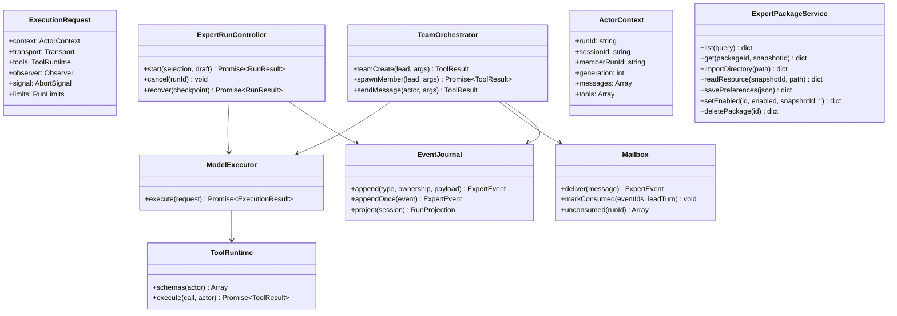
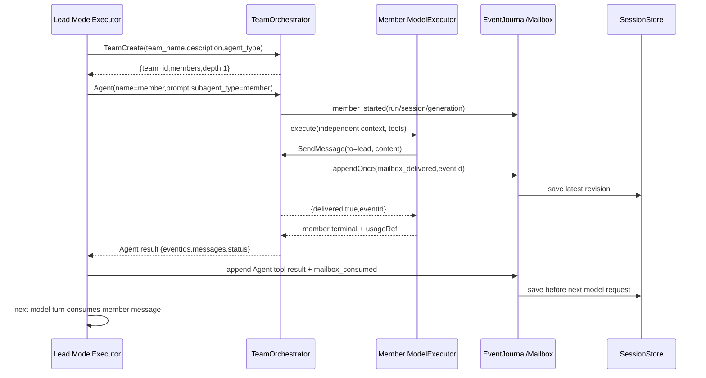
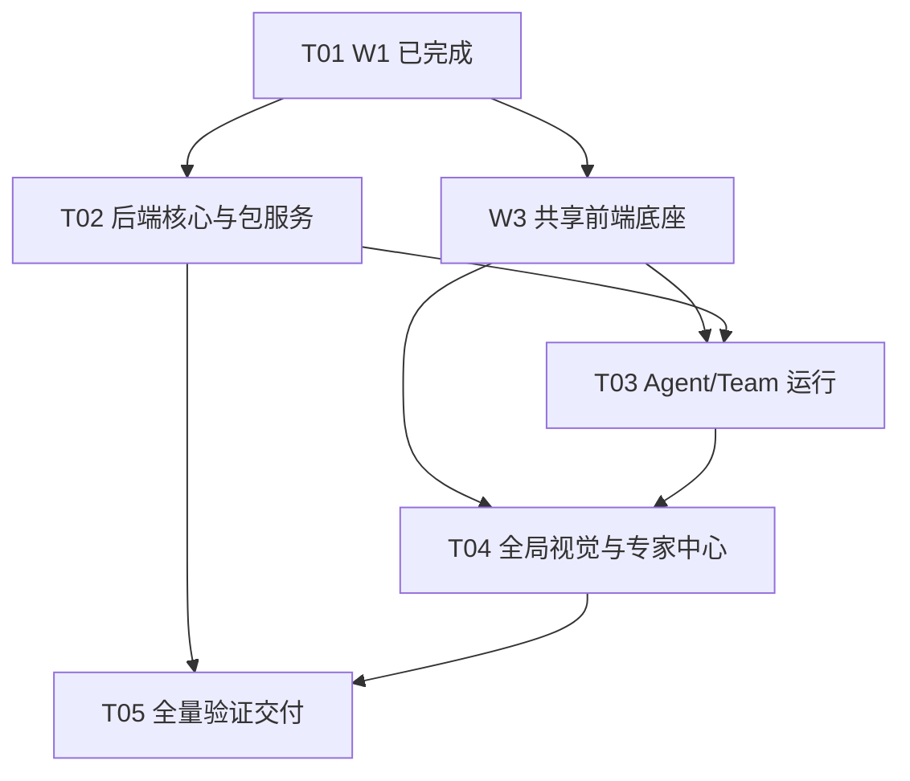

# Harbor 专家模式与整体重构统一目标架构

- 日期：2026-10-26
- 状态：**后续实施唯一架构基准；本阶段只读审计与文档，不改产品代码**
- 上游：`harbor-v19-expert-mode-prd-2026-10-26.md`、`harbor-v19-modern-architecture-design-2026-10-26.md`、W1 completed manifest
- 技术边界：Python stdlib + pywebview + HTML/CSS/原生 JS + Node 内置构建器；不新增框架、模型 SDK、YAML 包或运行时依赖

> 本文继承而非推翻现代架构：`AppState` / `RunRegistry` / `SessionStore` / manifest / 五层 CSS / 375px / WaveGuard / 21 个旧 CSS 变量与公开契约全部不变。W1 `deliverables/wave-backups/W1-modern/manifest.json` 为 completed，后续只以新 Wave 修改当前 `frontend/manifest.json`，绝不回写、回滚 W1 证据。本文引用的测试数字均为历史基线，本次未复测、未构建、未启动 exe。

---

# Part A：System Design

## 1. PRD §11 十二项裁决

| # | 裁决 |
|---|---|
| 1 | 专家运行全部在前端：`ExpertRunController` 管顶层 run，`TeamOrchestrator` 管串行 phase，`MemberContext` 管独立上下文，`Mailbox` 管投递/消费，`EventJournal` 管 sessions 内事件。后端只做不受信包解析、校验、快照、注册和受限资源读取，提供 7 个 `_V12_EXTRA` 接口。 |
| 2 | 从 45/60 提取 `providers/request.js` transport 与 `agent/model-executor.js` 完整 tool loop。普通聊天、Agent、lead、member 共用同一 executor 和 `ToolRuntime`；成员是顶层 run 内的 actor，**不替换全局 active run，不重入 `runAgentLoop` 的全局 DOM 路径**。 |
| 3 | P0 采用**串行同步编排**：lead 的 Agent 工具被 orchestrator 拦截，等待 member 完整 loop；member SendMessage 先持久化 mailbox，再让 Agent tool result 带 eventId/member 消息返回 lead；lead 下一模型轮次消费。它满足真回流与 mailbox 唤醒，且最简单、可证明。 |
| 4 | 顶层只有一个可写 run；phase/member 是其子状态。所有异步写入带 runId/sessionId/generation/phaseId/memberRunId；eventId 幂等，迟到帧只记 ignored/late，不改新状态。深度 1，member 不得 Agent/TeamCreate。 |
| 5 | TeamCreate/Agent/SendMessage 只在 Team run 注入；单 Agent 与普通聊天不可见；`backend/tools_schema.py` 不增加三者。普通工具取宿主权限与包声明交集，Guard/审计/预算不变。 |
| 6 | `experts.json` 只存注册/启用/限额/快照索引；会话事件存现有 sessions 的 `session.expert.events`，消息仅持有 event 引用与 usage，不建第二会话库。P0 仅目录导入，zip 明确 Out。 |
| 7 | frontmatter 是精确定义的受限 YAML-like 语法，不冒充 YAML；JSON 和 frontmatter 都拒绝 duplicate keys。canonical containment、Windows link/reparse/hardlink、case-fold 冲突在导入与每次读取复查；脚本零执行。 |
| 8 | 默认包 32MiB/512 文件/单文件 1MiB，单提示词 256KiB；run 总 40 turns、120 工具调用、8 次 member 派生、64 mailbox 消息、1000 events、30 分钟。frontmatter 和用户配置只能更严格。 |
| 9 | P0 恢复 = 重载 timeline + 新 runId/parentRunId 续办，足够且不复活旧所有权。checkpoint 最少保存快照、run/phase、已完成 member 结果引用、未消费 mailbox、累计 turns/usage 与终态原因。 |
| 10 | usage 的权威是各 actor 的 assistant 消息及唯一 messageId；event 只引用，不重复计数。lead/member 汇总经 selector 计算，重试/迟到帧不重复。普通会话累计/分析路径不变。 |
| 11 | 输入区选择只作用**下一次成功接受的 run**，不写会话偏好、不跨会话继承。专家中心为辅助浮层，运行 timeline 复用聊天投影；普通聊天不加载包、skills 或团队工具。 |
| 12 | W1 保持不变；W2 后端、W3 共享 Run/Session/executor、W4 全局视觉先形成底座，再以 W5A 包服务→W5B Agent→W5C Team/恢复→W5D 专家中心→W6 总体验证实施。每波都有真实行为测试。 |

### 1.3 附件逐字核验后的明确修正

已完整读取 `deliverables/reference/expert-porting-report.md`（597 行）与 `expert_portable.py`（425 行），未执行 reference Python。最终设计按附件实码而非二手概括收敛：`TeamCreate(team_name,description?,agent_type?)`（team_name 必填）、`Agent(name,prompt,subagent_type?)` 与 `SendMessage(to,content)` 同名同参；`teamInfo.leadAgent/memberAgents`、`settings.json.agent`、展示 members 含 lead 而 memberAgents 不含 lead；frontmatter 支持官方样例的一层 flow-map、`description: |` 和行尾注释。附件 `TeamRuntime.run/tool_agent` 只有一次 LLM 调用、mailbox 不被 lead 读取，不能直接用于生产；本文的共享完整 loop 与持久化回流是强制替代，不采纳其“TeamCreate 空操作”“并行是硬门槛”或工作量结论。

## 2. 统一模块树与依赖

### 2.1 目标树（在旧方案上映射新增，不改旧映射）

```text
backend/
  api.py                              # 仅增加 7 个 _V12_EXTRA 协议适配
  bootstrap/
    __init__.py                       # 唯一组合根包；禁止平行 backend/bootstrap.py
    container.py                      # 注册 ExpertPackageService
  paths.py                            # EXPERTS_FILE / EXPERTS_ROOT
  domains/
    expert/
      model.py                       # Package/Agent/Team/Skill/Snapshot DTO
      frontmatter.py                 # 受限 frontmatter 解析器
      jsonio.py                      # duplicate-key JSON / UTF-8
      validator.py                   # schema、ID、引用、settings 一致性
      limits.py                      # 宿主上限与更严格配置合并
      pathsafe.py                    # canonical containment / link / reparse
      reader.py                      # manifest 白名单资源、流式限额、hash 复查
      snapshot.py                    # digest / staging / 原子注册
      registry.py                    # experts.json 锁、原子写、损坏恢复
      service.py                     # 后端唯一包用例门面
  domains/providers/provenance.py     # 复用 untrusted 边界思想，不复制第二格式
frontend/src/
  providers/request.js                # 45 提取的共享 transport
  agent/
    model-executor.js                 # 60 提取的完整模型/tool loop
    tool-runtime.js                   # 普通工具 + scoped 工具路由、写串行
    run-controller.js                 # 普通聊天 DOM/session 适配，不可重入
    request-builder.js sse-parser.js stream-renderer.js tool-scheduler.js
  expert/
    controller.js                     # ExpertRunController / 下一次 run 选择
    orchestrator.js                   # TeamOrchestrator / 串行同步调度
    context.js                        # Lead/Member Context、宿主/资产分层
    schemas.js                        # TeamCreate/Agent/SendMessage/expert_read
    mailbox.js                        # 投递、消费、eventId 去重
    events.js                         # EventJournal / ownership / 持久化边界
    projection.js                     # run/phase/member/timeline/usage 只读投影
    recovery.js                       # checkpoint / parentRun 续办
    package-store.js                  # 7 个 js_api 的 effect 适配与有界缓存
    center.js                         # 包列表/详情/导入/启停/错误
    timeline.js                       # 聊天内运行时间线/mailbox/停止/恢复
  sessions/store.js                   # 保留 expert 元数据、唯一 sessions
  analytics/expert.js                 # 从消息 usage 计算聚合，不二次累计
frontend/styles/features/expert.css   # 复用现代 tokens/components
```

### 2.2 唯一状态源与禁止依赖

| 事实 | 唯一权威 | 投影/缓存允许范围 |
|---|---|---|
| 普通会话、专家事件、actor 消息与 usage | 当前 `SessionStore` 中的 session | UI timeline、搜索、export、分析 selector；不写第二份运行库 |
| active run 与取消所有权 | `AppState.run`，由 RunRegistry 操作 | `ExpertRunController` 只持有该 run 的控制上下文，不另设 active expert run |
| lead/member 模型上下文 | 当前 run 内各自的 `ActorContext.messages` | 稳定边界写入 sessions；member 不读取其他 member 上下文 |
| mailbox | 当前 session 的 expert events | `Mailbox` 仅是当前 run 的索引；重载由事件重建 |
| 包注册/启用/限额 | 后端 `experts.json` | `package-store` 只读有界缓存，不保存对话/运行真相 |
| 不可变包内容 | managed snapshot + digest | run 启动时固定 SnapshotRef；运行中导入/删除不换版本 |

禁止：

1. `backend/domains/expert` import 模型 SDK、调用 chat completions、读取 config API Key、依赖 Api/UI；前端不得用 Python/urllib 第二客户端。
2. `run-controller.js` 不得被 lead/member 重入；它只适配普通聊天的单 DOM。member 只能调无全局 DOM 的 `ModelExecutor`。
3. UI/component 不得直接写 events/sessions/experts.json；只能发 controller command。
4. Team 工具不得加入 `backend/tools_schema.py` 或普通 effectiveTools；member 不得获得 Agent/TeamCreate，所有 member 收件人只能是 lead。
5. 包代码不得 import/eval/child_process/shell 执行；SKILL/references/templates/prompt 都是 untrusted asset。
6. 不得从 DOM 反推运行状态，不得把 experts.json、DOM、mailbox cache 当第二事实源。

### 2.3 核心接口



`ModelExecutor.execute` 返回 `{status, content, newMessages, usage, modelTurns, toolCalls, finishReason, error, partialContent}`。observer 仅接收 `delta/assistant/tool/usage/phase/terminal`；transport 只负责 endpoint/retry/SSE bytes；executor 不直接碰 document、localStorage、providerState 或 `AppState.run`。

## 3. 共享模型执行器与默认零变化

### 3.1 transport + 完整 loop

`providers/request.js` 保留 45 的 Abortable sleep、GLM/local 重试、400 降级、normalizeSystemMessages 最后闸；接口改为显式 `transport.stream({apiKey, endpoint, body}, signal)`，由 effect 注入当前 endpoint/header，不把 Key 给专家后端。

`agent/model-executor.js` 保留 60 的完整行为：请求构造、流式 content/reasoning/tool/usage、tool_calls 聚合、工具结果回填后再请求、写工具串行边界、60 轮现有普通上限、loop/stall/budget、partial、length 续跑和终态。`ToolRuntime` 对普通工具仍委托现有 `executeTool`，作用域工具由 expert registry 提供。

普通聊天的 `run-controller.js` 负责现有按钮、消息气泡、nudge/localWait、session 保存；lead/member 使用无 DOM observer。普通请求走 executor 的 `mode:'chat'`，没有 expert selection 时不创建 ExpertRunController、Mailbox、Team schemas 或 package API 调用。

**P0 差分**：未选专家时，同一 fixtures 下 `JSON.stringify(reqBody)`、tools 数组、模型请求次数、usage 和最终 session 与普通基线完全一致；transport 重试不计额外逻辑 turn，现有普通 60 轮行为不被专家 40 默认上限改变。

### 3.2 可重入边界

- 顶层 `AppState.run` 始终是唯一 active run；member 是其 `actors[memberRunId]`，不是新 active run。
- 每个 actor 有独立 `AbortController`，父 signal 链接到当前 actor；取消顶层 run 会 abort 当前 fetch、拒绝新 phase/member/工具，并清待派生队列。
- `waiting_member` 不释放顶层 ownership，也不允许普通新发送覆盖；`waiting_lead` 是 member 已投递、Agent result 尚未提交 lead 的短暂态。
- 同步 RPC 不伪称强杀；迟到结果只能完成原 actor 的持久化收尾，且通过 ownership 检查，不能更改新 run/UI。

## 4. 串行 Team 真回流（P0 推荐）

### 4.1 精确协议

1. lead 调 `TeamCreate({team_name,description?,agent_type?})`（team_name 必填），orchestrator 验证 preselected Team snapshot、caller=lead、尚未建团，创建真实 teamId/名册/depth=1。
2. lead 调 `Agent(name,prompt,subagent_type)`（description 可选；subagent_type 缺省取 name，二者同时出现必须相同），orchestrator 验证 team/run/member 与额度，创建 memberRunId 和独立 `MemberContext`；member 仅获得 lead 明确下发的 prompt 与必要 provenance。
3. member 经同一 ModelExecutor 完整执行普通/scoped 工具。其 SendMessage 先由 EventJournal 持久化 `mailbox_delivered`，返回 eventId；member 可继续自己的模型轮次直至终态。
4. Agent 调用返回前收集该 member 新投递的 eventIds，将 `{eventIds,messages,memberStatus,usageRef}` 作为 lead 的 Agent tool result。该 result  append 到 lead context 后标 `mailbox_consumed` 并保存 sessions。
5. lead **下一模型轮次**读取这些 tool result 并继续；后续 phase 只能由 lead 的新工具调用/自然终态驱动。SendMessage 成功不等于 run 完成。

这是真回流：member 内容进入 lead 上下文并触发 lead 后续模型调用，而非 mailbox 只存不读。同步等待期间 lead 的状态为 `waiting_member`，投递到 result 提交之间为 `waiting_lead`；P0 不需要额外的异步 Promise 沉睡/唤醒器。

### 4.2 调用时序



若未来采用异步 `waiting_member`，必须额外证明：唤醒/generation 绑定、重复唤醒幂等、等待期取消与切会话、刷新后 unconsumed mailbox 重建、等待时不发模型请求、事件乱序与 lead 终态竞态。P0 不引入这些风险。

## 5. 状态机与硬不变量

### 5.1 状态与迁移

- `queued→running`；`running↔waiting_member`；`waiting_member→waiting_lead→running`。
- 任意非终态可进 `cancelled/timed_out/turn_limit/budget_exceeded/failed/partial`；只有 lead 自然结束、teamCreated、无未决 actor/tool/mailbox 提交时才可 `completed`。
- 有已投递结果或部分正文时，失败类终态用 `partial`；无产出的致命初始化失败用 `failed`。刷新后磁盘上的 queued/running/waiting 一律投影为 `partial/recovery_available`，不假装仍在运行。
- Team 未 TeamCreate 就结束 => `partial/TEAM_NOT_CREATED`；TeamCreate 后 lead 判断无需派生可正常 completed。member 失败但已投递结果 => lead 可继续，最终由 lead 汇总决定 completed/partial。

### 5.2 所有权与幂等

1. `runId=er_<uuid>`，`memberRunId=<runId>:m<seq>`，`phaseId=<runId>:p<seq>`；generation 在 start/cancel/recover 时递增。所有回调同时校验 runId/sessionId/generation/phaseId/memberRunId。
2. `eventId=ev_<runId>_<seq>_<uuid>`，EventJournal 以 eventId Set 去重；phase/member/run 终态按 id 幂等，较晚终态不得覆盖较早终态。
3. mailbox delivered 与 consumed 是不同事件；Agent result 提交 lead context 后才 consumed。崩溃在两者之间，恢复只看到 unconsumed，不重复注入。
4. 每个 memberRunId 同时最多一个 actor；member 不可再 Agent/TeamCreate，不可 member→member/user；SendMessage `to` 只能是字面 `lead` 或当前 leadAgent ID。
5. 工具写操作保持原 WRITE_SEQ_TOOLS 串行边界；Team actor 串行不代表其他会话被全局锁阻塞。

### 5.3 上限、超时、预算

- `modelTurn` = 一次逻辑 assistant 响应（可含 transport retry）；另记录 apiAttempts。每个 tool_call 增加 toolCalls。Team maxTurns 同时约束总 modelTurns 和每 actor；普通聊天原 60 轮不变。
- 每轮请求前检查 total/actor turns、toolCalls、memberCalls、总 token/费用、deadline；达到后不再发请求，进入精确 `turn_limit/budget_exceeded/timed_out`。
- 成员/总预算取 `min(宿主剩余, 包配置, 用户 experts.json 更严格配置)`；包不能放宽。usage 仅在 assistant message 首次提交时累计；迟到 usage 只归原 actor，不重复。

## 6. 作用域工具与 Guard/审计

### 6.1 schemas（`additionalProperties:false`）

| 工具 | 参数 | 成功返回/角色约束 |
|---|---|---|
| `TeamCreate` | `{team_name:string, description?:string, agent_type?:string}`；required team_name；agent_type 若给须匹配当前 Team | `{ok:true,team_id,team_name,members:[{name,role}],depth:1,run_id}`；仅 preselected Team 的 lead，每 run 一次 |
| `Agent` | `{name:string, prompt:string, subagent_type?:string, description?:string}`；required name/prompt；subagent_type 缺省=name，二者同给必须相等 | `{ok:true,member_run_id,member,status,event_ids:[...],messages:[{event_id,from,content,summary}],usage_ref,partial}`；仅 lead，member 必须在名册 |
| `SendMessage` | `{to:string, content:string, summary?:string}`；required to/content | `{ok:true,event_id,to:'lead',delivered:true}`；仅 member→当前 lead |
| `expert_read` | `{path:string}`；required path | `{ok:true,path,sha256,text}`；Agent/lead/member 可读当前 snapshot 白名单文本，不含 scripts |

这三者是 **WorkBuddy 提示词兼容层**：TeamCreate 必须传 team_name，Agent 必须传 name+prompt，SendMessage 必须传 to+content；禁止改成 recipient 或 subagent_type-only 形态。`to` 接受约定的 `lead` 别名或当前 leadAgent ID，不开放任意 user/member。`name` 必须是包内 member ID，subagent_type 若给必须===name；description 是可选任务摘要，prompt 是完整有界任务；`summary` 是事件预览，不替代 content。伪造 run/team/caller、未知 member、name/subagent_type 不一致、跨 session/run、二次 TeamCreate 都返回 `{ok:false,error:{code,message}}` 并写 expert 审计。

普通聊天与单 Agent 不注入 TeamCreate/Agent/SendMessage；普通工具仍由原 `build_tools` 产生，再与包 `capabilities` 白名单求交集。包未声明 capabilities 时只继承宿主当前工具权限，**不能默认扩权**。

### 6.2 Guard 交集

`expert_team_create/expert_member_spawn/expert_mail_send/expert_asset_read` 记录 OperationCoordinator 审计，附加可选 `expert:{packageId,snapshotId,runId,phaseId,memberRunId,eventId,provenance}`；旧审计返回键不变。文件/命令/浏览器/MCP 仍走原 Guard/token/工作区/预算。模型调用次数和成本由 Team limits 强制，不依赖提示词自律。

## 7. 包模型、受限语法与安全

### 7.1 元数据与一致性

支持 `.codebuddy-plugin/plugin.json` > `.workbuddy-plugin/plugin.json` > root `plugin.json` 的固定优先级。多份存在时解析并比较语义：完全相同可选择最高优先级并给 warning；任何 agentName/teamInfo/members/settings 冲突则 `METADATA_CONFLICT`，列出文件/字段，不静默通过。

`agents` 支持目录字符串、文件数组、缺省 `agents/*.md`。Agent 的 `agentName`、Markdown stem、frontmatter `name` 必须完全一致，且不允许无语义的裸 `team-lead`。Team 使用附件实际字段 `teamInfo.leadAgent/memberAgents`：leadAgent=agentName=lead MD name，`memberAgents` 不含 lead，引用均存在且唯一；展示 `members[]` 另含 lead，且每项 id/role 与 teamInfo 一致。team `settings.json` 必须存在，其 `agent` 与 agentName/lead MD name 一致；team 的 profession/displayName 按官方规则一致。ID 规则 `[a-z0-9][a-z0-9._-]{0,63}`，case-fold/NFC 后冲突也拒绝；version 为严格 `MAJOR.MINOR.PATCH`（可带 `-label`），不支持范围符号。

### 7.2 frontmatter 精确语法（不是完整 YAML）

```text
document   := "---\n" entries "---\n" body
entries    := zero or more "key: value" lines
key        := [A-Za-z][A-Za-z0-9_-]{0,63}
value      := bare-string | quoted-string | true | false | integer |
              inline-json-array-of-scalars | one-level-map | flow-map | block-text
one-level-map := key:\n + two-space-indented "child: scalar" entries
flow-map   := "{ child: scalar, child2: scalar2 }"（仅一层，禁止嵌套）
block-text := key: "|" or "|-" + two-space-indented raw text
```

- 只支持 UTF-8/LF（CRLF 导入时归一）、双引号 JSON 转义、单引号内 `''` 转义；bare-string 禁止 `: `、`[]{}`、控制符与首尾空白。inline array 必须 JSON 语法且元素仅 string/bool/int。
- map/flow-map 只允许一层，缩进只能两个空格；禁止 tab、锚点、别名、tag、多文档、深嵌套。支持整行注释及官方样例使用的行尾注释：仅引号/flow-map/block 外的空白 `#` 起始，URL 中 `#` 不截断；block 内 `#` 永远当正文。block 仅 `|`（保留末尾换行）与 `|-`（去掉末尾换行），不支持 `>`。
- 重复 key、非法类型/缩进、未闭合引号/block、超限均报 `{path,line,column,field,code}`。未知核心字段拒绝；`x-harbor-*` 只作 warning 元数据、不注入运行。JSON 用 `object_pairs_hook` 检重复，禁止 NaN/Infinity。

官方样例若只使用上述能力可解析；**不宣称完整 YAML 兼容**。实现 Gate A 前必须用实际附件/官方样例做 fixture，超出子集要明确报“不支持语法”而非静默转字符串。

### 7.3 managed snapshot 与删除

- `experts.json = ~/.glm-chat/experts.json`；root `~/.glm-chat/experts/`；snapshot `snapshots/<packageId>/<digest>/`；staging 同卷 `staging/<uuid>/`。
- digest 对排序后的 `relativePath + NUL + fileBytes` 做 SHA256，注册记录再存文件 hash。源目录仅读，完整校验后复制到 staging，重算 digest，`os.replace(staging,final)` 仅在 final 不存在时原子注册。
- 同 ID/同 digest 幂等；同 ID/不同 digest 创建新 inactive snapshot，不静默改 active；用户显式切换才更新 registry。final 已存在需重新校验后复用。registry 后写崩溃留下 orphan 不进入列表，后续清理，不影响已注册包。
- P0 删除仅移除注册/禁用，保留历史与不可变 snapshot，不允许新 run；不做物理 GC。zip/压缩包、市场下载、自动更新均 Out。

### 7.4 canonical containment 与每次读取

1. 导入 root 和每个 path 均 `realpath+abspath+normcase`；拒绝绝对声明、`..`、盘符/UNC/设备路径、混合斜杠逃逸。
2. root 及每个祖先/文件 `lstat` 检 symlink；Windows 检查 reparse/junction；只接受普通文件，`st_nlink>1` 拒绝；case-fold/NFC 路径冲突拒绝。
3. 每次资源读取先查 snapshot manifest 的 `readable_paths`（agent/SKILL/references/templates），重新执行 containment/link/type/size 检查；脚本、隐藏密钥文件和非声明文件不可读。
4. open 后 `fstat` 再核 size/type，流式读取到限额+1 即中止，并计算 SHA256 与 manifest 比对；前后文件 identity 不一致或 digest 不符拒绝。错误不含资源正文或秘密。

### 7.5 冻结资源限额

| 资源 | 默认硬上限 | 可配置 |
|---|---|---|
| 包总大小 / 单文件 / 文件数 / 目录深度 | 32MiB / 1MiB / 512 / 8 | 可调低：总包 1–32MiB、单文件 64KiB–1MiB、文件 16–512、深度 2–8 |
| agents / skills / references+templates | 64 / 64 / 256 | 可调低：agents 1–64、skills 0–64、references+templates 0–256 |
| metadata / 单提示词或文本资源 | 64KiB / 256KiB | 可调低：metadata 4–64KiB、文本资源 4–256KiB |
| skill name / description / 索引总大小 | 128 / 1024 字符 / 64KiB | 固定 |
| Team members / memberCalls | 12 / 8 次每 run | 可调低：members 2–12、memberCalls 0–8 |
| 总 modelTurns / 每 actor / toolCalls | 40 / 12 / 120 | 可调低：总 1–40、actor 1–12、工具 1–120；普通聊天不受影响 |
| mailbox 消息数 / 单条 / 总大小 | 64 / 16KiB / 256KiB | 可调低：消息 1–64、单条 1–16KiB、总量 16–256KiB |
| events / run / session，事件速率 | 1000 / 4000，20 条/s | 可调低：run 100–1000、session 400–4000、速率 1–20；终态/mailbox 不被速率丢弃 |
| run deadline / member deadline / mailbox wait | 30min / 8min / 10min（仅异步预留） | 可调低：run 60–1800s、member 60–480s；异步 wait 60–600s |
| run tokens / 单任务用户描述 / prompt | 200,000 / 32KiB / 32KiB | 可调低：tokens 1000–200000，文本 1–32KiB；且受宿主剩余预算约束 |

skills scripts 只显示路径/类型/大小和“不会自动执行”，默认不读正文、不注入、不下载依赖。导入、校验、索引、列表、详情、Agent/Team run、SKILL/reference 读取都不得创建子进程、动态 import/eval 或脚本网络/写文件副作用。

## 8. 数据、事件、compact 与恢复

### 8.1 experts.json

```json
{
  "schema_version": 1,
  "packages": {
    "pkg.id": {
      "enabled": true,
      "active_snapshot": "sha256...",
      "snapshots": [{
        "digest": "sha256...", "version": "1.0.0",
        "registered_at": "ISO-UTC", "source": {"kind":"directory","name":"..."}
      }]
    }
  },
  "preferences": {"limits": {"maxTurns": 40, "memberCalls": 8}}
}
```

不含 Key、endpoint 秘密、当前选择、对话或 run。`RLock + deepcopy + atomic_write_json`；失败回滚内存。损坏文件留带时间戳 `.bad` 并回退空注册+可见 warning；未知 schema_version fail-closed，不覆盖原文件。

### 8.2 sessions 内事件与 usage

```json
// session.expert（同一 sessions.json，不是新库）
{"schemaVersion":1,"events":[{
  "eventId":"ev_...","type":"mailbox_delivered",
  "runId":"er_...","sessionId":"s1","generation":1,
  "phaseId":"er_...:p1","memberRunId":"er_...:m1",
  "ts":"ISO-UTC","payload":{"from":"member-a","content":"...","summary":"..."},
  "provenance":{"packageId":"pkg","snapshotId":"...","path":"agents/a.md","sha256":"..."}
}]}
```

- `session.expert.events` 是运行事件权威；普通 message 的可选 `expert:{runId,phaseId,memberRunId,visibility,eventIds}` 只是引用。`normalizeSessions` 必须保留两者，旧消息无字段原样。
- member assistant/tool 可落现有 messages，`visibility:'timeline'`，不进主聊天气泡或普通后续上下文；lead 的最终 assistant 正常可见。request builder 只按各 ActorContext 取所需消息，不把全部 member 历史自动广播。
- **usage 只在 actor assistant message 首次 append 时累计**，`usageId=messageId`；event 仅存 `usage_ref`。lead/member 汇总由 `analytics/expert.js` 按 run/messageId 计算，不二次调用 `accumulateUsage`。
- 持久化边界：run/phase/member 开始与终态、assistant 完整响应、每个 tool result、mailbox delivered/consumed、recovery link；SSE delta 只流式投影，不逐 chunk 写 sessions。

### 8.3 限长、compact、export、搜索

- 每 event ≤16KiB，非 payload 元数据 ≤2KiB；每 run 1000、每 session 4000。超限先折叠旧 terminal run 的 delta/progress 为 `run_checkpoint`，保留 started/terminal/mailbox/member 最终结果/usage_ref 和最近 100 条；active run、未消费 mailbox 不折叠。
- `compactNow/archiveOldTasks` 不删除 expert events；hidden member 内容不注入 compact 模型请求，只摘要 lead 可见内容。恢复原文仍由现有 `_compactBackup` 负责，eventId 不重复。
- 搜索可索引 member/mailbox 文本，命中 timeline 而非伪造主消息位置；export 在原会话 Markdown 后附同一 projection 的专家 timeline/usage，不重放为第二对话。旧读取器忽略未知字段。
- 60 条、双源 updatedAt、删除墓碑、长字符串 30000 截断、即时/串行保存不变。

### 8.4 恢复粒度

P0 采用“重载时间线 + 新 run 续办”。checkpoint 最小字段：

```text
schemaVersion, runId, parentRunId, package{ id,snapshotId,version },
phase{ id,status }, leadSummaryRef, completedMembers[{memberRunId,resultEventIds}],
unconsumedMailboxEventIds, cumulative{ modelTurns,toolCalls,usageRef },
terminal{ status,reason }, createdAt
```

续办生成新 runId/parentRunId，固定历史 snapshot，只向 lead 提供有界摘要和引用的事件内容；已完成 member 不自动重跑，旧 AbortController/ownership 不复活。按指定 phase/member 精确续办属于 P1。

## 9. 最小 `_V12_EXTRA` API

所有新方法登记 `_V12_EXTRA`，`get_api_info` 与 API_VERSION 不变。错误统一为 `{ok:false,error:{code,message,path?,field?,line?,column?,details?}}`，不返回秘密或脚本文本。

| 方法 | 返回 JSON（成功） |
|---|---|
| `expert_list(query='')` | `{ok:true,packages:[{id,kind,name,version,enabled,valid,active_snapshot,source,warnings}],registry_warning?}`；不含正文 |
| `expert_get(package_id,snapshot_id='')` | `{ok:true,package:{...metadata,agents,team,skills,resources,limits,validation}}`；索引与 hash，正文按需读取 |
| `expert_import_directory(path)` | `{ok:true,package_id,snapshot_id,version,activated:false,warnings}` 或精确错误；staging 无半注册 |
| `expert_read_resource(snapshot_id,path)` | `{ok:true,path,sha256,text,truncated:false,provenance}`；只读白名单文本，scripts 拒绝 |
| `expert_save_preferences(prefs_json)` | `{ok:true,limits}`；校验只能更严格，保存失败原值不变 |
| `expert_set_enabled(package_id,enabled,snapshot_id='')` | `{ok:true,package_id,enabled,active_snapshot}`；可选显式切换到已注册 digest，停用不影响历史 |
| `expert_delete_package(package_id)` | `{ok:true,package_id,deleted:true}`；仅注销，历史 projection 仍可读 |

后端无 run/TeamCreate/Agent/SendMessage js_api；这三个是前端 expert run 的内部工具，避免伪造跨 run 调用。

## 10. 专家中心与现代 UI

- 输入区新增 `expertPickerBtn/expertSelectionChip`：默认“普通聊天”；选择只存 `state.drafts[session].expertSelection` 的内存值，run 被接受后清除。启动前失败保留选择，切会话/新会话清除。
- 辅助导航新增 `expertCenterBtn` 和单一 `expertCenter` overlay，不增加第五主面板。包列表/搜索/详情/导入/启停/删除/校验报告由 `center.js`；timeline 由 `timeline.js` 嵌入现有聊天运行区，不创建第二消息流。
- timeline 显示 phase/member、mailbox delivered→consumed、usage/预算、当前 actor、停止、错误与恢复；敏感 prompt 默认折叠，仅显示 provenance，访问不代表脚本执行。
- 375：专家中心全屏单列、列表↔详情 back、停止/关闭固定可达；768：列表+详情双列。复用 button/field/select/badge/card/list/overlay/statusBlock、现代 tokens、44px、焦点圈定/返回、reduced-motion/fx-off；禁止紫色专家皮肤。
- 纯增 DOM：`expertPickerBtn,expertSelectionChip,expertCenterBtn,expertCenter,expertPackageList,expertPackageDetail,expertImportBtn,expertRunTimeline,expertStopBtn`；纯增 `.expert-*` 类和 `openExpertPicker,toggleExpertCenter,clearExpertSelection,stopExpertRun` 导出。旧 DOM/onclick/CSS/callApi 不改。

## 11. 可执行 Wave 重排

所有波次新建独立 WaveGuard 白名单/pre-hash/post-hash；只逆序最新波，后续修改 hash 拒绝整文件恢复。W1 已 completed 的文件可由新 Wave 读取为前像并演进当前版本，**不得修改 `deliverables/wave-backups/W1-modern/**`**。

| Wave | 文件白名单 | 依赖 | 真实行为测试/出口 |
|---|---|---|---|
| W2 后端核心 | 原方案 `backend/application/**`, `backend/bootstrap/{__init__,container}.py`, `backend/domains/{settings,workspace,security,planning,providers,integrations}/**`, `backend/api.py`, `main.py`, specs, 相关 tests/tools/README；组合根唯一为 bootstrap 包，禁止 `backend/bootstrap.py` | W1；不含 domains/expert | 公开协议差分、Guard/Session/Plan/Checkpoint 行为、全量回归 |
| W3 共享前端底座 | 原方案 `frontend/src/**` + `agent/model-executor.js,tool-runtime.js`, `providers/request.js`, sessions/store, manifest, tests/perf/harbor.html | W2；ExpertRunController 尚不启用 | 普通请求体/tools/calls/usage 差分；lead 形式重入测试先用 fake actor 验证完整 tool loop、写串行、取消/迟到帧 |
| W4 全局视觉 | 原方案 styles/template/components/shell/manifest/harbor.html，不含 expert.css | W3 | 原视觉矩阵、375/800/1280、21 变量、工业层退出 |
| W5A 包服务 | `backend/domains/expert/**`, `backend/paths.py`, `backend/api.py`, `backend/bootstrap/container.py`, specs（若动态导入需声明）, `tests/test_expert_package_*.py` | W2；可独立评审，合入 W4 后 | 三种路径/官方 fixtures、frontmatter 类型、duplicate、越界/link/reparse、staging 原子、每次读取 TOCTOU、脚本零进程/网络/写副作用、registry 损坏/回滚 |
| W5B Agent 直调 | `frontend/src/expert/{controller,context,schemas,package-store,events}.js`, shared executor/session tests, `frontend/manifest.json`, `harbor.html` | W3+W5A | 显式选择一次 run；skills 逐级读取；普通零 package API；Agent 流式/工具/usage/停止/重生成；默认请求体/tools/calls/usage 零变化 |
| W5C Team/恢复 | `expert/{orchestrator,mailbox,projection,recovery}.js`, `expert/schemas.js`, sessions/store, `analytics/expert.js`, `tests/test_expert_team_*.py`, manifest/harbor.html | W5B | fake transport 按官方参数断言 `TeamCreate({team_name,description,agent_type})`→`Agent({name,prompt,subagent_type:name,description})` 完整 loop→`SendMessage({to:leadId,content,summary})` 持久化→lead 再次模型调用消费；recipient/subagent_type-only 形态拒绝；跨 run/member/嵌套、取消各阶段、超时/turn/budget、eventId 重放、刷新 projection、parentRun 恢复 |
| W5D 专家中心 | `expert/{center,timeline}.js`, `styles/features/expert.css`, `frontend/index.template.html`, manifest/harbor.html, UI tests | W5C+W4 | 包空/错/禁用/长文本、timeline 真回流、usage/停止/恢复；浅深、375/768/800/1280、44px、焦点、reduced-motion；普通聊天对照 |
| W6 总体验证 | 全部 tests/tools/spec/installer/README/交付报告，QA 缺陷按白名单新 Wave | W2–W5D | 全量 pytest、API/release/UI、build×2、普通差分、安全负例、性能、安装器/三 exe 与 hash、真实覆盖缺口；不主动启动 exe |

## 12. 性能预算与 Plan-Gate

### 12.1 性能

- 普通未选专家：boot 不得调 `expert_*`；请求体/工具/调用次数/usage 差分为 P0 硬门槛，普通 Node/Python 指标沿用 `max(10%, 原绝对噪声下限)`。
- 包列表按 50 分页，skills 仅索引；100 包首次打开的本地处理目标 ≤100ms（不含磁盘 IO），不得读取正文。1000 events 以 100 分页、16ms 合并投影，单帧预算 16ms，不能产生 >50ms 长任务。
- 串行 Team 除模型/工具外，member 交接与 mailbox projection 的 headless 中位数预算 ≤50ms；不得按 member 数重复全 session 扫描，索引用 runId/memberRunId Map。
- 32MiB 毒包采用流式读取和提前计数，超限必须在声明上限+1 停止；性能不得靠全量读入内存或省略 hash。性能报告同机 7 次中位数+原样本，真实模型时间另列。

### 12.2 Plan-Gate A/B/C

- **Gate A（每波开工）**：白名单快照、上游 Gate B、实际附件/官方样例 fixture、默认普通差分基线、状态 owner 和测试场景齐全；禁止改 W1 证据。
- **Gate B（每波完成）**：真实行为测试而非存在性；全量无新增失败、build×2、API/release/UI 契约；负面路径有 executor/network/process spy；post-hash 与性能记录。
- **Gate C（最终）**：Agent 真直调、Team member→mailbox→lead 下一模型轮次真回流；默认普通零变化；毒包/TOCTOU/脚本零执行、取消/恢复/usage、现代 UI 矩阵、性能、三 exe 与未覆盖披露全部齐全。缺任一项不得宣称专家模式完成。

## 13. 实码 trace、风险与兼容

| 当前实码 | 目标接线 | 必测风险 |
|---|---|---|
| `45-request-debounce.js: fetchGLMStream/sleep` | `providers/request.js` transport | retry/AbortError、400 降级、普通请求体不变 |
| `60-agent-loop.js: runAgentLoop/agentRunCurrent/cancelActiveAgentLoop` | `agent/model-executor.js` + 普通 run-controller + ExpertRunController | 不重入全局 DOM；普通单 active run；member 不另起 active run |
| 60 的 `loadBackendTools/executeRunTool/WRITE_SEQ_TOOLS` | `agent/tool-runtime.js/tool-scheduler.js` + expert/schemas | 普通 tools 零变化；写串行；member 无团队派生权 |
| 60 的 assistant usage / `accumulateUsage` | actor assistant message + `analytics/expert.js` selector | lead/member 只计一次，迟到/重试不重复 |
| `65-session-store.js: normalizeSessions/loadSessions/saveSessions` | 保留 session.expert/events/message.expert | 双源/墓碑/60 条/重载 projection/旧会话 |
| `97-compact.js: compactNow/archiveOldTasks` | compact 排除 hidden member，保留 expert 事件 | 不把团队全文重复注入、不丢恢复结果 |
| `backend/services/provider_service.py` | 仅端点测试参考，专家运行不复用为模型客户端 | 静态守卫禁止 Python 第二 chat client/Key 复制 |
| `backend/services/provenance.py` | untrusted asset 包裹与 source 语义参考 | 不覆盖既有 source，专家来源可追 file/hash/run/event |
| `backend/paths.py`, `runtime.py` | experts 独立路径；runtime 不加第二 active run | config 零污染、唯一 win/sid/ws_enabled owner |
| `backend/tools_schema.py` | 不注册 TeamCreate/Agent/SendMessage | 普通与全局 tools 不可见，build_tools legacy 逐字节 |
| W1 `frontend/manifest.json` | 新 Wave 顺序加入 expert JS/CSS | 遗漏/重复符号/build 幂等；W1 backup 不改 |

主要兼容风险：成员 usage 被重复累计、mailbox tool result 与 event 双写形成第二事实源、异步迟到事件污染新 run、包路径 TOCTOU、受限解析误收 YAML、专家选择意外跨会话，以及串行耗时诱发提前并行。上述均以唯一来源、同步回流、每次读取复查、精确语法和 P2 并行门禁控制。

无开放架构问题。P0 仅目录导入、同步串行、下一次 run 选择、恢复采用新 run；zip、异步等待优化、并行、市场下载、受控导出更新分别保持 Out/P2。

---

# Part B：Task Decomposition

## 14. Required Packages

```text
- 无新增第三方包、YAML 包、模型 SDK、npm 包或运行时依赖。
- 沿用 Python stdlib、pywebview、既有依赖、Node 内置模块与 pytest。
```

## 15. 五个实施任务

| Task ID | Task Name | Source Files | Dependencies | Priority |
|---|---|---|---|---|
| T01 | **项目基础设施（已完成 W1，禁止回写）** | `frontend/build.js`, `frontend/manifest.json`, `deliverables/design/check_contract.py`, `tools/check_static_paths.py`, `tests/helpers/frontend.py`, `tests/test_modern_build.py`, `harbor.html` | 无 | P0 |
| T02 | 后端核心迁移与专家包安全服务 | `backend/application/*`, `backend/bootstrap/*`, `backend/domains/**`（含 `expert/*`）, `backend/api.py`, `backend/paths.py`, specs/tests | T01 | P0 |
| T03 | 共享 executor、Run/Session 与 Agent/Team 运行 | `frontend/src/providers/request.js`, `agent/*`, `sessions/*`, `expert/{controller,orchestrator,context,schemas,mailbox,events,projection,recovery,package-store}.js`, manifest/tests | T02（包服务）；共享底座可先按 W3 验证 | P0 |
| T04 | 全局现代视觉与专家中心 | `frontend/styles/**`, `frontend/index.template.html`, `frontend/src/components/*`, `shell/*`, `expert/{center,timeline}.js`, `analytics/expert.js`, UI tests | T03 + 原 W3 前端底座 | P0 |
| T05 | 全量安全/兼容/性能/视觉/打包交付 | 全量 tests、tools、specs/installer、README/报告、outputs（只新增） | T02,T04 | P0 |

## 16. Shared Knowledge

```text
- 普通聊天未选专家时请求体、tools、模型调用次数、usage 零变化，是 P0 而非优化项。
- 只有一个前端模型 executor、一个 active run、一个 SessionStore；member 是 actor，不是第二 active run。
- 串行同步 Agent result 即 P0 mailbox 唤醒；member→持久化 mailbox→lead 下一模型轮次是真回流。
- 事件附在现有 sessions；usage 以 actor assistant message 为权威，event 只引用。
- TeamCreate/Agent/SendMessage/expert_read 仅 run 作用域；member 深度 1 且只能 SendMessage 给 lead。
- 专家包全部是不受信资产；目录导入、受限 frontmatter、每次资源读取复查，脚本永不自动执行。
- experts.json 只存注册/启用/限额/快照索引；config.json 不新增专家键；新 js_api 全进 _V12_EXTRA。
- W1 completed 证据不可改；所有新文件进入当前 manifest 和新 Wave 白名单，真实行为测试是每波出口。
```

## 17. Task Dependency Graph



实施顺序：W1（已完成）→ W2 → W3 → W4 → W5A → W5B → W5C → W5D → W6。W5A 可与 W3/W4 评审并行，但合入和测试必须按依赖执行；不得以专家增量为由跳过整体重组或全局 UI。
