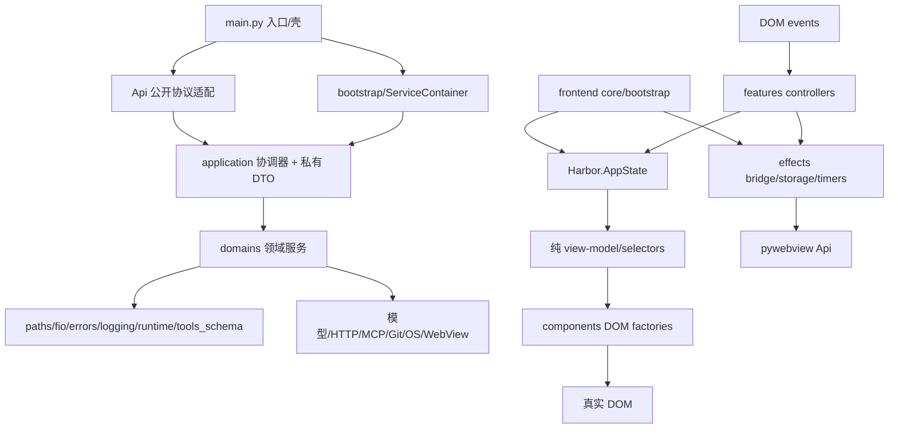
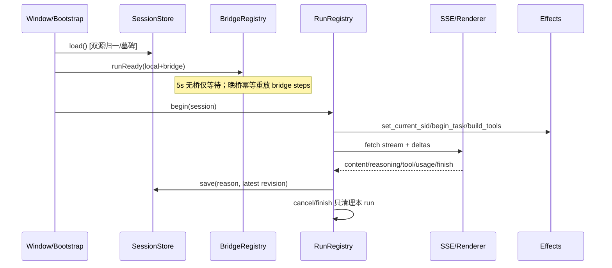
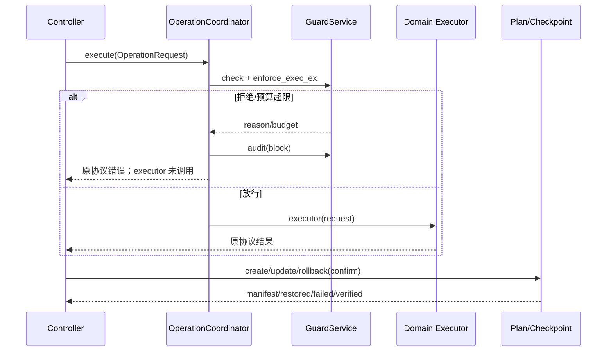
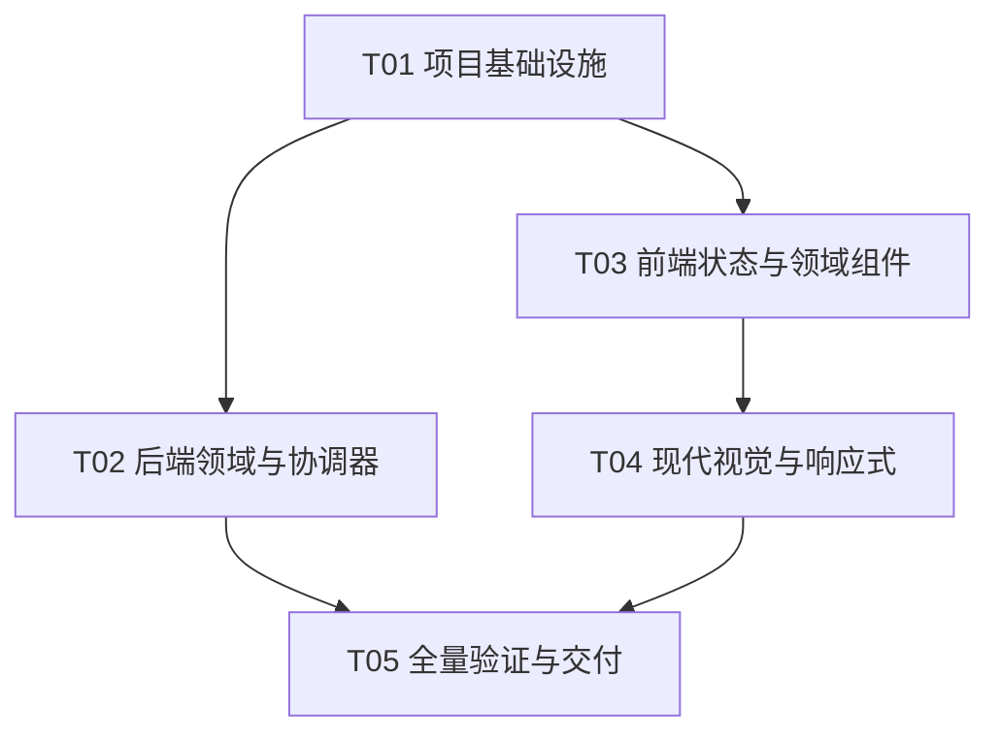

# Harbor v1.9 第三轮目标架构与现代视觉系统设计

- 日期：2026-10-26
- 状态：**实施设计已裁决；本阶段只读审计与文档，未改产品代码**
- 输入：`harbor-v19-modern-refactor-prd-2026-10-26.md`、`.ai-memory/20261026/_modern_refactor_plan.md`
- 技术约束：Python stdlib + pywebview + HTML/CSS/原生 JavaScript + Node 内置模块；**不新增框架、npm 包、运行时依赖、在线字体或网络构建步骤**
- 验收总线：公开 `js_api`、持久化、DOM/onclick/callApi/CSS 类/21 个旧 CSS 变量名冻结；内部一次迁移收敛，不留永久 shim、双写或第二套状态源

> 审计说明：已读取 PRD 全文 271 行及指定源码、spec、测试、构建和契约脚本。审计时 `git status --short` 为 36 个 tracked 修改及多组未跟踪成果，与 PRD 一致；全部保留。本文引用的 1509 passed 等是既有基线，**本次未运行测试、未重建、未启动 exe，不把它们写成本轮复测**。

---

# Part A：System Design

## 1. Implementation Approach

### 1.1 PRD §12 十项裁决（先给结论）

| # | 明确裁决 |
|---|---|
| 1 | **显式 manifest，不用目录递归决定顺序。** `frontend/manifest.json` 同时声明 scripts/styles 的完整相对路径、顺序、provides/requires。构建器只按 manifest 读取；磁盘上所有业务 `.js/.css` 必须恰好出现一次。最终仍是单 `<script>`、单 `<style>` 的根目录 `harbor.html`。 |
| 2 | 迁移同批更新 `main.py`、`Harbor.spec`、`Harbor-mac.spec`、`installer/*`、`tools/*`、`README.md`、`deliverables/design/check_contract.py`、性能/UI harness 以及 **全部 `tests/*.py` 中的实际旧引用**。历史文档、`main_v1.0.0_legacy.py` 与 `deliverables/wave-backups/` 是冻结证据，不改也不作为产品残留。新增静态守卫扫描当前产品/测试/工具路径，白名单仅允许明确的历史证据目录。 |
| 3 | 采用 **单一 `Harbor` 命名空间 + 工厂/私有模块对象 + 少量冻结的全局函数**。共享状态只在 `Harbor.AppState`；纯函数不读写 DOM/桥；组件只接收视图模型并返回 DOM；副作用经 effects 接口注入。旧 inline onclick 所需函数由 `Harbor.legacy` 显式导出，不是再复制一套实现。 |
| 4 | 21 个旧变量作为**兼容别名层**集中指向新语义 token；名称永久保留（契约而非 shim）。工业视觉覆盖层在本轮 Wave 4 整段删除，不能再次追加“最终覆盖层”。tokens 由构建器内联；禁用旧工业值、旧极光/玻璃规则后才算完成。 |
| 5 | **375 CSS px 是正式最低 Web UI 宽度。** `main.py` 原生窗口 `min_size=(800,600)` 不变。Windows 125%/150% 使 CSS viewport 低于 800 时仍属正式响应式支持，最低到 375；但 OS 不允许把原生窗口继续缩到其最小物理/逻辑尺寸以下。375/768 浏览器证据与 exe/DPI 证据分栏，不相互冒充。 |
| 6 | 375 使用**底部主导航 + 会话抽屉**；768 使用**左 rail + 会话抽屉**；两者设置 16 组均用**单一原生 select**，不横向挤 16 个 tab。保留既有 rail/sidebar/setNav DOM 与 onclick，仅改变呈现并让 select 调既有 `_showSetBlock(id)`；不恢复可视 `mainNav`。抽屉/浮层统一焦点圈定、Esc 和触发器焦点返回。 |
| 7 | 迁移期只允许 **Python 私有 import 适配**，且只存在于当前 Wave 的 `Api` 协议适配和 application 协调器；Guard/token/审计不可绕过协调器。Wave 2 完工即删除全部 `backend.services` 产品引用及兼容 re-export；前端旧路径 Wave 3 同批删除。冻结的公开 `Api` 方法、私有测试 seam 重写后均以同一 container 实例为唯一来源。 |
| 8 | **不使用原生 `@layer` 作为正确性依赖。** WebView2 evergreen 的新版本支持 cascade layers，但当前审计没有证明所有目标 WebView2/测试浏览器均在支持基线；因此采用 manifest 确定性拼接 + `tokens/base/components/features/utilities` 顺序 + 选择器命名约束模拟层叠。未来若单独提高运行时基线，再评审原生 layers，本轮不冒险。 |
| 9 | 1280×720 做**全部区域、16 设置组、全部浮层类型**基准；375/768/800/1024/1440/1920 做冻结代表抽样。16 组在 ≤1024 视口至少各出现一次，所有浮层至少在 375 与 1280 各出现一次；浅/深、状态、键盘、reduced-motion/fx-off、44px、对比度有独立证据，禁止用一张“页面正常”截图代替。 |
| 10 | 性能采用 **Wave 0 同机同数据 7 次前后交错测量，中位数 + 原始样本**。Node/Python 微基准回退阈值 `max(10%, 绝对噪声下限)`；启动/长列表/流式/浮层的 headless 指标回退阈值 `max(10%, 16ms)`。QA 执行并标记异常，架构师解释，team-lead 仅在查看原始样本后批准一次性噪声校准；不得为过关事后放宽。 |

### 1.2 核心难点与选型

1. **单脚本全局作用域与清晰私有边界冲突**：不引入 ESM 运行时或打包器，继续使用 Node 内置 `fs/path/vm`；以 manifest、显式导出和构建期符号检查替代隐式数字排序。
2. **公开协议多样，不能统一“美化”返回**：保留 `Api` 作为协议适配层；私有 DTO 只在 application/domain 之间使用，公开方法逐一保留原有 `ok()/err()`、裸文本、JSON shape 与位置参数。
3. **跨域横切安全不能散落**：以 `OperationCoordinator` 统一 Guard → token/预算 → 审计 → 执行；`SessionCoordinator` 统一 sid 切换、trace、MCP/Guard 信任清理。它们不依赖 `Api` 或 UI。
4. **单状态源与 DOM 渲染副作用**：`Harbor.AppState` 持有业务状态；DOM 是投影，不是回读事实源。表单未保存草稿允许局部存在，但必须标 `draft` 并在保存成功/失败时有确定回滚或保留策略。
5. **彻底换肤但无 cascade layer 运行时依赖**：CSS 源文件拆分、构建确定性内联，工业覆盖层删除而非再覆盖；以 computed-style 和静态旧规则扫描证明退出。

架构模式：后端 **Ports & Adapters + Application Coordinators + 薄协议门面**；前端 **单向数据流（state → view-model → DOM，event → effect → state）**；构建 **显式清单驱动**。不使用 React/Vue/MUI/Tailwind/npm。

### 1.3 当前问题的实码证据（非按行数机械拆分）

| 实证 | 架构问题与改造收益 |
|---|---|
| `backend/api.py:117-215` 同时创建 Runtime、Config、Guard、MCP、Browser、Plan、Checkpoint、代理和退出 hook；`api.py:1581-1593` 还负责 shell 自动检查点 | 组装根与协议/跨域协调混杂，依赖顺序隐式，测试只能搭整棵 `Api`。拆为 `ServiceContainer`、`SessionCoordinator`、`OperationCoordinator`，可独立替换端口验证。 |
| `backend/api.py:664-680,692-728,1339-1366,1404-1431` 多份 Guard detail、reason/budget、audit/返回处理 | 横切规则复制会漏挂点；新协调器固定 authorize-before-execute，负面测试证明任何执行器在拒绝时零调用。 |
| `backend/api.py:207-209` 用 `self._plan._checkpoint = self._checkpoint` 对齐两个实例；`ConfigService.session_purge` 又直接引用 `plan_service` 私有路径函数 | 私有跨域装配与路径所有权重叠。container 注入同一 checkpoint；`PlanningRepository` 成为 plans/checkpoints 路径唯一内部 owner，Config 不再拼另一个域的路径。 |
| `frontend/src/00-state.js`、`60-agent-loop.js:152-183` 同时存在 `isStreaming`、`abortController`、`__agentActiveRun`；`65-session-store.js` 保存时执行期再读全局 `sessions` | 状态可漂移，所有权已靠对抗测试艰难维持。`RunRegistry.current` 是唯一 run，`isStreaming` 派生；`SessionStore` 是唯一 sessions，保存快照带 revision。 |
| `60-agent-loop.js` 内同时路由、构造请求、SSE 聚合、工具批调度、DOM、预算、计划、持久化、定时器 | 不是“文件大”问题，而是取消/终态横跨多种职责，无法独立验证。按纯 SSE/请求构造、RunController、ToolScheduler、StreamRenderer 拆分，保持同一 run token。 |
| `50-markdown.js` 的 `scheduleRender` 有 rAF + 120ms 兜底和 `flushRender`；`110-boot.js` 正常/晚桥分别手列补偿步骤 | 证明副作用需要显式生命周期。保留并封装这些有效机制，BootCoordinator 用同一注册表执行/重放桥依赖，不再人工漏项。 |
| `frontend/build.js:23-36` 只读扁平 `src/*.js` 并按数字名排序；`check_contract.py:66-67` 同样只读扁平目录 | 目录迁移会静默漏模块。manifest 与磁盘一致性、符号和静态路径必须先迁移。 |
| `index.template.html:2287-2713` 是“v19 工业实用控制台最终视觉覆盖层”，覆盖前文的极光、弹簧、卡片 hover、玻璃 blur | 层叠依赖历史顺序而非设计边界。Wave 4 删除整段工业层及失效旧规则，以五层 CSS 源一次性替换；不能在其后再加现代覆盖层。 |
| `main.py:175-185` 最小 800×600；模板 `@media(max-width:560px)` 已有窄屏设置横排导航 | 原生最小尺寸与 CSS 宽度是不同坐标系；保持原生约束，正式补齐 375 CSS viewport 和可缩放 DPI，设置改 select 避免 16 项不可达。 |

## 2. 目标架构、职责与依赖

### 2.1 目标依赖图



### 2.2 模块职责、输入输出与状态所有权

| 模块 | 主责与输入 → 输出 | 状态所有者 | 禁止依赖 |
|---|---|---|---|
| `main.py` | 目录/日志/WebView、窗口与 atexit；窗口事件 → 进程退出 | 原生 window 仅交 RuntimeState | 业务规则、JSON 协议、领域路径 |
| `backend/api.py` | 冻结方法签名/位置参数/返回方言；私有调用 → 原样 JSON/文本 | 不持有业务真源，只持有 container/coordinators | 文件布局、Guard 判定细节、DOM |
| `bootstrap/container.py` | 显式构建单例及依赖顺序；`shutdown()` 逆序 | 服务实例唯一注册表 | import Api/main |
| `application/dto.py` | `OperationRequest/GuardDecision/SessionContext` 私有值对象 | 不可变调用上下文 | js_api 序列化细节 |
| `SessionCoordinator` | `set_current_sid` → runtime 更新、trace 失效、Guard/MCP 信任清理 | 委托 RuntimeState；trace 由协调器 | UI、Config、直接写持久化 |
| `OperationCoordinator` | op/detail/token + executor → 授权结果或执行结果；统一审计 | GuardService 是规则/信任真源 | Api、DOM、反向 domain→application |
| `PlanningRepository` | plans/checkpoints 路径、manifest、投影、关联 purge | plans/checkpoints 文件 | ConfigService、Api |
| `RuntimeState` | win/current_sid/ws_enabled | 对应三项唯一真源 | services/domain/UI |
| `Harbor.AppState` | sessions/currentSessionId/drafts/run/ui preference 的内存状态 | 前端唯一业务状态树 | DOM 节点、pywebview Promise |
| `SessionStore` | 双源归一、删除墓碑、revision 快照、串行 trailing 保存 | `state.sessions` 与 localStorage 缓存 | 组件、直接 innerHTML |
| `RunRegistry` | run id/session/controller/timers/ownership；`current` 只是 `AppState.run` 的访问器，不另存指针 | `AppState.run` 是唯一 active run | 第二份 `isStreaming/abortController` |
| selectors/纯函数 | state/DTO → view-model、SSE delta、请求体、统计 | 无 | DOM、localStorage、callApi、时钟（须注入） |
| components | view-model + callbacks → DOM/update/destroy | 仅组件临时句柄 | 业务持久化、全局 sessions 修改 |
| effects | bridge/storage/timer/clipboard/fetch/OS | IO 句柄；按 run 注册清理 | 业务规则、选择器 |

### 2.3 单向与禁止依赖规则

1. `main → bootstrap → application → domains → infrastructure/external`；`Api` 仅位于 application 之上做协议适配。
2. **禁止** domain import `Api`、application、bootstrap、pywebview、前端；禁止 infrastructure import domain。
3. **禁止** component 调 `callApi`、写 `state.sessions` 或 localStorage；必须发 callback 给 controller/effect。
4. **禁止** selector/read-model 写状态、读 DOM、弹 toast、直接取系统时间；时间/random 注入。
5. **禁止**直接操作另一个领域的私有属性/路径函数；跨域只经 application 或公开领域接口。
6. Guard/审计/token 必须在执行器前，且同一 `OperationRequest` 的 sid/detail/trace 贯穿；不得出现先执行后补审计的新路径。
7. 旧全局名仅是公开 DOM/测试契约导出；新增内部符号不得裸挂 `window`。

### 2.4 数据结构与接口（私有，不改变公开协议）

```mermaid
classDiagram
  class ServiceContainer {
    +runtime: RuntimeState
    +guard: GuardService
    +plans: PlanService
    +checkpoints: CheckpointService
    +mcp: McpService
    +__init__()
    +build() ServiceContainer
    +shutdown() dict
  }
  class RuntimeState {
    +win: object
    +get_current_sid() str
    +set_current_sid(sid) str
    +ws_enabled_for(sid, default=True) bool
    +set_ws_enabled(sid, enabled) void
  }
  class OperationRequest {
    +op: str
    +detail: dict
    +token: str
    +sid: str
    +trace_id: str
  }
  class GuardDecision {
    +allowed: bool
    +reason: str
    +budget: dict
  }
  class OperationCoordinator {
    +__init__(runtime, guard)
    +authorize(request) GuardDecision
    +audit(request, action, decision) str
    +execute(request, executor) object
  }
  class SessionCoordinator {
    +__init__(runtime, guard, mcp)
    +set_current_sid(sid) str
    +current_trace() str
    +trace_new() dict
  }
  class Api {
    +__init__(container=None)
    +get_api_info() str
    +set_current_sid(sid) str
    +rpc(name, payload_json='{}') str
  }
  class AppState {
    +sessions: Array
    +currentSessionId: str
    +drafts: Object
    +run: Object
    +preferences: Object
  }
  class SessionStore {
    +__init__(state, effects)
    +load() Promise~Array~
    +save(reason) Promise~void~
    +remove(id) Promise~void~
  }
  class RunRegistry {
    +current: Object
    +begin(session, controller) Object
    +isCurrent(run) bool
    +cancel(run) void
    +finish(run) void
  }
  class Effects {
    +api(name, args, timeoutMs) Promise~string~
    +storage: StoragePort
    +fetch: Function
    +timers: TimerPort
  }
  ServiceContainer --> RuntimeState
  Api --> ServiceContainer
  OperationCoordinator --> RuntimeState
  SessionCoordinator --> RuntimeState
  SessionStore --> AppState
  SessionStore --> Effects
  RunRegistry --> AppState
```

## 3. 目标目录树与旧→新完整映射

### 3.1 目标目录树

```text
backend/
  api.py                         # 仅公开协议适配
  application/
    session.py                   # SessionCoordinator
    operations.py                # OperationCoordinator
    dto.py
  bootstrap/
    __init__.py                      # 唯一组合根包；禁止平行 backend/bootstrap.py
    container.py
  domains/
    settings/                    # config/model_prefs/memory
    workspace/                   # workspace/file/cmd/process/clipboard/screenshot/sandbox/toolcache
    security/                    # guard/audit_chain/tool_validator
    planning/                    # plan/checkpoint/repository
    providers/                   # provider/local/hybrid/proxy/search_reader/provenance/prompt_loader
    integrations/                # mcp/browser/software/webdav/update
  paths.py fio.py errors.py logging_setup.py runtime.py tools_schema.py
frontend/
  manifest.json
  build.js
  index.template.html            # DOM + CSS/JS 占位符
  styles/
    00-tokens.css 10-base.css 20-components.css
    features/{shell,chat,sessions,analytics,workspace,settings,integrations}.css
    90-utilities.css
  src/
    core/ components/
    chat/ agent/ sessions/ workspace/ planning/
    settings/ providers/ integrations/ search/ analytics/ shell/
tests/
  helpers/frontend.py            # 共用 SRC manifest 读取，不再复制扁平目录假设
  test_modern_architecture.py
  test_modern_build.py
  test_modern_visual_contract.py
tools/
  check_static_paths.py
  perf_benchmark.py perf_frontend_benchmark.js wave_guard.py
```

保留 `backend/paths.py/fio.py/errors.py/logging_setup.py/runtime.py/tools_schema.py`：它们已是稳定共享基础设施，**不为了目录整齐而搬迁**。`backend/domains/*` 才是本次有明确内聚收益的领域迁移。

### 3.2 后端旧→新映射（全部现有 services 文件）

| 旧路径 `backend/services/` | 新路径 `backend/domains/` |
|---|---|
| `config_service.py`, `model_prefs_service.py`, `memory_service.py` | `settings/` 同名文件 |
| `workspace_service.py`, `file_service.py`, `cmd_service.py`, `process_service.py`, `clipboard_service.py`, `screenshot_service.py`, `sandbox_service.py`, `toolcache_service.py` | `workspace/` 同名文件 |
| `guard_service.py`, `audit_chain.py`, `tool_validator.py` | `security/` 同名文件 |
| `plan_service.py`, `checkpoint_service.py` | `planning/` 同名文件；新增 `repository.py` 统一关联路径/purge |
| `provider_service.py`, `local_model_service.py`, `local_proxy.py`, `hybrid_router.py`, `search_reader.py`, `provenance.py`, `prompt_loader.py` | `providers/` 同名文件 |
| `mcp_service.py`, `mcp_config_service.py`, `mcp_client.py`, `mcp_pool.py`, `mcp_transport_http.py`, `mcp_transport_stdio.py`, `mcp_dpapi.py` | `integrations/mcp/` 同名文件 |
| `browser/**`（含 `service.py`, `driver.py`, `adapters.py`, `extract.py`, `session_*.py`, `platform/**`, `win_capture.py`） | `integrations/browser/**` 相对结构不变 |
| `software_service.py`, `webdav_service.py`, `update_service.py` | `integrations/` 同名文件 |
| `services/__init__.py` | 删除；各领域包有自己的 `__init__.py`，不做总 re-export |

新增 `application/session.py` 接管 `Api.set_current_sid/_current_trace/trace_new`；`application/operations.py` 接管重复的 Guard/审计/预算协调；`bootstrap/container.py` 接管 `Api.__init__` 和 `main.py` 退出装配。公开 `Api` 私有测试引用统一改为 container/coordinator seam，不保留 `_plan._checkpoint` 之类跨域补写。

### 3.3 前端旧→新映射（57 个现有模块全部覆盖）

| 旧 `frontend/src/` | 新 `frontend/src/` |
|---|---|
| `00-motion.js`, `00-state.js`, `05-bridge.js`, `80-utils.js`, `110-boot.js` | `core/motion.js`, `core/state.js`, `core/bridge.js`, `core/utils.js`, `core/bootstrap.js` |
| `10-custom-select.js`, `18-toast.js`, `50-markdown.js`, `105-context-menu.js` | `components/select.js`, `components/overlays.js`, `components/markdown.js`, `components/context-menu.js` |
| `20-screenshot-dedup.js`, `73-chat-nav.js`, `74-input-plus.js`, `90-attachments.js` | `chat/screenshot.js`, `chat/navigation.js`, `chat/composer.js`, `chat/attachments.js` |
| `100-send.js` | `chat/send.js`；其中 `/plan` 生成与 `planModeRun` 移至 `planning/commands.js`；`toggleSettings/toggleSidebar` 移至 `shell/settings.js`/`shell/navigation.js` |
| `25-tool-exec.js`, `26-guard.js`, `30-history-shrink.js`, `35-frozen-compact.js`, `36-cost-defense.js`, `40-auto-compact.js`, `55-tool-route.js`, `95-compress.js`, `97-compact.js` | `agent/tool-executor.js`, `agent/guard.js`, `agent/context.js`, `agent/context-freeze.js`, `agent/budget.js`, `agent/compaction.js`, `agent/router.js`, `agent/text-compress.js`, `agent/compact-command.js` |
| `60-agent-loop.js` | `agent/run-controller.js`；纯函数/副作用另拆 `agent/sse-parser.js`, `agent/request-builder.js`, `agent/tool-scheduler.js`, `agent/stream-renderer.js` |
| `32-session-search.js`, `65-session-store.js`, `85-session-mgmt.js` | `sessions/search.js`, `sessions/store.js`, `sessions/controller.js` |
| `38-ws-quick.js` | `workspace/quick.js` |
| `67-plan-card.js`, `71-checkpoint-mgr.js` | `planning/card.js`, `planning/checkpoints.js` |
| `27-update.js`, `33-set-nav.js`, `34-local-model.js`, `36-connect.js`, `37-webdav.js`, `39-sandbox.js`, `69-memory-panel.js`, `70-config.js` | `settings/update.js`, `settings/navigation.js`, `settings/local-model.js`, `settings/connection.js`, `settings/webdav.js`, `settings/sandbox.js`, `settings/memory.js`, `settings/store.js`；`34-local-model` 的端点逻辑与 UI 分离到 `providers/local.js` |
| `45-request-debounce.js`, `65-hybrid.js`, `71-provider.js` | `providers/request.js`, `providers/hybrid.js`, `providers/provider.js`（端点逻辑保持原文件内聚） |
| `29-mcp.js`, `62-mcp-exec.js`, `64-software-panel.js`, `71-browser-driver.js` | `integrations/mcp-panel.js`, `integrations/mcp-exec.js`, `integrations/software.js`, `integrations/browser-driver.js` |
| `63-search-panel.js` | `search/panel.js` |
| `75-token-stat.js`, `76-cost-estimate.js`, `78-analytics.js` | `analytics/tokens.js`, `analytics/cost.js`, `analytics/panel.js` |
| `15-theme.js`, `16-panel-fx.js`, `41-nav.js`, `66-guard-grant.js`, `68-onboarding.js`, `69-platform.js`, `72-shortcuts.js`, `28-audit-viewer.js` | `shell/theme.js`, `shell/panels.js`, `shell/navigation.js`, `shell/grants.js`, `shell/onboarding.js`, `shell/platform.js`, `shell/shortcuts.js`, `shell/audit.js` |

迁移完成时旧扁平文件删除，manifest 只含新路径；没有“旧文件再 import 新文件”的平行实现。

### 3.4 manifest 格式与构建守卫

```json
{
  "schemaVersion": 1,
  "template": "frontend/index.template.html",
  "output": "harbor.html",
  "styles": [
    "frontend/styles/00-tokens.css",
    "frontend/styles/10-base.css",
    "frontend/styles/20-components.css",
    "frontend/styles/features/shell.css",
    "frontend/styles/features/chat.css",
    "frontend/styles/features/settings.css",
    "frontend/styles/90-utilities.css"
  ],
  "scripts": [
    {"path": "frontend/src/core/state.js", "provides": ["Harbor"], "requires": []},
    {"path": "frontend/src/core/bridge.js", "provides": ["callApi"], "requires": ["Harbor"]},
    {"path": "frontend/src/core/bootstrap.js", "provides": ["loadAll", "bridgeLateReady"], "requires": ["Harbor", "callApi"]}
  ]
}
```

真实 manifest 必须列出全部源文件，以上仅示意三条。规则：

1. `scripts/styles` 显式有序；`requires` 所引 provides 必须已在前面出现，不做隐式拓扑猜测。
2. 递归枚举 `frontend/src/**/*.js` 与 `frontend/styles/**/*.css`，仅用于**比对 manifest**，不得用于决定构建顺序；遗漏、重复、manifest 幽灵路径均失败。
3. 零依赖词法扫描跳过注释/字符串/模板字面量并追踪顶层 `{}`，提取 `function/let/const/var/class` 与 `Harbor.*` 显式导出；跨模块重复全局符号失败，声明与 `provides` 不一致失败。为重复函数、重复 let、模板字符串假阳性、注释伪代码写负例测试。
4. 每模块检查 `</script`；拼接后 `new Function(script)`；模板 `/*__APP_SCRIPT__*/`、`/*__APP_STYLES__*/`、`__APP_VERSION__` 各恰好一次；函数替换避免 `$&` 注入。
5. 检查 `libs/marked.min.js, purify.min.js, flate.js, highlight.min.js` 和模板全部本地 `src/href` 静态引用；禁止意外 `http(s)` 字体/构建资源。
6. `tools/check_static_paths.py` 在当前产品、tests、tools、installer、spec、README 扫描旧扁平 JS 与 `backend.services`；例外只限 `main_v1.0.0_legacy.py`、冻结历史 deliverables/wave-backups 和测试专门构造的旧路径反例。
7. `check_contract.py` 改为 manifest 读取全部源，CSS 契约检查合并后的样式，不再假设 `index.template.html` 含全部 CSS/JS。
8. 连续两次构建字节一致；WaveGuard 包含 `harbor.html` 作为生成物快照，但 `dist/`、安装器和旧证据永不回滚。

## 4. 六条关键数据流与等价不变量

### 4.1 启动与晚桥

- **同步**：`window.onload` 单次 gate → `initFx`（仍在首个 await 前）→ DOM/组件注册 → localStorage 非密钥偏好。
- **异步**：`SessionStore.load` → config 读取/本地无密钥回退 → `BridgeRegistry.runReady()`；5 秒无桥仅显示等待，不将后端判死。
- **晚桥**：`pywebviewready` 若尚未启动则走同一启动；若已回退则只重放 `bridge` 类 effect：modelPrefs/platform/reader/sandbox/grant/localProxy/guard/get_api_info/tokenStat。注册表幂等键防止重复监听和重复初始化。
- **错误/所有权**：每一步错误转对应状态块，不取消其他初始化；`backendWarning` 由 Boot 状态唯一拥有；分析仍懒加载。
- **不变量**：5 秒回退时机、get_api_info 三次 800ms 重试、缺失方法提示、无桥可浏览本地会话、fx-off 不闪动效保持不变。

### 4.2 流式与取消

- `RunRegistry.begin` 同步设置 active run 后再 await；run 持有 session/id/controller/nudge/localWait/assistantMsg；`isStreaming` 由 `activeRun && !cancelled` 派生。
- RequestBuilder 生成同一请求体；SSE parser 只产出 content/reasoning/tool/usage/finish；StreamRenderer 按元素合并最新帧，rAF+120ms 兜底，终态 `flushRender`。
- 停止/切换先撤销所有权并 abort fetch、清计时器；后端同步 RPC **不伪称被强杀**。旧 run 只能写自己的 session/assistant 并配平自己的 tool_calls，绝不能清新 run 的按钮或 streaming。
- 错误保留 partialContent；length 最多续跑 5 次；CAPTCHA 挂起可被取消并有终态；plan 仅自然非 length 结束才汇总，未决步骤不伪 done。
- **不变量**：双发单 run、跨会话隔离、工具写串行边界、60 轮上限、预算/loop/stall 熔断、截图状态复位、消息与持久化终态一致。

### 4.3 会话与持久化

- `SessionStore.load`：后端成功标志与 local 各自归一；按 id 取 `updatedAt` 较大值；墓碑过滤；仅后端读成功才出棺；排序后 60 条。
- 保存使用 `revision`：入队记录原因，真正执行时读取最新 state 并制作 slim 快照；首次立即 + 300ms trailing + Promise 串行不变。旧 Promise 完成不得覆盖更新的 revision。
- localStorage 会话缓存失败与后端 `save_sessions` 失败分别提示；后端 sessions/config 仍原子写；媒体占位、长字符串 30000 截断不变。
- 删除先本地移除+墓碑，再后端 purge；purge 由 PlanningRepository 负责关联 plan/checkpoint，Workspace 负责绑定，Config 负责 sessions；失败可见且不复活。
- **不变量**：双源、墓碑、已知附加字段、60 条、即时/原子保存、历史目录切换锁、无密钥写 localStorage。

### 4.4 工具 Guard 与审计

- controller 构造一个 `OperationRequest(op,detail,token,sid,trace)`；前端确认只负责 UX，后端 OperationCoordinator 必须再次 `check/enforce_exec_ex`。
- 顺序固定：deny/protect → grant/allow_rules/trustedOps → session trust/token → budget payload → executor；拒绝时 executor 调用次数必须为 0，审计写 block/error，不泄漏秘密原文。
- 成功、skip、error、CAPTCHA、non_retryable 等 JSON shape 原样保留；token 一次性、60s、op+detail digest；切会话清 Guard/MCP trust 和预算 used。
- MCP 在自身服务保持 TOFU/schema_review、tier、decision、token、审计和传输规则；协调器注入 Guard，不把 MCP 简化成普通命令。
- **取消/所有权**：用户拒绝即本次 operation 的取消终态；token 只属于签发时的 op+detail+当前 sid。同步 executor 不虚构可取消能力，桥 timeout 也不等于后端已停止；旧 run 的迟到结果由 RunRegistry 丢弃。
- **不变量**：所有现有执行点名单逐项映射测试；预算不短路 grant/rule/trust；管理员命令参数顺序 `[cmd, token, timeout]`；审计哈希链和 trace/identity 不变。每个既有审计事件仍恰好一次：普通 guarded API 由协调器记录，MCP 等已有领域审计保留在领域内，迁移时禁止协调器与领域重复记账。

### 4.5 计划与检查点

- `/plan` → PlanService.create(planning) → planShow 等批准 → plan_update(running) → 当前会话只保存 `plan.task_id` → 取有效工作区 → checkpoint_create → 原发送链。
- 检查点创建失败只提示“任务继续但无法回滚”，不阻断；计划 save/update 失败不得伪更新 UI 终态。
- 回滚保持 `confirm=false` 预检/拒绝 → 清单与 inline 确认 → `confirm=true`；备份当前版失败则该文件不恢复；返回 restored/failed/verified，部分失败不伪成功。
- 取消批准/替换计划要 resolve/reject 旧 Promise；执行中工具只推进现有步骤；自然结束按 pending/doing/blocked 决定 done/blocked。
- **取消/所有权**：新计划取代/拒绝会结束旧批准 Promise；执行归当前 run 与 task_id。回滚不新加“可中途取消”假象，按现有逐文件语义返回部分失败；调用方不得重复点击并发回滚同一 task_id。
- **不变量**：plans/checkpoints 路径与格式、保留 3 份、200MB/500、git 仅声明文件差异恢复、非 git 快照、`.rollback-bak`、absent 文件与投影重建不变。

### 4.6 配置、端点与 MCP

- 普通 config 采用既有 merge+原子写；后端保存密钥，localStorage 只保存剔除 `api_key/provider_key` 的非密钥缓存，序列化异常写 `{}` 而非含密钥原文。
- 端点配置和 model prefs 仍是各自文件；测试失败保留原编辑值，UI 显示可行动错误，不用旧值覆盖用户草稿。
- MCP 保存 enabled=true：normalize/precheck → 保存 → test；失败按现语义保存配置但 revert `enabled=false`，不得改成静默全删或假装未保存。
- MCP 写失败回滚内存；删除/切换 busy 独立；resources 不支持是合法空态；订阅先乐观更新，失败回滚 checkbox 和计数；stdio/HTTP、DPAPI、callTimeout 10–300 与 90s 面板桥超时不变。
- **取消/所有权**：配置保存/MCP test 的桥 timeout 不宣称后端事务已取消；每服务器独立 busy 抑制重复操作，完成后重新读取权威视图。订阅 URI 的并发更新按服务器串行，旧请求不得覆盖新订阅 revision。
- **不变量**：`config.json` 零新增 MCP 等独立域键；所有持久化路径、缺省合并、原子写、秘密禁日志/localStorage、错误 shape 不变。

### 4.7 调用时序





## 5. 无框架组件方案

### 5.1 命名空间与工厂

```js
globalThis.Harbor = globalThis.Harbor || {};
Harbor.AppState = Harbor.createInitialState(); // 唯一创建点
Harbor.components = (() => {
  function button(vm) { /* 只创建 DOM，不读全局业务状态 */ }
  function field(vm) { /* label/input/help/error 统一 */ }
  function overlay(vm) { /* open/trap/close/restoreFocus/destroy */ }
  return { button, field, select, badge, card, list, overlay, statusBlock };
})();
Harbor.legacy = { sendMessage, switchPanel, toggleSettings /* 冻结 DOM 入口 */ };
```

- 新内部代码以 IIFE 私有模块对象封装；依赖作为参数 `createX({state,effects,components})`，禁止模块加载时查询 DOM（bootstrap 显式 mount）。
- 冻结 inline onclick 仍调用同一实现；`Harbor.legacy` 是导出表，不是包装副本。
- 组件 API：`create(vm) → {el,update(nextVm),destroy()}`；简单静态控件可只返回 `el`。`update` 幂等，`destroy` 清理监听/计时器。
- `button`：variant/size/disabled/loading/icon/name，命中区至少 44；`field/select`：label/name/value/error/disabled/draft；`badge`：text+状态非仅颜色；`card/list`：开放/边界层级与长内容；`statusBlock`：empty/loading/error/success/disabled + retry；`overlay`：栈、焦点圈定、Esc、返回、滚动锁。
- **不制造第二事实源**：组件不存 sessions/config/MCP 列表副本；缓存仅是带 key/version 的只读 projection。`planCurrent/mcpServers` 变为按 id 的 view cache，后端仍是权威。

### 5.2 状态、纯函数、DOM、副作用边界

| 层 | 允许 | 禁止 |
|---|---|---|
| state/store | mutation、revision、归一化、内存 trust 视图 | querySelector、innerHTML、toast |
| selectors/纯函数 | Markdown sanitize 输入归一、SSE 聚合、统计、请求体 | 网络、存储、DOM、隐式时间 |
| DOM components | create/update/destroy、ARIA、焦点、局部事件 | callApi、写 sessions、保存配置 |
| controllers | event → command、调用 store/effect、更新 state | 手写重复控件样式/绕过 RunRegistry |
| effects | bridge/fetch/storage/timer/clipboard/原生窗口 | 决定 Guard/计划/预算业务规则 |

## 6. CSS 与现代视觉系统

### 6.1 源分层与合并顺序

1. `00-tokens.css`：primitive + semantic + 21 兼容别名；`:root` 与 `body.dark` 是唯一值来源。
2. `10-base.css`：reset、字体、排版、滚动条、焦点、reduced-motion、基础布局。
3. `20-components.css`：八类共享控件、浮层和状态块；不含页面业务选择器。
4. `features/*.css`：shell → chat → sessions → analytics → workspace → settings → integrations，manifest 显式列出。
5. `90-utilities.css`：少量 `.u-*`、响应式、触摸、打印/降级；不再出现“最终覆盖层”。

`@layer` 不用；禁止使用无说明 `!important`、通配 transition、大面积 blur、普通表面阴影。旧工业覆盖层退出条件：整段删除、旧紫蓝/极光/弹簧/玻璃规则无产品引用、computed-style 符合 tokens、21 名仍存在、UI 契约和全组件矩阵通过。

### 6.2 旧 21 变量映射与实值

| 旧变量 | 新语义/浅色值 | 深色值 |
|---|---|---|
| `--bg` | `--color-workspace` `#F5F6F4` | `#151917` |
| `--sidebar-bg` | `--color-rail` `#EEF1EE` | `#181D1A` |
| `--main-bg` | `--color-content` `#FCFCFB` | `#1C211E` |
| `--header-bg` | `--color-content`（实色） | `#1C211E` |
| `--card-bg` | `--color-raised` `#FCFCFB` | `#202622` |
| `--border` | `--color-border` `#D8DEDA` | `#333C36` |
| `--text` | `--color-text` `#202522` | `#EDF1EE` |
| `--text-2` | `--color-text-secondary` `#59635E` | `#AAB7AF` |
| `--primary` | `--color-accent` `#0F766E` | `#5EC8B8` |
| `--primary-hover` | `--color-accent-hover` `#115E59` | `#83D6C8` |
| `--user-bubble` | `--color-user` `#E8EFEA` | `#26352E` |
| `--ai-bubble` | `transparent` | `transparent` |
| `--hover` | `--color-hover` `#EDF1ED` | `#262E29` |
| `--active` | `--color-accent-soft` `#E2F0EC` | `#203A34` |
| `--chip-bg` | `--color-subtle` `#EEF1EE` | `#242A26` |
| `--ok` | `#197148` | `#78D6A4` |
| `--warn` | `#845B0B` | `#E8BE67` |
| `--err` | `#B3261E` | `#F2A39C` |
| `--shadow-sm` | `0 1px 3px rgba(20,30,25,.06)` | `0 1px 3px rgba(5,10,7,.24)` |
| `--shadow-md` | `0 8px 24px rgba(20,30,25,.10)` | `0 8px 24px rgba(5,10,7,.32)` |
| `--shadow-lg` | `0 20px 56px rgba(20,30,25,.16)` | `0 20px 56px rgba(5,10,7,.42)` |

附加语义：`--text-3:#6B746F/#96A59C`，`--primary-soft=var(--active)`，`--on-accent:#FFFFFF/#10201C`，`--border-control:#7B8781/#718078`，`--ok-bg:#E3F1E8/#1C3527`，`--warn-bg:#F7EEDD/#3A301D`，`--err-bg:#F9E8E5/#3C2421`。装饰边界可用 `--border`，输入/焦点/关键非文本边界必须用 `--border-control`。

已计算的代表对比度（设计检查，不冒充全矩阵 QA）：浅 text/content 15.16、text-2/content 6.07、text-3/content 4.70、白字/accent 5.47；深 text/content 14.33、accent/content 8.11；control border/content 浅 3.64、深 3.94，均达到相应 4.5 或 3:1 目标。

### 6.3 字体、尺寸、间距、动效 token

```css
--font-sans:"Source Han Sans SC","Microsoft YaHei","PingFang SC",sans-serif;
--font-mono:"JetBrains Mono","Cascadia Code",Consolas,monospace;
--fs-page:22px; --lh-page:30px; --fs-section:16px; --lh-section:24px;
--fs-body:14px; --lh-body:22px; --fs-control:14px; --lh-control:20px;
--fs-caption:12px; --lh-caption:18px; --fs-micro:11px; --lh-micro:16px;
--r-badge:6px; --r-control:10px; --r-card:14px; --r-panel:18px; --r-modal:22px; --r-pill:999px;
--space-1:4px; --space-2:8px; --space-3:12px; --space-4:16px;
--space-5:20px; --space-6:24px; --space-8:32px; --space-10:40px;
--control-h:44px; --content-w:1040px; --reading-w:760px;
--dur-press:100ms; --dur-hover:130ms; --dur-control:180ms; --dur-panel:260ms; --dur-modal:300ms;
--ease-standard:cubic-bezier(.2,0,0,1); --ease-exit:cubic-bezier(.4,0,1,1);
```

页面标题 600、区块 600、正文 400、控件 500；数字 `font-variant-numeric:tabular-nums`。旧 `--radius-xs/sm/md/lg/xl` 分别别名到 6/10/14/18/22，不再出现 3/4/8px 工业梯度。

只动 transform/opacity/颜色；hover/press 90–140ms，控件 140–200ms，面板/模态 200–320ms。`prefers-reduced-motion` 与 `body.fx-off` 停循环、stagger、平滑滚动和装饰；流式/加载用静态文本+状态灯，不仅把动画加速。

### 6.4 布局、触摸、焦点和移动导航

- ≥1100：60px rail + 可折叠上下文 sidebar + 主工作区；正文最大 760，内容最大 1040，1920 增留白。
- 769–1099：rail 保留，sidebar 覆盖式抽屉；设置左右分栏可缩。
- ≤768：rail 保留于左侧，sidebar 为抽屉；设置改单一 select；浮层 `max-width:calc(100vw - 24px)`。
- ≤560：rail 变底部 64px 导航，保留对话/会话/分析/工作区/设置/通知可达，次要余额转设置入口而非消失；主内容留 `padding-bottom:calc(64px + env(safe-area-inset-bottom))`；会话抽屉 modal；不显示 `mainNav`。
- 所有可点击目标含伪元素命中扩展后 ≥44×44 CSS px，目标间至少 4px；checkbox 可视 18px 但 label 命中 44px。长路径/URL/无空格串 `overflow-wrap:anywhere`，代码/表格局部横滚。
- `:focus-visible` 2px accent + 2px offset，焦点不被 overflow 裁切；浮层 `role/aria-modal/aria-label`、首焦点、Tab/Shift+Tab 圈定、Esc、触发器返回；toast 不抢焦点。
- 虚拟键盘以 `100dvh`（不支持时 `100vh`）和输入区可见性为准，375 验收记录 keyboard-open 状态，不用固定高度遮住输入。

### 6.5 记忆点与材质

仅保留“**圆润轨道 + 细致状态灯**”：rail 当前项浅青绿底、圆角和 3px 短轨；品牌为简化港湾几何符号。状态灯 7–9px，必须同时有文字/图标。普通卡片/消息/列表无阴影；sm 仅轻悬浮，md 菜单/popover，lg 模态。无紫蓝渐变、无大面积 blur、无弹簧过冲、无循环装饰依赖。

## 7. 分批实施、WaveGuard 与回滚

所有 Wave 开工前：`python tools/wave_guard.py snapshot <wave> --files <manifest>`；完工跑出口后 `complete --tests ... --performance ...`，`verify` 通过才允许逆序最新 Wave。白名单必须包含新建文件的预期路径（记录 existed=false）和 `harbor.html`。后续 hash 不同则拒绝整文件恢复，改逐 hunk 逆补丁；禁止整库 reset/checkout/stash，dist 与证据不回滚。

| Wave | 文件白名单（组内完整枚举到 manifest） | 依赖/操作 | 测试与截图出口 |
|---|---|---|---|
| W0 基线 | 只新增现状清单、性能/视觉证据；不改产品 | status/diff、21 变量、公开协议、57 JS、services、旧视觉与 perf 采样 | 既有基线确认；1280 旧视觉；7 次性能；不得宣称复测 exe |
| W1 构建护栏 | `frontend/build.js`, `frontend/manifest.json`, `frontend/index.template.html`, `deliverables/design/check_contract.py`, `tools/check_static_paths.py`, `tools/perf*`, `tests/helpers/**`, `tests/test_modern_build.py`, `tests/test_v14_experience.py`, `tests/test_review_fixes.py`, `tests/test_v19_performance_protocol.py`, `harbor.html` | W0；先支持嵌套 manifest/样式/守卫，再允许迁移 | build×2、遗漏/重复/幽灵/重复符号/静态路径负例、UI 契约、性能协议；无页面变化截图 |
| W2 后端 | `backend/application/**`, `backend/bootstrap/{__init__,container}.py`, `backend/domains/**`, `backend/api.py`, `backend/runtime.py`（仅必要）, `main.py`, `Harbor*.spec`, `installer/**`, `tools/**`, `README.md`, 全部有旧 import 的 `tests/*.py`, 新增架构测试；组合根唯一为 bootstrap 包，禁止 `backend/bootstrap.py` | W1；按 settings/security/planning/providers/workspace/integrations 内聚域迁移；同批删旧 services；container/coordinators 收敛 | API legacy 逐字节、release、全量 pytest、六流后端负面测试、import 无环/无 `backend.services`、Guard executor 零调用、plan/checkpoint fixtures |
| W3 前端 | `frontend/src/**`, `frontend/manifest.json`, `frontend/index.template.html`（仅必要 DOM）, `tools/perf*`, `deliverables/design/check_contract.py`, 全部有旧路径的 tests, 新增状态/构建测试, `harbor.html` | W1（可与 W2 并行评审，合入在其后）；core/state/effects → sessions/run → domains/components；同批删扁平旧文件 | 启动晚桥、双发/取消/切换、工具终态、保存墓碑、配置 MCP、UI 契约、build×2；1280 主流程截图 |
| W4 视觉 | `frontend/styles/**`, `frontend/index.template.html`, `frontend/src/components/**`, `frontend/src/shell/**`（仅焦点/导航）, `frontend/manifest.json`, 视觉 harness/tests, `harbor.html` | W3；tokens/base → 控件 → 四主面板 → 16 设置/集成 → 浮层 → 响应式；删除工业覆盖层 | §8 全矩阵、对比度/44px/溢出/focus/reduced-motion 自动证据 + headless 截图；1280 全组件，其他视口抽样 |
| W5 QA/交付 | tests/tools/spec/installer/README/报告；新 outputs；产品仅修 QA 路由缺陷并新建对应 WaveGuard | W2–W4；独立 QA、性能、打包；不主动启动 exe | 全量 pytest、API/release/UI、build×2、diff-check、性能对照、安装器测试/三 exe 构建及哈希；未覆盖分栏披露 |

回滚顺序仅 W5→W4→W3→W2→W1；每波若发现后续修改，WaveGuard 必须拒绝整文件恢复。W2/W3 迁移必须“一次完成该波全部旧路径删除”，不得留下长期双写。

## 8. 最小阻断视觉矩阵

### 8.1 固定覆盖规则

- **1280×720**：PRD §6 所有区域 + 16 设置组 + 所有浮层类型；每区域至少 default/empty/loading/error/disabled 或说明 N/A；长内容、浅深主题。
- **其他六视口**：每个至少对话、会话、分析、工作区/Guard、通知、搜索、确认弹层；设置按下面分配，确保 ≤1024 每组至少一次：
  - 375：01 连接、06 MCP、09 历史回滚、13 外观、16 浏览器驱动；输入附件、toast/modal/menu/select/viewer。
  - 768：02 路由、07 外部软件、10 记忆、14 免打扰、15 沙箱；Guard/审计/MCP。
  - 800：**16 设置组全量**、全主路径、全部浮层类型与长内容回归（其中 03 Token、04 生成、05 角色联网、08 WebDAV、11 授权白名单、12 更新承担窄桌面边界详测）；因此 375/768/800 三组分配已覆盖全部 16 组且无抽样遗漏。
  - 1024：01/04/06/08/09/11/15/16 长路径与双列边界复验。
  - 1440：长列表、图表、多浮层、最大内容宽。
  - 1920：宽屏留白、浮层锚定；100/125/150% 真机缩放另列，未做标未覆盖。
- 每代表视口都必须检查页面级横溢出、异常双滚动、不可达主按钮；代码/表格只许局部滚动。

### 8.2 状态与输入交叉

| 维度 | 阻断要求 |
|---|---|
| 主题 | 1280 全部浅/深；其他视口代表页浅/深，至少 accent、语义状态、代码块、边界对照 |
| 状态 | 空/加载/失败/超时/后端不可用/保存失败/权限拒绝/禁用/成功/重试；失败保留原值，无无限 loading/toast 风暴 |
| 键盘 | 新建、发送、停止、切会话、四主面板、设置保存、搜索、Esc；Tab 圈定与焦点返回 |
| 动效 | reduced-motion 与 fx-off 各一份；无循环/stagger/smooth-scroll，终态仍可读 |
| 触摸 | 自动测量可交互矩形/命中扩展 ≥44；无 hover 才能发现的关键操作；375 keyboard-open |
| 对比度 | 默认/hover/active/disabled/error/focus 浅深实测；正文 4.5，大文本与关键边界 3:1 |
| 极端内容 | 长模型名、路径、URL、无空格串、Markdown/代码/表格、错误详情、大列表 |

证据分级：**A=静态/Node 自动**（token、路径、语义、状态终态）；**B=headless/受控浏览器**（截图、布局、computed style、焦点、44px、对比度）；**C=真实 exe/WebView2/真机 DPI**（只由用户或明确人工流程执行）。真实模型流式、CAPTCHA、macOS、逃逸、签名未执行必须写“未覆盖”，不能用 A/B 替 C。

## 9. 性能预算与复测协议

### 9.1 固定基准

- `tools/perf_benchmark.py`：search_cache_stats（512）、history_dir_get、list_dir（5000）。
- `tools/perf_frontend_benchmark.js`：session_search_miss、stream_schedule_coalesced、analytics_render_aggregation、terminal_render_with_pending（128×64、2000 chunks）。
- 新增同源 headless：app script parse/eval、首次可交互、1000 会话行/1000 消息行渲染、500 SSE 分片终帧、popover/modal open-close；只测布局/绘制，不宣称网络或 exe 冷启动。
- 既有事实参照：after-t02 的 search median 2.362ms、history 0.370ms、list 12.395ms；baseline-t03 的 session search 9.925ms、stream 1.665ms、analytics 104.469ms。它们是历史样本，Wave 0 必须重新采样。

### 9.2 门槛

| 指标 | 阻断阈值（相对 Wave 0 同机中位数） | 正确性前置 |
|---|---|---|
| Python 微指标 | 回退 ≤ `max(10%, 0.5ms)` | 条目数/单次 history open/200 cap 不变 |
| Node 微指标 | 回退 ≤ `max(10%, 1ms)` | checksum、单快照聚合、终帧次数不变 |
| headless parse/TTI | 回退 ≤ `max(10%, 50ms)` | 无桥与晚桥均成功，无重复 init |
| 长列表/流式帧 | 回退 ≤ `max(10%, 16ms)`，且无连续 3 帧 >50ms（测试环境噪声需原样本说明） | 终帧完整、无重复 DOM、取消后不写新会话 |
| 浮层 open/close | 回退 ≤ `max(10%, 16ms)`；目标交互响应预算 100ms | 焦点圈定/返回、无泄漏监听 |
| 构建 | 不引入网络；两次字节一致；构建时长回退 ≤ `max(15%,100ms)` | manifest 与磁盘一致 |

每指标至少 7 次，baseline/after 交错执行，报告中位数/min/max/原样本、环境、数据集、源码 hash。QA 标 PASS/FAIL/UNCOVERED，架构师解释差异，team-lead 批准噪声校准；性能绝不通过删功能、减少样本或降低正确性断言变绿。

## 10. 风险、兼容影响与 Plan-Gate

### 10.1 风险登记

| 风险 | 控制 |
|---|---|
| 大量测试 import 与私有 monkeypatch 绑旧路径 | Wave 1 生成引用清单，Wave 2/3 全量同批替换；测试只改路径/seam，不断言弱化；`backend.services`/扁平路径残留阻断。 |
| 私有协议被通用 DTO 意外统一 | `get_api_info` legacy 逐字节、逐方法签名和返回 fixture；Api 保留显式适配，禁全局统一 `ok()` 包装。 |
| Guard/审计绕路 | OperationCoordinator 执行点清单 + executor spy；拒绝/预算/保护名单/token replay/跨 op 全负例；MCP TOFU 和 Checkpoint 专项。 |
| 全局顺序/初始化漂移 | manifest requires、重复符号、启动/晚桥幂等、模块顶层禁 DOM 查询守卫。 |
| 状态双源回潮 | AppState/RunRegistry 所有权守卫；禁止组件写 sessions/config；`isStreaming/abortController` 不再独立可写。 |
| CSS 组合爆炸与旧视觉孤岛 | 1280 全组件 + 冻结抽样 + computed style；旧工业值/选择器静态扫描；21 名契约保留。 |
| 视觉质感导致性能回退 | 普通表面无阴影、无大 blur、只 transform/opacity、同机性能协议；reduced-motion/fx-off 无静态状态丢失。 |
| 原生与 headless 证据混淆 | A/B/C 分栏；本团队不主动启动 exe；DPI/真实流式/macOS 等未跑即未覆盖。 |

### 10.2 Plan-Gate A/B/C

- **Gate A（每 Wave 开工）**：白名单与前像快照完成；公开契约/状态 owner/映射齐全；旧路径引用清单生成；测试不是删测或新增 skip；回滚路径可执行。
- **Gate B（每 Wave 完工）**：目标测试与全量回归 0 failed；build×2、API/release/UI 契约；静态路径和依赖无环；六流对应成功/失败/取消用例；post-hash + performance 写入 WaveGuard。
- **Gate C（最终交付）**：§8 最小矩阵证据齐全；21 变量和工业层退出；性能预算通过或有阻断报告；安装器/三 exe 构建及载荷哈希；A/B/C 证据分级和所有未覆盖披露；无长期 shim/双写/双状态/双导航。

### 10.3 实码 trace（实现时不得丢失）

| 流程 | 当前锚点 → 目标锚点 | 关键回归 |
|---|---|---|
| 晚桥 | `110-boot.js: window.onload/loadAll/bridgeLateReady/bridgeDependentInit` → `core/bootstrap.js + BridgeRegistry` | `test_v14_experience`, `test_review_fixes`, 新增晚桥重复/漏步测试 |
| 流式 | `60-agent-loop.js: agentRunCurrent/cancelActiveAgentLoop/runAgentLoop/fillMissingToolResults`；`50-markdown.js: scheduleRender/flushRender` → RunRegistry/SSE/Renderer | `test_review_fixes.TestFrontendNode` 的 run owner/配平；`test_round6_adversarial`；性能终帧测试 |
| 会话 | `65-session-store.js: normalizeSessions/loadSessions/saveSessions`；`ConfigService.get_sessions/save_sessions/session_purge` → SessionStore/PlanningRepository | `test_review_fixes` 双源/墓碑；`test_history_dir_purge.py`；`test_harbor_fix.py` |
| Guard | `25-tool-exec.js: executeToolRaw/agentGuardCheck`；`26-guard.js`；`GuardService.enforce_exec_ex/audit` → OperationCoordinator | `test_agent_guard_chain.py`, `test_review_batch2.py`, `test_v19_driver.py`, token/预算负例 |
| 计划 | `100-send.js: planModeRun`；`67-plan-card.js: ckptDoRollback/rbTwice`；`CheckpointService.create/rollback` → planning/commands + repository | `test_plan_service.py`, `test_v19_checkpoint.py`, `test_round6_adversarial.py` |
| 配置 MCP | `70-config.js: saveConfig`；`29-mcp.js`；`Api.mcp_save_server`；`McpConfigService.save_server` → settings/store + integrations/mcp | `test_v14_experience.py`, `test_v13_mcp.py`, `test_v16_mcp_resources_ui.py`, `test_model_prefs.py` |
| 构建 | `frontend/build.js: main`；`deliverables/design/check_contract.py: main`；`Harbor.spec/Harbor-mac.spec datas/hiddenimports` → manifest + static guards | `test_v14_experience.TestV14ContractRedlines`, `test_release_discipline.py`, `test_v19_mac.py`, 新增负例 |

### 10.4 未决项（均已给默认裁决，不阻塞实施）

无开放架构问题。需在实施时验证而非重新讨论的事项只有：真实 WebView2 的 DPI/键盘行为、实际模型流式、真机触摸与 macOS；这些不会改变 375/select/不用 @layer 的保守决策，未测即标未覆盖。

---

# Part B：Task Decomposition

## 11. Required Packages

```text
- 无新增第三方包。
- 沿用运行时：Python stdlib、pywebview、既有 send2trash/Pillow/pythonnet 等当前依赖。
- 构建与测试：Node 内置 fs/path/vm、现有 pytest；不新增 npm 包、不新增运行时依赖。
```

## 12. Task List（不超过 5 个，按依赖排序）

| Task ID | Task Name | Source Files | Dependencies | Priority |
|---|---|---|---|---|
| T01 | **项目基础设施**：manifest、构建、静态路径、共享测试入口与 WaveGuard | `frontend/build.js`, `frontend/manifest.json`, `frontend/index.template.html`, `deliverables/design/check_contract.py`, `tools/check_static_paths.py`, `tools/perf_benchmark.py`, `tools/perf_frontend_benchmark.js`, `tests/helpers/frontend.py`, `tests/test_modern_build.py`, `tests/test_v19_performance_protocol.py`, `harbor.html` | 无 | P0 |
| T02 | 后端领域迁移、组合根与 Guard/Session 协调器 | `backend/application/*`, `backend/bootstrap/*`, `backend/domains/**`, `backend/api.py`, `main.py`, `Harbor.spec`, `Harbor-mac.spec`, 相关 installer/tools/README/tests | T01 | P0 |
| T03 | 前端单一状态、Run/Session、六流与领域组件迁移 | `frontend/src/core/*`, `components/*`, `chat/*`, `agent/*`, `sessions/*`, `workspace/*`, `planning/*`, `settings/*`, `providers/*`, `integrations/*`, `search/*`, `analytics/*`, `shell/*`, `frontend/manifest.json`, 相关 tests/perf/contract/harbor.html | T01 | P0 |
| T04 | 五层 CSS、现代视觉、移动导航与全组件无障碍 | `frontend/styles/**`, `frontend/index.template.html`, `frontend/src/components/**`, `frontend/src/shell/**`, 视觉 harness/tests, `harbor.html` | T03 | P0 |
| T05 | 架构守卫、全量回归、视觉/性能/打包与交付证据 | `tests/test_modern_*.py`, 全量 tests, `tools/*`, specs/installer, README/交付报告, outputs（只新增） | T02, T04 | P0 |

## 13. Shared Knowledge

```text
- 所有公开 js_api 返回仍逐方法保持既有 JSON 字符串/裸文本与错误方言；私有 DTO 不出现在公开协议。
- API_VERSION='v1.0.0'；get_api_info 与 legacy 逐字节；新增方法只按 _V12_EXTRA 既有规则。
- config.json 与独立持久化路径/格式冻结；写操作原子化；秘密不写日志/localStorage。
- AppState 是前端唯一业务状态树；RunRegistry 是 run 唯一 owner；RuntimeState 是后端 win/sid/ws_enabled 唯一 owner。
- DOM 是 state 的投影；组件不直接 callApi/保存；所有事件经 controller/effect。
- Guard → execute → audit 的顺序不可绕；拒绝执行器调用必须为 0；token 一次性且 op+detail 绑定。
- manifest 是 JS/CSS 和顺序唯一来源；harbor.html 只能由 node frontend/build.js 生成。
- 21 旧变量名与 DOM/onclick/callApi/CSS 类只增不改；mainNav 不恢复可视；工业皮肤不并行保留。
- 375 CSS px 正式支持，原生 min_size 仍 800×600；自动/headless/exe 证据分栏。
- 每波 WaveGuard 白名单快照 + post-hash；只逆序最新 Wave；未知后续修改拒绝整文件恢复。
```

## 14. Task Dependency Graph



**实施顺序建议**：T01 →（T02 与 T03 可并行开发、按 W2→W3 顺序合入）→ T04 → T05。任何一波未达到 Gate B 不进入视觉宣称完成；T05 未过 Gate C 不发布。
