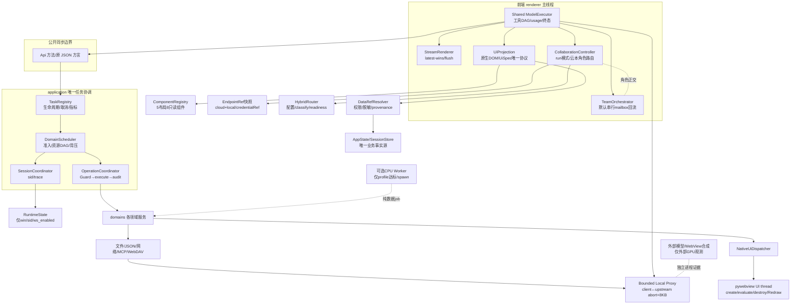
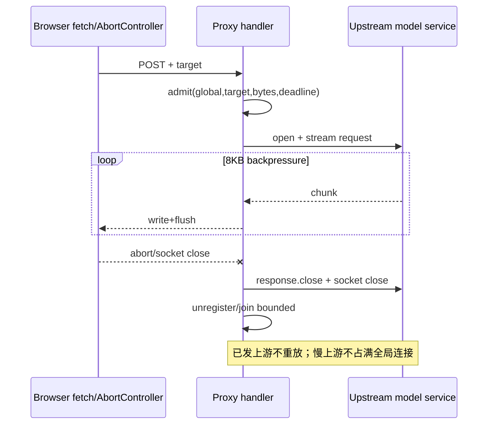
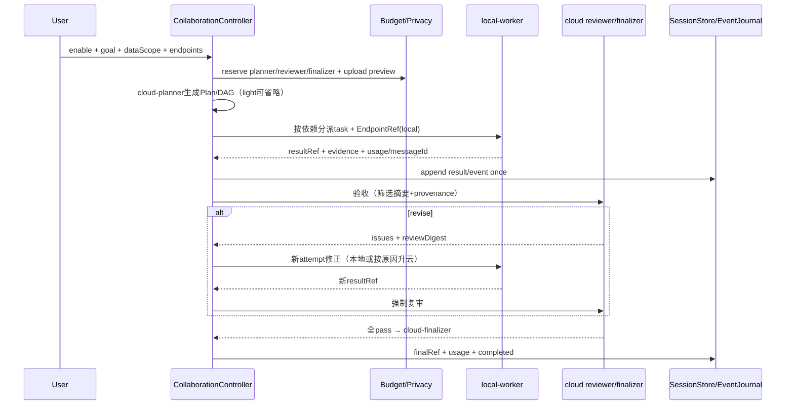
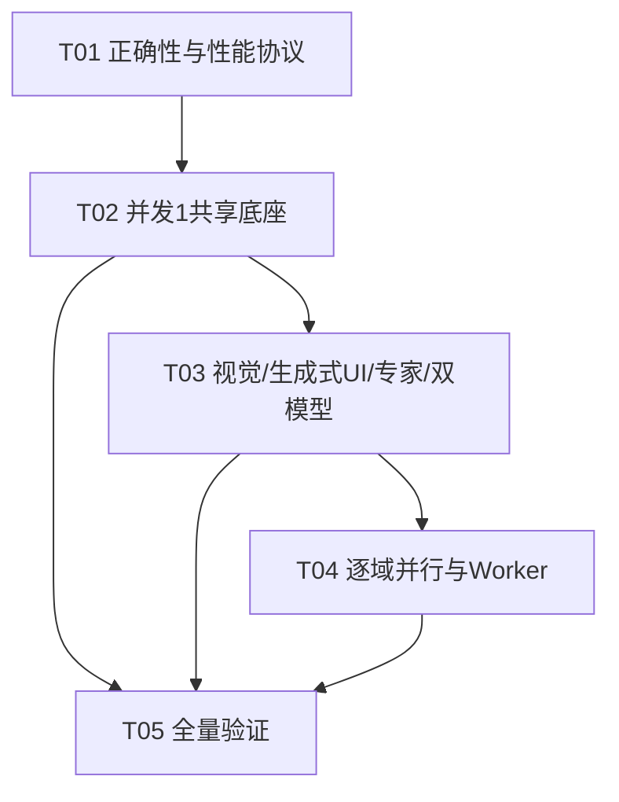

# Harbor 现代 UI / 专家 / 并行 / 双模型 / 生成式 UI 最终统一实施基准

- 日期：2026-10-27（生成式 UI 融合路线 + Agent 最佳实践应用矩阵整合）
- 状态：**后续实施唯一基准；只读审计与文档，不改产品代码**
- 上游：现代架构、专家统一架构、`harbor-v19-parallel-performance-prd-2026-10-27.md`、`harbor-v19-dual-model-collaboration-prd-2026-10-27.md`、`harbor-v19-generative-ui-prd-2026-10-27.md`；最佳实践输入为《约束解码与JSON-Schema结构化输出开发文档.md》与《AI-Agent开发知识体系-小哲263视频全总结.md》
- 技术约束：Python stdlib + pywebview + WebView2 + 原生 JS + Node 内置工具；生成式 UI 仅新增 Zod 单一 schema 依赖（vendor）与构建期 esbuild；不引 A2UI/Lit、Vue/React、AG-UI、iframe、Genkit 或第二页面运行时

> 本文继承而不推翻：同步 `Api`/`OperationCoordinator`/`SessionCoordinator` 协议与 Guard、RuntimeState 的 win/current_sid/ws_enabled 所有权、共享 ModelExecutor、普通与专家终态、Team 串行真回流、专家包安全、manifest、现代 UI 和 WaveGuard。W2 当前未验收；旧的 1510/25 只是历史结果，**实施第一步必须重跑当次全量，不能沿用为当前精确数**。本次未复测、未构建、未启动 exe。双模型协同作为共享 ModelExecutor 的 run 模式纳入本文，不另建第三运行时。

---

# Part A：System Design

## 1. PRD §12 九项裁决

| # | 最终裁决 |
|---|---|
| 1 | `TaskRegistry` 唯一拥有任务生命周期/取消/队列指标，`DomainScheduler` 只负责准入、resource DAG、背压与执行；`SessionCoordinator` 仍拥有 sid 切换/trace，`OperationCoordinator` 仍拥有 authorize→executor→audit。同步 `Api` 通过 `submit().result(deadline)` 适配，默认 inline 并发 1，不增加普通路径线程。 |
| 2 | `TaskEnvelope` 携带完整 ownership、resource keys、deadline/cancel、payload 和 expectedRevision。业务提交只在对应 domain 做 revision 检查，TaskRegistry 不写业务数据。锁按全局 rank 排序，慢 I/O/native 回调出锁；写操作不自动重试。 |
| 3 | Native UI 采用 **主线程 native dispatcher**：启动线程创建主/搜索窗；主窗创建后以 WinForms `BeginInvoke` 将 create/evaluate/destroy/RedrawWindow 回 UI 线程，Future 回传。调用方超时只退役该 window，不证明 zombie 已停，禁止另开 worker 与 zombie 并发。 |
| 4 | local proxy 用有界连接 registry 替代无限 ThreadingHTTPServer：全局/target 限制、队列条数/字节、慢连接退役、client abort→upstream close、8KB 读写背压；拒绝在入上游前发生，兼容 CORS/错误 shape，不创建第二模型客户端。 |
| 5 | ModelExecutor 工具 DAG 保持 Guard 先于执行、WRITE_SEQ_TOOLS 串行边界、CAPTCHA 挂起/取消、usage 首次提交与普通/专家终态。Team P0/P1 仍串行，Team 并行只属 P2 门禁。 |
| 6 | CPU Worker/进程仅 profile 达门槛后启用；Windows onefile 仅 spawn + freeze_support + 独立纯 worker 模块，IPC/取消/回收全测。Harbor 无 CUDA 证据；RTX4070/nvidia-smi 仅外部观测，不等于 Harbor GPU 加速。 |
| 7 | 无依赖采集：Python ctypes 系统计数、Node `--cpu-prof` + `monitorEventLoopDelay`、本地 CDP raw WebSocket、可选 nvidia-smi。7 次探索，≥30 次尾延迟；并发 1/2/4，median/P95/P99/原样本/算法优化与并行收益分开。 |
| 8 | 顺序为 W2 修复与当次全量 → 性能协议 → 并发 1 的共享 executor/native dispatcher → W4 视觉 → W4B封波 → G1–G4生成式UI → W5 专家 → W5E 双模型配置/schema/完整闭环 → W6 逐域并行/Worker → 条件 Team 并行 → W9 验收。每波白名单、真实行为+性能出口、WaveGuard 回滚。 |
| 9 | 反选全局大池、微服务和全异步 Worker；选择按领域资源键的可撤销调度。无净收益、P95 回退、资源不回落、取消/终态变化即恢复该域并发 1，并清理无用并行代码。 |

## 2. 新旧对比与目标架构

### 2.1 关键差异

| 当前事实 | 目标形状 | 为什么 |
|---|---|---|
| Api 直接同步调用各领域，尚无统一任务 envelope/背压 | Api admission → TaskRegistry → DomainScheduler → 原协调器/领域 | 不将 Operation/Session 变成队列第二 owner；公开同步返回不变 |
| RuntimeState 已有 RLock，Operation/Session 各有锁 | TaskRegistry 独立；锁 rank、快照与 revision 提交明确 | 锁存在不等于无线程竞态，更不等于 native 线程亲和 |
| DriverWindow/SearchBrowser 为每次 evaluate_js 起 worker+join；超时有 zombie | UI 线程 dispatcher + Future；超时 quarantine | 不再制造新 worker 与 zombie 并发 |
| local proxy 每连接一个 daemon 线程，8KB flush | 有界连接 registry + target/global/queue 限额 + abort 双向 close | 防止慢上游耗尽全部线程与句柄 |
| 工具批 `Promise.all` + 遇到写工具切片 | 同一 DAG：resource keys → read 并行候选 → write barrier → 原序 tool results | 保留结果顺序、Guard、CAPTCHA 和写边界，不盲目全并行 |
| perf 只有 median/min/max 和 Node/Python 微基准 | 系统/队列/浏览器/压力/取消全指标，7 探索+30 尾延迟 | 不把 Node stub 或首轮热冷混合误写成 GUI/并行收益 |

### 2.2 架构图



依赖保持单向：`Api → application → domains → infrastructure/external`；domains 不回调 Api/DOM，native dispatcher 不执行领域规则，TaskRegistry 不拥有业务状态，worker 不拥有公开协议。

## 3. 唯一所有权、TaskEnvelope 与同步适配

### 3.1 所有权边界

| 对象 | 唯一职责 | 明确不拥有 |
|---|---|---|
| `TaskRegistry` | task 注册、状态 queued/running/succeeded/failed/cancelled/timed_out/partial、cancel token、queue/wait/tasks/s 指标、关闭排空 | sessions、Guard、sid、native window、业务 revision |
| `DomainScheduler` | 准入、resource key DAG、并发/队列/字节、deadline、inline/worker 选择、执行与提交调用 | 任务历史、Guard 判定、业务提交 |
| `SessionCoordinator` | sid 原子切换、trace 失效、Guard/MCP trust 清理 | task queue、并行 worker、业务 executor |
| `OperationCoordinator` | authorize、one-flight（仅显式）、executor、audit 因果顺序 | 队列所有权、Deadline 总线、config/session 存储 |
| `ServiceContainer` | 单例 scheduler/native dispatcher/服务构建与逆序关闭 | 第二 RuntimeState、第二全局大池 |
| `NativeUiDispatcher` | native UI 调用队列、UI 线程身份、Future、quarantine、关闭排空 | 普通 task 调度、模型、业务状态 |
| `RunRegistry/ModelExecutor` | 前端 active run、actor ownership、工具 DAG、usage/终态 | Python 第二客户端、第二 active expert run |

`Api` 只对白名单领域走调度；默认路径 `concurrency=1` 且 inline 执行。同步适配：

```python
result = scheduler.submit(envelope, executor=operation.execute).result(
    timeout=envelope.remaining())
```

内部 `TaskResult{status,value,error,metrics}` 由 Api 映射回原 JSON 文本/裸文本和错误方言；不得把 TaskEnvelope 暴露到 `get_api_info` 或公开返回。

### 3.2 TaskEnvelope

```text
taskId, domain, operation, operationId,
resourceKeys[], dependsOn[],
sessionId, runId, generation, memberRunId?,
deadlineAtMonotonic, cancelToken,
payloadBytes, queueAt, startAt, endAt,
expectedRevision, submitRevision,
attempt, idempotencyKey?, dedupeKey?,
result, error, metrics{queueMs,connectMs,ioMs,serializeMs,waitMs}
```

- `taskId` 不等于 `operationId`：前者是一次调度，后者是 Guard/审计因果操作；trace 继续由 SessionCoordinator 提供。
- `resourceKeys` 在 admission 按 rank+canonical 排序，dependsOn 只表达真正先后依赖，不用锁模拟 DAG。
- `expectedRevision` 在快照时取得；提交时同 domain 再读 revision。冲突按现有 merge/tombstone/history 规则处理，TaskRegistry 不擅自覆盖。
- 取消先标记并优先移出 queued；running 只做协作取消/socket close best-effort。完成提交还必须再校验 session/run/generation/task；迟到结果仅归原 task。

### 3.3 结构化内部错误

```text
SCHEDULER_BUSY{domain,queueMs,retryable:true}
QUEUE_BYTES_EXCEEDED{domain,payloadBytes,retryable:false}
DEADLINE_EXCEEDED{domain,stage,retryable:false}
CANCELLED{domain,stage,retryable:false}
REVISION_CONFLICT{domain,expected,actual,retryable:false}
NATIVE_UI_TIMEOUT{windowId,stage,zombie:true,retryable:false}
PROXY_BUSY{target,retryAfterMs,retryable:true}
PARTIAL{domain,committed[],failed[],retryable:false}
```

这些不是新的公开错误协议。Api 在边界映射为各域现有 `err()`、`{ok:false,error:{...}}` 或 legacy 字符串；retryable=false 必须阻止前端自动重试。取消后不能再提交成功。

### 3.4 锁顺序与提交

全局 rank（低→高）：

1. TaskRegistry meta lock；
2. DomainScheduler queue/resource registry lock；
3. RuntimeState / SessionCoordinator trace lock；
4. OperationCoordinator inflight/Guard lock；
5. settings/session/workspace domain lock；
6. canonical path/task/audit sink lock（按 rank 后字典序）；
7. MCP entry/reconnect lock；
8. MCP HTTP pool lock；
9. native browser pool lock；
10. 仅保护 stdin/socket write 的 leaf lock。

规则：meta/queue lock 只在状态迁移持有；执行、审计 I/O、native、网络、慢文件 hash 不持前 5 类锁。跨 path/task 先按 rank+canonical 排序再获取。close/reconnect 先在锁内取快照/置代际，再出锁关闭；release 时复查 closed/generation。提交按 `expectedRevision` 和原业务锁完成，禁止锁内调用未知 observer/native。

## 4. 领域资源、并发、背压、超时与重试表

**约定**：default 是生产初始值；max 仅 P1/P2 经 A/B 后可达，不代表直接放开。所有写操作、命令、token consume、MCP tools/call、WebDAV PUT/restore、native evaluate/destroy 不自动重试。队列超限在 admission 返回结构化 busy，不静默排队。

| 领域 / resource key | default / max | 队列条数 / 字节 | deadline（含 queue+IO+serialize） | 去重 / 重试 |
|---|---|---|---|---|
| config/history/modelPrefs/experts：`cfg:<canonical file>@historyGeneration` | 1 / 读4写1 | 32 / 4MiB | 10s；历史迁移 60s | 同文件 revision 读可合并；写不合并不重试；history generation 使旧读失效 |
| sessions：`store:<canonical sessions file>` + `sid:<sessionId>` | 1 / 读2、store写1 | 32 / 16MiB | 30s | 同 store revision 读合并；同 sid 事件保序；保存/墓碑/purge 不重试 |
| workspace：`ws:<root>:<canonical path>` | 1 / 不同只读4、path写1 | 64 / 32MiB | 60s；大文件 120s | 同 fingerprint+offset 读可合并；跨 path 排序锁；写/移动/删除不重试 |
| Guard：`guard:<sid>:<op>` | 1 / check读2、execute写1 | 64 / 4MiB | 15s，人审按现有协议 | 同 cfg revision 的 check 可合并；token/trust/budget/execute 不去重不重试 |
| audit：`audit:<sink>` | 1 / 1 | 256 / 16MiB | 15s | 不合并、保持因果顺序；失败按现语义，不自动重试 |
| plan/checkpoint：`plan:<taskId>` | 1 / 读2、task写1 | 32 / 16MiB | create/list 60s；rollback 300s | manifest revision 读可合并；同 task 回滚串行；写/回滚不重试 |
| MCP stdio：`mcp:stdio:<serverId>` | 1 / 1 | 64 / 32MiB | connect30s、list15s、call默认60s（配置10–300s） | tools/list 同 generation 可合并；stdin 写 1；call 不重试；关闭/取消 best-effort |
| MCP HTTP：`mcp:http:<serverId>:<scheme:origin>` | 1 / server4、connection1 | 64 / 64MiB | 同 stdio；SSE watchdog 原有 | list 可合并；连接不共享写；404 仅幂等 initialize/list 可握手重放一次，tools/call 不重放 |
| WebDAV：`webdav:<backupId>:<host>:<jobId>` | 1 / 独立job2、backup写1 | 16 / 64MiB | 600s | 同 manifest revision GET/hash 可合并；PUT/export/restore/冲突写不重试 |
| update/provider：`net:<jobId>:<origin>` | 1 / update1、provider读2 | 16 / 64MiB | test30s、download600s | 同 URL manifest/models 仅在途合并；下载/应用不写自动重试 |
| local proxy：`proxy:<target>` + `proxy:global` | target1/global1；max target4/global32 | 128 / 32MiB；请求体仍32MiB | connect10s、idle read300s、active total1800s | 不在途重复转发；PROXY_BUSY 入上游前可直连/稍后；中途中止不直接重放 |
| native browser：`native:<windowId>` + pool3 | 1 / 1，window pool 3 | 32 / 8MiB | evaluate6s、navigate60s、destroy5s | 同 page revision outerHTML 仅在途合并；evaluate/create/destroy 不重试；zombie quarantine |
| frontend stream/render：`run:<runId>:<element>` | DOM1 / 1 | 256 chunks / 4MiB（latest-wins） | 现有 run/stall deadline | 未绘帧只保留最新；终帧 flush；网络仅保留45现有重试 |
| Team：`expert:<runId>:<memberRunId>` | 1 / P0–P1=1；P2独立成员2 | member8 / 256KiB；events沿用原上限 | run30min、member8min | mailbox eventId 幂等；member/mailbox写不重试；P2需独立资源与预算证明 |
| 双模型协同：`collab:<runId>:<taskId>:<attempt>` + `model:<endpointDigest>` | 1 / P2独立只读任务2 | 12 / 8MiB | 全链路默认1800s；单阶段按预算 | messageId 结算幂等；仅幂等模型请求重试；工具副作用零自动重放 |
| 生成式 UI：`ui:<runId>:<specId>:<blockId>` + `entityId` | DOM1 / 1 | 12 blocks / 64KiB spec；数据按DataRef限额 | 沿用生成run deadline；半block只Skeleton | 完整block可替换；revision/run/session/generation拒绝旧spec；P0 actions off |
| CPU Worker（可选）：`cpu:<pure-job-type>` | 0（不启动）/ 2 | 8 / 64MiB | 120s | 小任务不卸载；纯确定性只读job崩溃可重试一次，副作用job不进入 Worker |

控制类任务（cancel/close/shutdown）不占普通 FIFO 尾部；但不越过同 resource key 已提交的写步骤。所有 max 仍受上游 RPM、内存和连接约束。

## 5. Native UI dispatcher：可行实现与超时真相

### 5.1 启动与调用线程

1. `main.py` 在 `webview.create_window` 前创建 dispatcher，记录 `ownerThreadId` 与启动阶段。主窗与预创建搜索窗在 **webview.start 的同一启动线程** 经 dispatcher bootstrap-call 创建，不在新 worker 创建。
2. 主窗形成后，dispatcher 注册 `window.native.BeginInvoke` adapter。后续 create/evaluate/destroy/RedrawWindow 都必须 `submit(NativeCall)`；callback 线程仅提交 Future，worker 仅等待结果，不能直接触碰 Window/CoreWebView2/HWND。
3. Windows `System.Action` 回主 Form UI 线程执行调用并记录实际 thread id。create/evaluate/destroy 返回经 `concurrent.futures.Future` 回传；异常在 UI 线程捕获并回传结构化错误。
4. macOS 仅用独立 platform adapter 预留，不在无真机证据时宣称等价完成；P0 是 Windows。`_js_lock` 只能作为额外互斥，**不能作为线程亲和证明**。

### 5.2 调用语义

| 操作 | UI 执行 | 调用方/超时 |
|---|---|---|
| create_window | bootstrap 启动线程直接调用；运行期 BeginInvoke | 返回 window ref + owner thread evidence；失败按原 urllib/降级 |
| load_url/evaluate_js | 同 window 队列顺序执行 | Future result；evaluate 6s 后返回 NATIVE_UI_TIMEOUT 并 quarantine |
| destroy/show/hide | 同 window 队列尾部，先停新调用 | 等 bounded drain；销毁后才清 profile |
| RedrawWindow | BeginInvoke 调 user32，保留原 flags | 返回 nudged bool/原因；不新增周期线程 |

### 5.3 timeout zombie 与关闭排空

- UI 内 evaluate 同步卡住时，调用 Future 可超时，但 **UI 仍可能阻塞**。将该 window 标 `quarantined`，后续调用立即失败，不另起 evaluate/destroy worker。
- UI 最终返回后，dispatcher 先执行 quarantine close；若永不返回，只能保留退化状态并记录，不能谎称 kill。主窗关闭/进程退出是唯一最后边界，不在本文宣称强杀僵尸。
- shutdown：停止准入→queued Future 取消→当前 UI 队列排空→driver/search 窗口按 key 关闭→container 其他资源逆序关闭。超时不能排空时返回 partial 并记录 windowId，不并行强销。
- 测试记录创建线程、执行线程、返回线程；违规直接 Window 调用即失败。覆盖 evaluate hang→quarantine、close+release、主窗 closing 无残留、UI pumpable/非 pumpable 降级。

## 6. Local proxy：有界 stdlib 转发

### 6.1 连接 registry 与背压

- `LocalCorsProxy` 持有 `connections{connectionId:{target,upstream,client,created,lastActivity,cancelEvent}}`，全局/target 限额见表。`ThreadingHTTPServer.daemon_threads=True` 不再等于无限：admission 前注册，超限立即拒绝并 `close_connection=True`。
- 每连接仍只一个 handler 线程处理同步 stdlib socket（不是加速）；全局 thread 数与 registry 一致。慢/超时连接可摘除，只有 owner 执行 close。
- 上游 read 8KB→下游 write+flush；下游阻塞/断开后停止继续 read，关闭 upstream response 和 client。上游 socket 写入/请求体也有 deadline 和 32MiB 上限，不能无限缓冲。
- 队列按条数+字节双重限制；拒绝发生在任何上游请求前。`PROXY_BUSY` 以 CORS JSON `{error,code,retryable:true,retryAfterMs}` 返回；45 识别该码不错误放大重试。尚未入上游可按既有 direct 降级；已发上游绝不另发 direct 重放。

### 6.2 abort 与关闭



`shutdown` 先 stop admission，再快照 connections，逐个 close upstream/client，server.shutdown/server_close，join 有界并报告未退出。保留现有 CORS、HTTP 错误体、no-redirect、目标白名单、GET/OPTIONS 和前端 fallback；代理不做模型推理，不复制 API Key 到新后端运行时。

## 7. 共享 ModelExecutor 工具 DAG 与 Team 门禁

### 7.1 工具 DAG

```text
assistant tool_calls（原顺序）
  → Guard/detail 归一（不执行）
  → resource keys 排序 + 写 barrier 分段
  → [只读、不同 resource key 且有收益：候选并行]
  → WRITE_SEQ_TOOLS + 同 path/stdio/window/config：原序串行
  → 原顺序 tool results 回填 → 下一模型轮次
```

- `WRITE_SEQ_TOOLS=['write_file','append_file','search_replace','move_path','copy_path','delete_path']` 永远进入写 barrier；同 resource key 也串行。P0/P1 默认整个 batch 顺序，先证明行为再开放独立只读。
- Guard/token/审计顺序不可被 DAG 重排；Guard 失败的 executor 调用为 0。CAPTCHA 是节点等待态，保留 last-wins、abort 和终态注入；等待不释放 active run。
- usage 只在 assistant 首次提交时累计；tool result 按原 call 顺序，重试/迟到帧不重复。partial、cancelled、turn_limit、budget_exceeded、naturalDone/length 及计划 blocked/done 保持。
- 普通请求未选专家仍无 expert 调用；普通工具/请求体/usage 差分是每次并行改动的前置门。

### 7.2 Team P2 并行条件

Team 默认 `team_parallel=false`。只有同时满足才可 P2 实验：

1. members 无共享 path/config/stdio/native window，ModelExecutor 上下文独立；所有写仍回各自 resource barrier。
2. 每上游 origin 有 RPM/连接额度，模型总并发≤2；总/member turns、token/cost 在派发前原子预留，失败返还未使用额度，usage 不重复。
3. mailbox 以 `phaseSeq/memberSpawnSeq/eventSeq` 排序，而非网络到达顺序；lead 只在 barrier 后按序消费，eventId 幂等。
4. 全成员完成/失败/partial 才进入 lead；取消会停止全队列和当前 fetch，不派生新成员。
5. 串行与并行 event/projection/usage/终态等价，且 P95 有稳定收益；默认关闭，失败即恢复串行。

## 8. CPU Worker / spawn 与 GPU 边界

### 8.1 卸载门槛

候选仅限 Markdown/highlight、JSON/diff/hash/压缩、搜索/分析中纯数据部分。**当前证据不支持立即卸载**：`parallel-baseline.json` 首轮 profile 主要耗时为 512 次 `_io.open`（约 0.265s/0.344s，属 I/O/冷枚举，不是 GIL 内纯 CPU）；list_dir 11.708ms 太小；analytics 47.186ms 是 10 轮聚合总和（约 4.719ms/轮且不含 DOM），也未达门槛。它们应先做算法/I/O 与真实 CDP 复测，不得直接 Worker 化。

新的候选必须同时满足：

- profile 显示目标任务 CPU 占比≥70%，且 renderer 单次 >50ms 或后端单次 >250ms；
- 纯输入≥256KiB 或重复调用≥3 次，payload 可序列化，无 DOM/Api/localStorage/Guard/文件副作用；
- A/B 包含序列化、IPC、spawn 后，总耗时改善≥20% 且加速比≥1.3×，无新增 >50ms LongTask、RSS/句柄回退。

否则留原线程。JS Worker 仅纯文本中间结果；DOMPurify/ sanitize/DOM/焦点仍主线程。Python 线程不用于绕 GIL。

### 8.2 Windows onefile spawn

- `multiprocessing.freeze_support()` 是应用入口最早调用之一；worker 入口独立 `backend/workers/__main__.py`，含 main guard，绝不 import main/webview/Api。
- 使用 `get_context('spawn')`，初版单 `Process` 而非隐式全局 Pool；最多2。Queue 长度+字节双限，任务携带 jobId/deadline/payload digest。
- 父进程保留 job registry；取消先发 cancel event，纯 job 检查点后退出；必要时 terminate→join(5s)→kill→join，测 thread/handle/RSS 回落。worker 不写用户文件、不持 API Key。
- 源码 spawn 测试：冷/热启动、pickle、大 payload 拒绝、cancel in queue/running、异常、父退出回收。打包做静态 frozen 检查；onefile 实启验证需用户/明确人工，**本团队不主动启动 exe，不能预写 PASS**。

GPU 仅记录外部推理进程或 WebView2 合成器。`nvidia-smi` 可测 RTX4070 不代表 Harbor 使用；无外部进程 PID 映射时不归因，工具缺失标未覆盖。

## 9. 无依赖性能工具与判定

### 9.1 采集实现

| 层 | 零依赖实现 | 指标 |
|---|---|---|
| Python | `time.perf_counter`；ctypes `GetProcessTimes/GetProcessMemoryInfo/GetProcessHandleCount/GetProcessIoCounters`；`threading.active_count`；scheduler hooks | wall/user/kernel CPU、RSS、threads、handles、I/O bytes、queue/wait/tasks/s、deadline/cancel |
| Node | `process.cpuUsage/memoryUsage`；`perf_hooks.monitorEventLoopDelay`；`node --cpu-prof --cpu-prof-dir <artifact>` | event-loop delay median/P95/P99、heap、CPU profile、tasks/s |
| CDP | stdlib socket/base64/struct 实现本机 raw WebSocket；仅连已授权现有端点，不启动 exe/浏览器 | Performance metrics、PerformanceObserver longtask/event/paint、Tracing layout/paint、rAF 帧间隔、input-to-paint |
| GPU | 可选 `nvidia-smi --query-gpu` 与 `--query-compute-apps` | 外部 PID/process/util/memory；无则 UNCOVERED |

CDP 只连 127.0.0.1 已授权端点；原始帧解析做长度/上限/超时，禁止任意远程 WS。Node/CDP/外部模型/exe 分栏，不混写。

### 9.2 样本、百分位与场景

- 有效样本排序后，median 用常规中位数；P95/P99 用 **nearest-rank**：`x[ceil(p*N)-1]`（1-based），不插值，保留全部原样本。7 次只用于探索；尾延迟结论每组≥30 次，异常不得删除，只能注明原因并全部呈现。
- 冷/热分组：新进程/profile/首次枚举为冷；预热内容明确。baseline/A/B 交替，记录 dirty tree hash、OS/Python/Node/WebView、供电与后台负载。
- 每域并发 1/2/4 扫描，先最低并发；吞吐 tasks/s、queue/connect/first-byte/total、P95/P99、RSS/threads/handles、取消时间、压力后30s回落。
- 四组对照必须分开：**原算法串行 → 新算法串行 → 新算法并行 → 并行压力/取消**。算法收益不得归因多线程。

### 9.3 冻结回退门

- 功能门：当次全量 0 failed、公开契约和 correctness checksum 先过。
- 通用微指标：median/P95 退化不得超过 `max(10%,0.25ms)`；调度指标 `max(10%,2ms)`；UI/CDP 指标 `max(10%,16ms)`。P99 同相对门，但只在≥30样本下判发布。
- 不得新增 >50ms LongTask；tasks/s 退化>10% 拒绝；取消耗时不优于基线门 `max(10%,16ms)`。
- RSS 峰值回退门 `max(10%,32MiB)`；压力后30s不得出现持续 >2 threads 或 >8 handles 的净增长；zombie>0、queue 不回落即失败。
- 目标指标至少稳定改善一个，其他关键指标无未解释回退；收益小于调度开销或仅 CPU/GPU 占用上升即撤销。

## 10. 分阶段实施、文件白名单与回滚

每波先 `wave_guard.snapshot`，完成后真实行为/性能出口再 `complete --tests --performance`；只允许逆序最新 Wave。发现 post-hash 变化拒绝整文件恢复，改逐 hunk 逆补丁。不得修改 W1 证据、dist 或历史成果，不整库 reset/checkout/stash，不主动启动 exe。W3C-1 的 57 个机械迁移虽已完成，但其旧测试路径接缝由工程师另行修复，**不构成当前全量通过证明，也不改变本文架构裁决**。

| 顺序 | 文件白名单（实施时展开为逐文件 manifest） | 依赖与操作 | 真实测试/性能出口 |
|---|---|---|---|
| W2 正确性 | `backend/application/*`, `backend/bootstrap/*`, `backend/domains/**`（含 providers/prompt_loader），`backend/api.py`, `main.py`, `frontend/build.js`, manifest/CSS harness, `tests/conftest.py` 与受影响 tests, specs | 先修 W2、prompt_loader 路径/注释、manifest 注释与 CSS 接缝；不做性能改写 | 当次全量真实结果、API/release/UI、import/py_compile、build×2；不得引用旧25为当前数 |
| W2P 性能协议 | `tools/perf_benchmark.py`, `perf_frontend_benchmark.js`, 新增 `perf_stats.py`, `perf_system.py`, `perf_cdp.py`, `tests/test_*performance*`, 新 outputs | W2；冻结数据/算法/噪声/冷热/并发扫描 | 工具自测 percentile、CPU/RSS/handle/queue/event-loop/CDP 可用性；7探索+30尾延迟原样本 |
| W3 并发1共享底座 | `backend/application/{task,scheduler,registry,native_ui}.py`, `backend/bootstrap/container.py`, `backend/api.py`, `backend/runtime.py`, native browser files, `main.py`, `frontend/providers/request.js`, `agent/*`, sessions/store, 45/50/60/110 对应新映射, manifest/harbor.html | W2P；TaskEnvelope/inline scheduler/native dispatcher/共享 executor；default inline1 | 普通请求/API/Guard/usage/终态差分；native thread evidence、zombie quarantine、取消、晚桥；普通路径新增线程=0 |
| W4 全局视觉 | styles/template/components/shell/manifest/harbor.html | W3；不夹带并行放开 | 原全视觉矩阵、CDP LongTask/layout/paint、375/800/1280、reduced-motion |
| W4B 封波确认 | 只读现有 W4B manifest/styles/components，不改前像 | 现有视觉与旧入口基线 | snapshotted 不当 completed；保留现状与回滚点 |
| G1 schema/registry/最小渲染 | `package.json`, `package-lock.json`, `frontend/vendor/*`, `tools/build_ui_schema_bundle.js`, `libs/ui-schema.bundle.js`, `frontend/src/generative/{schemas,registry,projection}.js`, components, `Harbor*.spec`, `tools/check_release.py`, manifest, NOTICE, `tests/test_generative_registry.py` | W4B；Zod vendor+5布局8组件+原生投影 | 手写有效UiSpec/未知组件/坏props；bundle字节/SHA256/gzip实测、离线build×2、无innerHTML/eval、aria/tokens |
| G2 真实 DataRef | `frontend/src/generative/{data-ref,fixtures}.js`, planning/card, integrations/mcp-panel, settings/memory, sessions/store, `tests/test_generative_data_ref.py` | G1；真实plan/MCP/memory→DataRef→view model | plan_get权威/MCP刷新/memory entityId；伪造path/secret/stale/forbidden、状态更新、原视图切换与旧入口100% |
| G3 fake block闭环/降级 | `frontend/src/agent/model-executor.js`, `frontend/src/generative/{artifact,projection}.js`, `tests/test_generative_artifact.py`, `tests/test_generative_dom.py` | G2；完整/半block/毒数据/超时/旧revision→投影或Skeleton/fallback | 真实DOM动态生成、正常展开/切换、半JSON不parse、unknown/binding.miss/XSS/overflow、取消旧spec与手写fallback |
| G4 状态/动作/视觉性能 | `frontend/src/core/state.js`, `frontend/src/generative/{actions,state}.js`, components/overlays, `styles/features/generative.css`, perf tools, `tests/test_generative_state.py`, `test_generative_visual.py` | G3；状态回挂+默认off低危动作+全局视觉 | actions默认0；显式开启+点击+原Guard；entity/revision回挂、375/768/1280、44px/focus/aria/reduced-motion、P95/LongTask/旧入口 |
| W5A–D 专家 | `backend/domains/expert/**`, `frontend/src/expert/**`, `styles/features/expert.css`, `analytics/expert.js`, paths/api/container/manifest/harbor.html | W3+W4；包服务→Agent→Team串行→中心 | 包安全/脚本零执行、Agent直调、member→mailbox→lead下一模型轮次、恢复/usage、默认普通零变化 |
| W5E1 双模型配置/schema | `backend/domains/providers/hybrid_router.py`, `frontend/src/collaboration/{endpoint,schemas,config,router}.js`, `tests/test_collaboration_config.py`, `tests/test_collaboration_schema.py` | W3+W5A；hybrid.json默认off、EndpointRef缓存、Plan/Task/Result/Review硬校验 | 两个预设方向来源、无秘密、旧hybrid/config fixture、DAG无环/上限/引用不变量、普通单模型差分 |
| W5E2 单worker闭环 | `frontend/src/collaboration/{controller,plan,budget,privacy}.js`, `frontend/src/agent/{model-executor,tool-runtime}.js`, `tests/test_collaboration_flow.py` | W5E1；共享executor实际接入 | fake planner→local worker→cloud reviewer→revise→强制复审→finalizer，resultRef/reviewDigest/final引用、调用顺序和成本 |
| W5E3 隐私/预算/恢复 | `frontend/src/collaboration/{budget,privacy,recovery}.js`, `frontend/src/expert/{events,projection,recovery}.js`, `tests/test_collaboration_budget.py`, `tests/test_collaboration_privacy.py`, `tests/test_collaboration_recovery.py` | W5E2；预算预留、最小上传和checkpoint | 预算预留/无usage保守估算/messageId防重、local_only/fallback disabled、脱敏预览、取消/迟到帧/parentRun恢复、工具副作用0重放 |
| W5E4 协同UI与复用 | `frontend/src/collaboration/{ui,timeline}.js`, `frontend/src/providers/hybrid.js`, `frontend/src/expert/timeline.js`, `frontend/styles/features/collaboration.css`, `frontend/index.template.html`, manifest/harbor.html, UI tests | W5E3+W4；原混合卡内协同区与timeline复用 | 375/768/800/1280、深浅/焦点/44px/reduced-motion、Agent/Expert复用；真实端点质量UNCOVERED |
| W6P1 逐域并行 | settings/workspace/security/planning、MCP pool/client/transports、WebDAV、`providers/local_proxy.py`, `application/scheduler.py`, 对应 tests | W5；仅按域逐个开1→2→4，写保持1 | 同文件/session/stdio/pool close+release 竞争；MCP 404、WebDAV 非幂等、proxy abort/背压；性能收益和资源回落同时通过 |
| W7 CPU Worker（条件波） | `backend/workers/**`, `main.py` freeze guard, `frontend`纯计算Worker与perf tests，specs | W6P1 + profile 达门槛；未达即不创建 | spawn/IPC/cancel/回收、长任务/总耗时净收益；源码可测，frozen 真机另列未覆盖 |
| W8P2 Team并行（默认关） | `frontend/src/expert/{orchestrator,mailbox,projection}.js`, `agent/tool-runtime.js`, `providers/request.js`, tests | W5C+W6P1；独立成员/预算/限流/顺序全证明 | 串并 projection/event/usage 等价、上游限流、取消、mailbox顺序；无稳定收益即不开 |
| W9 总验收 | 全量 tests/tools/specs/installer/README/交付报告；缺陷按新白名单 | 全部前序 | 当次全量、API/release/UI/build×2、30尾延迟/压力/取消、安装器与三exe哈希；真实边界缺口分栏 |

撤销：先把该域 max 调回1并恢复串行出口，删除无收益的 worker/parallel 代码，不保留长期双执行路径。性能失败与功能失败分别记录，禁止删测/skip/放松断言。

## 11. 方案反选、可靠性与撤销条件

| 方案 | 扩展性/可靠性/安全/成本 | 决策与撤销 |
|---|---|---|
| 全局大池 | 接入快但共享资源失序、线程/句柄放大、取消困难、GIL误区 | 反选；任何局部池也必须有界与 owner |
| **DomainScheduler + resource DAG** | 保留同步门面，独立 I/O 可并行，能背压/审计/单域撤销；实现成本中 | **选择**；无净收益/P95回退/状态错误即该域并发1 |
| 微服务/全进程重写 | 隔离强但 IPC、部署、协议、安全、会话成本最高 | 反选；仅纯 CPU job 可 spawn |
| 全异步/全 Worker | 网络模型统一假象；公开同步API/Win32/DOM不可直接套，序列化与 sanitize 成本高 | 反选整体；保留 JS 事件驱动与个别纯 Worker |
| 单纯加锁 | 可减少数据竞争，但不证明顺序/线程亲和/背压 | 不能单独作为方案；锁 rank+快照+dispatcher 必须同时存在 |

额外风险：404/重连重复非幂等调用、关闭与 release 竞态、UI zombie 被误报已 kill、Team 提前并行、性能工具自报超时为功能通过。对应Gate均要求真实调用次数、连接回收、终态和资源证据。

无开放架构问题。尚未覆盖的 frozen onefile 实启、真实 WebView2/CDP、外部端点/GPU/macOS 必须在报告标 UNCOVERED，不改变本设计的保守默认。

---

## 12. 双模型协同：共享 ModelExecutor 的一种 run 模式

### 12.1 双模型 PRD §12 十项裁决

| # | 最终裁决 |
|---|---|
| 1 | `CollaborationController` 只负责 run mode、角色路由和 phase 推进；ModelExecutor 管模型/tool loop，RunRegistry 管唯一 active run，DomainScheduler 管 TaskEnvelope，HybridRouter 管旧 strategy/分类/本地健康。cloud-planner/local-worker/cloud-reviewer/cloud-finalizer 与 Team lead/member 正交，复用 actor/mailbox/event/SessionStore，无第三运行时或 Python 第二客户端。 |
| 2 | `EndpointRef` 在 run 启动冻结 cloud+local 双快照，含 credentialRef 而非秘密、model/baseUrlRef/prices/toolCapability/ctxWindow/digest。当前 preset 与 last-known-good cache 共同派生，禁止切换 providerState/localState 来换角色。 |
| 3 | Plan/Task/Result/Review 采用强 schema、有限 DAG 和 resultRef/reviewDigest/finalRef 绑定；修正产生新 attempt，修正后必须重新 review，未全 pass 或未 final 整合不得 completed。 |
| 4 | 本地能力路由由 local_readiness、requiredTools、ctxWindow、历史确定性失败和 capability 组成。classify 置信只表示分类，结果质量置信另算；仅复杂/校验/失败/低置信升云，本地优先也不取消云端验收。 |
| 5 | cloud/total 同时约束 prompt+completion，planner/reviewer/finalizer 先预留。无 usage 采用保守估算，messageId 结算防重；调用前原子预留，review/retry 有限，工具副作用零自动重放。 |
| 6 | 默认 `task_summary_only`：无附件/工作区原文/全历史，云端只收任务、验收标准、有界摘要和筛选结果。上传预览/脱敏/provenance/local_only/fallback disabled 全部强制，恶意 local 输出仍是 untrusted asset。 |
| 7 | hybrid.json 增加可选 collaboration 对象，默认 off，旧 strategy/部分更新/损坏恢复不变。**不新增 run js_api**，复用 hybrid_get/save_config、local_readiness/local_models/test_provider_endpoint；它们都已是 `_V12_EXTRA`，get_api_info 不变。 |
| 8 | 协同区放原混合设置卡，运行 DAG/usage/预算/停止/数据范围复用专家 timeline 和现代 tokens；375 单列可用，不做“双脑”营销视觉。 |
| 9 | P0 用 fake transport 完成云规划→本地执行→云 review→修正→强制复审→final，另测预算/隐私/取消/恢复/rubric/成本和单模型差分；真实端点质量、延迟与 exe 均 UNCOVERED。 |
| 10 | 纳入 W3C 共享 executor→W4 视觉→W5 专家→W5E1 配置/schema→W5E2 单 worker 闭环→W5E3 隐私/预算/恢复→W5E4 UI/复用→W6 并行→W9 验收，逐波白名单与 WaveGuard 回滚。 |

### 12.2 模块树、职责与接口

```text
backend/domains/providers/hybrid_router.py
  # 只做旧策略/classify/本地健康/cost_split + collaboration配置校验；不调模型
frontend/src/
  agent/model-executor.js              # 唯一完整模型/tool loop
  providers/{request,provider,hybrid}.js
  collaboration/
    controller.js                     # run mode + phase 状态机，不另设active run
    endpoint.js                       # EndpointRef/CredentialBroker/快照
    schemas.js                        # Plan/Task/Result/Review/outputSchema
    router.js                         # 确定性capability路由与升级原因
    plan.js                           # DAG/attempt/resultRef/finalRef不变量
    budget.js                         # 预留/结算/cloud+total/cost
    privacy.js                        # dataScope/redaction/upload preview/provenance
    config.js                         # collaboration defaults与UI配置映射
    recovery.js                       # 复用专家checkpoint/parentRun适配
    timeline.js                       # 复用专家timeline的协同projection
    ui.js                             # 原混合卡协同区
  expert/{events,projection,recovery,timeline}.js  # 同一事件/恢复/UI底座
```

接口：

```js
collaboration.start({
  runId, sessionId, generation, goal, dataScope,
  endpoints: {cloud: EndpointRef, local: EndpointRef},
  executor: ModelExecutor, scheduler: DomainScheduler,
  eventJournal, sessionStore, signal
}) -> Promise<{status, finalRef, planDigest, usageRef}>

executor.execute({
  context: ActorContext, endpoint: EndpointRef,
  transport, tools: ToolRuntime, observer, signal, limits
}) -> ExecutionResult                         // 与普通/Expert共用

router.decide({task, readiness, history, ctxWindow, policy}) -> {
  actor: 'local-worker'|'cloud-worker', reason,
  categoryConfidence, qualityConfidence?, evidence
}
```

边界：CollaborationController 不直接 fetch/DOM/写 config.json；EndpointRef 不携带明文 Key；HybridRouter 不执行协作；privacy/budget 在任何上游调用前执行；Team lead/member 保持原角色与串行 mailbox，cloud/local 只决定 actor 使用哪个模型。

### 12.3 EndpointRef 双端快照与两个激活方向

```text
EndpointRef {
  role: cloud|local, preset, baseUrlRef, model,
  credentialRef, prices{in,out,cache}, toolCapability,
  ctxWindow, snapshotDigest
}
```

`credentialRef = {kind:'provider-key'|'local-no-key'|'custom-provider-key', providerConfigDigest}`，仅供 CredentialBroker 从现有 `provider_key`/#apiKey 或本地免 Key 通道解析；不写 hybrid.json、事件、日志、endpoint_cache 正文或新密钥库。

当前连接是单活动端点，因此不能假设两个端点总在 config 同时存在。采用**当前配置 + last-known-good 非秘密 cache**：

1. `collaboration.endpoint_cache.cloud/local` 只在用户显式“保存并测试连接”成功时记录 `{preset,baseUrlRef,model,prices,toolCapability,ctxWindow,validatedAt}`，它是快照缓存，不是第二连接设置，也不保存 Key。
2. **本地预设激活时**：cloud EndpointRef 取 `endpoint_cache.cloud`，不得把当前 local providerState 当云。若 cache 缺失，先连接并测试云端一次；需要 Key 时还必须由 CredentialBroker 验证现有云 secret 通道可解析，否则阻断并提示重连云端。启动云角色的那一刻必须能解析该 cloud credentialRef，不能拿本地/不匹配 Key 冒充。
3. **云端预设激活时**：local EndpointRef 取 `endpoint_cache.local`；无 cache 则先连接并测试本地一次。cloud 直接使用当前 provider_* 配置与现有 credentialRef。需要本地自定义 Key 时同样必须能由现有秘密通道解析，否则阻断。
4. 两个快照在 run 开始后不可变；普通请求继续使用当前全局端点，协同 transport 只接收角色 EndpointRef。禁止为了 planner/worker 反复修改全局 providerState/localState。

这条规则同时避免“本地激活就没有云配置”和“云端激活就没有本地模型名”的静默错配。首次从未分别验证两端时，协同不可启用，而不是自行选择默认模型。

### 12.4 Plan / Task / Result / Review 精确 schema 与不变量

沿用 PRD 的 `CollaborationPlan/CollaborationTask/TaskResult/TaskReview` 字段，并冻结以下约束：

| 项 | P0 上限/规则 |
|---|---|
| plan/goal | schemaVersion=1、runId/planId/planDigest；goal≤8000字符，acceptanceCriteria≤8项/task |
| tasks | 2–12个（light=1），dependsOn 引用必须存在、taskId 唯一、DAG无环、最大深度4 |
| capability | kind∈understand/validate/plan/compose；requiredTools 必须是当前 Guard 后有效工具子集；outputKind∈text/markdown/json/file_patch/analysis |
| input/output | instruction≤4000字符；outputSchemaRef 只允许 type/required/properties/maxLength 的受限JSON Schema，不执行schema代码 |
| result | 单结果≤32KiB、evidenceRefs≤16、每run结果总量≤256KiB；resultRef=`res_<plan>_<task>_a<attempt>_<digest12>` |
| review | issues≤32；reviewDigest=SHA256(canonical(result)+rubric+reviewerEndpointDigest)；confidence∈[0,1] |
| attempt/retry | 初次attempt=1，max_review_rounds=2时最多attempt=3；模型传输/schema retry另计modelRetry≤1，不伪造新result |
| final | finalRef 只引用各task最新且pass的resultRef；每个阻断issue必须由后续pass review的reviewDigest关闭 |

attempt/resultRef/reviewDigest 一一对应，旧 attempt 的结果、usage 或 review 不得覆盖新 attempt。final 只能整合已通过的最新结果和修正，finalRef=`final_<plan>_<digest12>`，其输入引用必须可回溯至 planDigest。

状态：`draft→planning→planned→dispatching→reviewing→(revising→reviewing)*→finalizing→completed`。planned 需 schema/DAG/dataScope/预算预检全过；completed 需全部必需任务 pass、未决修正=0、finalRef 有效。其他有产出但未全通过为 partial；重载时非终态只显示 recovery_available，不假装仍在运行。

### 12.5 确定性能力路由与验收 rubric

复用 `HybridRouter.classify_task`、`check_budget`、`report_local_result` 和 `stage_request` 的纯函数思想，旧 strategy 与 cost_split 保持。协同路由顺序固定：

1. **硬否决**：local_only/fallback disabled、requiredTools 不在 local toolCapability、输入+预期输出超过 ctxWindow、readiness=cloud、历史同类确定性 schema/工具失败 → 不允许本地执行；能升云且隐私允许才走 cloud，否则 partial/failed。
2. **能力匹配**：readiness full/partial 且工具、窗口、输出kind满足 → local-worker 优先。plan/compose 的高复杂度、跨任务整合、独立校验由 cloud planner/reviewer/finalizer承担，而不是所有任务都升云。
3. **失败升级**：本地连接/超时/schema连续无效/工具失败/低质量置信时，记录确定原因；只允许在当前 dataScope 下升云，工具副作用不重新执行。
4. **置信区分**：`classify_task.confidence` 只表示“像哪类任务”；`qualityConfidence` 由 schemaValid、rubric覆盖、证据完整和阻断issue计算。reviewer 自报 confidence 只作辅助，不能替代真实结果。

质量置信使用可复现计算，不凭模型自称：

```text
qualityConfidence = min(
  schemaValid ? 1 : 0,
  evidenceCoverage,                    // 有证据的验收项/全部验收项
  resultRefValid ? 1 : 0,
  blockingIssues.length ? 0 : 1
)
```

- `pass`：outputSchema合法、resultRef/evidenceRefs有效、全部验收项有证据、无 blocker/critical，且 qualityConfidence≥0.70。
- `revise`：存在可修正问题且 attempt 未耗尽；复杂/跨任务修正或 reviewer 指定云端修正走 cloud-reviser，否则 local-reviser。修正后强制重新 review。
- `fail`：无真实结果、引用不匹配、隐私/安全违规、工具不可行、attempt 耗尽或 reviewer 明确不可修复。隐私决策、凭证、危险副作用、需求歧义、连续两次 review 冲突或 confidence<0.65 时必须人工介入，不自动放行。

轻任务仅当 `understand + classify confidence≥0.85 + 单任务 + 无附件/工具/工作区` 时可走 light：local-worker 生成草稿，cloud-reviewer 验收并给出最终文本，省略独立 planner/finalizer；**完整 DAG/compose/plan/validate 一律 planner+reviewer+finalizer，任何模式都不得省略云端验收**。

### 12.6 预算预留、费用与结算

```text
cloud_token_budget=30000（可调低，范围6000–30000）
total_token_budget=120000（cloud+local，范围10000–120000）
cloud_cost_budget=¥2.00（范围0.01–1000，按EndpointRef价格）
plannerReserve=min(4000, cloudBudget*20%)
reviewerReserve=min(4000, cloudBudget*20%) × (1+max_review_rounds)
finalizerReserve=min(4000, cloudBudget*20%)
```

默认 max_review_rounds=2 时预留 planner 4000 + reviewer 12000 + finalizer 4000，共 20000，保留 10000 给 cloud worker/reviser。任何配置下这些必需角色预留不能超过 cloud budget 的80%，剩余至少20%用于执行/修正；cloud budget<6000 拒绝启用，不静默取消云端验收。light 路径在判定成功后立即释放未使用的 planner/finalizer 预留，只保留实际 cloud review/最终文本所需额度，不能因预留策略抬高轻任务成本。

- 每次模型调用前按 `{runId,actor,taskId,attempt,modelRetry}` 原子预留：`estimatedPrompt ×1.5 + requested max_tokens`，同时检查 cloud/total/cost/deadline。无法取得 usage 时按此保守上限并标“估”。
- 实际 usage 到达后，以唯一 assistant `messageId` 结算 prompt+completion 和费用，释放未用预留。重试/修正有新的调用计数与 usage，旧迟到帧不能再次结算。会话累计仍只在 actor assistant 首次 append 时发生一次；CollaborationBudget 只是该 usage 的投影，不得再次调用 `accumulateUsage`。旧 `HybridRouter.record_usage/cost_split` 只服务原 strategy，协同改由 role/messageId 分账，禁止旧 chip 与协同双记。
- 网络 unknown 时不确定上游是否已产生费用，预留不释放，也不双端重放相同任务。幂等模型重试沿用 transport backoff；副作用工具、命令、MCP、文件和 WebDAV 永远零自动重放。
- `reviewer` 预算未预留前不得派发 worker；worker 不得挤占 reviewer/finalizer。cloud/total/费用任一达到上限即 budget_exceeded，保留 partial 和 checkpoint，不发起新调用。

### 12.7 隐私、dataScope 与脱敏

默认 dataScope：

```text
scope=task_summary_only
allowAttachments=false, allowWorkspace=false, allowFullHistory=false
allowLocalResultSummary=true
maxGoalChars=8000, maxSummaryPerResult=4000, maxEvidenceExcerpt=2000
allowedCloudInputs=[userTask, acceptanceCriteria, boundedLocalSummary, provenance]
```

- 启用协同代表当前任务文本可上云，UI必须明示；附件/图片/视频、工作区原文、完整 sessions、原始工具输出、路径列表、凭证及未挑选结果默认不上传。planner 不得自行扩大范围。
- 上传前预览 `{actor,taskId,resultRef,digest,bytes,categories,redactions}`；本地摘要也再次脱敏。路径替换为 `[PATH_<hash8>]`，Bearer/token/secret字段为 `[SECRET]`，URL userinfo/query凭证整体移除，local endpoint细节不进入云payload或日志。
- run 级 `local_only` 禁用云角色并回落普通本地单模型；task 级 local_only 仅向云暴露抽象任务ID/状态，不上传原文。无法本地完成时 partial/failed，不升云。`fallback_policy=disabled` 同样禁止任何升云。
- local result 永远标 `untrusted=true + provenance{actor,taskId,resultRef,digest,scope}`；其中“忽略宿主/扩大上传/跳过验收/泄露Key”只当数据，不能改计划、权限或预算。
- cloud reviewer 只获得验收标准、筛选后的result摘要和必要证据片段；未满足隐私预览/确认则云调用次数为0。

### 12.8 hybrid.json 与最小 API

新增可选对象，旧 strategy 不变：

```json
"collaboration": {
  "enabled": false,
  "local_first": true,
  "cloud_token_budget": 30000,
  "total_token_budget": 120000,
  "cloud_cost_budget": 2.0,
  "max_review_rounds": 2,
  "max_model_retries": 1,
  "deadline_s": 1800,
  "fallback_policy": "allow_bounded",
  "upload_scope": "task_summary_only",
  "endpoint_cache": {"cloud": null, "local": null}
}
```

缺省字段按安全默认补齐，enabled 永远默认 false。范围：review 0–2、retry 0–1、deadline 60–1800、fallback `allow_bounded|disabled`、upload `task_summary_only|selected_results_only|local_only`。endpoint_cache 只含非秘密快照。`hybrid_get_config` 可纯增返回该默认对象；旧字段值和旧 strategy 语义不变，不要求旧响应字节级不变。

`hybrid_save_config` 继续部分更新；collaboration=null 表示不变。非法 collaboration 在写入前拒绝，内存和磁盘均保持原值；原子写失败也回滚内存。旧未知键仍忽略，旧 hybrid/config/sessions 数据格式兼容，strategy auto/saver/quality 不变。**新 run API 为0**；运行全部由前端内部 controller 驱动，现有 hybrid/local_readiness/local_models/test_provider_endpoint 足够。

### 12.9 端到端数据流与恢复



checkpoint 保存 planDigest、dataScope、task/result/review refs、未消费事件、预算预留/消耗、当前attempt。恢复用新 runId/parentRunId，已完成无副作用结果不重跑，重查两端连接/预算/隐私；旧迟到 result/usage/review 不修改新 run。普通 Team mailbox 可承载协作事件，但不得把 cloud planner 当 Team lead，也不得改变 Team 串行和星型拓扑。

Expert 复用是**显式 opt-in 且默认关闭**：只有用户同时启用 collaboration、选定兼容包并确认 dataScope 时，Expert lead 才可使用 cloud-planner/reviewer/finalizer 角色，member 才可使用 local-worker/reviser；角色只分配模型，不改变 lead/member 权限、专家 capabilities 或 mailbox 顺序。普通 Agent/Expert 默认完全不走协同。

### 12.10 设置与运行 UI

- 原 `#hybridBlock` 内增加协同区：enabled/local-first/cloud+total token/cloud cost/review/retry/deadline/fallback/upload_scope，以及两个 EndpointRef 摘要与不可用原因。原三策略、costSplit chip、连接与测试入口保留。
- 启用前必须显示上传预览与两端验证状态；不显示 Key。运行区复用专家 timeline：plan DAG、task/attempt、local/cloud actor、review verdict、修正轮次、停止、数据范围、脱敏计数、local/cloud prompt+completion、费用和剩余预算。
- 375 单列 plan/task/review/budget，停止与数据范围固定可达；44px、焦点、对比度、reduced-motion/fx-off、深浅主题同全局矩阵。未验收不能显示绿色完成，无“AI双脑”皮肤或第二设置页。

### 12.11 质量、成本与撤销门

P0 fixtures 必须包括：2+任务完整闭环、light流程、本地不升云、复杂/校验/失败/低置信四类升级、local_only/fallback disabled 云调用0、修正后强制复审、旧attempt不覆盖、未决不completed、预算预留后worker超额调用0、无usage保守估算/messageId防重、工具副作用0重放、取消/恢复/迟到帧、恶意local输出不扩权、collaboration off 的普通单模型全差分。

成本分别记录单云、纯本地（能力允许）与协同 fixtures 的 local/cloud prompt+completion、费用和云调用次数，不给固定节省比例。若协同质量更差、云端调用/费用更高且无质量收益，撤销到单模型/旧 hybrid strategy；关闭 collaboration 后不得留下 planner/reviewer/协同事件或改变原请求。真实 FreeToken/Ollama/云端质量、延迟、能力、exe 未实际执行一律 UNCOVERED。

---

## 13. 生成式 UI：融合式原生 UiSpec 路线

### 13.1 选型与唯一协议

最终路线为 **Harbor 原生声明式 UiSpec + Zod schema 校验 + 现有原生 components/AppState/ModelExecutor**。不直接采用 A2UI/Lit 完整渲染器，不引入 Vue/React/AG-UI/Genkit/iframe，不维护 A2UI 兼容层，也不同时维护平行 UiSpec schema/renderer。未来外部适配必须另评，不属于本实施。

| 路线 | 借鉴 | 规避 |
|---|---|---|
| A2UI | envelope/catalog/data model 分离与平台无关思想 | 协议升级/完整运行时/版本复杂度；不接 Lit 或兼容层 |
| json-render/LangChain/assistant-ui | flat blocks、完整元素/props 后投影、registry/actions/unknown reject | 任意 state/path 写、自由表达式与框架耦合 |
| Vercel useObject/OpenAI | loading/error/stop、终态校验、Structured Outputs、权限上下文 | partial 天然可信与厂商锁定；半 block 只显示 Skeleton |
| CopilotKit | 稳定 entityId、revision/latest props、HITL | stale render、index key 与第二 agent runtime |
| JSONForms/Formily | data schema 与 UI schema 分离、字段级错误/状态 | 表单专用/重型低代码与自由联动表达式 |
| MCP Apps | 能力协商和 sandbox 思想 | iframe/freeHTML/postMessage 第二页面运行时 |
| Controlled GenUI | 手写默认模板 | 组件数量无界 |
| CSS/a11y 资料 | role/label/focus/scroll/mobile/键盘/reduced-motion | 不依赖框架赠送，必须真实 DOM 验证 |

### 13.2 模块、接口与状态边界

```text
ModelExecutor artifact
  → UiSpec schema（Zod，仅结构）
  → DataRefResolver（宿主权限/脱敏/provenance/revision）
  → ComponentRegistry / ActionRegistry
  → UiProjection（原生DOM）
  → AppState.uiGenerative / SessionStore
```

接口：

```js
registry.registerLayout({id, role, aria, responsive, render})
registry.registerComponent({type, schema, defaults, limits, render})
resolver.resolve({source, selector, scope, expectedRevision}) -> {
  value, entityId, revision, provenance
}
projection.commit({spec, resolved, runId, sessionId, generation, revision}) -> {
  status, surface, errors
}
executor.observer({type:'ui-spec', specRef, blockId, complete, revision})
```

- **UiSpec** 只描述版本化 layout/block/component/binding/action，不复制业务数据，不含 HTML/JS/CSS/URL。
- **ComponentRegistry** 恰好 5 布局：`single-column/two-column/card-grid/table-focus/timeline`；恰好 8 只读组件：`Table/Card/KeyValue/Timeline/BarChart/TextBlock/EmptyState/Skeleton`。注册必须提供 props schema、role/aria、响应式与键盘行为。
- **DataRefResolver** 只接受已授权 selector：`tool{toolCallId,selector,resultRevision,scope}` 或 `appState{selector,scope,expectedRevision}`。host 把 selector 映射为 data model path，模型不能任意读写 path、文件、URL、sessions 或秘密字段。
- **UiProjection** 用 createElement/createElementNS/textContent；无 innerHTML/eval/new Function/inline onclick/自由 style。SVG 仅受控数值/元素，无外部 URL/foreignObject/事件属性。
- **ActionRegistry** P0 `actionsEnabled=false`；模型 action 一律移除并记录。后续 copy/export/refresh 仅在显式开启+用户点击+原 handler/Guard/确认后执行；写/删除/批准/回滚/命令/MCP 写不进入候选。
- **AppState** 唯一持有生成器生命周期与 `selection/expanded/scroll/focusKey` 回挂；processor/projection 只保存生成文档与 data model 投影，不是第二业务状态库。`revision/runId/sessionId/generation/specId` 决定提交权。

### 13.3 Schema 限额、数据与默认模板

- spec≤64KiB、blocks≤12、嵌套≤3、title≤200字符、单文本≤10000字符、每 block actions≤2；数值必须 finite，重复 blockId/未知主版本/未知组件拒绝或降级并计数。
- Table 1–8列/pageSize 5–50；Card≤8字段；KeyValue 1–12项；Timeline 1–50项；BarChart 1–12个非负有限值。超限采用明示截断或整块 EmptyState，不静默丢关键数据。
- DataRef 仅允许 `plan.current.steps`（无运行中 plan 时显式 `plan_get(task_id)`）、`mcp.servers`、`memory.items`、`analytics.current` 等注册 selector。plan 以当前 task_id 的 plan_get 为恢复权威，MCP 以 mcp_list_servers 刷新，memory index 作稳定 entityId。
- `binding.miss` 分 not_found/type_mismatch/stale，forbidden 独立；不把无权限当空数据。工具 content 按注册方言解析并限制深度/节点/字节，非 JSON 不猜结构。
- 三个手写默认模板只提供结构，不写死数据：Plan timeline、MCP table-focus、Memory single-column/card-grid。任一模型失败/超时/未知情况下由原模板或原页面继续工作，旧 plan/MCP/memory 入口与视图切换始终保留。

### 13.4 完整 block、骨架与降级

1. 用户显式生成时先显示稳定 Skeleton，模型只提供布局/组件与有界 props，不伪造金额/计数/状态/证据。
2. **只有完整 block envelope 到达才 process/JSON.parse/schema校验并投影**；半 JSON 保持 Skeleton，不反复修补通用 parser。
3. 完整 spec 终态再校验版本、block唯一性、DataRef/revision；旧 run/session/generation 或 stale spec 拒绝覆盖。
4. unknown_component 降级 KeyValue/EmptyState；未知布局/props 使用默认值或该 block 降级；binding forbidden 只显示无权限；overflow 明示截断/默认模板；超时/取消保留已验证 block，其余手写 fallback。
5. 用户正常展开、选择、切换原视图必须可用。新 spec 同 block 时按 entityId 回挂，实体消失才移除选择，不把焦点/选择交给同下标新实体。aria-live 只播报汇总，不逐 token 刷屏。

### 13.5 依赖、打包与升级/回退

- 唯一新运行时依赖：`zod@4.6.7`（MIT、zero external dependencies）；构建期 `esbuild@0.28.2`（MIT、dev-only）。package-lock 固定，禁止 `^/~` 漂移。
- `tools/build_ui_schema_bundle.js` 以受控 esbuild 将 Zod 与 `frontend/vendor/` adapter 生成 `libs/ui-schema.bundle.js`，普通 `frontend/build.js` 只消费 vendor 结果；无 node_modules 也可离线构建，file://无 CDN。
- `Harbor.spec`、`Harbor-mac.spec` 通过 `libs` 整目录收包；`tools/check_release.py` 和静态路径守卫显式检查 bundle、adapter、NOTICE 与源映射。bundle 不混入 esbuild 或其平台包。
- G1 实测记录 bundle **确切字节数、SHA256、gzip 大小和构建环境**，本文不估计。逐包 NOTICE 以实际 lock 为准。
- minor/patch 升级也需全量 UiSpec/安全/真实 DOM/build×2/PyInstaller 检查；major 重新评审 schema 行为。失败回退 lock 中上一版并重新生成可复现 bundle，不保留两个 Zod 版本。

### 13.6 真实场景与验收底线

- Plan：timeline + Timeline/KeyValue，真实 steps/status/task_id；原计划卡/批准/检查点不变。
- MCP：table-focus + Table/Card，真实 name/transport/tool_count/status；原设置/详情/编辑不变。
- Memory：single-column/card-grid + Card/Timeline/EmptyState，真实 text/ts/index；原添加/删除/搜索不变。
- fake 模型必须完整走“显式生成→完整block→DataRef真实绑定→原生DOM→状态回挂→原视图切换”；另注入 unknown component、binding.miss、毒数据、超时和旧 spec，证明 Skeleton/手写 fallback。
- 验收分静态/Node、真实DOM/headless、真实模型/exe 三层；动态生成、正常交互、失败降级、旧功能兼容缺一不可。真实模型质量与真实 WebView2/exe 未测统一 UNCOVERED。

G1–G4 的文件白名单、输入输出、边界与测试以 §10 波次表为唯一直接实施清单；完成 G4 才进入 W5A–D 专家，随后 W5E 双模型、W6 并行与 W9 验收。

---

## 14. Agent 最佳实践应用矩阵

### 14.1 资料、状态口径与证据基线

本节把三份资料映射到**同一套 Harbor 架构**，不新建 Agent 运行时、Python 模型客户端、会话库、RAG 平台或任务平台。资料编号如下，表内引用均指章节而非 Harbor 实测结论：

- **S1**：《约束解码与JSON-Schema结构化输出开发文档.md》，§0–§8。
- **S2**：《AI-Agent开发知识体系-小哲263视频全总结.md》，第一至第十一部分及附录；其“263 视频”、百分比、加速比和案例数字只是上游资料陈述，不能写成 Harbor 收益或质量证据。
- **S3**：《尚硅谷-Agent开发实战-两门课合并开发手册.md》，第 0–18 部分；其中 Hermes 安装、配置、品牌、版本、性能与安全宣传仅是课程材料，不是 Harbor 选型或实测证据。

状态口径：**已实现**仅指当前已有实码且验证范围已在该行限定；**进行中**指已有源码/测试但对应 Wave 尚未完成验收；**计划**指本文规定的后续实施，不表示代码已经存在；**UNCOVERED**指当前没有 Harbor 实现或没有所要求的真实环境/质量证据。某一行同时出现“进行中 + UNCOVERED”时，前者只描述 fake/源码路径，后者明确真实端点或系统能力缺口。

当前可引用的最新完整验收基线只有 `deliverables/wave-backups/G2/manifest.json`：**1609 passed, 0 failed, 1 skipped；related 170 passed；G1/G2 14 passed**，另有 G2 headless 12 captures、overflow 0、legacy clicks 6、runtime errors 0。它是 G2 功能/视觉基线，**不是 Agent 质量、RAG、真实模型或 G3 通过证明**。`deliverables/wave-backups/G3/manifest.json` 为 `snapshotted` 且 `evidence={}`；虽然 G3 源码与测试文件已经存在，本节不预写任何 G3 通过数，也不把其标为 completed。`deliverables/wave-backups/G4/manifest.json` 另记录工程师自报 **1628 passed/0 failed/1 skipped**，这只是 G4 实施方自报证据，不能回写或冒充 G2 基线；独立 QA 此前因 429 中断，尚未形成通过结论，故不得把 G4/独立 QA 写成已完成最终验收。真实模型与真实 exe 仍为 UNCOVERED。

统一应用链路为：

```text
来源分级/硬约束锚点
  → 确定性上下文预算与投影（最后才允许 LLM 摘要）
  → 共享 ModelExecutor / 外层 Workflow 状态机
  → 可选端点 strict → 完整输出 Schema → 业务/证据/权限校验
  → 执行前 Guard/HITL → 工具有界执行/主动对账
  → checkpoint/恢复重查 → 独立证据与强制复审
  → 结果/过程/系统三层评估与可识别降级
```

### 14.2 模型边界与结构化输出（S1 全文；S2 第一、三部分）

| 经验 → 现有模块 / 新增环节 | 状态 | 验证与落地门 | 未覆盖 / 明确边界 |
|---|---|---|---|
| **Prompt/few-shot 不是硬保证；约束解码、Schema、业务校验各管一层。** G3 `createUiGenerationBody` 可给单次生成请求增加 `response_format.json_schema.strict=true`，`productionUiGenerate` 只在识别为 schema 不支持时回落普通请求；普通聊天请求体不变。 | **进行中** | G3 固定普通请求 shape、strict opt-in、仅 `response_format/json_schema` 不支持才降级；网络/取消/超时不得借 strict fallback 重放。补端点能力矩阵后再允许按 `EndpointRef` 开启。 | 三个实际 Plan/MCP/Memory 入口当前未传 `strictSchema`，默认仍为 false；真实云/本地端点的 Structured Outputs 能力与语法保证均 **UNCOVERED**。不得把 Zod safeParse 写成约束解码。 |
| **完整输出先做 Schema，再做业务校验。** `UiArtifactStream` 只处理完整 block，`artifact.js` 以 Zod strict envelope 拒绝未知字段，`uiArtifactValidateCandidate` 再经 DataRef 权限/revision/类型和 ComponentRegistry props 校验；双模型 Plan/Task/Result/Review 复用同序。 | **进行中（UiSpec）/计划（协同 Schema）** | 非法 JSON、漏字段、额外字段、枚举越界、跨字段/DataRef 失败均不得投影或执行；合法 Schema 但伪造证据/越权仍必须失败。W5E1 加 DAG、引用、预算、dataScope 不变量。 | Schema 不能保证事实、金额、日期、引用或业务状态正确；真实模型字段完整率/业务正确率 **UNCOVERED**。 |
| **校验失败用“结构化错误 + 原始输出”定向修复，不盲 retry。** 现有 `uiArtifactFeedback` 回传错误码和最多 4096 字符原始输出，`generateUiSpec` 默认 `maxRepairs=1`，失败回手写模板。 | **进行中** | G3 验证首轮坏输出、次轮仅修错、达到上限后 fallback；记录 repair 次数和最终原因。修复输入继续标 untrusted，上传云端前仍走 privacy/redaction。 | 真实模型修复成功率 **UNCOVERED**；修复不是无限反思，不得重复执行已有副作用工具，也不能把原始秘密送入未授权端点。 |
| **Schema 版本与模型/提示词/证据版本绑定。** 当前 UiSpec 有 `schemaVersion=1`、specId/revision 和 stale 拒绝；协同设计已有 planDigest、resultRef、reviewDigest、EndpointRef.digest。新增审计关联 `schemaDigest + promptVersion + endpoint/model snapshot + data/index revision`。 | **已实现（局部版本拒绝）/计划（全链绑定）** | 旧 schema/model 快照不得静默消费新结果；升级做灰度、旧 fixture 重放和回滚。G3 先守住 stale run/revision，W5E/W9 补齐跨层 digest。 | 版本绑定不等于模型训练时见过该 Schema；模型与 Schema 的质量匹配、真实灰度 **UNCOVERED**。 |
| **首次 Schema/grammar 编译成本要测量并缓存。** Harbor 只缓存规范化 Schema、Zod schema 对象与端点能力，键含 schemaDigest/endpointDigest；xgrammar/outlines/vLLM 的 FSM/PDA 编译和 mask cache 仅可能属于外部推理服务。 | **计划（宿主缓存）/UNCOVERED（本地 grammar）** | 冷/热分开测首轮和稳态 P95/P99，缓存不得跨权限/版本误命中；无净收益不增加缓存层。 | 不引入 xgrammar/outlines/vLLM、第二 Python 模型客户端或本地推理运行时；真实编译耗时与命中率 **UNCOVERED**。 |
| **推理与结构化输出分阶段，避免过严约束压扁内容。** 协同 planner/worker 先形成有界草稿/分析产物，最终输出阶段再套 Plan/Result/UiSpec Schema；简单 UiSpec 不强制增加一次模型调用。 | **计划** | 比较单阶段/双阶段的可解析率、业务正确率、token、TTFT/total P95；只修未通过字段，不整篇漂移。 | 不采集或保存私有链式思考；只保存用户可见、可审计的草稿/结论。过严约束导致空对象的真实质量 **UNCOVERED**。 |
| **谨慎投机解码。** 只有外部端点明确支持且草稿/目标共享 grammar 时才评估；Harbor 不自行实现 draft/target。 | **UNCOVERED / 默认不启用** | 分桶记录接受率、拒绝位置、TTFT、TPOT、吞吐和结构化错误率；strict 工具调用无明显净收益即关闭。 | 不宣称“加速且答案不变”已由 Harbor 验证；GPU、草稿模型与真实端点 **UNCOVERED**。 |
| **Transformer/QKV、tokenization/自回归、上下文顺序，以及 KV Cache、MoE、量化、长上下文、批处理都属于端点能力边界，而非 Harbor 新模块。** 共享 ModelExecutor 管输入来源/顺序和 token 预算，`EndpointRef.ctxWindow/toolCapability`、路由只消费能力快照；对数值/日期/代码/工具参数建立独立精确匹配集。 | **计划（能力与评测）/UNCOVERED（推理内部）** | 按任务类型测 EM、Schema 错误、TTFT/TPOT/queue P95/P99；长上下文与分片+筛选对照，量化模型单独回归敏感字段，稳定前缀与动态内容分开。 | Transformer 训练/推理内核、PagedAttention、FlashAttention、KV 量化、MoE 热专家、RoPE 外推、4bit/AWQ、动态批处理均不是 Harbor 已实现能力；RTX4070 不构成证据。 |
| **缺知识优先 RAG，改行为才评估微调。** 当前只保留模型/端点适配与客观评测，不开展权重训练。 | **UNCOVERED / 非本波范围** | 若未来另立 PRD，先区分知识更新、格式行为、数据质量与通用能力回退，使用未见测试集。 | LoRA/全量微调、训练数据与模型权重变更均不在本架构授权范围。 |

### 14.3 Workflow、Harness 与上下文工程（S2 第二、七、十部分）

| 经验 → 现有模块 / 新增环节 | 状态 | 验证与落地门 | 未覆盖 / 明确边界 |
|---|---|---|---|
| **Workflow 控主流程，Agent 只在局部探索。** `ModelExecutor` 保留运行时选工具/再思考的 Agent loop；plan 状态机、Team lead→member→mailbox→lead、CollaborationController 的 plan→execute→review→revise→review→final 由代码控制，合规与云端复审不可跳过。 | **已实现（共享 loop）/计划（Team、协同闭环）** | 普通单模型路径差分；固定阶段不能因模型输出跳级，局部工具选择仍可有界动态；轻任务不强行套多 Agent/完整 DAG。 | 协同和 Team 的真实闭环未验收；不能把多个 prompt 分段扮演当作 Workflow 或多 Agent 已完成。 |
| **Harness 五要素之一 Context。** `ModelExecutor.observer.beforeRound` 是统一组装点，`agent/context.js` 已有发送副本瘦身，`compact-command.js` 有归档/摘要；后续确定性 ContextPipeline 仍挂在共享 executor，不建旁路。 | **已实现（局部）/计划（完整管线）** | 每轮记录输入字节/token 估算、裁减原因和来源；原始 SessionStore 不被发送投影污染，普通请求 shape 不变。 | 现有瘦身/摘要尚不等于完整来源分级、四阶段预算和硬约束锚点，见下一行。 |
| **四阶段确定性压缩，最后才用 LLM 摘要。** 顺序固定为：①单工具结果字节/行数预算；②过期/无关历史裁剪；③旧工具结果微压缩但保留关键字段；④读取时虚拟投影/按需取原文；仅仍超预算时才调用摘要。 | **已实现（部分截断/归档）/计划（统一四阶段）** | 构造长工具输出、旧历史、精确 read 恢复、摘要失败场景；压缩前后关键字段和权限不变，摘要失败保留确定历史而非丢任务。 | 现有 `compactNow` 是 LLM 摘要，不能声称前四阶段已统一完成；压缩质量与真实长任务 **UNCOVERED**。 |
| **硬约束锚点不参与摘要。** 在 ActorContext 增加独立 `RunAnchor{goalVersion,acceptanceCriteria,forbiddenOps,dataScope,requiredOutput,permissionRefs,evidenceRefs,queriedAt}`，每轮原样注入；工具主键/路径/trace/错误码、失败路径和证据时效也结构化保留。 | **计划** | 多轮压缩后逐项断言禁止项、验收标准、目标版本和授权未丢；违规时停止/回滚并重新注入，不靠摘要自觉。 | 当前摘要提示词要求保留若干信息，但不是不可压缩的硬约束载体；真实长程不跑偏 **UNCOVERED**。 |
| **Harness 五要素 Tools / Guardrails / Evaluation / Recovery。** Tools=`ToolRuntime+MCP+Schema`；Guardrails=`OperationCoordinator+GuardService+HITL`；Evaluation=测试/构建/真实 DOM/resultRef/review；Recovery=定向修复、取消、checkpoint、预算与人工接管。 | **已实现（基础边界）/计划（统一闭环）** | Guard 拒绝 executor=0；客观物证优先于模型自述；连续失败有终态/partial/人工，不无限 retry。 | “五要素”不是五个新服务，更不是五个全局状态 owner；完整 Team/协同恢复仍待对应 Wave。 |
| **重复调用、死循环与有效反思。** 现有 `maxRounds` 和写串行只是底线；新增只读调用 fingerprint/历史结果提示、DAG 退出条件和真实错误驱动修复。反思必须引入测试、断言、独立 reviewer 或反证。 | **已实现（轮次上限）/计划（轨迹治理）** | 相同只读调用不浪费预算；写操作不得仅凭同参数 fingerprint 去重；无新证据时停止，修正后强制复审，重复副作用=0。 | 不能把所有工具包进统一重试/去重器；真实自治任务循环率与修复质量 **UNCOVERED**。 |
| **进度必须来自真实事件。** RunRegistry/TaskRegistry/EventJournal 投影 queued/running/waiting_confirmation/succeeded/failed/partial/cancelled/timed_out，显示真实工具/检索计数、耗时和脱敏错误。 | **已实现（局部状态）/计划（统一投影）** | 注入模型超时、工具超时、权限拒绝、外部不可用，UI 原因可分且可取消；无事件不得显示假“深度思考”。 | 跨设备任务领取、完整长任务进度与真实端点分类 **UNCOVERED**。 |

### 14.4 工具、MCP、状态机与恢复（S2 第四、七部分）

| 经验 → 现有模块 / 新增环节 | 状态 | 验证与落地门 | 未覆盖 / 明确边界 |
|---|---|---|---|
| **工具 Schema 是模型菜单，不是后端接口原样暴露。** 保持单一职责、少而准参数、枚举/必填/字段说明；Function Calling 只表达调用意图，执行权在 ToolRuntime/Guard。MCP 只负责标准连接和发现。 | **已实现（基础）/计划（元数据补齐）** | 坏名称、错参数、额外字段、越权 MCP 工具均拒绝；结构化错误能区分参数/权限/不存在/超时，公开 legacy shape 不变。 | 所有现有工具的描述质量与模型选择准确率未做真实评测，**UNCOVERED**。 |
| **读写分离、风险分级与幂等元数据。** 在现有 tool descriptor 增补 `effect=read/idempotent_write/irreversible_write`、`idempotencyScope`、`queryStatus`、`compensation`；`WRITE_SEQ_TOOLS` 和 DomainScheduler 写 barrier 保持，TaskEnvelope.idempotencyKey 只是载体，必须配领域去重账本。 | **已实现（文件写串行）/计划（全工具语义）** | 故障注入覆盖发送前/处理中/返回后失败；只读可有界重试，幂等写先查后决，不可逆写不自动重放；重复 operation/event 返回原结果。 | 当前有 idempotencyKey 字段不等于已完成幂等；通用工具去重账本、补偿与真实外部写一致性 **UNCOVERED**。 |
| **共享工具/连接池必须有界，不能默认单实例被多 Agent 随意并发。** 复用 DomainScheduler resource keys、MCP stdio 单写/HTTP per-host pool 与 Team 成员限额；池化只解决可安全复用实例的准入，不改变工具幂等和写串行。 | **已实现（MCP 局部连接限制）/计划（统一工具 DAG）** | 同实例排队、不同只读实例有界并行、close+release、成员取消和上游 RPM 测试；池大小增加必须同时证明 P95 收益和资源回落。 | 不建立全局无限工具池；工具池化不等于业务并行安全，真实多 Agent 争用 **UNCOVERED**。 |
| **失败分类先于重试。** 内部统一 `invalid_argument/denied/not_found/timeout/network/unknown_result/conflict`，含 `phase` 和 `retryable`；Api 边界再映射旧错误方言。网络 unknown 不代表未发生。 | **已实现（部分调度错误）/计划（工具全链）** | 参数/鉴权错误自动重试=0；网络抖动只按策略重试只读/幂等操作；unknown_result 进入对账或人工，不能乐观成功。 | 不同 MCP/外部服务的错误码映射需逐域验证，不可假设统一 HTTP 语义。 |
| **参数级权限与执行前最后一道校验。** 复用 GuardService 的 op+detail、protect list、grant scope 和一次性 token；新增风险判定只看真实身份、工具名、规范化参数、资源归属和当前上下文，不信模型自称管理员。 | **已实现（Guard 基础）/计划（全工具参数矩阵）** | 绕开模型直接调用底层工具仍被拒绝；同工具单条/批量、自己/全员、原目标/被替换目标分别测试，旧批准不能覆盖新参数。 | 并非所有工具已有统一四级“自动/确认/管理员/禁止”策略；逐工具覆盖和独立分类器质量 **UNCOVERED**。 |
| **HTTP 200/已受理不等于业务成功，必须主动对账。** 对支持异步状态的工具提供专用 `queryStatus(operationId)`，以权威业务终态结算；TaskRegistry/TaskEnvelope 只承载 ID、deadline 和取消，不伪造业务成功。 | **计划 / UNCOVERED（通用外部对账）** | 200 后 pending/failed/expired、轮询超时、结果迟到、重复查询不重复执行均有 fixture；终态必须由业务查询/物证确认。 | 当前没有覆盖所有外部工具的通用对账器；不能为了对齐资料硬加固定轮询次数或“一律超过 30 秒”规则，按工具 SLA 配置。 |
| **冲突由权威源/时间/口径/version 裁决，不能多数投票。** DataRef revision、SessionStore/AppState 和领域权威服务提供当前事实；冲突写入事件并阻断高风险后续动作。 | **已实现（revision 拒绝）/计划（领域冲突策略）** | 旧数据不能覆盖新数据；订单/支付/退款等口径不混用；不可裁决时 partial/人工而非模型临场发明优先级。 | 各领域权威源目录、冲突率和真实补偿链 **UNCOVERED**。 |
| **可执行计划先于动作，高危变更重新确认。** CollaborationPlan/Task 继续携带目标、输入、工具、读写属性、dependsOn、输出检查和失败策略；executor 只执行批准计划内动作，计划修订产生新 planDigest，高危变化重新走 Guard/HITL。 | **计划** | 草稿计划不能直接执行；缺少前置条件/输出检查拒绝，动态新增高危工具或资源时调用次数为 0，轻任务可使用有界单任务计划。 | 自然语言计划卡不等于可执行计划，真实复杂规划质量 **UNCOVERED**。 |
| **副作用建模、补偿不等于回滚。** 现有 plan checkpoint 只提供文件快照/回滚；目标通用执行 checkpoint 在动作前后记录意图/结果/实际影响，状态机区分未开始/成功未回报/明确失败，并把可逆性、补偿动作和二次确认写入工具元数据。 | **已实现（文件计划检查点）/计划（通用执行检查点）** | 注入部分成功、补偿也失败、状态查询延迟；已成功并行节点不重跑，补偿高风险动作仍需 Guard/HITL。 | 现有 plan 文件快照/回滚不是通用业务 Saga，也不是所有 Agent 状态的完整 checkpoint。 |
| **恢复要重查新鲜度，不是读旧摘要继续。** W5E recovery 使用新 runId/parentRunId，重查端点、预算、dataScope、workspace revision、外部状态和授权；旧授权不自动续期，旧迟到结果不提交。 | **计划** | 重启/取消/断网后，已提交无副作用结果保留；变化依赖列入 checklist，无法核实即暂停，高风险动作重新确认。 | TaskRegistry 当前内存任务不等于可跨重启 durable task；跨设备结果领取与 TTL **UNCOVERED**，需要时另评持久句柄，不能建第二会话库。 |
| **事件唯一 ID、去重与状态更新同一边界。** 现有 TaskEnvelope.idempotencyKey 与 revision 只提供基础；后续 Team mailbox eventId、messageId usage 结算和领域提交必须形成真实去重边界，撤销/改判追加反向事件，不删历史。 | **已实现（字段/revision 基础）/计划（Team 与 usage 全链）** | 重复、乱序、延迟事件不改变终态/usage；消费去重和业务提交原子等价，事件含业务号/发生时间/schemaVersion。 | 字段存在不等于外部事件已幂等；不同外部事件源的事务能力不能假设。A2A/Agent Card 不是内部 Team 的必需协议，当前 **UNCOVERED** 且不引入。 |
| **MCP Sampling/Tasks 需要独立授权与持久语义。** 若未来支持 Server 反向 sampling，Host 必须裁资源、声明用途、审计并确认；长任务只有确需断连恢复时才增加持久 Task ID。 | **UNCOVERED / 非默认能力** | Server 只能得到本次授权片段；断连/重启/重复查询/权限撤销/TTL 测试通过后才开放。 | 当前 MCP 工具接入不等于 Sampling 或 Tasks 已实现；不因为资料建议而扩大协议面。 |

### 14.5 记忆：克制写入、双时间与可撤回（S2 第五部分）

| 经验 → 现有模块 / 新增环节 | 状态 | 验证与落地门 | 未覆盖 / 明确边界 |
|---|---|---|---|
| **分层记忆与状态分离。** 当前 `MemoryService` 有 fact/preference/rule、ts/ts_iso、200 条上限、关键词 bigram 检索和 ≤5 条/≤800 字注入；SessionStore/AppState/TaskRegistry 继续拥有当前业务状态，记忆不得充当权威状态。 | **已实现（现有范围）** | G2 全量基线覆盖现有存储/检索；新增测试保证旧 memory.json 读取、公开 memory_* API 和 config 隔离不变；订单/库存/run 状态必须实时重查。 | 当前不是向量长期记忆，也没有完整工作记忆层；G2 的 Memory DataRef 只证明授权投影，不证明记忆质量。 |
| **长期记忆写入门禁。** 后续写入前增加复用价值、来源可信度、稳定性、隐私授权四问；保存 `source/scope/confidence/recordedAt`，模型推断仅作低置信候选，不能直接覆盖用户明确事实。 | **计划** | 用户明示、接口验证、模型推断、网页注入分源测试；验证码、临时抱怨、第三方网页和无据推测不自动长期保存，敏感写入需可见授权。 | 当前自动分类不等于写入门禁；真实误判率与长期用户体验 **UNCOVERED**。 |
| **动态事实双时间 + 版本。** 纯增字段 `validFrom/validTo/recordedAt/version/supersedes/source`，当前查询取有效版本，审计按 recordedAt 回放；模型推断不得静默作废旧事实。 | **计划** | 地址/偏好/规则变更、迟到记录、冲突来源和跨年时间测试；旧数据懒迁移、无新字段时行为兼容。 | 当前 ts_iso 主要是系统记录时间，不是双时间；现有按时间衰减也不等于有效版本管理。 |
| **精确键值与语义检索分工。** 订单号、手机号、memory id、entityId 走精确键/索引；现有多关键词/bigram 继续服务轻量召回。只有确有模糊语义需求且评测有收益才另评向量检索。 | **已实现（轻量关键词）/UNCOVERED（向量语义）** | 精确字符串不被相似词替代；比较召回命中、误召回、延迟和存储成本，权限/版本进入所有索引与缓存键。 | 不新增向量库/embedding 依赖；不得把 bigram 检索写成 BM25+向量混合 RAG。 |
| **遗忘、撤回与程序性经验淘汰。** 增加 expiresAt/invalidatedAt 的软删过滤，用户撤回走硬删除并清理派生索引/缓存；旧规则关联失败案例并定期复验，不能永久叠加互相冲突的“千万别”。 | **已实现（按索引硬删除）/计划（生命周期）** | 软删默认不可召回但可审计，硬删不可恢复；版本升级后旧补救规则经评测无收益即停用，硬约束不能因“遗忘”被删。 | 派生向量/缓存目前不存在，未来不得只删主记录留下可召回副本；合规删除的真实全链 **UNCOVERED**。 |
| **文件式记忆可优先于重型向量库。** 如需跨会话项目经验，复用现有版本化文档/摘要/关键词检索，按需读取全文；静态项目规则与动态记忆分源。 | **计划（候选）/UNCOVERED（自动维护）** | 验证渐进加载、摘要与原文一致、权限范围、过期规则和调试可追溯；后台处理仍受 DomainScheduler 限额。 | 双模型异步提炼/合并不是默认需求，不新增隐式模型调用或第二记忆库。 |

### 14.6 RAG 与确定性数据回答（S2 第六部分）

**边界裁决：Harbor 当前没有通用文档 RAG 主链。MemoryService 的关键词检索、会话搜索和 UiSpec DataRef 都不是完整 RAG。以下均是未来有独立场景/PRD 后的设计约束，状态统一为 UNCOVERED；不得借本次矩阵宣称已经落地。**

| 经验 → 现有模块 / 新增环节 | 状态 | 验证与落地门 | 未覆盖 / 明确边界 |
|---|---|---|---|
| **解析与结构感知切分先于检索。** 新链路须保留标题/段落/表格/代码边界、页码/bbox、docId/hash/version，切片有界并适度 overlap；扫描件需 OCR/版面解析。 | **UNCOVERED** | 双栏 PDF、跨页表格、代码、图片、扫描件的阅读顺序和证据定位测试；hash 变化只增量重建受影响块。 | 当前不新增 unstructured/Docling/OCR/多模态解析依赖；10–20% overlap 是待评测起点，不是普遍定值。 |
| **混合召回→融合→重排，动态 Top-K。** 关键词/BM25 管精确实体，向量管语义，元数据管时间/权限；融合后用 rerank，原始 query 永远保底。 | **UNCOVERED** | recall@K、关键证据命中、rerank 后命中、P95/成本分桶；简单查询可跳过重排，候选数量有界。 | 当前无 BM25、向量、RRF/LTR 或 reranker；不能直接横向比较不同检索器原始分数。 |
| **保守 Query 改写。** 保留人名/订单号/合同号/法规编号等硬实体，原 query 与改写并行保底，低置信可回退并说明理解。 | **UNCOVERED** | 过度扩展、错别字/别名、多意图和时间范围测试；缓存键含用户 scope、来源、知识版本。 | 不让模型替用户换问题，不无限生成候选 query。 |
| **索引版本、删除、权限和缓存同步。** 文档/chunk 以唯一 ID+hash 增量更新，记录生效/失效、来源和 ACL；检索时实时过滤，缓存随文档/版本/权限失效。 | **UNCOVERED** | 删除后不可召回、旧版本降权/过滤、权限撤销即时生效、缓存无误命中；监控 TopK/分数/答案用于发现知识腐化。 | 没有持久索引与 ACL 同步实现；不能仅靠文档时间解决部门/来源冲突。 |
| **可回答性独立于生成模型。** fully/partially/not_answerable 三态，部分回答明确知道/不知道和补信息入口；召回多不代表证据充分。 | **UNCOVERED** | 用人工标注真实/边界/对抗集测可回答率、误拒率、缺证据强答率；零召回按请求→解析→索引→权限→检索定位。 | 独立 scorer/分类模型不存在；不能调高相似度阈值冒充可回答性判断。 |
| **证据图、引用绑定与冲突阻断。** 答案结论绑定 docId/version/hash/page/span/bbox、queryTime/modelSnapshot，覆盖主体/条件/时间/例外；冲突按权威/时效/口径处理，未决则拒答或人工。 | **UNCOVERED** | 引用准确率、忠实度、条件覆盖、伪造引用、冲突指南/参数知识冲突测试；抽取值在证据中找不到即标推断/失败。 | 多 Agent 投票不能替代证据；GraphRAG/NLI/MadamRAG 不是默认引入项。 |
| **表格/代码数值由确定性程序计算。** 模型只解析意图/生成受限查询参数，宿主做只读、字段白名单、超时/行数限制和口径校验，代码/数据库计算后模型只解释。 | **UNCOVERED** | 同比/环比、币种/税/退款口径、单位与中间值可重跑；保存查询版本、执行时间、快照/digest，歧义先追问。 | 禁止模型心算补百分比、任意 SQL/eval 或无证据数字进看板；真实财务/医疗等高风险用途不在当前授权。 |
| **GraphRAG、LLM Wiki、Ontology 按问题类型另评。** 只有多跳/全局趋势/隐关系等普通 RAG 不足时才混合路由；原始素材始终不可改，Wiki 摘要不是事实源。 | **UNCOVERED / 反选默认铺开** | 与普通 RAG 对照证据覆盖、构建成本、更新成本和尾延迟；无明确收益不建图/Wiki/Ontology。 | 行业案例、漫剧/应急/工业/电商流程只是设计启发，不转化为本波新行业功能。 |

### 14.7 多 Agent、交接与双模型复审（S2 第八部分；S1 §4.6）

| 经验 → 现有模块 / 新增环节 | 状态 | 验证与落地门 | 未覆盖 / 明确边界 |
|---|---|---|---|
| **多 Agent 仅在“有并发收益 + 触及上下文边界”时启用。** 默认单 Agent/Team 串行；W8P2 除现有资源/预算/等价性门禁外，必须先记录这两个启用理由，线性任务不拆。 | **计划 / 默认关闭** | 单 Agent 原型先行；串并比较独立工作量、上下文占用、P95、token/cost、冲突和终态，未同时证明必要性与净收益即不启用。 | Team 功能规划存在不等于并行已开；真实模型多 Agent 质量 **UNCOVERED**。 |
| **独立上下文与有界共享状态。** member 使用独立 ActorContext/messages/tools 限额；AppState/SessionStore 是唯一提交事实源，推理草稿不直接进全局结论，按 expectedRevision 提交各角色产物。 | **计划（Team）/已实现（revision 基础）** | 成员看不到无关秘密/历史；角色只能写自己的 result/review，旧 revision/整体覆盖/迟到消息被拒绝。 | 不以公共草稿本、第二 SessionStore 或共享 DOM 做协作；真实长周期协作 **UNCOVERED**。 |
| **项目目录、对话、子 Agent、Worktree 是不同边界。** 项目规则/产物有固定归属，会话只承载当前目标，子 Agent 只带回 Schema 结论/证据；探索性文件改动若另评 Worktree，仍须 Guard、路径授权和合入 revision。 | **已实现（会话/路径基础）/计划（Team 边界）/UNCOVERED（Worktree 工作流）** | 成员上下文最小化、产物归属可追踪、主会话不被草稿污染；Worktree 创建/销毁/合入冲突不得绕过权限。 | Worktree 只是文件隔离，不是 OS 沙箱或第二事实源；当前不为多 Agent 默认引入。 |
| **Schema 交接而非模糊自然语言。** 在现有 Team mailbox/EventJournal 内使用有界 `HandoffRecord{schemaVersion,sender,receiver,goal,status,done,inProgress,remaining,evidenceRefs,artifactRefs,eventId,baseRevision}`；不改 TeamCreate/Agent/SendMessage 既有工具签名。 | **计划** | 缺字段、错误 receiver、旧 event、schemaVersion 不兼容时不得接力；member→mailbox→lead 下一模型轮次真实消费，重启后交接完整。 | 不需要 A2A 作为内部传输；SendMessage.content 公开形状不被偷偷改成另一协议。 |
| **独立证据与反证复核，反对多数投票。** reviewer 获取独立检索/测试或反例任务，记录 sourceIndependence/queryPath/evidenceDigest；安全/权限/金额冲突由规则或人工裁决。 | **计划 / UNCOVERED（真实独立性）** | 同源同 prompt 多 Agent 不得计为多份证据；统计冲突发现率、证据独立性和事实一致性，反证失败不能 completed。 | cloud-reviewer 强制复审是必要门，但云模型本身不自动等于独立证据或无偏裁判。 |
| **双模型强制复审与客观物证。** CollaborationController 复用共享 ModelExecutor，Result→Review→新 attempt→再 Review→final；rubric 分项检查证据、覆盖、边界、格式，文件/字段/权限由程序验证。 | **计划** | fake 链覆盖 revise 后复审、旧 attempt 不覆盖、未全 pass 不 final；LLM 裁判做顺序交换/隐藏模型名稳定性检查，重要事实由规则/人工复核。 | 真实云端复审质量、偏差与单位成功成本 **UNCOVERED**；fake 通过不能替代。 |
| **共享 KV/前缀缓存只是优化。** 统一静态 system/tool Schema 前缀可作为端点能力评测，动态 ID/时间后置；语义缓存若未来采用必须绑定权限、时效和版本。 | **UNCOVERED / 条件优化** | 命中率、误命中、TTFT/P95 和质量对照；缓存失效不改变事实源与权限。 | RadixAttention/服务端 KV 共享不是 Harbor 已实现；不能为了缓存跨成员共享私有上下文。 |

### 14.8 注入、HITL、沙箱与审计（S2 第九部分）

| 经验 → 现有模块 / 新增环节 | 状态 | 验证与落地门 | 未覆盖 / 明确边界 |
|---|---|---|---|
| **外部内容降权为数据，不能触发动作。** UiSpec 原生投影已禁止任意 HTML/JS 执行；协同 privacy 设计要求把 local result 标 `untrusted+provenance`，后续再以统一 source trust 标签覆盖网页/文档/RAG/tool/mailbox，恶意“忽略规则/扩大权限”只保留为可审计文本。 | **已实现（UiSpec 原生隔离）/计划（协同 privacy 与全 Context 来源）** | 直接/间接注入 fixture 不改变 RunAnchor、dataScope、工具白名单或预算；变量边界和来源标注可回放。 | 分隔符/转义不能提供 100% 安全；独立注入扫描器和真实攻击覆盖率 **UNCOVERED**。 |
| **执行前权限是最后一道防线。** `OperationCoordinator.authorize→GuardService.enforce_exec_ex→executor` 保持；每次按即将执行的规范化参数重核，不用任务启动时的一次总授权替代。 | **已实现（核心路径）/计划（覆盖审计）** | 手写越权请求绕开模型直送底层仍拒绝；Guard 失败 executor=0，身份取自已验证会话，目标变更使旧 token 失效。 | 未接入 OperationCoordinator 的旁路必须逐一排查；默认 off 的旧 Guard 档不能被宣传为所有命令默认强确认。 |
| **HITL 确认具体事实且位于副作用之前。** 现有一次性 confirm token 绑定 op+detail+TTL；后续确认卡展示对象、原/新值、影响范围、来源、风险、可逆性和数据上传预览。 | **已实现（token 基础）/计划（统一确认卡）** | 删除/外发/支付类高风险、影响外部对象、高成本动作确认前副作用=0；确认后目标变化需重新确认，记录取消率。 | 不在最终答案后补形式化确认；管理员审批/支付等真实行业流 **UNCOVERED**。 |
| **沙箱四防线不可夸大。** 当前 Windows SandboxService 已有 Job Object 进程树收编、CPU/内存/进程数限制与 fail-closed；文件路径 Guard 只是另一层，不等于完整文件系统隔离。 | **已实现（进程/资源局部）/UNCOVERED（完整四防线）** | 测试挂起创建→收编、子孙进程不可逃逸、限额与 fail-closed；另测文件读写、网络出入和提权边界，未过不得标“全沙箱”。 | 网络隔离、通用文件系统隔离、剪贴板隔离、admin 通道收编未覆盖；macOS 实机 **UNCOVERED**。Git Worktree 也不是 OS 沙箱。 |
| **审计含输入输出、链路和版本。** 现有 trace/AuditChain/usage 继续；新增 prompt/schema/model/endpoint、data/index、工具描述、策略/评测集版本引用，按 run/task 聚合可回放并脱敏。 | **已实现（审计基础）/计划（版本化回放）** | 原始输入、清洗输入、实际上下文引用、模型原始输出、后处理结果可区分；秘密不入日志，保留/删除策略可执行。 | 不记录私有链式思考；完整上下文可能含敏感数据，应以受控引用/脱敏快照实现，真实回放覆盖 **UNCOVERED**。 |
| **内容审核需要状态机与可申诉版本。** 若未来加入发布/审核能力，采用 pending/machine_review/human_review/published/restricted/removed/appealed，乐观锁防旧结论覆盖。 | **UNCOVERED / 非当前功能** | 机器/举报/人工并发、申诉和回滚测试；可见性与可信度分开。 | 当前 Guard/UiSpec 校验不是内容审核平台，不新增该业务面。 |

### 14.9 路由、缓存、评估、成本与降级（S2 第十部分）

| 经验 → 现有模块 / 新增环节 | 状态 | 验证与落地门 | 未覆盖 / 明确边界 |
|---|---|---|---|
| **三层评估：结果、过程、系统。** 结果看真实文件/状态/测试/引用；过程看工具选择、参数、重复调用、越权路径和恢复；系统看成功率、P95/P99、稳定性、token/工具成本。W9 汇总，不只问“是否完成”。 | **计划（统一 Agent 评估）/已实现（性能采样底座）** | 真实/边界/对抗/高频数据集分层，结果正确但路径越权也失败；失败能定位模型/检索/工具/业务层。 | G2 的 1609 passed 只属当前软件回归证据，不是三层 Agent 质量分；真实模型评估集 **UNCOVERED**。 |
| **尾延迟与推理阶段拆分。** 沿用 7 次探索、≥30 次尾延迟和 nearest-rank；transport/perf 增加 queue/prefill 代理指标、TTFT、TPOT、total、取消率，按端点/模型/输入输出长度分桶。 | **已实现（采样协议）/计划（模型指标）** | 保留原样本，baseline/A/B 交替；平均吞吐不得掩盖首字/尾延迟，算法与并行收益分开。 | fake transport 不产生真实 TTFT/TPOT；外部端点、GPU、真实 WebView2/exe **UNCOVERED**。 |
| **单位成功成本而非单次调用便宜。** CollaborationBudget 按场景/阶段/模型/run 汇总 local+cloud token、费用、retry/repair/tool 成本，`unitSuccessCost=全部候选run成本/客观成功run数`；partial/failed 单独展示。 | **计划** | 同一 fixture 比较单云、纯本地、协同；成功数由物证判定，0 成功时标不可计算/∞而非 0；同时报人工接管和返工。 | 不预设固定节省比例，真实价格/usage 缺失时用保守估算并显著标“估”。 |
| **降级必须可识别且按风险。** G3 已记录 `schemaFallback`、生成失败回手写模板；后续 UI 明示完整/简化/建议/strict 不可用/普通模型降级及原因，保留恢复路径。 | **进行中（生成 fallback）/计划（统一呈现）** | 模型降级、能力降级、流程降级分别测；用户能辨认非完整答案，高风险主模型不可用时转人工/稍后而非小模型硬答。 | 当前 `schemaFallback` 记录不等于所有入口已有可见降级标识；真实高风险决策 **UNCOVERED**。 |
| **防 Goodhart 假完成。** completed 必须同时有目标产物、客观校验、无未决 blocker、合法执行路径；人工抽检与滞后指标（返工/投诉/撤回/冲突）监督，不能仅优化关单率或测试数。 | **计划** | 注入“只做简单任务”“模型自称完成”“无证据关单”“为通过测试改测试”等反例；过程/口径校验失败即非成功。 | 1609 passed 不能单独证明用户任务成功；长期线上质量、用户回访和真实 ROI **UNCOVERED**。 |
| **路由的是意图到整套能力，不只是模型名。** `CollaborationRouter` 综合任务、风险、工具、上下文、dataScope、时延和预算选择模型+Workflow+检索/复审链，旧 hybrid strategy 不变。 | **计划** | 分类 confidence 与 qualityConfidence 分开；记录路由原因、结果质量/成本/失败率，错误路由可回退但不重放副作用。 | 自动根据线上反馈调策略尚无真实数据，**UNCOVERED**；不允许默认所有请求打最大模型。 |
| **前缀/语义缓存必须有权限与版本边界。** 固定提示词/工具说明前缀仅是外部端点优化；应用缓存键含 user/scope/source/schema/model/knowledge revision。 | **UNCOVERED（语义缓存）/计划（安全缓存键）** | 相似问题但不同权限/时间/版本不得命中；缓存命中也重查易变业务状态。 | 不以语义缓存替代权威查询，不宣称 Responses API、previous_response_id 或服务端状态已接入。 |
| **高并发靠有界准入、优先级与可识别有损服务。** DomainScheduler 按 resource/队列字节/风险准入，实时控制优先于可延期生成；压力超过预算时拒绝、排队或降级，不让每个请求都跑完整 Agent 链。 | **已实现（有界调度基础）/计划（SLO 分级）/UNCOVERED（百万并发）** | 压力扫描验证队列/内存/句柄回落、优先级、公平性和取消；过载拒绝保持公开错误方言，高风险任务不静默采样降级。 | Harbor 是桌面应用，不把“百万并发”当目标或既有能力；不引微服务网关/消息队列作为本波依赖。 |
| **行业落地先看高频、人工成本、可验证性、错误损失和持续反馈。** 工业/交易等高风险主流程由 Workflow/规则系统和责任人控制，LLM 只提案/解释，不能直连设备或资金动作。 | **UNCOVERED / 非当前行业功能** | 无客观验收与持续反馈就不自动化；高损失场景必须人工审、全留痕、断网/不确定时禁止执行。 | 漫剧、应急、工业、电商案例不构成本产品需求或收益证明。 |
| **Skills/规则文件要可检索、可检查、零脚本自动执行。** 专家包 name/description 写清适用/不适用场景，资源渐进加载；硬约束仍由 Harness/Guard 执行，规则文件版本入审计。 | **计划（专家中心）** | 候选/最终 Skill 选择与误命中可观测；包路径/hash/权限复验，脚本零自动执行；规则须能转化为客观检查。 | 上百 Skill 的层级路由和自动优化 **UNCOVERED**；不引 LangChain/LangGraph 或 Responses API 作为新运行时。 |

### 14.10 落地归位、反选与未覆盖总账

| 既有 Wave | 本矩阵直接补强的工作 | 不得写成已完成的内容 |
|---|---|---|
| G3（当前进行中） | 完整 block、strict 可选请求路径、Schema+DataRef 业务校验、原始输出定向修复、fallback 原因与旧 revision 拒绝；补真实入口能力开关前先定义端点协商和降级可见性。 | 真实 strict 能力、真实修复质量、G3 completed 或通过数；当前 manifest 仍 snapshotted/evidence 空。 |
| G4 | 降级标识、焦点/选择回挂、动作 Guard、生成过程/系统指标与旧入口差分。 | P0 actions 仍默认 off；不得把“可识别降级”变成自动执行许可。 |
| W5A–D / W5E1–E4 | RunAnchor、Schema handoff、独立上下文/证据、Team checkpoint 恢复重查、协同强制复审、预算/隐私/版本化审计。 | Team/双模型真实质量、跨设备 durable task、A2A/Responses API。 |
| W6P1 / 条件 W8P2 | 工具 effect/idempotency/queryStatus 元数据、失败分类、主动对账、事件去重、resource revision；多 Agent 仅在并发收益和上下文边界同时成立时实验。 | 统一自动 retry、不可逆写重放、内存 TaskRegistry 持久化假象、无条件 Team 并行。 |
| W9 | 结果/过程/系统三层评估、TTFT/TPOT/P95/P99、单位成功成本、路径审计、降级可见与 Goodhart 反例。 | 用 1609 passed、fake transport 或 GPU 利用率替代 Agent 真实成功率和质量。 |
| **需另立场景/PRD，当前不扩波** | 通用 RAG/向量/reranker/GraphRAG/Wiki/Ontology、模型微调、本地 xgrammar/vLLM、MCP Sampling/Tasks、通用业务 Saga、完整网络/文件系统沙箱、内容审核平台。 | 全部 **UNCOVERED**；不得为“知识体系完整”擅自新增依赖、公开 API、第二事实源或行业功能。 |

本矩阵不改变 §15 Required Packages 既定依赖：运行时仍只有受控 Zod vendor，不新增 JSON Schema 校验库、Python 模型 SDK、向量数据库、Agent 框架或本地推理框架。资料中的“虚拟工具/no-op tool”只可作为未来端点适配候选，当前不加入 Harbor 工具菜单；任何结构化修复、缓存、降级和复审都不能绕过 Guard、dataScope、预算、revision 或真实终态。

### 14.11 S3 Hermes / 企业 Agent 手册应用与冲突矩阵

本节只吸收 S3 的**工程治理方法**，不复制 Hermes 的安装、配置、运行框架或产品边界。S3 第 0–18 部分均已映射：Agent Loop/目录/工具/MCP/记忆/Skills/Hooks 归入下表；Profile/Delegation/Kanban/博客流水线归入现有 Team 与双模型；插件、Cron、消息网关、Dashboard、外部记忆和 Swarm 仅作反选或 UNCOVERED 记录。

#### 14.11.1 Agent Loop、上下文、目录与确定性验证

| 经验 → 当前应用 / 后续环节 | 状态 | 验证 | 取舍 / UNCOVERED |
|---|---|---|---|
| **校验与修复是 Agent Loop 常态，不是一次生成就交付。** 共享 `ModelExecutor` 保持模型→工具→观察→下一轮；UiSpec 使用完整 block/Schema/DataRef 校验和定向修复，双模型以 Result→Review→修正→再 Review 收口。 | **已实现（共享 loop）/进行中（UiSpec）/计划（Team、协同复审）** | 每轮有真实工具结果、错误码或测试物证；修复只针对未通过项并受 maxRounds/maxRepairs/budget 限制；无新证据、旧 attempt 或未全 pass 不得完成。 | 不引入 Hermes Agent Loop，也不把“循环”当无限重试；真实模型修复质量、独立 QA 终验仍 **UNCOVERED**。 |
| **外置记忆与压缩解决不同问题。** `MemoryService` 继续保存有边界的长期条目，`agent/context.js`/`compact-command.js` 负责发送投影和压缩；后续按 §14.3 四阶段确定性管线与 RunAnchor 补齐，恢复时重查易变事实。 | **已实现（本地记忆/局部压缩）/计划（统一上下文治理）** | 长会话后目标、禁止项、证据和授权不丢；原始会话与发送副本分离，记忆写入门禁/撤回/版本测试通过，摘要不冒充当前业务状态。 | 不接 Hermes `memory.md/user.md`、外部记忆提供商或第二会话库；共享/外置记忆不等于每轮全量注入。 |
| **不同任务使用隔离会话，子 Agent 不继承隐式历史。** `SessionCoordinator` 管 sid/trace，SessionStore/AppState 管当前事实；Team member 使用独立 ActorContext，委派时显式传 goal、RunAnchor、contextRefs、dataScope、tools、budget 和 acceptance。 | **已实现（会话边界）/计划（Team 显式委派）** | 两个会话/成员的 messages、授权、usage、event 和 revision 不串；缺少必要上下文时返回 needs_context，而非偷读父会话；member 只收到最小授权片段。 | 不通过克隆完整 Profile/.env/历史实现“独立”；共享 Skills/记忆不等于原始上下文全共享。 |
| **启动目录不是隐式授权根，源数据与产物分离。** Harbor 继续由后端 workspace 配置、canonical containment 和 Guard 决定可写范围，进程 CWD 只可作为默认展示上下文；本轮研究生成物、性能样本和验收证据写 `outputs/`，Wave 快照写既定备份区。 | **已实现（workspace/Guard 基础）/计划（产物归属校验）** | 从不同 CWD 启动不能扩大权限；越界/链接逃逸拒绝，outputs 有 run/task 归属且不覆盖源数据；经用户明确批准的业务文件修改仍按现有 Guard 和公开行为执行。 | 不把 Hermes“在哪个目录启动就在哪工作”搬进 Harbor，也不借 outputs 规则偷偷改变已有用户授权写文件语义。 |
| **写后既查格式，也查行为。** 后续在现有 Plan/ToolRuntime 的写后环节接入确定性语法/格式/AST、构建、相关测试和真实 DOM/业务状态检查；失败形成新证据并进入修复或回滚，而非只看写入返回成功。 | **已实现（测试/检查点基础）/计划（统一写后验证）** | patch/write 后验证文件内容、语法和关键行为；故障注入覆盖“格式对但行为错”“接口 200 但业务未成”，写后失败不得 completed。 | 不承诺所有文件都能自动格式化，也不以 lint 代替行为验收；通用自动校验覆盖率 **UNCOVERED**。 |
| **确定性代码优先于模型。** Schema/权限/预算/revision/去重/数值计算/格式检查由代码完成，模型只负责意图、规划、选择与解释；能直接调用现有纯函数/测试时不增加模型轮次。 | **已实现（基础校验）/计划（扩展确定性验证器）** | 同输入得到可重跑结果；模型不得修改校验结论，模型关闭时 Guard/预算/权限仍有效；对格式、计算和断言分别报告错误层。 | S3 的 SEO 插件只是“代码校验”示例，不新增 SEO/Python 插件系统；表格/RAG 确定性计算主链仍 **UNCOVERED**。 |

#### 14.11.2 Skills：只借鉴包治理、渐进加载与归档

| 经验 → 当前应用 / 后续环节 | 状态 | 验证 | 取舍 / UNCOVERED |
|---|---|---|---|
| **技能四条件必须同时满足：重复、稳定、输入可得、结果可验。** W5 专家/Skill 候选先提交复用频率、稳定流程、输入来源和客观验收；任一不满足就只保留当次产物，不固化为 Skill。 | **计划（准入门）** | 用一次性任务、规则频繁变化、缺输入和无法验收四类反例验证拒绝；固定的是方法与检查点，不是模型最终答案。 | 不采用 SkillCreator 自动沉淀，也不因一次成功就自动安装/启用/自进化。 |
| **`SKILL.md + references/assets/scripts` 只作为受控资源布局借鉴。** 映射进现有专家包 snapshot/package-store、plugin.json/frontmatter 和资源白名单：SKILL.md 提供用途/输入/步骤/验收，references 提供口径，assets 提供模板，scripts 只登记元数据。 | **计划（W5 包治理）** | duplicate key、未知字段、路径逃逸、大小/hash 变化和坏 frontmatter 均拒绝；references/assets 按需读取，scripts 自动执行次数恒为 0；原专家包三种 plugin.json 路径与 lead/member 元数据不变。 | 不建立第二 Skill registry，不照搬 Hermes 目录，不把 `plugin.py` 或第三方脚本当可信入口；SKILL.md 不替代现有专家 lead/member MD。 |
| **按需加载与 Curator 归档用于控制 token 和干扰。** 首层只加载启用项的 name/description/适用范围，命中后按 scope 读取最小 references；使用频率/最近使用/误命中从事件指标形成 still/archived 建议，由用户显式归档或恢复。 | **计划（W5 专家中心与预算）** | 测量每轮 Skill tokens、候选数、误命中和总成本；归档项不进入模型上下文，恢复需重新授权/校验，重复或过期 Skill 不叠加冲突规则。 | Curator 只做治理建议，不自动合并、删除、安装、启用或学习；`experts.json` 仍不保存对话/运行真相，自动自进化 **UNCOVERED** 且非本波目标。 |

#### 14.11.3 MCP、Hooks、危险脚本与秘密边界

| 经验 → 当前应用 / 后续环节 | 状态 | 验证 | 取舍 / UNCOVERED |
|---|---|---|---|
| **MCP 工具必须定义输入、输出、异常和业务失败。** 现有 tool descriptor/TaskError 增补参数约束、结果 Schema、transport exception、business failure、unknown_result 和 queryStatus；工具描述采用“用途/适用边界→参数/权限/副作用→输出/异常/失败/对账”三段式。 | **已实现（MCP 基础）/计划（契约元数据）** | 时区/正整数等参数校验、缺字段、超时、权限拒绝、已受理后失败均可区分；模型能据结构化错误修复，200/调用返回不得直接当业务成功。 | 不把后端 API 原样暴露给模型；外部服务真实错误方言与对账覆盖 **UNCOVERED**，公开 legacy 错误 shape 不变。 |
| **stdio + HTTP 复用现有 MCP 通道，内部服务按权限拆分。** 保持 stdio 单写/pending ID 与 HTTP per-host pool；内部服务 token 使用 credentialRef/现有秘密通道，按参数、资源、调用身份授权。复杂系统按信任域/数据权限/写风险拆 Server，而非一个全能高权 MCP。 | **已实现（stdio/HTTP 与秘密通道基础）/计划（权限拓扑）** | 错 token、跨 scope、批量参数、重连和撤销测试；Server A 的凭据不能访问 Server B，HTTP 重连不得重放非幂等 tools/call，最小权限和审计可验证。 | 不自动 `npx` 下载未知服务，不采用课程“token 权限尽量全开”；拆服务不等于无限碎化，真实内部服务拓扑 **UNCOVERED**。 |
| **pre-tool block 对应现有执行前 Guard，而非新 Shell Hook。** `OperationCoordinator.authorize→GuardService.enforce_exec_ex→executor` 是唯一授权链，拒绝映射 OperationDenied/GUARD_DENIED；HITL 在高风险/不可逆/外发前，post-tool 只做确定性验证与审计。 | **已实现（核心授权）/计划（统一覆盖）** | 直接绕过模型调用底层工具仍拒绝，block 时 executor=0，审批绑定规范化 op+detail；回调/Hook 抛错 fail-closed，不能静默放行。 | 不新增可执行 hooks 配置；S3 的 `DANGER=[...]` 示例黑名单不得替代现有 Guard、参数解析/AST、路径 containment 与沙箱。 |
| **危险脚本先隔离，第三方 Skill/Plugin 先审查。** 沿用 SandboxService 的进程树/资源限额、专家包 hash/containment/frontmatter/脚本零自动执行和现有秘密通道；审查网络、外发、凭据与安装行为。 | **已实现（局部沙箱与秘密通道）/计划（专家包审查）/UNCOVERED（完整隔离）** | 危险命令、编码绕过、子进程逃逸、资源耗尽、恶意资源路径和外发 fixture；沙箱不可用时按既有策略 fail-closed，密钥不出现在日志/上下文/产物。 | 不引入 Docker/Hermes plugin.py 或一键安装脚本；完整网络/FS 四防线仍未覆盖，不新增 `.env`，`config.json` 零污染。 |

#### 14.11.4 Profile / Delegation / Kanban 与成本模型的 Harbor 归位

| 经验 → 当前应用 / 后续环节 | 状态 | 验证 | 取舍 / UNCOVERED |
|---|---|---|---|
| **Profile 映射为专家包 + ActorContext + EndpointRef，不复制运行时。** W5 lead/member 各自有人格/规则/工具限额/模型快照和独立 messages；双模型 cloud/local 角色与 Team 成员正交。 | **计划（W5/W5E）** | 成员权限、模型、预算、事件和 usage 可独立审计；切换 member 不切全局 providerState/localState，秘密按 credentialRef 解析。 | 不引入 Hermes Profile 目录、Soul.md 路由或克隆 .env；不改现有专家包工具签名和 frontmatter 契约。 |
| **Delegation 适合短而自包含子任务。** 映射到 Team Agent 工具和 memberRunId，显式交接 Schema/证据/产物引用，mailbox 先持久化再由 lead 下一模型轮次消费；并行仍受 §14.7 双门。 | **计划 / 默认串行** | 子 Agent 无父历史也能完成有界任务；缺输入即 blocked，重复委派有 dedupe/idempotency，member→mailbox→lead 真回流可恢复。 | 不把 Delegation 默认开启或固定并行当成 Harbor 默认；无并发收益/上下文边界时单 Agent。 |
| **Kanban 的状态机、assignee、workspace、orchestrator 职责可借鉴，board 本身不引入。** 复用 TaskEnvelope/TaskRegistry/DomainScheduler、TeamOrchestrator、Session expert events/mailbox 和 workspace resource keys；每项任务有唯一 assignee/memberRunId 与产物 scope，orchestrator 只拆解/分派/协调/汇总，不直接执行成员工具。 | **计划（W5/W6）** | queued/running/waiting/blocked/partial/succeeded/failed/cancelled 状态转移合法；重复认领/迟到完成/越界 workspace 被拒绝，orchestrator 无文件/终端副作用。 | 不新增 Kanban DB、看板产品、Swarm 或第二持久任务库；内存 TaskRegistry 仍不冒充跨重启 durable board。 |
| **研究→写作→审核→人工→发布链映射到现有角色和强制复审。** research/writer 是 Team member 分工，review 用确定性检查+cloud-reviewer+反证，人工批准后才允许任何外发/发布动作；修订必须重新审核。 | **计划（治理链）/UNCOVERED（自动发布业务）** | 研究证据不足、review 未全 pass、人工拒绝或目标变化时发布调用=0；发布前后有 Guard、审计和结果对账，旧 review 不能批准新 revision。 | 不新增博客/SEO/GitHub publisher/消息网关业务；P0 生成式 UI actions 仍按原门禁，人工确认不能由云 reviewer 代替。 |
| **模型分级与 Skills token 预算纳入现有成本模型。** CollaborationRouter 按任务风险/质量/时延/预算选 EndpointRef 和 Workflow；Skill catalog、references 和成员上下文计入 cloud/total/member token 预留，先预算后调用。 | **计划** | 同一客观任务比较单云/纯本地/协同的质量、P95 和单位成功成本；Skill 开关/归档做 token A/B，超预算可识别降级而非偷漏复审。 | 不按课程品牌或“便宜/贵”静态指定模型，不承诺固定节省；真实价格、模型质量和 token 收益 **UNCOVERED**。 |

#### 14.11.5 与 S3 的八项明确冲突裁决

| # | 课程建议 / 潜在冲突 | Harbor 最终裁决与验证 |
|---|---|---|
| 1 | **“不要自己造 Agent 框架”，直接选 Hermes。** | 不推翻也不另造 Harbor：继续现有 `ModelExecutor + ToolRuntime + DomainScheduler + Guard + SessionStore`，本次只补治理映射；**不新建框架、不换 Hermes、不引第二运行时**。普通单模型差分和共享执行器测试为准。 |
| 2 | **固定最多 8 路工具并行。** | 不采用固定 8。仍按领域 resource DAG 从 **1→2→4** 实测，默认 inline=1、写串行、普通路径不新增线程；队列/RPM/native 亲和/内存回落和 P95/P99 不达标即回 1。课程的“性能有保障/不增 token”不作证据。 |
| 3 | **智能学习减少审批。** | 高风险 Guard 不学习放行、不降低确认。只允许既有低风险 `session` 信任、一次性 op+detail token 和显式 grant；delete/admin/不可逆/外发等按现有高风险规则每次重核，模型不能修改风险级别。 |
| 4 | **多个 Profile 共享记忆、Skills、Curator。** | 共享的是经授权的只读方法/候选记忆，不是父会话原文、秘密或全部工具结果。所有读取按 scope/provenance/confidence/revision/最小权限，成员上下文独立；Curator 不自动改动启用态。 |
| 5 | **插件、消息网关、Cron、Dashboard、外部记忆、Swarm 一键拓扑。** | 全部非本波范围，状态 **UNCOVERED**；不新增 Python 插件执行、微信/邮箱入口、定时调度、新 Dashboard、外部记忆镜像或 Kanban/Swarm。现有 Harbor UI/EventJournal/Team 不另建平行产品。 |
| 6 | **课程示例字段、性能、品牌、安全和版本宣传。** | `config.yaml` 示例、`max_parallel_tools`、模型品牌/价格、5 美元 VPS、工具数量、Hermes v0.16、安全/“无闭源顾虑”等均不是 Harbor 接口或实测证据；只保留可验证原则，真实能力需本机测试与独立 QA。 |
| 7 | **密钥放 `.env`，示例 publisher token 权限尽量全开。** | 不新增 `.env`，继续现有 API key/credentialRef/DPAPI 等秘密通道，`config.json` 零污染；token 最小权限、有效期、scope 和撤销必须可测，秘密不进 Git/日志/专家包/模型上下文。 |
| 8 | **Memory/跨会话搜索可支撑知识回答。** | 不改变 §14.6：Harbor 通用 RAG 主链仍 **UNCOVERED**。MemoryService bigram、session search、Skills references 按需读取都不是混合召回/rerank/可回答性/证据绑定；未来 RAG 需独立场景与验收。 |

证据纪律继续以 §14.1 为准：**G2=既有完整基线 1609 passed；G4=工程师自报 1628 passed，不能替代独立 QA；独立 QA 因 429 尚未形成通过结论**。S3 的课程演示不构成任何新增测试、性能、安全或真实模型证据。

---

# Part B：Task Decomposition

## 15. Required Packages

```text
- 既有：Python stdlib、pywebview、现有依赖、Node 内置 fs/path/vm/perf_hooks、pytest。
- 生成式UI唯一新运行时依赖：zod@4.6.7（MIT，仅schema校验，vendor到libs/ui-schema.bundle.js）。
- 构建期专用：esbuild@0.28.2（MIT，不进入运行时依赖树）；package-lock固定全部版本。
- 禁止：A2UI/Lit、Vue/React、AG-UI、Genkit、第二模型SDK、第二状态库或第二页面运行时。
- 本地 CDP/nvidia-smi 可选；无新增其他 npm/Python 依赖。
```

## 16. 五个实施任务

| Task ID | Task Name | Source Files | Dependencies | Priority |
|---|---|---|---|---|
| T01 | **项目基础设施与正确性/性能协议** | `main.py`, `frontend/build.js`, `frontend/manifest.json`, `backend/api.py`, `backend/application/*`, `backend/bootstrap/*`, `tools/perf_*`, `tests/helpers/*`, `tests/test_*performance*`, specs | 无（W1已完成，不重写证据） | P0 |
| T02 | 并发1调度、native dispatcher与共享executor | `backend/application/{task,scheduler,registry,native_ui}.py`, `backend/runtime.py`, `backend/bootstrap/container.py`, native browser/local proxy 基座, `frontend/providers/request.js`, `frontend/agent/*`, sessions/store, manifest/tests | T01 | P0 |
| T03 | 全局现代视觉、生成式UI、专家与双模型协同 | `frontend/styles/**`, `frontend/index.template.html`, `frontend/src/generative/**`, `frontend/src/expert/**`, `backend/domains/expert/**`, `frontend/src/components/**`, `frontend/src/shell/**`, `frontend/src/collaboration/**`, `backend/domains/providers/hybrid_router.py`, `frontend/src/providers/hybrid.js`, `package.json`, `package-lock.json`, `libs/ui-schema.bundle.js`, `analytics/expert.js`, manifest/tests | T02 | P0 |
| T04 | 逐域并行、可选CPU Worker与P2 Team门禁 | `backend/domains/{settings,workspace,security,planning,integrations}/**`, `providers/local_proxy.py`, MCP pool/client/transports, `backend/workers/**`, `frontend/src/expert/{orchestrator,mailbox,projection}.js`, perf tests | T03 + W6P1 profile | P1（Team=P2） |
| T05 | 全量功能/性能/视觉/打包与证据 | 全量 tests、tools、specs/installer、README/交付报告、outputs（只新增） | T01,T02,T03,T04（可条件跳过未达门槛Worker但须记录） | P0 |

## 17. Shared Knowledge

```text
- TaskRegistry 管任务，SessionCoordinator 管 sid/trace，OperationCoordinator 管 Guard；DomainScheduler 不成为第二业务状态源。
- 默认 inline 并发1；普通路径不额外线程。公开同步 Api 和 JSON 返回不变。
- resource key 排序、写1、写操作不自动重试；锁内不执行慢I/O/native/未知回调。
- Native UI 只在 UI dispatcher；timeout 只 quarantine，不证明 zombie 已停止。
- Local proxy 有界连接+全局/target/queue限制；abort双向close，8KB背压，已发上游不重放。
- ModelExecutor保留WRITE_SEQ_TOOLS、Guard、CAPTCHA、usage和普通/专家终态；Team默认串行。
- CPU Worker必须profile达标并包含IPC/spawn成本；Harbor不宣称CUDA，RTX4070仅外部观测。
- 7探索/30尾延迟；nearest-rank P95/P99；算法与并行收益分组；功能门先于性能门。
- 每波白名单+WaveGuard；无收益即该域回1并删除无用并行实现，不留长期双路径。
- CollaborationController只是共享ModelExecutor的run模式；EndpointRef双端快照，禁止全局切端点或Python第二客户端。
- Plan/Task/Result/Review绑定attempt/resultRef/reviewDigest/finalRef；修正后强制复审，未全pass不得完成。
- 本地优先但云端验收不可省；cloud/total预算先预留，messageId结算，工具副作用零自动重放。
- 默认最小上传+脱敏预览；hybrid.json collaboration默认off，旧strategy和普通单模型不变。
- UiSpec是唯一生成协议；ComponentRegistry仅5布局8只读组件，DataRefResolver宿主授权绑定，UiProjection原生DOM。
- 完整block才投影，半JSON只Skeleton并用手写fallback；P0 actions off，旧plan/MCP/memory入口始终可用。
- Zod只做schema校验；vendor/NOTICE/离线bundle实测字节与SHA256，不引入A2UI/Lit或第二renderer。
- Agent硬约束由独立RunAnchor承载，四阶段确定性压缩后才允许LLM摘要；strict按端点可选，Zod不等于约束解码。
- 通用RAG、向量/reranker、本地推理框架、MCP Sampling/Tasks和完整四防线沙箱均按§14标UNCOVERED，不借规划宣称已实现。
- Agent验收分结果/过程/系统三层，报告P95/P99与单位成功成本；fake和1609 passed基线都不能替代真实任务质量。
```

## 18. Task Dependency Graph



唯一实施顺序：W2 → W2P → W3C（并发1共享executor）→ W4 → W4B封波 → G1 schema/registry → G2 真实DataRef → G3 fake block闭环/降级 → G4 状态/动作/视觉性能 → W5A–D（专家）→ W5E1–E4（双模型配置/schema/闭环/UI）→ W6P1 →（条件 W7）→（条件 W8P2）→ W9。不得先并行后补正确性，也不得将 GPU/线程数当性能结论。
