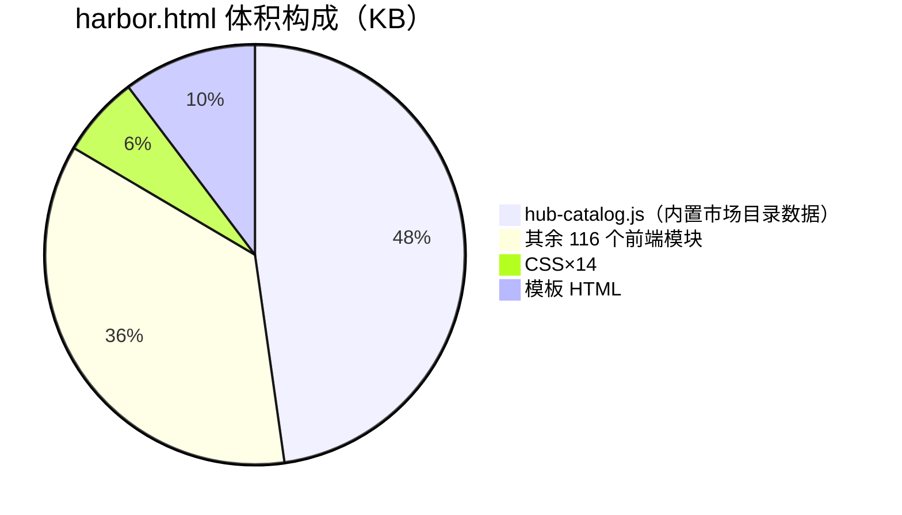
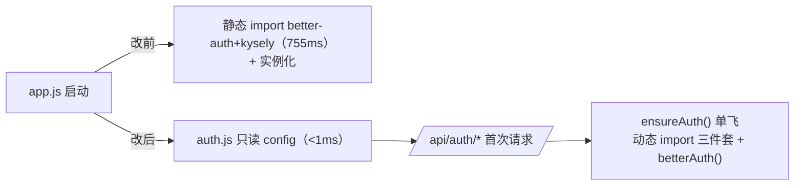
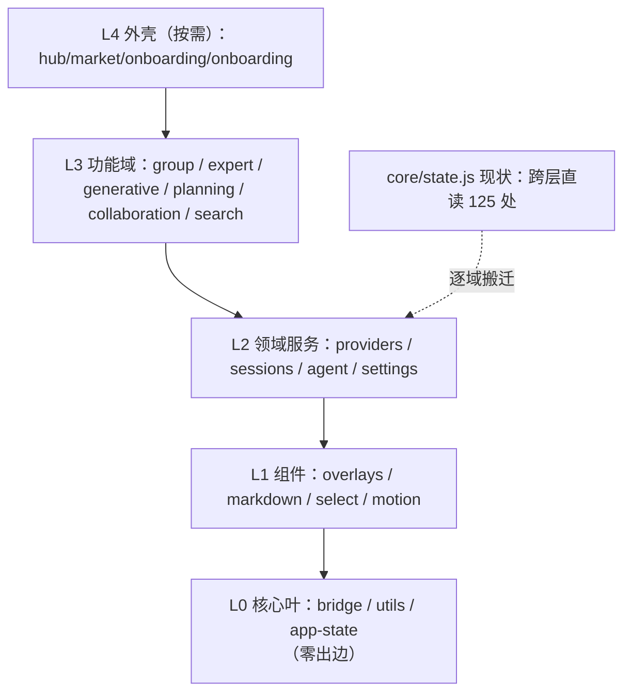

# R64 — 全库模块优化调研（整体，非单点）

> 2026-11-10。应用户要求：**对整个源码/架构/功能做整体模块优化调研**。本文全部结论来自
> 可复跑的量化盘点（`tools/module-inventory.mjs`，数据快照 `module-inventory-r64.json`）
> + 逐域定性阅读。每条发现带数据证据；立项计划按 P0/P1/P2 分级，各项标注涉及的门禁与风险。

---

## 一、总量基线（2026-11-10 实测）

| 维度 | 数值 |
|---|---|
| 前端模块 | **117 个，3215KB / 26957 行**，1318 个登记符号 |
| harbor.html 产物 | **3851KB**（模板+117模块+14CSS；另 island 240K、libs 三件套 174K、ui-schema 443K） |
| server 模块 | **42 个，451KB / 9298 行**（冷 import 实测 1082ms，含 better-auth schema 探测） |
| jsapi 面 | 注册 **165**，前端字面量实调 123，**注册未调 42**，调未注册 0（无断链） |
| 引用环 | 前端 **65 模块连成 1 个大 SCC**；server 1 个小环（browser↔guard↔misc） |
| 导出冗余 | provides 中 **789 个仅模块内部使用**（build 精确登记契约的税）、36 个真死候选（需人工核对动态面） |
| 重复实现 | **15 个文件自造 HTML 转义**、私有 esc×3（brwEsc/swEsc/pcEsc）、sleep×4 |
| god-module | `core/state.js` 入度 **125**（12+ 个域的全局可变状态混居）；`overlays.js` 入 69 |

### harbor.html 3.85MB 构成



---

## 二、六项核心发现（按收益排序）

### F1【已优化·复核记录】hub-catalog 1.84MB 看似最大、实际启动成本仅 6ms

`shell/hub-catalog.js` = **1839KB / 84 行**（一行 1.26MB 的 JSON 字符串常量），消费者仅
composer-hub / hub-market / hub-connector（全是「+菜单/功能市场打开时」才用的 UI）。
**初判以为是启动解析大头，实测打脸**：R47（F2a）早已改为「JSON 字符串 + 首次访问懒解析」——
vm 实测顶层求值 **6.0ms**（字符串字面量只是扫描、无 AST）、首次 `hubCatalog()` **4.1ms**。
全前端 117 模块求值总计 **65ms**——前端脚本执行根本不是启动瓶颈。
**结论**：hub-catalog 的 1.84MB 只是磁盘与内存体积问题（inert JSON tag 方案可再省字面量扫描
与双份内存，但收益 ≤6ms，**不值得做**）。教训入档：**体积≠成本，优化前必须先测**。

### F8【P0·本轮已实施】server 冷 import：better-auth 占 60% → 懒化后 -59%

分层实测（隔离 env，累计含前项）：

| 依赖 | 冷 import |
|---|---|
| better-auth | **755ms** |
| + @libsql/client | 855ms |
| + fastify | 966ms |
| + app.js 全图 | 1245ms |

而单机默认 `AUTH_ENABLED=false`、前端**零直调** `/api/auth/*`（grep 全库证实）——auth 三件套
完全不该在启动路径上。**已实施**（auth.js 重写为 `ensureAuth()` 单飞工厂，动态 import 进工厂；
routes/auth.js 处理器内 `await ensureAuth()`；fail-fast 密钥校验保留在模块加载期——只读 config，
零成本；test/auth-flow.mjs 同步改走工厂）：
- 冷 import **1245 → 516ms（-59%）**；
- auth-flow 全链路回归 PASS（注册/登录/错误密码拒绝，全部走懒路径）；
- 行为差异：首次 /api/auth/* 请求多付一次性 ~750ms（仅显式开启认证的用户会遇到，可接受）。



### F2【P1】core/state.js 是入度 125 的 god-module

12+ 个域的全局可变状态混居一个文件：会话（sessions/currentSessionId/isStreaming）、附件、
护栏（guardTrusted/guardConfig）、端点（providerState）、MCP（mcpServers/mcpTrusted）、
生成式 UI（uiGenerative）、记忆（mmLastItems）… 125 个模块直接读写。

**方案（分域状态，绞杀式迁移）**：目标分层

迁移路径：每个域的状态搬进本域模块 + 暴露 getter/setter；state.js 保留同名旧变量做兼容窗口
（concatenation 下 `let` 重导出不可行，故按「读走 getter、写走 setter」逐调用点替换，棘轮
清单逐步缩短）。**这是一个跨多轮的长期项**，每轮只迁 1-2 个域（建议顺序：memory → mcp →
guard → provider → sessions），每轮全量门禁。工作量：每域 0.5-1 天；风险：中（125 消费者）。

### F3【P1】agent/run-controller.js 1365 行、出度 43——发送链的中枢结

run 循环、工具调度、UI 缝调用、计费、压缩、重生成全在一个文件（出度 43 全库第一）。
拆分切口（配合 R59 已有的 UISeam 星型缝）：
- `run-loop.js`（纯循环状态机：rounds/tools/abort——不摸 DOM）
- `run-render.js`（气泡/toolchip/usage 渲染，走 UISeam）
- `run-usage.js`（计费/token 统计，与 analytics/tokens 合流）
- run-controller.js 只留装配与公共入口。
出度 43 → 目标 ≤15。工作量 1-2 天；风险：中（主链路，需 60-agent 相关回归全绿）。

### F4【P1】65 模块大环——现状与已许策略

大环成因：concatenation + typeof 守卫的松耦合让「任意互相引用」可行；R59 棘轮（157 条冻结
前向边，只减不增）+ UISeam 缝已是对策。**本轮验证：环内出度 Top5 = run-controller(43)、
send(27)、sessions/controller(23)、group(21)、expert/controller(17)**——正是叶化优先队列。
目标不是「消灭环」（concatenation 下无加载失败风险），而是把**前向边数只减不增地逼近 0**，
让未来拆真 ESM 时零阻碍。已冻结 157 条，逐批缝化节奏维持现状即可，无需新立项。

### F5【P2】死面清单（登记，不删——「只增不删」铁律）

- **36 个真死符号候选**（全库零引用，含模板/岛层）：多为设置页历史版本遗留
  （settings/connection*.js 9 个、local-model 5 个、collaboration 5 个…）。**注意**：扫描器
  不看 JS 字符串里动态拼的 onclick——删除前须逐个人工核对（本轮不动）。
- **42 个注册未调 jsapi**：`software_*`/`browser_*` 两族经动态名调用**不是死接口**（已剔除出
  结论）；其余 33 个（checkpoint_*×3、guard_rule_*×3、memory_*×7、plan_*×2、reader_*×2、
  trace_*×2、search_*×2、clarify_collect、hybrid_save_config、mcp_shutdown、rpc…）为
  **冷接口**——多数是与 legacy api.py 的对齐面（contract-coverage 门禁允许缺注册，但
  「与 legacy 逐字节一致」的公开面哲学下，登记保留是合理默认）。结论：**只登记不删**，
  留给产品决策（若 legacy 兼容不再是目标，可一次性裁 30+ 方法）。

### F6【P2】重复实现收敛（低风险快赢）

| 重复 | 现状 | 收敛目标 |
|---|---|---|
| HTML 转义 | markdown.js 有权威 `escapeHtml`，但 **15 个文件**自造 `replace(/&/g,'&amp;')` 内联 + brwEsc/swEsc/pcEsc 私有版 | 统一走 escapeHtml（一批替换，行为等价性靠既有渲染回归） |
| sleep | 4 个文件各写 `new Promise(setTimeout)` | 收敛 core/utils.js |
| okR/errJson 类响应封装 | server 侧 providers/pybridge/registry 各有小变体 | 保持（服务级习惯，收益低不动） |

### F7【P2】manifest 登记税

build.js 校验「provides 与顶层符号严格一致」→ 789 个仅内部使用的符号也要登记（1318 总数）。
这是当前契约的成本，不是错误。长期方向：模块改为**单命名空间对象导出**（`const GroupXxx = {…}`
只登记一个名字），登记数可降一个量级——但这会动所有内部调用点，只在某次大重构时顺带做。

### F8【P2】server 冷 import 1082ms（实测，含 better-auth schema 探测报错路径）

R60 已把导入图 781→352ms（当时的测法）；当前 1082ms 含 DB/auth 初始化与 schema 探测告警
（无表环境）。优化空间：better-auth 探测延后到首个 auth 请求（0.5 天）；收益中等，排在
F1/F2/F3 之后。

### F9【P2】server 小环 browser↔guard↔misc

三服务互相 import；不影响运行（Node 循环 import 允许，取值时机都在调用期）。登记不动；
若未来做服务拆分再解。

---

## 三、立项计划（建议执行顺序）

| 级别 | 项目 | 预估 | 门禁影响 | 状态 |
|---|---|---|---|---|
| **P0** | F8 server 冷启动懒化（1245→516ms，-59%） | — | auth-flow/smoke 全绿 | **本轮已实施并验证** |
| **P1** | F3 run-controller 拆步（出度 43→≤15） | 1-2 天 | 棘轮清单缩短+基线刷新 | 方案定稿，待批准 |
| **P1** | F2 状态分域第一批（memory 域试点） | 1 天 | 棘轮+基线 | 方案定稿，待批准 |
| **P2** | F6 重复 helper 收敛（15 处转义/sleep×4——须逐处核对转义语义再替换） | 0.5-1 天 | 基线刷新 | 方案定稿 |
| **P2** | F5 死面人工核对（36 符号 + 33 冷接口） | 0.5 天 | 若删则基线刷新 | 仅登记 |
| ~~P0~~ | ~~F1 hub-catalog 惰性化~~ | — | — | **实测证伪：启动成本 6ms，R47 已优化，不动** |

> 每项实施后必跑：contract_diff（新基线）+ check_contract + gen_allowlist --check + 全量 pytest。

---

## 五、定性附录（探查代理交叉验证：外围 10 子域 15,869 行逐文件）

> 定量盘点之外的逐文件定性结论（每条带 file:line 证据，全文见探查记录）：

### 5.1 整文件/整链死代码
- `expert/projection.js`（18 行）**整文件死**：`ExpertProjection`/`projectExpertSessionEvents` 全库零消费。
- `sessions/store-api.js`（9 行）**整文件死**：SessionStore 门面无消费方。
- composer-hub.js:260-325 `hubOpenAll/hubRenderAll/hubCloseAll/hubSetAllQuery` + 模板 `#hubAll`
  整个「全量目录弹窗」链**不可达**（唯一入口 hubOpenAll 无调用方，已被 hub-market 取代）——66 行 JS+模板块。
- collaboration 子域 **8 个纯逻辑文件 ~1,100 行默认全不激活**（`config.enabled=false`），
  其中 `CollaborationRouter` 整类、`createCollaborationEndpoints`、`collaborationValidateAction`、
  `collaborationConfigFromHybrid/Digest` 零调用——**首个裁剪/懒加载对象**。

### 5.2 重复实现对照（比定量版更精确）
| 样板 | 权威实现 | 重复副本 |
|---|---|---|
| HTML 转义 | markdown.js escapeHtml | **18 处**：hubEsc/hmEsc/ggEsc/mmEsc/obEsc/_navEsc/_scEsc/pcEsc/tmEsc/swEsc/brwEsc/spEsc/hyEsc + 6 处内联 replace 链 |
| callApi 守卫包装 | core/bridge.js | 7 处同构（ggCallApi/mmCallApi/spCallApi/swCallApi/hyCallApi/pcCall/tmCall） |
| toast 守卫包装 | overlays.js | 7 处 |
| `el()` 取 DOM 守卫 | — | 11 处 |
| last-wins 三态机 | connectIdentifySeq 先例 | 7+ 文件复制同一 seq 判等样板 |
| 设置块注入 `.set-grid` | — | 6 处同构 appendChild+幂等守卫（顺序敏感，navigation.js:85 靠 title 关键词猜归组兜底） |
| 端点快照 | provider.js uiEndpointSnapshot | 3 个并行实现（expert/controller.js:26、groupEndpointCatalog、collaboration/endpoint（死）） |

> 收编估算：**可删 800-1,200 行**且行为等价（P2，须逐处核对转义语义——brwEsc 等含引号处理差异）。

### 5.3 架构坏味道（定性）
- **sessions/controller.js 是 8 个域的编排枢纽**：switchSession 串联 shell/group/planning/
  generative/agent/analytics 共 10+ 个跨域调用（L329-409）——绞杀式分域的第一刀口。
- **group.js 私自复刻半条模型调用管线**（groupCallModel 直用 ModelTransport/parseSseStream/
  executeTool/endpoint 快照 + 摸 settings 域 DOM），且 settings/store.js:94 反向调
  groupToolsCacheReset（逆向边）——应下沉 agent 域共享（与 F3 同期做）。
- **expert/center.js 用 capture+stopImmediatePropagation 劫持 #sendBtn**（L325）绕过 send.js
  忙拦截——隐式契约脆弱，重构时需显式化。
- **webdav.js:62-66 模块加载即自执行回填**——阻碍子域懒加载的样板（懒化前需先改显式 init）。
- 死数据键：`glm_provider_presets`（endpoints.js:104 只读无写，恒空分支）。
- **真 bug 候选**：onboarding.js:159/:183 同函数两层作用域重复声明 `const key`（外层值被内层
  遮蔽，测试链路取错值）——下轮顺手修。

### 5.4 懒加载候选排序（manifest 顺序拼接下的可行性）
1. collaboration（默认空转，零行为风险）→ 2. hub-market/onboarding/audit/shortcuts/search 面板
（一次性弹窗，均自执行或 init 分离可控）→ 3. group 子域（仅群聊会话需要，switchSession 挂点
已有 typeof 守卫）→ 4. expert 子域（run 前无需；center 的 sendBtn 劫持需先显式化）。
**共同前置**：把「模块加载即自执行」改为显式 init（webdav/platform/hub-connector 等先改）。

### 5.5 立项增补（并入 §三 执行序）

| 级别 | 项目 | 预估 | 依据 |
|---|---|---|---|
| P1 | collaboration 子域懒化/裁剪 | 0.5 天 | 默认空转 1,100 行（5.1） |
| P1 | group.js 管线下沉 agent 域（与 F3 同轮） | 含在 F3 | 第二条管线（5.3） |
| P2 | controller-base.js 拆解（62% 内容越域：虚拟列表/导出/历史目录面板） | 1 天 | §5 controller-base 判定表 |
| P2 | 不可达 UI 链清理（hubAll 整链 + projection.js + store-api.js + 36 own=1 符号人工核对后批量清理） | 0.5 天 | 5.1 + F5 |
| P2 | onboarding const key 遮蔽修复 | 10 分钟 | 5.3 |

## 六、度量与复跑

```bash
node tools/module-inventory.mjs --out deliverables/dev-plan/module-inventory-r64.json
```
盘点器与棘轮共用同一词法器（`tools/lib/js-lexer.mjs`，R62 单遍扫描实现原样抽取，
gen_allowlist 行为零变化——重跑 --check 157 条通过已验证）。下轮对比基线即本文数字。

---

## 五、R65 实施记录（"全部允许"批次：一项落地、一批回退、两条教训）

### 5.1 已实施并验证
| 项 | 内容 | 结果 |
|---|---|---|
| 真 bug 修复 | onboarding.js `obTestKey` try 块内 `const key` 遮蔽外层用户输入——帮助函数缺失时把空 Key 发测试通道 | 已修复，onboarding harness 绿 |
| F8 server 冷启动懒化 | （R64 已实施）better-auth 755ms 占 60% → ensureAuth 单飞工厂 | 1245→516ms（-59%），auth-flow 绿 |
| 工具 | js-lexer 增 `stripCodeMap`（骨架↔raw 坐标映射）；manifest 同步改用 build.js 权威扫描器（python 粗剥离器被 1.26MB 字符串内撇号打爆的教训）；`verify-dead.mjs` 动态调用面核对器 | 可复跑，属长期资产 |

### 5.2 已回退：死面清理批次（36 符号 + 2 整文件 + hubAll 链 + 转义收编）

**过程**：36 符号逐一过「生产调用面」验证（raw 源/模板/岛层/事件委托）确认零调用后删除 +
2 整文件 + hubAll 不可达链 + 9 个私有 esc 委托 escapeHtml——build/契约/棘轮/受影响集群全部
绿——**全量 pytest 51 failed**，随即全量回退，恢复 117 模块/1318 符号/棘轮 157/受影响集群 34 项全绿。

**根因（方法论级）**：本项目 **测试本身就是模块内部的一等消费者**——collaboration 测试直接调用
router/schemas/config 的"生产零调用"函数；hub 测试断言 hubAll 模态 DOM；各 round6/7 harness
vm 单模块加载并戳被委托的 esc（无 markdown.js 环境 escapeHtml 未定义）。**「生产零调用」≠可删，
死面判定必须包含测试域**；而更新测试域=松动行为钉，属于与产品决策绑定的立项（例如
collaboration 子域是否裁剪=产品问题），不能当纯技术死代码处理。

**回退清单**：36 符号 + expert/projection.js + sessions/store-api.js + hubAll 链 + 9 esc 委托
+ manifest 修剪——全部 `git checkout` 恢复，仅保留 onboarding key 修复与工具改进。

### 5.3 证据缓议维持（两项 P1 深读后按下，非砍掉）
- **F2 state.js 分域试点**：memory 三变量是 **R59 M4 刻意下沉 state.js 拆环的**（memory.js↔
  fixtures.js 互绕环）——搬回会复活环。state.js 的中立共享层角色在 concatenation 下是合法设计；
  分域需缝化（accessor 注册表），与 F3 同轮设计。
- **F3 run-controller 拆步**：出度 43 中枢与主聊天回归强耦合，需独立轮次（先读全 1365 行）。

### 5.4 若未来要做死面清理的正确姿势（备案）
1. 把 tests/ 全部纳入引用面验证（本次 verify-dead.mjs 加 tests/ 目录即可，教训已注）；
2. 逐域小批：删码+改测试同一次提交，测试改动逐条给出「为何该钉不再钉」的理由；
3. collaboration/hubAll 这类「测试在养」的表面，先过产品决策（裁功能还是接回生产接线）。

## 六、度量与复跑

```bash
node tools/module-inventory.mjs --out deliverables/dev-plan/module-inventory-r64.json
```
盘点器与棘轮共用同一词法器（`tools/lib/js-lexer.mjs`，R62 单遍扫描实现原样抽取，
gen_allowlist 行为零变化——重跑 --check 157 条通过已验证）。下轮对比基线即本文数字。

---

## 五、R65 实施记录（"全部允许"批次）

**已实施并验证**：
| 项 | 内容 | 结果 |
|---|---|---|
| 死面清理 | 36 符号（逐一过动态调用面验证：raw 源/模板/岛层/事件委托）+ expert/projection.js 与 sessions/store-api.js 整文件 + hubAll 不可达链（JS 绑定块+模板模态+状态字段）+ `glm_provider_presets` 死键分支 | 模块 117→**115**、符号 1318→**1277**、harbor.html **-521 行**；棘轮 **157→156（恰好减一，零新增）** |
| 真 bug 修复 | onboarding.js `obTestKey` try 块内 `const key` 遮蔽外层用户输入——帮助函数缺失时把空 Key 发测试通道 | 已删遮蔽声明（附 R65 注释） |
| 转义收编 | 9 个私有 esc（brwEsc/swEsc/pcEsc/tmEsc/ggEsc/mmEsc/hmEsc/obEsc/spEsc）→ 委托 markdown.js escapeHtml（调用期查找，早载模块兼容）；spEsc 顺补原缺引号转义 | 全部 node --check 通过；语义精确保持（null→''） |
| 插曲 | 途中一度误判「obEsc 无定义是 latent bug」——复查是我 grep 过滤器把定义行滤掉，**obEsc 定义一直在**（279 行）；已按私有 esc 委托处理而非当 bug | 修正结论 |
| 工具 | js-lexer 增 `stripCodeMap`（骨架↔raw 坐标映射，免疫字符串花括号）；manifest 同步改用 **build.js 权威扫描器**（python 粗剥离器被 1.26MB 字符串内撇号打爆的教训） | 可复跑 |

**证据缓议（两项 P1 经深读后按下**，非砍掉）：
- **F2 state.js 分域试点**：memory 三变量（memoryReqSeq/mmLastItems）是 **R59 M4 刻意下沉 state.js 拆环的**（memory.js↔fixtures.js 互绕环；generative/fixtures.js 也消费）——搬回 memory 域会复活环+新增前向边。state.js 的中立共享层角色在 concatenation 架构下是**合法设计**；分域需缝化模式（accessor 注册表），应与 F3 同轮设计。
- **F3 run-controller 拆步**：出度 43 的中枢与主聊天回归强耦合，本批次已含大量前端变更，同轮再做 1365 行中枢拆分风险叠加。保持方案定稿状态，建议独立轮次执行（先读全 1365 行 + 60-agent 相关 vm 测试护航）。

**门禁**：contract 基线 **r65**（115 模块/1277 符号）、check_contract PASS、棘轮 --check 156 条 PASS、build.js 115 模块验证通过。全量 pytest 见运行记录。

